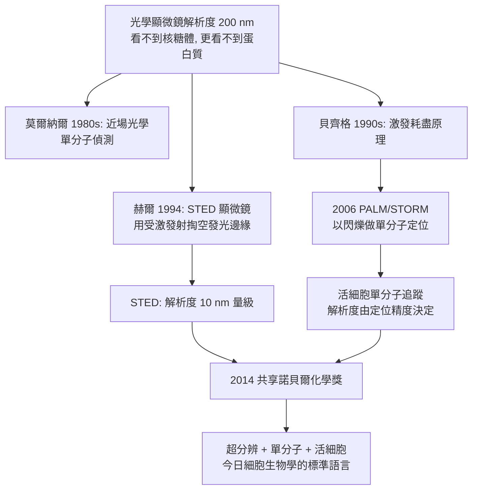

# 2014 · 貝齊格、赫爾與莫爾納爾——看見光的衍射極限之外

> 2014 諾貝爾化學獎：艾力克·貝齊格（Eric Betzig，1960– ，美國）、斯特凡·赫爾（Stefan Hell，1962– ，德國）與威廉·莫爾納爾（William E. Moerner，1953– ，美國）——表彰「其對超解析螢光顯微鏡之開發」。**人類第一次用光看到了奈米以下的世界。**

## 懸案（案情提要）

2010 年代的生物學，有一堵「看得見但看不清楚」的牆：

- **光學顯微鏡**是活細胞成像的主力，但它有**衍射極限（diffraction limit）**：

$$\Delta x \approx \frac{\lambda}{2\,\mathrm{NA}} \approx 0.2\ \mu\mathrm{m}\ (200\ \mathrm{nm})\qquad (\lambda = 500\ \mathrm{nm},\ \mathrm{NA} \approx 1.4)$$

$$\text{對比}：\ \text{蛋白質直徑} \sim 5\text{–}10\ \mathrm{nm};\qquad \text{核糖體直徑} \sim 20\text{–}30\ \mathrm{nm}$$

**光學顯微鏡的解析度比核糖體還差一個數量級**——也就是說，**用光學顯微鏡看單一蛋白質，在物理上不可能**；
- 而電子顯微鏡（見 [1982-克盧格與電子顯微鏡](1982-克盧格與電子顯微鏡.md)）解析度足夠，卻有兩個致命限制：**必須固定、必須脫水**——**活細胞裡的動態過程完全看不到**；
- 2011 年諾貝爾化學獎頒給了**冷凍電顯**（見 [2017-杜布歇與冷凍電顯](2017-杜布歇與冷凍電顯.md)），解決了「固定」的問題，但**「活細胞」問題仍在**；
- 懸案因此非常具體：**能不能在活細胞裡，用光，看到奈米尺度的細節？**

偵辦人：莫爾納爾（先把單分子光學做起來）、貝齊格（光學顯微鏡的「激發耗盡」）、赫爾（受激發射／STED）。

## 前因

| 年份 | 事件 |
| --- | --- |
| 1960 / 1962 / 1953 | 貝齊格生於美國密西根州安娜堡；赫爾生於德國阿拉爾；莫爾納爾生於美國。 |
| 1980s | 莫爾納爾在康奈爾大學（導師 **Robert (R.)**）研究**近場光學**：1982 年首次在室溫下於固體中以**近場光學散射（near-field optical scattering）**觀察到單個分子；1986 年**首次以近場光學偵測單一分子的吸收**——這是「超解析光學」的第一塊磚。 |
| 1986–1993 | 莫爾納爾在華盛頓大學發展**光學顯微鏡的「近場掃描探針」技術**，並**首次以光學方法偵測單一分子**（1993 年 *Nature*）；他也發展了**超解析的「隨機光纖維」方案**。 |
| 1990s | 貝齊格在冷泉港（HHMI）與**利平科特（Lippincott）**、**韋布（Webb）**、**拉加里亞斯（Lagarias）**等合作，發展出**光學顯微鏡的「受激發射」概念**；1999 年他與威爾遜（L.）發表〈光學顯微鏡超越衍射極限〉，提出以「激發耗盡」提升解析度的原理。 |
| 1994 | 赫爾在德國 MPI（Max Planck Institute for Biophysical Chemistry）**以受激發射（stimulated emission）**的概念，實現了第一台 **STED 顯微鏡**——其原理來自**受激發射（stimulated emission）**的概念——這是他在 MPI 與量子光學的同事**烏爾里希·霍費爾（Ulrich Hopfner）**等人共同發展的。 |
| 2000–2010s | **赫爾的 STED** 持續改進（以脈衝式激發光束「掏空」螢光發射區的邊緣，把有效發光區縮到奈米級）；**貝齊格的 PALM/STORM**（光激發光定位顯微鏡／隨機光纖維定位）在 2006 年實現活細胞單分子定位；**2014 年**三人共享諾貝爾化學獎。 |
| 2010s | **莫爾納爾的超解析**擴展至**分子跟蹤與超解析光譜**（超解析拉曼光譜）；**STED 與 PALM/STORM 的競賽**（解析度與速度之爭）成為顯微鏡學的核心議題。 |

## 調查

**偵查一：衍射極限的來源——「光自己會擴散」。**

$$\text{點光源的} \textbf{點擴散函數（PSF）}：\ \text{Airy 斑}，\quad \text{半高全寬} \approx 0.61\frac{\lambda}{\mathrm{NA}}$$

$$\text{兩個點源的斑重疊} \Rightarrow \text{無法分辨} \Rightarrow \text{解析度下限}$$

$$\boxed{\text{光學顯微鏡的解析度是物理限制，不是工程問題}}$$

**偵查二：STED 的原理——「把發光區的邊緣掏空」。**

$$\text{一般情況}：\ \text{受激發射與自發射同時發生} \Rightarrow \text{光擴散到} \sim \lambda/2 \text{範圍}$$

$$\text{STED}：\ \text{以強} \textbf{激發光束（STED beam）}\text{在焦點周圍誘導受激發射}$$

$$\text{受激發射的光} \xrightarrow{\text{方向性}} \text{離開採集路徑} \Rightarrow \textbf{被「清空」}$$

$$\text{因此有效發光區被壓縮} \Rightarrow \text{解析度提升} \Rightarrow \Delta x \approx \frac{\lambda}{2\sqrt{1 + I_{\text{STED}}/I_{\text{sat}}}}$$

$$\boxed{\text{關鍵洞見}：\ \text{解析度不是由波長決定，而是由} \textbf{「剩餘的發光面積」}\text{決定}}$$

**「用另一束光把不需要的光消掉」——這是 2014 年諾貝爾獎最深刻的思想。**

**偵查三：PALM／STORM——「把位置資訊編碼在時間裡」。**

$$\text{傳統成像}：\ \text{同時記錄所有} \textbf{光子} \Rightarrow \text{重疊} \Rightarrow \text{無法定位}$$

$$\text{PALM/STORM}：\ \text{使熒光分子} \textbf{閃爍（blinking）} \Rightarrow \text{每幀只有少數分子發光}$$

$$\text{累加數千幀} \xrightarrow{} \text{每個分子被定位到} \sim 20\text{–}30\ \mathrm{nm} \text{精度}$$

$$\boxed{\text{解析度不再由光學決定，而由} \textbf{定位精度}\text{決定（因為分子在時間上是分開的）}}$$

**「以時間換空間」——這是超解析的第二條路徑，且是活細胞成像的主力**（2014 年後的單分子追蹤實驗幾乎都用 PALM/STORM 或其變體）。

**偵查四：莫爾納爾的「近場」——「把探針放進波長以內」。**

$$\text{遠場（遠小於} \lambda\text{）}：\ \text{繞射極限};\qquad \text{近場（探針距離} \ll \lambda\text{）}：\ \text{解析度由} \textbf{探針尺寸}\text{決定}$$

$$\text{近場光學}：\ \text{以} \text{AFM/STM}\ \text{探針在樣品表面掃描} \xrightarrow{} \text{以} \textbf{金屬孔徑的近場}\text{傳輸光} \Rightarrow \text{奈米級定位}$$

$$\text{這是「不受波長限制」的成像}，\text{1980 年代即已實現單分子偵測}$$

**偵查五：從「看得多清」到「看得多快」——競賽的收尾。**

$$\begin{array}{l}
\text{STED}：\ \text{解析度高（} \sim 10\ \mathrm{nm}\text{）}，\text{但需強光，可能傷活細胞}\\
\text{PALM/STORM}：\ \text{活細胞友好、時間解析慢（} \sim \text{秒到分鐘）}\\
\text{相機與} \textbf{mini-STORM}\text{的折衷}：\ \text{平衡解析度與速度}
\end{array}$$

$$\text{2014 年後的趨勢}：\ \text{兩者融合} \xrightarrow{} \text{「超解析 + 單分子追蹤」成為活細胞成像的標準手段}$$

## 理論裁決

**判決一：解析度不是波長的必然，而是「光子可以被定位到多準」的函數。**

$$\text{傳統}：\ \Delta x \sim \frac{\lambda}{2\mathrm{NA}}\qquad \text{（光學限制）}$$

$$\text{超解析}：\ \Delta x \sim \frac{\lambda}{2\mathrm{NA}}\cdot\frac{1}{\sqrt{1 + I/I_s}}\quad(\text{STED})\qquad\text{或}\quad \Delta x \approx \frac{\mathrm{PSF\ width}}{\sqrt{N_{\text{photons}}}}\quad(\text{單分子定位})$$

$$\boxed{\text{關鍵觀念}：\ \text{若能把「無法分辨的兩點」在時間或強度上區分開，就不必靠光學去分辨它們}}$$

**判決二：激發耗盡的物理——「用另一種躍遷來減少光子」。**

$$\text{螢光}：\ S_1 \to S_0 + h\nu_{\text{em}} \quad(\text{各向同性，方向隨機})$$

$$\text{受激發射}：\ S_1 \to S_0 + h\nu_{\text{STED}} \quad(\textbf{方向性：沿激發光束方向傳播})$$

$$\text{因此}：\ \text{把焦點外圈以受激發射「清空」} \Rightarrow \text{只有焦點中心附近能自發螢光}$$

$$\text{這是一個} \textbf{「用光消除光」}\text{的設計——冷卻原子與光學陷阱的同一原理}$$

**判決三：單分子定位的統計學。**

$$\text{定位精度} \approx \frac{\text{PSF 寬度}}{\sqrt{N_{\text{photons}}}}$$

$$\text{每一幀只記錄少數分子} \xrightarrow{} \text{大量幀累加} \xrightarrow{} \text{每分子的位置} \sim 20\text{–}30\ \mathrm{nm}$$

$$\boxed{\text{「解析度」由} \textbf{統計} \text{決定，而非由光學決定}}$$

**「用時間換空間」的典範，也是一種深層的科學哲學轉變：成像不必是「一次拍下」，可以是「拍很多次再拼」。**

**判決四：超分辨對生物學的意義。**

$$\text{此前無法回答的問題}：\ \begin{cases}\text{受體在細胞膜上如何聚集？}\\ \text{兩個蛋白質在多小的距離上會結合？}\\ \text{突觸小泡如何釋放囊泡？}\end{cases}$$

$$\text{超解析} \xrightarrow{} \text{在活細胞中以奈米精度追蹤} \xrightarrow{} \textbf{分子生物學的「空間維度」被解鎖}$$

## 後果

| 領域 | 影響 |
| --- | --- |
| 細胞生物學 | 活細胞中的單分子追蹤（受體運輸、突觸傳遞、染色質的動態）；今日「分子動態生物學」的主要工具。 |
| 藥理學 | 以單分子追蹤測量**藥物受體的佔有率與動力學**，以及**藥物的功能性結合與功能性佔有之比**——今日藥理學的核心指標。 |
| 病理學 | 病理診斷中的超解析（以標記抗體定位病原體與受體）。 |
| 科學史 | 三位得主分別代表「近場（莫爾納爾）」「受激發射（赫爾）」「單分子定位（貝齊格）」三條不同路徑，卻達成同一個目標——**這是科學史上典型的「多重獨立發現」模式**。 |

## 關聯

- [1982-克盧格與電子顯微鏡](1982-克盧格與電子顯微鏡.md)：電子顯微鏡的高解析度與「不能看活細胞」的缺陷——超解析的對照組。
- [2017-杜布歇與冷凍電顯](2017-杜布歇與冷凍電顯.md)：結構生物學的另一條超越光學限制的路徑；與超解析互補（電顯給結構，超解析給動態）。
- [2014-貝齊格與超解析顯微鏡](2014-貝齊格與超解析顯微鏡.md)：即本卷。
- [2008-下村脩與GFP](2008-下村脩與GFP.md)：GFP 是超解析成像最常用的標籤——兩案在實務上直接相接。
