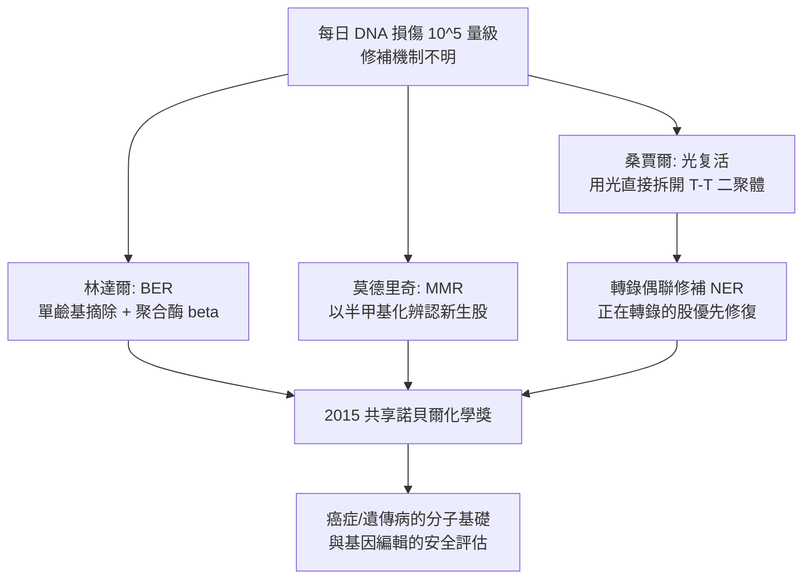

# 2015 · 林達爾、莫德里奇與桑賈爾——DNA 的除錯班

> 2015 諾貝爾化學獎：托馬斯·林達爾（Thomas Lindahl，1938– ，瑞典／英國）、保羅·莫德里奇（Paul Modrich，1946– ，美國）與阿齊茲·桑賈爾（Aziz Sancar，1946– ，土耳其／美國）——表彰「其對 DNA 修復之機制的研究」。**生命每天都在修補自己的文字稿，而我們終於知道修補的文法。**

## 懸案（案情提要）

1990 年代的分子生物學，有一個「帳目」問題：

- 細胞每天複製 DNA，而複製**不可能是完美的**：估計每個細胞每天因複製錯誤產生約 $10^{4}$–$10^{5}$ 個突變，加上外源因素（紫外線、化學致癌物、活性氧），每日損傷的 DNA 位點數可達 $10^5$ 個量級；
- 這些損傷若不修補，就會變成突變（癌症）、染色體畸變（唐氏症、癌症）與細胞死亡；
- 但**修補的機制完全不明**：
  1. **DNA 是雙股**：一條股受損時，另一條就是「正確答案的副本」——這顯然是最合理的修復策略。**但細菌與人類的「複製後修補」機制完全不同**（細菌用核酸酶切斷錯配段再重合成；真核用錯配辨識蛋白辨認新舊股）；
  2. **鹼基被化學改變**（如紫外造成胸腺嘧啶二聚體、氧化造成 8-氧代鳥嘌呤）——**誰認得這些「化學殘骸」？怎麼修？**
  3. **DNA 損傷的種類極多**（每種都要有專一酵素）——**有沒有一個統一的「信號」？**
- 三位得主各自破解了其中一類。

## 前因

| 年份 | 事件 |
| --- | --- |
| 1938 / 1946 / 1946 | 林達爾生於瑞典；莫德里奇生於美國；**桑賈爾生於土耳其（前行政區）的一個小鎮**，家人移居土耳其。 |
| 1960s–70s | **林達爾**在烏普薩拉大學工作，並於 1970 年代前往紐約的哥倫比亞大學；他研究**噬菌體的 DNA 修補**，並於 1970 年代指出「**DNA 的損傷可以由未受損的另一股作為模板而被修補**」這一原理。 |
| 1970s–80s | **莫德里奇**在杜克大學研究**限制性內切酶與 DNA 修補**：發現**摻入錯誤核苷酸的 DNA 可以被「摻入—切除」機制修正**（1970 年代），並於 1980 年代發現**DNA 聚合酶 III 的「外切酶修補活性」（proofreading）**，以及**錯配辨識（MMR）途徑**。 |
| 1980s–90s | **桑賈爾**在北卡羅來納大學研究**光复活（photoreactivation）**：發現一種酵素（**光裂合酶 DNA photolyase**）能**利用可見光的能量直接「拆開」紫外造成的胸腺嘧啶二聚體**——**這是第一個被發現的「DNA 修復酵素」，且其機制是「把化學鍵直接打斷」**，這在當時是極不可思議的。 |
| 1980s | 桑賈爾以**基因截斷（gene disruption）**技術（在細菌中以重組建立「 knockout」個體）**在體內證實了光复活基因（phr）的必要性**——**第一個基因敲除實驗**（1985 年），這個技術後來成為遺傳學的標準工具。 |
| 1990s | **林達爾**在倫敦的 Francis Crick Institute 揭示**碱基切除修補（BER）**路徑，並發現**DNA 聚合酶 $\beta$ 在修補中的核心角色**（1996 年《Nature》）。 |
| 1994–1996 | **莫德里奇**解析**錯配修補（MMR）系統**：發現 **MutS、MutL、MutH** 蛋白與**半甲基化（hemimethylation）**的「子代鏈辨識」機制。 |
| 1990s–2000s | **桑賈爾**發現**核苷酸切除修補（NER）**途徑中的**轉錄偶聯修補（transcription-coupled repair）**：**正在被轉錄的那一股 DNA 損傷，會被優先修復**。 |
| 2015 | 三人共享諾貝爾化學獎。 |

## 調查

**偵查一：BER——「摘除壞的核苷酸，補上對的」。**

$$\text{受損核苷酸（如} \mathrm{8\text{-}oxoG}\text{、} \mathrm{uracil}\text{、} \mathrm{5\text{-}hmC}\text{）}$$

$$\xrightarrow{\text{DNA 糖苷酶（glycosylase）}} \text{AP 位點（無嘌呤/嘧啶）} \xrightarrow{\text{APE1（無嘌呤/嘧啶內切酶）}} \text{缺口} \xrightarrow{\text{聚合酶（} \beta\text{）+ 連接酶}} \text{修復的 DNA}$$

$$\text{單鹼基修補（single-base repair）}：\ \text{一個壞核苷酸} \xrightarrow{} \text{被「摘除」並以正確者替換}$$

**關鍵酵素：DNA 聚合酶 $\beta$（林達爾 1996 年發現其結構與作用機制）——它同時具有聚合酶與「dRP 裂解酶」活性，是修補的最後一步酵素。**

**偵查二：NER——「切下一大塊」。**

$$\text{大面積損傷（如紫外造成的二聚體、化學致癌物造成的加合物）}\xrightarrow{} \text{切除} \sim 24\text{–}32\ \text{個核苷酸的一段}$$

$$\text{機制}：\ \text{損傷辨識蛋白（XPC 等）} \xrightarrow{} \text{轉位酶（TFIIH）解旋} \xrightarrow{} \text{切口蛋白（XPF-ERCC1, XPG）切除}$$

$$\text{轉錄偶聯修補}：\ \text{若損傷位於「正在被轉錄」的股（編碼股）} \xrightarrow{\text{CSA/CSB}} \textbf{修復被大幅加速}$$

$$\boxed{\text{「細胞知道哪一股比較重要」——轉錄偶聯修補是 DNA 修復中著名的「功能優先」機制}}$$

**偵查三：MMR——「認出新舊股的差別」。**

$$\text{複製後錯配}：\ \text{新生股上有一個錯配核苷酸}$$

$$\text{辨識}：\ \mathrm{MutS}\ \text{（辨識錯配）} \xrightarrow{} \mathrm{MutL} \xrightarrow{} \mathrm{MutH}\ (\text{核酸酶，} \mathrm{Dam}\ \text{甲基化的指示})$$

$$\boxed{\text{「半甲基化」是辨認新股的標記}：\ \text{親代股已甲基化，新生股尚未甲基化（需短暫延遲）} \Rightarrow \mathrm{MutH}\ \text{切在新生股的錯配對側}}$$

$$\text{切除}：\ \mathrm{ExoI}、\mathrm{ExoVII}、\mathrm{ExoX}\ \text{或} \mathrm{Pol}\ \delta\ \text{的} 5'\to3'\ \text{外切酶活性} \xrightarrow{} \text{移除錯配段} \xrightarrow{} \text{再合成}$$

**「半甲基化的方向性」是 MMR 的關鍵洞見——它讓系統知道「錯的是新抄的那一份」。**

**偵查四：光復活——「用光直接拆開化學鍵」。**

$$\text{UV 造成} \quad \mathrm{T{-}T}\ \text{二聚體（胸腺嘧啶二聚體）}$$

$$\mathrm{photolyase}\ +\ h\nu\ (\text{藍光，} \sim 300\text{–}500\ \mathrm{nm}) \xrightarrow{} \text{二聚體被拆回兩個正常的} \mathrm{T}$$

$$\text{機制的極端}：\ \text{這不是「切除並重合成」，而是} \textbf{「用光把壞的鍵直接還原」}$$

$$\text{輔因子}：\ \mathrm{FADH^-}\ (\text{光感受器}) + \mathrm{MTHF}\ (\text{電子轉移體})$$

$$\boxed{\text{「DNA 修補可以是純粹的光化學過程」——這在 1990 年代是異端}}$$

**偵查五：三條路徑的分工。**

| 路徑 | 損傷類型 | 範圍 | 核心酵素 |
| --- | --- | --- | --- |
| **BER**（鹼基切除修補） | 單一被化學改變的鹼基 | 1 個核苷酸 | DNA 糖苷酶、聚合酶 $\beta$ |
| **NER**（核苷酸切除修補） |  bulky 加合物與二聚體 | 24–32 個核苷酸 | TFIIH、XPF-ERCC1、XPG |
| **MMR**（錯配修補） | 複製錯配、插入缺失環 | 數十至數百個核苷酸 | MutS/MutL/MutH |

$$\text{加上光復活（} \mathrm{phr}\text{）} \xrightarrow{} \text{四條路徑} \xrightarrow{} \text{「遺傳資訊的維護系統」}$$

## 理論裁決

**判決一：DNA 修復的核心原理——「以未受損的股為模板」。**

$$\boxed{\text{DNA 雙股} \xrightarrow{\text{損傷只在一股}} \text{另一股即為「正確答案的副本」} \xrightarrow{} \text{以之為模板修補}}$$

**這是 1970 年代林達爾提出的原理**，其深遠性在於：**生命把「資訊冗餘」寫進了分子結構本身**——雙股不是只有複製的功能，更是**修復的資訊來源**。

**判決二：修復的「訊號」問題——「化學標記就是信號」。**

$$\text{問題}：\ \text{一個受損的碱基（如} \mathrm{8\text{-}oxoG}\text{）在化學上「看起來」像甚麼？}$$

$$\text{解答}：\ \text{受損碱基被特定酵素辨認（形狀 + 化學基團）} \xrightarrow{} \text{「壞」的碱基被辨識}$$

$$\text{更精密的版本（MMR）}：\ \text{新股的} \textbf{半甲基化缺失}\text{本身即為「我是新抄的」的信號}$$

**「分子本身帶著『我多老』的標記，而酵素讀這個標記」——這是 DNA 修復系統最精巧的設計之一。**

**判決三：光復活的機制——「化學鍵的光化學還原」。**

$$\mathrm{T{-}T\ 二聚體} + h\nu_{\text{blue}} \xrightarrow[\mathrm{FADH^-}]{\text{photolyase}} 2\,\mathrm{T}$$

$$\boxed{\text{這證明了}：\ \text{「修復」不一定需要切除與重合成；有些損傷可以直接} \textbf{就地拆解}\text{。}}$$

**並且：它把「光」從「驅動光合作用的能量」變成「修復遺傳資訊的工具」——兩個本來無關的領域，因同一個酵素輔因子（FAD）而相遇。**

**判決四：修復的「功能優先」——轉錄偶聯修補。**

$$\text{若損傷在} \textbf{編碼股} \text{（被轉錄的那一股）} \xrightarrow{\text{CSA/CSB}} \text{修復速率大幅提升}$$

$$\text{生物學意義}：\ \text{基因正在被讀出} \Rightarrow \text{它此刻「最值錢」} \Rightarrow \textbf{優先保護}$$

**「功能優先」的維護策略——這是 DNA 修復研究中少見的『經濟學』直覺**，並在 2010 年代被擴展為「轉錄耦合的 DNA 損傷應答（TC-NER）」與癌症化療抵抗機制的研究核心。

## 後果

| 領域 | 影響 |
| --- | --- |
| 醫學 | DNA 修復缺陷導致**遺傳病**：著色性乾皮症（NER 缺陷）、共濟失調-眼動失調症（ATM）、 Lynch 綜合徵（MMR 缺陷）、遺傳性非息肉病性大腸直腸癌。**修復基因的多態性是癌症風險的重要決定因子。** |
| 抗癌 | DNA 損傷為化療藥的作用機制（順鉀造成 DNA 交聯）；**修復途徑是化療抵抗的重要機制**（PARP 抑制劑利用「合成致死」）——PARP 抑制劑今日是卵巢癌的標準治療。 |
| 老化 | DNA 損傷隨年齡累積；「DNA 損傷與疾病」的關聯是今日健康長壽研究的主題。 |
| 生物技術 | **基因敲除**（桑賈爾 1985 年的第一個實例）成為遺傳學的標準工具；**基因編輯的安全評估**（離開編輯位點的意外修復）直接依賴本案的工作。 |
| 科學史 | 三位得主分別代表瑞典（林達爾）、美國（莫德里奇）與土耳其—美國（桑賈爾）；**桑賈爾是首位土耳其諾獎得主**，亦是諾獎得主中少數以「手邊的工具」（細菌重組與基因截斷）開創新方法者。 |

## 關聯

- [1958-桑格與胰島素序列](1958-桑格與胰島素序列.md)：序列與 DNA 修復的關係——修復需要「知道正確答案是什麼」。
- [1989-奧特曼與RNA催化](1989-奧特曼與RNA催化.md)：DNA 損傷的化學性質與酵素辨識；DNA 糖苷酶的機制與核酶同屬「RNA/蛋白質催化」。
- [2020-卡彭蒂耶與CRISPR](2020-卡彭蒂耶與CRISPR.md)：基因編輯的安全與效率，直接依賴本案所建立的 DNA 修復機制知識。
- [2015-林達爾與DNA修復](2015-林達爾與DNA修復.md)：即本卷。
- [1960-利比與碳-14定年](1960-利比與碳-14定年.md)：放射性造成的 DNA 損傷與突變，是本案研究的重要動力來源之一。
