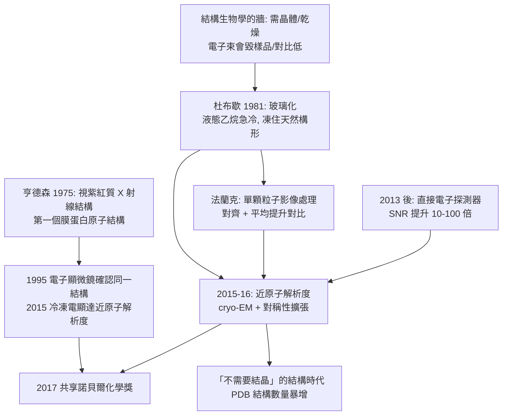

# 2017 · 杜布歇、法蘭克與亨德森——把生物分子凍成玻璃

> 2017 諾貝爾化學獎：雅克·杜布歇（Jacques Dubochet，1942– ，瑞士）、約阿希姆·法蘭克（Joachim Frank，1940– ，德國／美國）與理查·亨德森（Richard Henderson，1945– ，英國）——表彰「其對低溫電子顯微鏡之開發，用以解析生物分子的高解析度結構」。**生命科學的結構時代，就此開門。**

## 懸案（案情提要）

2010 年代的結構生物學，有一堵「物理上無法跨越」的牆：

- **X 射線晶體學**（見 [1962-佩魯茨與血紅蛋白](1962-佩魯茨與血紅蛋白.md)、[1964-霍奇金與X射線晶體學](1964-霍奇金與X射線晶體學.md)）能給出原子解析度——但**需要晶體**，而：
  - 許多蛋白質**無法結晶**（柔性、構形多變、體積大）；
  - 結晶需要**把蛋白質從水中取出並乾燥**——**這可能改變其構形**；
- **電子顯微鏡**（見 [1982-克盧格與電子顯微鏡](1982-克盧格與電子顯微鏡.md)）能看生物樣品——但：
  - **電子束會摧毀樣品**（輻射損傷：$100\ \mathrm{kV}$ 下每 $\mathrm{nm^2}$ 每年僅能承受約 $10\ \mathrm{e^-/nm^2}$）；
  - 傳統 TEM 影像有**低對比**（生物樣品主要靠碳、氫、氮，電子散射弱）；
- **NMR**（見 [1991-恩斯特與NMR](1991-恩斯特與NMR.md)、[2002-田中與蛋白質質譜](2002-田中與蛋白質質譜.md)）能給解算度高的結構且不需結晶——但**只限於小分子**（$<30$–$40\ \mathrm{kDa}$），且需要同位素標記；
- 懸案因此是：**能不能在「玻璃態」的生物樣品上，用電子束拍出高對比、高解析度的結構？**

偵辦人：杜布歇（玻璃化技術）、法蘭克（單顆粒子的影像處理）、亨德森（把電子顯微鏡用於蛋白質結構）。

## 前因

| 年份 | 事件 |
| --- | --- |
| 1942 / 1940 / 1945 | 杜布歇生於瑞士阿爾卑斯山區；法蘭克生於德國Siegen（戰後在美國 grew up，後成為美國籍）；亨德森生於英國愛丁堡。 |
| 1970s | 杜布歇在**日內瓦大學與洛桑聯邦理工學院**（EPFL）研究**生物學樣品的電子顯微鏡**：他首先意識到**「樣品必須在真空中以玻璃態存在，才能保持天然構形」**。 |
| 1971–1973 | 杜布歇嘗試各種冷卻方法：**液態氦冷卻（過冷液氦）導致樣品在結晶時形成冰晶，破壞構形**；轉而嘗試**液態乙烷（$-183\,^\circ\mathrm{C}$）**——**因為乙烷比氮更不易凝固，且冷卻速度極快（$10^6\ \mathrm{K/s}$）**。 |
| **1981** | 杜布歇發明**玻璃化（vitrification）技術**：把樣品**快速浸入液態乙烷**，使水**不形成冰晶而直接變成非晶態的玻璃態冰（vitrified water）**——**樣品的天然構形因此被「凍住」**。 |
| 1980s | 法蘭克在**英國 MRC 實驗室**（劍橋，後於美國 NIH）研究**電子顯微鏡的影像處理**：**單顆粒子的影像分析（single particle image processing）**——把許多同型分子的投影影像依取向分類、對齊、平均，**以提高對比度並消除噪聲**（此方法源自 1970 年代的傅立葉降噪與「對齊—平均」思想）。 |
| 1980s | 亨德森在**愛丁堡大學**（Edinburgh）與 MRC 實驗室研究**膜蛋白的結構**：1975 年他以 X 射線（細菌的視紫紅質）在 $3.5\ \text{Å}$ 解析 Rhodopsin——**這是第一個膜蛋白的原子結構**，並首次顯示**七次穿膜的螺旋束**。 |
| 1990s | 亨德森與其同事（**N. Unwin** 等）以**電子顯微鏡**解析細菌視紫紅質的結構（1995 年，$7.4\ \text{Å}$），確認七次穿膜螺旋束的構形。 |
| 2015–2016 | **「電子斷層成像（cryo-electron tomography / cryo-ET）」的解析度躍升**（阿戈斯等人以「直接電子探測器（direct electron detector）」取得近原子解析度的電子斷層圖譜，並結合「水晶篩選（crystal screening）」與「對稱性擴張」）；**2017 年**三人共享諾貝爾化學獎。 |

## 調查

**偵查一：玻璃化——「把水凍成玻璃，而不是冰」。**

$$\text{冷卻速度的判準}：\ \text{若} v_{\text{cool}} > v_{\text{crystal}}\ \text{則形成玻璃態}; \qquad v_{\text{cool}} < v_{\text{crystal}} \Rightarrow \text{形成冰晶}$$

$$\text{為何液態乙烷}：\ \begin{cases}\text{熔點} -183\,^\circ\mathrm{C}\ (\text{比液氮低} 87\,^\circ\mathrm{C})\\ \text{但仍為液態（可作冷媒）}\\ \text{熱容量小} \Rightarrow \text{冷卻速度極快}\end{cases}$$

$$\boxed{\text{玻璃態的水} = \text{無長程有序的冰} \Rightarrow \text{分子的原始構形被完整保留}}$$

**「玻璃化」是 2017 年諾貝爾獎的第一塊基石**——它解決了「如何讓生物樣品在真空中保持天然狀態」。

**偵查二：低對比——「把雜訊平均掉」。**

$$\text{單顆粒子的投影} \xrightarrow{} \text{傅立葉降噪（去背景）} \xrightarrow{} \text{以已知取向對齊} \xrightarrow{} \textbf{平均} \xrightarrow{} \text{高對比度的 2D 平均圖}$$

$$\text{對比度的來源}：\ \underbrace{\text{投影中原子（碳等）的散射差}}_{\text{單張圖極弱}} \times \underbrace{N}_{\text{數千至數萬張平均}} \Rightarrow \textbf{可見的對比度}$$

$$\text{這正是} \textbf{電子顯微鏡的「單顆粒子分析」}\text{：}\ \text{用統計取代單張圖的物理極限}$$

**偵查三：直接電子探測器——「電子束不再那麼殘忍」。**

$$\text{傳統底片（照相底片）}：\ \text{電子被二次散射模糊} \Rightarrow \text{解析度低}$$

$$\text{直接探測器（2013 年後）}：\ \text{電子直接撞擊} \mathrm{CMOS}\ \text{像素} \xrightarrow{} \textbf{無散射、} \textbf{高量子效率}$$

$$\text{結果}：\ \text{單張影像的} \textbf{SNR}\ \text{提升} \sim 10\text{–}100\ \text{倍} \xrightarrow{} \text{輻射損傷不再是瓶頸}$$

$$\text{於是}：\ \text{「單顆粒子 + 高 SNR} \Rightarrow \text{近乎原子的解析度（} \sim 3\ \text{Å）}$$

**偵查四：單顆粒子——「不用結晶也能解結構」。**

$$\text{流程}：\ \text{玻璃化製備} \xrightarrow{} \text{電子顯微鏡收集數千張} \xrightarrow{} \text{單顆粒子對齊與分類} \xrightarrow{} \text{3D 重建} \xrightarrow{} \text{迭代精修}$$

$$\boxed{\text{「不需要晶體」——這改變了結構生物學的適用範圍}}$$

**「曾經需要花數年嘗試結晶的蛋白質，如今數小時可得結構」——這是結構生物學的範式轉移。**

**偵查五：亨德森的先驅——「膜蛋白也可以有結構」。**

$$\text{1975}：\ \text{細菌視紫紅質的} 3.5\ \text{Å}\ \text{X 射線結構} \xrightarrow{} \text{七次穿膜螺旋束首次被看見}$$

$$\text{2015}：\ \text{同一蛋白質以} \textbf{冷凍電顯}\ \text{得近原子結構} \Rightarrow \text{22 年後} \textbf{同一結構被另一種技術確認}$$

**「同一個分子，先用 X 射線，再用冷凍電顯」——這是方法學的交叉驗證典範**，也是 2017 年諾貝爾獎敘事中的漂亮閉環。

## 理論裁決

**判決一：玻璃化的物理——「避免核形成」。**

$$\text{成核} \xrightarrow{} \text{晶核生長} \xrightarrow{} \text{冰晶} \xrightarrow{} \text{體積膨脹} \xrightarrow{} \textbf{破壞樣品}$$

$$\text{玻璃化}：\ \text{冷卻速度} > \text{成核速度} \xrightarrow{} \text{分子運動被「凍住」在原位} \Rightarrow \textbf{無晶格、無破壞}$$

$$\boxed{\text{玻璃態} = \text{「無長程有序的固體」}\xrightarrow{}\text{這正是} \ [2011-\text{謝赫特曼與準晶}]\text{所定義的物質形態的另一端（準晶=有序但無週期；玻璃=無序）}}$$

**「樣品的物理狀態選擇」是結構生物學被忽略的一個環節**——杜布歇的貢獻正是在此。

**判決二：對比度來自統計——「單張圖不行，萬張圖可以」。**

$$\text{單張影像的 SNR} \sim \sqrt{N_{\text{electrons}}};\qquad \text{平均後} \ \Rightarrow\ \text{背景被除以} \sqrt{N},\ \text{訊號被除以} 1$$

$$\text{即}：\ \text{平均} N \text{ 張} \Rightarrow \text{SNR 提升} \sqrt{N}$$

$$\boxed{\text{「把對比度從物理限制轉為統計問題」——這是 20 世紀物理學給生物學的最大禮物之一}}$$

**判決三：輻射損傷與「把劑量花在刀刃上」。**

$$\text{電子束對樣品的傷害} \propto \text{每單位面積的電子數}$$

$$\text{直接探測器的意義}：\ \text{電子不再被散射損失} \Rightarrow \text{每個電子都攜帶完整資訊} \Rightarrow \textbf{需要的電子數驟減}$$

$$\text{結果}：\ \text{可以在「必要的劑量」內取得足夠 SNR} \Rightarrow \text{直接電子探測器成為 Cryo-EM 革命的硬體基礎}$$

**判決四：三種結構方法的分工（2017 年後的定局）。**

| 方法 | 解析度 | 分子量上限 | 樣品需求 | 產出速度 |
| --- | --- | --- | --- | --- |
| X 射線 | $1$–$2\ \text{Å}$ | 無 | 需晶體 | 數月–數年 |
| NMR | $1$–$3\ \text{Å}$ | 約 $40\ \mathrm{kDa}$ | 均一、同位素標記 | 數週–數月 |
| **Cryo-EM** | $2$–$4\ \text{Å}$（近原子） | **數百 $\mathrm{kDa}$** | 數 $\mu\mathrm{L}$、不需晶體 | **數小時–數天** |

$$\boxed{\text{三大方法的「覆蓋率」重疊度大幅增加} \Rightarrow \textbf{結構生物學從「挑戰」變成「常規」}}$$

## 後果

| 領域 | 影響 |
| --- | --- |
| 結構生物學 | PDB 結構數在 2016–2023 年間增加數倍；**「結構決定功能」的假說得以在超大分子上檢驗**（核糖體、剪接體、蛋白酶體、動力蛋白）。 |
| 醫藥 | 難以結晶的靶點（膜蛋白、GPCR 複合體、蛋白質複合體）現在都有結構可用；**結構基礎藥物設計的適用面大幅擴張**。 |
| 疫苗 | 病毒顆粒（HIV 衣殼、流感病毒）的結構研究成為可能，直接支撐了疫苗設計。 |
| 科學史 | 三位得主的貢獻形成完整鏈條：**杜布歇（樣品）→ 法蘭克（影像處理）→ 亨德森（把方法用於膜蛋白並展示其力量）**；亨德森是 1960 年代膜蛋白結構的先驅，其 2017 年的得獎同時表彰了「先驅」與「工具」。 |

## 關聯

- [1962-佩魯茨與血紅蛋白](1962-佩魯茨與血紅蛋白.md)：X 射線結構生物學的開端與相位問題。
- [1964-霍奇金與X射線晶體學](1964-霍奇金與X射線晶體學.md)：X 射線時代的頂峰與「需要晶體」的限制。
- [1982-克盧格與電子顯微鏡](1982-克盧格與電子顯微鏡.md)：電子顯微鏡用於生物學的先驅——本案是它的現代延伸。
- [1991-恩斯特與NMR](1991-恩斯特與NMR.md)：NMR 的結構解讀方法學。
- [2011-謝赫特曼與準晶](2011-謝赫特曼與準晶.md)：玻璃態（無序固體）與準晶（有序非週期）的概念對照。
- [2017-杜布歇與冷凍電顯](2017-杜布歇與冷凍電顯.md)：即本卷。
- [2024-貝克與蛋白質設計](2024-貝克與蛋白質設計.md)：結構預測的資料庫，主要由冷凍電顯在 2016 年後的大量結構所支撐。
