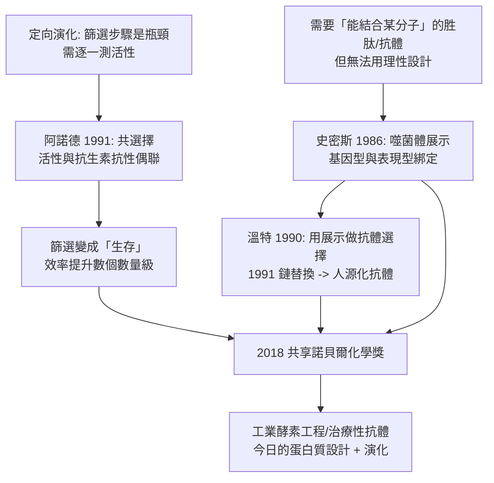

# 2018 · 阿諾德、溫特與史密斯——讓演化來做設計

> 2018 諾貝爾化學獎（共享）：弗朗西斯·阿諾德（Frances Arnold，1956– ，美國）、格雷格·溫特（Gregory Winter，1951– ，英國）與喬治·史密斯（George P. Smith，1941– ，美國）——表彰「其對酵素之定向演化，以及胜肽與抗體之噬菌體展示之貢獻」。**人類第一次把「演化」從自然的力量變成設計的工具。**

## 懸案（案情提要）

1990 年代的蛋白質工程，有一個「方法論上的死結」：

- 生物學家有一個極強的工具：**定向演化（directed evolution）**——隨機突變 + 選擇，能在數週內把一個酵素改造得更有活性、更耐熱、更能催化新反應；
- 但它的效率取決於「突變—篩選」的循環次數。每一輪要：
  1. **隨機突變**整個基因（產生數千至數萬個變異）；
  2. **表達並篩選**（數萬次實驗）；
  3. **回收**最好的變異，重複；
- 問題在於**第 2 步是瓶頸**：篩選「活性」通常需要**逐一測定每個變異的催化活性**——這是**人工的、慢的、且無法並行**的；
- 懸案因此是：**能不能讓「篩選」由蛋白質自己完成——讓酵素「只催化我要的反應」，而其他變異完全不動？**

偵辦人：阿諾德（用「共選擇（co-selection）」把篩選變成「生存」）。

## 前因

| 年份 | 事件 |
| --- | --- |
| 1956 / 1951 / 1941 | 阿諾德生於美國匹茲堡；溫特生於英國萊斯特；史密斯生於美國密蘇里州。 |
| 1980s | **史密斯**在密蘇里大學（後為**堪薩斯大學**）研究**RNA 噬菌體的生物學**；1986 年他以 $\mathrm{T7}$ 噬菌體為基礎建立**「噬菌體展示」（phage display）**系統——**把外源蛋白（胜肽或抗體片段）以融合蛋白的形式表現在噬菌體表面，而其內部 DNA 編碼該蛋白**——**基因型與表現型被物理地「綁在一起」，展示在表面的胜肽，就是其基因的產物**。 |
| 1988–1990 | 史密斯發表噬菌體展示的首篇論文；**1990 年**他的團隊以**胜肽**展示「能結合金屬的胜肽」，並以**胜肽的隨機突變**做「逐步親和力成熟」的示範——**這證明了「選擇」可以在噬菌體上進行。** |
| 1990s | **溫特**在 MRC 實驗室（劍橋）研究**抗體工程**：1991 年他證明**「噬菌體展示可以用來選擇具有特定抗原結合能力的抗體片段（scFv）」**——**這是「用展示系統做定向演化」的完整工具鏈。** |
| 1993 | **溫特與其合作者**（**Jones (P.)** 等）用**「鏈替換（chain shuffling）」**技術，把鼠源的抗體重塑為**人源抗體**（保留抗原結合位，替換其餘部分為人源序列）——**這開啟了「治療性抗體的人源化」產業。** |
| 1990s | **阿諾德**在**加州理工學院**進行蛋白質工程與演化研究，並於 1990 年代末確立了定向演化的方法學。 |
| 1991–1993 | **阿諾德的關鍵發明**：**「共選擇」（co-selection）**——把催化活性**與可選的表型（例如抗生素抗性）偶聯**，使「有活性的變異」能在**培養皿中直接存活**，**無需逐一測定活性**。**定向演化的效率因此提高數個數量級。** |
| 1993 | 阿諾德發表定向演化的方法論論文，隨即被工業界廣泛採用。 |
| 2018 | 三人共享諾貝爾化學獎。 |
| 2000s–2010s | 定向演化成為**工業酵素工程**的標準手段（洗衣粉酵素、燃料酵素、生物燃料）；**2018 年後，藉由蛋白質設計與定向演化的結合（甚至用生成式 AI 設計起始序列再演化優化），「蛋白質設計」進入新階段**（直通 2024 年諾貝爾獎，見 [2024-貝克與蛋白質設計](2024-貝克與蛋白質設計.md)）。 |

## 調查

**偵查一：噬菌體展示——「把基因和它的產物綁在同一個粒子��」。**

$$\text{噬菌體}：\ \text{衣殼蛋白基因} \xrightarrow{\text{融合}} \text{外源基因（編碼胜肽/抗體）}$$

$$\boxed{\text{展示在噬菌體表面的胜肽} \equiv \text{其內部 DNA 所編碼的胜肽}}$$

$$\text{因此}：\ \text{「篩選胜肽」=「篩選帶有該 DNA 的噬菌體」}$$

$$\text{流程}：\ \text{建庫（} \sim 10^9\text{ 個變異）} \xrightarrow{\text{親和力篩選}} \text{洗滌} \xrightarrow{\text{擴增}} \xrightarrow{\text{再突變}} \xrightarrow{} \text{循環}$$

**「基因型—表現型連結」是整個技術的關鍵**：因為兩者物理地綁在同一個噬菌體上，**篩選即選擇**。

**偵查二：鏈替換——「只保留想要的部分」。**

$$\text{抗體的結構} = \underbrace{\text{6 個 CDR（互補決定區）}}_{\text{決定抗原結合}} + \underbrace{\text{框架區}}_{\text{骨架，決定性質與免疫原性}}$$

$$\text{鏈替換}：\ \text{取} \textbf{鼠源}\ \text{抗體的 CDR} \xrightarrow{\text{裝入}} \textbf{人源}\ \text{框架區}$$

$$\text{結果}：\ \text{保留抗原結合能力} + \text{人源的免疫原性} \xrightarrow{} \textbf{可安全用於人體的治療性抗體}}$$

**這是生物技術產業最重大的商業化技術之一**——今日幾乎所有單株抗體藥物（曲妥珠單抗、adalimumab 等）都是「人源化」或「全人源」的。

**偵查三：阿諾德的共選擇——「讓篩選變成生存」。**

$$\text{傳統}：\ \text{逐一測定每個變異的活性} \xrightarrow{} \text{挑最好的} \xrightarrow{} \text{（數萬次人工測定）}$$

$$\text{共選擇}：\ \text{把催化活性與} \textbf{抗生素抗性}\ \text{（或生長優勢）偶聯}$$

$$\boxed{\text{有活性的變異} \xrightarrow{} \text{在抗生素培養皿上存活};\quad \text{無活性的變異} \xrightarrow{} \text{被殺死}}$$

$$\text{於是篩選由「人工測量」變成「生物選擇」} \xrightarrow{} \textbf{篩選量提升} \sim 10^5\text{–}10^7\ \text{倍}$$

$$\text{更妙的是}：\ \text{可以用} \textbf{不同的底物}\text{來選擇不同的催化活性} \xrightarrow{} \text{「催化 promiscuity」的選擇}$$

**「把酵素的活性寫進它的『生存條件』」——這是把自然選擇的原理直接當作工程工具使用的典範。**

**偵查四：DNA 序列的「隨機性」——為什麼要隨機？**

$$\text{定向演化的統計學}：\ \text{隨機突變產生變異} \xrightarrow{\text{選擇}} \text{更優變異} \xrightarrow{\text{再突變}} \cdots$$

$$\text{為何不用「理性設計」}：\ \text{即使} \mathrm{RNA\ world}\text{時代的} \textbf{定向進化（in vivo selection）}\text{也依賴隨機性}$$

$$\text{核心觀點}：\ \text{蛋白質的「設計空間」太大（} 10^3\text{–}10^4\ \text{個胺基酸位置} \times \text{20 種胺基酸）}\xrightarrow{} \textbf{理性設計不可及，演化可以}$$

$$\boxed{\text{「演化是搜尋演算法（genetic algorithm）」——阿諾德的貢獻是把它工程化}}$$

**偵查五：定向演化 + 蛋白質設計 = 現代的酵素工程。**

$$\text{今日的流程}：\ \underbrace{\text{生成式 AI 設計序列}}_{\text{2020 年代}} \xrightarrow{} \underbrace{\text{定向演化優化}}_{\text{阿諾德的方法}} \xrightarrow{} \textbf{高效新酵素}$$

$$\text{案例}：\ \text{逆合成酶（逆轉胰島素的路徑）}、\ \text{人工設計的} \mathrm{CO_2}\ \text{還原酵素}、\text{分解 PET 的酵素（以定向演化）}$$

## 理論裁決

**判決一：定向演化是「遺傳演算法」的化學實現。**

$$\text{遺傳演算法}：\begin{cases}\text{① 產生變異（突變/重組）}\\ \text{② 評估（選擇）}\\ \text{③ 保留最佳者並複製} \end{cases} \xrightarrow{\text{迭代}} \text{逼近最優}$$

$$\boxed{\text{阿諾德的貢獻} = \text{把「評估」變成} \textbf{「可大規模並行」} \text{的生物選擇}$$

**這讓「搜尋」的速度從「數月」變為「數天」**，並使工業界能在合理的時間內演化出特定性能的酵素。

**判決二：展示系統的「物理耦合」原理。**

$$\text{噬菌體展示的要件}：\ \text{外源基因} \xrightarrow{} \text{融合蛋白} \xrightarrow{} \text{衣殼表面展示}$$

$$\boxed{\text{「能結合的」與「能複製的」綁在同一個粒子} \Rightarrow \text{選擇 = 複製 = 篩選}}$$

**這與 1980 年的重組 DNA（見 [1980-伯格與重組DNA](1980-伯格與重組DNA.md)）是同一套思想**——「把想要的東西與複製機制物理地綁在一起」，讓選擇可以自動進行。

**判決三：抗體工程的可及性。**

$$\text{傳統}：\ \text{免疫動物} \xrightarrow{} \text{取得 B 細胞} \xrightarrow{} \text{篩選} \xrightarrow{} \text{大量培養（極慢、難以放大）}$$

$$\text{展示}：\ \text{完全在} \textbf{大腸桿菌}\text{中進行} \xrightarrow{} \text{可擴展}、\text{可工程化}$$

$$\boxed{\text{「抗體的選擇」從免疫學問題變成} \textbf{分子生物學問題}}$$

**「抗體可用大腸桿菌以無限量製造」——這是生物藥物產業的技術地基**。

**判決四：理性設計與演化的分工。**

$$\begin{array}{l}
\text{理性設計}：\ \text{當我們} \textbf{真的知道}\text{想要什麼（序列-功能關係清楚）}\\
\text{定向演化}：\ \text{當我們} \textbf{不知道}\text{，但知道如何選擇}
\end{array}$$

$$\text{2020 年代的融合}：\ \text{以 AI 生成序列} \xrightarrow{} \text{以演化優化} \xrightarrow{} \textbf{「設計 + 演化」的混合流程}$$

**這正是 2024 年諾貝爾獎（貝克的計算設計）的自然延伸**（見 [2024-貝克與蛋白質設計](2024-貝克與蛋白質設計.md)）。

## 後果

| 領域 | 影響 |
| --- | --- |
| 工業 | 洗衣粉酵素（蛋白酶）、生物燃料酵素、工業酵素的定向演化，使許多原本不可能的反應變得實用。 |
| 醫藥 | 治療性抗體（人源化與全人源）、ADC（抗體藥物偶聯物）的靶點；**「以演化優化藥效」的產業模式**。 |
| 疫苗 | 噬菌體展示用於疫苗抗原的篩選；今日的 mRNA 疫苗平台與其同屬「篩選—優化」的思路。 |
| 科學方法 | 「演化是工程工具」——這在 21 世紀初被稱為「定向演化革命」，今日已是蛋白質工程的標準語言。 |
| 科學史 | 2018 年的諾貝爾獎首次表彰「演化與展示」這類**方法論型**貢獻——它把生物學的兩個最古典的概念（天擇與抗體）轉化為技術。 |

## 關聯

- [1946-薩姆納與酵素結晶](1946-薩姆納與酵素結晶.md)：蛋白質的可操作化——定向演化的前提。
- [1955-迪維尼奧與催產素](1955-迪維尼奧與催產素.md)：合成胜肽的技術，與噬菌體展示展示的胜肽互為鏡像（合成 vs 選擇）。
- [1980-伯格與重組DNA](1980-伯格與重組DNA.md)：重組 DNA 是噬菌體展示的技術前提。
- [1984-梅里菲爾德與固相合成](1984-梅里菲爾德與固相合成.md)：胜肽合成的另一條路徑（合成 vs 演化）。
- [2018-阿諾德與定向演化](2018-阿諾德與定向演化.md)：即本卷。
- [2024-貝克與蛋白質設計](2024-貝克與蛋白質設計.md)：AI 設計＋定向演化的融合。
