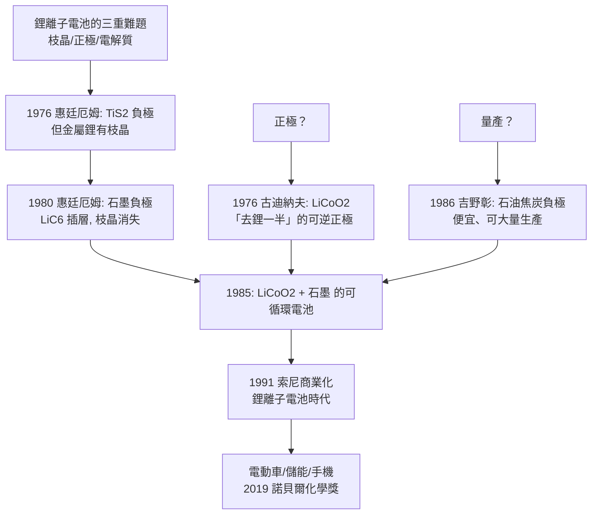

# 2019 · 古迪納夫、惠廷厄姆與吉野——把太陽能存進電池

> 2019 諾貝爾化學獎：古迪納夫（John B. Goodenough，1922–2023，美國）、斯坦利·惠廷厄姆（M. Stanley Whittingham，1941– ，英國）與吉野彰（Akira Yoshino，1948– ，日本）——表彰「其對鋰離子電池之發展的貢獻」。**人類把太陽的能量，存進了可攜式電池。**

## 懸案（案情提要）

1970 年代的能源科技，有一個「不可兼得」的三角：

- **石油**好用，但會用完、會燃燒、會影響氣候；
- **電池**可以存能，但當時的**鉛酸電池太重**（汽車電池 20–30 kg），**鎳鎘電池有劇毒**；
- 而**鋰金屬**是極佳的負極材料：電化學電位最負（$-3.04\ \mathrm{V}$）、密度低、能量密度高——**但「鋰與任何東西接觸就反應」**（鋰遇水反應劇烈）；
- 懸案因此是三重的：
  1. **怎麼把鋰安全地做成可逆的負極？**（鋰枝晶的問題：充電時鋰析出成樹枝狀枝晶，穿刺隔膜造成內短路甚至爆炸）；
  2. **正極該用什麼？**（當時的正極是過渡金屬氧化物 $\mathrm{LiCoO_2}$、$\mathrm{LiNiO_2}$ 等）；
  3. **電解質呢？**（鋰電池需要**非水**電解質——水會與鋰反應；$\mathrm{LiPF_6}$ 溶於碳酸酯溶劑是當時的選擇）；
- 這三個問題任一個沒解決，鋰離子電池都不可能商業化。

## 前因

| 年份 | 事件 |
| --- | --- |
| 1922 / 1941 / 1948 | 古迪納夫生於美國耶拿（Jena，德國）；惠廷厄姆生於英國諾丁漢；吉野彰生於日本京都。 |
| 1952 | 古迪納夫在美國**麻省理工學院**（LINAC 團隊）參與「**材料科學計畫**」，研究 **鈉（$\mathrm{Na}$）與鉀（$\mathrm{K}$）的多硫化物**作為二次電池的正極——**這是他與鋰電池的緣起：他在研究「鈉—硫」時學會了高聚硫正極的設計原理。** |
| 1970 | 古迪納夫移居**德州奧斯汀的德克薩斯大學**，開始研究**鋰二次電池**。 |
| 1976 | **古迪納夫的關鍵發現**：**鈷酸鋰（$\mathrm{LiCoO_2}$）作為正極材料**——他發現，若**只把鈷酸鋰中的鋺「抽走一半」**（即 $\mathrm{Li}_{0.5}\mathrm{CoO_2}$），它就成為可逆的正極：

$$\mathrm{LiCoO_2} \rightleftharpoons \mathrm{Li}_{1-x}\mathrm{CoO_2} + x\,\mathrm{Li^+} + x\,e^-$$

$$\boxed{\text{「去鋰」把 $\mathrm{Co^{3+}}$ 部分還原為} \mathrm{Co^{4+}}\text{，能量因此被釋出/儲存}}$$

**這是鋰離子電池的核心反應，也是他獲獎的主要理由。**

| 1970s | **惠廷厄姆**在**英國牛津大學**（**Exxon 公司的研究人員**）研究**二硫化物（$\mathrm{TiS_2}$）負極**——1976 年他製得第一顆可充電的鋰金屬電池（$\mathrm{Li}/\mathrm{TiS_2}$）。**問題**：金屬鋰在充電時形成枝晶。 |
| 1980 | **惠廷厄姆發明碳複合負極**：以**石墨（$\mathrm{LiC_6}$）**取代金屬鋰——**鋰以「嵌入」而非「析出」的方式存在**，枝晶問題因此徹底消失。**但石墨負極的容量當時僅約 $\mathrm{LiC_6}$，能量密度仍不足。** |
| 1985 | 古迪納夫在德州奧斯汀的實驗室證實：**以** $\mathrm{LiCoO_2}$ **為正極、石墨為負極的電池可以循環數百次**——「鋰離子電池」的基本架構完成。 |
| **1986** | **吉野彰**在**日本旭化成（Asahi Kasei）**開發出**石油焦炭負極**——以**廉價的石油焦（petroleum coke）**取代石墨，首次使鋰離子電池**可大量生產**。 |
| 1991 | **索尼**商業化第一代鋰離子電池（以吉野的焦炭負極 + 古迪納夫的鈷酸鋰正極）——**鋰離子電池時代開始**。 |
| 1991 | **古迪納夫**發表鈷酸鋰正極的著名論文《$\mathrm{LiCoO_2}$: A New Cathode Material》（應刊於 *J. Power Sources*），確立其地位。 |
| 1994–1996 | 古迪納夫提出**鈦酸鋰（$\mathrm{Li_4Ti_5O_{12}}$，LTO）**負極——**零應變（zero-strain）的嵌锂材料**，安全性極佳。 |
| 1997 | 索尼推出以**石墨**負極的第二代鋰離子電池。 |
| 2000s–2010s | 鋰離子電池的成本大幅下降（今日 $\sim \$100/\mathrm{kWh}$ 级别），電動車（2010 年後由特斯拉等推動）、大規模儲能（2015 年後的電網級儲能）成為可能。 |

## 調查

**偵查一：三道難題的逐一破解。**

鋰離子電池的成立，取決於三個各自獨立、卻必須同時成立的技術突破：

| 難題 | 誰解了 | 怎麼解的 |
| --- | --- | --- |
| 枝晶（充電時鋰析出成樹枝、刺穿隔膜） | 惠廷厄姆（1980） | 以石墨「嵌入」取代金屬鋰「析出」 |
| 正極材料 | 古迪納夫（1976） | $\mathrm{LiCoO_2}$，且只抽走一半的鋰才可逆 |
| 量產可行性 | 吉野彰（1986） | 以廉價的石油焦取代石墨 |

**偵查二：插層反應的驗證——「能量從哪裡來」。**

$$\mathrm{LiCoO_2} \rightleftharpoons \mathrm{Li}_{1-x}\mathrm{CoO_2} + x\,\mathrm{Li^+} + x\,e^-$$

「去鋰」把 $\mathrm{Co^{3+}}$ 部分還原為 $\mathrm{Co^{4+}}$，能量因此被釋出（放電）或儲存（充電）——**這是鋰離子電池的核心反應，也是他獲獎的主要理由**。

**偵查三：SEI 膜的發現——「第一次充電為什麼會發熱」。**

第一次充電時，電解液在負極表面還原，形成一層固態的**固體界面膜（SEI）**：它導電、卻阻止電子繼續跑到溶劑裡。**沒有 SEI，電池會在第一次充電就把自己喝光**；有了 SEI，「點火」才成功——這也解釋了為什麼鋰離子電池的頭幾圈效率偏低（化成工序）。

**偵查四：今天的物理化學帳本。**

$$\text{能量密度} \approx 150\text{–}250\ \mathrm{Wh/kg}\ (\text{電池組}) \quad\text{vs}\quad \text{汽油} \approx 12000\ \mathrm{Wh/kg}$$

**——但電動車的「整體效率」（電機 + 電池 + 再生制動）遠高於內燃機，因此以「每公里電費」計，電動車已遠勝汽油車。**

## 理論裁決

**判決一：插層（intercalation）——「把鋰藏進層間」。**

$$\mathrm{LiC_6} \rightleftharpoons \mathrm{Li}_{1-x}\mathrm{C_6} + x\,\mathrm{Li^+} + x\,e^-$$

$$\mathrm{LiCoO_2} \rightleftharpoons \mathrm{Li}_{1-x}\mathrm{CoO_2} + x\,\mathrm{Li^+} + x\,e^-$$

$$\boxed{\text{「 intercalation」——離子插入層狀晶體的格子，而主體骨架幾乎不變（topotactic 反應）}}$$

**這解釋了為何鋰離子電池可以循環數千次而不解體**——**沒有金屬鋰析出、沒有結構崩壞**。這是「插層化學」（intercalation chemistry）在材料科學中的地位。

**判決二：零應變材料——「體積不變，所以不崩壞」。**

$$\text{循環中的體積變化} \xrightarrow{} \text{機械應力} \xrightarrow{} \textbf{顆粒裂解} \xrightarrow{} \text{SEI 膜破壞} \xrightarrow{} \text{容量衰退}$$

$$\text{對策}：\ \text{選擇體積變化} \approx 0\ \text{的宿主材料}$$

$$\text{鈦酸鋰}（\mathrm{Li_4Ti_5O_{12}}）：\ \Delta V \approx 0\ \text{，電位} \sim 1.55\ \mathrm{V}\ \text{，循環壽命} > 5000\ \text{次}$$

$$\boxed{\text{「零應變」是材料選擇的第一原則之一——這是化學家給工程師的設計語言}}$$

**判決三：固體界面膜（SEI）——「那層被犧牲的膜」。**

$$\text{第一次充電}：\ \text{電解液在負極表面還原} \xrightarrow{} \underbrace{\text{SEI 膜}}_{\text{固態、導電、可阻止持續還原}}$$

$$\boxed{\text{沒有 SEI} \Rightarrow \text{電解液持續消耗} \Rightarrow \text{容量迅速衰減；}\ \textbf{有了 SEI} \Rightarrow \text{電池「點火」成功}$$

$$\text{這解釋了「頭幾圈效率低、之後才正常」的現象，也是化成（formation）工序存在的原因}$$

**判決四：電化學穩定窗口——「元素要待在自己的地盤上」。**

$$\text{正極電位} \ \text{vs}\ \text{電解液的分解電位} \Rightarrow \text{必須} \mathbf{v}_{\text{cathode}} < \mathbf{v}_{\text{electrolyte}}$$

$$\text{電解液}：\ \mathrm{LiPF_6}\ \text{溶於碳酸酯}（如 EC/DMC）}$$

$$\text{負極}：\ \text{石墨}（電位} \sim 0.1\ \mathrm{V\ vs\ Li}\text{）}\xrightarrow{} \text{極易還原碳酸酯} \Rightarrow \text{必須靠 SEI 保護}$$

**「電化學穩定窗口」是化學家（而非工程師）決定材料系統的核心概念**——這正是本案的諾獎意義：**它表彰的是化學原理的應用，而非機械工程**。

## 後果

| 領域 | 影響 |
| --- | --- |
| 交通電動化 | 電動車的成本與續航在 2010–2030 年間跨越了臨界點；電池 pack 成本從 2010 年的約 $\sim \$1{,}200/\mathrm{kWh}$ 降至 2020 年代的數百美元量級。 |
| _grid儲能 | 2015 年後的太陽能與風電的「平準化」高度依賴鋰離子電池；電網級儲能的全球部署。 |
| 電子 | 鋰離子電池使智慧手機、平板、筆記型電腦成為可能——**這是諾貝爾獎改變日常生活最直接的例子之一**。 |
| 科學 | 「插層化學」成為材料科學的核心概念（今日也用於鈉離子電池 $\mathrm{Na_3V_2(PO_4)_3}$、鋰硫電池、富勒烯鋰離子電池）。 |
| 科學史 | 三位得主的軌跡極具對比：**古迪納夫（固體物理與材料化學出身，80 多歲仍獲諾獎）**、**惠廷厄姆（石油公司的科學家）**、**吉野彰（企業的電化學家）**——**「工業實驗室的科學」再次產出諾獎級貢獻**。 |

## 關聯

- [1956-鏈反應與爆炸](1956-鏈反應與爆炸.md)：鏈反應是電池內副反應（過充、析鋰）的理論語言。
- [1959-海羅夫斯基與極譜](1959-海羅夫斯基與極譜.md)：電化學量測技術（電位、循環伏安）在電池研究中的角色。
- [1976-利普斯科姆與硼烷](1976-利普斯科姆與硼烷.md)：多中心鍵與缺電子化學——與鋰插層化合物的結構化學相關。
- [1992-馬庫斯與電子轉移理論](1992-馬庫斯與電子轉移理論.md)：電子傳遞鏈與電化學的理論橋樑。
- [2019-古迪納夫與鋰離子電池](2019-古迪納夫與鋰離子電池.md)：即本卷。
- [1995-克魯岑與臭氧層](1995-克魯岑與臭氧層.md)：能源與環境的另一條線——鋰離子電池是「能源轉型」硬體端的核心。
