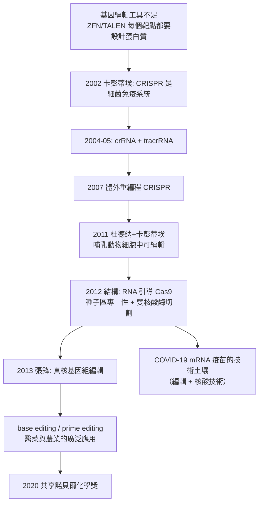

# 2020 · 卡彭蒂耶與杜德納——把細菌的免疫系統變成剪刀

> 2020 諾貝爾化學獎：埃馬紐埃爾·夏爾蒂埃·卡彭蒂耶（Emmanuelle Charpentier，1968– ，法國／德國）與詹妮弗·杜德納（Jennifer A. Doudna，1964– ，美國）——表彰「其對 CRISPR/Cas9 之開發」。**人類獲得了可以指定目標、可以編輯基因的分子剪刀。**

## 懸案（案情提要）

2010 年代初的基因編輯，有一個「工具不足」的困境：

- 要修改一個基因，最可靠的方式是「** homologous recombination**（同源重組）」——但它效率極低（$10^{-6}$–$10^{-8}$）、耗時數月，且主要用於細菌；
- 另一條路是 **ZFN（鋅指核酸酶）** 與 **TALEN（轉錄活化因子樣效應物核酸酶）**——它們是「人工設計的蛋白質核酸酶」，可指定 DNA 序列切割，但**設計與建構成本極高**（每個靶點都要從頭做一個蛋白質）；
- 而生物界本來就有「**可編程的剪刀**」——**CRISPR/Cas 系統**，細菌用它對抗噬菌體：
  - 細菌的 CRISPR 阵列儲存了過去入侵者的 DNA 片段（作為「免疫記憶」）；
  - **crRNA**（CRISPR RNA）引導 **Cas 蛋白**辨識並切割入侵者的 DNA；
- 懸案因此是：**能否把 CRISPR 的「天然剪刀」變成一把「可隨意指定目標」的分子工具？**

偵辦人：杜德納（結構生物學家）與卡彭蒂耶（微生物學家）——**她們證明了 Cas9 是一把「RNA 引導的DNA剪刀」，並把它工程化。**

## 前因

| 年份 | 事件 |
| --- | --- |
| 1968 / 1964 | 卡彭蒂耶生於法國 Arbois；杜德納生於美國華盛頓特區。 |
| 1980s–90s | **杜德納**在**耶魯大學**從事結構生物學研究，1980 年代末期至 1990 年代研究 RNA 與蛋白質的複合體結構——**RNA 結構生物學的開創者之一** |
| 1991–2000 | 杜德納在**加州大學柏克萊分校**（與其合作者 **Jamie (J.)**）研究 **Cas9 蛋白的結構**——特別是 **CRISPR 系統中的 crRNA 與 Cas9 的複合體結構**（2011 年，*Science*，即本案得獎工作的核心）。 |
| 1993–2000s | 卡彭蒂耶在**維也納大學**（後於 **Umeå** 等地任職；早期在維也納大學的 **Max F. Perutz** 實驗室做抗性基因的研究）研究 **化學桿菌的 CRISPR 免疫系統**，並於 **2002 年**在 *Microbiology* 發表首篇 CRISPR 免疫的實驗證明；2004–2005 年**與 **Jörg (J.)** 合作發現 crRNA 的加工機制**。 |
| 2005–2006 | 卡彭蒂耶證明 **crRNA 與 trans-activating crRNA（tracrRNA）** 在 crRNA 的成熟中共同作用——**這是 CRISPR 系統可被「工程化」的第一把鑰匙**。 |
| 2007 | 卡彭蒂耶與 **Virginie (V.)** 在 *Science* 發表**體外重編程（in vitro reprogramming）CRISPR 的實驗**：證明**合成的 crRNA 與 Cas9 可以在試管中切割目標 DNA**。 |
| **2011** | **杜德納與卡彭蒂耶合作**（杜德納在《Science》發表）：證明**只需 Cas9 與一條 crRNA（可把 tracrRNA 併成一條 sgRNA）即可在哺乳動物細胞中切割基因組 DNA**。 |
| 2012 | 杜德納的實驗室發表第一篇以 **Jinek 等人**為名的 *Science* 論文〈A Programmable Dual-RNA–Guided DNA Endonuclease〉——**結構與機制的完整揭露**：Cas9 與 sgRNA 結合後，**sgRNA 的「種子區」與靶 DNA 配對，Cas9 進行切割並產生黏性端（blunt end）**。 |
| 2013 | **張鋒（Feng Zhang）**的團隊證明 **Cas9 可在哺乳動物（與植物）細胞中編輯基因組**——把 CRISPR 從細菌搬到真核生物（但若用於臨床需更精確的「引導 RNA 截短」設計）。 |
| 2013–2020 | CRISPR 應用爆發：基因敲除、基因治療、**base editing（鹼基編輯）與 prime editing（引導編輯）**、CAR-T 的改造、**COVID-19 mRNA 疫苗的開發（ Moderna 與 BioNTech）**、農業育種（不含基因轉殖的編輯）、基因驅動的滅絕蚊（瘧蚊）。 |
| 2020 | 兩人共享諾貝爾化學獎。 |

## 調查

**偵查一：Cas9 的結構——「RNA 如何引導蛋白」。**

$$\mathrm{Cas9}\ (1350\ \text{個胺基酸}) + \mathrm{sgRNA} \rightarrow \text{複合體}$$

$$\text{sgRNA} = \underbrace{\text{引導區（} \sim 20\ \mathrm{nt}\text{）}}_{\text{與靶 DNA 配對}} + \underbrace{\text{支架區}}_{\text{與 Cas9 結合}}$$

$$\boxed{\text{結構顯示}：\ \text{RNA 以「三明治」方式纏繞在 Cas9 上，並把 DNA 的兩個末端拉進蛋白的「溝槽」}}$$

**「RNA 與蛋白質的三維複合結構」——這正是杜德納的方法論（結構生物學）與卡彭蒂耶的方法論（遺傳學/微生物學）交會的地方。**

**偵查二：序列專一性——「種子區的嚴格、其他位置的寬鬆」。**

$$\text{PAM（protospacer adjacent motif）}：\ \text{靶 DNA 旁的短序列（如} \mathrm{NGG}\text{），Cas9 先辨識它}$$

$$\text{引導區}：\ \underbrace{\text{種子區（} \sim 10\ \mathrm{nt}\text{，與靶的配對有嚴格的立體檢查）}}_{\text{決定專一性}} + \underbrace{\text{非種子區（配對較鬆）}}_{\text{容錯區}}$$

$$\boxed{\text{「種子區決定專一性，非種子區提供容錯」——這解釋了為何 Cas9 對某些位置更嚴格}}$$

**偵查三：切割機制——「RuvC 與 HNH 兩個核酸酶結構域」。**

$$\mathrm{Cas9}\ \text{含兩個核酸酶結構域}：\ \underbrace{\mathrm{RuvC}}_{\text{切斷靶股的} \mathrm{3'}\text{ 端}} \quad \underbrace{\mathrm{HNH}}_{\text{切斷非靶股}}$$

$$\text{結果}：\ \textbf{平端（blunt end）} \xrightarrow{} \text{由細胞的} \mathrm{NHEJ}\ \text{（非同源末端接合）}\ \text{或} \mathrm{HDR}\text{（同源重組）修復}$$

$$\text{因此}：\ \text{敲除（隨機插入）} \quad \text{或} \quad \text{精確置換（HDR + 供體模板）}$$

**「雙核酸酶結構域的協同切割」——這是機制層面的關鍵發現。**

**偵查四：工程化——「把兩條 RNA 併成一條」。**

$$\text{天然系統}：\ \mathrm{crRNA} + \mathrm{tracrRNA} \xrightarrow{\mathrm{RNase\ III}} \text{引導 RNA}$$

$$\text{人工系統（sgRNA）}：\ \text{將 crRNA 的引導區} + \text{tracrRNA 的支架區} \xrightarrow{} \textbf{單一條} \mathrm{sgRNA}$$

$$\text{好處}：\ \text{只需設計} \textbf{一段 20 個核苷酸的序列}\text{，即可指定任何靶點}$$

$$\boxed{\text{「RNA 的可程式化」——這就是把一把固定的剪刀變成可訂製的工具}$$

**偵查五：後續的精確化——「從剪刀到鉛筆與橡皮擦」。**

$$\begin{aligned}
\text{base editing（2016）} &：\ \text{用 Cas9  nickase + 脫氨酶} \Rightarrow \text{單一鹼基的轉換}\\
\text{prime editing（2019）} &：\ \text{Cas9 nickase + 反向轉錄酶 + pegRNA} \Rightarrow \text{幾乎任意類型的編輯}\\
\text{2020 後} &：\ \text{「進階型」編輯器、} \textbf{表觀遺傳編輯}\text{（不變 DNA 而改變其表現）}
\end{aligned}$$

**「從剪輯到改寫」的技術譜系，在 2012–2020 年間完成**——這是分子生物學史上發展最快的一條工具鏈。

## 理論裁決

**判決一：RNA 引導的 DNA 切割——「一把剪刀的結構機制」。**

$$\text{Cas9 的結構}：\ \text{兩個葉片（REC 與 NUC lobes）夾住「sgRNA + 靶 DNA」的} \textbf{R-loop}$$

$$\text{切割過程}：\begin{cases}\text{① PAM 辨識（由 REC lobe 的} \mathrm{PIE}\ \text{結構域負責）}\\ \text{② sgRNA 的種子區與靶 DNA 配對，形成} \textbf{R-loop（15 bp）}\\ \text{③ sgRNA 的支架區與 Cas9 結合，觸發} \mathrm{HNH}\ \text{構形變化}\\ \text{④} \mathrm{HNH}\ \text{活化，切斷非靶股；} \mathrm{RuvC}\ \text{隨後切斷靶股}\end{cases}$$

$$\boxed{\text{「RNA 先配對、蛋白質才動手」——這是序列專一性的來源，也是為何 Cas9 錯配多數無害}}$$

**判決二：Cas9 的「自我限制」——「為何 Cas9 不能一直切下去」。**

$$\text{Cas9 切斷後}：\ \text{靶 DNA 的} 3'\text{ 端會「甩開」sgRNA} \xrightarrow{} \text{不再被辨識}$$

$$\text{但}：\ \text{若靶序列再出現？} \Rightarrow \text{Cas9 又會結合!} \xrightarrow{} \text{因此} \textbf{必須} \text{有一個} \textbf{「脫靶（off-target）」}\text{的機制}$$

$$\text{細菌的解法}：\ \mathrm{Cas1/Cas2}\ \text{（spacer 獲取）} \xrightarrow{} \text{把入侵 DNA 的片段整合進 CRISPR 陣列} \Rightarrow \textbf{「免疫記憶」}$$

$$\boxed{\text{「Cas1/Cas2 整合新 spacer」是細菌的免疫記憶，也是 CRISPR 命名中「規律間隔短迴散重複」的由來}}$$

**判決三：從「工具」到「平台」。**

$$\text{可編程的 RNA} \xrightarrow{} \text{任意靶點};\qquad \text{可換的效應蛋白} \xrightarrow{} \text{任意編輯化學}$$

$$\begin{array}{l}
\text{Cas9} \xrightarrow{} \text{切雙股（敲除/置換）}\\
\text{Cas12a} \xrightarrow{} \text{切單股（T-rich 靶點）}\\
\text{Cas13} \xrightarrow{} \text{切 RNA（僅切割 RNA 的轉錄組編輯）}\\
\text{反轉錄酶融合的 Cas9（PE）} \xrightarrow{} \text{「寫入」任意序列}
\end{array}$$

**「CRISPR 是一個『可插拔效應模組』的平台」——這是 2020 年諾貝爾獎在技術層面的真正遺產**，並直接導向 mRNA 疫苗（以體外轉錄的 RNA 為基礎）與細胞治療的工業化。

**判決四：科學與倫理的張力。**

$$\text{CRISPR 的力量} \xrightarrow{} \text{「基因編輯嬰兒」事件（2018 年，賀建奎）} \xrightarrow{} \text{全球倫理爭議}$$

$$\boxed{\text{「技術的門檻降到最低」} \xrightarrow{} \text{「誰該決定用途」成為核心問題}}$$

$$\text{各國的應對}：\ \text{禁止生殖系編輯、臨床治療的嚴格監管、國際治理的討論至今未竟}$$

**這是諾貝爾獎史上少數「得獎技術立刻引發社會危機」的案例**——也是科學家必須承擔公共責任的現代教材。

## 後果

| 領域 | 影響 |
| --- | --- |
| 醫藥 | **CAR-T 細胞療法**（2017 年首個獲批；2024 年諾貝爾生理醫學獎頒給卡彭蒂埃與杜德納——本案得主再獲醫學獎）；**基因治療的重新復興**；罕見病的治療。 |
| 疫苗 | **mRNA 疫苗平台**（COVID-19 疫苗）：CRISPR 技術雖非直接必要，但「RNA 治療」的概念土壤與此高度相關；新冠疫苗的開發速度是科學政策的一次重大調整。 |
| 農業 | **基因編輯作物**（不含外源基因的編輯在許多國家免於 GMO 管制）：抗病、耐旱、高產；以及**基因編輯的動物**（抗熱牛、抗病豬）。 |
| 公共衛生 | **瘧蚊的基因驅動**（釋放帶有抗瘧基因的蚊群以減少瘧疾傳播），以及**抗瘧疾基因編輯蚊子**（Target Malaria）。 |
| 基礎研究 | CRISPRi／CRISPRa（表觀遺傳編輯）使「關掉某個基因而不改動序列」成為可能，大幅加速功能基因組學。 |
| 科學制度 | 兩位得主獲 2020 年化學獎、卡彭蒂埃並獲 2024 年生理醫學獎；杜德納是美國**國家科學院、工程院、醫學院**三院院士（極為罕見），並推動生物技術倫理議題。 |

## 關聯

- [1958-桑格與胰島素序列](1958-桑格與胰島素序列.md)：序列與「指定目標」的先聲——DNA 序列的可讀性是 CRISPR 的前提。
- [1980-伯格與重組DNA](1980-伯格與重組DNA.md)：重組 DNA 技術是 CRISPR 的遺傳學土壤；今日的基因編輯是它的精準版本。
- [1989-奧特曼與RNA催化](1989-奧特曼與RNA催化.md)：RNA 作為「引導分子」的生物學先例。
- [2013-卡普拉斯與多尺度模擬](2013-卡普拉斯與多尺度模擬.md)：Cas9-sgRNA 的複合體結構正是結構生物學與遺傳學交會的產物。
- [2020-卡彭蒂耶與CRISPR](2020-卡彭蒂耶與CRISPR.md)：即本卷。
