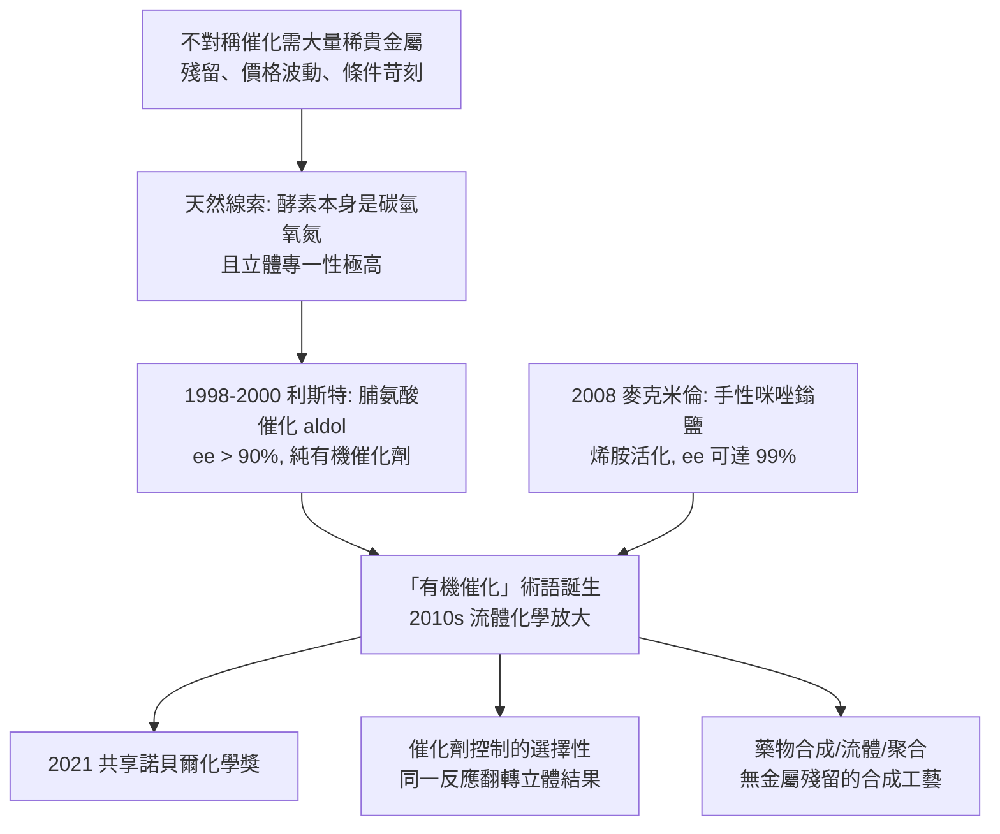

# 2021 · 利斯特與麥克米倫——不用金屬的催化

> 2021 諾貝爾化學獎：本亞明·利斯特（Benjamin List，1968– ，德國）與大衛·W·C·麥克米倫（David W. C. MacMillan，1968– ，美國）——表彰「其對不對稱有機催化的發展」。**酵素之外的催化劑——純粹由碳、骨架與氫構成的分子催化劑。**

## 懸案（案情提要）

1990–2010 年代的化學，有一個「代價」問題：

- **不對稱催化**（見 [2001-諾爾斯與手性催化](2001-諾爾斯與手性催化.md)）在 2001 年後成為藥物合成的標準工具——但**所用的催化劑幾乎全是金屬**：
  - 鉑、鈀、銥、鈀（偶聯反應，見 [2010-赫克與鈀催化偶聯](2010-赫克與鈀催化偶聯.md)）；
  - 銠（氫化，見 [2001-諾爾斯與手性催化](2001-諾爾斯與手性催化.md)）；
  - 鈦、鋁（烯烔聚合，見 [1963-齊格勒與納塔](1963-齊格勒與納塔.md)）；
- 金屬催化劑的問題：
  1. **稀缺且昂貴**（鉑族金屬價格與供應風險）；
  2. **金屬會殘留在藥物中**（ppm 級的金屬雜質需要處理，尤其對重金屬敏感的藥品）；
  3. **需要特殊條件**（惰性氣氛、無水無氧、低溫）；
  4. 且**不一定能給出高對映選擇性**；
- 另一個巨大的「誘惑」是：**酵素能做到極高的選擇性（見 [1975-康福思與普雷洛格](1975-康福思與普雷洛格.md) 的立體專一性原理），而且酵素本身就是碳、氫、氧、氮組成的。**那麼——
- **懸案：能不能設計出「像酵素一樣」的、只含碳與氫的有機小分子催化劑？**

偵辦人：利斯特（2000 年的脯氨酸催化 aldol 反應）與麥克米倫（2008 年的手性咪唑鎓鹽催化）。

## 前因

| 年份 | 事件 |
| --- | --- |
| 1968 / 1968 | 利斯特生於德國波鴻（曾居以色列，後回德國）；麥克米倫生於美國貝克萊。 |
| 1990s | **利斯特**在**德國馬克斯・普朗克煤研究所**（Mülheim）做博士後研究，先研究烯烔的環氧化（與 Sharpless 的 Ti 催化劑合作），隨後轉向**脯氨酸催化的 aldol 反應**。 |
| 1998 | **利斯特的關鍵實驗**：發現**脯氨酸**能催化丙酮與硝基醛的 **aldol（羥醛）反應**，並且產物有**極高的對映選擇性**（ee 可達 90% 以上）——**這是第一個廣為人知的「純有機小分子催化劑」**。 |
| 2000 | 利斯特發表《Proline-Catalyzed Direct Asymmetric Aldol Reactions》（*Angew. Chem.*），並在 2001 年發表其回顧〈Proline-Catalyzed Asymmetric Reactions〉——**「有機催化（organocatalysis）」一詞由此誕生**。 |
| 2000s | 利斯特與其合作者在 2000–2010 年代發展出「二級胺 + 硝基醛」的 aldol 催化、脯氨酸衍生的反轉 aldol，以及烯胺催化的 $\alpha$-官能化。 |
| 2000s | **麥克米倫**在**普林斯頓大學**研究「手性 Brønsted 酸」——以手性聯萘骨架衍生的磷酸等——並發展出**胺催化**（2001 年）與**手性咪唑鎓鹽催化**（2008 年）。 |
| **2008** | **麥克米倫的突破**：發明**手性咪唑鎓鹽（chiral imidazolidinium salt）**催化劑，以**共軛胺（enamine）中間體**活化羰基化合物進行 $\alpha$-官能化，**ee 可達 99%**——**「像酵素一樣的有機催化劑」正式成立**。 |
| 2010s | 有機催化成為**藥物合成與流體化學（flow chemistry）**的主流；**2021 年**兩人共享諾貝爾化學獎。 |
| 2010s–2020s | 「**催化劑的選擇性**」概念擴展：麥克米倫的「**催化劑控制的選擇性（catalyst-controlled selectivity）**」——同一個反應，不同催化劑給出不同的立體化學結果（E/Z 選擇性、對映選擇性、非對映選擇性可各自獨立調控）。 |

## 調查

**偵查一：脯氨酸的「雙重身分」。**

$$\text{脯氨酸的} \alpha\text{-胺基} + \text{醛的羰基} \xrightarrow{} \underbrace{\text{烯胺（enamine）}}_{\text{親核試劑}}$$

$$\text{烯胺} + \text{硝基醛} \xrightarrow{} \text{aldol 產物} \xrightarrow{\text{水解}} \textbf{羥醛二聚體}$$

$$\text{立體專一性的來源}：\ \text{脯氨酸的} \textbf{五員環}\text{限制了烯胺的構象} \xrightarrow{} \text{親核進攻只能從一面發生}$$

$$\boxed{\text{「同一個碳，扮演兩次角色」}：\ \text{先當親核試劑的來源，後當立體控制的模板}}$$

**這就是「像酵素一樣」的關鍵**——酵素的催化機制裡，酵素的殘基通常也扮演多重角色。

**偵查二：麥克米倫的咪唑鎓鹽——「把親核試劑「裝」在催化劑裡」。**

$$\text{羰基化合物} + \text{二級胺} \xrightarrow{} \underbrace{\text{烯胺（或亞胺鎓）}}_{\text{親核中間體}} \xrightarrow{\text{與親電試劑反應}} \text{產物}$$

$$\text{立體控制}：\ \text{咪唑鎓的} \textbf{立體剛性骨架}\ \text{（與} \mathrm{BINOL}\text{ 骨架相連）}\xrightarrow{} \text{烯胺的} \textbf{面選擇性}$$

$$\boxed{\text{「催化劑把反應物預先組織成特定構形」——這正是酵素的做法（見} \ [1975-\text{康福思與普雷洛格}]\text{）}}$$

**偵查三：Brønsted 酸——「把手性放進酸裡」。**

$$\text{手性 BINOL-磷酸} \xrightarrow{} \text{以} \mathrm{H^+}\ \text{活化羰基或亞胺} \xrightarrow{} \text{立體選擇性的亲核進攻}$$

$$\text{優點}：\ \text{不需金屬、不需鹼、不需惰性氣氛};\quad\text{缺點}：\ \text{對水極敏感}$$

**偵查四：催化劑控制選擇性的圖景。**

$$\underbrace{\text{反應本身的選擇性}}_{\text{底物的立體偏好}} \quad+\quad \underbrace{\text{催化劑的選擇性}}_{\text{可獨立調控}} \quad\Longrightarrow\quad \text{「可編程的立體化學」}$$

$$\begin{array}{l}
\text{底物控制}：\ \text{ aldol 反應的anti/syn 選擇性}\\
\text{催化劑控制}：\ \text{同一反應，用} (S)\text{-催化劑得 syn，用} (R)\text{-催化劑得 anti}
\end{array}$$

**「更換催化劑即可翻轉立體化學結果，而不改變反應物」——這在金屬催化的世界裡是罕見的，而在有機催化中卻是常態。**

**偵查五：為什麼現在才被接受？**

$$\text{有機催化的歷史}：\ \text{1912 年 Bredig（} \mathrm{HCN}\ \text{加成）} \to \text{1912–20s Pracejus} \to \text{1970s（} \mathrm{Bu3N}\text{、} \mathrm{pyridine}\text{等）} \to \textbf{2000 利斯特} \to \textbf{2008 麥克米倫}$$

$$\text{為何長期不受重視}：\begin{cases}\text{① 效率低、TON 小（催化劑用量大）}\\ \text{② 立體選擇性不如金屬}\\ \text{③ 「催化劑比產物更貴」的經濟疑慮}\end{cases}$$

$$\text{轉折}：\ \text{①} \ \text{流體化學（連續流動）使有機催化的} \textbf{TON} \text{不再重要（催化劑可回收）};\quad \text{②} \ \text{金屬供應與價格波動（鉑價）};\quad \text{③} \ \text{藥政對金屬殘留的要求}$$

$$\boxed{\text{「科學的接受」與「產業的條件」共同決定了技術的時機}}$$

## 理論裁決

**判決一：催化劑的兩種策略——「活化底物」與「活化親電試劑」。**

$$\begin{array}{l}
\text{烯胺活化（利斯特、麥克米倫）}：\ \text{催化劑把} \textbf{親核試劑}\text{生成出來}\\
\text{iminium 活化}：\ \text{催化劑把} \textbf{親電試劑}\text{活化（降低 LUMO）}\\
\text{Brønsted 酸（麥克米倫）}：\ \text{以} \mathbf{H^+}\ \text{活化羰基或亞胺}
\end{array}$$

$$\boxed{\text{這三者對應了「酵素如何做反應」的三種基本策略}}$$

**判決二：立體專一性的分子基礎——「構象限制」。**

$$\text{脯氨酸}：\ \text{五員環} \xrightarrow{} \text{烯胺中間體的構形被} \textbf{剛性地鎖定} \Rightarrow \text{只有一面可被進攻}$$

$$\text{咪唑鎓}：\ \text{立體剛性的} \mathrm{BINOL}\ \text{骨架} \xrightarrow{} \text{烯胺的} \textbf{E/Z 與面選擇性被鎖定}$$

$$\text{兩者共享同一原理}：\ \underbrace{\text{用} \textbf{構象限制}\text{取代立體阻礙來控制立體化學}}$$

**「酵素的立體專一性來自活性部位的剛性立體環境」——有機催化劑正是用小分子重現了這件事。**

**判決三：催化劑控制的選擇性——「立體化學的軟體」。**

$$\boxed{\text{更換催化劑} \xrightarrow{} \text{翻轉} \textbf{對映}、\textbf{非對映}、\textbf{E/Z} \text{選擇性，而底物不變}}$$

**這把立體化學從「底物的性質」變成「反應條件的可調參數」**——對藥物合成而言，這意味著**可以用同一組砌塊，製造不同的立體異構藥物**（有時其中一個才是活性成分）。

**判決四：與酵素的對話。**

$$\text{酵素的催化} \xrightarrow{} \text{用蛋白質的立體環境}\text{創造低能通路}$$

$$\text{有機催化} \xrightarrow{} \text{用小分子的立體剛性}\text{創造低能通路}$$

$$\boxed{\text{「模仿酵素」是有機催化的核心動機——利斯特與麥克米倫都明確表述過這一點}}$$

**「把酵素的聰明，用一個小分子裝進瓶子裡」——這是 2021 年諾貝爾獎最動人的一句話。**

## 後果

| 領域 | 影響 |
| --- | --- |
| 藥物合成 | 大量藥物合成的最後一步改用有機催化；**「無金屬」製造**（metal-free manufacturing）成為藥業的綠色趨勢。 |
| 綠色化學 | 有機催化常在**室溫、水中、簡單條件**下進行，減少溶劑、能耗與金屬廢棄。 |
| 流體化學 | 連續流動反應讓**TON 較低的有機催化劑得以工業化**（催化劑不需回收，因而不需高 TON）。 |
| 聚合 | 麥克米倫的**二級胺活化單體的聚合（zwitterionic polymerization）**開啟了「不用金屬也能控制立體聚合」的新路。 |
| 科學史 | 有機催化是「被重新發現」的學問（1912 年即有先例）；**其被接受的時機由產業條件決定**，是科學技術互動的教科書案例。 |

## 關聯

- [1909-奧斯特瓦德與催化](1909-奧斯特瓦德與催化.md)：催化理論的法典化；本案的「有機催化」是它的新分支。
- [1912-格林納與薩巴捷](1912-格林納與薩巴捷.md)：格林納試劑是「金屬有機試劑做碳—碳鍵」的先驅；有機催化是它的「無金屬」對應物。
- [1975-康福思與普雷洛格](1975-康福思與普雷洛格.md)：酵素立體專一性的原理——本案模仿的對象。
- [1987-克拉姆與超分子化學](1987-克拉姆與超分子化學.md)：以主—客與預組織創造選擇性，與「以立體剛性創造選擇性」同源。
- [2001-諾爾斯與手性催化](2001-諾爾斯與手性催化.md)：金屬版的對映選擇性；本案的無金屬版。
- [2021-利斯特與不對稱有機催化](2021-利斯特與不對稱有機催化.md)：即本卷。
