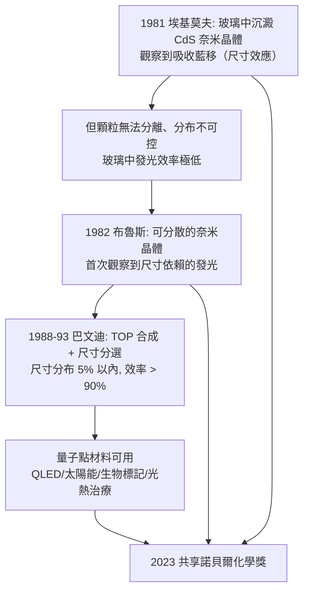

# 2023 · 巴文迪、布魯斯與埃基莫夫——會發光的奈米顆粒

> 2023 諾貝爾化學獎：蒙吉·巴文迪（Moungi G. Bawendi，1961– ，美國）、路易斯·布魯斯（Louis E. Brus，1953– ，美國）與阿列克謝·伊·埃基莫夫（Alexei I. Ekimov，1945– ，俄羅斯）——表彰「其對量子點之發現與合成」。**把半導體縮小到奈米尺度，讓電子在盒子裡像樂隊一樣排排站。**

## 懸案（案情提要）

1980 年代的半導體科技，有一個「物理上的天花板」：

- 晶片上的電路由**量子侷限**支配：**電子被限制在奈米尺度的盒子裡時，能階會量子化**（就像電子被關在盒子裡的粒子）；
- 這意味著**材料的性質（顏色、發光）由尺寸決定**——尺寸可調的半導體，是「可設計的發光材料」與「可設計的光電轉換」的物理基礎；
- 但製造這樣的奈米結構在 1980 年代**極其困難**：
  - 需要的結構特徵尺度是 **2–10 nm**（僅數個原子層），遠小於當時的光學微影極限（數百 nm）；
  - 「外延生長」等薄膜技術需要**超高真空、極高溫**，且生長速率慢、覆蓋率低；
- 而有沒有一個更簡單的**化學**方法？

**偵辦人**：埃基莫夫（用化學沉澱在玻璃中做出奈米晶體）、布魯斯（把這個發現帶到美國並發展成可控合成）、巴文迪（做出「尺寸分布極窄」的樣品——這才是可用器件的關鍵）。

## 前因

| 年份 | 事件 |
| --- | --- |
| 1961 / 1953 / 1945 | 巴文迪生於美國巴黎；布魯斯生於美國克利夫蘭；埃基莫夫生於蘇聯（後於美國與丹麥）。 |
| 1981–1983 | **埃基莫夫**在蘇聯（列寧格勒 Ioffe 物理技術研究所，與 **Alexei (A.)** 與 **S. (S.)** 合作）以**膽礬（sulfate）與硒化物在玻璃中沉澱**（低溫玻璃矩陣法），觀察到**尺寸約 3 nm 的硫化鎘（CdS）奈米晶體**，並發現其**吸收與發光的能量隨顆粒尺寸變化**——**這是奈米晶體效應（size quantization effect）的第一次觀察**。**（因蘇聯的科學出版限制，論文延至 1983 年才發表。）** |
| 1982–1983 | **布魯斯**在**貝克萊的施樂（Xerox PARC）**獨立做出**奈米尺度顆粒的膠體合成**，並**首次觀察到**由尺寸決定的**發光（photoluminescence）**——**確認了奈米晶體在室溫下的量子限域效應**。 |
| 1983 | 埃基莫夫與布魯斯的論文相繼發表（*Journal of the American Chemical Society* / *Soviet Physics* 系列），「**奈米晶體（nanocrystal）**」一詞由布魯斯團隊提出。 |
| 1988–1993 | **巴文迪**在**Bell Labs**（與其合作者**默里（Murray）**、**約翰森（Johnson）**等）**以**高溫金屬有機合成（organometallic synthesis）**做出**尺寸分布極窄（$\sim$ 5% 以內）的 CdS 奈米晶體**：以 $\mathrm{Cd(CH_3)_2}$ 與 $\mathrm{S(CH_3)_2}$ 在 $280$–$300\,^\circ\mathrm{C}$ 的**三辛基膦（TOP，trioctylphosphine）**中反應，並以**尺寸分選（size-selective precipitation）**去除大小不一的顆粒。 |
| 1990s | 巴文迪與其合作者證明：**奈米晶體的光致發光效率高達 90% 以上**（在溶液中的量子產率 $\sim 0.9$）——**這是「奈米材料不只是尺寸效應，而是更好的材料」的關鍵證據**。 |
| 1993 | 巴文迪加入**麻省理工學院**，建立奈米晶體的化學研究路線。 |
| 1998 | **「量子點」（quantum dot）**一詞在業界定型（源自1980年代於**膠體 CdSe 的尺寸分布控制**）。 |
| 2000s–2010s | 奈米晶體用於：**QLED 顯示器**（三星等於 2010 年代量產的量子點顯示器）、**太陽能電池**、**生物標記（量子點螢光探針）**、**癌症治療（近紅外光熱治療）**。 |
| 2023 | 三人共享諾貝爾化學獎。 |

## 調查

**偵查一：量子限域——「盒子變小，能階變多」**

$$\text{半導體中的載流子} \xrightarrow{} \text{被限制在} \ L \sim 2\text{–}10\ \mathrm{nm}\ \text{的盒子裡}$$

$$\text{盒子越小} \Rightarrow \text{能階間隔} \Delta E \uparrow \Rightarrow \textbf{吸收與發光的能量（波長）由尺寸決定}$$

$$\text{半徑} R \text{ 對應於} \quad E_{\text{confine}} \sim \frac{\hbar^2\pi^2}{2R^2 m^*}\left(\frac{1}{n^2}-\frac{1}{m^2}\right)$$

$$\boxed{\text{因此}：\ \text{同一種材料（CdSe）} \xrightarrow{\text{不同顆粒尺寸}} \text{發出} \textbf{從藍到紅} \text{的各種顏色}}$$

$$\text{對照}：\ \text{體相 CdSe} \ (\text{顆粒} > 10\ \mathrm{nm})\ \text{只發出} \sim 550\ \mathrm{nm}\ \text{（橙黃）的寬帶光}$$

$$\text{而} \ 3\ \mathrm{nm}\ \text{的顆粒} \xrightarrow{} \sim 400\ \mathrm{nm}\ \text{（藍）};\qquad 7\ \mathrm{nm} \xrightarrow{} \sim 650\ \mathrm{nm}\ \text{（紅）}$$

**「同一個化學式，不同的顏色」——這是化學史上材料設計最直觀的成果之一。**

**偵查二：合成法的關鍵——「尺寸分布」。**

$$\text{為何尺寸分布重要}：\ \text{若顆粒尺寸不一} \Rightarrow \text{發光譜寬、顏色不純} \Rightarrow \textbf{不能用於顯示器}$$

$$\text{巴文迪的合成（TOP 法）}：\ \begin{cases}\text{① 以金屬有機前驅物在高沸點配位溶劑中熱解}\\ \text{② 以}\textbf{尺寸分選（size-selective precipitation）}\text{去除過大/過小的顆粒}\\ \text{③ 表面以} \textbf{三辛基膦氧化膦}\text{包覆，使顆粒可分散並防止聚集}\end{cases}$$

$$\boxed{\text{結果}：\ \text{尺寸分布寬度} \sim 5\%\ (\text{相對標準差}) \text{——這是「可以拿來做器件」的門檻}}$$

**「分布窄到 5%」——這就是巴文迪獲獎的核心理由**：不是「做出奈米顆粒」，而是「做出**均勻**的奈米顆粒」。

**偵查三：把奈米晶體「裝進盒子」——尺寸分選與相轉移。**

$$\text{量子點的實際挑戰}：\ \text{顆粒必須} \textbf{大小均勻}、\textbf{表面可功能化}、\text{且} \textbf{在加工後仍不聚集}$$

$$\text{方法}：\ \text{以} \mathrm{PPh_3}\ \text{與} \mathrm{H_2O}\ \text{作} \textbf{相轉移配體交換（ligand exchange）}\xrightarrow{} \text{表面由膦配體換成羧基} \Rightarrow \textbf{可溶於水、可接生物分子}$$

**「奈米晶體的化學表面工程」——這是化學家在奈米時代的核心競技場**，因為電子傳遞與催化都發生在**表面**。

**偵查四：為什麼 1980 年代的化學家「看見」了它，卻不是布魯斯與巴文迪先做出來？**

$$\text{埃基莫夫（1981）}：\ \text{在玻璃中做出 CdS 奈米晶體，觀察到吸收邊的藍移}$$

$$\text{問題}：\ \text{① 玻璃中的顆粒} \textbf{無法分離、無法操控、尺寸分布不可控}；\ \text{② 没有} \textbf{可觀測的} \textbf{發光} \text{（當時玻璃中的奈米晶體發光效率極低）}$$

$$\text{布魯斯（1982）}：\ \text{以化學途徑做出} \textbf{可分散的} \text{奈米晶體，並觀察到} \textbf{尺寸依賴的} \textbf{發光}$$

$$\text{巴文迪（1988–93）}：\ \text{解決} \textbf{尺寸分布}\text{的問題} \xrightarrow{} \textbf{材料可用了}$$

$$\boxed{\text{科學的接力}：\ \text{現象的發現（埃基莫夫）} \to \text{現象的確立（布魯斯）} \to \text{材料的可用（巴文迪）}}$$

**「三個人分別解決了『看見』『確認』『可用』三個層次」——2023 年諾貝爾獎的敘事結構非常清晰。**

## 理論裁決

**判決一：限域能階——「材料性質成為尺寸的函數」。**

$$\Delta E_{\text{conf}} \approx \frac{h^2}{8m^*R^2}\left(\frac{1}{n_1^2}-\frac{1}{n_2^2}\right) \quad(\text{球近似，} R \ll \text{體相玻爾半徑})$$

$$\boxed{\text{因此}：\ E_g(R) = E_{g,\text{bulk}} + \frac{h^2}{8m^*R^2}\left(\frac{1}{n_1^2}+\frac{1}{n_2^2}\right)\ \text{——藍移，} R \text{ 越小，能隙越大}}$$

$$\text{經典的 Brus 方程（1984）}：\ \frac{1}{R^2} = \frac{E_{g,\text{bulk}} - E_g}{C} - \frac{2}{R_{\text{exciton}}} + \text{表面項}$$

**「把量子侷限寫成可計算的公式，並用來量測奈米顆粒的大小」——這是奈米化學的第一個定量定律。**

**判決二：尺寸分布——「材料科學的統計學」。**

$$\text{奈米晶體的發光譜寬} \approx \sqrt{\left(\frac{\Delta E}{E}\right)^2_{\text{尺寸分布}} + \left(\frac{\Delta E}{E}\right)^2_{\text{其他 broadening}}}$$

$$\boxed{\text{若尺寸分布寬度} \Delta R/R \sim 10\% \Rightarrow \text{發光譜寬到不可用}; \quad \Delta R/R \sim 5\% \text{以下} \Rightarrow \textbf{可用}}$$

**「分布」而非「平均值」成為奈米材料的核心指標——這是一個統計物理的教訓。**

**判決三：表面是反應場所，也是缺陷來源。**

$$\text{奈米晶體}：\ \text{表面原子比例} \sim \frac{3}{R} \quad\text{（} R = 2\ \mathrm{nm}\ \text{時約 50\% 的原子在表面！）}$$

$$\text{因此}：\ \begin{cases}\text{① 表面缺陷} \to \text{非輻射複合} \to \text{發光效率低}\\ \text{② 表面包覆（有機配體）} \to \text{鈍化} \to \text{效率跳升}\end{cases}$$

$$\boxed{\text{「奈米化學」的本質}：\ \text{在奈米尺度上控制表面}$$

**這是化學家在奈米時代的核心角色：不是做「更小的塊」，而是**工程化它們的表面**。**

**判決四：從「效應」到「器件」的距離。**

$$\text{量子點} \xrightarrow{} \text{EL 效率} > 20\% \xrightarrow{} \text{壽命} > 10^5\ \mathrm{h} \xrightarrow{} \text{像素密度} > 4\mathrm{K}\ \text{（QLED）}$$

$$\text{2010 年代}：\ \text{量子點顯示器量產} \xrightarrow{} \text{奈米材料第一次進入消費電子}$$

## 後果

| 領域 | 影響 |
| --- | --- |
| 顯示技術 | **QLED（量子點 LED）**：色彩純度依賴發光譜窄，而譜窄依賴尺寸分布——**這是巴文迪的貢獻最直接影響的產業**。 |
| 光電 | 量子點太陽能電池（可調帶隙以吸收更多太陽能）、紅外偵測器。 |
| 醫療 | 量子點作為**近紅外光熱治療**（吸收 NIR、局部加熱殺死腫瘤細胞）；作為多模態成像標籤（MRI 的 $\mathrm{Gd}$ 與螢光雙模）。 |
| 奈米科學 | 確立「奈米材料必須尺寸可控」的標準，也催生了对纳米颗粒毒理学的系統研究（表面反應性與生物冠層）。 |
| 科學史 | 埃基莫夫的蘇聯經歷（成果因出版限制延後）、布魯斯的跨國轉移、巴文迪的化學訓練與材料能力——**三條科學路徑的交會**。 |

## 關聯

- [1966-馬利肯與分子軌域](1966-馬利肯與分子軌域.md)：量子限域的理論語言（量子井、能階）。
- [1976-利普斯科姆與硼烷](1976-利普斯科姆與硼烷.md)：奈米尺度上的鍵結與結構——本案是其在膠體與半導體中的實現。
- [1995-克魯岑與臭氧層](1995-克魯岑與臭氧層.md)：半導體與大氣化學之外的另一個「奈米尺度」舞台。
- [2023-巴文迪與量子點](2023-巴文迪與量子點.md)：即本卷。
- [2000-白川英樹與導電聚合物](2000-白川英樹與導電聚合物.md)：導電高分子與量子點——奈米材料領域的兩個並行的化學路線。
