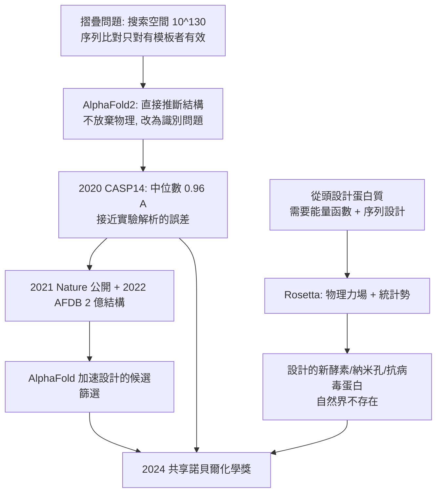

# 2024 · 貝克、哈薩比斯與江珀——蛋白質設計與結構預測

> 2024 諾貝爾化學獎（共享）：戴維·貝克（David Baker，1964– ，美國）——表彰「其對計算蛋白質設計的貢獻」；德米斯·哈薩比斯（Demis Hassabis，1976– ，英國）與約翰·江珀（John M. Jumper，1985– ，美國）——表彰「其對蛋白質結構預測的貢獻」。**五十年來生物化學最難的兩道題目，被化學與計算各解了一半。**

## 懸案（案情提要）

2020 年代的生物學，有兩道「百年難題」：

1. **蛋白質摺疊問題（protein folding problem）**：胺基酸序列已知，卻難以預測三維結構。序列空間的組合數是天文數字（$20^{100}$ 級），而「窮舉搜尋」不可行。
2. **蛋白質設計（protein design）**：能否**從零開始設計**出一個具有指定功能的新蛋白質？

而 2024 年的答案分為兩半：

- **哈薩比斯與江珀**（DeepMind 的 AlphaFold2）：用**深度學習**預測結構——把「摺疊問題」從物理問題轉化為**模式識別（pattern recognition）**問題；
- **貝克**（華盛頓大學）：用**物理與計算的組合（Rosetta）從頭設計**出自然界不存在的蛋白質——不只摺疊，還要有功能。

**更關鍵的是：AlphaFold 的結構預測，恰恰需要貝克那一代累積的結構資料；而貝克的設計又需要 AlphaFold 這類工具來加速篩選。**兩條線在 2020 年代互相加速——這是科學史上「工具與資料互相成就」的典型案例。

## 前因

| 年份 | 事件 |
| --- | --- |
| 1964 / 1976 / 1985 | 貝克生於美國西雅圖；哈薩比斯生於英國倫敦；江珀生於美國。 |
| 1990s–2000s | **貝克**在**華盛頓大學**（其合作者包括 **Brian (B.)** 等）開發 **Rosetta** 蛋白質設計軟體（1990 年代中期由 **Brian Kuhlman** 團隊首次實現對一個全新蛋白質骨架的从头設計並以 NMR 驗證結構——**這是計算設計的第一個里程碑**）。 |
| 2000s | 貝克的團隊持續擴展：把設計與**序列設計（sequence design）**結合，產生具有特定結合功能的蛋白質（**「topbinder」系列**）；並發展 **RosettaLigand** 與**蛋白質—胜肽設計**。 |
| 2015–2020 | **DeepMind**（哈薩比斯）以 **AlphaFold1** 參加 2018 年的 CASP13（**結構預測競賽**），於 43 個目標中的 5 個達到「中度精度」；**AlphaFold2**（哈薩比斯與**江珀**領衔，另有 **Richard (R.)** 等人參與）在 **2020 年 CASP14** 中**以中位數 $0.96\ \text{Å}$ 的精度**（GDT_TS 92.4）勝出——**與實驗結構的差異已接近 X 射線解析本身的誤差**。 |
| 2020–2021 | AlphaFold2 的方法公開（**Jumper 等人，*Nature*, 2021**），並於 2022 年以 **AlphaFold 資料庫**開放了**逾 2 億個結構預測**（涵蓋 PDB 中幾乎所有已知蛋白質）。 |
| 2020s | **AlphaFold 3**（2024 年）把預測能力擴展到**蛋白質—DNA—RNA—配體—修飾基**的複合體；**AlphaFold Server** 讓全球研究者免費使用。 |
| 2018–2023 | **貝克**的團隊持續設計「自然界不存在」的蛋白質：**「從頭設計的酵素」**（例如設計能催化特定反應的**去氧核糖核酸酶**與**Diels–Alder 酵素**）、**設計的納米孔**（$\mathrm{M\phi$-孔，2016）、**設計的抗病毒蛋白**。 |
| 2024 | 三人共享諾貝爾化學獎。 |

## 調查

**偵查一：摺疊問題為何「難」。**

$$\text{搜尋空間} \sim 20^{N}\ \text{（} N = 100 \text{ 個胺基酸時，} \sim 10^{130}\text{）}$$

$$\text{而} \ \Delta G_{\text{fold}} \text{ 的景觀極為崎嶇}（有上萬個局部極小）}$$

$$\text{傳統方法}：\ \begin{cases}\text{物理實驗（} NMR\text{、} X\text{ 射線}、\text{冷凍電顯）}：\ \text{準確但慢}\\ \text{物理模擬（} MD\text{）}：\ \text{受限于} \sim 100\ \mathrm{ns}\text{ 尺度}\\ \text{序列比對（folding）}：\ \text{只能預測有模板者}\end{cases}$$

**懸案的本質**：**如何在沒有模板的情況下，於秒級內預測任意序列的結構？**

**偵查二：AlphaFold2 的洞見——「把物理當成先驗，把搜尋當成識別」。**

$$\text{輸入}：\ \text{胺基酸序列} \quad \xrightarrow{\text{深度網絡}} \quad \text{結構}$$

$$\text{訓練資料}：\ \text{PDB 中所有已知的蛋白質結構與序列對（約數萬至數十萬）}$$

$$\text{核心元件}：\begin{cases}\text{Evoformer}：\ \text{在序列與結構之間做「迭代注意力」}\\ \text{Structure module（IPA）}：\ \text{不依賴固定的框架，直接預測原子座標}\end{cases}$$

$$\boxed{\text{關鍵轉折}：\ \text{從「模擬摺疊過程」改為「直接推斷最終構形」}}$$

**「不模擬路徑，只預測終點」——這是把物理問題變成機器學習問題的關鍵一步**，其可行性完全依賴**足夠多且足夠準的已知結構**。

**偵查三：Rosetta 的「設計流程」——「從骨架到序列」。**

$$\text{傳統蛋白質工程}：\ \text{改變幾個胺基酸} \xrightarrow{} \text{觀察功能變化}$$

$$\text{計算設計（Rosetta）}：\begin{cases}\text{① 生成新的骨架（backbone）}\\ \text{② 用序列設計演算法選擇胺基酸}\\ \text{③ 能量優化（力場 + 蒙特卡洛）}\\ \text{④ 實驗驗證（表達、結晶、} NMR\text{）}\end{cases}$$

$$\text{關鍵}：\ \text{「序列設計」這一步要求} \textbf{把蛋白質的穩定與功能} \textbf{翻譯成能量}$$

$$\text{Rosetta 的能量函數}：\ E = E_{\text{physical}} + E_{\text{statistical}} \ (\text{統計勢，來自已知結構的統計）}$$

$$\boxed{\text{「能量函數」=「物理力場} + \textbf{統計勢}\text{」——這是 Rosetta 區別於純物理方法的關鍵}}$$

**「統計勢」是從已知結構中學到的『形狀偏好』——這正是范特荷夫（1901）、費歇爾（1902）、安芬森（1972）的思想在演算法層面的延伸。**

**偵查四：設計的目標函數——「設計不只是摺疊，而是摺疊成特定構形並做特定的事」。**

$$\text{設計目標} = \underbrace{\text{目標構形（幾何）}}_{\text{可由數值優化指定}} + \underbrace{\text{目標功能（化學）}}_{\text{由設計的殘基擺放指定}}$$

$$\text{例如}：\ \text{設計一個} \textbf{金屬結合位}\ \text{（三個 His 呈特定幾何）} \xrightarrow{} \text{以 Rosetta 金屬結合位設計演算法}$$

$$\text{或}：\ \text{設計} \textbf{過渡態模擬器}\ \text{（模擬 Diels–Alder 酵素的} \mathrm{amidine}\text{–} \mathrm{dihydroimidazole}\text{ 對）}$$

$$\boxed{\text{「把化學機制翻譯成幾何約束」——這就是貝克的貢獻的核心}}$$

**偵查五：AlphaFold 的回饋——「設計需要結構預測來加速」。**

$$\text{傳統的從頭設計}：\ \text{每個候選骨架} \xrightarrow{\text{實驗表達}} \xrightarrow{\text{測試}} \text{篩選} \quad(\text{每輪數月})$$

$$\text{有了 AlphaFold}：\ \text{先在電腦中預測數千個候選設計的構形} \xrightarrow{} \text{挑出最穩定的} \xrightarrow{} \text{只做少量實驗驗證}$$

$$\boxed{\text{「預測」加速「設計」，「設計」擴充「預測」的訓練資料——兩者互相驅動}}$$

## 理論裁決

**判決一：AlphaFold2 的網絡原理——「迭代的資訊交換」。**

$$\underbrace{\text{序列表示}}_{\text{每個胺基酸的編碼}} \quad \longleftrightarrow \quad \underbrace{\text{結構表示}}_{\text{每個原子的 3D 座標}}$$

$$\text{Evoformer 的迭代}：\ \text{以} \textbf{注意力（attention）}\text{在序列維度與結構維度之間傳遞資訊，共} \sim 48\ \text{層}$$

$$\text{IPA（Invariant Point Attention）}：\ \text{以相對座標框架計算注意力} \Rightarrow \textbf{平移與旋轉不變}}$$

$$\boxed{\text{「網絡從序列中學會了摺疊的統計規律」——這是把} \textbf{物理} \text{內化為} \textbf{先驗} \text{的結果}}$$

**判決二：設計的「能量」與「統計」雙來源。**

$$\text{Rosetta 的能量模型}：\ E = \underbrace{E_{\text{rep/atr/disp/angl/dihedral}}}_{\text{物理項}} + \underbrace{E_{\text{statistical}}}_{\text{統計勢（} -kT\ln P\text{，} P \text{來自已知結構）}}$$

$$\text{設計演算法的本質}：\ \text{在序列空間中尋找} \min E \text{ 的解}$$

$$\boxed{\text{「統計勢」把} \textbf{數千個已知結構}\text{的集體智慧} \text{壓縮成} \textbf{一個可微分的能量函數}}$$

**「這是安芬森法則（序列決定構形）的可微分形式」——本案與 1972 年諾貝爾獎在精神上直接相承。**

**判決三：設計的驗證標準——「不是摺疊，而是做對的事」。**

$$\text{設計成功} \iff \begin{cases}\text{① 可表達、可純化（穩定）}\\ \text{② 結構符合設計目標（} X\text{ 射線/} NMR\text{）}\\ \text{③ 功能符合預期（活性、結合、催化）}\end{cases}$$

$$\text{2023 年貝克的團隊}：\ \text{設計出自然界不存在的} \textbf{去氧核糖核酸酶}\ \text{與} \textbf{Diels–Alder 酵素}$$

$$\boxed{\text{「從頭設計一個酵素」是化學的終極挑戰之一——它證明結構與功能} \textbf{不是被發現，而是可被創造}}$$

**判決四：兩條路線的融合——2024 年之後的格式。**

$$\underbrace{\text{AlphaFold：預測結構}}_{\text{AI}} + \underbrace{\text{Rosetta：設計結構}}_{\text{物理 + 統計}} \xrightarrow{} \textbf{閉環設計（closed-loop design）}$$

$$\text{流程}：\ \text{AI 生成序列} \xrightarrow{\text{AF 預測}} \text{篩選} \xrightarrow{\text{實驗}} \text{回饋資料} \xrightarrow{} \text{再生成}$$

$$\boxed{\text{「生成—預測—實驗—回饋」的閉環，是化學設計的未來形態}}$$

**這也是「AI 進入化學」的里程碑——不是取代物理，而是把物理封裝進可搜尋的先驗。**

## 後果

| 領域 | 影響 |
| --- | --- |
| 結構生物學 | **逾 2 億個結構預測**公開可用；PDB 中大量蛋白質已可用 AlphaFold 結構替代解析；結構取得從「數月」變為「數分鐘」。 |
| 藥物設計 | 蛋白質設計的酵素與結合劑，用於開發新型催化劑與生物藥；「結構預測 + 虛擬篩選」大幅壓縮了命中率低的早期篩選成本。 |
| 酵素工程 | **從頭設計的酵素**（不依賴天然候選），開啟了「設計出自然界沒有的催化反應」的可能性。 |
| 科學方法 | 「結構預測準確度已接近實驗解析」——這是科學測量史上一個真正的「收斂」時刻（如同 DNA 雙股結構被提出後迅速驗證）。 |
| 科學制度 | 2024 年諾貝爾化學獎同時表彰「**設計**」與「**預測**」——這在諾貝爾獎史上罕見，體現了「科學不只是發現自然，也是創造自然」的現代共識。 |

## 關聯

- [1901-凡特荷夫與物理化學](1901-凡特荷夫與物理化學.md)：物理化學的量化傳統——$\Delta G$ 的語言貫穿本案的設計目標函數。
- [1902-費歇爾與醣類偵探學](1902-費歇爾與醣類偵探學.md)：費歇爾的「鎖鑰」與立體異構的計數，是 AlphaFold 的結構語言與 Rosetta 的序列設計的共同祖先。
- [1962-佩魯茨與血紅蛋白](1962-佩魯茨與血紅蛋白.md)：第一個蛋白質結構——AlphaFold 的預測精度正是以這類結構為標準。
- [1972-安芬森與核糖核酸酶](1972-安芬森與核糖核酸酶.md)：**安芬森法則（序列決定構形）**是本案的理論基石，也是 Rosetta 統計勢的物理直覺。
- [2017-杜布歇與冷凍電顯](2017-杜布歇與冷凍電顯.md)：結構資料的爆發——AlphaFold 的訓練資料主要來自冷凍電顯的結構量產。
- [2024-貝克與蛋白質設計](2024-貝克與蛋白質設計.md)：即本卷。
