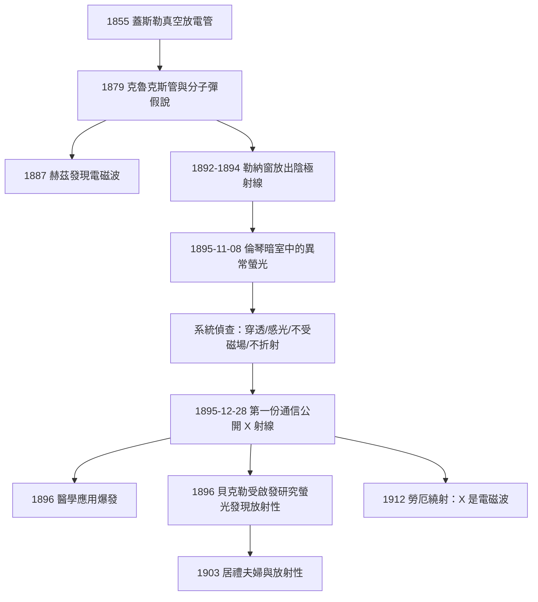

# 1901 · 倫琴與 X 射線：穿透黑紙的無名之光

> 1901 諾貝爾物理學獎：威廉·康拉德·倫琴（Wilhelm Conrad Röntgen, 1845–1923，德意志帝國）——表彰「他因發現其後以他的名字命名的不尋常射線而做出的傑出貢獻」（for the discovery of the remarkable rays subsequently named after him）。首屆諾貝爾物理學獎。

## 懸案（案情提要）

1895 年 11 月 8 日，星期五，晚上。德國符茲堡大學物理研究所所長倫琴獨自在暗室裡值班。他面前是一具陰極射線管——全歐洲各大實驗室都有的標準設備——以及一塊被螢光劑（鉑氰化鋇）塗抹過的小屏。當管子通電時，那塊離管子一公尺遠、理應與陰極射線毫無關係的螢光屏，竟然亮了。

這樁案子有三個不合常理的地方，讓整個物理學界坐立難安：

1. 陰極射線走不了這麼遠。它們在空氣中頂多前進幾公分，而且連薄玻璃都出不了管壁。
2. 螢光屏上的光不是由可見光引起的：光束與管子之間隔著厚厚的黑色紙板，可見光完全出不去。
3. 這束看不見的射線能讓底片感光、能穿過書本、木頭、甚至活人的手掌——卻在金屬鉛面前停了下來。

更麻煩的是它的「作案手法」完全不合當時任何已知射線的慣例：它不會被磁場偏轉（陰極射線會）、不會被透鏡折射（可見光會）、也不像任何已知的紫外線那樣容易反射。倫琴在第一份報告裡乾脆給它起了個代號——**X**，一宗數學上的未知數，一樁尚未結案的懸案。

## 前因

| 年份 | 事件 |
|------|------|
| 1855 | 德國吹玻璃工匠蓋斯勒（Heinrich Geissler）造出高真空放電管，人類第一次能把「稀薄氣體中的電流」裝進玻璃裡研究。 |
| 1858 | 普呂克（Julius Plücker）觀察到陰極附近的玻璃壁會發出螢光，並隨磁場移動——陰極射線的第一次現身。 |
| 1869 | 希托夫（Johann Hittorf）證明陰極射線沿直線行進、能被障礙物擋住。 |
| 1876 | 戈德斯坦（Eugen Goldstein）命名 Kathodenstrahlen（陰極射線），並注意到它們會在物質上打出「陰極螢光」。 |
| 1879 | 克魯克斯（William Crookes）改良真空管（克魯克斯管），提出「分子彈」假說：陰極射線是高速帶電粒子。 |
| 1887 | 赫茲（Heinrich Hertz）發現電磁波，證實麥克斯韋方程組；同年他觀察到陰極射線似乎能穿透薄金屬箔——「粒子說」出現了第一道裂縫。 |
| 1892–1894 | 萊納德（Philipp Lenard）在赫茲指導下製出「勒納窗」：以鋁箔封住管壁，把陰極射線放出管外研究。這是 1905 年諾獎的主角，也是倫琴案的「前科檔案」。 |
| 1894 | 倫琴就任符茲堡大學物理研究所所長；他早在 1888 年起系統研究氣體放電與陰極射線，是全德最熟悉這類管子的實驗家之一。 |
| 1895-11-08 | 懸案發生：暗室中的鉑氰化鋇螢光屏在陰極射線管通電時無故發光。 |

## 調查

倫琴的偵查風格是教科書級的：八個星期內，他幾乎住在實驗室，重做、加做、控制變因，把每一個可懷疑的旁證都排除乾淨。他日後的自述（1896 年 1 月與記者與同行的談話、1895 年 12 月 28 日提交的《論一種新型射線，第一份通信》）提供了完整的筆錄：

**第一步：確認光源。** 他先用黑紙把整個放電管包得密不透光，在暗室中通電，再靠近螢光屏——發光依舊。關掉高壓，發光消失。光源確實在管內，且不是可見光或紫外線：一整疊黑紙擋得住任何已知的光。

**第二步：測穿透力。** 他把各種材料放在管與屏之間：幾百頁的書、兩千頁厚的書目錄、松木板、硬橡膠、鋁板。結果呈現一條清晰的規律——**穿透能力隨密度遞減**，與厚度有關但更快地與物質密度有關。鉛（密度 $11.3\,\mathrm{g/cm^3}$）幾乎完全擋住射線。他用一塊小鉛片截住射線時，意外在螢光屏上看到了自己手指骨頭的影子——史上第一次，活人的骨骼在世間現形。

**第三步：測直線性與感光性。** 射線使乾板感光，留下清晰的陰影像。1895 年 12 月 22 日，他請妻子安娜·貝爾塔把手放在底片上，得到那張著名的 X 射線照片：指骨、無名指上的戒指、皮肉的半透明輪廓。傳說安娜看後只說了一句：「我看見了自己的死亡。」

**第四步：逐一排除已知射線。** 這是「起訴書」的關鍵證據鏈：

| 試驗 | 陰極射線 | 紫外線 | 新射線 X |
|------|----------|--------|----------|
| 穿出玻璃管壁 | 不能 | 能 | 能 |
| 穿過數公分固體 | 不能 | 不能 | 能 |
| 被磁場偏轉 | 強烈偏轉 | 不偏轉 | 不偏轉 |
| 被透鏡/稜鏡折射 | （帶電不折射） | 折射 | 不可察覺的折射 |
| 被平面鏡規則反射 | 無 | 有 | 無 |
| 螢光效應 | 有 | 有 | 有，且極強 |

五項中三項像光、兩項像粒子，卻兩頭都不像。倫琴在報告中的原話是：「這一性質的組合，在迄今已知的任何射線中都不存在。」

**第五步：定量。** 倫琴測量了射線經過吸收板後螢光強度的衰減，發現指數式吸收規律：

$$I(x) = I_0 \, e^{-\mu x}$$

其中 $\mu$ 為線性衰減係數，隨材料密度增大而增大。他還觀察到：管的放電越「硬」（電壓越高），射線越能穿透——這暗示射線本身有某種可調的「硬度」，日後被理解為能量（波長）的差異。

**結案前的最後一步：反向調查。** 倫琴嚴格檢查了螢光屏會不會因溫度、靜電、化學污染等雜訊發光——全部排除。他在數週內拍攝了金屬片、砝碼盒（連盒中砝碼與夾子一起現形）、羅盤（金屬部分清晰、玻璃部分幾乎透明）等系統性物證。1895 年 12 月 28 日，《符茲堡物理醫學學會會刊》收到第一份通信；1896 年 1 月 5 日，維也納《新自由報》率先登出消息，一夜之間，X 射線震動世界。

## 理論裁決

倫琴本人交出的報告只描述事實，刻意不做理論判決——他甚至在報告中試探性地猜測 X 射線「也許是以太的縱波」，與麥克斯韋的橫波理論相容性存疑。真正的裁決要等 17 年：

**裁決一：X 射線是電磁波。** 依麥克斯韋方程組，在真空中電磁場滿足波動方程

$$\nabla^2 \mathbf{E} - \frac{1}{c^2}\frac{\partial^2 \mathbf{E}}{\partial t^2} = 0$$

若 X 射線是電磁波，波長應在可見光（約 $400$ 至 $700\,\mathrm{nm}$）與陰極射線（粒子）之間，即約 $0.1\,\mathrm{nm}$ 量級——遠小於任何人造光柵的柵距，這正好解釋了為什麼它「不折射、不反射」：常規光學元件的尺度對它而言太粗糙，散射與繞射效應完全被忽略。1912 年勞厄以晶體（原子間距約 $0.1$ 至 $0.3\,\mathrm{nm}$）作「天然光柵」拍出繞射斑，此案才獲得光學上的終審（見 1914 年檔案）；布拉格父子再以 $2d\sin\theta = n\lambda$ 把繞射角換算成波長，X 射線光譜學從此成為一門精確科學。

**裁決二：X 射線從哪裡來。** 現代理論給出兩個機制，兩者都在倫琴的管子裡同時作案：

1. **韌致輻射（bremsstrahlung）**：陰極射線電子撞上陽極（玻璃或金屬靶）急劇減速，依拉莫公式輻射電磁能

$$P = \frac{e^2 a^2}{6 \pi \varepsilon_0 c^3}$$

其中 $a$ 為電子加速度。電子的末動能 $eV$ 決定了輻射譜的高頻上限：

$$\nu_{\max} = \frac{eV}{h}$$

電壓越高、射線越「硬」——這正是倫琴測到的「硬度隨放電強度增加」的理論根據。

2. **特徵輻射（characteristic X rays）**：高速電子打掉靶原子內層電子，外層電子躍遷填補空位，輻射出該元素特有的譜線。巴克拉（1917 年獲獎）發現 K、L 系特徵輻射，莫塞萊（1913）更給出規律

$$\sqrt{\nu} = A\,(Z - \sigma)$$

$\nu$ 隨原子序 $Z$ 平滑變化——X 射線成了「原子的指紋」，也成為波耳原子模型（見 1922 年檔案）最嚴格的法庭證據。

**裁決三：為何不受磁場偏轉。** 陰極射線受力 $\mathbf{F} = q\,\mathbf{v} \times \mathbf{B}$，故在磁場中彎曲；X 射線是不帶電的光子束，僅以極小概率與電子散射（康普頓效應，1927 年檔案），偏轉效應弱到倫琴時代完全測不出。三份證據合併，懸案正式結案：X 射線是波長約 $0.01$ 至 $1\,\mathrm{nm}$ 的電磁波，由高速電子撞擊物質產生。

## 後果

| 年份 | 影響 |
|------|------|
| 1896 | X 射線醫學應用爆發：骨折診斷、異物定位在數月內成為常規手術。倫琴放棄專利，希望射線「屬於全人類」。 |
| 1896 | 貝克勒受「螢光物質可能發射穿透性射線」的問題啟發，發現鈾鹽的天然放射性——1903 年物理學獎的直接前因。 |
| 1901 | 首屆諾貝爾物理學獎無異議頒給倫琴；他婉拒了頒獎晚宴演說，把獎金全數捐給符茲堡大學。 |
| 1914 | 勞厄 X 射線晶體繞射獲諾獎；1915 年布拉格父子以此解析晶體結構；1917 年巴克拉的特徵輻射再獲獎。 |
| 1927 | 康普頓效應獲諾獎：X 射線光子與電子的彈性碰撞，把「X 是波還是粒子」變成「都是」。 |
| 1928 | 倫琴成為輻射劑量單位（roentgen），醫用輻射標準沿用數十年。 |
| 1953 | DNA 雙螺旋的關鍵證據（Photo 51）來自 X 射線繞射—— X 射線光譜學跨進分子生物學。 |
| 1994 | 第 111 號元素命名為 Rg（roentgenium，錀），以倫琴之名入列元素週期表。 |
| 2017 | LIGO 與 Chandra 等多信使天文學中，X 射線望遠鏡仍是宇宙偵查的主設備之一，源頭皆可追溯到 1895 年那晚的螢光。 |

## 關聯

- [1902-洛倫茲與塞曼的磁場譜線案](1902-洛倫茲與塞曼的磁場譜線案.md)：倫琴的「不可折射、不受磁場」與塞曼效應同屬「電磁與輻射」主線；X 射線不受磁場偏轉的判決，正是以帶電粒子會偏轉（塞曼案的核心）為對照組。
- [1903-貝克勒與居禮夫婦的放射性懸案](1903-貝克勒與居禮夫婦的放射性懸案.md)：貝克勒正是被 X 射線與螢光的關係之謎直接啟發，才去查鈾鹽——X 射線案的餘波盪出了放射性世紀。
- [1905-萊納德與陰極射線的窗戶](1905-萊納德與陰極射線的窗戶.md)：勒納窗是 X 射線案的前科檔案；萊納德一生對倫琴搶走「陰極射線家族的新成員」耿耿於懷，是本案最大的「未結恩怨」。
- [1906-湯姆森與電子的身分證](1906-湯姆森與電子的身分證.md)：陰極射線管中飛馳的電子，正是 X 射線的生產者；電子的 $e/m$ 測定與 X 射線的不可偏轉互為正反面。
- [1914-勞厄：X 射線與晶體的雙重審判](1914-勞厄：X射線與晶體的雙重審判.md)：倫琴留了 17 年的「X 是何物」案卷，由勞厄以晶體繞射一錘定音。
- [1917-巴克拉與元素的特徵X射線指紋](1917-巴克拉與元素的特徵X射線指紋.md)：特徵輻射把 X 射線變成原子物理的證據採集工具，波耳理論的重要旁證。
- ../化學獎/1903-阿倫尼烏斯電離學說.md：同屆（1903）化學獎與物理獎共享「電與物質」的時代主題；首屆五獎的得主名單本身就是 19 世紀末物理化學革命的結案報告。
