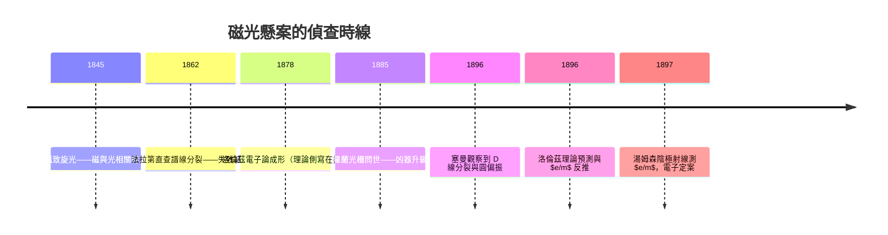

# 1902 · 洛倫茲與塞曼：磁場撬開的譜線

> 1902 諾貝爾物理學獎：亨得里克·安東·洛倫茲（Hendrik Antoon Lorentz, 1853–1928）與彼得·塞曼（Pieter Zeeman, 1865–1943），皆荷蘭人——表彰「他們對磁場影響輻射現象的研究」（for their researches into the influence of magnetism upon radiation phenomena），即塞曼效應的發現與理論解釋。

## 懸案（案情提要）

十九世紀末的物理學有三樁懸案同時在辦：光是什麼在振動、物質裡什麼在發光、以及磁與光到底有沒有關係。最後這樁最撲朔迷離——

1862 年，法拉第親自出馬。他把鈉焰放進當時最強的電磁鐵兩極之間，用光譜儀盯著 D 線，等它分裂。什麼都沒發生。以法拉第之能，這次的空手而歸幾乎成了定讞：**磁場改變不了光的顏色**。

三十四年後，萊頓大學一位 30 歲的講師塞曼不信這份舊卷。他把電磁鐵換強了數十倍、把光譜儀的解析度換成了羅蘭凹面光柵——那可是能分辨 $0.01\,\mathrm{nm}$ 級波長差的頂級凶器。1896 年 10 月 31 日，鈉 D 線在磁場中變寬了；再往下追，邊緣竟然是兩條分開的線。**譜線在磁場中分裂了**。

但分裂只是屍檢報告。真正的懸案是：誰在物質裡振動？磁場對它施加了什麼力？分裂的間距能不能倒推出這個「兇手」的體重與電荷？萊頓城裡恰好住著歐洲最深潛的理論偵探——洛倫茲，他手裡已經握有一份十年前寫好的「嫌疑犯側寫」。

## 前因

| 年份 | 事件 |
|------|------|
| 1845 | 法拉第發現磁致旋光（法拉第效應）：磁場能旋轉光的偏振面——「磁與光有關」的第一份物證。 |
| 1846 | 法拉第大膽假設：光是一種在力線中傳播的振動。 |
| 1862 | 法拉第以鈉焰與電磁鐵尋找磁場對譜線的影響，未果——偵查技術尚不足以偵破。 |
| 1864 | 麥克斯韋發表電磁場統一理論，光被裁定為電磁波。 |
| 1873–1875 | 洛倫茲的博士論文發展麥克斯韋理論；1875 年起他構思「電子論」：物質中存在極小的帶電粒子，光的發射與吸收來自它們的振動——遠早於電子被實驗證實。 |
| 1878 | 洛倫茲發表振子模型，成功解釋色散與吸收：折射率 $n$ 在吸收線附近反常變化（後稱洛倫茲-洛倫茨公式一脈）。 |
| 1885–1888 | 美國的羅蘭（H. A. Rowland）製成凹面衍射光柵，光譜解析度躍升一個量級——為重審法拉第舊案備好凶器。 |
| 1890 | 塞曼在萊頓跟隨昂內斯與柯莫林（Kamerlingh Onnes）取得博士學位，任講師，專攻磁光學。 |
| 1895-11-08 | 倫琴發現 X 射線，全歐物理界目光聚焦「看不見的輻射」；三個月後，萊頓也將迎來自己的大案。 |

## 調查

**第一現場。** 塞曼的裝置：一曲柄傳動的呂姆科夫感應圈驅動電磁鐵，磁極間隙中放置鈉鹽火焰（或吸收火焰）；光經縫隙進入羅蘭光柵攝譜儀。1896 年 10 月 31 日，他觀察到鈉 D 線在磁場作用下**變寬**；加強磁場後，他分辨出這不是模糊，而是 D 線的邊緣各自分出了新成分。他隨即對鎘紅線（$643.8\,\mathrm{nm}$）做了同樣檢查，結果更乾淨：中間一條原線，兩側各一條新線——三分裂的清晰「現場照片」。

**關鍵旁證：偏振方向。** 洛倫茲聽完塞曼的報告後，立刻算出預測：沿磁場方向觀察時，兩條外線應為**左旋與右旋圓偏振**；垂直磁場方向觀察時，三條線均為線偏振，中線偏振方向平行磁場、兩側垂直。塞曼逐一驗證——用一片四分之一波片與檢偏器，他確認沿場方向看到的是圓偏振，且旋轉方向與電子（負電荷）的迴旋方向一致。理論預測與現場證據嚴絲合縫，這在當時的實驗物理中極為罕見。

**定量的偵訊：從分裂量倒推 $e/m$。** 洛倫茲給出了分裂間距公式（見下節），塞曼據此做反向計算。以磁通量密度 $B$ 與分裂頻移 $\Delta\nu$：

$$\frac{e}{m} = \frac{4\pi \, \Delta\nu}{B}$$

代入磁場約 $10^4$ 高斯（$1\,\mathrm{T}$ 量級）、鎘線分裂約為該線頻率的 $10^{-5}$ 量級，塞曼得到荷質比

$$\frac{e}{m} \approx 10^{11}\,\mathrm{C/kg}$$

的量級——比當時任何已知離子（氫離子 $e/m \approx 9.6\times10^{7}\,\mathrm{C/kg}$）大**上千倍**。這意味著發光振子是一種遠比原子輕的帶電體。這份筆錄比湯姆森 1897 年的陰極射線實驗早了數月，是電子第一次被「稱重」——而審訊手段竟然是磁場與光譜。此外，分裂外線的圓偏振旋向還順帶判定了振子電荷的**符號**：負。

## 理論裁決

洛倫茲的裁決書核心是「振子 + 洛倫茲力」：物質中的發光體是束縛帶電粒子，質量 $m$、電荷 $e$，被回復力 $-k\mathbf{r}$ 拴在平衡位置附近振動。無磁場時，振動滿足

$$m\,\ddot{\mathbf{r}} = -k\,\mathbf{r}$$

本徵頻率 $\nu_0 = \frac{1}{2\pi}\sqrt{k/m}$，這就是譜線位置。加上外磁場 $\mathbf{B}$（沿 $z$ 軸），帶電振子多受一項洛倫茲力：

$$m\,\ddot{\mathbf{r}} = -k\,\mathbf{r} + e\,\dot{\mathbf{r}} \times \mathbf{B}$$

關鍵在座標系的選擇。把振動分解為沿磁場的線振動 $z$ 與兩個旋轉分量（左旋、右旋圓運動）。對 $z$ 分量，速度 $\dot{\mathbf{z}}$ 與 $\mathbf{B}$ 平行，$\dot{\mathbf{z}} \times \mathbf{B} = 0$，頻率**不變**——這就是三分裂中不動的中央線。對圓偏振分量，洛倫茲力沿半徑方向，等效地修改了回復力：

$$m\,\omega_\pm^2 = k \mp e\,\omega_\pm B$$

本徵頻率變成

$$\nu_\pm = \nu_0 \pm \frac{e\,B}{4\pi\,m}$$

分裂間距因此為

$$\Delta\nu = \frac{e\,B}{4\pi\,m}, \qquad \Delta\lambda = \frac{\lambda^2}{c}\,\frac{e\,B}{4\pi\,m}$$

三個可檢驗的推論全部被塞曼證實：（1）三分裂；（2）沿場方向兩外線為反向圓偏振、垂直場方向三線均為線偏振；（3）由 $\Delta\nu$ 反推的 $e/m$ 為 $10^{11}\,\mathrm{C/kg}$ 量級、電荷為負。這份裁決的威力在於：它不是描述一個現象，而是**用一個現象稱出了一種尚未被捕獲的粒子**。

**本裁決的殘留疑點（案中案）。** 洛倫茲的「正常塞曼效應」預言三分裂，但塞曼隨後在更多譜線上發現四分裂、六分裂、且強度比例古怪——「反常塞曼效應」成為量子力學問世前最著名的未結懸案，索墨菲稱之為「原子物理的粉筆墓誌銘」。它的偵破要等 1925 年烏倫貝克與古茲米特的電子自旋假說：自旋磁矩的迴磁比是軌道的兩倍，$g_s = 2$。自旋與相對論性的自旋-軌道耦合一併入卷，才把所有譜線分裂一次說清——這條支線最終通向包立不相容原理（1945 年檔案）與量子力學的完整體系。

**順帶的時代伏筆。** 為協調「運動中的地球為何測不到乙太風」，洛倫茲在 1892–1904 年間發展出的變換

$$x' = \frac{x - vt}{\sqrt{1 - v^2/c^2}}, \qquad t' = \frac{t - vx/c^2}{\sqrt{1 - v^2/c^2}}$$

日後被愛因斯坦重新詮釋為時空本身的性質——洛倫茲變換。1902 年這份諾獎，獎的是他電子論的譜線戰功；但他留給二十世紀物理的遺產遠不止此。

## 後果

| 年份 | 影響 |
|------|------|
| 1897 | 湯姆森以陰極射線直接測得 $e/m = 1.7\times10^{11}\,\mathrm{C/kg}$，與塞曼的反推值同量級——電子被雙重定案（1906 年物理學獎）。 |
| 1897–1902 | 塞曼與洛倫茲系統研究反常分裂；塞曼效應成為檢驗任何原子理論的第一張考卷。 |
| 1913 | 波耳模型解釋氫光譜；1916 年索墨菲引入精細結構與空間量子化，塞曼效應在舊量子論框架下重獲部分解釋。 |
| 1925 | 電子自旋提出，反常塞曼效應結案；同年包立不相容原理問世——原子結構的刑法總則成形。 |
| 1938 | 拉比的核磁共振（1944 年獲獎）本質上是「對原子核做的塞曼實驗」： $\omega = \gamma B_0$，日後衍生出 MRI 醫學成像。 |
| 1945 | 包立獲獎，其 1925 年的判決書正是為了清理塞曼案的殘留證物。 |
| 現代 | 天文學以塞曼分裂測量太陽黑子與星際磁場；原子鐘、離子阱（1989 年獲獎）皆以磁分裂與量子態操控為核心技術。 |

## 關聯

- [1901-倫琴與X射線](1901-倫琴與X射線.md)：X 射線不受磁場偏轉（光子無電荷）與塞曼效應中帶電振子受磁場分裂，構成「電磁輻射對磁場反應」的一體兩面。
- [1903-貝克勒與居禮夫婦的放射性懸案](1903-貝克勒與居禮夫婦的放射性懸案.md)：$\beta$ 射線在磁場中的偏轉（貝克勒 1899–1900 年的偵查）正是塞曼案「帶電粒子論」的直接延伸。
- [1906-湯姆森與電子的身分證](1906-湯姆森與電子的身分證.md)：塞曼以光譜稱出電子，湯姆森以陰極射線稱出電子——同一兇手的兩份獨立筆錄。
- [1922-波耳與原子結構的裁決](1922-波耳與原子結構的裁決.md)：塞曼效應成為波耳-索墨菲模型必須通過的測試，也埋下自旋的伏筆。
- [1945-包立與不相容原理](1945-包立與不相容原理.md)：反常塞曼效應這樁案中案，最後由包立以自旋與不相容原理總結陳詞。
- ../化學獎/1901-范托夫溶液滲透壓.md：首屆化學獎與本屆物理獎都在追問「分子與離子的真實身分」，電離與電子論共同催生原子級的世界觀。
