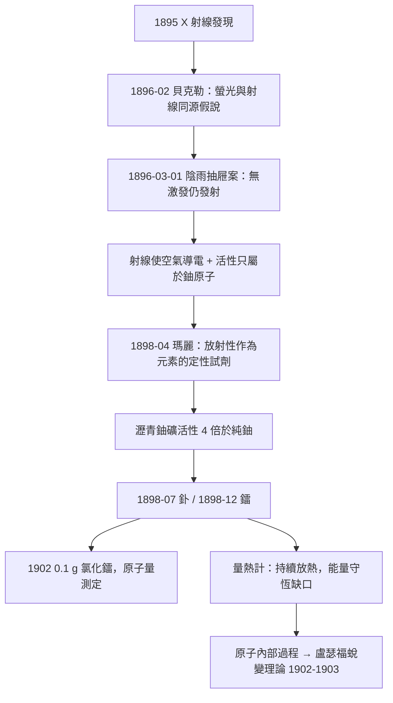

# 1903 · 貝克勒與居禮夫婦：從鈾鹽到鐳的放射性懸案

> 1903 諾貝爾物理學獎：亨利·貝克勒（Antoine Henri Becquerel, 1852–1908，法國）——表彰「他發現天然放射性」；皮耶·居禮（Pierre Curie, 1859–1906）與瑪麗·居禮（Marie Curie, 1867–1934，法國）——表彰「他們對貝克勒教授所發現的放射性現象的共同研究」。瑪麗·居禮是史上第一位女性諾貝爾獎得主。

## 懸案（案情提要）

1896 年初，全歐的實驗室都在追逐 X 射線。貝克勒——巴黎自然史博物館的教授、一個四代皆為物理學家世家的第三棒——問了一個非常自然的問題：**X 射線與螢光是同一回事嗎？** 倫琴的管子裡，玻璃壁正在發螢光，射線也從那裡出來。如果螢光物質受到日光激發就能發射穿透性射線，那一切就都能用現有的光學來解釋。

他用家族傳家寶——硫酸鈾醯鉀（一種著名螢光晶體）——做實驗：日光下曬過、放在包著黑紙的底片上，沖片，影像出現了。1896 年 2 月 24 日，他向科學院報告「螢光輻射」穿透黑紙的證據。

然後，懸案發生了。巴黎連日陰雨，沒有日光，他把包好的鈾鹽與底片一起鎖進抽屜。2 月 26 日、27 日無太陽；3 月 1 日他為了趕科學院的下一次報告，照樣把底片沖了——**影像比先前更黑、更清晰**。

這一沖，整個案情翻轉：激發源（日光）根本不在場，射線照樣發射。元凶不是螢光、不是光、不是任何「被激發」的過程——鈾鹽自己、無聲無息、日夜不停地，在發射某種東西。沒有輸入，卻有源源不絕的輸出；能量守恆在這裡出現了一個黑洞。這樁「無源之火」的懸案，接下來由居禮夫婦接手偵辦四年，並把全案指向物質最深處。

## 前因

| 年份 | 事件 |
|------|------|
| 1852 | 貝克勒生於巴黎；祖父安托萬·塞撒、父親亞歷山大皆研究磷光與螢光，博物館實驗室裡收藏著數十年累積的礦物標本。 |
| 1867 | 瑪麗亞·斯克沃多夫斯卡生於華沙；在巴黎以「一個房間、每天一頓飯」的窮學生身分修讀索邦物理與數學。 |
| 1880 | 皮耶·居禮與兄長雅克發現壓電效應：石英受壓生電——日後成為測量微弱電流的關鍵工具。 |
| 1880s | 居禮研究晶體對稱性與磁性，提出居禮定律 $\chi = C/T$ 與居禮點：磁性如何隨溫度瓦解。 |
| 1895 | 倫琴發現 X 射線；同年瑪麗與皮耶成婚，蜜月的一部分是騎自行車巡遊法國——之後瑪麗以 X 射線之外的新題目開博士論文。 |
| 1896-02 | 貝克勒的鈾鹽實驗；3 月 1 日陰雨天抽屜案發——「放射性」在無人命名的情況下現形。 |
| 1896 | 貝克勒隨後證明：該射線能使空氣導電、不受磁場偏轉、且**純鈾**（非化合物）才有此性質——活性與化學結合無關，只與鈾原子有關。 |

## 調查

**第一線索：這不是光。** 貝克勒的射線能穿黑紙、能使帶電驗電器放電（游離空氣），卻不反射、不折射。他起初測得它像 X 射線一樣不受磁場偏轉；這個判斷後來被修正（他測的成分複雜），但「有穿透性且使空氣導電」的定性成立。全案自此改用**驗電器放電速率**作為測量儀器——把「射線強度」變成可讀的電學量。

**第二線索：活性與化學無關。** 貝克勒換了十幾種鈾化合物——硫酸鹽、硝酸鹽、氧化物、非晶、晶體——放電速率不變。只有換成純鈾以外的元素，活性消失。結論驚人：**射線是鈾原子自身的性質**，不是任何分子結構的副產品。這是「原子內部還有事」的第一份正式立案卷宗。

**居禮夫婦接案：把驗電器變成天平。** 1897 年底，瑪麗·居禮選定此題為博士論文。她與皮耶合作，用壓電石英與靜電計組成「壓電驗電器」，把游離電流測到前所未有的精度，並系統地掃描皮耶多年收集的礦物。1898 年 4 月她的判決：**活性是原子的性質，是元素的化學性質之外的「原子性質」，只此一種量測能排序它**。她隨即提出本世紀最漂亮的偵查假設之一：

> 放射性強度只與樣品中某未知放射性元素的含量成正比——因此**可以用放射性當作這種元素的化學定性試劑**。

**循線追緝：釙與鐳。** 瀝青鈾礦（pitchblende）的活性是純鈾的**四倍**——超出鈾所能解釋的上限，鐵證顯示礦中還藏著更強的未知放射性元素。居禮夫婦（1898 年 7 月起有化學家貝蒙加入）以分級沉澱與分結晶對數噸瀝青鈾礦殘渣進行「化學篩」：當硫化鉍級分顯示異常活性，7 月 18 日宣布發現**釙**（Polonium，以瑪麗的祖國波蘭命名）；當氯化鋇級分的活性以百萬倍級放大、光譜上出現新譜線，12 月 26 日宣布發現**鐳**（Radium）。為了讓科學界信服「鐳是元素」而非雜質，瑪麗在漏雨的棚屋裡處理了數噸礦渣，1902 年煉出 0.1 克氯化鐳，測得鐳的原子量約 225——元素身分至此證據齊全。

**關鍵的物理定性：能量從哪來。** 皮耶與拉波德以量熱計測得：鐳樣品每克每小時放出約 100 卡的熱，且**多年不衰**。X 射線要靠電源、化學反應要耗反應物，鐳什麼都不需要。能量守恆的缺口逼出了唯一的解釋方向：這能量來自原子內部、來自某種迄今未知的轉換。同時，居禮夫婦的測量確立了放射性**不受溫度、光照、化學狀態影響**——它深居原子核（雖然當時「核」尚未被發現）。

## 理論裁決

**裁決一：放射性是原子（核）的性質。** 貝克勒與瑪麗的系列實驗確立三條不變量：活性正比於鈾/鐳的量；與化學結合、溫度、光照無關；單位質量的活性是元素常數。任何「分子激發」「殘餘磷光」的辯護全部出局。裁決書只有一句：發射源在原子最深的結構裡。

**裁決二：蛻變——能量的來源。** 1902 至 1903 年，盧瑟福與索迪研究釷系放射性，發現活性按指數衰減：

$$A(t) = A_0\,e^{-\lambda t}, \qquad T_{1/2} = \frac{\ln 2}{\lambda}$$

並提出**蛻變理論**：放射性元素的原子不穩定，會自發轉變為另一種元素的原子，同時釋出 $\alpha$、$\beta$ 射線；能量來自蛻變前後的質量與結合能差。這一裁決同時解決了居禮夫婦的量熱計悖論——鐳不是無中生有地放熱，而是以可觀測的半衰期（鐳約 1600 年）在「燃燒」自己。依質能觀點（愛因斯坦 1905 年 $E = mc^2$，日後補上數學根據），1 克鐳完全蛻變釋放的能量對應質量虧損

$$\Delta m = \frac{E}{c^2}$$

其總量遠超任何化學反應——這就是棚屋裡那 100 卡每克每小時的帳目來源。

**裁決三：統計的隨機性。** 蛻變是量子式的自發事件：每個原子核在時間 $dt$ 內以固定機率 $\lambda\,dt$ 蛻變，個體完全隨機、整體嚴格指數。這是物理定律第一次以**機率**的形式出現在宏觀可測的現象中，比量子力學的統計詮釋（1926 年玻恩，1954 年檔案）早了二十餘年——放射性其實是機率世界觀的第一個實驗場。

**三種射線的分工（1900–1903 年的補偵）。** 盧瑟福區分 $\alpha$（可被紙擋住、後知為氦核 $^4\mathrm{He}^{2+}$）、$\beta$（磁場可偏轉、高速電子——貝克勒與考夫曼測定）、$\gamma$（穿透力極強、電磁波，1900 年維拉發現）。貝克勒本人對 $\beta$ 射線的電荷與速度測量，意外為相對論提供了首批高速電子數據。

## 備考：本案的三樁案外案

**案外案一：瑪麗的提名之爭。** 1903 年最初流出的提名名單只有貝克勒與皮耶。瑞典數學家米塔格-萊弗勒（諾獎委員會的關鍵顧問）寫信告知皮耶此況，皮耶立即回信強調：「放射性發現中的全部工作，我的妻子與我共同承擔。」委員會遂修正。瑪麗成為首位女性諾獎得主後，法國科學院仍以一票之差拒絕她入會——科學的共同體規則，遠比科學本身保守。

**案外案二：鐳的價格悖論。** 1902 年瑪麗手中有 0.1 克氯化鐳；這一小瓶物質的「原料成本」高達數十萬法郎（數噸礦渣的運輸與化學品），而製備工藝的每一步她都公開發表、拒絕申請專利。鐳成為當時世界上以克論價最貴的物質，而發現者一貧如洗——這樁案外案日後被反覆引用，作為「科學知識應否專利化」的經典辯例。

**案外案三：安全問題的伏筆。** 居禮夫婦的實驗簿到今日仍有放射性（鐳-226 的半衰期約 1600 年，讀者需再等千餘年才能安全翻閱）；瑪麗的遺骸 1995 年遷入先賢祠時，棺木仍需鉛封。放射性在 1903 年被裁決為「原子的性質」，其對人體的傷害要到 1920–1930 年代（錶盤女工中毒案、放射師職業病）才成為公共衛生議題——物理的判決快，社會的判決慢，本案是第一個完整樣本。

## 後果

| 年份 | 影響 |
|------|------|
| 1902–1903 | 盧瑟福-索迪蛻變理論成立；放射性定年法的理論基礎就位（日後地質學與考古學的時鐘）。 |
| 1903 | 諾獎首度三人共享：貝克勒（單獨一半）與居禮夫婦（共享另一半）。最初提名未含瑪麗，經數學家米塔格-萊弗勒向皮耶通報、皮耶去信力爭，瑪麗才列名——諾獎史上關於性別的一樁著名插曲。 |
| 1905 | 愛因斯坦 $E = mc^2$ 為鐳的持續放熱補上最後一筆理論帳。 |
| 1906 | 皮耶死於馬車車禍；瑪麗接任其索邦講席，成為該校首位女教授。 |
| 1911 | 瑪麗·居禮再獲化學獎（發現釙與鐳、分離純鐳），成為唯一在兩個不同科學類別獲諾獎者；居禮家族至今共獲五座諾獎。 |
| 1919 起 | 盧瑟福以 $\alpha$ 粒子擊氮首次人工核反應；放射化學直通核分裂（1938 哈恩-斯特拉斯曼、1944 化學獎）與原子彈。 |
| 1934 | 約里奧-居禮夫婦（伊雷娜與弗雷德里克，瑪麗的女兒與女婿）發現人工放射性，獲當年化學獎——居禮學派的直系成果。 |
| 醫學 | 鐳療（居里療法）開創腫瘤放射治療；一次世界大戰中瑪麗組織 X 射線「小居禮」野戰車，放射性與 X 射線共同改寫醫學。 |
| 標準 | 「居里（Ci）」成為放射性活度單位（$1\,\mathrm{Ci} = 3.7\times10^{10}$ 次蛻變每秒，取鐳的活性）。 |

## 關聯

- [1901-倫琴與X射線](1901-倫琴與X射線.md)：本案直接因 X 射線引發的螢光問題而起；「看不見的射線」成為 1896–1903 年間的系列懸案。
- [1902-洛倫茲與塞曼的磁場譜線案](1902-洛倫茲與塞曼的磁場譜線案.md)：$\beta$ 射線在磁場中的偏轉測量承襲塞曼案的帶電粒子偵查術，確認放射性至少有一部分是高速電子。
- [1904-瑞利與氬的密度疑案](1904-瑞利與氬的密度疑案.md)：同一年代的兩樁「精密測量破案」——一個用天平找出新元素（氬），一個用驗電器找出新元素（鐳）。
- [1908-李普曼與干涉彩色照相](1908-李普曼與干涉彩色照相.md)：同為法國科學院系統的精密測量傳統；李普曼也是瑪麗·居禮的博士論文導師之一脈絡中的巴黎學界。
- [1911-維因與熱輻射定律](1911-維因與熱輻射定律.md)：放射性統計規律與黑體輻射統計是「機率進入物理」的雙入口，兩案在量子概念的誕生處會合。
- ../化學獎/1911-居禮分離鐳.md：瑪麗·居禮的化學獎檔案，記錄釙與鐳的分離偵查全案。
- ../生理醫學獎/1901-貝林白喉血清.md：同屆醫學獎；「血清療法」與「鐳療」並列為世紀之交醫學物理化的兩大案件。
