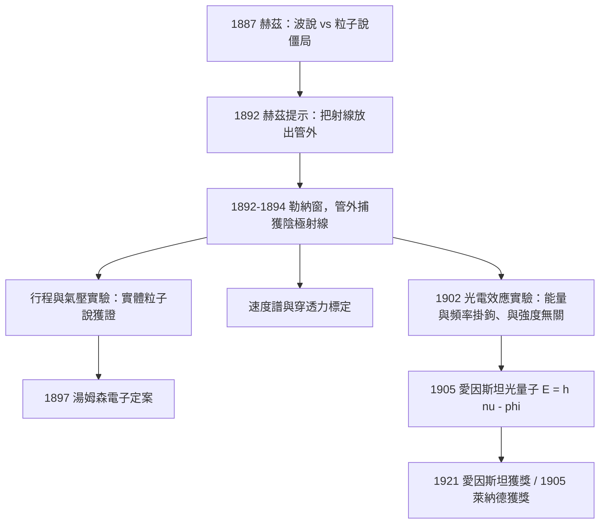

# 1905 · 萊納德：給陰極射線開一扇窗

> 1905 諾貝爾物理學獎：菲利普·愛德華·安東·馮·萊納德（Philipp Eduard Anton von Lenard, 1862–1947，德意志帝國）——表彰「他對陰極射線的研究」（for his work on cathode rays）。

## 懸案（案情提要）

十九世紀末，陰極射線是物理學最熱鬧的偵查現場，但偵辦始終卡在一個技術死結：**兇手被鎖在管子裡。**

克魯克斯管是一個抽了真空的玻璃管。陰極射線只在管內的高真空中飛馳——一旦撞上管壁或玻璃，它就消失了。所有偏轉實驗、螢光實驗、熱效應實驗，都只能在「案發現場內部」進行。這直接引發兩大懸案：

1. **陰極射線到底是不是波？** 赫茲 1887 年的實驗顯示它似乎能穿透薄金屬箔——波才有這種「滲透力」；但它又會被磁場狠狠偏轉——只有帶電粒子才會。兩份證據打架，兩派偵探（英國的粒子派、德國的以太波派）纏鬥十五年。
2. **它出了管子還是它嗎？** 真空是陰極射線的載體還是它的本體？若能在管外「自由大氣」中攔截到它，很多問題才能提審。

赫茲的學生萊納德決定從死結下手：**給管子開一扇窗**。他要在玻璃壁上鑲一片薄得讓射線能穿出去的金屬箔，把陰極射線押送出管外受審。這扇窗，日後被稱為勒納窗（Lenard window），是本案的破案鑰匙——而窗外的訊問筆錄，一路供養了 1897 年電子的定案、1902 年光電效應的關鍵數據，乃至 1905 年愛因斯坦的光量子論文。

## 前因

| 年份 | 事件 |
|------|------|
| 1858–1879 | 普呂克、希托夫、克魯克斯系統研究陰極射線：直線行進、發螢光、可被磁鐵偏轉。 |
| 1876 | 戈德斯坦命名 Kathodenstrahlen；他認為陰極射線是以太波。 |
| 1887 | 赫茲發現電磁波；同年測陰極射線在電場中似乎不偏轉（實為管內氣體游離掩蔽了偏轉），傾向波說。 |
| 1889–1891 | 赫茲注意到陰極射線能穿過薄金屬箔使管外螢光物發光——穿透性的線索首次出現。 |
| 1892 | 赫茲向萊納德提示：「最好能把陰極射線放出管外看看。」萊納德著手設計金屬箔窗。 |
| 1892–1894 | 萊納德以氫氟酸在玻璃上蝕刻出鋁箔窗（約 $2.7\,\mathrm{\mu m}$ 級，當時玻璃無法做這麼薄）：勒納窗問世，第一批「管外陰極射線」被捕獲。 |
| 1895 | 倫琴在研究勒納型射線時發現 X 射線——勒納窗間接參與了 1901 年的首屆諾獎。 |
| 1897 | 湯姆森以勒納窗與磁偏轉數據支持自己的 $e/m$ 測定；電子定案，粒子派獲勝。 |

## 調查

**第一戰：窗戶本身。** 玻璃抽成高真空後，要鎳一片薄箔且不漏氣，在 1892 年近乎異想天開。萊納德的工藝：把氫氟酸滴在玻璃上蝕出一個淺槽，直到玻璃只剩極薄一層，再鋪上鋁箔封口。鋁的選擇是關鍵——原子序低（$Z = 13$），對電子的阻擋截面小，薄箔對陰極射線幾乎「透明」。1894 年他發表論文《陰極射線能穿透金屬箔》，證明射線可在管外的氫氣中飛行**數公分**，並在數毫米後仍能激發螢光屏。

**第二戰：測它的「行程」。** 管外射線的穿透距離與氣壓強相關：壓強越低，飛得越遠；且行程大致與 $1/p$ 成正比——射線一路都在與殘餘氣體分子碰撞「減員」。以吸收規律表述：

$$I(x) = I_0\,e^{-\alpha p x}$$

$\alpha$ 為單位壓強單位長度的衰減係數。這證明陰極射線是**實體**——波（如光）不會這樣被氣體一寸寸吃掉；同時萊納德由此估算出「射線粒子」的平均自由程量級，為日後的粒子尺寸估算提供數據。

**第三戰：測它的速度與「穿透能耐」。** 萊納德在管外加磁偏轉與吸收實驗，畫出速度譜：管內不同加速條件下的射線速度可達 $10^8\,\mathrm{cm/s}$ 量級（即光速的三分之一上下），而且**速度越快的射線穿透鋁箔越深**。他提出以「單一速度的射線能穿透多厚」作為射線的客觀指標——這些方法被後世的 $\beta$ 射線能譜學直接繼承。

**第四戰（案中案，影響最深遠）：1902 年的光電效應筆錄。** 萊納德把勒納窗思路反過來用：他在真空管中放置紫外光源與金屬陰極，讓光照出的「光電子」在管內飛行，以收集電極測其能量。1902 年他發表震驚各方的兩條數據：

1. 光電子的**最大速度與光強無關**——把紫外光加亮十倍，電子並沒有飛得更快；
2. 電子能量只由光的**頻率**（實驗上即所用光源種類）決定。

這兩條與經典波動理論的預言（更亮的光 = 更大的波幅 = 更大的電子能量）正面衝突，成為經典電磁理論的頭號懸案。1905 年 3 月，愛因斯坦以光量子假說

$$E_k = h\nu - \phi$$

（$\phi$ 為逸出功）一次裁決此案——那份論文正是他 1921 年諾獎的得獎事由。萊納德的實驗數據，是量子論出庭時的第一證人。

## 理論裁決

**裁決一：陰極射線是帶電粒子流。** 磁場偏轉給出決定性證據。帶電粒子在均勻磁場中做圓周運動，半徑由

$$\frac{mv^2}{r} = e v B \quad \Longrightarrow \quad r = \frac{m v}{e B}$$

決定。偏轉方向依左手定則由電荷符號決定——萊納德與湯姆森的偏轉方向一致地指向負電荷。若陰極射線是以太波，任何已知電磁波都不會受 $\mathbf{F} = q\mathbf{v}\times\mathbf{B}$ 支配。加上勒納窗實驗顯示的「行程隨氣壓衰減」，波說的兩大支柱（不偏轉、易穿透）全部倒戈：偏轉實在、穿透有限。1897 年湯姆森進一步測得

$$\frac{e}{m} \approx 1.7\times10^{11}\,\mathrm{C/kg}$$

比氫離子大千餘倍——比原子更小的粒子被正式定案，命名 electron。

**裁決二：管外射線的行為遵守稀薄氣體中的碰撞統計。** 依平均自由程理論，速度為 $v$ 的粒子在密度 $n$ 的氣體中行進 $dx$ 的碰撞機率為 $n\sigma\,dx$（$\sigma$ 為有效截面），於是束流衰減

$$\frac{dI}{dx} = -n\sigma I \quad \Longrightarrow \quad I = I_0\,e^{-n\sigma x}$$

代入理想氣體 $n = p/(k_B T)$ 即得萊納德觀察到的 $e^{-\alpha p x}$ 規律。一條經驗曲線被分子運動論逐字讀懂——這是統計物理接管「放電管物理」的漂亮範例。

**裁決三（待裁之案）：光電子的能量帳本。** 萊納德 1902 年的數據留下一份矛盾帳：按經典波動理論，電場振幅 $E_0$ 正比於光強，電子被電場加速的功率 $\propto E_0^2$，理應隨強度增大。實測卻是能量與 $\nu$ 掛鉤。這份帳本懸置三年，直到愛因斯坦以普朗克的能量子 $h\nu$ 給出單行本判決：每個電子一次只吸收**一個**光子，

$$h\nu = \phi + \frac{1}{2}m v_{\max}^2$$

強度只決定有多少個光子（多少電子被打出，即光電流大小），頻率才決定每個電子的零花錢。萊納德本人終生不接受這份判決——他後來成為「德國物理」運動的旗手、攻擊相對論與愛因斯坦最激烈的人之一。**1905 年的諾獎得主，成了二十世紀物理學上最令人唏噓的偵探：他採集了關鍵物證，卻拒絕承認自己證據指向的真相。**（密立根 1916 年的精密驗證與 1923 年獲獎，將在相關檔案中繼續此案。）

## 後果

| 年份 | 影響 |
|------|------|
| 1894–1897 | 勒納窗成為放電管物理的標準裝備；湯姆森、維恩、佩蘭等人在管內外兩側同時推進電子研究。 |
| 1897 | 電子定案（1906 年諾獎）；勒納窗數據是重要旁證。 |
| 1902 | 光電效應關鍵數據發表；量子論的最重要實驗伏筆之一。 |
| 1905 | 萊納德獲物理學獎；同年愛因斯坦發表光電效應論文、布朗運動論文、狹義相對論——物理學史的奇蹟之年。 |
| 1916 | 密立根精密驗證 $h\nu = \phi + \frac{1}{2}mv^2$，光電方程完全站穩。 |
| 1920s–1930s | 萊納德出版《偉大人物在科學中》，鼓吹種族主義的「德國物理」，攻擊「猶太物理學」；二戰期間獲納粹政權禮遇——科學家的晚年成為反面教材。 |
| 現代 | 電子顯微鏡、電子束微影、CRT 顯示器皆以「把電子束放出管外、精確控制其行程」為基本思想——勒納窗的直系後裔。 |

## 關聯

- [1901-倫琴與X射線](1901-倫琴與X射線.md)：倫琴正是在重複勒納型射線實驗時發現 X 射線；兩案共享同一批放電管與同一批偵探圈。
- [1906-湯姆森與電子的身分證](1906-湯姆森與電子的身分證.md)：萊納德的穿透與偏轉數據是電子定案的關鍵旁證；湯姆森的 $e/m$ 是本案的終審判決書。
- [1907-邁克生與光速的極限測量](1907-邁克生與光速的極限測量.md)：1905 與 1907 兩屆諾獎一個查「極小的粒子」、一個量「極限的速度」，合起來正是相對論的兩端。
- [1923-密立根：油滴與光電的雙重驗證](1923-密立根：油滴與光電的雙重驗證.md)：萊納德留下的光電效應帳本由密立根以最精確的方式結案，並測出 $h$。
- ../化學獎/1905-拜耳有機染料.md：同屆化學獎；1905 年前後「物質的微觀結構」在物理與化學兩線同時推進。
