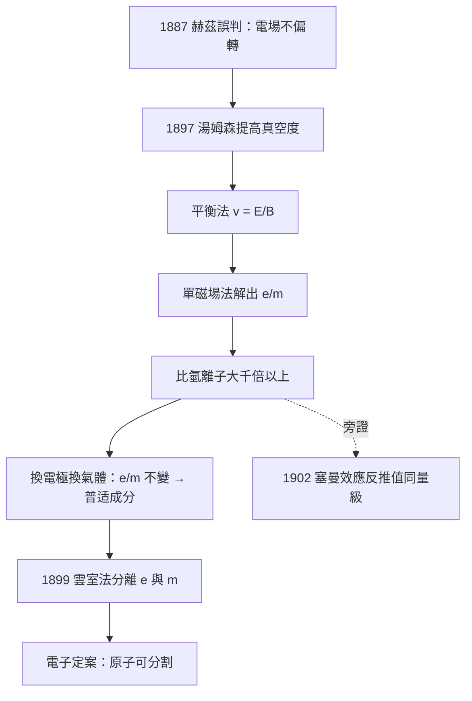

# 1906 · 湯姆森：電子的身分證

> 1906 諾貝爾物理學獎：約瑟夫·約翰·湯姆森（Joseph John Thomson, 1856–1940，英國）——表彰「他對氣體導電的理論與實驗研究」（in recognition of the great merits of his theoretical and experimental investigations on the conduction of electricity by gases）。這份研究在 1897 年結出著名果實：電子的發現。

## 懸案（案情提要）

1897 年，卡文迪許實驗室的主任湯姆森接手一樁全歐僵持多年的懸案：**陰極射線是波，還是粒子？** 更深一層的問題是——如果它是粒子，那它的質量是多少？它來自陰極本身，還是來自管內殘餘氣體的原子？

這樁案子的要害在於一個數字：**荷質比 $e/m$**。要拆穿陰極射線的身分，光看它會不會被磁場彎是不夠的——必須同時量出它受電場與磁場的作用，把速度與荷質比同時解出來。而且當時還有一個干擾源被所有德國實驗室誤判：**管內殘餘氣體會游離、會導電**，把偏轉數據攪得一團糟。赫茲當年就是因此「測不到」電場偏轉，誤判陰極射線為波。

湯姆森的破案思路雙管齊下：一方面把真空抽到前所未有的好，殲滅雜訊；另一方面設計一組互相獨立的測量，讓速度 $v$ 與荷質比 $e/m$ 在方程組中同時現形。當他把答案算出來——$e/m$ 比氫離子大千餘倍——剩下的只有一種可能：**有一種比原子還小的粒子存在**。原子不可分割的教條，就此被判了死刑。

## 前因

| 年份 | 事件 |
|------|------|
| 1859 | 普呂克觀察陰極射線；此後德英兩派對其本質展開百年之辯。 |
| 1876 | 戈德斯坦命名陰極射線；德國學派傾向以太波說。 |
| 1881 | 湯姆森在劍橋以數學第一名畢業，入卡文迪許；早年研究電磁理論與帶電球體的「電磁質量」問題——此案的理論預備。 |
| 1884 | 28 歲的湯姆森接任卡文迪許實驗室教授（繼瑞利之後），把實驗室推向氣體導電與放電現象研究。 |
| 1887–1890 | 湯姆森系統研究氣體放電，提出氣體導電的理論：放電由離子與電荷載子傳遞。 |
| 1890–1896 | 佩蘭（法國）與舒斯特等用磁偏轉估算陰極射線荷質比，數值彼此懸殊；佩蘭的集電器實驗顯示射線帶負電，但未同時定出速度。 |
| 1895 | 倫琴發現 X 射線；勒納窗數據累積；塞曼效應反推出 $e/m \approx 10^{11}\,\mathrm{C/kg}$ 量級——全案箭在弦上。 |
| 1897-04-30 | 湯姆森在皇家學會晚間演說首次報告：陰極射線的荷質比遠超任何已知離子，與射線源無關。 |

## 調查

**第一手：把雜訊殺乾淨。** 湯姆森與助手把放電管真空度提升到 $10^{-6}$ 至 $10^{-7}$ 大氣壓量級——比赫茲時代的管子好幾個數量級。殘餘氣體不再游離導電，電場偏轉立刻顯形：赫茲的「不偏轉」冤案當場平反。這一步看似平平無奇，卻是全案的分水嶺——**審判質量取決於法庭的安靜程度**。

**第二手：電磁聯審，同時解出 $v$ 與 $e/m$。** 裝置：陰極射線經準直狹縫成束，穿過一對平行板（電場 $E$）與一對線圈（磁場 $B$）構成的「速度選擇區」，再打上螢光屏。湯姆森的兩步法：

1. **平衡法測速度。** 同時施加互相垂直的 $E$ 與 $B$，調整到粒子**不偏轉**。此時電場力與磁場力抵消：

$$eE = e v B \quad \Longrightarrow \quad v = \frac{E}{B}$$

速度這個未知數被直接交出。

2. **單磁場法測荷質比。** 撤去電場，只留磁場，測屏上光點的偏移 $y$。粒子在磁場中走半徑 $r = mv/(eB)$ 的圓弧，在場區長度 $L$ 內偏移

$$y = \frac{e B L^2}{2 m v}\ \left(\text{近似，忽略邊緣效應}\right)$$

把 $v = E/B$ 代入，立即解得

$$\frac{e}{m} = \frac{2 y E}{B^2 L^2}$$

湯姆森測得的數值：$e/m \approx 0.77\times10^{11}$ 至 $1.7\times10^{11}\,\mathrm{C/kg}$（各批次略有差異，以今日值 $1.7588\times10^{11}\,\mathrm{C/kg}$ 為終值）。**比氫離子的 $e/m \approx 9.6\times10^{7}\,\mathrm{C/kg}$ 大一千到一千八百倍。**

**第三手：排除「氫離子說」的兩種辯護。** 敵方有兩條逃生路線，湯姆森逐一封死：

1. 「也許它電荷極大？」——他引用已知的電解數據與塞曼效應的獨立推算：磁光學與陰極射線給出同樣量級的 $e/m$，兩個互不相干來源不可能同時錯上一千倍。最省力的解釋是**質量極小**。
2. 「也許它取決於電極材料或氣體？」——他把陰極換成鋁、鉑等不同金屬，把管內氣體換成氫、氮、二氧化碳，甚至改用不同方法產生射線：**$e/m$ 不變**。粒子與陰極材料、殘餘氣體統統無關——它是一種普适的物質成分。

**第四手：後方補偵（1899）：直接「稱重」個體。** $e/m$ 只有比值。湯姆森接著研究紫外光照出的光電子與熱離子發射，用雲霧膨脹法（威爾遜雲室的前身技術）數出單位體積內的帶電粒子數 $N$，配合總電荷 $Q = N e$，第一次**分離**出電荷與質量：$e \approx 10^{-19}\,\mathrm{C}$ 量級——與法拉第電解定律外推的元電荷一致。至此，這個新粒子有了完整的身分證：負電荷、質量約氫原子的 $\frac{1}{1837}$、存在於一切物質。湯姆森稱它 corpuscle（微粒），世人沿用斯托尼 1891 年的命名——**electron**。

## 理論裁決

**裁決一：原子可分割。** 湯姆森的判決書只有一句：「陰極射線的粒子，其質量遠小於任何已知原子的質量，且是一切原子的共同成分。」原子論從道爾頓的「不可分最小單位」降格為「有內部結構的複合體」。這是兩千年來第一次，有人用實驗證明物質的最深處可以被打開。

**裁決二：氣體導電的機制。** 獲獎事由不是電子本身，而是更廣的「氣體導電」研究。湯姆森給出的模型：氣體在放電、X 射線或紫外光作用下產生離子對，電流密度為

$$\mathbf{j} = e\,n_+\,\mathbf{v}_+ - e\,n_-\,\mathbf{v}_-$$

其中 $n_{\pm}$ 為正負載子密度、$\mathbf{v}_{\pm}$ 為漂移速度。依遷移率理論 $\mathbf{v} = \mu\,\mathbf{E}$，電流隨場強飽和（所有新生離子全部被電極收走）：

$$j_{\max} = e\,q$$

$q$ 為單位體積單位時間的離子對生成率。湯姆森測得 X 射線照射下氣體導電的飽和行為，定量驗證了這套載子理論——它就是今日電離室、蓋革計數器、乃至半導體物理「載流子」概念的老祖宗。

**裁決三：湯姆森原子模型與它的敗訴。** 為解釋原子中電子如何分布，湯姆森 1904 年提出「葡萄乾布丁」模型：正電荷如布丁般瀰漫成球（半徑約 $10^{-10}\,\mathrm{m}$），電子如葡萄乾鑲嵌其中並做環狀振動，振動頻率對應光譜線。他用均勻球內的諧振子譜解釋元素週期性，甚至推導了多電子穩定排布的數學條件。這份模型優雅、自洽、且由發現電子的人親筆寫下——然後在 1909–1911 年被他的學生盧瑟福用 $\alpha$ 粒子散射實驗擊穿：大角度散射只能由**極小、極重的核**解釋（見 1908 年盧瑟福檔案與 1906 年本檔的師承反轉）。湯姆森的原子模型敗訴，但他的實驗方法、他的實驗室、他的七位諾獎學生，統治了此後半個世紀的原子物理。

**裁決四：電磁質量的預言。** 湯姆森早在 1881 年就計算過：帶電球體運動時攜帶的電磁場會表現出額外慣性——「電磁質量」$m_{em} = \frac{4}{3}\,\frac{U}{c^2}$（$U$ 為場能量，係數 3/4 為其原稿結果，後經修正為 4/3 佚事見相對論史）。當他發現電子 $e/m$ 極大時，他明確討論過一種可能性：**電子或許根本沒有「普通」質量，質量全部是電磁的**。這條思路直接預習了 1905 年狹義相對論的 $E = mc^2$ 世界。

## 後果

| 年份 | 影響 |
|------|------|
| 1899–1903 | 湯姆森團隊分離 $e$；密立根 1909–1913 油滴實驗精測 $e$（1923 年諾獎）。 |
| 1906 | 湯姆森獲物理學獎；1908 年其學生盧瑟福以放射化學獲化學獎，卡文迪許學派成型。 |
| 1909–1911 | 盧瑟福散射實驗推翻湯姆森模型，原子核時代開啟。 |
| 1912 | 湯姆森發明拋物線質譜法（第一台質譜儀），並在氖中發現質量 $20$ 與 $22$ 兩種粒子——**同位素**存在的最早線索。 |
| 1937 | 其子喬治·湯姆森因電子繞射（證明電子是波）獲 1937 年諾獎——父子一個證明電子是粒子、一個證明電子是波，互補原理的家族註腳。 |
| 20 世紀 | 電子管、電晶體（1956）、全息與量子電子學（1964）、QED（1965）——一切電子學與量子電子學都從 1897 年那束被彎折的射線出發。 |
| 今日 | 電子仍是標準模型中最精確檢驗的粒子之一；其磁矩實驗與理論吻合至 $10^{-12}$ 量級（1955 年庫施一脈的傳承）。 |

## 關聯

- [1902-洛倫茲與塞曼的磁場譜線案](1902-洛倫茲與塞曼的磁場譜線案.md)：塞曼以光譜反推 $e/m$，湯姆森以陰極射線直接測 $e/m$——雙證據鏈共同定案電子。
- [1905-萊納德與陰極射線的窗戶](1905-萊納德與陰極射線的窗戶.md)：勒納窗的管外射線數據是本案重要旁證；萊納德與湯姆森分別代表德、英兩派的終極對決。
- [1908-盧瑟福與放射性的蛻變裁決](1908-盧瑟福與放射性的蛻變裁決.md)：學生盧瑟福接手本案未竟之卷——原子的內部結構與原子核的現身。
- [1912-達倫與燈塔的自動調節閥](1912-達倫與燈塔的自動調節閥.md)：對照卷：同年湯姆森的質譜儀與達倫的工程發明，展示諾獎「基礎/應用」的兩端。
- [1923-密立根：油滴與光電的雙重驗證](1923-密立根：油滴與光電的雙重驗證.md)：湯姆森 1899 年分離 $e$ 的粗測，由密立根以油滴實驗精測至千分之一。
- [1937-戴維孫與湯姆森：電子的波動身份](1937-戴維孫與湯姆森：電子的波動身份.md)：本案的續集——電子既被證明是粒子（1906），也被證明是波（1937）。
