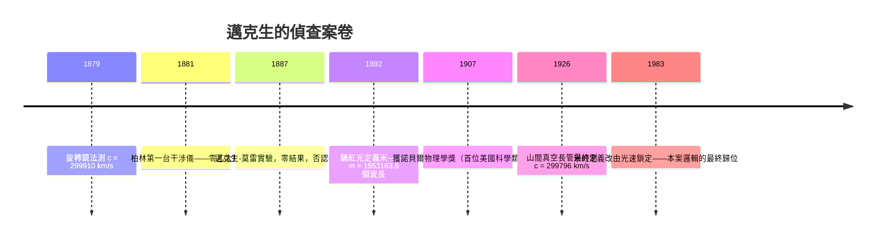

# 1907 · 邁克生：以干涉條紋丈量光速的人

> 1907 諾貝爾物理學獎：阿爾伯特·亞伯拉罕·邁克生（Albert Abraham Michelson, 1852–1931，美國）——表彰「他的精密光學儀器，以及借助這些儀器在光譜學與計量學方面所做的研究」（for his optical precision instruments and the spectroscopic and metrological investigations carried out with their aid）。他是第一位獲得諾貝爾科學類獎項的美國人。

## 懸案（案情提要）

十九世紀末的物理學有兩件「量不準」的事，都卡在光速 $c$ 上：

1. **$c$ 到底有多準？** 1849 年菲索用齒輪測得 $313{,}000\,\mathrm{km/s}$，1862 年傅科用旋轉鏡改進到 $298{,}000\,\mathrm{km/s}$——兩者相差百分之五，誤差遠大於儀器聲稱的精度。麥克斯韋電磁理論把光速寫成純電磁量的組合

$$c = \frac{1}{\sqrt{\mu_0 \varepsilon_0}}$$

理論的嚴謹與測量的粗糙嚴重失配。若 $c$ 量不準，整座電磁理論大廈就有一根柱子懸空。

2. **地球在乙太中飛馳，為什麼測不到乙太風？** 依波動說，光以乙太為介質；地球繞日速度 $v \approx 30\,\mathrm{km/s}$，沿地球運動方向的光程應比垂直方向「逆風折返」多出 $\frac{v^2}{c^2} \approx 10^{-8}$ 量級的差——二階小量，全歐儀器皆無法察覺。這個 $10^{-8}$ 的死角，需要一把**史上最靈敏的尺**。

邁克生一生就幹了這一件事：造尺。他的干涉儀能把 $10^{-9}\,\mathrm{m}$ 量級的光程差變成一條條肉眼可數的明暗條紋——把「看不見的乙太風」變成「可數的條紋位移」。1887 年他與莫雷的合作實驗交出零結果，成為相對論誕生前最重要的「否認報案」；而他把尺轉向別處，先量出了金屬標準米的波長定義與更精確的 $c$。1907 年的諾獎，正是頒給這把尺與用它結的案。

## 前因

| 年份 | 事件 |
|------|------|
| 1676 | 勞默爾以木衛一蝕首次證明光速有限；惠更斯算出約 $2.2\times10^8\,\mathrm{m/s}$。 |
| 1849 | 菲索齒輪法；1862 傅科旋轉鏡法——$c$ 的測量進入 $10^8\,\mathrm{m/s}$ 量級，但誤差仍以千分之幾計。 |
| 1865 | 麥克斯韋電磁理論確立 $c = 1/\sqrt{\mu_0 \varepsilon_0}$，光被裁定為電磁波。 |
| 1878–1879 | 麥克斯韋致信美國航海曆書局局長紐康，指出地面上測光速的精度瓶頸；時任航海曆書局教師的邁克生讀信後自製旋轉鏡設備。 |
| 1879 | 邁克生以改進的旋轉鏡法測得 $c = 299{,}910 \pm 50\,\mathrm{km/s}$——精度一下子逼近極限。 |
| 1881 | 邁克生在柏林（亥姆霍茲門下）建造第一台干涉儀式「乙太風偵測器」，靈敏度已達理論需求，結果：無乙太風。 |
| 1885–1887 | 邁克生與莫雷在克利夫蘭凱斯理工重做實驗：石板浮於水銀池、光臂加長至 11 米、多路反射使等效臂長 10 倍——靈敏度比 1881 年高 40 倍。 |
| 1889–1892 | 邁克生轉赴克拉克大學、芝加哥大學；提出以鎘紅光波長定義「米」的構想——光成為長度的原器。 |

## 調查

**第一件物證：邁克生干涉儀。** 原理極簡，威力極大。光源發出的光被 $45^{\circ}$ 分束板分為兩路，分別射向兩面互相垂直的反射鏡後匯合。兩路光程差 $\Delta L$ 導致相位差

$$\Delta\varphi = \frac{2\pi}{\lambda}\,\Delta L$$

當 $\Delta\varphi = 2\pi n$ 時兩波同相相長——亮條紋；$\Delta\varphi = 2\pi(n + \frac{1}{2})$ 時相消——暗條紋。條紋每移動一格，光程就改變 $\lambda/2$。以鈉黃光 $\lambda \approx 589\,\mathrm{nm}$ 計，一格條紋對應約 $294\,\mathrm{nm}$ 的光程變化——**肉眼可直接數出十億分之幾米的差異**。這就是那把尺：沒有任何機械量具能與之匹敵。

**第二件物證：邁克生-莫雷實驗（1887）。** 偵查設計針對乙太風的一階與二階效應：

- 設地球相對乙太速度 $v$，沿運動方向的往返光時（依乙太理論）為 $2L/c \cdot \frac{1}{1 - v^2/c^2}$，垂直方向為 $2L/c \cdot \frac{1}{\sqrt{1 - v^2/c^2}}$，二階差為

$$\delta t \approx \frac{L}{c}\,\frac{v^2}{c^2}$$

- 以 $L = 11\,\mathrm{m}$（多次反射等效）、$v/c = 10^{-4}$ 計，預期條紋位移約

$$\frac{2\delta t}{T} \approx \frac{2L}{\lambda}\,\frac{v^2}{c^2} \approx 0.4\ \text{條}$$

而儀器可分辨 0.01 條——靈敏度富餘 40 倍。結果：**最大位移小於 0.01 條，乙太風不存在**。他們在一天的不同時刻、一年的不同季節重複（含地球自轉與公轉速度反向的組合），皆為零。

**「否認報案」的處理。** 零結果引出三大補救假說：斐茲傑惹-洛倫茲收縮（運動方向臂長縮短 $\sqrt{1 - v^2/c^2}$ 倍，恰好抵消）、乙太拖曳說、發射說。洛倫茲由此發展出著名的變換

$$x' = \frac{x - vt}{\sqrt{1 - v^2/c^2}}, \qquad t' = \frac{t - vx/c^2}{\sqrt{1 - v^2/c^2}}$$

1905 年愛因斯坦以狹義相對論做出最終裁決：不需要乙太、不需要收縮機制——光速不變是時空本身的性質，$c$ 是一切慣性系共用的極限速度。邁克生實驗從此成為相對論的「無罪推定」證據：**一場精心設計的偵查，以「找不到兇手」結案，而這個零恰好就是真相。**

**第三件物證：光的波長成為尺。** 1890 年代起，邁克生把干涉儀轉向計量學：用鎘紅光（波長極單色）的干涉與標準米原器直接比對，1892–1893 年在國際計量局測得

$$1\,\mathrm{m} = 1{,}553{,}163.5\ \text{條鎘紅光波長}$$

這是「用原子尺度定義人類單位」的第一次——1960 年國際單位制正式以氪-86 波長、1983 年再以光速 $c = 299{,}792{,}458\,\mathrm{m/s}$ 定義米，皆為此案邏輯的延伸：**長度最終以光速與時間定義，時間以原子鐘定義**（拉比 1944 年檔案一脈）。

**第四件物證：再量 $c$。** 邁克生一生反覆重測光速：1879 年（$299{,}910\,\mathrm{km/s}$）、1882 年（$299{,}853\,\mathrm{km/s}$）、以及 1924–1927 年在加州威爾遜山與聖安東尼奧山之間以 35 公里的真空長管旋轉鏡法，測得

$$c = 299{,}796 \pm 4\,\mathrm{km/s}$$

——與今日定義值 $299{,}792.458\,\mathrm{km/s}$ 已相差不足十萬分之二。他晚年仍在病榻上設計更高精度的光速實驗，1931 年去世前數日還在與愛因斯坦討論此事。

## 理論裁決

**裁決一：干涉計量法——把長度測量變成波長計數。** 兩束同調光的疊加強度為

$$I = I_1 + I_2 + 2\sqrt{I_1 I_2}\cos\Delta\varphi$$

這是干涉儀的全部數學。只要 $\Delta L$ 的測量問題轉換成 $\Delta\varphi$ 的讀數問題，任何機械誤差、溫度膨脹、刻度磨損都退場——**波長就是最穩定的刻度，因為它是原子的性質**。這套方法論直接孕育了：光譜學的精細結構研究（干涉儀改裝成的階梯光譜儀可解析 $10^{-4}\,\mathrm{nm}$ 級波長差）、雷射干涉計量（2017 年 LIGO 偵測重力波，臂長 4 公里的邁克生干涉儀，測的是 $10^{-18}\,\mathrm{m}$ 級的光程變化——邁克生之尺的終極放大）。

**裁決二：光速不變的時空裁決。** 邁克生-莫雷零結果 + 貝克勒 $\beta$ 射線速度測量 + 各種乙太假說的失敗，構成狹義相對論的實驗底盤。愛因斯坦公設：一切慣性系中真空光速皆為 $c$。洛倫茲變換由是成為時空的座標律，同時性相對化、質能關係 $E = mc^2$ 陸續出爐。邁克生本人對相對論始終存疑——這位實驗大師直到去世都不完全接受「沒有乙太」的裁決書，但他造的尺，替相對論站了一百年的崗。

**裁決三：$c$ 與單位制的最終合流。** 麥克斯韋的 $c = 1/\sqrt{\mu_0 \varepsilon_0}$ 與邁克生的精密測量合流，最終導致 1983 年的定義：米是光在真空中 $\frac{1}{299{,}792{,}458}\,\mathrm{s}$ 內行進的距離。**$c$ 從被測對象變成了定義常數**——測量史的終點，是把「量」變成「約定」。這正是邁克生計量學研究的完整迴響。

## 後果

| 年份 | 影響 |
|------|------|
| 1907 | 首位美國科學類諾獎得主；美國實驗物理正式登上世界舞台。 |
| 1905–1915 | 狹義與廣義相對論建立；邁克生-莫雷實驗成為所有教科書的經典「負結果」教材。 |
| 1921–1927 | 精細結構的干涉光譜測量為量子力學提供數據；邁克生的階梯光譜儀解析出氫線的細部。 |
| 1944→ | 拉比原子鐘、1955 年蘭姆位移測量、1965 年後的雷射頻率梳——「以頻率/波長為尺」的方法論一路沿用。 |
| 1960 | 氪-86 波長定義米；1983 年改以 $c$ 定義米。 |
| 1970s–2015 | 干涉式引力波探測構想提出；2015 年 LIGO 首次偵測重力波（2017 年諾獎）——邁克生干涉儀臂長從 11 米到 4 公里，靈敏度跨越 15 個量級。 |
| 今日 | 光學計量、光頻梳（2005 年諾獎）、引力波天文學——「以光為尺」已是整個精密物理的骨架。 |

## 關聯

- [1901-倫琴與X射線](1901-倫琴與X射線.md)：X 射線「不可折射、不可反射」之謎的最終解釋（波長太短），正是以邁克生式干涉計量法於 1912 年後裁定。
- [1905-萊納德與陰極射線的窗戶](1905-萊納德與陰極射線的窗戶.md)：1905 與 1907 兩屆諾獎，一微觀一極限，共同框出二十世紀物理的兩條主軸。
- [1908-李普曼與干涉彩色照相](1908-李普曼與干涉彩色照相.md)：1907 與 1908 兩屆諾獎皆為干涉技術——一把用來量長度，一把用來存顏色。
- [1911-維因與熱輻射定律](1911-維因與熱輻射定律.md)：黑體輻射的譜測量同樣依賴光譜解析度；邁克生的儀器傳統與維因的輻射定律共同逼出量子概念。
- [1917-巴克拉與元素的特徵X射線指紋](1917-巴克拉與元素的特徵X射線指紋.md)：精細光譜測量傳統的 X 射線分支。
- ../生理醫學獎/1911-古爾斯特蘭德眼睛光學.md：同屆 1911 醫學獎得主以眼的光學成像獲獎——「光學精密測量」跨獎的另一案例。
