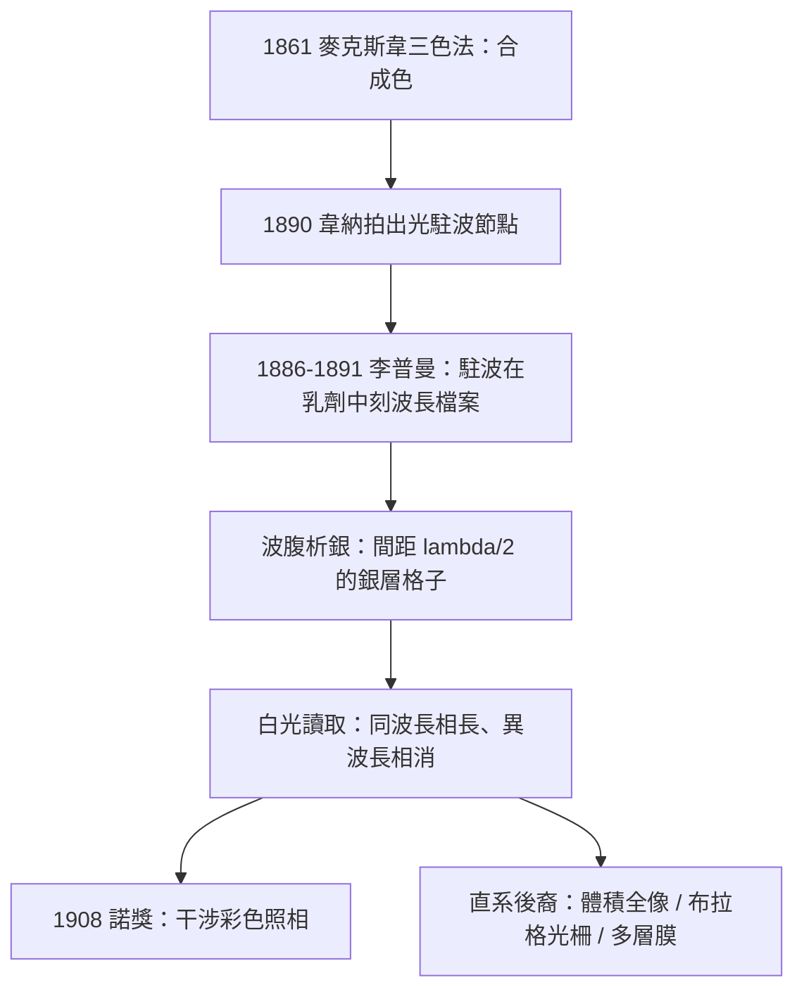

# 1908 · 李普曼：用駐波把顏色存進底片

> 1908 諾貝爾物理學獎：約拿斯·斐迪南·加布里埃爾·李普曼（Jonas Ferdinand Gabriel Lippmann, 1845–1921，法國）——表彰「他基於干涉現象、以攝影方式重現色彩的方法」（for his method of reproducing colours photographically based on the phenomenon of interference）。

## 懸案（案情提要）

1890 年代，攝影已經問世半個世紀，但所有的照片都是黑白——底片只認「光的強度」，對「光的波長」（即顏色）完全失明。要把顏色存進化學乳劑，當時有兩條路線：

1. **分色疊印法**（如麥克斯韋 1861 年的三色攝影）：分別以紅綠藍三片濾光曝光三張底片，再疊合投影。可行，但笨重：三張底片、三重曝光、染色疊印——且色彩由人工顏料合成，永遠「像」而不「是」。
2. **讓底片自己記住波長**：如果底片能直接把光的波長刻進乳劑，一張底片一次曝光還原全部色彩——這才是「真彩色」的正解。

李普曼的切入點是一個漂亮的物理直覺：**波長的信息，藏在光與自身的干涉裡。** 可見光波長僅約 $0.4$ 至 $0.7\,\mathrm{\mu m}$，任何機械手段都刻不了這麼細的格子——但光自己會刻。讓入射光與它在鏡面上的反射光疊加，形成駐波：波節與波腹以 $\lambda/2$ 為間距排開。若乳劑恰好能在波腹處優先析出銀，底片裡就自動長出一套間距為 $\lambda/2$ 的「波長檔案」。讀取時，白光一照，不同深度的銀層各自反射各自波長的光，干涉相長——**顏色被原樣重放出來**。

懸案只剩技術難關：怎麼讓銀粒只長在波腹上？乳劑必須「比波長還細膩」——顆粒要小到 $10\,\mathrm{nm}$ 量級，是普通底片顆粒的百分之一。

## 前因

| 年份 | 事件 |
|------|------|
| 1665–1690 | 牛頓色散實驗與惠更斯波動說並立；顏色 = 光的週期性的概念成形。 |
| 1801 | 楊氏雙縫實驗復興波動說；干涉成為光的波動性的判決性證據。 |
| 1849 | 菲索與傅科先後精測光速；光的波長 $\lambda = c/\nu$ 從此可算。 |
| 1850s | 韋納（Léon Foucault 與 Wiener 的駐波實驗，1890 年韋納以照相法直接拍出光駐波的節點分布）——「光能在乳劑裡刻出駐波」的直接前例。 |
| 1861 | 麥克斯韋展示第一張彩色照片（三色法，用蘇格蘭彩帶做對象）；同年他的電磁理論確立 $\lambda = c/\nu$ 的普适性。 |
| 1868 | 李普曼在巴黎高等師範學院任教前曾赴海德堡隨基爾霍夫與亥姆霍茲研究電學，開始構思「電學與光學的精密測量」生涯。 |
| 1886 | 李普曼向法國科學院報告彩色照相構想：以駐波干涉在乳劑中記錄波長。 |
| 1891 | 首批李普曼彩色照片在巴黎公開展示；1893 年獲得改進（乳劑製備工藝成熟），1894 年發表完整方法。 |

## 調查

**第一步：設計「無限薄的尺」。** 李普曼底片的結構：極平的玻璃板（平面度須達光學級，否則干涉會糊）上塗佈超微粒滷化銀明膠乳劑——顆粒直徑約 $10\,\mathrm{nm}$，厚度僅 $10$ 至 $20\,\mathrm{\mu m}$，遠薄於普通底片。乳劑背面緊貼一層**水銀**作為反射鏡。水銀面在乳劑未乾時保持液態，能與乳劑表面共形貼合——這保證了反射光與入射光的波前嚴格重合。

**第二步：曝光，讓光自己刻檔案。** 波長 $\lambda$ 的入射光垂直射入乳劑，在水銀面反射後與入射光疊加。兩列振幅相同、方向相反的相干波形成駐波：空間強度分布為

$$I(z) = 4\,I_0\,\cos^2\!\left(\frac{2\pi z}{\lambda}\right)$$

波腹（亮層）位於 $z = n\,\lambda/2$，即**每半個波長一層**。以綠光 $\lambda = 520\,\mathrm{nm}$ 計，間距 $260\,\mathrm{nm}$；乳劑厚 $15\,\mathrm{\mu m}$ 時，內部要容納近 60 層「波長檔案」。曝光後，波腹處的銀鹽優先析出金屬銀——顯影時這些位置變成高折射率的銀層，檔案刻成。

**第三步：讀取——顏色的重放。** 白光垂直照向乾好的底片，每層銀如半反射鏡般把光反射回去。相鄰銀層反射波的光程差恰為 $2 \times \frac{\lambda}{2} = \lambda$，故**只有波長等於當初記錄波長的光**在各層反射波間滿足相長條件

$$2 d\,m = m\,\lambda \quad \text{（各層間距 } d = \lambda/2\text{）}$$

其餘波長則因相位錯亂相消。結果：綠光被綠光刻的格子反射回來，紅光透過綠格子被紅光格子反射——人眼沿反射方向看到的，正是原景物的完整光譜成分。**這不是顏料的混合，而是波長的物理重放**——每個像素的顏色都是用干涉「算」出來的，理論上可還原整個可見光譜（這也是今日的多層介質膜、體積全像與布拉格光纖光柵的原理）。

**第四步：與三色法對質。** 李普曼在 1890 年代的公開演示中，把彩色照片與原物並列對照；1893 年後的成品（花卉、彩色玻璃、瑞士風景）色彩細膩到與彩色印刷完全不同量級。他在索邦的講席（1893 年接替布冉利）與巴黎科學院的舞台讓該法風行一時。但它也暴露了致命弱點：曝光需數秒至數分鐘（乳劑靈敏度極低）、觀看需特定角度與鏡面反射（無法複印）、製作極貴。彩色膠片（分色染料法）後來以廉價取勝——李普曼法成為技術史上「物理上完美、商業上過早」的著名案例。

**第五步：缺陷清單（敗訴理由的完整筆錄）。** 為了公平起見，此案卷須完整記錄李普曼法的技術弱點：

1. **曝光極慢**：超微粒乳劑的靈敏度僅約普通底片的百分之一，人像需坐定數分鐘；
2. **不可複製**：每張底片都是唯一原版，反射讀取的角度受限，無法像紙上照片那樣批量印刷；
3. **色彩不穩**：顯影與水洗工藝的細微差異會移動銀層位置，造成色偏；
4. **儲存脆弱**：明膠層隨濕度收縮，格子變形即混色。

十九世紀的工程界因此給它下了一個精準的評語：「科學上的傑作，商業上的死路。」但這張缺陷清單的每一條，都在二十世紀被逐一推翻——感光速度由雷射曝光解決、複製問題由體積全像的模壓複製解決、穩定性由介質膜解決。李普曼法輸給了 1900 年代的工業，卻贏了整個二十世紀的光學。

## 理論裁決

**裁決一：駐波場的數學。** 入射波 $E_1 = E_0 e^{i(kz - \omega t)}$ 與理想反射鏡的反射波 $E_2 = -E_0 e^{-i(kz + \omega t)}$（金屬面處電場反相）疊加：

$$E(z,t) = 2\,E_0 \sin(kz)\,\sin(\omega t)$$

空間上固定的強度包絡 $I(z) \propto 4 E_0^2 \sin^2(kz)$，波腹間距

$$\Delta z = \frac{\lambda}{2} = \frac{\pi}{k}$$

李普曼法的本質是**把空間座標 $z$ 當作波長選擇器**：乳劑沿深度方向的自相關函數，就是入射光譜的鏡像。用今天的語言，這是一維體積全像（volume hologram），其波長選擇性由布拉格條件描述：

$$2 d \sin\theta = m\,\lambda$$

垂直讀取時 $\theta = 90^{\circ}$、$d = \lambda/2$，即前述相長條件。光譜選擇性（反射帶寬）隨銀層數 $N$ 增加而變窄，$\Delta\lambda \approx \lambda/N$——層數越多，顏色越「純」。李普曼底片的 50 至 100 層給出的選擇性已足以重放連續光譜中的每一個成分。

**裁決二：干涉 vs 顏料的哲學差異。** 三色法記錄的是**三個投影值**（紅綠藍各自的強度），是對光譜的降採樣；李普曼法記錄的是**波長本身在深度上的分布**，是對光譜的直接編碼。前者色彩空間受限於三基色的色域，後者原則上覆蓋全部可見波段。這是「採樣表示」與「物理表示」的分野——二十世紀的全像術、光譜儀陣列、乃至多光譜成像，走的都是李普曼這條線。

**裁決三：為何它輸給了染料法。** 李普曼乳劑的光敏性與顆粒細度成反比：顆粒越小，吸收截面總量越低，感光越慢；且銀層一旦顯影，反射光只能在特定幾何條件下讀出，無法複製。1900 年代末，盧米埃兄弟的「自動彩色片」（Autochrome，染料澱粉微點法）與後來的柯達彩色膠片以可複製、可放大的商業優勢完勝。科學判決正確、工程路線失利——這樁案子最終以「原理存活、載體更替」結案。

## 後果

| 年份 | 影響 |
|------|------|
| 1891–1894 | 李普曼法在巴黎世博與科學院展示；被讚為「物理學與攝影術的結婚照」。 |
| 1898–1900 | 李普曼與他人合作改良電壓計（毛細管靜電計，曾被埃因托芬用於心電圖）與立體照片傳送——他的精密測量觸角跨入多個領域。 |
| 1908 | 獲物理學獎，由法國總統親自陪同返巴黎——首位享此殊榮的法國得主。 |
| 1948 | 伽博發明全像術（1971 年諾獎）：以離軸參考光在乳劑中記錄相位——李普曼駐波編碼的二維推廣。 |
| 1960s | 體積全像與反射式全像（Denisyuk 全像）直接採用李普曼幾何：單光束入射、乳劑內自反射干涉——又稱「李普曼全像」。 |
| 1978–1995 | 光纖布拉格光柵（週期折射率調製 $\lambda/2$ 級）成為通訊波長選擇器——李普曼格子的光纖版，今日每根通訊光纖鏈路裡都有它。 |
| 現代 | 多層介質膜濾光片、抗反射鍍膜、彩虹全像防偽標籤，原理同源：深度方向 $\lambda/2$ 調製的干涉選波。 |

## 關聯

- [1907-邁克生與光速的極限測量](1907-邁克生與光速的極限測量.md)：1907 與 1908 兩屆諾獎同為干涉技術的雙雄——一把丈量極限速度，一把保存光譜顏色；邁克生干涉儀與李普曼底片共享同一條數學（$\Delta\varphi = 2\pi \Delta L / \lambda$）。
- [1901-倫琴與X射線](1901-倫琴與X射線.md)：X 射線的「硬度」（波長）與可見光的「顏色」同為波長信息；本案展示了波長編碼思想在光學照相的極致。
- [1911-維因與熱輻射定律](1911-維因與熱輻射定律.md)：光譜測量與波長選擇的另一主線——黑體輻射的光譜分析直接催生量子論。
- [1971-伽博與全像術](1971-伽博與全像術.md)：李普曼駐波編碼的直系後裔——記錄振幅之外的相位，三維影像的誕生。
- ../化學獎/1911-居禮分離鐳.md：同屆（1911）化學獎與 1908 物理獎同屬「法國精密科學」傳統；李普曼是瑪麗·居禮的巴黎學界同輩與支持者。
