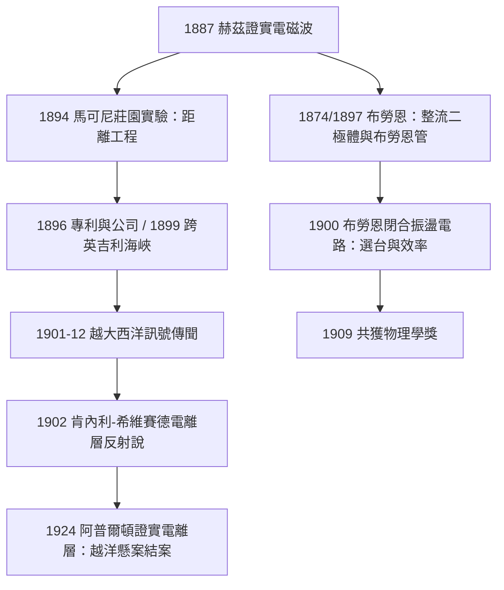

# 1909 · 馬可尼與布勞恩：讓電波橫越大西洋

> 1909 諾貝爾物理學獎：古列爾莫·馬可尼（Guglielmo Marconi, 1874–1937，義大利王國）與卡爾·費迪南德·布勞恩（Karl Ferdinand Braun, 1850–1918，德意志帝國）——表彰「他們對無線電報發展的貢獻」（for their contributions to the development of wireless telegraphy）。

## 懸案（案情提要）

1895 年前後，赫茲的電磁波已是公認的實驗室奇觀——但它被視為「沒有用的波」。赫茲本人對此的說法廣為流傳：「這證明了麥克斯韋是對的，僅此而已。」

把「沒有用的波」變成橫越大洋的通信，懸案有三道關卡：

1. **距離關**：發射機火花放電的能量散入整個空間，接收功率隨距離急劇衰減；當時主流計算認為，地球曲率之下、跨越上千公里的電波通信需要不可思議的天線高度與功率——電波理論上走不了直線那麼遠。
2. **干擾關**：所有火花發射機寬頻輻射，兩台電台互相淹沒；沒有選台機制，無線電報就沒有商業價值。
3. **顯示關**：接收端只有塗了金屬粉的檢波器（金屑檢波器，coherer），靈敏度低、每次擊發後要人工搖散，電報碼全靠人眼人手。

1901 年 12 月 12 日，馬可尼宣稱在紐芬蘭收到了橫越大西洋的訊號（三個點的 S 碼），掀起軒然大波——這麼遠，電波怎麼可能沿著彎曲的地球走？兩年後肯內利與希維賽德提出解釋：**高層大氣有導電層（電離層）會把電波反射回地面**——電波是「貼著天花板跳」過去的。而把發射與接收真正工程化的兩位關鍵人物——企業家馬可尼與物理學家布勞恩——正是本屆諾獎的雙主角：一位建造了跨越海洋的訊號網，一位提供了讓訊號乾淨、可選台、可顯示的電路科學。

## 前因

| 年份 | 事件 |
|------|------|
| 1864–1873 | 麥克斯韋電磁理論預言電磁波以光速傳播。 |
| 1874 | 布勞恩發現金屬硫化物導電的方向性（方鉛礦整流）——最早的半導體二極體，日後的礦石檢波器。 |
| 1887–1888 | 赫茲以火花振盪器與環形天線實驗證實電磁波的存在與反射、折射。 |
| 1894 | 馬可尼閱讀赫茲訃文後，在父親莊園開始無線電實驗；他改良金屑檢波器、加接地天線，把傳輸距離從幾米推到山頭之間的數公里。 |
| 1895 | 馬可尼實現 2.4 公里越丘通信；同年布勞恩發明布勞恩管（陰極射線管）。 |
| 1896–1897 | 馬可尼赴英國演示，取得專利，成立馬可尼公司；實現跨越布里斯托海峽 14 公里通信。 |
| 1897 | 布勞恩任斯特拉斯堡大學物理所長，開始研究馬可尼系統的瓶頸。 |
| 1898–1900 | 馬可尼跨越英吉利海峽（1899，50 公里）；公司與海纜電報公司、海軍角力，無線電進入商業視野。 |
| 1900 | 馬可尼取得著名的「四電路」調諧專利（7777 號）；布勞恩完成發射電路與天線解耦的「閉合振盪電路」設計。 |

## 調查

**第一線：布勞恩的電路外科手術。** 馬可尼初期的發射機是「直接耦合」：火花隙直接串在天線迴路裡。布勞恩診斷出三大病灶：(1) 火花隙的阻尼極強，天線裡的振盪幾個週期就衰減殆盡，輻射效率低；(2) 發射頻率由天線本身的雜散電容電感決定，毫無選擇性；(3) 檢波器與天線直連，一擊即死。他的手術：把火花振盪器放進**帶可調電容與電感的閉合電路**，再以變壓器（感應耦合）把能量送到天線——發射頻率由電路自己定：

$$\nu = \frac{1}{2\pi\sqrt{LC}}$$

天線與火花電路解耦後，振盪可持續數十個週期，頻譜窄、效率高。他更進一步提出「定向天線」（相控陣的雛形，1905）：以相位控制的多元天線把能量集中射向一個方向——增益問題的第一份工程解。這套「布勞恩電路」成為此後數十年所有無線電發射機的標準解剖結構。

**第二線：檢波器的革命。** 布勞恩把 1874 年的整流發現武器化：方鉛礦（硫化鉛）與金屬針接觸形成的點接觸結，對高頻交流有單向導通性——這是第一只晶體檢波器，也是半導體二極體的原型。相較於每次擊發要復位的金屑檢波器，晶體檢波器即時、靈敏、可複用。這一「點接觸結」的傳承直通 1947 年的點接觸電晶體（1956 年諾獎）。

**第三線：馬可尼的越洋遠征。** 1900 年起馬可尼在英國康瓦爾的波爾杜建大功率電台（天線塔陣、25 千瓦級火花機），1901 年 12 月赴紐芬蘭聖約翰斯，以風箏拉起的接收天線監聽預定的「S」碼發射。他報告收到訊號——英法科學界一片質疑：按當時對電波沿直線傳播的認識，3300 公里越洋根本不可能。補偵很快出爐：1902 年馬可尼的船試測得訊號在夜間增強、且「視距外」仍可達數千公里；1902 年肯內利與希維賽德各自提出高層導電層反射說；1924 年阿普爾頓以頻率掃描實驗直接證明電離層存在（1947 年諾獎）。**電波不是翻過地球，而是被電離層彈回來的**——懸案以大氣物理的發現結案。

## 備考：專利戰與「無線電是誰發明的」

此案的卷宗若少了專利訴訟史就不完整。1896 年至 1909 年間，「無線電發明權」的認定在多國法庭反覆開庭：

- **波波夫（Alexander Popov，俄國）** 1895 年 5 月先於馬可尼公開演示了雷暴偵測接收機，俄國至今以 5 月 7 日為「無線電節」；
- **特斯拉（Nikola Tesla）** 1897 年申請、1900 年獲得的美國專利（645576 號）覆蓋多諧振電路與無線傳輸原理；1900 年代末美國專利法庭曾裁定特斯拉優先；
- **馬可尼**則憑工程實績與商業網絡獲得市場：英國郵政總局、各大海運公司與海軍皆為其客戶。

1943 年，美國最高法院在馬可尼公司訴美國政府的專利案中重審證據鏈，裁定特斯拉、石東（Stone）等人的在先專利成立，馬可尼四電路專利無效——距馬可尼去世僅六年。諾貝爾委員會 1909 年的措辭於是顯得格外審慎：得獎事由不是「發明無線電」，而是「對無線電報**發展**的貢獻」。一樁案件的榮譽歸屬，取決於問句是「誰第一個看到」還是「誰第一個做成」——本案兩者皆是，所以卷宗永遠無法完全合上。

## 理論裁決

**裁決一：輻射的物理——赫茲偶極子。** 短天線（長度遠小於波長）上的電流元 $I\,dl$ 產生的遠場輻射場為

$$E_\theta = \frac{\mu_0\, I_0\, dl\, \omega \sin\theta}{4\pi r}\,\sin(\omega t - kr)$$

輻射功率

$$P = \frac{\mu_0\, I_0^2\, dl^2\, \omega^2}{12\pi c} = 80\pi^2 \left(\frac{dl}{\lambda}\right)^2 I_0^2$$

$(dl/\lambda)$ 的平方關係是無線電的鐵律：天線太短、波長太長，輻射效率急劇崩潰。馬可尼早期用長波（數千米）而天線有限，靠的是「加大電流」——布勞恩的閉合電路正是把電流集中到低阻尼的 $LC$ 迴路裡、再高效地泵進天線。輻射阻尼越小，品質因數 $Q = \omega L/R$ 越高，頻譜越窄——選台能力（兩台電台的頻率差須大於帶寬）由此而來。**效率、選擇性、定向性**三張裁決書，全部由同一組電磁理論方程簽發。

**裁決二：傳播之謎——電離層。** 大氣上層在太陽紫外輻射下電離，自由電子對入射電磁波的回應由等離子體頻率決定：

$$\nu_p = \frac{1}{2\pi}\sqrt{\frac{n_e e^2}{\varepsilon_0 m_e}}$$

當工作頻率 $\nu < \nu_p$（取決於電子密度 $n_e$）時，波被反射回地面；夜間低層（D 層）消失、吸收減弱，訊號更強——與馬可尼 1902 年船試「夜間增強」的觀測吻合。地球上「天花板」與地面之間的多次彈跳，使越洋通信成為可能。這份裁決把無線電從「奇蹟」降格為「可計算的大氣光學」，並在 1947 年阿普爾頓的諾獎中獲得正式追認。

**裁決三：檢波的半導體物理（提前四十年的伏筆）。** 方鉛礦點接觸的整流行為，其能帶解釋（金屬針與 n 型半導體形成的蕭特基勢壘）要等 1930 年代固態物理成熟後才給出。布勞恩 1874 年的觀察與 1900 年代的應用，是半導體電子學的第一次執業——它的現代後裔從檢波二極體到 MIMO 天線（布勞恩相控陣思想的無線通訊版）遍布今天每一部手機。

## 後果

| 年份 | 影響 |
|------|------|
| 1904 | 弗萊明發明真空二極管；1906 年德弗雷斯特發明三極管（放大器）——電子學時代開啟，無線電從電報進入語音廣播。 |
| 1909 | 泰坦尼克號前三年，無線電報已成船舶標配；1912 年泰坦尼克沉沒時的「CQD/SOS」證明無線電救了 700 餘人——馬可尼公司的操作員在救援中的角色轟動世界。 |
| 1912 | 阿普爾頓層命名前，電離層假說已被廣泛接受；1947 年阿普爾頓獲諾獎。 |
| 1920s | 廣播時代：KDKA 等電台開播；布勞恩管（CRT）成為電視的顯示心臟（直到 2000 年代）。 |
| 1935 | 雷達問世（英國 Chain Home 與美國 MIT 雷達計畫）——布勞恩相控陣與磁控管的工程匯流，直接影響二戰走向。 |
| 1947 | 點接觸電晶體誕生（1956 年諾獎）：布勞恩 1874 年整流結的直系孫輩。 |
| 現代 | 5G MIMO、相控陣雷達、衛星通信、深空網——馬可尼的距離野心與布勞恩的電路科學，合流為今天的無線世界。 |

## 關聯

- [1901-倫琴與X射線](1901-倫琴與X射線.md)：電磁波譜的兩端——倫琴的 X 射線（約 $0.1\,\mathrm{nm}$）與馬可尼的長波（數千米）同屬麥克斯韋方程組的管轄；布勞恩管更是 1897 年電子發現的技術平台。
- [1906-湯姆森與電子的身分證](1906-湯姆森與電子的身分證.md)：布勞恩管中的陰極射線正是本案（1906）的主角；無線電與電子物理共享同一批放電管技術。
- [1907-邁克生與光速的極限測量](1907-邁克生與光速的極限測量.md)：電磁波以 $c$ 傳播的精確值，是無線電工程頻率與波長換算的底數。
- [1912-達倫與燈塔的自動調節閥](1912-達倫與燈塔的自動調節閥.md)：1912 年諾獎的燈塔自動化與無線電信標同屬「航海安全」工程線；三年後泰坦尼克事件使兩者一齊成為國際公約標配。
- ../生理醫學獎/1904-巴甫洛夫條件反射.md：無線電廣播與條件反射同屬 1900 年代「訊號與行為」的時代課題——一個改變訊息傳播，一個改變行為科學。
