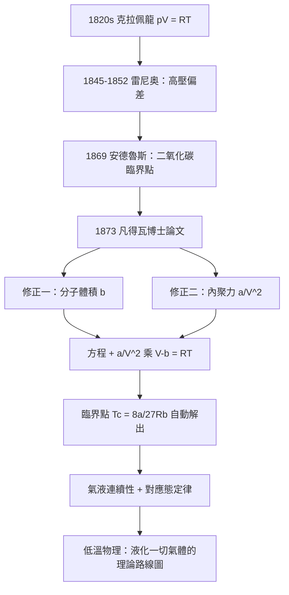

# 1910 · 凡得瓦：一條方程打通氣與液

> 1910 諾貝爾物理學獎：約翰內斯·迪德里克·凡得瓦（Johannes Diderik van der Waals, 1837–1923，荷蘭）——表彰「他對氣體與液體狀態方程的研究」（for his work on the equation of state for gases and liquids）。

## 懸案（案情提要）

1873 年前，物理學對「物態」的官方敘事有一道刺眼的裂縫：**理想氣體方程 $pV = RT$ 在高壓下全面失守。**

- 實驗數據顯示：壓強升高後，氣體的 $pV$ 積不再守恆，二氧化碳在 31 攝氏度以下甚至出現「等溫線中間水平」的詭異段落——氣體直接液化，壓強不變、體積縮小；
- 理想氣體方程裡根本沒有「液化」這個詞：分子是沒有體積、互不理睬的幾何點，理論上可以無限壓縮，永遠不會變成液體；
- 更糟的是臨界點的存在：安德魯斯（Thomas Andrews）1869 年的實驗顯示，二氧化碳在 31.1 攝氏度以上無論加多大壓強都**無法液化**——氣與液之間似乎有一道溫度上的鐵閘。

氣體與液體，在十九世紀的教科書裡是兩種「不同質」的物質；而在真實世界裡，水蒸氣與水明明是同一種東西。理論要如何打通這兩態？荷蘭一位白天教書、夜裡自學的學校校長，在博士論文裡只做了兩件事：**給分子補上體積，給分子之間補上吸引力**。一條修正方程，把氣態與液態縫合成同一條等溫線上的兩段——這是統計物理史上以最少的假設解釋最多現象的典範之作。

## 前因

| 年份 | 事件 |
|------|------|
| 1662–1802 | 波以耳、查理、給呂薩克確立氣體的經驗定律；1820 年代克拉佩龍合併成 $pV = RT$。 |
| 1837 | 凡得瓦生於萊頓，家境普通，當過小學教師；大學入學的語言科目門檻讓他繞道自學數年——遲至 36 歲才獲入學資格。 |
| 1845–1852 | 雷尼奥精密測量多種氣體的壓縮數據，發現 $pV = RT$ 的高壓偏差有系統性——「理想氣體」的缺口公開化。 |
| 1852 | 克勞修斯與後來的波茲曼、麥克斯韋建立分子動理論：溫度是分子動能的度量 $\frac{3}{2}k_B T$。 |
| 1869 | 安德魯斯報告二氧化碳的等溫線與臨界點（$T_c = 31.1\,^\circ\mathrm{C}$、$p_c = 73\,\mathrm{atm}$）：氣液連續性成為熱點問題。 |
| 1872 | 凡得瓦以非正式學生身分在萊頓完成博士論文《論氣態與液態的連續性》——本案的核心物證。 |
| 1877 | 阿姆斯特丹市政大學成立，凡得瓦獲聘首任物理學教授——從校長到教授的躍升。 |
| 1880–1890 | 吉布斯、奧斯特瓦爾德、洛倫茲等推廣熱力學與化學勢；凡得瓦方程成為歐陸的「顯學」。 |

## 調查

**第一步：起訴理想氣體的兩條罪狀。** 凡得瓦的偵查從「理想假設哪裡錯了」開始。分子動理論的 $p = \frac{1}{3}\frac{N m}{V}\langle v^2\rangle$ 隱含兩個公設：(1) 分子體積為零，可自由佔據整個容器；(2) 分子之間無作用力，碰撞是唯一互動。高壓下這兩條全面破功——真實分子是有尺寸的「硬球」，且靠近時彼此吸引。

**第二步：修正項 $b$——分子自己的地盤。** 分子有體積，可供運動的「自由空間」不是 $V$ 而是 $V - b$，其中 $b$ 正比於分子總體積（精確係數：剛性球氣體 $b = 4 N b_0$，$b_0$ 為單個分子體積，因子 4 來自碰撞時兩球中心的最小距離 $2r_0$ 的幾何修正）。壓強修正隨之而來：

$$p = \frac{RT}{V - b}$$

這一項解釋了高壓下 $pV > RT$ 的系統性偏大。

**第三步：修正項 $a/V^2$——看不見的內聚力。** 氣體內部分子被四周同樣的分子吸引，合力抵消；但**撞向器壁的分子**只受內部分子的拉扯，向外動量被削減，實測壓強比動理論值小。凡得瓦論證：內向拉力正比於撞壁分子密度 $N/V$，也正比於提供吸引的分子密度 $N/V$，故修正量正比於 $1/V^2$：

$$p_{\text{實測}} = \frac{RT}{V - b} - \frac{a}{V^2}$$

合併即**凡得瓦方程**：

$$\left(p + \frac{a}{V^2}\right)(V - b) = RT$$

兩個參數 $a$（內聚力）、$b$（分子體積）對每種物質是常數——**整個氣液世界的性格，被兩個數字概括**。

**第四步：等溫線的全面對質。** 把方程按不同溫度畫 $p$–$V$ 曲線：

- 高溫：曲線光滑下降，近似雙曲線——理想氣體復原；
- 臨界溫度 $T_c$：曲線出現拐點，$\frac{\partial p}{\partial V} = \frac{\partial^2 p}{\partial V^2} = 0$，臨界點被方程**自動解出**；
- 低溫：曲線出現「S 形」的波狀段——理論上預示了氣液兩相的存在與亞穩態（過冷蒸氣、過熱液體）。

凡得瓦進一步以麥克斯韋的等面積法則（1875 年）把 S 形段換成水平直線：兩相共存的壓強由熱力學穩定性裁定。臨界溫度、臨界壓強、臨界體積都可由 $a$、$b$ 表出：

$$T_c = \frac{8a}{27 R b}, \qquad p_c = \frac{a}{27 b^2}, \qquad V_c = 3 b$$

**對應態定律隨之而來**：把 $p$、$V$、$T$ 分別除以臨界值，所有流體的等溫線**重合**——二氧化碳、水、乙醚，在約化座標下是同一條曲線。這是「普适性」概念在物理學的第一次重大現身。

## 理論裁決

**裁決一：氣與液本為一物。** 凡得瓦方程在臨界點以上給出光滑等溫線——從「氣」連續變到「液」不必經過任何相變；臨界點只是等溫線上拐點處的奇異點。亞里斯多德以來「四元素各有本性」式的物態二分法正式出局：**氣態與液態是同一條方程在參數空間的兩個區域**。麥克斯韋盛讚此論文，並親自將它譯成德文——荷蘭語論文因此得以傳遍歐陸。

**裁決二：分子是實在的。** $a$ 與 $b$ 不是數學技巧，而是分子的物理屬性：$b$ 直接給出分子尺寸（由 $b$ 反推的分子半徑與日後其他方法所得一致），$a$ 度量分子間吸引的強度。在 1873 年，「分子是否真實存在」仍是化學與物理內部激烈爭論的議題（原子論直到 1908 年佩蘭的布朗運動實驗才獲終審）；凡得瓦方程的成功等於提前三十年為分子實在論出庭作證——它把「看不見的分子」變成了可測量的參數。

**裁決三：分子間作用力的普适存在。** 凡得瓦內聚力不挑化學性質：氬（1910 年代拉姆齊的新元素）、氮、二氧化碳、水，全部服從同一形式的方程。這種「與化學鍵無關的普适弱吸引」的微觀本源（電子的瞬時偶極誘導偶極作用）要到 1930 年才由倫敦以量子力學解釋——

$$\Phi(r) \approx -\frac{3}{4}\,\frac{\alpha_1 \alpha_2 I}{(4\pi\varepsilon_0)^2 r^6}$$

（$\alpha$ 為極化率、$I$ 為電離能），即著名的 $-r^{-6}$ 勢。但「力是普适的、與化學無關」這一裁決，凡得瓦在 1873 年已憑宏觀數據正確簽發——今日化學鍵與分子間力之分野、生物大分子的折疊、石墨烯的層間作用，名稱仍叫「凡得瓦力」。

**裁決四：對應態與普适性。** 約化方程 $\left(\pi + \frac{3}{\phi^2}\right)(3\phi - 1) = 8\tau$（$\pi = p/p_c$、$\phi = V/V_c$、$\tau = T/T_c$）不含任何物質參數——**所有流體在約化座標下完全相同**。這是臨界現象「普適類」思想的遠祖：1960 年代威爾遜的重整群（1982 年諾獎）正是沿著「臨界點附近物理與微觀細節無關」這條線走到量子場論的方法。

## 後果

| 年份 | 影響 |
|------|------|
| 1877–1908 | 低溫液化競賽開跑：凱特勒、杜瓦相繼液化氧氮氫；理論路線圖（先降溫至 $T_c$ 以下）由凡得瓦方程提供——昂內斯 1908 年液化氦、1911 年發現超導（1913 年諾獎）皆有此案鋪路。 |
| 1878–1890s | 吉布斯相律與化學勢理論與凡得瓦方程互補，化學熱力學成形。 |
| 1890s | 凡得瓦學派（柯特維格、洛倫茲的合作圈）把阿姆斯特丹建成統計物理重鎮。 |
| 1910 | 凡得瓦以 73 歲高齡獲獎——諾獎史上「博士論文獲獎」的最長等待紀錄之一（37 年）。 |
| 1923 | 凡得瓦去世；同年范霍夫、阿倫尼烏斯等荷蘭-瑞典統計物理譜系已在化學獎連環發力。 |
| 1930 | 倫敦以量子力學解釋色散力，凡得瓦力的微觀本源結案。 |
| 現代 | 真實氣體狀態方程（Redlich-Kwong、Peng-Robinson）皆為凡得瓦方程的工程直系；臨界點普適性、液氦超流、玻色-愛因斯坦凝聚（2001 年諾獎）皆屬此案的遠房後代。 |

## 關聯

- [1904-瑞利與氬的密度疑案](1904-瑞利與氬的密度疑案.md)：氬是凡得瓦力最純淨的展示品——單原子、無化學鍵，只有分子間弱吸引；拉姆齊的新元素成為檢驗 $a$、$b$ 參數的標準樣品。
- [1913-昂內斯與超導的極低溫](1913-昂內斯與超導的極低溫.md)：液化氦的理論路線圖由凡得瓦方程繪製；同為荷蘭學派的昂內斯把方程變成了工程。
- [1911-維因與熱輻射定律](1911-維因與熱輻射定律.md)：同為「以最少假設解釋最多現象」的裁決書；凡得瓦方程與維因公式一個打通氣液、一個逼近量子，1910 與 1911 兩屆諾獎連續頒給「半經典的偉大修正」。
- [1922-波耳與原子結構的裁決](1922-波耳與原子結構的裁決.md)：分子間力的量子解釋（倫敦色散力）最終歸入原子電子結構的框架——凡得瓦案與波耳案在量子力學處會師。
- ../化學獎/1901-范托夫溶液滲透壓.md：首屆化學獎得主范托夫的滲透壓方程 $pV = RT$（對溶液）正是凡得瓦修正思想的同門先聲；荷蘭物理化學學派的雙傑。
