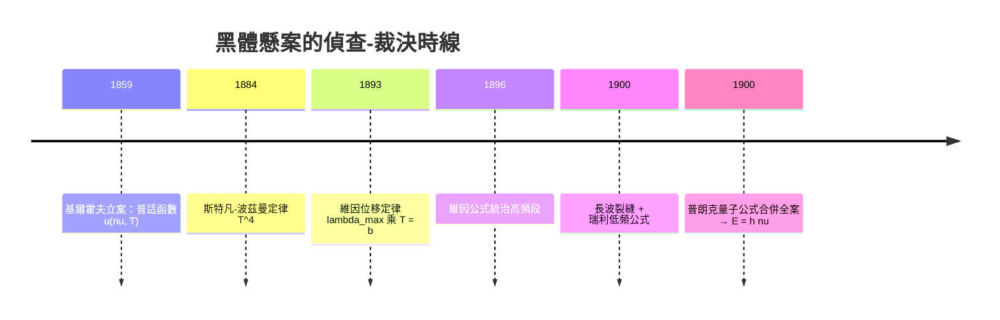

# 1911 · 維因：黑體輻射與量子論的前哨戰

> 1911 諾貝爾物理學獎：威廉·維因（Wilhelm Carl Werner Otto Fritz Franz Wien, 1864–1928，德意志帝國）——表彰「他關於支配熱輻射之定律的發現」（for his discoveries regarding the laws governing the radiation of heat），即維因位移定律與維因輻射公式。

## 懸案（案情提要）

十九世紀末，物理學界最燙手的懸案不是陰極射線，也不是 X 射線，而是一個看似平凡的問題：**燒紅的鐵為什麼先發紅光、後發白光？爐溫升高，光的顏色為什麼有規律地變？**

更準確地說，懸案是：**給定溫度 $T$，一個理想黑體發出的輻射，其光譜 $u(\nu, T)$ 是什麼函數？** 這個函數之所以關鍵，是因為：

1. 黑體輻射與任何材料、任何形狀無關，只依賴 $T$——它是**純粹的普适函數**，任何理論（力學、電磁學、統計學）都必須在這裡過堂；
2. 舉目所及皆是實例：太陽（約 5800 K）、熔爐、燈絲、甚至宇宙本身——量準這條曲線，就能讀出一切發光體的溫度與本質；
3. 維因時代已經測出：光譜峰值隨溫度升高向短波移動（紅→橙→白），且曲線形狀有規律——但**沒有人能寫出這個函數**。

維因的貢獻是本案的「偵查階段成果」：他用嚴格的熱力學+電磁學推理，抓到了函數的**形式骨架**（位移定律）與高頻段的**近似解**（維因公式）。而正是這個近似解在低頻段的失敗——著名的「紫外災難」——把普朗克逼上了 1900 年的量子革命。1911 年的這座獎，獎的是量子論誕生前最後、也最關鍵的一場前哨戰。

## 前因

| 年份 | 事件 |
|------|------|
| 1859–1860 | 基爾霍夫提出黑體概念與基爾霍夫定律：空腔輻射譜 $u(\nu, T)$ 是普适函數，與腔壁材料無關——懸案正式立案。 |
| 1860s–1884 | 斯特凡由實驗數據歸納總輻射功率 $\propto T^4$；波茲曼 1884 年以電磁輻射壓（$p = u/3$）+ 熱力學推導出 $u_{\text{總}} = \sigma T^4$（斯特凡-波茲曼定律）——理論首勝。 |
| 1884 | 維因在亥姆霍茲實驗室任助手，開始輻射測量；同年在柏林認識普朗克——兩人將在 27 年後先後領取相鄰的諾獎。 |
| 1893 | 維因發表位移定律的理論推導：$\lambda_{\max} T = \text{常數}$。 |
| 1894–1896 | 維因與盧默設計空腔輻射計（帶精密光柵單色儀的黑色空腔爐），首次測得可與理論對質的全光譜數據。 |
| 1896 | 維因發表輻射公式 $u(\nu, T) = A\,\nu^3\,e^{-h'\nu/kT}$ 形式（以他自稱的「分子假說」推導）：在高頻段與實測完美吻合。 |
| 1899–1900 | 盧默與普林斯海姆的紅外長波測量顯示維因公式在低頻段系統性偏低——「紫外交接處」出現裂縫。 |
| 1900-10 | 瑞利以能量均分定理導出 $u \propto \nu^2 T$ 的低頻公式；1900-12-14 普朗克發表量子假說下的普朗克公式，全案合併。 |

## 調查

**第一步：把案子搬進「理想黑體」這個實驗室。** 維因的偵查從統一物證標準開始：以帶小孔的空腔爐為黑體——輻射進入小孔後在腔內多次反射吸收，逃逸概率趨零，小孔的輻射譜即 $u(\nu, T)$。他與盧默的空腔輻射計把溫度控制、光柵分光、熱電堆測功三者聯調，首次產出可信的 $u(\nu, T)$ 實測數據集——「量得夠準」是本案一切推理的前提。

**第二步：熱力學推理，抓出函數骨架。** 維因的關鍵思想實驗（1893）：考慮一個緩慢壓縮的鏡面空腔。腔內輻射被移動的鏡面都卜勒頻移：波長按 $\lambda' = \lambda (1 + v/c)$ 收縮；同時絕熱壓縮中輻射能量密度按 $u \propto T^4$、體積按 $V$ 變化。聯合電磁輻射壓 $p = u/3$ 與熱力學第一定律，維因證明：譜函數必須具有形式

$$u(\nu, T) = \nu^3\, f\!\left(\frac{\nu}{T}\right)$$

——**一個未知的單變量函數 $f$，把所有溫度的光譜全部串聯**。這是「標度律」思想的偉大首演：量一個溫度的光譜，理論上可推出所有溫度的光譜。

**第三步：位移定律。** 令 $u(\nu, T)$ 對 $\nu$ 求極值：$\frac{d}{d\nu}\left[\nu^3 f(\nu/T)\right] = 0$，等價於 $f$ 的自變量取常數 $\nu_{\max}/T = \text{常數}$。以波長表述：

$$\lambda_{\max}\,T = b, \qquad b = 2.898\times10^{-3}\,\mathrm{m\cdot K}$$

太陽（$5800\,\mathrm{K}$）峰值 $\lambda_{\max} \approx 500\,\mathrm{nm}$——綠色，恰好是人眼最敏感的波段；人體（$310\,\mathrm{K}$）峰值 $\approx 9.3\,\mathrm{\mu m}$——紅外；宇宙背景（$2.7\,\mathrm{K}$）峰值 $\approx 1\,\mathrm{mm}$——微波。一條公式串起爐火、陽光、體溫與宇宙。

**第四步：擬合出維因公式。** 維因以熱力學骨架 + 對麥克斯韋速度分布的類比（他自述為「分子假說」的試探性推理），假設輻射子的頻率分布類似氣體分子速率的指數分布，得

$$u(\nu, T) = A\,\nu^3\,e^{-h'\nu/k_B T}$$

此式在高頻（短波）段與盧默的數據吻合得極好，且自動滿足位移定律與斯特凡-波茲曼定律（積分 $\int u\,d\nu \propto T^4$）。1890 年代末，它被視為黑體懸案的「事實上的解答」。

**第五步：裂縫現形。** 1900 年，盧默與普林斯海姆把測量推進到長波紅外（$\lambda$ 至 $18\,\mathrm{\mu m}$、$T$ 約 $1600\,\mathrm{K}$）：維因公式在低頻段**系統性偏低**，偏差高達百分之五十；同段數據反而與瑞利的 $\nu^2 T$ 律吻合。一條公式統治高頻、另一條統治低頻——$u(\nu, T)$ 的完整函數成為橫在新世紀門口的最後一懸。1900 年 12 月 14 日，普朗克以能量量子 $h\nu$ 的「內插 + 統計推導」發表

$$u(\nu, T) = \frac{8\pi h \nu^3}{c^3}\,\frac{1}{e^{h\nu/k_B T} - 1}$$

——高頻極限即維因公式，低頻極限即瑞利公式。懸案總結，量子論誕生。

## 理論裁決

**裁決一：維因位移定律（嚴格成立）。** 維因的譜函數形式 $u = \nu^3 f(\nu/T)$ 是熱力學+電磁學的嚴格推論，量子力學不能推翻它——普朗克公式完全滿足此形式（$f(x) = \frac{8\pi h}{c^3}\,\frac{1}{e^{x} - 1}$，$x = h\nu/k_B T$）。位移定律因此與斯特凡-波茲曼定律一起，成為黑體輻射中「理論骨架級」的永恆裁決：無論微觀機制為何，宏觀熱力學已鎖死其形。

**裁決二：維因公式的功過（部分成立）。** 維因公式是普朗克公式的 $h\nu \gg k_B T$ 極限：

$$\frac{1}{e^{h\nu/k_B T} - 1} \to e^{-h\nu/k_B T}\ \text{（高頻時）}$$

它在光子能量遠大於熱能的區域完全正確——這正是後來玻色-愛因斯坦統計中「光子氣體高能極限即麥克斯韋-玻茲曼分布」的具體表現。它的失敗僅在低頻：維因的指數假設過強壓制了長波輻射。此案的教訓成為方法論教材：**以部分數據擬合出的普适函數，必須在全部數據面前受審**——普朗克的內插法同樣「不體面」，但他等到了 1900 年 10 月的長波數據才簽發判決。

**裁決三：輻射壓與輻射的熱力學。** 維因推導中使用的電磁輻射壓 $p = u/3$（無質量光子的動量各向同性給出 $p = u/3$，比有質量理想氣體的 $p = 2u/3$ 小）與光子熵變換，是相對論性熱力學的最早實例之一。這套「把光當熱力學系統處理」的工具箱，日後在愛因斯坦 1917 年的輻射理論（自發/受激輻射、A、B 係數——雷射的理論起點，1964 年諾獎）與宇宙學（微波背景輻射的絕熱冷卻 $T \propto 1/a$，2006 年諾獎）中反覆復用。

**裁決四：量子的第一份配方。** 值得記錄的是：維因公式中那個指數 $e^{-h'\nu/kT}$ 正是普朗克 1900 年「絕望內插」的出發點；普朗克後來說，他珍視維因公式甚於瑞利公式，因為它「含有正確的極限」。歷史地看，**維因抓到了量子的形，普朗克找到了量子的理**——1911 與 1918 兩座物理獎，獎的其實是同一懸案的偵查與終審。

## 後果

| 年份 | 影響 |
|------|------|
| 1900 | 普朗克公式誕生，$h = 6.626\times10^{-34}\,\mathrm{J\cdot s}$ 首次現身——量子紀元元年。 |
| 1905 | 愛因斯坦以光量子解釋光電效應（1921 年諾獎），量子從黑體輻射走向全物理。 |
| 1911 | 維因獲獎（頒於 1912 年儀式）；同年他任維爾茨堡大學教授（倫琴的舊講席）。 |
| 1913 | 波耳模型以量子化軌道解釋氫光譜（1922 年諾獎）；1919 年斯塔克效應（1919 年諾獎）再為量子論添證——維因的學術圈正是舊量子論的搖籃。 |
| 1924 | 玻色-愛因斯坦統計與光子氣體：維因公式被識別為其高頻極限；1925 年玻色-愛因斯坦凝聚預言（2001 年諾獎）。 |
| 1948 | 電視與遙感：維因位移定律成為色溫標準與紅外熱像儀的理論基礎。 |
| 1965→ | 宇宙微波背景輻射 $T = 2.735\,\mathrm{K}$（1978/2006 年諾獎）：一個完美的黑體譜，正是基爾霍夫-維因-普朗克案卷在宇宙尺度的重審。 |
| 現代 | 白熾燈色溫、LED 光譜設計、系外行星與恆星溫度測定、熱成像醫學——位移定律無處不在。 |

## 關聯

- [1901-倫琴與X射線](1901-倫琴與X射線.md)：輻射譜測量的同一傳統——X 射線譜（韌致輻射的上限 $\nu_{\max} = eV/h$）與黑體譜共享「以譜線斷案」的方法論。
- [1904-瑞利與氬的密度疑案](1904-瑞利與氬的密度疑案.md)：瑞利 1900 年的低頻輻射公式出自同一位瑞利男爵——本屆得主的偵查對手與低頻段的正確者。
- [1910-凡得瓦與氣液狀態方程](1910-凡得瓦與氣液狀態方程.md)：1910 與 1911 兩屆諾獎連續表彰「半經典修正」——凡得瓦修正分子模型、維因修正輻射模型，皆以極少參數通吃現象。
- [1912-達倫與燈塔的自動調節閥](1912-達倫與燈塔的自動調節閥.md)：1911 與 1912 兩屆諾獎一理論一工程，同屬「光的利用」主線——燈塔閃光頻率與輻射譜都是光的信息。
- ../化學獎/1920-能斯特熱定理.md：能斯特的熱定理與普朗克常數共同構成低溫統計物理的支柱；熱輻射與熱定理同為世紀之交熱學的兩大裁決。
