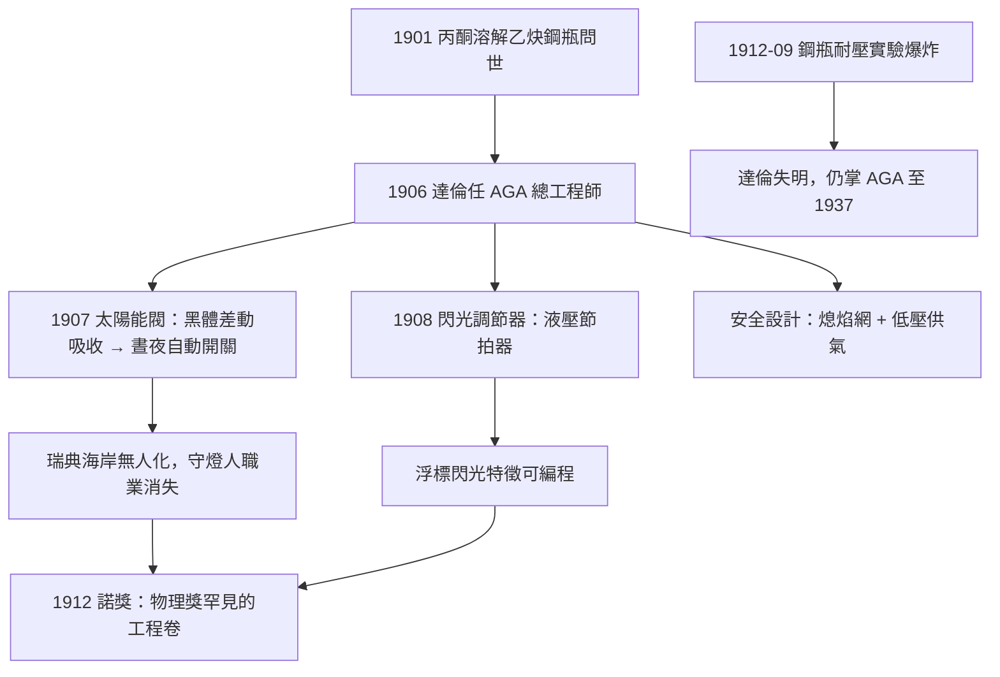

# 1912 · 達倫：給燈塔裝上會思考的閥門

> 1912 諾貝爾物理學獎：尼爾斯·古斯塔夫·達倫（Nils Gustaf Dalén, 1869–1937，瑞典）——表彰「他發明的、與氣體蓄電器聯用於燈塔與浮標的自動調節閥」（for his invention of automatic regulators designed to be used in combination with gas accumulators in lighthouses and light buoys）。

## 懸案（案情提要）

諾貝爾物理學獎至今百年，得獎事由清一色是「發現」與「理論」；1912 年這一屆卻是一個**工程發明**——而且得主在領獎時已經雙目失明。這樁案子的特殊性恰恰在此：它問的不是「自然是什麼」，而是**「物理學能把人類的監視者撤走多少」**。

19 世紀末，瑞典漫長的海岸線上有數千座燈塔與浮標。它們的運作模式極其昂貴：每座燈塔都要有守燈人常駐，日夜補充燃料、修剪燈芯、擦拭玻璃。乙炔燈（電石燈）亮度高、火焰白，是理想的航海光源——但乙炔鋼瓶日夜燃燒，氣耗驚人，且無人值守就無人點燈、無人關燈。懸案有三：

1. **節流關**：白天的燃燒是純粹浪費——但怎麼讓燈「天亮自動熄、天黑自動亮」？光線本身能否當作控制訊號？
2. **閃光關**：航海實踐證明「閃光」比「定光」更易辨認（每座燈塔有專屬的閃爍節奏），但機械式旋轉遮板粗笨易壞，浮標上根本裝不下。
3. **安全關**：乙炔氣壓高、易爆，鋼瓶充氣與運輸本身就是事故源頭——如何在無人環境下絕對安全？

達倫的答案是一組優雅得近乎藝術的機電器件：**太陽能閥**（sun valve）與**閃光調節器**（blinker machine）。前者讓黑體吸收太陽熱差動膨脹、自動關閉主火焰；後者以小號乙炔火焰驅動微小的水柱活塞，讓燈以預設節奏閃爍——無電、無人、無發條，純靠物理。1907 年後，瑞典海岸一夜之間「無人化」，守燈人這個職業消失了。而達倫本人在 1912 年的一次乙炔儲罐耐壓實驗爆炸中失明——**頒獎禮上，替他領獎的是他的兄弟**。

## 前因

| 年份 | 事件 |
|------|------|
| 1869 | 達倫生於瑞典西海岸農家；早年就讀哥登堡查爾姆斯理工，主攻機械工程與電氣。 |
| 1895–1897 | 就讀瑞士蘇黎世聯邦理工（愛因斯坦的學校），師從電機名師；回瑞典任哥登堡蒸汽機公司工程師。 |
| 1900–1906 | 與合夥人開辦空氣加熱器公司；受瑞典煤氣蓄電器公司（AGA 前身）之託調查乙炔用作航標光源的可行性。 |
| 1901–1905 | 法國化學家克洛德（Georges Claude）與布尚發明碳化鈣製乙炔的工業法與溶解乙炔鋼瓶（丙酮多孔吸附法）——乙炔從「炸彈」變成「可控氣源」，為達倫案提供前提。 |
| 1906 | 達倫加入 AGA 任總工程師；開始設計乙炔燈塔的完整系統（鋼瓶—調壓—燃燒—控制）。 |
| 1907 | **太陽能閥**問世：黑體金屬桿對日光的差動吸收驅動閥門，白天自動關小主焰至微光，天暗自動全開。 |
| 1908–1910 | 閃光調節器與加熱混合器問世；瑞典燈塔全面改裝，AGA 公司成為世界航標供應商。 |
| 1912-09 | 達倫在工廠測試乙炔鋼瓶的耐壓極限，儲罐爆炸，面部重創而失明——三個月後，諾獎通知抵達。 |

## 調查

**第一件證物：太陽能閥——以黑體輻射當開關。** 達倫的問題是「無人條件下如何感知晝夜」。他的裝置極其聰明：三根包在玻璃罩內的金屬桿，**最上桿塗黑、其餘為拋光鏡面**，各自與一個密閉液壓腔相連，液壓腔共同推動一個閥門桿。原理：

- 黑體的吸收率 $\alpha \approx 1$，拋光面的 $\alpha \approx 0.1$——同一日照下，黑桿吸熱是鏡面桿的十倍；
- 夜間：無日照，三桿同溫，閥門桿平衡在**開啟**位置，乙炔全通，燈全亮；
- 白天：黑桿升溫遠快於鏡面桿，其液腔膨脹推動閥門桿**關小**主焰（只留導航所需的微弱引焰）；
- 熱平衡的分析可用牛頓冷卻定律寫出：各桿溫度 $\frac{d\Delta T}{dt} = \frac{\alpha P_{\odot}}{C} - \frac{h\,\Delta T}{C}$，穩態溫升 $\Delta T_{ss} \propto \alpha P_{\odot}/h$——黑桿與鏡面桿的穩態溫差直接正比於日照強度，閥門行程因此是日照的**連續函數**。

全器件沒有一片電子、沒有一個馬達：輻射物理（黑體吸收）+ 熱膨脹 + 液壓槓桿，構成一台**以陽光為輸入的自動開關**。據 AGA 統計，太陽能閥把乙炔消耗削減九成，燈塔可連續無人運行一年以上。

**第二件證物：閃光調節器——以水柱當節拍器。** 航海要求每座燈塔有專屬閃光特徵（如「每 5 秒閃 2 次」）。達倫的方案：以燈塔自備的乙炔引焰加熱一個小水槽，水蒸氣壓推動活塞；活塞走到行程末端時，以機械槓桿**切斷引焰**，蒸汽凝結、活塞回位，循環重啟。閃爍節奏由水槽尺寸與節流孔決定：

$$\Delta t \approx \frac{V}{A\,v_{\text{孔}}} \quad \text{（水柱驅動一次行程的時間）}$$

調整節流孔即可設定 1 至 30 秒的任意節奏——**一台純液壓的可編程節拍器**。閃光比定光省氣數倍，且辨認度更高；浮標（隨波搖晃、無處架電）因這台小器件而首次獲得可靠的閃光能力。

**第三件證物：安全系統。** 乙炔與空氣混合的爆炸極限寬（約 2.5% 至 82% 體積分數），鋼瓶破裂即爆。達倫的工程組合：(1) 丙酮吸附多孔填充鋼瓶（法國技術），工作壓下乙炔溶解於丙酮而非以氣態高壓存在；(2) 回火防止器（金屬絲網熄焰裝置，依據火焰淬熄距離 $d_{\text{熄}} < $ 網孔尺寸的燃燒理論）；(3) 全系統低壓供氣設計。他把「易爆氣體 + 無人值守」這一矛盾組合馴服成為海上的常態設施——工程物理的完整課本。

## 備考：失明的首席工程師

1912 年 9 月的那場爆炸值得單獨記錄。事發時達倫正在測試一組新型乙炔鋼瓶的耐壓極限——他在場親自觀察壓力表。爆炸後他的面部嚴重燒傷，數週後視力完全喪失。三個月後諾獎通知抵達，外界一度質疑委員會是否會撤回；委員會不僅照頒，還安排了他的兄弟代為出席。達倫後來的自述成為工程史上著名的證詞：

> 「我的眼睛屬於實驗，而不是屬於我自己。」

此後 25 年，他以觸覺、記憶與口述繼續掌管 AGA：白天的實驗室由助手讀數，夜晚他靠指尖檢查圖紙上的凸線（公司為他製作了浮凸製圖台）。1920 年代他主導的產品還包括後來聞名於世的 AGA 爐（1922 年的鑄鐵蓄熱烤箱，至今仍在生產）與第一代航用無線電信標。他在 1937 年去世前完成的回憶錄中堅持一個觀點：諾獎頒給「自動閥」而非「某種科學發現」，恰恰說明物理學的價值最終要以「它替人類省下了多少守望」來結算。這份價值觀，是 1912 年這一卷與所有純科學卷宗之間最有意思的張力。

## 理論裁決

**裁決一：以黑體吸收率差動做傳感。** 太陽能閥的物理核心是克希霍夫輻射定律的工程翻譯：吸收率等於發射率（$\alpha = \varepsilon$），黑化表面在太陽光譜（可見+近紅外為主）中的吸收遠高於拋光面。達倫把三桿差動結構做成**機械微分器**：只響應「日照的改變量」，日夜切換對應閥門的死區設計（滯回），避免晨昏時刻閥門顫振——自動控制的經典課題（傳感器差動、執行器滯回）在 1907 年已全部到位。這是閉環控制理論在工業界的早期典範，比維納的控制論（1948）早了四十年的工程實踐。

**裁決二：閃光調節器的流體與熱力學。** 引焰加熱水槽的功率 $P$ 給出蒸發速率，蒸汽壓沿飽和蒸氣壓曲線 $p_{\text{sat}}(T)$ 上升；活塞推力 $F = A_{\text{活塞}}(p_{\text{sat}} - p_{\text{回位}})$，行程時間由節流孔的泊肅葉流（Poiseuille flow）控制：

$$Q = \frac{\pi r^4}{8 \eta L}\,\Delta p$$

（$r$、$L$ 為孔半徑與長度，$\eta$ 為水黏度。）改變 $r$ 即改變 $Q$，從而設定閃光週期——把奈維爾-斯托克斯的一個特例變成「可旋鈕的時間常數」。整機無活動電觸點、無潤滑需求、耐低溫、防鹽霧：以流體與熱力學元件構成的「固態」邏輯，是機電一體化思想的教科書。

**裁決三：安全工程的燃燒物理。** 回火防止器的原理是火焰傳播的淬熄：火焰在窄於淬熄距離的通道中因熱損失大於反應放熱而熄滅。達倫的金屬絲網以密集小孔實現 $L_{\text{孔}} < L_{\text{熄}}$，把火焰鎖在燃燒室內。配合丙酮溶解（亨利定律：氣體溶解度正比於分壓 $c = k\,p$）與低壓管路，系統在「氣體本性不改」的前提下被工程上制服——這份裁決與其說是物理發現，不如說是**物理定律被反向用作設計準則**的示範。

**裁決四：諾獎的邊界裁決。** 1912 年物理學獎頒給工程器件，在諾獎史上極為罕見（此後同類僅有 1992 年夏帕克探測器、2000 年基爾比積體電路等少數工程取向的授獎）。委員會的理由呼應諾貝爾遺囑原文——獎勵「為人類帶來最大福祉」的發明與發現。此案確立了物理獎的邊界語法：**物理學的「裁決」不只寫在黑板上，也寫在海岸線上**。而達倫失明後仍以記憶與口述執掌 AGA 三十年，並在 1930 年代為航標增加無線電信標——本檔案與 1909 年馬可尼案在此再次交匯。

## 後果

| 年份 | 影響 |
|------|------|
| 1907–1915 | 太陽能閥行銷全球，燈塔與浮標大規模無人化；AGA 成為世界級公司，產品線後來涵蓋烤箱（AGA 爐至今仍以達倫 1922 年的設計聞名）。 |
| 1912 | 達倫失明；諾獎委員會破例維持授獎。他回信：「把獎金拿去做我的實驗，比放在我口袋裡更有價值。」 |
| 1920s–1930s | 達倫在失明狀態下推動 AGA 進入無線電信標、自動化儀表領域——航標從光學邁向無線電（與 1909 案合流）。 |
| 1948→ | 自動控制學科成形（維納《控制論》）：差動傳感、滯回、閉環調節——太陽能閥的設計語法被全面理論化。 |
| 2000s | 太陽能閥的原理被重新發掘為「被動式晝夜開關」，應用於離網太陽能路燈與偏遠地區航標——無人值守與零能耗的設計目標百年未變。 |
| 現代 | 光電傳感自動照明、光敏太陽能路燈、航海 AIS 信標與自動閃光 LED 航標——「以光為開關」的達倫思想仍是現在進行式；黑體差動吸收更成為日射量計（pyranometer）與熱電堆傳感的標準設計。 |

## 關聯

- [1909-馬可尼與布勞恩的無線電報](1909-馬可尼與布勞恩的無線電報.md)：航海安全的兩條技術線——無線電信標與自動閃光航標；1912 年泰坦尼克事件後，兩者同時被國際公約列為船舶標配。
- [1911-維因與熱輻射定律](1911-維因與熱輻射定律.md)：太陽能閥的物理心臟正是維因案的核心——黑體吸收與輻射譜；1911 與 1912 兩屆諾獎恰好構成「輻射的理論與工程」雙卷。
- [1907-邁克生與光速的極限測量](1907-邁克生與光速的極限測量.md)：兩案同為「精密物理服務於航海與計量」的案例——1907 諾獎的鎘紅光長度標準與 1912 的自動航標，同屬度量衡與安全的應用物理。
- [1903-貝克勒與居禮夫婦的放射性懸案](1903-貝克勒與居禮夫婦的放射性懸案.md)：對照卷——居禮夫婦棚屋裡處理數噸礦渣的放射性安全問題，與達倫的乙炔安全系統，同屬「馴服高危物質」的世紀工程。
- ../化學獎/1912-格林尼亞與薩巴捷.md：同屆化學獎（格林尼亞試劑與催化氫化）——1912 年的諾獎同時表彰「實驗室的新工具」：物理獎的燈塔閥與化學獎的格氏試劑，都是讓同行反覆受惠的基礎設施型發明。
