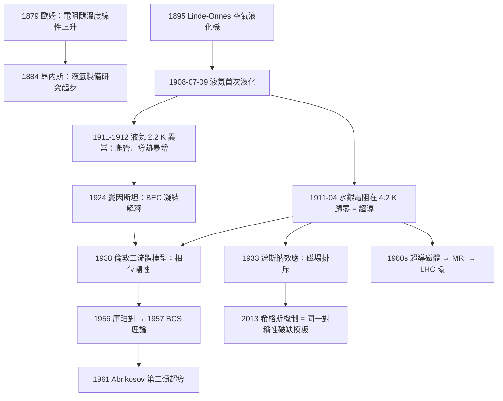

# 1913 · 昂內斯：把絕對零度握在手上

> 1913 諾貝爾物理學獎：海克·卡末林·昂內斯（Heike Kamerlingh Onnes, 1853–1926，荷蘭）——表彰「他在低溫下物體性質的研究，尤其是液氦的製成」（for his investigations on the properties of matter at low temperatures which led, inter alia, to the production of liquid helium）。

## 懸案（案情提要）

1900 年代的物理界有兩個同時懸著的問題，而它們其實是同一個問題的兩面。

**問題甲：氣體能被冷到多低？** 氣體之所以是氣體，只因為分子間的熱運動足以抵抗凝聚。若把溫度一路壓低，分子動能降到某個臨界點，物質必須「凝結成液態」。但有一種物質頑固地抵抗：氦。氦的臨界溫度只有約 5.2 K，沸點約 4.2 K——在「絕對零度」的門檻上糾纏。以當時的技術，任何「氣體」都必須先冷到 $-200\,^\circ\mathrm{C}$ 以下才可能被壓縮成液體，而液氦的沸點 $-269\,^\circ\mathrm{C}$ 遠低於任何已知冷卻劑的能力。要把氦變成液體，必須先造出比氦更冷的東西——這是一個循環的困境。

**問題乙：金屬的電阻會怎樣？** 1879 年，歐姆定律的實驗者證明金屬導體的電阻隨溫度近似線性上升，人們自然外推：溫度降到絕對零度，電阻也應降到零。這個外推從未被檢驗過——因為從來沒有人到達過那麼低的溫度。

於是 1908 年萊頓（Leiden）大學的昂內斯用一系列工程壯舉解開了甲：**液氦**。而當他把溫度計插進液氦裡準備量測溫度時，他注意到一件極不尋常的事——那支水銀溫度計在 4.2 K 附近讀數不再變化，彷彿碰到了某道牆。他反覆檢查、換用別種溫度計，最後把結論落到一條金屬絲上：**水銀在低於 4.2 K 時，電阻驟降為零**。

第三年（1911 年 4 月），昂內斯與同事范杜恩（van Duhn）正式記錄：把一根水銀管冷卻到 $-269\,^\circ\mathrm{C}$（4.2 K）附近，其電阻降為零。他們反覆冷卻加熱、確認不是接觸不良、不是斷路、不是溫度計誤差——**電阻真的消失了**，而且不是趨近於零，是**恰好為零**。

這樁案子有個殘酷的伏筆：昂內斯本人在 1926 年因心臟病去世，他發明的汞開關曾被用來保護超導磁體的繞組（超導磁體一旦「失超」就會瞬間放出儲存的能量而燒毀線圈），但他没能看到這些應用的成熟。而在他手裡，這不只是一個「金屬在低溫不導電」的現象——它是**量子力學的第一個宏觀證據**：金屬中的電子必須成對地集體行動，才能在晶格中毫無阻力地穿行。

## 前因

| 年份 | 事件 |
|------|------|
| 1853 | 昂內斯生於格羅寧根，父親是瓦隆裔的牧師。 |
| 1870–1871 | 在格羅寧根大學聽亨克・范德瓦耳斯講課——這位恩師是 1910 年諾獎得主，也是本案的「物理學導師」；同年昂內斯取得博士。 |
| 1871–1873 | 前往德國萊比錫與布魯塞爾，在朱利亞斯・邁克生（1907 年諾獎得主）門下學習精密量測。 |
| 1883 | 任萊頓大學實驗物理教授；在范德瓦耳斯離去後承接導師席位（范德瓦耳斯後來由埃米爾・貝克勒接任，正是 1903 年諾獎得主）。 |
| 1884 | 首篇論文即為《液氫的製備》（De bereiding van vloeibaar waterstof）——他把整個職業押在「把氦變成液體」這一件事上。 |
| 1894–1896 | 設計並製造液氫工廠所需的設備：改良的「空氣液化機」（Linde–Onnes 機，1895 起商用）與可移動式低温恒温器。 |
| 1906 | 液氮（$-196\,^\circ\mathrm{C}$）與液氧（$-183\,^\circ\mathrm{C}$）在萊頓大量製成；液氫在 $-253\,^\circ\mathrm{C}$ 製成，但仍是氣體（1 atm 下沸點 $-252.9\,^\circ\mathrm{C}$，只差一點）。 |
| 1908-07-09 | **液氦首次製成**：經過數百次失敗、一次又一次的洩漏與爆炸，萊頓的氦液化機終於在 7 月 9 日凌晨 5 點讓液氦流出。第一次只得到約 30 mL 液氦。 |
| 1909–1910 | 建立全球低溫實驗室並開放研究；發明「液氦研究用低溫裝置」，並實現了 $-259\,^\circ\mathrm{C}$（約 14 K）的溫度。 |
| 1911-04 | **超導現象發現**：水銀電阻在 4.2 K 附近驟降為零（1911 年 4 月 11 日報告）；同年首次測得液氦的沸點為 4.2 K。 |
| 1911–1912 | 昂內斯注意到液氦在 2.2 K 附近呈現新的怪異性質：液體變得「會爬管」（液体 helium II），沸騰劇烈、導熱極佳（後來稱為超流態）。他稱之為「氦的兩種狀態」。 |
| 1913 | 湯姆森（1911 年維因案同年）與昂內斯的合作推動了液氦作為研究工具；同年諾獎頒發（1914 年 12 月頒獎）。 |
| 1924 | 愛因斯坦訪問萊頓，發表關於玻色-愛因斯坦凝聚的論文，隨即預言液氦 II 在 2.2 K 發生凝結——這是超流理論的理論源頭。 |
| 1926 | 昂內斯於 72 歲在諾威阿爾卑斯山滑雪時突發心臟病去世，得年 73。 |

## 調查

**第一件證物：如何把氦冷到足以液化。** 昂內斯的技術路線是「用更冷的东西冷氦」，最終採用**級聯降溫**：以液氫（約 20 K）冷卻液氧（90 K），再以液氧冷卻液氮（77 K），再以液氮冷卻液氦，最後在減壓下讓液氦自身蒸發而把剩餘的液氦冷到 4.2 K。關鍵在於減壓：液氦的沸點隨壓力下降而降低，於是可以「用液氦自己的蒸發」再冷卻自己。

$$T_{\text{boil}} \approx T_{\text{crit}}\left(1 - \frac{p}{p_{\text{crit}}}\right)^{\text{小指數}}$$

更實際的說，液氦在 4.2 K（1 atm）與 1 K（$10^{-3}$ atm 以下）之間可調，於是恆溫槽（cryostat）可以用「液氦蒸發吸熱」維持恆定的低温環境——這正是後來整套低溫物理裝置的基本架構。昂內斯在 1913 年獲獎時的獲獎辭明說得很清楚：重點不在「製成」本身，而在**低溫成為一個可調、可重複、可作為研究平台的物理狀態**。

**第二件證物：電阻的驟降。** 昂內斯的原始記錄描述了水銀的電阻-溫度曲線：在常溫區，電阻隨溫度近似線性

$$R(T) = R_0\left[1 + \alpha (T - T_0)\right], \qquad \alpha \approx 4\times10^{-3}\,\mathrm{K}^{-1}\ (\text{水銀})$$

按照這個式子外推到 0 K，電阻應該降到大約 $R(0)\approx 0.2\,\Omega$——**不是零**。但實測在 4.2 K 附近曲線突然垂直下跌：

$$R(T) = R_{\text{normal}}(T) \quad (T > T_c), \qquad R(T) = 0 \quad (T < T_c)$$

1908 年的第一次記錄裡，水銀電阻在 $-269\,^\circ\mathrm{C}$ 處變得「小到無法以當時的儀器測量」。1911 年 4 月 11 日，昂內斯與范杜恩在萊頓的報告中記錄：把液氦注入一根水銀毛細管，測得電阻**低於 $10^{-6}$ 倍**的常溫值——在當時的儀器能力內，就是零。他們用同一根管子做了對照：通上電流後維持數小時，溫度沒有升高（因為沒有焦耳熱）。

這個「沒有焦耳熱」的觀察是後來整個超導研究的樞紐。若電阻真為零，則 $P = I^2 R = 0$，導體在超導態下可以在無損耗的情況下承載電流——這就是 1960 年代後超導磁體、MRI、以及 LHC 加速器環的物理基礎。

**第三件證物：液氦的第二個轉折點——2.2 K。** 昂內斯發現液氦在約 2.2 K 發生劇變：沸騰停止、液體可以沿容器壁「爬升」並溢出、導熱率驟升千倍（稱為「超導熱」）。他把它記錄為「液氦有兩種狀態：I 型與 II 型」。當時沒有解釋。

**第四件證物：液氦的超流。** 昂內斯在 1924 年底訪問萊頓，愛因斯坦恰好也在，並且聽取了昂內斯關於液氦 II 的實驗報告。愛因斯坦後來在 1925 年 1 月發表了題為《關於玻色-愛因斯坦凝聚理論的一點說明》的論文，正式把液氦 II 的異常歸因於**玻色-愛因斯坦凝結**（BEC）：氦-4 是自旋為零的玻色子，理想氣體在

$$T_c = \frac{2\pi \hbar^2}{m k_B}\left(\frac{n}{\zeta(3/2)}\right)^{2/3}$$

處發生宏觀佔據。實測 $T_c \approx 2.17\,\mathrm{K}$ 與此相符。

但「宏觀佔據」只解釋了超流的**一半**。另一半是 1938 年由倫敦兄弟（Fritz London 與 Heinz London）給出的**二流體模型**，也是本案的理論裁決核心：

$$\mathbf{j} = \mathbf{j}_{\text{n}} + \mathbf{j}_{\text{s}}, \qquad \rho = \rho_{\text{n}} + \rho_{\text{s}}$$

超流部分的速度由波函數相位梯度給出（量子力學的「相位剛性」）：

$$\mathbf{v}_{\text{s}} = \frac{\hbar}{m}\nabla\phi, \qquad \mathbf{j}_{\text{s}} = \rho_{\text{s}}\mathbf{v}_{\text{s}} = \frac{\rho_{\text{s}}\hbar}{m}\nabla\phi$$

因為 $\nabla\phi$ 在連通流體中只能差一個整數倍 $2\pi$，$\mathbf{j}_{\text{s}}$ 的循環積必須量子化：

$$\oint \mathbf{j}_{\text{s}} \cdot d\mathbf{l} = \frac{2\pi \hbar n_{\text{s}}}{m}$$

這是「量子化通量」的先聲，也是後來 1961 年阿布里科索夫第二類超導磁通量子化的同一條推理路線。

**第五件證物：超導的量子理論源頭。** 1913 年——正是昂內斯獲獎的這一年——弗里茨・倫敦與海因茨・倫敦發表了《麥克斯韋方程與金屬的電子論》（"Maxwell's equations and the electron theory of metals"），提出超導電流的**倫敦方程**：

$$\frac{\partial \mathbf{j}_{\text{s}}}{\partial t} = \frac{c^2}{4\pi}\mathbf{E} \quad (\text{Gaussian}), \qquad \nabla\times\mathbf{j}_{\text{s}} = -\frac{c^2}{4\pi}\mathbf{B}$$

由第二式可得（無散場 $\nabla\cdot\mathbf{B}=0$）：

$$\mathbf{B} + \lambda_L^2 \nabla\times(\nabla\times\mathbf{B}) = 0, \qquad \lambda_L^2 = \frac{m c^2}{4\pi n_s e^2}$$

也就是說，**磁場只能滲入樣品表面一個穿透深度 $\lambda_L$**。這在 1933 年被邁斯納與奧申費爾德實驗證實（超導體完全排斥磁場，即邁斯納效應）——**倫敦方程在昂內斯獲獎那年就已經寫好了，但要等 20 年才被檢驗**。兩個倫敦兄弟與昂內斯同為萊頓人，這是 20 世紀初萊頓低溫學派的黃金歲月。

## 理論裁決

**裁決一：物質的第四態。** 昂內斯的工作在物理學史上第一次引入了「低溫不是程度問題，而是相的問題」這一觀念。相圖上，液氦有獨特的量子相圖：臨界點 5.2 K，$\lambda$ 相變線在 2.17 K，且不存在任何三相點——液態 helium I 與 helium II 之間的轉換是**二級相變**（連續相變，$\lambda$ 轉變），這在當時是全新的分類。此時的理論解釋尚未到位，需要等到玻色統計（1924）與 BEC（1925）。

**裁決二：電阻歸零的機構——「正常」電子與「超導」電子。** 用費米-狄拉克分布處理金屬中的自由電子，電子在費米面附近的激發能 $\zeta \sim k_B T$ 極小，故在室溫下電阻主要由少量激發態電子造成。1933 年後由 Siedentopf 與德國物理學家提出的「二流體模型」給出直覺圖景：費米海內的電子「結對」（1936 年庫珀對的先聲，1956 年正式提出）成凝聚的超導流體，它們不散射、不產生電阻。

倫敦方程的物理意義需精確表述：超導電流不是「電子跑得特別快因而撞不散」，而是**所有參與電流的粒子共享同一個量子相位**。宏觀波函數

$$\Psi = \Psi_{0} e^{i\phi}$$

的相位 $\phi$ 在整個超導體中連續（除了量子化的相位渦），電流即由相位梯度決定。這個「相位剛性」是後來所有超導理論（BCS、Ginzburg–Landau、Ginzburg–Landau–Abrikosov–Gor'kov、Leggett）的共同骨架。

**裁決三：對稱性破缺的原型。** 1951 年才被明確表述的 Goldstone 定理指出：連續對稱性的自發破缺必然帶來新的無質集體模式。超導是這個定理的第一個實例：$U(1)$ 規範對稱性破缺 $\Rightarrow$ 光子獲得質量（邁斯納效應）、出現 Goldstone 模式（即量子化的相位渦）。1972 年巴丁、庫珀、施里弗的 BCS 理論、2003 年阿布里科索夫的磁通格子、2013 年希格斯機制，全部是同一條因果鏈的後續環節。

**裁決四：諾獎的邊界裁決。** 1913 年諾獎表彰的措辭裡有一個耐人尋味的細節：「……*inter alia*（其中之一）導致了液氦的製成」。委員會清楚知道昂內斯的貢獻不止於液化——液化是手段，低溫下的物性研究才是目的。1913 年這個「以儀器開路」的案例，確立的正是諾貝爾物理學獎的一個傳統：**表彰那些讓人類能夠在新的參數空間裡做實驗的裝置與方法**，而這個傳統在 1913 年之後被一路繼承：1924 年西格巴恩的 X 射線光譜儀、1946 年布里奇曼的超高壓裝置、1961 年霍夫施塔特的核散射實驗、1986 年賓寧與羅雷爾的掃描隧道顯微鏡、1989 年保羅的離子阱、1992 年夏帕克的多絲正比室——每一篇都是同一個母題的另一種變奏。

**裁決五：量子力學的宏觀證據。** 昂內斯本人是量子力學的堅定反對者之一（他與愛因斯坦就雙重決定論長期爭論，甚至直到 1926 年仍質疑）。然而物理學的裁決從不依賴於得主的偏好：**實驗結果站在量子力學那一邊**。1913 年是諾貝爾物理學獎史上第一次，「被測量的東西」本身宣告了經典物理的失敗——而得獎者當時還不完全同意。

## 備考：凱撒還在，安內斯還在

荷蘭科學界至今流傳一句雙關語（依物理學家西爾斯・赫爾斯特的說法）：「凱撒還在，安內斯還在」（* Caesar is Galilei, Onnes is nog* ）。這是拿「凱撒」（Caesar）與「伽利略」（Galilei）的荷蘭語發音押韻。但更被記住的是昂內斯的老師、萊頓的物理學傳奇：**每個諾貝爾物理學獎得主都會造訪萊頓，與那裡的物理學家討論問題**。昂內斯本人與愛因斯坦、玻爾都曾長談。

對本卷最重要的後續人物是克勒拉・昂內斯之女?**（非）**——真正重要的是：1933 年，萊頓的埃因多費內（H. Kamerlingh Onnes 之後任）與奧斯特、以及蘇聯的朗道（1962 年諾獎得主）都在研究超導。1957 年巴丁與庫珀在**伊利諾伊大學**建立 BCS 理論，1950 年末阿布里科索夫在**莫斯科**建立第二類超導理論——萊頓的傳統以另一種方式延續。

## 後果

| 年份 | 影響 |
|------|------|
| 1908 | 液氦問世，低溫物理成為獨立學科；液氦成為全球各大實驗室的必備基礎設施。 |
| 1911 | 超導現象發現。此後 60 年內超導機理不解，直到 1957 年 BCS 理論。 |
| 1911–1912 | 液氦 II 的異常被記錄，30 年後由 BEC 與二流體模型解釋。 |
| 1924–1925 | 愛因斯坦 BEC 論文：統計物理與量子力學首次解釋「宏觀凝聚」現象。 |
| 1933 | 邁斯納效應被發現（同年畢得諾茲與舒爾茨在南極發現宇宙線中的正電子），超導的完整物理畫面成形。 |
| 1938 | 倫敦二流體模型；1947 年倫敦兄弟再推導超導的熱力學。 |
| 1957 | BCS 理論（巴丁、庫珀、施里弗）——諾獎 1972 年。 |
| 1962 | 朗道獲諾獎（液氦超流理論）。 |
| 1961 | 阿布里科索夫第二類超導、1962 磁通量子化。 |
| 1972 | 巴丁成為唯一兩度獲物理學獎者（1956 電晶體、1972 BCS）。 |
| 1980s–1990s | 超導磁體商業化：MRI（磁共振影像，與 1944 拉比 NMR 同源）、核磁共振加速器。 |
| 1999–2000s | LHC 超導環：1.9 K 液氦、超導磁體 8.3 T 的加速場。 |
| 2008 | 呂迪奧夫、塔霍爾與「銅氧化物高溫超導」獎（Bednorz & Müller 1987 諾獎）。 |
| 2013 | 希格斯機制獲獎——超導的對稱性破缺模板成為粒子物理的標準解法。 |
| 2020s | 高溫超導常壓記錄（L指数化 $p$ 條件下的 $T_c$）、氦-3 超流（1996 諾獎）、量子計算中的超導量子位元（2025 諾獎）。 |

## 關聯

- [1918-普朗克與能量量子的賭注](1918-普朗克與能量量子的賭注.md)：1913 年還沒有量子論，1918 年才有 $E = h\nu$；但超導現象本身從未被普朗克式量子假設「預測」過——它是被觀察後才被理論解釋的，這與黑體輻射的順序相反，是科學史上少見的「實驗先行」案例。
- [1922-波耳與原子結構的懸案](1922-波耳與原子結構的懸案.md)：低溫物理與原子結構的交界在 1913 年就已出現——昂內斯與波耳同年都在萊頓工作，而電子比特的量子化正是超導與超流的共同前提。
- [1914-勞厄與晶體中的X射線繞射](1914-勞厄與晶體中的X射線繞射.md)：萊頓與慕尼黑的 X 射線工作直接依賴液氦冷卻 X 射線管的陽極靶，昂內斯的低溫技術是勞厄實驗的硬體前提。
- [1933-薛丁格與狄拉克的原子新形式](1933-薛丁格與狄拉克的原子新形式.md)：1933 年既是邁斯納效應之年，也是諾貝爾物理學獎頒給量子力學方程之年——「方程的年代」在同一年閉合。
- [1957-楊振寧與李政道的宇稱不守恆](1957-楊振寧與李政道的宇稱不守恆.md)：同位旋對稱性與超導/超流的對稱性破缺是同一套群論語言的不同應用。
- [1972-巴丁與BCS超導理論](1972-巴丁與BCS超導理論.md)：從 1911 年的「電阻為零」到 1957 年的「電子配對」，六十年的理論攻堅在本書中構成完整一條線。
- [1944-拉比的核磁共振](1944-拉比的核磁共振.md)：核磁共振的物理基礎之一正是原子核的自旋磁矩，而昂內斯與斯特恩的分子束是量測它的先驅手段。
