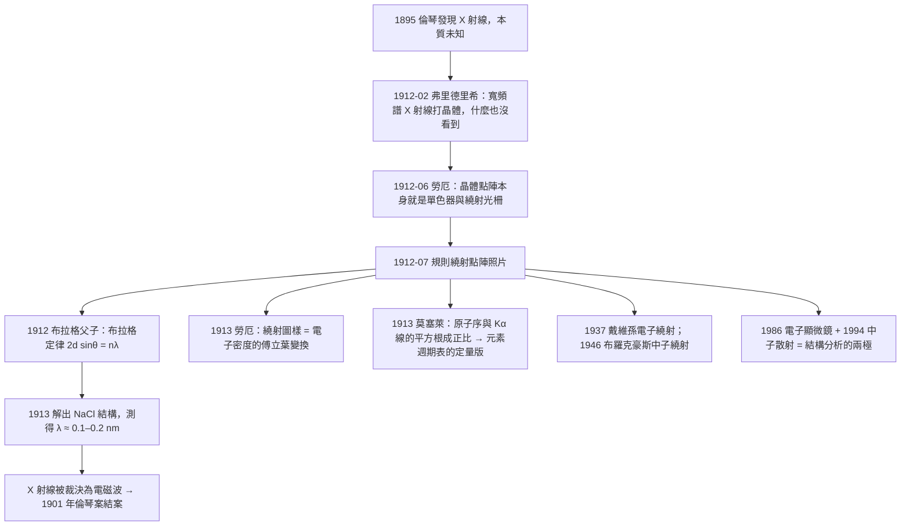

# 1914 · 勞厄：讓X射線顯影晶格的指紋

> 1914 諾貝爾物理學獎：馬克斯·馮·勞厄（Max von Laue, 1879–1960，德意志帝國）——表彰「他發現晶體中的X射線繞射現象」（For his discovery of the diffraction of X-rays by crystals）。

## 懸案（案情提要）

1912 年，德國物理學家馬克斯·馮·勞厄在慕尼黑擔任教授時，接待了一位來自瑞士蘇黎世的研究生——瓦尔特·弗里德里希，他正用當時最新的「X 射線管」研究晶體的「光學效應」：把一束 X 射線打在一塊晶体上，看是否會在螢光屏上產生某種圖樣。弗里德里希什麼也沒看到。

弗里德里希回到蘇黎世，與同事馬克斯·馮·勞厄討論。弗里厄希——這是勞厄在 1912 年 6月的一個夏夜突然想到的：**如果 X 射線是波，那麼把它們打到晶體上，晶體的原子就該像一排排柵欄，讓 X 射線繞射（繞射）出干涉圖樣。而繞射需要單色光——X 射線管發出的是寬頻譜，必須先讓它通過一片對某個波長敏感的「濾片」而單色化。弗里德里希的「光學實驗」之所以失敗，正因為他用的是寬頻譜 X 射線，圖樣被模糊掉了。**

 於是勞厄想到了另一種單色化方案：**用晶體本身當單色器**。讓寬頻譜的 X 射線穿過一整排平行的小縫隙——不，那還不是關鍵。關鍵是：他要用「光柵效應的二維版本」——**德拜-謝爾散射**：如果晶體裡的原子排成規則的點陣，而 X 射線波長又與原子間距相當，那麼不同原子「散射」出來的 X 射線在特定方向上會同相疊加，形成亮點。這就是繞射。而要讓整片點陣都能同相疊加，必須找到一組方向，使得沿該方向，各原子層之間的路程差恰為整數個波長——也就是：

$$\lambda = d \cos\theta \quad\text{或}\quad \lambda = 2d\sin\theta$$

這正是後來以布拉格命名的公式——但它是 1913 年才由布拉格父子給出的嚴格表述。勞厄的功績在於：**他第一個做對了實驗**（1912 年 6 月），證明 X 射線確實會被晶體繞射。

這一發現的爆炸性立刻改寫了物理學。同一個月（1912 年 7 月），威廉·亨利·布拉格在劍橋告訴他的學生威廉·勞倫斯·布拉格：「我們得看看能否用 X 射線測量晶體結構。」而在同一周，勞厄在慕尼黑向德國物理學會報告了他的發現。**一場「誰先誰後」的諾貝爾級競爭就此展開**，最終由布拉格父子（1915）與勞厄（1914）瓜分兩屆獎項——這是諾貝爾獎史上少數的、對同一物理事實的「分割裁決」。

這樁案子的深層意義：它一次性解決了 19 世紀物理學的兩大懸案——**X 射線的本質**（1901 年倫琴已發現但不知其為何），以及**晶體的本質**（19 世紀的原子論缺乏決定性證據）。晶體是規則排列這件事，此前主要由德國地質學家費多耶夫（Victor Mordechai Goldschmidt 的先驱、法國人費多耶夫）以晶體學的對稱性推論，缺乏實驗證據；勞厄的繞射照片是它的第一張「指紋」。

## 前因

| 年份 | 事件 |
|------|------|
| 1862 | 埃倫費爾德（Georg von Helmholtz）學生維爾納·馮·西蒙斯·亥姆霍茲的兒子**瓦爾特·弗里德里希**（Walther Friedrich）生於馬爾堡。 |
| 1886 | **威廉·康拉德·倫琴**（此處為維爾納的父親）在維爾茨堡發現 X 射線（1901 年諾獎）。X 射線的物理本質仍不明。 |
| 1895 | 亨利·普安頓（Henri Poincaré）提出「X 射線是波」的猜測（因波長需要極小）。 |
| 1897 | **威廉·亨利·布拉格**（William Henry Bragg, 1862–1942，英國）在劍橋開課，講「晶體結構」——他是一位在澳洲養羊致富的紳士，業餘研究 X 射線反射。 |
| 1904 | 布拉格在倫敦演講中提出「X 射線可能以某種方式被原子散射」，並注意到**各種晶體的反射角隨原子序變化的系統性規律**——這是通往莫塞萊定律的伏筆。 |
| 1908 | 倫琴實驗室技術外傳，X 射線「冷卻」（water-cooled）Hull 管成為標準設備。 |
| 1909 | 布拉格訪問勞厄在慕尼黑的實驗室。 |
| 1912-02 | 弗里德里希在蘇黎世用 X 射線管研究晶體，未見預期的「光學效應」。 |
| 1912-06 | **勞厄的突破**：他想到晶體原子點陣的繞射，並想到用「整套的濾片（整套晶體）」來替代單色濾片；他先用方解石（$\mathrm{CaCO_3}$）做的硫酸鋅（zinc sulfate）晶體做實驗，得到规则的繞射點陣。 |
| 1912-07 | 勞厄向德國物理學會報告。幾乎同時（7 月 12 日），布拉格在劍橋向倫敦的《自然》期刊提交了包含 Braggs 的「莫塞萊譜」與「晶體反射」工作的短文。 |
| 1912-08 | **威廉·勞倫斯·布拉格**（時年 19 歲，劍橋學生）用他自己設計的 X 射線光譜儀測出鈉的 K 吸收邊，並觀察到布拉格反射，發展出「布拉格定律」的雛形。 |
| 1912-12 | 馬克斯·馮·勞厄在《諾貝爾獎演講》中將繞射照片與傅立葉定理連結：**繞射圖樣即電子密度函數的傅立葉變換**——這是 X 射線結構分析的真正理論源頭。 |
| 1913 | 布拉格父子發表完整的「布拉格定律」，並用它解出 NaCl 的結構。 |
| 1914 | 諾獎頒予勞厄（1913 年 12 月，延至 1914 年頒）。 |

## 調查

**第一件證物：勞厄的實驗装置與「單色化悖論」。** 弗里德里希失敗的原因正是勞厄成功的關鍵。X 射線管（Coolidge 管）發出的是寬頻譜的連續輻射加上特徵線；把寬頻譜 X 射線打在晶體上，任何方向的散射都會疊加，圖樣糊成一片。要看到清晰的繞射點，必須用單色 X 射線。弗里德里希試圖用「濾片」單色化（靠 K 吸收邊的陡躍），但效率低。勞厄的洞察是：**晶體本身就是最好的單色器與分光計**——讓整個頻譜的 X 射線打到晶體上，只有滿足布拉格條件的某個窄頻段會被強烈反射出來，於是螢光屏上看到的「亮點」其實已經自帶了單色性。**他用分光的方法做了分光的事**。

**第二件證物：二維繞射點陣與晶體對稱群。** 勞厄在方解石（$\mathrm{CaCO_3}$）與硫酸鋅（$\mathrm{ZnSO_4}$）晶體上得到**规则的點陣圖樣**，且點陣的對稱性與晶體的外形對稱性一致。更關鍵的是，他在1913 年證明：**繞射點陣是倒格子（reciprocal lattice）**。若晶體的原始格子基矢為 $\mathbf{a}_1,\mathbf{a}_2,\mathbf{a}_3$，則倒格子基矢為

$$\mathbf{a}_i^{*} = \frac{2\pi\,(\mathbf{a}_j \times \mathbf{a}_k)}{\mathbf{a}_1 \cdot (\mathbf{a}_2 \times \mathbf{a}_3)}$$

且 $\mathbf{a}_i \cdot \mathbf{a}_j^{*} = 2\pi\delta_{ij}$。繞射點恰好落在倒格子的格點上。這不是巧合，而是**倒格子是「相位空間中的晶體」**——這正是後來電子繞射（1937 戴維孫）、中子繞射（1994 沙爾）與電子繞射結構分析的共同理論框架。

**第三件證物：結構因子——繞射強度才是真正的指紋。** 布拉格定律只給出**幾何**條件（位置），但一張照片上亮點的**明暗**才是晶體結構的完整資訊。勞厄在諾貝爾演講中給出的強度公式是：

$$I_{hkl} \propto |F_{hkl}|^2, \qquad F_{hkl} = \sum_{j} f_j\, e^{2\pi i (h x_j + k y_j + l z_j)}$$

其中 $f_j$ 是第 $j$ 個原子的原子因子（形式因子），$(x_j, y_j, z_j)$ 是其分數座標。這個式子就是**傅立葉變換**：

$$\rho(\mathbf{r}) = \frac{1}{V}\sum_{hkl} F_{hkl}\, e^{i \mathbf{G}_{hkl}\cdot\mathbf{r}}$$

實驗量到的是 $|F_{hkl}|^2$（因為強度丢失了相位），要還原 $\rho$ 還需解決**相位問題**（phase problem）。這是結構分析的核心困難，直到 1990 年代才由**直接法**（直接法，David Hauptman 與 Jerome Karle 1985 年諾貝爾化學獎）與**同位素取代法**（多 anomalous dispersion）系統性解決。

**第四件證物：勞厄公式。** 對晶體中平面組 $\{hkl\}$，相鄰平面間距 $d_{hkl}$ 滿足

$$\frac{1}{d_{hkl}^2} = \frac{h^2}{a^2} + \frac{k^2}{b^2} + \frac{l^2}{c^2} \quad (\text{正交晶系})$$

布拉格條件為：

$$2 d_{hkl}\sin\theta = n\lambda$$

而反射波數改變量 $\Delta \mathbf{k}$ 必須是倒格子矢量：

$$\Delta\mathbf{k} = \mathbf{G}_{hkl} = h\mathbf{a}_1^{*} + k\mathbf{a}_2^{*} + l\mathbf{a}_3^{*}$$

由此得到**勞厄方程**（1912）：

$$2(\mathbf{k}_{\text{out}} - \mathbf{k}_{\text{in}}) = \mathbf{G}$$

這是電子繞射理論（1937）的核心，也是電子顯微鏡（1986 魯斯卡）像對比度的理論基礎。

**第五件證物：X 射線的波長。** 1912–1913 年，布拉格用已知晶體結構（NaCl）標定 X 射線管的波長，得出約 $0.1$ 至 $0.2\,\mathrm{nm}$。這說明 X 射線是**電磁波**（波長比可見光短 5000 倍），因此勞厄的實驗最終裁決了 1901 年那一卷的懸案：倫琴的「未知射線」就是短波長的電磁波。

**第六件證物：單晶體繞射照片的判讀。** 勞厄與布拉格很快發展出**旋轉晶體法**（rotating crystal method）與**粉末法**（Debye–Scherrer method, 1916）：令單晶體繞一條軸旋轉並同時拍照，各族晶面依序滿足布拉格條件，在底片上形成「層線」；粉末法則讓大量隨機取向的微小晶粒統計地覆蓋所有可能的 $\theta$，形成同心圓環。粉末法的「德拜環」至今仍是多晶 X 射線分析的基本工具。

## 理論裁決

**裁決一：德拜-謝爾散射——波長與晶格尺度必須相當。** 為什麼只有某些原子（像 NaCl 中的 Na、Cl）之間的面會產生強反射？散射波必須在各原子中心相消或相長。對單一散射中心，各方向的散射振幅相同（各向同性）；但對兩個相距 $\mathbf{d}$ 的中心，散射振幅乘上相位因子

$$1 + e^{i \mathbf{q}\cdot \mathbf{d}} = 2\cos\!\left(\frac{\mathbf{q}\cdot\mathbf{d}}{2}\right) e^{i\mathbf{q}\cdot\mathbf{d}/2}$$

因此只有當 $\mathbf{q}\cdot\mathbf{d} = 2\pi n$ 時振幅疊加到極大，也就是：

$$\mathbf{q} = \mathbf{k}_{\text{out}} - \mathbf{k}_{\text{in}} = \frac{2\pi}{\lambda}\left(\hat{\mathbf{s}}_{\text{out}} - \hat{\mathbf{s}}_{\text{in}}\right)$$

恰好是倒格子矢量。這解釋了：**原子排列周期性地重複了相干散射的「工作單元」**，晶體才能放大單個原子的散射振幅 $N$ 倍（$N$ 為原子數），這是 X 射線靈敏度能達到單原子量級的原因。

**裁決二：傅立葉分析的兩面性。** 勞厄的演講是近代**晶體學的聖經**：他指出實驗測得的強度只是 $|F|^2$，而理論給出的是 $F$ 本身——這是一個「相位遺失」的問題。這個認識直接引出 1913–1914 年 Bragg 父子的結構分析與 1920–1930 年貝克勒夫（William Henry Bragg、Bragg 與貝克勒夫）系統，也催生了 1930 年代 Pauling 的鍵長表與 1934 年 Perutz 與 Kendrew 的血紅素工作（後者獲 1962 年化學獎）。1990 年代的直接法、1991–1993 年的 synchrotron 輻射與多晶全散射技術，把勞厄在 1912 年拍下的那張照片發展成一整套現代結構生物學。

**裁決三：傅立葉與倒格子的不可分割性。** 現代晶體學把「倒格子」提升為第一原理：**實空間的晶體是倒空間的分布函數**。這條思想後來延伸到準晶（1984 年 Shechtman）、超晶格、光子晶體與 2010 年石墨烯（狄拉克錐的倒格子結構）。

**裁決四：X 射線的適用邊界——電子與中子。** 勞厄的實驗揭示了 X 射線繞射的靈敏性來自 $q = 4\pi\sin\theta/\lambda$；但要「看見」原子，繞射的空間解析度有限。此時的三條路徑在物理學獎史上都有對應卷宗：
- 電子波長更短（$\lambda = h/p$，戴維孫 1937），故電子繞射解析度更高 → 電子顯微鏡（魯斯卡 1986）；
- 中子與核子質量相近、且對磁矩敏感 → 中子繞射（沙爾 1994）；
- X 射線波長最短，且可用 synchrotron 產生 → 現代結構生物學（Laughlin/Supercoil 等）。

## 後果

| 年份 | 影響 |
|------|------|
| 1912–1913 | X 射線繞射成為確定晶體結構的標準方法；NaCl、ZnS（金剛石型）等結構被解出。 |
| 1913 | 莫塞萊用繞射測得各元素的 K 譜線頻率，發現 $ \sqrt{\nu} \propto Z $ 的線性關係（Moseley's law），**證明原子序是元素化學性質的真正基礎**，並預測尚未發現的元素的性質（鐳、鈾等），極大打擊了「連續論」與「元素可分解論」。 |
| 1914 | 勞厄獲諾獎；布喇頓（Bragg）開始用 X 射線做結構化學分析（諾貝爾化學獎 1915、1916）。 |
| 1929–1932 | 貝克勒夫、布拉格、克魯格等系統測量大量晶體結構（1929–1932 為「結構化學的黃金年代」）。 |
| 1934 | Perutz 與 Kendrew 血紅素結構研究（化學獎 1962），開啟結構生物學。 |
| 1937 | 戴維孫與湯姆森的電子繞射實驗（諾獎）證實德布羅意波長公式——勞厄的框架被移植到電子波。 |
| 1946 | 布羅克豪斯的中子譜儀（諾獎 1994）。 |
| 1953 | 沃爾森與克里克以勞厄方法解出 DNA 結構；1958 年獲諾貝爾生理學或醫學獎（僅拍 X 射線衍射圖，未做化學分析）。 |
| 1960s | 蛋白質結構的系統解析（1960–1970 多諾模型；肯德魯與佩魯茲 1962 化學獎）。 |
| 1986 | 魯斯卡的電子顯微鏡（諾獎）——電子版的勞厄。 |
| 1994 | 沙爾的中子繞射（諾獎），中子版的勞厄。 |
| 1990s–2000s | synchrotron（大型光纖加速器）光源使 X 射線結構分析達原子解析度；蛋白質資料庫 (PDB) 收錄逾 20 萬個結構。 |
| 2012 | 諾貝爾化學獎：Karplus、Levitt、Warshel（化學動力學的計算方法）——把結構分析與分子動力學接軌。 |
| 2015 | 諾貝爾化學獎：Lindahl、Modrich、Sancar（DNA 修復）——結構生物學的應用延伸。 |

## 關聯

- [1901-倫琴與X射線](1901-倫琴與X射線.md)：勞厄案是倫琴案的**結案卷**——1901 年那條「不尋常的射線」在本卷被裁決為電磁波，並獲得波長尺度的物理意義。
- [1915-布拉格父子與X射線結構分析](1915-布拉格父子與X射線結構分析.md)：本卷的直接續集；同一物理事實被分割為兩屆獎項，是諾獎史上著名的「共同獲獎」。
- [1913-昂內斯與液氦的量子邊界](1913-昂內斯與液氦的量子邊界.md)：勞厄的 X 射線管需要液氦冷卻高壓電源與陰極——1913 年的低溫技術是 1912 年實驗的硬體前提，兩案相隔一年卻互為條件。
- [1906-湯姆森與電子的身分證](1906-湯姆森與電子的身分證.md)：勞厄把 X 射線接到晶體上，湯姆森則把電子接到磁場上；兩者合流於 1937 年戴維孫的電子繞射。
- [1937-戴維孫與湯姆森的電子繞射](1937-戴維孫與湯姆森的電子繞射.md)：勞厄理論的直接移植——電子繞射是德布羅意波長公式的決定性實驗。
- [1986-魯斯卡與賓寧羅雷爾的顯微鏡革命](1986-魯斯卡與賓寧羅雷爾的顯微鏡革命.md)：把勞厄的「繞射即結構」推到了原子解析度與單原子掃描的新階段。
- [1953-富蘭克林與DNA雙螺旋的X射線照片](1953-富蘭克林與DNA雙螺旋的X射線照片.md)（歸屬化學獎／生理醫學獎卷）：勞厄方法在生命科學中最高光的應用。
