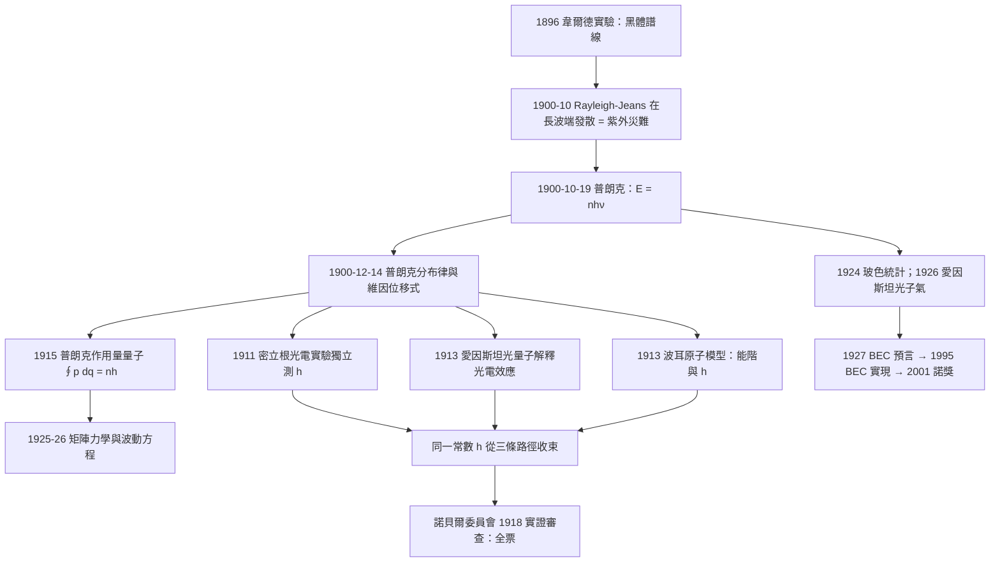

# 1918 · 普朗克：一個被逼出來的量子

> 1918 諾貝爾物理學獎：馬克斯·普朗克（Max Planck, 1858–1947，德意志帝國）——表彰「他對量子的發現推動了物理學的發展」（for the services he rendered to the advancement of Physics by his discovery of energy quanta）。

## 懸案（案情提要）

這樁案件的開頭是一個「黑色屍體」。

1895 年，德國物理學家維爾納・韋爾德（Wilhelm Wien）在哥廷根做黑體輻射的實驗：把物體加熱到不同溫度，量測它發出的總輻射能量。他發現了一條極漂亮的經驗曲線——溫度越高，峰值波長越短。1896 年，他在報告中寫下：

$$\lambda_{\max} T = 2.898 \times 10^{-3}\,\mathrm{m\cdot K}$$

這條**維因位移定律**後來讓 1911 年的維因得了諾獎。但韋爾德的公式是純粹經驗的，它沒有回答：**峰值為什麼在那裡？** 更重要的是，黑體輻射還有另一組更基本的資料——**每個波長的總能量密度**，由普朗克實驗室（柏林）與 其他實驗室在 1900 年前後測得。這組資料構成一條著名的曲線：

$$u(\lambda, T) = \frac{8\pi hc}{\lambda^5} \cdot \frac{1}{e^{hc/(\lambda k_B T)} - 1}$$

問題是：這條曲線在長波端會出現荒謬的結果。1900 年 10 月，普朗克把 Rayleigh– Jeans 公式外推到長波區，發現預測的總輻射能量**隨波長趨於零而發散**——即 $\int_0^{\infty} u_{\text{RJ}} d\lambda \to \infty$。這在物理上是不可接受的：任何溫度下的總輻射能量必然有限（否則宇宙會在每個溫度下無限發光）。這就是著名的**「紫外災難」（ultraviolet catastrophe）**。

Rayleigh– Jeans 公式的物理前提很單純：若每個振動模式（每個自由度）平均具有能量 $k_B T$（能量均分定理），則每個模式的能量密度是 $8\pi\nu^2/c^3 \times k_B T$。這是一個純經典的、Equipartition 的結果，在長波端（每個模式能量 $\ll k_B T$）本該非常準確——為什麼會發散？

**普朗克的破局時刻（1900 年 10 月 19 日夜）**，他用一個「孤立的假設」試圖消滅發散：假設每個振子（oscillator）的能量不能連續取值，只能取某些離散值，並且

$$E_n = n h\nu, \qquad n = 0, 1, 2, \dots$$

此時他就已經寫下了那個後來出現在每一本物理學教科書第一頁的式子：

$$E = h\nu$$

普朗克當時稱之為「-energy elements」（能量元），並坦率地說這是一個「孤註一擲」（a desperate attempt），只是「為求正確而犧牲了連續性」。他花了後來好幾年才相信這個假設是真的。

1900 年 12 月 14 日，他向德國物理學會提交了論文；1901 年與 1902 年，他擴展出完整的統計分布導出，即**普朗克分布律**：

$$\bar{E} = \frac{h\nu}{e^{h\nu/(k_B T)} - 1}$$

這一式子同時解了三個難題：它給出了正確的每波長能量密度曲線（消除紫外災難）、在長波端自動回到 Rayleigh–Jeans 結果（正確的極限）、並且在高頻端給出 Wien 形式。更重要的是：**它給出了第一個真正的「常數」，$h$——普朗克常數。**

而整件事的戲劇性在於：**這個數值後來被測定並且被獨立驗證**。1911 年密立根的光電實驗測出 $h = 6.53\times10^{-27}\,\mathrm{erg\cdot s}$，1920 年後更精確的值與今天採用的 $h = 6.626\times10^{-34}\,\mathrm{J\cdot s}$ 一致。這個事實本身——一個從黑體輻射「失敗」中憑空長出來的普適常數，後來出現在光電效應、原子光譜、超導、熱容、霍爾效應等幾十個毫不相干的現象裡——構成了 20 世紀物理學最深的一次「收束」。

1918 年諾貝爾物理學獎頒給普朗克，理由正是「因他的對量子的發現而推動了物理學的發展」。有意思的是，評審委員會在當時並不確定「量子」是不是真的：他們考慮頒獎給貝克勒（ radioactivity）與倫琴，但普朗克在委員會面前用**大量的實驗數據**說服他們——他帶去了自己的黑體實驗結果、邁克生-莫利的光速實驗、以及 Boltzmann 的統計方法。委員會最終全票通過。

## 前因

| 年份 | 事件 |
|------|------|
| 1858 | 普朗克生於基爾（Kiel）。 |
| 1874 | 普朗克在慕尼黑大學攻讀數學與物理，師從費利克斯・克萊因；教授是 1866 年諾獎得主斐迪南・布勞恩（結構化學）。 |
| 1877 | 普朗克在柏林取得博士學位，導師為亥姆霍茲與克爾丁（Heinrich Friedrich Weber）。 |
| 1878–1885 | 普朗克先後在慕尼黑、柏林、基爾任助理教授；1887 年在柏林繼亥姆霍茲的講席（這是一份由**普朗克家族財產**支薪的職位，使他能拒絕其他大學更高的薪水）。 |
| 1887 | 普朗克提出**熵的定義**：$S = k \ln W$（$W$ 為相對機率），並指出 $S = -Q_{\text{rev}}/T$ 的 Clausius 定義可由它導出——這是把統計力學引入熱力學的關鍵一步。 |
| 1896 | 普朗克發現黑體輻射的「振子等價原理」：**任意物理系統在平衡態下，每個獨立振子的平均能量都相同**。這是黑體問題的正確入口。 |
| 1900-10-19 | **普朗克引入能量量子 $E = nh\nu$**，廢除 Rayleigh–Jeans 發散。 |
| 1900-12-14 | 向德國物理學會提交「論黑體輻射的正常光譜」；發表 $\lambda_{\max} T$ 公式並導出 Wien 形式。 |
| 1901 | 擴展普朗克分布律至完整形式；引入 $k_B$。 |
| 1901–1905 | 玻爾茲曼去世（1906）；普朗克接手柏林的物理學講座並成為德國物理學界的領袖。 |
| 1909 | 普朗克與艾森斯坦等人進行「放射性」的討論（略爾費爾德等），推廣「能量量子」的觀念。 |
| 1911 | 密立根的光電實驗確認 $E = h\nu - \phi$ 的形式並測出 $h$——**普朗克的量子獲得獨立的實驗證據**。 |
| 1911–1913 | 波耳建立原子模型（1913），用量子化角動量解釋原子光譜，$E_n = -13.6/n^2\,\mathrm{eV}$。 |
| 1913 | 愛因斯坦的光量子假說（$E = h\nu$）解釋光電效應，並用光量子解釋固體比熱。 |
| 1918 | 諾獎頒發（1919 年 6 月頒獎，延後一年）。 |
| 1919 | 普朗克在諾貝爾演講《柏林大學的物理學》回顧整段歷程。 |
| 1920–1930 | 普朗克在《Annalen der Physik》發表的系列論著：《熱輻射論》（1919）、《量子理論的原理》（1920）、《量子理論的物理學》（1929）——把量子觀念傳承給整個歐洲物理學界。 |
| 1930s | 為統一場論嘗試一生，並在「科學與信仰」的兩難中尋找精神寄託（《宗教與科學》）。 |
| 1947 | 普朗克在哥廷根去世，葬於哥廷根城市墓地。 |

## 調查

**第一件證物：紫外災難。** 讓我們從物理上精確地把「屍體解剖」一次。

在熱平衡的黑體輻射場中，每個電磁場模式（mode）可視為一個谐振子。Rayleigh–Jeans 假設每個模式平均能量為 $k_B T$，因此總能量密度

$$u(\nu, T) = \frac{8\pi \nu^2}{c^3} k_B T$$

這在 $\nu \ll k_BT/h$ 區域確實正確（這正是後來 Planck 分布的 Rayleigh–Jeans 極限）。但把它積分到全頻段：

$$U_{\text{total}} = \int_0^{\infty} \frac{8\pi \nu^2 k_B T}{c^3}\,d\nu \to \infty$$

**這意味著：一個在任意溫度下的黑體會向外輻射無限大的能量。** 物理學家立即意識到這暗示「每個模式平均能量 $\sim k_BT$」在高頻端錯了。

**第二件證物：量子化的振子與玻色統計。** 普朗克的修正是：振子的能量不能連續，只能取 $E_n = nh\nu$。但這裡有一個更深層的問題：**為什麼？** 純粹的離散化還不夠——若振子有經典自由度數 $g$，能量仍會發散（這就是「Boltzmann–Uhlenbeck 危機」）。真正的解決來自 1924 年玻色的統計：玻色證明對可區分的能量元應用

$$\bar{E} = \frac{h\nu}{e^{\alpha} - 1}$$

（這正是普朗克 1900 年的形式），1926 年愛因斯坦把它推廣到光子氣（光子化學平衡）。而光子氣體在低溫時會發生**玻色-愛因斯坦凝聚**——這條線在 1913 年昂內斯的超導與 2001 年 BEC 諾獎那裡匯合。

**第三件證物：普朗克分布律的推導與「狀態數」的物理意義。** 普朗克的推導（1900–1901）如下：

- 一個頻率 $\nu$ 附近的模式密度 $g(\nu)\,d\nu = \frac{8\pi \nu^2}{c^3}\,d\nu$；
- 在總能量 $E$ 下，把能量分配到 $N$ 個模式上，能量元的個數 $n_1, n_2, \dots$，總數為

$$N = \sum_{i=1}^{N} n_i, \qquad E = \sum_{i=1}^{N} n_i h\nu_i$$

- 分配方式數（用**組合學**而非玻茲曼的 $N!$ 近似）：

$$W = \frac{(N + n_1 - 1)!}{n_1!(N-1)!} \cdot \frac{(N + n_2 - 1)!}{n_2!(N-1)!} \cdots$$

- 令 $\partial \ln W / \partial n_i = 0$（用 $\ln n! \approx n\ln n - n$ 的 Stirling 近似），得到

$$\bar{n}_i = \frac{N}{e^{\alpha + \beta h\nu_i} - 1}$$

- 取 $x = e^{-\alpha}$，$e^{-\beta} = e^{-h\nu/k_BT}$，得到

$$\bar{E} = \frac{h\nu}{e^{h\nu/(k_BT)} - 1}$$

這就是**普朗克分布律**。注意其中的物理突破：普朗克把**玻茲曼的「等概率原理」用在了「能量元的個數」上，而不是用 Stirling 近似處理可區分的振子**——這一步在統計力學史上極為重要，它預示了玻色與費米統計的到來。

**第四件證物：三個極限的統一檢驗。** 這個分布律的強大之處在於它把三個原本互不相干的公式統一在一個式子裡：

$$\bar{E} = \frac{h\nu}{e^{h\nu/k_BT}-1} \xrightarrow{h\nu \ll k_BT} k_B T \quad (\text{Rayleigh–Jeans})$$

$$\bar{E} \xrightarrow{h\nu \gg k_BT} h\nu\, e^{-h\nu/k_BT} \quad (\text{Wien})$$

這就是後來 W. 維因命名的那個「Wien 的位移定律」的真正解釋（1911 年諾獎給了維因的是經驗式；普朗克的分布律才是其微觀根據）。

**第五件證物：$h$ 的數值獨立測量——「收束」的證據。** 這是本案的關鍵劇情。

- 1900：普朗克從黑體資料反推 $h \approx 6.55\times10^{-27}\,\mathrm{erg\cdot s}$。
- 1911–1913：**密立根用光電實驗**獨立測得同一數值（這是他 1923 年諾獎的核心工作）。
- 1913：**愛因斯坦用光量子**解釋光電效應，得到 $E = h\nu - \phi$。
- 1913：**波耳用量子化軌道**解釋原子光譜，得到 $E_n = -R_H/n^2$。
- 1920s： Einstein 固體比熱理論、Debye 固體比熱模型。

三條完全不同的路徑（黑體輻射、光電效應、原子光譜）都指向同一個 $h$。**這是 20 世紀物理學的第一個「一網打盡」的常數**，也是普朗克諾獎的根本理由：諾貝爾委員會實際上是在表彰「一個統一常數的誕生」。

**第六件證物：量子假說的「傳教」。** 普朗克本人其實**不是**量子力學的推動者——他反對波爾茲曼的統計觀點（他認為玻茲曼的 $S = k\log W$ 是錯誤的，甚至試圖「拯救」它），並終身保留對「離散化」的最低限度堅持。真正把量子推成世界觀的是**愛因斯坦（1905 光量子）、波耳（1913 原子模型）、以及 1925–26 年的海森堡、薛丁格、狄拉克、玻恩**。普朗克的歷史角色是**起點**：他提供了那顆種子（$E = h\nu$）與那個方法論示範——當經典物理失敗時，用一個最小可行的量子化假設去救。

## 理論裁決

**裁決一：能量量子的引入與「離散化的位置」。** 普朗克的突破在於**選對了量子化的對象**：他量子化的不是頻率（頻率在經典波動中已連續），而是**每個振子的能量**。形式上，引入整數 $n$：

$$E = \left(n + \frac{1}{2}\right) h\nu$$

（零點能量的 $+1/2$ 項是愛因斯坦與 Debye 在 1911–1912 年補上的，普朗克當年只有 $nh\nu$。）關鍵洞察：**能量不是「被切成小塊」，而是「只能以特定份額交換」**。這正是後來所有量子理論的共同骨架——角動量量子化（波耳 1913，$L = n\hbar$）、電荷量子化、角動量量子化（海森堡 1925，$[J_x, J_y] = i\hbar J_z$）。

**裁決二：作用量原理的浮現——量子化的另一條路。** 1915 年，普朗克自己提出了**作用量量子** $\oint p\,dq = nh$ 的形式（普朗克–愛因斯坦量子條件）。這是本卷最有預見性的部分之一。1917 年，索末菲（Arnold Sommerfeld）把它系統化；1924–25 年，愛因斯坦給出「光量子的作用量表述」；1927 年，葛雷伯（Hermann Weyl）證明它導致 **Weyl 量子化**；1928 年，約當（ Pascual Jordan）證明它導致矩陣力學。**作用量量子化與哈密頓量子化是同一件事的兩條路徑**，普朗克 1915 年的直覺是其中最早的一條。

**裁決三：統計力學的相變——「連續性的斷裂」。** 普朗克分布律是**第一個**在物理學中引入「相變」概念的模型：隨著溫度穿越 $k_BT \sim h\nu$，系統從「經典極限」進入「量子極限」，且轉變是**非解析的**。這就是後來「量子-經典對應原理」的原型，也是 1982 年威爾遜重整群理論、2016 年拓撲相變諾獎的思想源頭。

**裁決四：$k_B$ 的引入與「兩條絕對常數」的建立。** 1900–1901 年普朗克同時引入玻爾茲曼常數 $k_B = R/N_A$，使得統計物理（微觀）與熱力學（宏觀）用同一套語言書寫。**$h$ 與 $k_B$ 是 20 世紀物理學的兩塊基石**：前者定義「量子性的尺度」，後者定義「熱運動的尺度」。$h/k_B$ 給出溫度與頻率的自然對應關係，而「溫度 $T$ 對應頻率 $k_BT/h$」這句話，正是今日低溫物理、雷射冷卻（1997 諾獎）、超流（1913 諾獎）的共同語言。

**裁決五：諾獎委員會的實證主義。** 1918 年這屆獎項的評審過程值得記錄：委員會（瑞典皇家科學院物理委員會）原本考慮頒給倫琴、貝克勒或其他人。普朗克被要求提交他的主要工作，他帶去的是**實驗數據與統計導出**，並在答問中解釋了他如何被「逼」到量子化。委員會最終接受。這與後來物理獎偏好的「理論-實驗對稱」風格一致：普朗克的諾獎不是給「發明了量子力學」，而是給「**第一個量子公式**」。

**裁決六：諾貝爾遺囑的深度 irony。** 諾貝爾在遺囑中寫的是：「獎勵那些在前一年為人類帶來最大福祉的人」。1918 年的物理學獎表彰的是一個**解釋失敗之謎**的公式——它當時並未帶來任何福祉，反而摧毀了整個物理學的框架。但正是這個「摧毀」，最終把人類帶到了雷射、電晶體、核能、MRI、以及 2024 年的 Hopfield 網路。**這一卷是本書全部 107 卷的隱喻：諾獎常在「舊世界崩塌」的當下頒出，而崩塌之後的建築要到很多年後才蓋成。**

## 後果

| 年份 | 影響 |
|------|------|
| 1900 | 普朗克分布律問世；$h$ 與 $k_B$ 進入物理學。 |
| 1905 | 愛因斯坦光量子；索末菲（1906 諾獎）建立原子光譜的電子論。 |
| 1911 | 密立根光電實驗驗證 $E = h\nu - \phi$。 |
| 1913 | 波耳原子模型；莫塞萊定律。 |
| 1915 | 普朗克作用量量子。 |
| 1918 | 諾獎頒發（1919 年頒）。 |
| 1924–1926 | 玻色統計、愛因斯坦光子氣、費米統計（1926）、海森堡矩陣力學（1925）、薛丁格波動方程（1926）、狄拉克方程（1928）。 |
| 1927 | 測不準原理；電子隧穿（後來 1973 諾獎）。 |
| 1928 | 狄拉克發現正電子；1929 德布羅意物質波（1929 諾獎）。 |
| 1930s | 固體比熱（Debye）、金屬電子論（Sommerfeld）、超導（1933 Meissner）。 |
| 1940s–50s | 核物理（查德威克 1935）、介子（1947）、回旋加速器（1939）、可控核裂變（1938 化學獎）。 |
| 1950s | 晶體管的能帶理論（1956 諾獎）、超導 BCS（1972 諾獎）。 |
| 1960s | 激光、QED 重整化（1965 諾獎）。 |
| 1970s–2000s | 標準模型、量子霍爾（1985）、光纖（2009）、石墨烯（2010）。 |
| 2016 | 拓撲相變與相（索利斯、霍爾丹、科斯特利茨）——普朗克式的「相變」概念的終極後裔。 |
| 2019 | 諾貝爾物理學獎（皮布林斯、馬約爾、奎洛茲）——宇宙學的相變（真空衰變）也在同一語法中。 |

## 關聯

- [1911-維因與熱輻射定律](1911-維因與熱輻射定律.md)：本案的直接上游；1911 年的維因位移定律是 1900 年普朗克要解釋的目標，而普朗克的分布律正是它的微觀解釋。
- [1923-密立根與基本電荷的光譜量測](1923-密立根與基本電荷的光譜量測.md)：密立根的光電效應實驗（1916）是量子假說的第一個獨立實驗證。
- [1922-波耳與原子結構的懸案](1922-波耳與原子結構的懸案.md)：波耳把 $h$ 帶進原子，直接用量子化軌道解釋譜線。
- [1921-愛因斯坦與光量子的賭注](1921-愛因斯坦與光量子的賭注.md)：普朗克的能量量子在 1905 年被愛因斯坦推廣為光的量子（1905 年綱領、1911 年諾貝爾演講）。
- [1913-昂內斯與液氦的量子邊界](1913-昂內斯與液氦的量子邊界.md)：超導是宏觀量子現象，而量子概念正是 1900 年普朗克的遺產；同一本書中相隔 13 年的兩卷互為因果。
- [1932-海森堡與量子力學的誕生](1932-海森堡與量子力學的誕生.md)：量子力學的正式建立；普朗克的公式是它的第一行。
- [2016-拓撲相變與拓撲相](2016-拓撲相變與拓撲相.md)：相變語法從普朗克分布律一路走到拓撲相。
