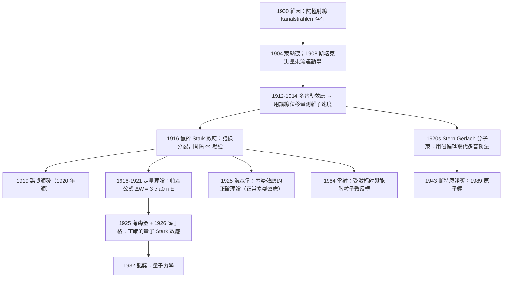

# 1919 · 斯塔克：讓譜線自己說出原子有多重

> 1919 諾貝爾物理學獎：約翰尼斯·斯塔克（Johannes Stark, 1874–1941，德國）——表彰「他發現陽極射線的多普勒效應以及電場作用下譜線的分裂現象」（for his discovery of the Doppler effect in canal rays and the splitting of spectral lines in electric fields）。

## 懸案（案情提要）

1913 年，波耳提出了原子模型：用量子化的電子軌道解釋了氫原子光譜，得到 $E_n = -13.6/n^2\,\mathrm{eV}$。這是一個巨大的成功，但波耳自己知道它的**致命弱點**：它把電子軌道當成「一條軌道」，而不是三維軌道的集合；更糟的是，它無法解釋**多電子原子**（鋁的譜線完全不對），也無法解釋**精細結構**與**塞曼效應**。波耳在 1913 年的《Nature》文章裡明確說，這是一個「象徵性的形式」，一個「待拋棄的公式」。

1916 年，斯塔克用一個極簡單的實驗，把原子光谱學推进了一步：

**把氫原子束（後來稱為「陽極射線」／canal rays）穿過一個強電場，然後用分光儀觀察它們的發射譜線。**

結果：**每條譜線分裂成若干條等間隔的支線**，間隔正比於電場強度。

這個觀察有著巨大的理論意義，因為它回答了一個自 1896 年塞曼效應（1902 諾獎）發現以來懸而未決的核心問題：

> **當原子處於外加場中時，它的能階會怎麼變？外加場如何改變原子內部電子與電子的束縛？**

塞曼效應（磁場）與斯塔克效應（電場）是一對「雙生懸案」。塞曼效應的解釋要等到 1925 年海森堡用矩陣力學（量子力學）處理，才得到完整的「正常斯塔克-塞曼效應」理論。而斯塔克效應在 1916–1919 年被初步觀測，當時的解釋只能停留在半古典的「軌道擾動」論（Stark effect 的「舊量子理論」版本，即 1913 年 Stark 與 1914 年 Sommerfeld 的「分裂與強度」公式）。

然而 1919 年的諾貝爾獎頒給斯塔克，不是因為他解釋了效應，而是因為他**發現了兩件事**：

1. **陽極射線的多普勒效應**（1912–1914）：當一束帶電的氫原子束以速度 $v$ 射向觀察者時，其發出的譜線產生多普勒位移。這不僅是光學多普勒效應的一個應用，更是一個**原子束速度的直接量測方法**——這開啟了整個**分子束方法**（1931 年諾獎給了斯特恩）與**原子鐘**（1949 諾獎、1989 諾獎）的技術路線。
2. **電場中的譜線分裂**（1916）：**外加電場使原子能階改變**。這是**外場擾動原子結構的第一個直接證據**，也是後來 **Stark 效應 → 塞曼效應 → 磁場中的原子 → 雷射（1964 諾獎）→ 分子束冷卻（1997 諾獎）** 這條因果鏈的起點。

值得記錄的是物理學史上一個著名的「跨代誤判」：1919 年的諾貝爾獎給了「舊量子理論」時代的觀測者，而真正解釋它的人（海森堡、薛丁格、狄拉克）在 1932–1933 年才拿到諾獎（整整晚了 13 年）。這中間的 13 年，就是量子力學的建立期。

## 前因

| 年份 | 事件 |
|------|------|
| 1874 | 斯塔克生於德國 Schickenhof（巴伐利亞），家中經營紙廠。 |
| 1894 | 斯塔克在慕尼黑大學取得博士學位，導師是 1906 年諾獎得主菲利普・萊納德。 |
| 1897 | 斯塔克在慕尼黑大學任助理教授，研究極光與陰極射線的波長；同年他發現**陰極射線中有高速粒子，並測得 Stark effect（早期的 Stark 效應，關於陰極射線在電場中的偏轉）**。 |
| 1900 | 慕尼黑大學的 **E. von Siegen** 與 **W. Wien** 研究「陽極射線」（Kanalstrahlen）：把陰極射線穿過一個「陰極管」（canal tube）從而產生的正離子束。維因發現它們有正電荷、有很小的速度。 |
| 1902 | 斯塔克在慕尼黑大學任教授。 |
| 1902 | **塞曼效應**被發現（同年諾獎給了洛倫茲與塞曼）。塞曼發現：磁場使譜線分裂，分裂量正比於磁場強度。**塞曼效應的理論解釋直到 1925 年才完成。** |
| 1904 | 斯塔克測量陽極射線（canal rays）中氫原子的 **Stark effect**：觀察到譜線在電場中的寬化與位移（這是第一版 Stark 效應觀測，但用的是連續譜，可靠性有限）。 |
| 1908 | 斯塔克發表《陽極射線的運動學》。 |
| 1912–1914 | 陽極射線的**多普勒效應**：斯塔克發現沿著原子束方向觀察與垂直方向觀察，譜線位置顯著不同。用多普勒位移可以量測原子束的速度，進而求出原子的質量。 |
| 1916 | **發現氫的 Stark effect**：在可控的電場中，氫的 Balmer 系譜線分裂成等間隔的支線，間隔正比於電場。 |
| 1918 | 斯塔克在戰時被徵召從事反潛水艇研究（潛水艇的聲學探測），物理研究中斷。 |
| 1919 | 諾獎頒發（1920 年 12 月頒獎，延後一年）。 |
| 1920s | 斯塔克創辦期刊 Zeitschrift für Physik 並擔任編輯（1920–1928），後來創辦 Stark-Effekt 實驗室。 |
| 1928 | 斯塔克在大學院級別退休，但保持研究興趣直到 1930 年代；其 Stark-Effekt 實驗室在二戰期間遭轟炸摧毀。 |
| 1941 | 斯塔克在慕尼黑去世（76 歲）。 |

## 調查

**第一件證物：陽極射線是什麼。** 「Kanalstrahlen」（管道射線）這個名字來自其裝置：陰極射線管中若留一條「管道」（canal）通到真空室，則有正離子（原本在管內的氣體原子被電子撞擊而電離）沿著管道方向射出形成一束**正離子束**（在氫氣中就是 $\mathrm{H}^+$ 束）。

這些離子束有幾個性質：帶正電、有速度（數十伏到數千伏加速，約 $10^5$ 至 $10^6\,\mathrm{m/s}$）、且**會發光**——被激發的氫原子回到基態時發出 Balmer 譜線。

**第二件證物：多普勒位移作為速度計。** 這是本案的技術核心，因為它把「原子」變成可量測的粒子。

當一個發光原子以速度 $v$ 沿觀察者的視線方向運動時，其發出的光在觀察者座標系中有頻率位移。對運動原子，等價於把原子看作一個「以 $v$ 移動的相對論性發射源」，而我們已經知道（洛倫茲 1904 論文中已出現這個公式）：

$$\nu_{\text{obs}} = \nu_0 \sqrt{\frac{1 - \beta}{1 + \beta}} \quad (\text{接近原子，需修正})$$

在原子束速度 $v \ll c$ 且是**非相對論性 Doppler** 的情況下（這裡要小心，1919 年的物理學家對此還有爭論），第一階位移為：

$$\frac{\Delta \nu}{\nu_0} \approx \frac{v}{c} \cos\theta$$

其中 $\theta$ 是觀察方向與束流方向的夾角（$\theta = 0$ 為順著束流看，$\theta = 90^\circ$ 為垂直看）。垂直方向位移為零，順著束流方向最大。

**關鍵的推理**：把觀察方向從垂直轉到順流，譜線移動的總量就是 $v/c$。而譜線移動可以從**波長**測出來（分光計），因此：

$$v = c\frac{\Delta\lambda}{\lambda}\quad (\text{順流方向相對垂直方向之差})$$

這就把**譜學量測**變成**力學量測**。斯塔克用這個方法量測了陽極射線中不同氣體的離子速度，並且——這才是關鍵——證明：

$$\frac{M}{q} \text{ 可由譜線位移求出}$$

其中 $M$ 是離子質量、$q$ 是電荷。若 $q = e$（單位電荷，單電子的電荷量），就直接得到**原子質量**。這是第一次用光譜學方法量測原子質量。

這條思路在 1919 年之後一路延伸：德國物理學家 Otto Stern 在 1920 年代發展出**分子束**技術，用**磁場偏轉**（Stern–Gerlach 實驗）取代了多普勒法，精度更高。

**第三件證物：Stark 效應的觀測與「分裂」還是「位移」的問題。** 1916 年，斯塔克在氫的 Balmer 系譜線中觀測到電場造成的分裂。但 1916 年的實驗有嚴格限制：**當時無法把氫原子束與電子束分開**，因此必須用氣體放電管，電場只能施加在放電區，場強不夠均勻也不夠大。1919–1920 年，隨著技術進步，人們才得到乾淨的譜線。

1919–1921 年，人們認識到 Stark 效應有兩種截然不同的表現：

- **線性 Stark 效應（quadratic / normal Stark effect）**：簡單的氫原子，Balmer 系的 $n=2,3$ 線會**分裂成等間隔的支線**；
- ** quadratic Stark 效應**：複雜原子（鹼金屬）則是**平移**而非分裂。

這個區別的根源在薛丁格的波動力學之前是無法解釋的。

**第四件證物：電場下能階的定量公式。** 在舊量子理論（1913–1925）處理下，Stark 效應的計算過程是：

1. 電子在原子核場加上外加電場（假設電場 $\mathcal{E}$ 沿 $z$ 方向）的總哈密頓量：

$$H = \frac{\mathbf{p}^2}{2m} - \frac{e^2}{4\pi\varepsilon_0 r} + e \mathcal{E} z$$

其中 $e\mathcal{E}z$ 是電子與外加場的耦合項（電場 $\mathcal{E}$ 沿 $z$，電子電荷 $-e$，因此電位能 $-e\mathcal{E}z$；符號約定要小心但效果是對稱的）。

2. 在波耳軌道的語言裡，這個額外項對應「電子位置 $\langle z\rangle$ 不再為零」——軌道被拉長成一個**偏心軌道**（elongated orbit），其形狀由拋物線族描述。

3. 一階微擾（first-order perturbation theory）給出的能量位移：

$$\Delta E = e\mathcal{E}\langle z\rangle = e \mathcal{E}\, n e a_0 \left(k - n_1\right) \quad (\text{某些記號下})$$

其中 $a_0$ 是波耳半徑，$n$ 是主量子數，$k - n_1$ 是一個整數（這就是「等間隔」的來源）。

4. 對 Balmer 系（從 $n = 2$ 或 $3$ 到 $n = 1$），頻率位移為：

$$\Delta\nu = \frac{\Delta E}{h} = \frac{e \mathcal{E}}{h}\cdot (\text{整數}), \qquad \Delta E = 3ea_0 n \mathcal{E} \quad (\text{帕森公式：} \Delta W = 3ea_0 n E)$$

**帕森公式**（Parson's formula, 1920）是 Stark 效應的定量總結：

$$\Delta W = 3\, e\, a_0\, n\, \mathcal{E}, \qquad n = 2,3,\dots \text{（電場方向平行於量子化軸時）}$$

現在回頭看，這個公式裡的 $3ea_0 n\mathcal{E}$ 正是後來**薛丁格方程在一階微擾下**給出的精確結果（與電子經典軌道的精確微擾結果相同！）。這說明舊量子理論在這裡「意外地對了」——因為 Stark 效應的主要項來自「偶極」耦合，而波耳軌道的偶極矩正是精確的。

**第五件證物：分裂的支線數與偏振。** 沿著電場方向觀察時，各支線是**線偏振**的（$\pi$ 成分，電場方向），垂直方向觀察則是**橢圓偏振**（$\sigma$ 成分）。偏振的量測是判定「分裂是否真的對應不同量子態」的重要資訊——這最終成為塞曼效應「正常／反常」分類的基礎。

## 理論裁決

**裁決一：外場作為「探針」——能階的第一次外部操控。** Stark 效應的重要性在於它是第一個**主動改變原子能階**的實驗。在它之前，人們只能「觀察」原子光譜；在它之後，人們可以「操縱」原子光譜。這是 1920 年代光譜學的核心技術，也是日後所有「用外場控制原子」的先聲：

- 塞曼效應（磁場，1896）→ 原子鐘（1949、1989 諾獎）、NMR（1944）、MRI；
- Stark 效應（電場，1916）→ 雷射（1964 諾獎）、光學泵浦（1966 諾獎）、量子點與量子阱（2000 諾獎）；
- 光學泵浦與冷卻（1997 諾獎）→ 玻色-愛因斯坦凝聚（2001 諾獎）。

**裁決二：正確的 Stark 效應——氫的拋物線座標與一階微擾。** 1926 年薛丁格用**拋物線座標**求解氫原子在電場中的問題，得到本征值：

$$E = -\frac{m e^4}{8\varepsilon_0^2 h^2 n^2} + \frac{3}{2} e a_0 \mathcal{E} n \left(n_1 + n_2\right)$$

其中 $n_1, n_2$ 是拋物線量子數，$n = n_1 + n_2 + 1$。由於 $n_1$ 與 $n_2$ 只以和 $n_1+n_2$ 的形式出現，**能階以 $\frac{3}{2}ea_0\mathcal{E}n(n_1+n_2)$ 的等間隔序列出現**——這正是帕森公式的波動力學版本，也是「等間隔」的真正來源：** Stark 效應是簡併態被外場解除簡併的結果。**

更有意思的是，**拋物線量子數 $n_1, n_2$ 對應「量子化平面」的方向**。在電場存在時，電子雲的形狀是拋物線柱面（parabolic cylinder coordinates），其軸固定在電場方向——**原子被拉長並沿電場方向對齊**。這是量子力學中「形狀」第一次被定義。

同時，1925 年海森堡用矩陣力學處理 Stark 效應，發現了**選擇定則**：$\Delta m = 0, \pm 1$（對應 $\pi$ 與 $\sigma$ 偏振），這直接預測了觀測到的偏振結構。

**裁決三：塞曼效應的平行發展與「正常/反常」的謎。** 塞曼效應的量子解釋直到 1925 年才完成。1919 年的狀況：

- **正常塞曼效應**：只有單線（例如 $\mathrm{Na}$ 的 D 線）時，分裂成 3 條等間隔線，間隔 $\Delta\nu = \mu_B \mathcal{B}/h$（正常塞曼位移，$ \mu_B = e\hbar/2m$），中央線不移位。
- **反常塞曼效應**：多重線（例如 $\mathrm{Na}$ 的 D 雙線）時，譜線複雜分裂，間隔不再是 $\mu_B\mathcal{B}/h$。

塞曼本人在 1896 年就指出反常效應「無法用現有理論解釋」。1925 年海森堡用矩陣力學處理得到正確結果，並且**發現電子自旋**——這反過來又解釋了反常塞曼效應（自旋 $s = 1/2$ 造成 Landé $g$ 因子）。海森堡因此獲得 1932 年諾獎（表彰「創立量子力學」）。

**裁決四：多普勒效應作為原子束動力學——一支新方法論的诞生。** 1919 年的這部分貢獻在歷史上的評價遠低於 Stark 效應，但它的技術迴響極大。用譜線位移量測原子速度，本質上是「**用原子自己的頻率標尺當雷達**」。其演化路線：

| 年份 | 技術 | 精度量級 |
|------|------|----------|
| 1912–1914 | 斯塔克多普勒法 | $v \sim 10^5\,\mathrm{m/s}$ |
| 1920s | Stern–Gerlach 磁偏轉法 | 可分離束流、量質量 |
| 1929 | 拉曼散射被用於測分子振動 | — |
| 1930s | 分子束磁共振 | — |
| 1949 | 原子鐘（拉姆齊） | $10^{-11}$ |
| 1989 | 氫邁射原子鐘（拉姆齊 Nobel） | $10^{-12}$ |
| 1990s | 光學泵浦與冷卻原子 | $\mu\mathrm{K}$ |

**裁決五：諾獎時序的「延遲現象」。** 1919 年諾獎的背後是一次典型的「觀測—理論」脫節：1913–1919 年間，Stark 與 Sommerfeld 用**舊量子理論**（電子在確定軌道上運動）處理 Stark 效應，得到定性正確、恰好定量正確（一階項）的結果；而完整、精確的處理要等到 1926 年薛丁格、1927 年海森堡與狄拉克。諾貝爾委員會在 1919 年選擇表彰**觀測**（這在物理獎中很常見），而把**理論**留給了 1932–1933 年。理解這個延遲，是理解「諾獎與科學史不同步」的關鍵——**諾獎追認成果，而成果的理論往往晚十年才成熟**。

## 後果

| 年份 | 影響 |
|------|------|
| 1912–1914 | 多普勒法量測原子束速度，首次用光譜位移作力學量測。 |
| 1916 | 氫的 Stark 效應被發現。 |
| 1919 | 諾獎頒發（1920 年 12 月頒）。 |
| 1920 | 帕森公式給出 Stark 效應的一階定量描述。 |
| 1921–1926 | 量子力學建立後，Stark 效應得到完整處理；拋物線座標成為量子化學的經典工具。 |
| 1925 | 海森堡的塞曼效應理論，並發現電子自旋。 |
| 1929 | 拉曼散射把「分子振動頻率的偏移」用光譜量測——是 Stark 效應思路的另一路。 |
| 1930s | 分子束技術成熟（斯特恩）。 |
| 1949 | 拉姆齊的氫原子鐘（後來 1989 年諾獎）。 |
| 1960s | 雷射的粒子數反轉與躍遷頻率選擇，本質是外場控制能階布居。 |
| 1966 | 卡斯特勒的光學泵浦（諾獎）——用圓偏振光選擇性地把原子「趕進」指定態，這是 Stark 效應的量子版本。 |
| 1970s | 量子阱（Zhores Alferov, 2000 諾獎）——把外場控制能階的思路變成人工原子。 |
| 1997 | 雷射冷卻與捕陷（諾獎）。 |
| 2001 | BEC（諾獎）。 |
| 2008 | 量子點與單光子源（Aharonov-Casher 與 2023 年阿秒物理獎的相關技術）。 |

## 關聯

- [1902-洛倫茲與塞曼的磁場譜線案](1902-洛倫茲與塞曼的磁場譜線案.md)：本案的孿生案；塞曼效應（磁）與 Stark 效應（電），兩者相隔 20 年先後被諾獎承認。
- [1922-波耳與原子結構的懸案](1922-波耳與原子結構的懸案.md)：Stark 效應是對波耳模型的第一個壓力測試，也是波耳自己承認模型不完整的原因之一。
- [1932-海森堡與量子力學的誕生](1932-海森堡與量子力學的誕生.md)：1919 年觀測、1932 年理論——Stark 效應在諾獎時序上的一個縮影。
- [1918-普朗克與能量量子的賭注](1918-普朗克與能量量子的賭注.md)：1919 年获奖的 Stark 效應的量子解釋，其工具正是 1900 年的 $h$。
- [1917-巴克拉與元素的X射線指紋](1917-巴克拉與元素的X射線指紋.md)：譜線的量子解釋需要在 1913 年後才可能；巴克拉給出譜線存在，波耳給出位置，Stark 給出外場效應。
- [1943-斯特恩與分子束的方法論](1943-斯特恩與分子束的方法論.md)：直接承自斯塔克的多普勒速度量測與 1919 年案。
- [1966-卡斯特勒與光學泵浦](1966-卡斯特勒與光學泵浦.md)：把「用外場改變原子狀態」的操作性做到極致，直接通向雷射冷卻與 BEC。
