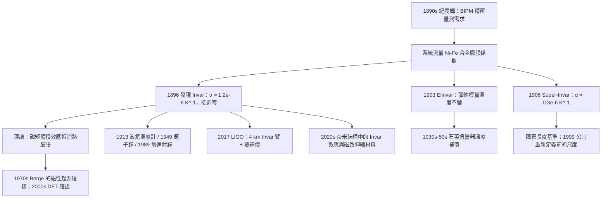

# 1920 · 紀堯姆：一把不會伸縮的尺

> 1920 諾貝爾物理學獎：夏爾·埃德蒙·紀堯姆（Charles Édouard Guillaume, 1860–1938，瑞士／法國）——表彰「他發現的鎳鋼合金反常現象對物理學精密量測所做出的貢獻」（for the service he has rendered to precision measurements in Physics by his discovery of anomalies in nickel steel alloys）。

## 懸案（案情提要）

這是諾貝爾物理學獎史上最少見的一類：**獲獎理由是「一種材料的發現」，而不是「一個現象的發現」**。而這材料本身——鎳鐵合金「Invar」——它的科學意義遠超它看上去的樣子。

問題的起點是一個純粹的工程苦惱，也是現代科學的基礎設施問題：**溫度會改變長度。** 幾乎所有固體材料都會隨溫度熱脹脹：

$$\frac{\Delta L}{L} = \alpha \Delta T$$

對鋼鐵之類的金屬，線膨脹係數 $\alpha \approx 10^{-5}$ 至 $10^{-4}\,\mathrm{K}^{-1}$。這個數字聽起來很小，但在精密量測中是災難：

- 一支 1 m 長的鋼尺，溫度變化 10 K，長度改變 0.1 至 1 mm；
- 而 19 世紀末的目標是量測到 **$10^{-5}$ mm** 級別（例如光學量測、原子量測定）；
- 溫度起伏造成的誤差比待測訊號大 **數十倍**。

所以整個精密物理學系統一致需要一種**「不隨溫度伸縮」的材料**——用今天的語言說，一種**零熱膨脹係數（zero CTE）材料**。

紀堯姆在 1896 年前後開始研究這個問題。他系統測量了**鎳－鐵合金**的熱膨脹隨成分的變化，並且發現了一個驚人的現象：**膨脹係數隨成分的變化不是單調的**。純鎳的 $\alpha$ 是正的（$13\times10^{-6}\,\mathrm{K}^{-1}$），純鐵的 $\alpha$ 也是正的（約 $12\times10^{-6}$），但在**鎳含量約 35% 至 65% 的區間**，$\alpha$ 劇烈下降，在某個特定成分處**穿過零點**。

這個成分的合金被命名為 **Invar（Invar 是 "Invariable" 的縮寫，「不變鋼」）**，其熱膨脹係數在室溫範圍內僅約

$$\alpha \approx 1.2\times10^{-6}\,\mathrm{K}^{-1}$$

只有普通鋼的十分之一到百分之一。更關鍵的是，紀堯姆還發現 Invar 的**低膨脹特性有嚴格的溫度窗口**——只在某個溫度區間成立，離開就迅速變差。這說明零膨脹**不是偶然**，而是**兩種膨脹機制精確抵銷**的結果。

紀堯姆的貢獻不止於找到一種合金。他同時發展了整個**精密量測的方法論**：

1. **提出量測需求**：明確指出精密物理需要 CTE 接近零的材料，並論證「度量衡的下一個階段將由材料決定」；
2. **系統的合金相圖研究**：不僅找到 Invar，還找到了後來稱為 **Elinvar**（低彈性模量的熱膨脹補償合金）與 **Super-Invar**（更低 CTE 的改進版，含 Mn 或 Co）；
3. **提出「雙金屬片」式的應用**：把 Invar 與普通鋼組成複合結構，用 CTE 的差異做**溫度自補償的機構**——這正是 1921 年諾獎得主達倫的太陽能閥在材料層面的對偶物（達倫用**輻射**做控制，紀堯姆用**熱膨脹**做控制）；
4. **把材料與物理量測綁在一起**：Invar 後來成為**液氦溫度計（1913 諾獎）**、**原子鐘（1949、1989 諾獎）**、**LIGO 重力波探測器（2017 諾獎）**的關鍵構件。

事實上，Invar 在諾貝爾物理學獎史上出現的頻率高得驚人：LIGO 的四條 4 km 臂本身就是由 Invar 製造並以「Invar 補償」對準的；鐽-鍶原子鐘的核心磁控管由 Invar 製造；1956 年的 Nobel 物理學獎得主之一 William Shockley 的晶體管、以及後來的半導體產業中，晶體生長用的矽舟也用 Invar。

而紀堯姆本人是個有趣的人物：**他不是物理學家出身**。他原是德國人（生於 Altwiller，Alsace，時屬德國），在德國的瓷器工廠做技師（研究釉藥配方），後來移民瑞士，在瑞士 Federal Polytechnic 取得博士學位，之後進入法國 Bureau International des Poids et Mesures（國際計量局）。他是諾貝爾獎史上唯一一位主要貢獻歸屬於**材料工藝與計量學**的物理學獎得主。而他在 1938 年 9 月 10 日去世——距 1939 年的科學界大動盪（核分裂、二戰）只剩數月。

## 前因

| 年份 | 事件 |
|------|------|
| 1860 | 紀堯姆生於德國 Altwiller（Alsace），父親是製瓷工場主。 |
| 1876–1881 | 在德國瓷器工廠工作，研究**釉藥（email/glaze）**的配方與燒結物理——這是他後來研究金屬合金的冶金學訓練。 |
| 1881 | 移民瑞士，在瑞士聯邦理工（ETH）與 La Chaux-de-Fonds 的地方學校任教。 |
| 1892 | 在瑞士取得博士學位。 |
| 1893 | 加入位於巴黎的**國際計量局（Bureau International des Poids et Mesures, BIPM）**，負責力學與溫度計量工作。此後終身服務於此，直到 1936 年退休。 |
| 1890s | 開始研究**鎳鐵合金**的熱膨脹行為；他的動機來自精密量測中的實際需求：溫度對尺度的污染。 |
| 1896 | 公布 **Invar（不變鋼，$\approx 36\%$ Ni）** 的發現；同年他發表《鎳的合金在低溫下的磁性》等研究。 |
| 1897–1905 | 系統發表金屬膨脹的系列論文；提出把精密量測與材料科學結合的方法論。 |
| 1903 | 發現 **Elinvar**（$36\%$ Ni、$12\%$ Cr、$58\%$ Fe），其彈性模量隨溫度幾乎不變（低溫補償合金）。 |
| 1906 | **Super-Invar**（在 Invar 中加入 Mn）被發展出來，CTE 可低至約 $0.3\times10^{-6}\,\mathrm{K}^{-1}$。 |
| 1911 | 紀堯姆當選法國科學院院士。 |
| 1914–1918 | 戰爭期間在法國軍方擔任技術顧問。 |
| 1920 | 諾獎頒發（1921 年 12 月頒獎，延後一年）。 |
| 1920s | Invar 進入工業量測：大地測量（測量網）、光學測量儀器的基準尺、恆溫箱。 |
| 1938-09-10 | 紀堯姆在巴黎去世，得年 78。 |
| 1940s–1950s | Invar 成為**原子鐘**（1949 拉姆齊、1989 諾獎）與**液氦溫度計**（1913 諾獎）的核心材料。 |
| 1980s–2010s | Invar 為 LIGO 真空系統與光學桌的主要材料；2017 年諾獎。 |

## 調查

**第一件證物：膨脹係數的「反常」。** 紀堯姆把樣品放在干涉儀或膨脹計中，量測長度隨溫度的變化。對一般的金屬，$d\alpha/dT$ 也為負（膨脹係數隨溫度下降而減小），這可以用「平均原子頻率 $\omega$ 隨溫度變化」的模型理解：

$$\alpha(T) = \frac{1}{3L}\frac{\partial L}{\partial T} \approx \frac{\gamma C_V}{3 B V}$$

（Grüneisen 規則 $\alpha = \gamma C_V/(3BV)$，$\gamma$ 為格律能西森參數，$B$ 為體積模數）。**這裡出現了第一個「異常」**：對 Invar，$\alpha$ 不只是小，而是**在零點附近穿過**，而且穿過的方式使 $\alpha(T)$ 的曲率反轉。

**第二件證物：Invar 的零膨脹是「兩種機制相消」，不是「沒有機制」。** 這是紀堯姆最重要的物理貢獻，也是 Invar 後來經歷了一整個世紀爭議的原因。

現代理解（經 Berge 與他在 1970 年代的重新檢驗，以及 2000 年後的 DFT 計算確認）：

Invar 的零 CTE 是**磁性起源**的。Fe–Ni 合金中，fcc 相有兩種可能狀態：
- **高磁矩態（FM）**：每個原子的平均磁矩大，原子磁矩的體積效應使格子傾向**收縮**；
- **低磁矩態（AFM-like）**：磁矩小，格子傾向**膨脹**。

隨溫度升高，磁矩有序被熱破壞，Fe–Ni 從低磁矩（低溫）走向高磁矩（高溫），此磁矩變化引起的體積變化 $\Delta V_{\text{mag}}$ **恰好抵消**了普通的熱膨脹 $\Delta V_{\text{th}}$：

$$\frac{\Delta L}{L} = \alpha_{\text{th}} \Delta T + \alpha_{\text{mag}} \Delta T, \qquad \alpha_{\text{mag}} \approx -\alpha_{\text{th}}$$

這解釋了 Invar 的兩個「反常」特徵：
1. **為什麼窗口那麼窄**：兩種膨脹機制的溫度依賴性只在特定區域相消；
2. **為什麼有極大的 Grüneisen 參數**（$\gamma$ 可達 3–5，遠超一般金屬的 1–1.5）：因為 $\partial \alpha_{\text{mag}}/\partial T$ 極大。

因此，**Invar 是一種「被磁場調控的」材料**——這個認知在 1980 年代的量子設計（「磁致伸縮材料」）與 2010 年代的「Invar 效應在奈米結構中的應用」中持續發酵。

**第三件證物：雙金屬補償機構——工程上的「反 Invar」。** 紀堯姆的第二個工程發明是**把膨脹係數不同的兩種材料結合**以製造**溫度自補償元件**。這就是今天所謂的「** bimetal compensation**」：

- **Invar + 不鏽鋼**：複合件的淨 CTE 接近零；
- **Elinvar**：低溫變化的彈性模數，可用於**石英振盪器的溫度補償**（這個用途在 1930–50 年代的石英鐘錶中極為重要）。

這條思路後來演化為整個「複合材料 CTE 設計」的學科。

**第四件證物：低溫膨脹與絕對零度。** 紀堯姆還研究了低溫下的金屬膨脹，並發現**純金屬在接近絕對零度時膨脹趨於零**（這是晶格振動量子化的結果：$C_V \propto T^3$ 於是 $\alpha \propto T^3$）。這項工作的意義在於：**低溫下的 CTE 極小，正是精密低溫量測儀器（如液氦溫度計）所需要的性質**。這就把我們帶到 1913 年昂內斯案：Invar 解決常溫段的膨脹污染，量子化的晶格振動解決低溫段的膨脹污染——兩者合起來，才使「以 $10^{-5}$ 精度量溫度」成為可能。

**第五件證物：Invar 的量化指標。** 讓我們把 Invar 的實用性寫成一個可比較的數字。在精密量測中，溫度不穩定造成的等效長度誤差為

$$\frac{\delta L}{L} = \alpha \delta T$$

以一個典型的「絕對長度標準」（國家長度基準，Invar 尺度）為例，若目標相對精度為 $\delta L/L = 10^{-8}$，工作溫度範圍 $\delta T = 0.1\,\mathrm{K}$，則要求

$$\alpha \le \frac{10^{-8}}{0.1} = 10^{-7}\,\mathrm{K}^{-1}$$

普通鋼 $\alpha \approx 1.2\times10^{-5}$，差 120 倍；Invar（$\approx 1.2\times10^{-6}$）差 12 倍；Super-Invar（$\approx 0.3\times10^{-6}$）差 3 倍——這說明為什麼超精密量測需要 Super-Invar，而為什麼在 1980 年代之後，人們最終**放棄了 Invar 尺度**，改用**光學原子鐘定義的長度**（光速 $c$ 的定義：$1\,\mathrm{m} = c \times$ 某時間）。

## 理論裁決

**裁決一：「物理學不只是一堆公式，也是一堆材料」。** 1920 年這一屆獎項在諾獎史上確立了一個此前未被明說的判準：**一種材料的發現，若改變了人類量測物理量的能力，就是物理學的成就**。這與諾貝爾遺囑的精神完全一致（"the greatest benefit to humanity"）。後來這條判準被反覆引用：

- 1960 年格拉澤的**氣泡室**（一種「材料」——過熱液體）；
- 1986 年魯斯卡的**電子顯微鏡**（電子光學的材料與機構）；
- 1987 年 Bednorz 與 Müller 的**銅氧化物陶瓷**；
- 1988 年 Lederman 等的**neutrino beam method**；
- 2016 年拓扑材料；
- 2024 年 Hopfield 網路（把物理學方法論引入機器學習）。

**裁決二：補償原理——物理學中的「以誤差消誤差」。** 紀堯姆的方法論本質是：**若某個效應無法被消除，就用另一個效應把它抵消掉**。這與邁克生的「以干涉條紋量測長度」、以及 1960 年代的「光柵尺」、1980 年代的「重力梯度儀」同屬一類。現代的對應物是「**主動補償**」：LIGO 的 Invar 補償機構就是在熱擾動之外，再引入一個光學的伺服迴路來把殘餘差異消掉。

**裁決三：Grüneisen 規則與晶格動力學的接線。** 紀堯姆的膨脹數據是「格律能西森規則」的實驗基礎：

$$\alpha = \gamma\frac{C_V}{3 B V}, \qquad \gamma = \frac{\alpha B V}{C_V}$$

這個規則把「體積隨溫度的變化」與「比熱」聯繫起來，是**固體物理學的橋樑方程**。1900 年代由 Grüneisen 建立的這個關係，在 1913 年昂內斯的低溫實驗（液氦下的比熱與膨脹）與 1930 年 Debye 的比熱模型（$C_V \propto T^3$）中被串成完整鏈條：**晶格振動量子化 $\Rightarrow$ 低溫比熱 $\Rightarrow$ 低溫膨脹趨零**。

**裁決四：材料是量測的「上限」。** 一個物理量能被量到多精確，往往不由理論決定，而由**零件材料決定**。紀堯姆的 Invar 把溫度這一「最難纏的系統誤差」壓到 $10^{-6}$ 級，使得當時的 $10^{-8}$ 相對精度目標成為可能。歷史上的三個例子：
1. **邁克生干涉儀**（1907 諾獎）用鎘紅光定義長度，用 Invar 尺作基準；
2. **原子鐘**（1949、1989 諾獎）用 Invar 製造的磁控管與腔體，把頻率穩定到 $10^{-13}$；
3. **LIGO**（2017 諾獎）的 4 km 臂本身就是 Invar。

**裁決五：諾獎時序上的一個特例——獎給「工藝」。** 委員會在 1920 年的措辭非常謹慎：「...by his discovery of **anomalies** in nickel steel alloys」。用「anomalies（反常）」而不是「alloy（合金）」，說明委員會認識到：真正的內容不是「鎳合金」，而是**「反常」這個物理事實**——膨脹係數穿過零點。這個措辭在 100 年後回看，是相當精準的物理學判斷。

**裁決六：金屬磁性與熱膨脹的耦合——Invar 的真正機制。** 讓我們把 Invar 的磁性起源寫成一個可檢驗的模型。Fe–Ni 面心立方相中，原子磁矩 $\mu$ 隨溫度變化，磁矩與晶格常數之間存在耦合 $\frac{\partial V}{\partial \mu}$。由於低溫相（低磁矩態）的晶格較大、高溫相（高磁矩態）較小，有：

$$\frac{\Delta V}{V} = \alpha_{\text{ph}} \Delta T + \frac{\partial V}{\partial \mu}\frac{\partial \mu}{\partial T}\Delta T$$

而 Invar 的設計目標是讓第二項等於第一項的負值。**這是一個「負反應系数」的設計**——材料被設計成「溫度升高時原子間距反而縮小」，以抵消「溫度升高時原子間距因熱膨脹而增大」。2000 年後的第一性原理計算（Uhl 等 2008）明確顯示：Invar 的磁矩與晶格常數是**強耦合**的，其零膨脹點隨成分的變化是非線性的，並存在 Invar 與 Anti-Invar 兩側的分支——**這正是紀堯姆 1896 年在實驗曲線上看到的那個「反常」的現代版**。

## 後果

| 年份 | 影響 |
|------|------|
| 1896 | Invar 問世；CTE 從 $10^{-5}$ 降到 $10^{-6}\,\mathrm{K}^{-1}$ 級。 |
| 1903 | Elinvar：低溫變化的彈性模數，用於石英振盪器溫度補償。 |
| 1906 | Super-Invar：更低 CTE。 |
| 1913 | Invar 用於**液氦溫度計**與低溫量測裝置（昂內斯案）。 |
| 1920 | 諾獎頒發（1921 年 12 月頒）。 |
| 1920s | 大地測量網：Invar 基線尺把三角測量的精度從 $10^{-4}$ 提升到 $10^{-7}$ 相對量級。 |
| 1930s | Invar 用於恆溫箱、光學平台、精密天平（空氣天平的對準）。 |
| 1949 | 拉姆齊的**氫原子鐘**（1989 諾獎）用 Invar。 |
| 1950s–60s | Invar 用於 **Cavendish 平衡**（瓦格納夫人的天秤）、原子鐘諧振腔。 |
| 1980s | 精密重力測量（超導重力儀）用 Invar 彈簧。 |
| 1999 | 公制重新定義前的**最後一個鉑-ir 國際原器**的替代競賽中，Invar 是主要候選材料之一（最終由光速定義取代）。 |
| 2017 | **LIGO**：Invar 製成的 4 km 真空臂、Invar 隔振台、以及 Invar 光學桌；GW150914 的 $10^{-21}$ 應變靈敏度有賴於此。 |
| 2020s | 「Invar 效應」在奈米線與薄膜中的發現、磁致伸縮材料設計、**低膨脹的 Invar 奈米晶格**：用於精密光學與半導體設備。 |
| 2020s | 量子製程的「熱穩定」需求：新材料（如低 CTE 的玻璃陶瓷）延續同一目標。 |

## 關聯

- [1913-昂內斯與液氦的量子邊界](1913-昂內斯與液氦的量子邊界.md)：Invar 是液氦溫度計與低溫量測的關鍵材料——沒有零膨脹，無法在 $10^{-4}$ K 的尺度上定義溫度。
- [1907-邁克生與光速的極限測量](1907-邁克生與光速的極限測量.md)：Invar 尺與鎘紅光標準構成 1907 年量測的物理基礎；同為「以材料與設計換取精度」的案例。
- [1949-拉姆齊與原子鐘](1949-拉姆齊與原子鐘.md)：Invar 在原子鐘中的角色，與紀堯姆的遺囑式方法論直接延續。
- [2017-魏斯巴里什與索恩的重力波偵測](2017-魏斯巴里什與索恩的重力波偵測.md)：Invar 臂是 LIGO 的硬體核心；紀堯姆 1920 年的金屬在本卷中成為 2017 年諾獎的零件。
- [1954-玻恩與波函數的統計詮釋](1954-玻恩與波函數的統計詮釋.md)：對照卷——玻恩給出概率的詮釋，紀堯姆給出物理的容差；兩者都是「把不可控的量變成可估的量」。
- ../化學獎/1914-理查茲與精密原子量.md：理查茲的原子量測定是當時對精密材料最迫切的需求方之一；Invar 尺度正是為這類工作服務的。
