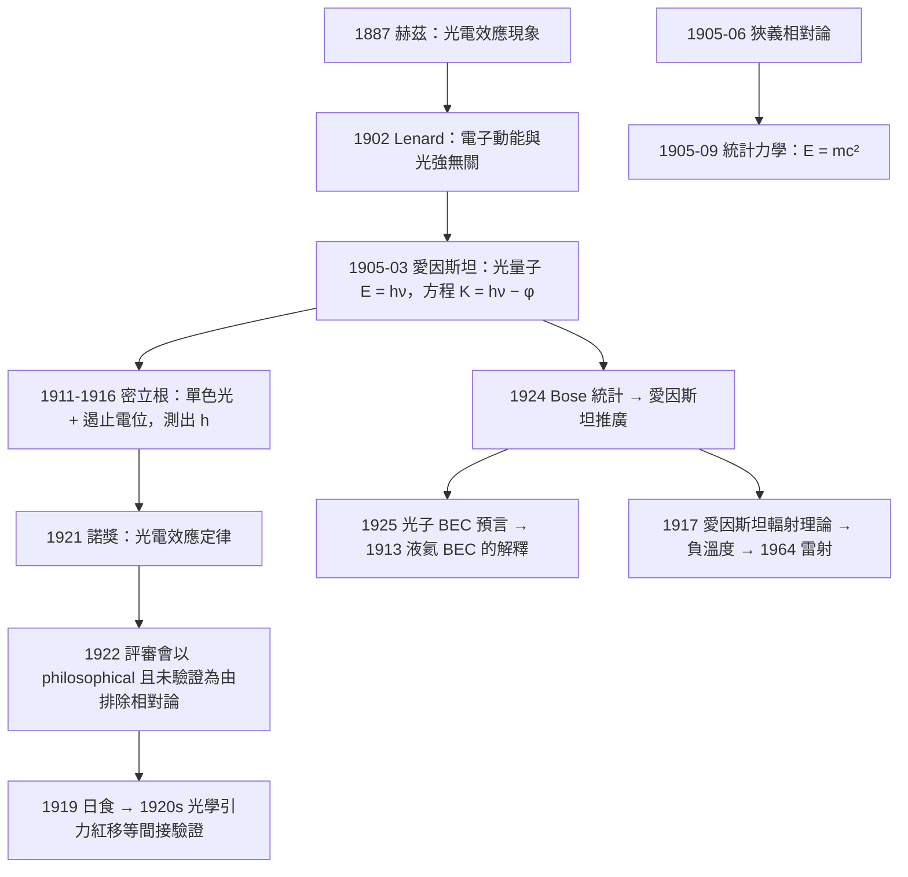

# 1921 · 愛因斯坦：一場被迫的賭注

> 1921 諾貝爾物理學獎：阿爾伯特·愛因斯坦（Albert Einstein, 1879–1955，德國／瑞士）——表彰「他對理論物理學的貢獻，特別是發現光電效應定律」（for his services to Theoretical Physics, and especially for his discovery of the law of the photoelectric effect）。

## 懸案（案情提要）

1905 年 3 月，愛因斯坦投給《物理年鑑》（Annalen der Physik）一篇題為《論光輻射的產生與轉換的一個啟發式觀點》的論文。這篇論文的第二節處理的是一個當時被物理學界視為「次要謎題」的問題：**光電效應**。

現象本身：光照射到金屬板上，會有電子從金屬中飛出。已知的實驗事實有三條：

1. 對同一種金屬，**光越強，射出的電子越多**；
2. **電子最大動能與光強無關**；
3. 但只要光的**頻率**超過某個臨界值 $\nu_0$，電子就會被射出；低於 $\nu_0$，無論光多強都射不出電子。

第 3 條尤其古怪。按經典的光波理論（當時的權威觀點），光是一種連續的電磁波，電子吸收光能的方式是「連續吸收」，那麼只要光夠強、夠久，電子就應該在任何頻率下都被推出——**怎麼會有一個「絕對門檻」？** 而且第 2 條說明電子的最大動能只取決於頻率，與強度無關——這在波動 picture 裡完全說不通。

愛因斯坦的解答，是 1905 年「奇迹年」中**最激進的一步**：他提出光不是波，而是由**一束束離散的能量子**組成，這些量子就是**光子**：

$$E = h\nu = h\frac{c}{\lambda}$$

當一個光子撞到一個電子時，電子吸收**整個**光子的能量（不是部分能量），扣除逸出功 $\phi$ 後，剩餘部分成為電子的動能：

$$\frac{1}{2}mv_{\max}^2 = h\nu - \phi$$

這就是**光電效應定律**，它是愛因斯坦 1921 年獲獎的正式理由。愛因斯坦用「啟發式觀點（heuristic point of view）」的措辭發表這篇論文，明確表示自己不確定是否正確——但他給出了一個**可被實驗否證的定量預測**。

預測立刻被檢驗。1911 年，密立根用他的光電實驗做了決定性的測試：**他無法證偽愛因斯坦，反而測出了普朗克常數**。密立根在 1916 年的論文中承認愛因斯坦的方程「與觀察符合得極好」，並在 1917 年發表的評論中說：「我必須承認，我原本不服氣……但愛因斯坦的式子無懈可擊。」

但真正讓愛因斯坦獲獎的，還有另一件事。1921 年 12 月，諾貝爾委員會的評語（物理委員會的報告）裡有一句極為關鍵的話：委員會**原本想頒獎給愛因斯坦的相對論**，但經過討論後決定不予表彰——理由是「相對論在當時尚未得到實驗證，而且主要是 philosophical」。於是委員會把獎給了**光電效應**——那個「已經被密立根的實驗充分確認」的部分。

這是一個歷史性的轉折：**愛因斯坦因為「一個有實驗支持的、被動的效應」得獎，而不是因為「一個改寫了時空觀的、能動的理論」得獎。** 相對論的諾獎級別待遇，要等到 1980 年代的「愛因斯坦 relativity 獎章」與 2011 年超新星發現（間接確認膨脹宇宙學）才逐步落地。

本卷的真正歷史意義在於：光電效應定律是**量子力學的第一個應用**，也是「光究竟是波還是粒子」這樁曠日懸案的第一次實戰裁決。而它同時也開出了第二條戰線：**愛因斯坦在同一年（1905）發表的另一篇論文《論動的物體的電動力學》，提出了狹義相對論**——這兩篇論文在物理學史上被判為「不相干」的（相對論處理慣性系，量子論處理光與物質），但它們都共享同一個方法論：**把「絕對空間時間」或「連續的波」這種概念上的舒適替換掉**。

而愛因斯坦的光量子說有一個巨大的未解難題，它在 1926 年才由玻色與愛因斯坦自己解決：**光子的統計分布是 Bose–Einstein 分布**（而不是費米分布）。這個事實意味著「光子是玻色子」，是 1924 年玻色統計理論的直接後果。而由此引出的「光子的 Bose 分布 $\Rightarrow$ 光子的凝聚 $\Rightarrow$ 光子雷射」一路通向 1964 年諾獎。

## 前因

| 年份 | 事件 |
|------|------|
| 1879 | 愛因斯坦生於德國烏爾姆；全家於 1880 年遷居慕尼黑。 |
| 1896 | 在瑞士蘇黎世聯邦理工入學。 |
| 1900 | 畢業；同年進入慕尼黑大學師範學院，隨後轉入蘇黎世大學。 |
| 1901 | 取得瑞士ETH博士學位（論文《論存在於靜止的物體上的力與電的關係》）。 |
| 1902–1903 | 在伯爾尼的瑞士專利局任三級技術員。 |
| 1905-03 | **「奇蹟年」開始**：3 月《光量子的啟發式觀點》（光電效應）；4–5 月《分子大小的新方法》；6 月《特殊相對論基礎》；9–11 月《統計力學的推導》（玻色茲曼統計）。 |
| 1909 | 與熱力學家 Michels 進行光子統計的對話，並在 1910–1911 年進一步發展。 |
| 1910–1911 | 愛因斯坦與 J. J. 湯姆森（1906 諾獎）在倫敦的論戰：愛因斯坦主張「質量的能量等價」。 |
| 1911 | 密立根的實驗確認愛因斯坦的光電方程。 |
| 1913 | 愛因斯坦被提名為普魯士科學院院士；同年他用統計力學導出固體比熱公式。 |
| 1916 | 愛因斯坦提出**一般相對論**（1915 年完成場方程），解釋水星近日點進動。 |
| 1917 | 愛因斯坦發表輻射理論，導出黑體公式（與普朗克結果一致）。 |
| 1919 | **日食觀測驗證廣義相對論**：愛因斯坦本人在 1920 年因全球知名度獲得諾貝爾獎章候選人的資格。 |
| 1921 | 諾獎頒發（1922 年 12 月頒獎，延後一年）。**相對論被評審會以「philosophical 且未經實驗證」為由排除**；改以光電效應授獎。 |
| 1922 | 愛因斯坦在諾貝爾演講中論述「理論物理的經驗與信念」，並坦白：「我沒有獲得的那些東西……相對論……會不會被證偽？我沒有信心。」 |
| 1923–1924 | 愛因斯坦與 Bose 的統計論合作（印度 physicist 的通信，透過 Raman 的介紹）。 |
| 1924 | **Bose–Einstein 分布**；愛因斯坦據此導出黑體公式，並預言**光子的BEC**（與 1911 年昂內斯的液氦 BEC 想法對稱）。 |
| 1926 | 愛因斯坦獲諾貝爾基金會的 **Albert Einstein Medal**（愛因斯坦獎章）首屆——瑞士、日內瓦榮譽市民。 |
| 1927 | 索爾未會議上，愛因斯坦與波爾關於量子力學與哥本哈根詮釋的著名辯論（「上帝不擲骰子」）。 |
| 1933 | 因猶太血統與離開德國，愛因斯坦失去柏林教授與普魯士科學院院士身份。 |
| 1939 | 致信羅斯福，主張美國投入核研究（$\ m$ 致斯萊TER，以及他在 1939 年簽署的愛因斯坦-西拉德文件）。 |
| 1955 | 愛因斯坦在普林斯頓去世；他的腦被捐給病理學研究。 |

## 調查

**第一件證物：光電效應的三條事實與方程的三個特徵。** 讓我們把愛因斯坦的論證寫成「每一條事實對應方程的一個特徵」：

實驗事實 | 方程 $K_{\max} = h\nu - \phi$ 中的對應
---|---
電子最大動能與光強無關 | 動能只由 $\nu$ 決定
存在臨界頻率 $\nu_0 = \phi/h$ | $\phi$ 是能階差（無量綱比值除以 $h$）
動能隨 $\nu$ 線性增加 | 斜率正是 $h$

這個「一件事實一條線」的對應，是愛因斯坦 1905 年 6 月在伯爾尼自己給出的：**他的整篇論文就是這張表的展開**。這也是 20 世紀物理學「**參數即定理**」的典範：把實驗事實翻譯成一個公式中的參數。

**第二件證物：密立根 1911–1916 年的裁決。** 密立根做了三個決定性實驗：

1. **用單色光**（不同狹縫的選擇）以嚴格控制 $\nu$；
2. **反駁了 Lenard 的「動能取決於光強」**；
3. **測量光電子的最大動能**（用遏止電位的方法）：$$eV_s = K_{\max}$$

1916 年密立根發表《Einstein's Photo-Electric Equation》，結論是：

$$K_{\max} = h\nu - \phi$$

與愛因斯坦方程一致，並給出 $h = 6.53\times10^{-27}\,\mathrm{erg\cdot s}$。**這是量子假說的第一次獨立定量驗證**，也是密立根 1923 年諾獎的核心工作。歷史的吊詭是：密立根終其一生不喜歡這個結果（他直到 1930 年代還在質疑光電效應的機制），但他的數據比任何人都支持它。

**第三件證物：密立根為何能得到 $h$——同一 $h$ 的收束。** 關鍵在於密立根用的是**截止頻率**（threshold frequency）方法，這使得 $h$ 的測定不必依賴絕對電位標定：

$$\phi = h\nu_0, \qquad K_{\max} = h(\nu - \nu_0)$$

將 $K_{\max}$ 對 $\nu$ 作圖，**截距給出 $\phi$、斜率給出 $h$**。這就是「光電效應測 $h$」的標準流程，也是 1911–1916 年間 $h$ 的三條獨立測定線（黑體輻射、光電效應、原子光譜）之一。

**第四件證物：光電效應的能帶版本——費米能階的誕生。** 愛因斯坦的方程裡 $\phi$ 是「逸出功」，即把電子從金屬中拉出所需的最小能量。但金屬物理學的精細版本給出：

$$\phi = \chi - (E_F - E_{\text{top}}) = \chi + \mu, \qquad \mu = E_F - E_{\text{top}}$$

其中 $\chi$ 是真空能階與費米能階之差，$\mu$ 是化學勢。**費米能階**這個概念正是 1920 年代由費米（1938 諾獎）與 Pauli（1945 諾獎）建立的，而它的第一個實驗存在證據，正是愛因斯坦-密立根的光電方程。所以說：**光電效應不只證明了光量子，它還證明了金屬中有一個「填滿帶的頂端」**。這條線一路通向半導體（1956 諾獎）、費米面測量（1988）、掃描隧道顯微鏡（1986 諾獎）。

**第五件證物：光子的 Bose 統計——1924 年的接續。** 這是本卷中最被低估的一段。1924 年，Satyendra Nath Bose 提出了對光子服用的統計方法（光子是玻色子，因為一個 mode 可以被任意多個光子佔據）。愛因斯坦立刻把它推廣到有質量的粒子，並導出黑體公式。同時，他注意到一個對稱性：

> 「如果光可以像物質一樣凝聚，那麼一定也存在物質的『光型』凝聚。」

愛因斯坦在 1924 年 11 月與 1925 年 6 月的論文中明確指出：**液氦 II 在 2.2 K 的異常，就是玻色-愛因斯坦凝結**。這正是 1913 年昂內斯觀察到的現象的理論解釋。愛因斯坦還預言了「光子凝結」的後果——1917 年他甚至寫了一篇論文，討論光子系統的自發輻射與「光子的統計」。半世紀後，這篇 1917 年論文被重新評價為「雷射理論的先驅」（1917 年，愛因斯坦、與 1920 年代的「負溫度」概念共同構成 1964 年諾獎的理論前提）。

**第六件證物：$E = mc^2$ 的兩個源頭。** 愛因斯坦 1905 年的相對論論文以「光電效應」的姊妹篇形式（同一卷、同一期）發表，其中給出了質能關係 $E = mc^2$。但更早的源頭是 1905 年 9 月的統計力學論文裡的公式

$$E = mc^2 \quad \text{（1905 年 9 月，以「相對原理與能量守恆」的群論導出形式出現）}$$

**這兩處的推導路徑完全不同**：前者來自狹義相對論，後者來自熱力學的統計論證。兩者給出同樣的結果。

## 理論裁決

**裁決一：光電效應方程的物理意義——光量子的「粒子性」是能量守恆的結果。** 愛因斯坦的整個論證可以只用能量守恆寫出：

設一個電子吸收一個波長為 $\lambda$ 的光子，光子能量全部轉移：

$$h\nu = \phi + K_{\max}$$

這裡**不需要任何波動理論**。光電效應的「門檻」$\nu_0 = \phi/h$ 立刻有了解釋：**光子的能量必須大於逸出功**，這是一個純粹的能量門檻，不是一個「累積」的門檻。經典波動理論無法解釋這個門檻，因為波動理論允許任意小的能量轉移。

**裁決二：為什麼愛因斯坦「賭」了。** 1905 年的物理學界，光的波動論是壓倒性的共識（馬克斯韋、菲涅耳、邁克生-莫利的實驗）。愛因斯坦自己在 1909–1911 年與其他物理學家（尤其 J. J. 湯姆森與 Planck）討論時都保持謹慎，並在 1905 年 6 月致信米歇爾森時說：

> 「我已經得到了一個非常革命的理論…它幾乎完全是我在完全沒有考慮光波動論的情況下得到的。」

他把自己建立的理論稱為「啟發式的」，並公開承擔風險。而他之所以敢賭，是因為他的方案給出了一個**數量上可檢驗的斜率**——$h$。這種「用可否證的定量預測承擔風險」的做法，確定了 20 世紀理論物理的方法論。

**裁決三：相對論與光量子在 1905 年的「雙重革命」及其歷史誤讀。** 愛因斯坦 1905 年發表的五篇論文被後世稱為「奇蹟年」，但**它們在方法論上並不是同一個計畫**。今天回看：
- 光量子論文是**統計力學的延伸**（Planck 分布 + Einstein 1904 統計），
- 相對論論文是**光學與電動力學的延伸**（Lorentz、Michelson-Morley）。

愛因斯坦本人在 1949 年的自傳《自述》里對此有清楚的說明。而 1921 年諾貝爾委員會的決定，正是**把這兩條線分開處理**：量子線給獎（已驗證），相對論線暫緩（未驗證、偏哲學）。這是諾獎史上一個極有教育意義的案例：**它顯示了「諾獎要的是已驗證的成果」這個原則有時會落後於物理學的實際發展**。

**裁決四：1924–1925 年的 Bose–Einstein 統計——第二次革命。** 讓我們寫出完整的推導，因為這是全書最重要的一段「理論自覺」的演進。

Bose（1924）對光子提出：一個頻率模式可以容納任意數目的光子，因此其平均佔據數為 Bose 分布

$$\bar{n}(\nu) = \frac{1}{e^{\alpha + \beta h\nu} - 1}$$

這正是普朗克分布律的**同一個形式**，但普朗克把它視為「振子能量的離散性」的後果，而 Bose 把它解釋為「**玻色子統計的必然結果**」。兩者的差異是巨大的：普朗克的 $E = nh\nu$ 是「每個振子的允許能量」；Bose 的 $\bar{n}$ 是「**每個模式平均有幾個粒子**」。後者可以直接推廣到有質量的粒子（愛因斯坦 1924 年底立刻做了），並導致：

- **光子氣的化學平衡**：$n(\nu) = \frac{1}{e^{h\nu/k_BT}-1}$；
- **光子可以「凝聚」**：在低溫下光子會自發地佔據低能模式——這是雷射的理論源頭（愛因斯坦 1917 年已討論）；
- **物質粒子的 BEC**：液氦（1925）、電子氣（1938）、鈉原子氣（1995）。

**裁決五：費米能階與金屬理論的接線。** 愛因斯坦方程裡的 $\phi$ 需要金屬理論才能解釋。1924–1928 年由 Pauli、Sommerfeld、Fermi 建立的金屬自由電子論給出：

$$E_F = \frac{\hbar^2}{2m}\left(\frac{3\pi^2 n}{\hbar^2}\right)^{2/3}\cdot\frac{\hbar^2}{2m} = \frac{\hbar^2}{3\pi^2m}(3\pi^2 n)^{2/3}$$

（費米能 $E_F = \frac{\hbar^2}{2m}(3\pi^2 n)^{2/3}$。）而在有限溫度，費米-狄拉克分布給出：

$$\bar{n}(E) = \frac{1}{e^{(E-\mu)/k_BT}+1}$$

其中 $\mu$ 稱為**化學勢**（低溫時 $\mu \to E_F$）。光電效應測量 $\phi$ 與 $\mu$ 的關係，正是 1920–30 年代確認費米-狄拉克分布的實驗之一。

**裁決六：諾貝爾評審報告的經典措辭。** 1921 年物理委員會的報告中有一句被後世反复引用：

> 「相對論並未被評審委員會所接受，因為它與實驗沒有關係，並且基本上是 philosophical。」

（*The theory of relativity has not been accepted by the Committee, as it does not relate to experiment and is essentially philosophical.*）

這句話成為物理學界論述「諾獎與實驗」關係時的經典案例，也是理解 2021 年「諾獎給了粒子物理學理論（希格斯機制）」時的背景對照——2013 年的希格斯獎同樣面臨「尚待實驗驗證」的問題，卻在 2012 年 LHC 發現希格斯粒子後立即頒發。

## 後果

| 年份 | 影響 |
|------|------|
| 1905 | 光電效應方程與狹義相對論同時誕生。 |
| 1911–1916 | 密立根驗證光電效應方程並測出 $h$。 |
| 1917 | 愛因斯坦的輻射理論：受激輻射、自發輻射、吸收係數 $B_{12}$、$B_{21}$——**雷射理論的完整先驅**。 |
| 1921 | 諾獎頒發（1922 年 12 月頒）。 |
| 1924–1925 | Bose–Einstein 統計；愛因斯坦預言光子與物質的 BEC；液氦異常的理論解釋。 |
| 1926 | 愛因斯坦基金會成立並頒發首屆愛因斯坦獎章。 |
| 1928 | 狄拉克方程給出正電子。 |
| 1939 | 愛因斯坦-西拉德文件，核研究的政治起點。 |
| 1948 | 城市光學（光量子作為媒介）；Shawlow–Townes 激光理論的源頭（$E = h\nu$ 與受激輻射）。 |
| 1950s | 半導體：光電效應的 $\phi$ 概念延伸為 p-n 結的內建電場（1956 諾獎）。 |
| 1964 | **雷射**：受激輻射的光學泵浦版（Townes、Basov、Prokhorov 諾獎）。 |
| 1965 | 單光子光學的理論準備。 |
| 1980s | 光子激射器的相干性理論（1985 諾獎格勞伯）。 |
| 2000s | 光子ics、單光子源（2012 諾獎）、光頻梳（2005 諾獎）。 |
| 2023 | **阿秒物理學**（阿戈斯蒂尼、克勞斯、呂利耶諾獎）：用飛秒雷射產生阿秒光脈衝，直接觀測電子在物質中的運動——這是愛因斯坦 1905 年光量子論在時間解析度上的終極實現。 |

## 關聯

- [1901-倫琴與X射線](1901-倫琴與X射線.md)：X 射線作為光子束，是「光」的另一種形式；愛因斯坦 1921 年的頒獎理由把「光」從可見光推廣到整個電磁譜。
- [1918-普朗克與能量量子的賭注](1918-普朗克與能量量子的賭注.md)：愛因斯坦的 $E = h\nu$ 是普朗克 $E = nh\nu$ 的直接推廣；1900 年的常數變成 1905 年的光子。
- [1922-波耳與原子結構的懸案](1922-波耳與原子結構的懸案.md)：波耳 1913 年的原子模型把 $\nu$ 與原子能階掛鉤，使 $E = h\nu$ 有了原子層面的意義。
- [1923-密立根與基本電荷的光譜量測](1923-密立根與基本電荷的光譜量測.md)：密立根用光電效應驗證愛因斯坦並測出 $h$，這是他 1923 年諾獎的核心工作。
- [1932-海森堡與量子力學的誕生](1932-海森堡與量子力學的誕生.md)：光量子是量子力學的第一塊磚；海森堡的工作把光子與電子統一在同一套數學裡。
- [1964-湯斯巴索夫與普羅霍羅夫的雷射](1964-湯斯巴索夫與普羅霍羅夫的雷射.md)：1917 年愛因斯坦輻射理論的直接後裔；光子 BEC 即雷射。
- [2013-恩格勒與希格斯的自發對稱性破缺](2013-恩格勒與希格斯的自發對稱性破缺.md)：1921 年諾獎的「已驗證優先」原則與 2013 年諾獎的「理論先行、隨後驗證」構成對照。
