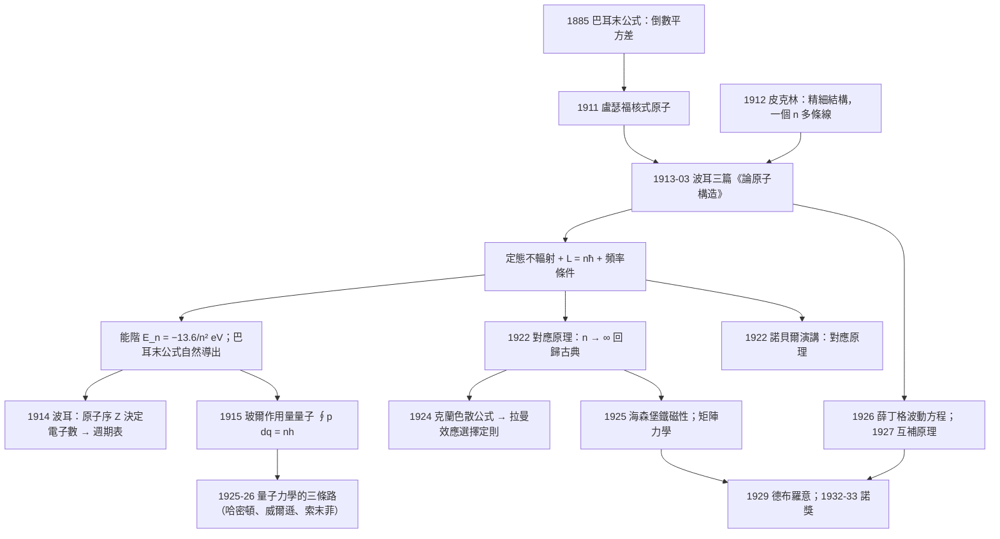

# 1922 · 波耳：給原子一個地址

> 1922 諾貝爾物理學獎：尼爾斯·波耳（Niels Bohr, 1885–1962，丹麥）——表彰「他對原子結構以及從原子發射出的輻射的研究」（for his services to the investigation of the structure of atoms and of the radiation emanating from them）。

## 懸案（案情提要）

1911 年盧瑟福用 $\alpha$ 粒子散射實驗建立了核式原子模型：原子是一個極小的正電荷核心，外面繞著電子。但這個模型立刻帶來三個致命的矛盾：

1. **穩定性悖論**：繞著原子核運轉的電子是加速運動，根據經典電磁學，加速電荷必然輻射。於是電子會不斷失去能量、螺旋落入原子核——**所有原子都會在 $10^{-11}$ 秒內塌縮**。但我們顯然不是這樣。
2. **光譜悖論**：經典電磁學說，週期運動的電子以連續的頻率發光，應產生**連續光譜**。但事實上原子光譜是**線狀的**，而且線的頻率滿足一個不可思議的規則：

$$\frac{1}{\lambda} = R_H\left(\frac{1}{n_1^2} - \frac{1}{n_2^2}\right)$$

這是**巴耳末公式**（Balmer formula, 1885），其中 $R_H = 1.097\times10^7\,\mathrm{m}^{-1}$。這個公式在數學上精確得可怕，但物理上完全不可理解——為什麼會是「倒數平方的差」？

3. **原子尺度悖論**：原子的尺度（$\sim 10^{-10}\,\mathrm{m}$）遠大於電子自身的尺度（$\sim 10^{-18}\,\mathrm{m}$），但遠小於原子核（$\sim 10^{-15}\,\mathrm{m}$）。電子憑什麼「懸浮」在這麼大的空間裡？

波耳在 1913 年 3 月（僅僅三個月！）提出的模型，**同時解決了這三個問題**，而且只用三個假設：

**假設一（定態假設）**：電子只能在某些特定的「定態軌道」上運動，在這些軌道上它**不輻射**。為什麼？波耳說這是「一個待解決的謎」，他給了「無 radiated energy」這個原則但承認沒有推導。

**假設二（量子化條件）**：電子的角動量必須量子化：

$$L = m v r = n\hbar, \qquad n = 1, 2, 3, \dots$$

**假設三（頻率條件 / correspondence）**：在定態之間的躍遷，發射或吸收的光的頻率由能量差給出：

$$h\nu = E_{n_2} - E_{n_1}$$

由此立刻得到：

$$E_n = -\frac{m e^4}{8\varepsilon_0^2 h^2 n^2} = -\frac{13.6\,\mathrm{eV}}{n^2}$$

以及半徑 $r_n = n^2 a_0$（$a_0 = 0.529\,\text{Å}$，波耳半徑）。

於是巴耳末公式自然地從量子化條件裡湧出：

$$\nu = \frac{m e^4}{8\varepsilon_0^2 h^3}\left(\frac{1}{n_1^2} - \frac{1}{n_2^2}\right) = \frac{R_\infty c}{h}\left(\frac{1}{n_1^2} - \frac{1}{n_2^2}\right)$$

**這個模型的簡潔性是革命性的**：它給出了原子的能階、尺寸、光譜、以及週期表的結構雛形（電子殼層），而且用的只是一個量子化條件。然而波耳自己非常清楚它的**致命缺陷**：

- **多電子原子**：把 3 個以上的電子塞進原子，波耳的計算完全失敗（鋁的譜線完全不對）；
- **精細結構**：相對論修正（1926）顯示同一 $n$ 的軌道還有 $l$ 依賴的能階差異，波耳模型無法解釋；
- **塞曼效應與 Stark 效應**：外場對能階的擾動，波耳模型只能定性猜測；
- **「定態不輻射」的理由**：完全沒有解釋；
- **電子軌道的圖像本身**：1924 年德布羅意與海森堡的量子力學表明，電子根本沒有軌道。

1913 年之後，整個物理學界都在問：**波耳的三個假設，哪一個是真的？哪一個是偽造的？** 答案在 1925–1926 年揭曉：三個假設**全部**被替換掉了（定態假設 → 定態方程 $\hat{H}\psi = E\psi$；角動量量子化 → 算符對易 $[\hat{x},\hat{p}] = i\hbar$；頻率條件 → 波動方程的頻率解與傅立葉分析）。但波耳模型所**預測的東西**，全部被保留了下來——它是「正確的答案，錯誤的推理」。

這樁案子還有一個極重要的科學制度意義：**波耳在 1922 年的諾貝爾演講中，系統性地提出了「對應原理」（correspondence principle）**——

> 「儘管我們在這裡所主張的觀點與古典物理學的觀點有根本的差別，但我們必須承認：當把量子化條件推廣到無窮大的激發程度時，量子力學的結果將趨近於古典物理學的結果。」

這句話是 20 世紀物理學方法論的樞紐：**它給出了新理論與舊理論之間的接縫規則**，使得物理學家可以在已知舊理論的領域（如原子內部的小擾動）用量子化來做修正計算，同時保持與舊理論的相容。波耳自己把它稱為「理論物理學家的指南針」（the compass of the theoretical physicist）。

## 前因

| 年份 | 事件 |
|------|------|
| 1885 | 波耳生於丹麥哥本哈根。 |
| 1904 | 波耳在丹麥皇家科學院發表博士論文《論金屬的導電性中的「電子理論」的考察》——**他二十歲時就在用電子論研究金屬**。 |
| 1909 | 取得博士學位；赴英國劍橋 J. J. 湯姆森（1906 諾獎）實驗室工作，隨後在曼徹斯特盧瑟福（1908 化學獎）實驗室做 $\alpha$ 粒子散射實驗。**這是他日後能立刻理解原子核概念的直接原因。** |
| 1911 | 盧瑟福提出核式原子模型。 |
| 1911 | 波耳回到哥本哈根，開始思考原子結構問題；同年遇到馬格麗特（Margrethe Love），並寫下著名的「遺囑」式的求職信（把自己的思想與求婚結合在一封信裡）。 |
| 1912 | 波耳在曼徹斯特訪問盧瑟福時，聽到**皮克林（Pickettering）光譜學家**指出的「**光譜線的精細結構**：例如 Na 的 D 線其實是兩條靠得很近的線」。這給了波耳一個關鍵啟示：**同一個 $n$ 對應多條譜線**——這是他提出「多電子／不同 $l$ 軌道」想法的起點。 |
| 1913-02 | 波耳訪問曼徹斯特，告訴盧瑟福他已得到原子結構的解答。 |
| 1913-03 | **「論原子構造」三篇論文**發表於《Philosophical Magazine》（3 月 6 日、13 日、20 日），論文中包含著名的 **「$n$ 與 $k$ 的量子化」**（後來演化成角動量量子化 $L = n\hbar$ 與角動量的 $l$ 投影）。 |
| 1913-08 | 波耳在曼徹斯特演講「原子結構」，**主動把自己的模型稱為「a provisional and only partly satisfactory picture」**——他毫不隱瞞模型的缺陷。 |
| 1913-11 | 波耳當選皇家科學院院士。 |
| 1914 | **莫塞萊在加里波利戰役陣亡**；波耳在《Phil. Mag.》發表《元素的原子結構》，明確把原子序 $Z$ 放進原子模型（此前模型的原子序由原子量決定，物理意義不明）。波耳是**第一個把莫塞萊定律與原子模型統一的人**。 |
| 1914–1918 | 波耳在哥本哈根建立「理論物理學研究所」的前身；Copenhagen 學派開始形成。 |
| 1915 | 波耳在英國求學期間提出：原子與原子之間的「相遇」與「分離」過程可以用「量子的、逐步的」方式描述（碰撞過程的量子化）。 |
| 1918 | 波耳獲諾貝爾物理學獎（因戰爭滞留；由丹麥駐倫敦外交官代為領獎）；同年回國，在哥本哈根創立**諾貝爾研究所理論物理部**（Niels Bohr Institute）。 |
| 1920–1922 | 波耳在哥本哈根建立「 institute」的國際學術網絡；接待海森堡、克蘭、施特倫克等人。 |
| 1922 | **諾獎頒發**（1922 年 12 月 10 日，斯德哥爾摩）；波耳在演講中提出**對應原理**。 |
| 1923 | 波耳在哥本哈根大學開設「原子理論」課程，學生包括 George Gamow、Gregory Breit；建立「 Copenhagen interpretation」的基礎。 |
| 1924 | 克蘭（Kramers）用舊量子理論計算色散現象（Kramers–Heisenberg 公式），成為對應原理的第一個定量檢驗；海森堡用電子模型解釋**鐵磁性**（第一個用量子力學解釋的固體性質）。 |
| 1925 | 海森堡建立矩陣力學；海森堡在索爾未會議上提出測不準原理；克蘭提出反不相容原理（spin statistics）。 |
| 1926 | 薛丁格建立波動方程（並論證其與矩陣力學等價）；海森堡與狄拉克給出量子力學的一般形式；同年波耳在哥本哈根會議上提出「互補原理」（complementarity）。 |
| 1927 | **索爾未會議**：海森堡、薛丁格、狄拉克、泡利、朗道等人；波耳提出互補原理，結束第一回合量子論辯。 |
| 1930s | 核反應的「液滴模型」（1936）；1938 年發現鈾分裂；波耳 1938 年在華盛頓與海森堡、伽莫夫討論核裂變（提議「Chain reaction」）。 |
| 1940s | 玻爾在丹麥主持研究，並在 1943 年幫助美國科學家逃離納粹占領的歐洲（「玻爾的國際主義」）。 |
| 1962 | 波耳在哥本哈根去世；葬於哥本哈根的 Assistens 墓園。 |
| 2003 | 波耳研究院成立 80 週年；2010 年「《玻爾文集》」的數位化。 |

## 調查

**第一件證物：原子的三個謎題。** 我們已經列出了穩定性、光譜、尺度三難。讓我們把它們轉成方程：

**謎題一（穩定性）**——經典軌道上的電子，半徑 $r$、速度 $v$，其向心加速度 $a = v^2/r$，因加速輻射的功率（Larmor 公式，經典電磁學）：

$$P = \frac{e^2 a^2}{6\pi\varepsilon_0 c^3} = \frac{e^2 v^4}{6\pi\varepsilon_0 c^3 r^2}$$

以 $v$ 表示的動能為 $K = \frac{1}{2}mv^2$，若假設電子由靜止自由落下（fall to the center），則 $\frac{1}{2}mv^2 = \frac{e^2}{4\pi\varepsilon_0 r}$，代入得：

$$P = \frac{2 e^6}{3 (4\pi\varepsilon_0)^3 m^2 c^3 r^4}$$

可見能量流失速率隨 $r^{-4}$ 發散，故在 $r \sim 10^{-10}\,\mathrm{m}$ 處壽命約 $10^{-11}$ 秒。**原子的經典模型在數學上是一個「塌縮解」**。

**謎題二（光譜）**——巴耳末公式的「倒數平方差」。

**謎題三（尺度）**——波耳注意到：原子的尺寸遠大於電子，也遠大於原子核，這意味著電子的運動是在「一個幾乎無場的區域」中進行，只在靠得很近時才受核的強吸引。這提示「電子與核之間的距離是決定性的，而這個距離必須由某個原理決定」。

**第二件證物：波耳的三個假設與推導。** 讓我們完整推導一次 1913 年的計算，因為這是 20 世紀最著名的物理推導之一。

**(a) 力平衡**（庫侖力 = 向心力）：

$$\frac{e^2}{4\pi\varepsilon_0 r^2} = \frac{m v^2}{r}$$

**(b) 角動量量子化**（波耳的「第二個假設」）：

$$m v r = n\hbar$$

由 (a)、(b) 消去 $v$：

$$v_n = \frac{e^2}{4\pi\varepsilon_0\hbar n}, \qquad r_n = \frac{4\pi\varepsilon_0\hbar^2}{m e^2}n^2 = a_0 n^2$$

其中 $a_0 = \frac{4\pi\varepsilon_0\hbar^2}{m e^2} = 5.29\times10^{-11}\,\mathrm{m}$。

**(c) 總能量**（動能 + 勢能，$U = -\frac{e^2}{4\pi\varepsilon_0 r}$）：

$$E_n = \frac{1}{2}m v_n^2 - \frac{e^2}{4\pi\varepsilon_0 r_n} = -\frac{m e^4}{2(4\pi\varepsilon_0)^2\hbar^2 n^2} = -\frac{m e^4}{8\varepsilon_0^2 h^2 n^2}$$

數值上 $E_1 = -13.6\,\mathrm{eV}$。

**(d) 躍遷與巴耳末公式**：若電子從 $n_2$ 躍遷到 $n_1$（$n_2 > n_1$），放出能量 $\Delta E = E_{n_2} - E_{n_1} > 0$，光子的頻率為

$$\nu = \frac{\Delta E}{h} = \frac{m e^4}{8\varepsilon_0^2 h^3}\left(\frac{1}{n_1^2} - \frac{1}{n_2^2}\right)$$

定義**里德伯常數** $R_\infty = \frac{m e^4}{8\varepsilon_0^2 h^3 c} = 1.097373\times10^7\,\mathrm{m}^{-1}$，則

$$\frac{1}{\lambda} = R_\infty\left(\frac{1}{n_1^2}-\frac{1}{n_2^2}\right)$$

對氫原子，還需考慮**質子質量修正**（質子不是不動的）：$\frac{1}{R_H} = \frac{1}{R_\infty} + \frac{m_e}{m_p}\cdot\frac{1}{R_\infty}$，即 $R_H = R_\infty\frac{m_p}{m_p + m_e}$。這個修正正是**紅移與質量的直接量測**——1915 年威爾遜（1917 諾獎）用它量測了太陽系內的「約化質量」效應。

**(e) 巴耳末系與里德伯系**：$n_1 = 1$ 為萊曼系（紫外），$n_1 = 2$ 為巴耳末系（可見），$n_1 = 3$ 為帕邢系，$n_1 = 4$ 為布萊克系，$n_1 = 5$ 為方和系，$n_1 = 6$ 為席格系。**這六個系的存在，是波耳模型最硬的證據**——它預測了多個未知的谱系，且都對。

**第三件證物：1913 年的「第二個量子化條件」與 $k$ 的引入。** 波耳最初的論文中，除了角動量量子化，他還引入了第二個量子數 $k$（後來對應角動量的磁量子數 $m_l$）：他讓電子在不同「軌道族」上運動，並量子化的是「垂直於運動平面的角動量投影」。這是因為皮克林發現的精細結構——**同一 $n$ 對應多條譜線**。

波耳當時的處理甚至允許「$n$ 個不同的軌道對應同一 $n$」，並用「$n$ 與 $k$ 的關係」試圖解釋不同元素的差異。這個過渡的混亂，正是 1916–1924 年「**非整數量子數**」爭議的來源（Sommerfeld、Urey、Russell）。

**第四件證物：1914 年《元素的原子結構》——波耳最深刻的單篇貢獻。** 這篇論文的關鍵洞見是：

> 原子序 $Z$ 應當決定原子中電子的**數目** $N = Z$，而不是原子量。

這就把莫塞萊定律（1913–1914）接進了原子模型，使得**元素的化學性質由一個整數決定**。波耳還提出：不同元素有相同電荷數但不同中子數，這些是**同位素**——他預測了氫的同位素（後來 1932 年由查德威克確認，1932 年諾獎的獲獎理由裡就明說「發現了氫的同素異形體」）。

**第五件證物：對應原理的正式表述與它的實踐意義。** 對應原理有多個版本，我們把核心寫成一個可操作的判準：

$$\text{當 } n \to \infty \text{ 時，量子結果應回到古典結果}$$

更具體的兩個操作版本：
- **靜態對應原理**：量子躍遷頻率在 $n$ 很大時，應趨近於古典軌道的頻率：

$$\nu_{n\to n-1} \approx \frac{1}{2\pi}\sqrt{\frac{k}{m r_n^3}} \quad (\text{在庫侖場中})$$

（用 $E_n \propto -1/n^2$ 求導，$\nu = \frac{1}{h}|dE/dn| \approx \frac{m e^4}{8\varepsilon_0^2 h^3 n^3}$，正是軌道週期頻率。）

- **動態對應原理**：量子躍遷的躍遷機率應在 $n$ 大時趨近於古典的輻射理論結果。

1924 年克蘭用這個原理算出**色散公式（Kramers–Heisenberg formula）**，成功解釋了**拉曼效應**（1928 諾獎）的選擇定則——這是對應原理的第一個定量勝利，也是「舊量子理論」最後的輝煌。1925 年海森堡用電子模型算出**鐵的磁化曲線**，是第一個用量子力學解釋的固體現象。

**第六件證物：玻爾模型對「多電子原子」的失敗與它的補丁。** 波耳的模型只能處理「一個電子繞著核」的情況（類氫）。對多電子原子，正確的做法是**每個電子在一個有效平均場中運動**（Thomas-Fermi 模型，1920），再加上：

- **電子間排斥**使各層能量抬高（這解釋了為什麼週期表的元素性質不單調）；
- **殼層結構**：當第 $n$ 層被填滿（$2n^2$ 個電子）時最穩定——這就是 2、8、18、32 的「幻數」的先聲（1922 年諾獎的格佩特-梅耶與延森）。

波耳在 1922 年的諾貝爾演講中明確承認：他的模型只適用於「類氫原子」，並把「多電子原子」與「相對論效應」列為待解決的問題。

**第七件證物：波耳的「紀念碑」——$\oint p\,dq$ 與作用量量子。** 1913 年底到 1915 年，波耳獨立於普朗克提出了一個更深刻的量子化表述：

$$\oint p\,dq = n h$$

這就是「作用量量子」，它是 1924–1928 年通向量子力學的另外一條路（由 Sommerfeld 推廣，由 Weyl、Jordan 最終導向算符量子化）。波耳本人認為這個表述比 $L = n\hbar$ 更基本，因為它對應「任何閉合運動的積分」而非特定軌道的形狀。**波耳在 1915 年就已經握住了通往量子力學的正確把手**——這是本卷最值得反覆回味的一段史實。

## 理論裁決

**裁決一：對應原理——量子力學的「指南針」。** 讓我們把對應原理的技術內容寫清楚，因為它是理解 1922 年諾獎的關鍵。

對應原理有三個層次：

1. **形式對應**：經典的哈密頓量 $H(\mathbf{p},\mathbf{q})$ 與量子算符一一對應：

$$p_i \to \hat{p}_i = -i\hbar\frac{\partial}{\partial q_i}, \qquad q_i \to \hat{q}_i$$

這個對應規則在 1925–1926 年由海森堡、狄拉克、索末菲發展成完整的「量子化程序」，是量子力學的施工圖。

2. **漸近對應**：對大的量子數，量子預測必須退回經典預測。例如**巴耳末公式的高線端**：

$$\frac{1}{\lambda} = R_H\left(\frac{1}{n_1^2}-\frac{1}{n_2^2}\right) \xrightarrow[n \gg 1]{} \text{連續譜}$$

這預言了**光譜線的收斂極限**——巴耳末系在短波端收斂到 $1/\lambda = R_H/4$，這正是**收斂限（convergence limit）**，1913 年後的實驗立刻驗證。

3. **選擇定則的對應**：躍遷的選擇定則（$\Delta l = \pm 1$、$\Delta m = 0, \pm 1$）在 $n \to \infty$ 時對應於**經典偶極輻射的偏振模式**。

**裁決二：波耳模型的「數學結構」——它其實是半個量子力學。** 值得注意的是，1913 年的波耳模型裡已經埋藏了後來量子力學的幾個關鍵概念：

- **「定態」對應於 $\hat{H}\psi = E\psi$ 的本征態**；
- **「躍遷」對應於算符的矩陣元 $\langle \psi_f | \hat{\mathbf{d}} | \psi_i\rangle \neq 0$**；
- **「$n$ 與 $k$」對應於舊量子論的 $(n, l, m)$ 量子數**；
- **「作用量量子」對應於後來的 $\oint p\,dq = 2\pi\hbar$ 的 Weyl 量子化**。

因此波耳不是「猜對了答案」，而是**用一個錯誤的語言（古典軌道）寫出了正確的骨架**。1926 年薛丁格用波動方程重建這套骨架時，發現波耳的 $E_n$ 精確重現；而 1925 年海森堡用矩陣力學重建時，發現波耳的「躍遷頻率 = 能量差 / $h$」精確重現為矩陣元素的頻率規則。**兩個截然不同的數學框架給出同一組物理結果，這正是物理學正確性的最強判準。**

**裁決三：波耳的三重角色——「原子物理的架構師」。** 1922 年諾獎的深層意義在於波耳不只是解決了一個光譜問題，他**建構了一整套學術制度**：

- **研究所模式**：1917 年創立的哥本哈根大學理論物理研究所（後來的 Niels Bohr Institute）成為**全球物理學的寄宿學校**，1930–1960 年間全世界一半的量子力學先驅都在此待過（海森堡、泡利、狄拉克、克蘭、朗道、佩恩、施溫格、伽莫夫、Heitler）。
- **哥本哈根詮釋**：1927 年索爾未會議上提出的互補原理（complementarity），確立了量子力學的認識論框架。
- **跨領域的橋樑**：波耳在核物理（液滴模型、1936）、生物學（1929 年的「生命與物理」座談會，這直接催生了 1937 年哥本哈根會議 → DNA 結構問題的提出 → 1953 年沃森克里克）、以及原子能政策（1940 年代）三個領域都留下樞紐。

**裁決四：諾貝爾演講作為方法論宣言。** 波耳 1922 年 12 月 10 日在斯德哥爾摩的演講題為《原子結構與輻射的理論》（"The Theory of Atomic Structure and Radiation"），他在其中系統陳述了對應原理，並留下一段名言：

> 「我們在這裡所建立的，並不是一個聯繫原子與原子間相互作用的理論，而是一個關於單獨原子的理論。……所得到的結果，在形式上與已知的經驗事實相符，但在背後的本質上，我們所尋求的並不是一個可以描述一切的圖景，而是某種分析的要素。」

這段「我們的模型是分析的工具，不是世界的照片」的表述，是 20 世紀物理學認識論的綱領。**本卷的深層主題因此是：1913 年波耳不只是給了物理學一個答案，而是給了物理學一個方法——用可修正的模型去逼近真實。**

**裁決五：從模型到方程——1925–1926 年的三條並進路線。** 為完整呈現波耳案的收尾，讓我們標出後來三條路如何各自重建波耳的成果：

| 路線 | 建立者 | 方法 | 重建了什麼 |
|------|--------|------|-----------|
| 矩陣力學 | 海森堡 (1925) | 用數列 $x_{nm}$ 表示 $x(t)$，不用微分方程 | 巴耳末公式、能階、躍遷頻率規則 |
| 波動方程 | 薛丁格 (1926) | 求解 $\hat{H}\psi = E\psi$ | 同上，並解出氫原子波函數與精細結構 |
| 對易形式 | 海森堡、狄拉克 (1925–1926) | $\hat{A}\hat{B}-\hat{B}\hat{A}$ | 量子化程序的一般化，測不準原理 |

三條路線的交匯點是 1926 年 6 月薛丁格證明**矩陣力學與波動力學等價**（概率密度 $|\psi|^2$ 與 $|x_{nm}|^2$ 一致）。這個等價性是 1932–1933 年諾獎的真正內容。

## 後果

| 年份 | 影響 |
|------|------|
| 1913 | 波耳原子模型；巴耳末公式的理論解釋；萊曼紫外系的存在被預測並於 1914–1916 年確認。 |
| 1914 | 波耳把原子序引入原子模型；預測同位素。 |
| 1915 | 波耳作用量量子 $\oint p\,dq = nh$。 |
| 1920 | Thomas–Fermi 模型（多電子原子的近似）。 |
| 1922 | 諾獎頒發；對應原理提出。 |
| 1924 | 克蘭色散公式；海森堡的鐵磁性量子理論。 |
| 1925 | 海森堡矩陣力學；泡利不相容原理（1925）——電子填充規則，殼層結構的第一個正確描述。 |
| 1926 | 薛丁格波動方程；量子力學的一般形式。 |
| 1927 | 索爾未會議；互補原理；海森堡測不準原理。 |
| 1928 | 狄拉克方程；狄拉克提出「正電子」；泡利–施溫格理論。 |
| 1929 | 德布羅意物質波；德布羅意推廣相對論性電子（$E^2 = p^2c^2 + m^2c^4$）。 |
| 1930–1932 | 拉曼效應（諾獎）、查德威克中子（諾獎）、海森堡與氮的同素異形（氫的同素異形體）。 |
| 1936 | 玻爾的核液滴模型。 |
| 1938 | 鈾分裂；玻耳在華盛頓提出鏈式反應的想法；1939 年他飛到美國參加原子能會議，並把裂變概念帶給 Fermi。 |
| 1943 | 玻爾幫助美國科學家（包括 Fermi、Peierls、Teller 等人）逃離被占領的歐洲；**玻爾的「哥本哈根精神」在戰時的實踐**。 |
| 1947–1955 | 核物理的液滴模型修正、Copenhagen 資料書（Nuclear Data Sheets）。 |
| 1950s–60s | 核殼層模型（1963 諾獎）實現了波耳 1922 年列出的待解問題。 |
| 1960s | 原子物理與固態物理分水嶺（化學鍵理論、晶體場理論）。 |
| 1980s | 量子力學的基礎問題（EPR 論證、Bell 定理）成為哲學與物理的交匯點（2022 諾獎）。 |

## 關聯

- [1913-昂內斯與液氦的量子邊界](1913-昂內斯與液氦的量子邊界.md)：波耳模型為 1913 年的超導提供了「電子只能處於特定量子態」的概念前提；同在 1913 年。
- [1914-勞厄與晶體中的X射線繞射](1914-勞厄與晶體中的X射線繞射.md)：巴克拉的 X 射線指紋（1917 諾獎）要靠波耳模型才能解釋其能量位置；波耳的原子模型直接解釋了巴克拉觀測到的 K/L 線系。
- [1917-巴克拉與元素的X射線指紋](1917-巴克拉與元素的X射線指紋.md)：巴克拉給「譜線存在」，波耳給「譜線位置」；兩案構成完整的實驗-理論配對。
- [1919-斯塔克與外場中的譜線分裂](1919-斯塔克與外場中的譜線分裂.md)：Stark 效應是對波耳模型的第一個壓力測試；波耳自己承認模型不完整的原因之一。
- [1918-普朗克與能量量子的賭注](1918-普朗克與能量量子的賭注.md)：$h$ 的引入（1900）是波耳量子化條件（1913）的必要前提。
- [1932-海森堡與量子力學的誕生](1932-海森堡與量子力學的誕生.md)：波耳模型的完全替代與實現。
- [1933-薛丁格與狄拉克的原子新形式](1933-薛丁格與狄拉克的原子新形式.md)：波耳的「正確答案、錯誤推理」在 1926 年被兩個方程重建。
- [1963-維格納與核殼層模型](1963-維格納與核殼層模型.md)：波耳 1922 年諾貝爾演講中列出的「多電子原子」待解問題，在 1948–49 年被解決。
