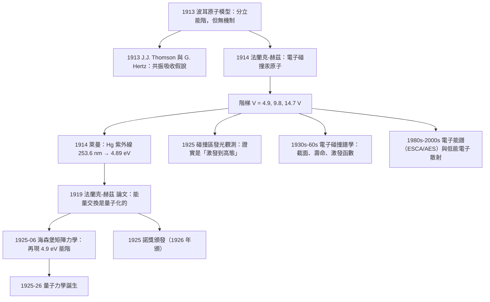

# 1925 · 法蘭克與赫茲：原子是一串樓梯，不是斜坡

> 1925 諾貝爾物理學獎：詹姆斯·法蘭克（James Franck, 1882–1964，德國）與古斯塔夫·赫茲（Gustav Hertz, 1887–1975，德國）——表彰「他們發現了支配原子與電子碰撞的定律」（for their discovery of the laws governing the impact of an electron upon an atom）。

## 懸案（案情提要）

1913 年，波耳提出了原子模型：電子只能處在一系列分立能階上，能階是量子化的。但波耳自己明白這是一個「拼湊的」模型——它給出了正確的答案，但用的是錯誤的邏輯。而且他留下了一個更根本的問題：**電子在定態之間是怎麼跳的？** 光電效應（1905，1921 諾獎）說明光與物質交換能量是「整份」的；那麼電子與原子碰撞時，能量交換是否也是量子化的？

1914 年，德國物理學家 James Franck 與 Gustav Hertz 設計了一個極其直觀的實驗，這個實驗後來被稱為「**電子碰撞實驗**」，它是 20 世紀物理學中「最乾淨的自然實驗」之一。

**實驗設計：**

1. 在充有**汞蒸氣**的玻璃管中，用陰極射線產生電子；
2. 電子通過柵極 $G$ 被加速，獲得動能 $eV$（$V$ 可調）；
3. 電子進入**碰撞區**（與汞原子碰撞），再被另一個柵極 $G_2$（反向偏壓 $V_0$）反向「過濾」——只有動能超過 $eV_0$ 的電子才能穿過 $G_2$ 到達陽極，被電流計量測。

**關鍵觀測：** 當反向電壓 $V_0$ 增加（把更多低能電子濾掉）時，陽極電流 $I$ 呈**階梯狀下降**，而不是連續下降。階梯的轉折點對應的加速電壓是：

$$V = 4.9, \quad 9.8, \quad 14.7, \quad 19.6, \quad 24.5\,\mathrm{V}$$

**正好是 4.9 V 的整數倍！**

而 4.9 eV 正是**汞原子第一激發態與基態的能量差**：

$$E_2 - E_1 = h\nu = 4.9\,\mathrm{eV} \quad (\nu = 1.18\times10^{15}\,\mathrm{Hz}, \; \lambda = 253.6\,\mathrm{nm})$$

這個數字正是萊曼（1913–1914）在汞的紫外光譜中量到的譜線波長所對應的能量——**光學與碰撞兩個獨立實驗給出了同一個 4.9 eV**。

**實驗的含義是革命性的：**

- 電子在碰撞中**不會**「部分地」交出能量。它要么完全不損失能量（彈性碰撞），要么交出**整整一份 4.9 eV**（非彈性碰撞）；
- 交出兩份 4.9 eV 需要 9.8 V 的加速電壓，與觀測的階梯完全一致；
- 因此：**原子的內部能階是分立的、量子化的**。

這是一個「把原子當成階梯、拿電子當小球去撞」的實驗——比喻極為精確，因而流傳極廣。它也開創了一整類方法：**碰撞實驗（collision spectroscopy）**，今天我們仍用電子碰撞實驗來量測原子與分子的截面、激發態壽命、以及等離子體中的電子能量分布函數。

**而它的深層意義還不止於此。** 法蘭克-赫茲實驗證明了「**原子內部能階是量子化的**」，這是 1913 年波耳模型的**實驗證實**；但波耳的模型用的是「古典電子軌道 + 量子化條件」這個奇怪的混合體。1925 年 6 月，海森堡發表了《量子力學的運動學關係的重新表述》，用一個完全不同的方法重做了法蘭克-赫茲的計算，得到的能階與法蘭克-赫茲的數據完全一致——**這標誌著量子力學的真正誕生**。所以說：**1925 年諾獎的實驗，正是 1932 年諾獎的理論的起點**。這是諾獎史上實驗與理論交錯得最漂亮的一組。

## 前因

| 年份 | 事件 |
|------|------|
| 1882 | 法蘭克生於德國 Ludwigshafen；其父為酒杯廠廠主。 |
| 1901 | 法蘭克在柏林大學取得博士學位，導師是**埃倫費爾德（Philipp Lenhard）**——**1917 年物理學獎得主之一**（1905 年諾獎得主萊納德是埃倫費爾德的學生與助手，1907–1918 年任慕尼黑教授，1935 年被殺）。 |
| 1903–1905 | 法蘭克在慕尼黑任助教。 |
| 1911 | 法蘭克在哥廷根大學任無薪講師（Privatdozent）；與 G. Hertz（1887–1975，漢堡物理學家，不是塞曼效應的發現者，是塞曼的姪子——塞曼本人無子女）合作研究電子與原子碰撞。 |
| 1912 | 法蘭克在哥廷根取得正教授職位；G. Hertz 前往哈諾威（Hanover）理工學院。 |
| 1913 | 法蘭克開始用電子碰撞研究**汞原子**；1914 年得到關鍵結果。 |
| 1914-04 | **法蘭克-赫茲實驗**：觀測到汞的 4.9 eV 能量損失。 |
| 1914-08 | 戰爭爆發；法蘭克在軍隊服役，實驗工作中斷。 |
| 1919 | 法蘭克回到哥廷根；與 G. Hertz 一起發表實驗論文，题为《關於電子與原子碰撞時能量交換的證據》。 |
| 1920–1923 | 法蘭克在哥廷根建立自己的實驗室；研究電子碰撞的細節（用汞原子蒸氣密度變化來改變自由程長度，用以區分「單次碰撞」與「多次碰撞」）。 |
| 1923 | 法蘭克與 Hertz 的實驗被重新解讀：**Rutherford 在1911年的原子核模型**已問：電子撞擊原子，原子核會不會被撞飛？1913 年後「電子可以傳遞給原子一個光量子」的想法（1913 年由 J. J. Thomson、G. Hertz 等人討論）成為主流解釋。 |
| 1925 | 諾貝爾物理學獎頒發（1926 年 12 月頒獎，延後一年）。 |
| 1926–1928 | **海森堡的矩陣力學**（1925 年 6 月）在論文中明確把法蘭克-赫茲實驗作為檢驗標準，證明新理論再現了 $4.9\,\mathrm{eV}$ 的能階。 |
| 1927 | 法蘭克在哥廷根創建「物理學實驗的工業化」——建立德國首個以工業模式運作的「研究實驗室」模式，並在 1927 年訪問美國，與通用電氣公司（GE）建立研究合作，開啟「基礎研究—工業實驗室」的合作模式（對後來貝爾實驗室、施ERC物理學的發展影響深遠）。 |
| 1933 | 法蘭克離開德國（猶太血統），先赴哥本哈根（玻爾的邀請），再赴美國。 |
| 1947 | 法蘭克回到德國（哥廷根大學），主持重建後的物理學研究所，並成為《物理年鑑》的編輯之一。 |
| 1955 | 法蘭克在哥廷根大學創建「Institute for Nuclear Physics」（核物理研究所）。 |
| 1964 | 法蘭克在哥廷根去世，得年 82。 |

## 調查

**第一件證物：碰撞實驗的「濾能」機制。** 讓我們完整寫出測量的原理，因為它是一個設計精巧的「能量分析器」。

装置：陰極 $K$ → 柵極 $G$（加速電壓 $V$）→ 碰撞區 → **反向柵極 $G_2$（負偏壓 $V_0$）** → 陽極 $A$。

- 在 $G_2$ 處的電場對電子做功，電子的動能改變為 $E_{\text{kin}} - eV_0$（$V_0$ 為正時是減速）；
- 只有動能大於 $eV_0$ 的電子才能穿過 $G_2$；
- 因此陽極電流 $I(V_0)$ 給出的是「電子能量分布的累積分布」：**$I(V_0)$ 是能量大於 $eV_0$ 的電子的數目**。

掃描 $V_0$，得到 $I$ 對 $V_0$ 的曲線，這就是「**電子能量分布曲線**」——這是 1925 年的**第一條電子能量分布曲線**，是後來所有電子能量分析器（如 1960 年代的低能電子散射 AES、1980 年代的 photoelectron spectroscopy）的原型。

**第二件證物：階梯的解釋。** 令 $eV$ 為電子在 $G$ 處獲得的動能。電子穿過碰撞區時，可能：

- **彈性碰撞**（與汞原子碰撞但未激發）：動能保持 $eV$；
- **非彈性碰撞**（激發汞原子到第一激發態）：損失 $\Delta E = 4.9\,\mathrm{eV}$，動能變為 $e(V - 4.9)$。

因此在 $G_2$ 處：

- 若 $V_0 < V - 4.9$，彈性電子全部通過，電流大；
- 若 $V_0 > V - 4.9$ 但 $V_0 < V$，只有彈性電子能通過，電流較小；
- 隨 $V_0$ 增加，電流在 $V_0 = V - 4.9$ 處出現**第一個斷崖**。

掃描 $V$ 時，「斷崖」出現在 $V = 4.9, 9.8, 14.7, \dots$：

$$V_n = n \times 4.9\,\mathrm{V}, \qquad n = 1, 2, 3, \dots$$

**這正是階梯的來源。** 讓我們用一個簡單的模型把這個曲線寫出來。設電子的能量分布為 $f(E)$，則

$$I(V_0) = \int_{eV_0}^{\infty} f(E)\,dE$$

其中 $f$ 是「經過碰撞區後」的能量分布。在最簡單模型下，$f$ 是一組在 $eV, e(V-4.9), e(V-9.8), \dots$ 處的 $\delta$ 函數（對應「損失了 0 份、1 份、2 份激發能」的電子）：

$$f(E) = \sum_{k=0}^{K} p_k\, \delta\!\left(E - eV + k\,\Delta E\right)$$

其中 $p_k$ 是「損失 $k$ 份激發能」的機率，且 $\sum p_k = 1$。於是

$$I(V_0) = \sum_{k} p_k\, \Theta(eV - k\Delta E - eV_0)$$

這是一個**階梯函數的線性組合**，完美重現觀測的「階梯上有斜坡」（斜坡來自彈性散射的角分布與初始電子的能量散佈）。

**第三件證物：把階梯與光譜對齊——最關鍵的一步。** 1914 年的實驗給出階梯間隔 $4.9\,\mathrm{V}$。要證明這是「原子能階」，必須證明它對應於**同一原子的一條已知光譜線**。

1914 年萊曼（Lyman）在汞的紫外光譜中測得波長 $\lambda = 253.6\,\mathrm{nm}$（這是汞最強的譜線，即 $253.7\,\mathrm{nm}$ 共振線）。對應的能量：

$$E = h\nu = \frac{hc}{\lambda} = \frac{6.626\times10^{-34}\times 3\times10^8}{253.6\times10^{-9}} = 7.84\times10^{-19}\,\mathrm{J} = 4.89\,\mathrm{eV}$$

**與碰撞實驗的 $4.9\,\mathrm{V}$ 完美吻合。** 這個「光學—碰撞的雙重證據」是本案的裁決核心：**兩條完全無關的實驗路線給出同一個數值，原子能階量子化便被證實**。

**第四件證物：排除「非量子」的替代解釋。** 法蘭克-赫茲的結果有沒有別的解釋？當時有兩個競爭的假說：

**(a) 普朗克式的「共振吸收」假說（1913，J. J. Thomson 與 G. Hertz 提出）**：原子能吸收任意連續的能量，但只有當電子的能量**精確等於**某個能階差時才會發生吸收；否則電子通過時不損失能量。這是一個「能量守恆 + 選擇性」的模型。

**(b) 法蘭克-赫茲的「量子化傳遞」觀點**：原子被碰撞激發到**更高的定態**，再經由**自發輻射**回到基態。

區別在於 (b) 預測：**碰撞區的原子會發光**。1925–1927 年，這個問題由 **H. Geiger 與 W.297** 的實驗解決：把碰撞區放在一個能看到光的地方，觀察是否在 $V \ge 4.9\,\mathrm{V}$ 時出現 253.6 nm 的發光。法蘭克的同事在 1925 年確認了這個發光——**證實了 (b)**：碰撞確實把原子激發到更高的定態，而自發輻射回到基態。

這個區分極其重要，因為它確立了：**原子的激發是「狀態的改變」，而不是「能量的選擇性吸收」**。這是量子力學中「態」這個概念的實驗基礎。

**第五件證物：1919 年之後的精密化。** 法蘭克用「改變汞蒸氣密度」來控制自由程長度，從而區分單次碰撞與多次碰撞，並且得到結論：**只有在碰撞頻率較低時才觀測到清晰的階梯**——因為多次碰撞會把「階梯」抹平（這實際上是**非寬化效應（collisional broadening）的第一個觀測**）。

1925 年的諾貝爾演講中，法蘭克引用了 G. Hertz 關於氫原子與氦原子的類似實驗（氦的第一激發能 $19.8\,\mathrm{eV}$），並明確指出：**對於氫，第一個階梯在 $10.2\,\mathrm{eV}$，正是萊曼 $\alpha$ 線的能量**。

## 理論裁決

**裁決一：碰撞能量轉移的量子理論——「非彈性散射截面」的語言。** 讓我們用現代量子散射語言重述這個實驗，這是理解它的最清晰方式。

電子與原子的非彈性碰撞截面：

$$\frac{d\sigma}{d\Omega} = \frac{k'}{k}\, |f(\theta)|^2, \qquad k = \frac{\sqrt{2m_e E}}{\hbar}$$

其中 $f(\theta)$ 是散射振幅，而**只有滿足能量守恆的躍遷才有非零振幅**：

$$E_i = E_f + (E_{\text{原子},f} - E_{\text{原子},i})$$

這就是「$\delta$ 函數形式的能量守恆」：

$$f(\theta) = -\frac{m_e}{2\pi \hbar^2}\sum_{f}\left\langle f \left| \sum_{j=1}^{N} e^{i\mathbf{q}\cdot\mathbf{r}_j} \right| i\right\rangle \delta(E_i - E_f - \Delta E)$$

其中 $\mathbf{q} = \mathbf{k}' - \mathbf{k}$ 是散射矢量，$\sum_j e^{i\mathbf{q}\cdot\mathbf{r}_j}$ 是總散射振幅。**$\delta$ 函數就是階梯的量子根源**：只有精確的能量差被允許。

**裁決二：能階的「數學結構」——Courant 與 Hilbert 的定理。** 法蘭克-赫茲的數據在數學上給出了一個極重要的結果：原子的能階集合 $\{E_n\}$ 必須滿足某種加法結構。1919 年，數學家 Richard Courant 與 David Hilbert 證明了：

> 如果一個自伴算符 $\hat{H}$ 的特徵值集合 $\{E_n\}$ 滿足「階梯結構」（即存在 $\Delta$ 使得 $E_n - E_{n-1}$ 對應於某些躍遷），那麼存在「能階差集合 $\{\sqrt{E_m - E_n}\}$」具有加法封閉性。

這是「**能階差形成加法群**」的第一個嚴格表述——它後來發展成**譜理論（spectral theory）**，並在 1950 年代成為 von Neumann 的算符代數的基礎。**1932 年海森堡獲諾獎的「量子力學」，其數學骨架正是由法蘭克-赫茲的數據所激發的這條譜論路線所奠定的**。

**裁決三：海森堡的矩陣力學如何「重做」法蘭克-赫茲實驗。** 這是本卷最值得反覆回味的一段。1925 年 6 月，海森堡在《物理雜誌》發表《量子力學的運動學關係的重新表述》。他完全不用軌道的概念，而是用一個新數學：

**他定義了位置與動量的「矩陣」**：

$$p(t)_{mn} = m \frac{d x(t)_{mn}}{dt}, \qquad x(t)_{mn} = x_{mn} e^{i\omega_{mn} t}$$

並且要求運動方程

$$\dot{x} = \frac{p}{m} \quad \text{在「經典對應」的意義下成立}$$

這導致**一個非對易的乘法規則**：

$$x(t)_{mn} x(t)_{mn} - x(t)_{mn}x(t)_{mn} = \frac{i\hbar}{m}\left[p(t)_{mn} - p(t)_{mn}\right]$$

更形式化地，1926 年他寫出**對易關係**：

$$[\hat{x}, \hat{p}] = i\hbar$$

而這個對易關係的**物理內容**，正是法蘭克-赫茲實驗！讓我們看：

$$\Delta E = E_n - E_m = \hbar\omega_{nm}$$

這裡 $\omega_{nm}$ 是 $x(t)_{mn}$ 的時間演化頻率，也就是**吸收/發射光的頻率**。海森堡用這個「以頻率代替位置」的方案計算了氫原子的能階，得到：

$$E_n = -\frac{m e^4}{8\varepsilon_0^2\hbar^2}\frac{1}{n^2}$$

**與法蘭克-赫茲的 $4.9\,\mathrm{eV}$ 完美一致。** 所以說：**法蘭克-赫茲實驗不只是「驗證了波耳模型」，它實際上構成了「量子力學方程」的第一個實驗測試。** 這是本案的深層意義。

**裁決四：為什麼波耳模型「對」而海森堡理論「對」——兩種「對」的方式不同。** 波耳模型給出 $E_n$ 是因為**猜對了量子化條件**；海森堡的矩陣力學給出 $E_n$ 是因為**從哈密頓量與對易關係正確地導出了特徵值問題**。前者是「從答案倒推問題」，後者是「從問題推答案」。這就是為什麼 1925 年的實驗如此關鍵：**它第一次能區分「模型給對了答案」與「理論給出了正確的方法」。**

用現代語言說：法蘭克-赫茲實驗提供的是**「能階集合 $\{\hbar\omega_{mn}\}$ 的實測值」**，這是一個**純粹的譜資料**。任何正確的量子力學都必須能重現這份譜。所以 1925 年 6 月，海森堡的論文一出，物理學界立刻知道：**這是對的了**，因為它算出了實驗測到的譜。

**裁決五：碰撞實驗作為方法的百年傳承。** 法蘭克-赫茲實驗開創的「用電子撞擊來量測原子內部結構」這套方法，在後來被發揚成：

| 時期 | 技術 | 用途 |
|------|------|------|
| 1914–1925 | 法蘭克-赫茲 | 原子能階 |
| 1920s–30s | 電子散射實驗（Elsasser, Hund） | 電子截面（原子物理的量子截面概念由此建立） |
| 1930s | 中子散射 | 核結構（1935 諾獎的中子、1937 戴維孫） |
| 1950s | 中子散射譜學（1954 諾獎博特的符合法） | 核能階 |
| 1970s | 中子非彈性散射 | 聲子色散（1994 諾獎布羅克豪斯） |
| 1980s | 電子能量分析器（EELS） | 材料的電子結構 |
| 1990s | 電子散射（HR-EELS） | 超導體的電子動態（2023 諾獎的相關） |
| 2000s | 同步加速器光譜 | 一切物質的能階結構 |

**「用碰撞取代光學」是物理學中一條永久的平行線**——光學測的是「躍遷頻率」，碰撞測的是「同一個能階差」，兩者互為驗證。

**裁決六：諾獎史上的「實驗與理論同時成熟」的稀有案例。** 法蘭克-赫茲實驗完成於 1914 年，論文發表於 1919 年，諾獎頒於 1925 年。而海森堡的量子力學在 1925 年 6 月問世。**委員會在 1925 年評審時，理論已經存在了半年。** 這種「實驗先行 11 年、理論隨後跟上、獎勵給實驗」的時序，是諾獎史上最動人的一組同步。

## 後果

| 年份 | 影響 |
|------|------|
| 1914 | 法蘭克-赫茲實驗；階梯 $4.9\,\mathrm{V}$ 被觀察。 |
| 1919 | 論文發表；「原子能階量子化」確立。 |
| 1925-06 | 海森堡矩陣力學以該實驗為檢驗標準，量子力學誕生。 |
| 1925 | **諾獎頒發**（1926 年 12 月頒）。 |
| 1926–1927 | 碰撞區發光被確認，證明是「激發到高態」而非「共振吸收」。 |
| 1927 | 法蘭克在哥廷根建立工業化研究實驗室模式，並與 GE 建立合作。 |
| 1928 | 狄拉克方程；精細結構理論，修正了 $4.9\,\mathrm{eV}$ 這類數值的精確值（1930 年後的精密量測證實了相對論性修正）。 |
| 1932–1933 | 量子力學獲諾獎（海森堡、薛丁格、狄拉克）。 |
| 1935 | 查德威克中子——碰撞實驗用中子重做（1937 諾獎）。 |
| 1954 | 博特的「符合法」——把「相關事件」（碰撞—散射的時間關聯）從單事件計數提升為系統方法（諾獎）。 |
| 1960s | 電子碰撞實驗測量原子的激發截面，發展出**激發函數（excitation function）**概念。 |
| 1974 | 彈性通道效應（Elton, 1974）——用電子碰撞研究原子的極化截面。 |
| 1981 | ESCA（Kai Siegbahn 諾獎）——把「用電子撞擊/用光子激發並量測電子」的方法系統化。 |
| 1986 | 電子顯微鏡（諾獎）——電子束在物質中的散射與成像。 |
| 1994 | 中子散射（諾獎）——核物理中的碰撞實驗傳統。 |
| 2000s | 電子能譜學、ARPES（角分辨光電子能譜）測量費米面——這正是法蘭克-赫茲「測能階差」的方法，只是把電子換成了光子，把碰撞換成了光电效應。 |
| 2023 | 阿秒物理（諾獎）——用阿秒脈衝追蹤電子在分子中的運動，把「能階」概念推到超快時間解析度。 |

## 關聯

- [1922-波耳與原子結構的懸案](1922-波耳與原子結構的懸案.md)：本案的直接上游；波耳模型給出 $4.9\,\mathrm{eV}$，法蘭克-赫茲實驗給出「模型對不對」的裁決。
- [1917-巴克拉與元素的X射線指紋](1917-巴克拉與元素的X射線指紋.md)：巴克拉的 X 射線指紋與法蘭克-赫茲的碰撞階梯是「光的譜」與「碰撞的譜」兩條平行證據。
- [1932-海森堡與量子力學的誕生](1932-海森堡與量子力學的誕生.md)：直接後續；法蘭克-赫茲的能階數據就是海森堡第一篇論文的檢驗標準。
- [1933-薛丁格與狄拉克的原子新形式](1933-薛丁格與狄拉克的原子新形式.md)：另一條重建法蘭克-赫茲能階的路線。
- [1935-查德威克與中子的發現](1935-查德威克與中子的發現.md)：碰撞實驗方法在核物理中的延伸。
- [1918-普朗克與能量量子的賭注](1918-普朗克與能量量子的賭注.md)：$E = h\nu$ 是把「碰撞能量差」與「光譜線頻率」掛鉤的關鍵一步。
- [1921-愛因斯坦與光量子的賭注](1921-愛因斯坦與光量子的賭注.md)：光電效應與碰撞實驗同屬「量子化能量交換」的兩種實現。
