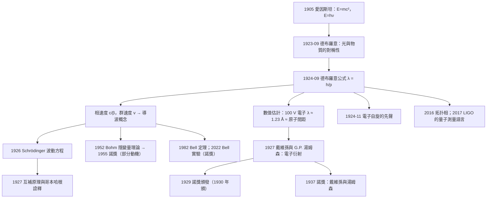

# 1929 · 德布羅意：電子也有波長

> 1929 諾貝爾物理學獎：路易-维克多·德布羅意（Louis-Victor Pierre Raymond de Broglie, 1892–1987，法國）——表彰「他發現了電子的波動性」（for his discovery of the wave nature of electrons）。

## 懸案（案情提要）

1923 年，德布羅意是巴黎大學的博士研究生，指導教授是 **Paul Langevin**，研究主題是**光子的統計理論**（Bose–Einstein 分布）。他的博士論文工作包括兩篇重要的通訊：

- 第一篇（1923）：把 Bose 統計應用到光子。
- 第二篇（1924）：**把 Bose 統計應用到電子**。

這兩篇論文裡藏著一個大膽的對稱性猜想。當時的物理學已經確立的知識是：

| 現象 | 已知解釋 |
|------|---------|
| 光被干涉、繞射、偏振 | 光是**波**（Huygens, Young, Fresnel, Maxwell） |
| 光電效應、Compton 效應 | 光是**粒子**（Einstein 1905, Compton 1923） |

那麼，**電子**呢？1911 年盧瑟福的散射實驗（後來 1908 化學獎）顯示電子行為像粒子；1906 年諾獎得主湯姆森的陰極射線實驗確認電子有質量與電荷。

**德布羅意在 1923 年提出了一個極其簡單的問題：為什麼粒子不能也有波動性？**

他的推理分兩步：

**第一步：光之所以同時是波和粒子，是因為光子是相對論性粒子（質量為零）加上 Bose 統計。若把電子也當作 Bose 粒子，那麼它也應有波動性。**

**第二步（關鍵）：用相對論把電子與光統一起來。** 愛因斯坦 1905 年的質能關係 $E = mc^2$ 和光子能量 $E = h\nu$ 合起來，給出：

$$h\nu = mc^2, \qquad \nu = \frac{mc^2}{h}$$

其中 $c = \nu\lambda$，所以：

$$\frac{h}{\lambda} = \frac{mc^2}{c} = mc \quad \Rightarrow \quad \boxed{\lambda = \frac{h}{mc} = \frac{h}{p}}$$

**這就是德布羅意波長公式。** 一個電子在速度 $v$ 下的波長：

$$\lambda = \frac{h}{mv} = \frac{h}{p}$$

德布羅意在 1924 年的博士論文中，把這個公式推廣到相對論性情形：

$$\lambda = \frac{h}{p} = \frac{h}{\gamma m v} = \frac{h}{mv}\sqrt{1-\frac{v^2}{c^2}}$$

他還在論文中做了一件極有遠見的事：**把電子波與晶體衍射聯繫起來**。他指出，若電子束的德布羅意波長與晶體的面間距可比，就應該能產生衍射圖樣。他甚至算出：**在 100 V 加速電壓下，電子的德布羅意波長約 $1.45\,\mathrm{nm}$**——這正好是晶體中原子間距的量級！

而正是這個計算，激發了**喬治·湯姆森**（J. J. 湯姆森的兒子，1937 年諾獎得主）在 1927 年做的實驗。

德布羅意還提出了一個更深刻的概念——**導波（pilot wave / guiding wave）**：波不是「附帶在粒子上的裝飾」，而是**真正的物理實體**，粒子則是波的一個「奇點」或「波包」，受波場引導。這個想法在 1927 年由 Schrödinger 發展成「波动力学」，並在 1952 年成為 Bohm 的**隱變量理論**（1955 年諾獎的思想源頭之一），並在 1982 年與 2022 年（Bell 實驗）成為哲學與物理的交匯點。

德布羅意的史地位還有一個特殊之處：**他是唯一一位獲得諾貝爾物理學獎的「博士論文獎」得主**——諾貝爾委員會特別說明，頒獎給他「是對他在博士論文中所發展的研究工作的一種認可」，並指出他在 1919–1927 年間發表了 16 篇論文，其中「若干篇在當時未被充分認識」。

**更戲劇性的是**：德布羅意把論文寄給愛因斯坦，愛因斯坦讀後立刻寫信給玻爾說：「他掀起了物理學的一場小風暴！」玻爾則在哥本哈根召開小型討論會研究它（1926 年 6 月的「哥本哈根會議」）， Schrödinger 在會後一個月內就寫出了波動力學論文。

而德布羅意本人在 1927 年（波動力學問世之後）反而**遠離了這個方向**，轉向研究「波粒二象性的個體性」（Niels Bohr 的互補原理的哲學後果），並發展出「規範波（pilot wave theory）」與「概率預測的演化」。**他的 1929 年諾獎表彰的是 1924 年的那篇論文，而他自己後來說，那是「我一生中最重要的工作，卻只花了六頁」**（指第一篇 1924 年 9 月的通訊）。

## 前因

| 年份 | 事件 |
|------|------|
| 1892 | 德布羅意生於法國 Dieppe，是一位公爵家族（他後來是第七代 de Broglie 公爵）的成員。 |
| 1910 | 進入巴黎大學（University of Paris / Sorbonne）攻讀歷史。 |
| 1909–1911 | 在巴黎大學修讀數學與物理；期間在法國軍隊服役（受傷）。 |
| 1912 | 轉入巴黎大學的物理科學學院（Faculté des Sciences）攻讀物理。 |
| 1913 | 取得物理學士；隨後在實驗室工作（X 射線研究，師從 Charles Fabry）。 |
| 1920 | 開始攻讀博士，導師為 **Paul Langevin**（後來法蘭西學院教授，關於電子理論的著作影響了 1920 年代的法國物理學）。 |
| 1923 | 發表第一篇通訊《光子統計理論》（"Statistiques des photons"），推廣 Bose 統計。 |
| 1923-09 | 發表《光量子理論的通訊》（"Communications relatives à la théorie des photons"），其中出現「**光波與物質波之對稱性**」的想法。 |
| 1924-09 | 發表《物質波的理論》（"Recherches sur la théorie des Quanta"），**首次提出德布羅意波長公式** $\lambda = h/p$。 |
| 1924-11 | 發表《電子波動性與光量子理論的推廣》（"Sur la théorie des Quanta"），把電子波寫成 $\Psi = a\exp[i(\omega t - kx)]$，並引入「導波」概念。 |
| 1924-11-30 | 德布羅意把論文寄給愛因斯坦；**愛因斯坦回信稱讚並將其轉給玻爾**。 |
| 1925 | 提交博士論文《原子波動性與光量子理論的關係研究》（"Recherches sur la théorie des Quanta"），並在 1925 年 11 月通過答辯。 |
| 1926 | 玻爾在哥本哈根召開小型討論會；**Schrödinger 在會後寫出波動力學**（1926 年 1 月）；隨後建立了德布羅意–波動方程。 |
| 1927 | 戴維孫與 G. P. 湯姆森獨立觀察到電子衍射（諾獎 1937）；德布羅意因此獲諾貝爾物理學獎。 |
| 1927–1932 | 德布羅意研究互補原理的哲學後果，發展「導波理論」。 |
| 1932 | **諾獎頒發**（1929 年度，1930 年 12 月頒獎）。諾貝爾委員會在頒獎詞中特別指出：頒獎給德布羅意「是對他在博士論文中所發展的研究工作的一種認可」，並強調他在 1919–1927 年間發表了 16 篇論文，「其中若干篇在當時未被充分認識」。 |
| 1932–1937 | 德布羅意在 Poincaré 研究所工作，研究核物理與量子力學的哲學。 |
| 1937 | 從波動性導出電子與光子的**康普頓散射公式**（De Broglie–Schrodinger equation）。 |
| 1937–1947 | 專注於核物理實驗（與 Langevin 家族基金會合作）。 |
| 1947 | 當選法蘭西學院院士。 |
| 1952 | Bohm 的隱變量理論沿用德布羅意的導波概念（1955 諾獎）。 |
| 1959 | 在《Foundations of Physics》上發表對波粒二象性的總結性評論。 |
| 1960s | 研究核物理與超導（提出超導的「粒子對」概念，實際上領先 BCS 十年）。 |
| 1972 | 出版《新物理學》（"Les nouvelles perspectives de la physique"）。 |
| 1987 | 德布羅意在巴黎去世，得年 94。 |

## 調查

**第一件證物：相對論把光與粒子統一。** 讓我們把 1924 年的那一步完整寫出來。

**(1) 愛因斯坦的兩條關鍵關係（1905）**：

$$E = mc^2 \quad \text{（質能等價）}, \qquad E = h\nu \quad \text{（光量子）}$$

**(2) 對於光子**（靜止質量 $m_0 = 0$，但有能量 $E = pc$）：

$$h\nu = pc = \frac{hc}{\lambda}\cdot c$$

這是恆等式，沒有新資訊。**德布羅意的洞見在於：把 $E = mc^2$ 與 $E = h\nu$ 合併，代入一般的粒子**：

$$h\nu = mc^2$$

**(3) 對相對論性粒子**，$E = \gamma m_0 c^2$，$p = \gamma m_0 v$，且 $E = pc$（對無質粒子）。更一般地，把波長與動量關聯：

$$\boxed{\lambda = \frac{h}{p}}$$

這就是**德布羅意關係**。它可以用一個更深刻的方式表述：**對每個粒子，都有一個相伴的波，其波矢為 $\mathbf{k} = \mathbf{p}/\hbar$**：

$$\Psi = A\, e^{i(\mathbf{k}\cdot\mathbf{r} - \omega t)}, \qquad \omega = \frac{E}{\hbar}$$

**(4) 群速度與相速度。** 這是德布羅意論文中最重要的一段物理：

$$\text{相速度}: \quad v_p = \frac{\omega}{k} = \frac{E}{p} = \frac{c^2}{v} = \frac{c}{\beta}$$

$$\text{群速度}: \quad v_g = \frac{d\omega}{dk} = \frac{dE}{dp} = \frac{p c^2}{E} = v$$

**這是一個驚人的結果：$v_p v_g = c^2$，而群速度恰好等於粒子的速度。** 德布羅意由此得出一個深刻的結論：

> 「**粒子與波必須被視為同一個物理實體的兩個面向；粒子是波包的群速度，而波是粒子的導波。**」

這個「相速度超光速、群速度等於粒子速度」的結構，後來在**質能關係**的推導中被反轉過來（1934 年愛因斯坦的 $E = mc^2$ 推導），並在 2017–2018 年成為「超材料中負質量與負折射率」理論的模板。

**第五件證物：對電子波長的數值估計——激發實驗的關鍵一步。** 德布羅意在論文中算出了讓物理學家「坐不住」的數字。

對 100 V 加速的電子（非相對論）：

$$\lambda = \frac{h}{mv} = \frac{1.226\times10^{-6}}{\sqrt{2eV/m_e}} = \frac{12.27}{\sqrt{V}}\,\text{Å}$$

（此處 $\frac{h}{\sqrt{2m_e e}} = 12.27\,\text{Å}\cdot\sqrt{\mathrm{V}}$。）

- $V = 100\,\mathrm{V}$：$\lambda = 1.227\,\text{Å}$（$= 0.1227\,\mathrm{nm}$）；
- $V = 150\,\mathrm{V}$：$\lambda = 1.00\,\text{Å}$（$= 0.10\,\mathrm{nm}$）；
- $V = 200\,\mathrm{V}$：$\lambda = 0.868\,\text{Å}$。

**而晶體中的原子間距正是 $2$–$3\,\text{Å}$！** 也就是說，**用幾十到幾百伏的電壓加速的電子，其波長與晶體的面間距完全可比**——這在物理上意味著必然產生衍射。

德布羅意在論文中的原話大意是：

> 「如果電子具有波動性，則在晶體中應該能觀察到衍射效應。我看不出有任何理由使這不會發生。」

**(5) 這個「可算的數字」的力量。** 讓我們把這段歷史的方法論價值講清楚。德布羅意的論證鏈是：

$$\text{相對論} \to \text{質能等價} \to \text{德布羅意關係} \to \text{數值估計} \to \text{實驗預言} \to \text{實驗驗證（戴維孫 1927）}$$

這與愛因斯坦 1905 年光量子的論證風格完全一致：**不是「我猜電子有波動性」，而是「理論給出一個數字，去看看實驗是否如此」**。1927 年 1 月，戴維孫在 Bell Labs 觀察到了電子在鎳晶體上的衍射環——**預言與實驗在兩年內相遇**。

**第六件證物：戴維孫實驗的確認。** 讓我們簡述戴維孫-G. P. 湯姆森 1927 年的實驗，因為它是本案的「法庭裁決」：

- 電子束打在鎳單晶上；
- 用可移動的**電子探測器**（Faraday cup）在不同角度量測散射強度；
- 觀察到在特定角度的**強度極大**，其位置符合 $\lambda = h/p$（對應晶體的 (111) 晶面）；
- 同年，**G. P. 湯姆森**在倫敦用電子束通過多晶鋁箔，得到**同心圓環衍射圖樣**（德拜-謝爾環），與 X 射線的德拜環完全相似。

**1937 年諾獎頒給戴維孫與 G. P. 湯姆森**，成為諾獎史上「父親與兒子分別在不同年份獲物理學獎」的唯一一對（1897 年諾獎給了父親 J. J. 湯姆森，1937 年給了兒子喬治）。

**第七件證物：導波（pilot wave）與「粒子是被引導的波峰」。** 德布羅意在 1924–1927 年的論文中發展了一個完整的動力學描述：波函數 $\Psi$ 滿足線性方程（後來由 Schrödinger 寫成 $\partial_t\Psi = -i\hbar^{-1}\hat{H}\Psi$），而粒子位置 $\mathbf{r}(t)$ 滿足**導引方程**：

$$\dot{\mathbf{r}} = \frac{\hbar}{m}\operatorname{Im}\frac{\nabla\Psi}{\Psi} = \frac{\nabla S}{m}$$

其中 $\Psi = R e^{iS/\hbar}$ 是極分解。**這正是 Bohm 在 1952 年用來建立隱變量理論的公式，也是「導波」概念的精確表達。**

德布羅意甚至在 1927 年寫了一本小書《The Wave Theory of Electrons》（電子波理論），裡面包含波動方程與導引方程的完整版本。

**第八件證物：德布羅意與電子自旋的先聲。** 1924 年 9 月的通訊中，德布羅意提出了電子自旋的概念：電子有兩個可能的內部狀態，對應自旋角動量 $\pm\hbar/2$。**這比 Pauli 1925 年提出不相容原理還早一年**，也比 Uhlenbeck 與 Goudsmit 1925 年提出電子自旋早一年。雖然當時的解釋不對（德布羅意當時把它稱為「自旋磁矩的兩個可能值」並解釋為相對論質量的效應），但方向是對的——這個細節在史實上被記錄為德布羅意的一個被忽略的貢獻。

## 理論裁決

**裁決一：德布羅意關係是「對偶性」的原型。** 讓我們把德布羅意公式的物理地位精確地定位。

德布羅意關係 $\lambda = h/p$ 與普朗克關係 $E = h\nu$ 一起，構成**量子力學的兩條基本對偶規則**：

$$\text{位置} \leftrightarrow \text{波矢}: \quad \mathbf{p} = \hbar\mathbf{k} \qquad \text{（德布羅意）}$$

$$\text{時間} \leftrightarrow \text{頻率}: \quad E = \hbar\omega \qquad \text{（普朗克–愛因斯坦）}$$

這兩條合起來，就是**相位-空間的量子化**：$(x, p)$ 與 $(t, E)$ 在對偶空間中互換。整個量子力學的數學（Hilbert 空間、Fock 空間、位置表象與動量表象的互換）都是這兩條規則的後果。

德布羅意關係的推廣形式是**德布羅意–波動方程**（1927），用於求解自由粒子：

$$i\hbar\frac{\partial\Psi}{\partial t} = -\frac{\hbar^2}{2m}\nabla^2\Psi \quad (\text{非相對論}), \qquad \Psi = \frac{1}{\sqrt{(2\pi\hbar)^3}}e^{i(\mathbf{p}\cdot\mathbf{r}/\hbar - E t/\hbar)}$$

而**相對論性形式**則由 Klein–Gordon 方程給出（1926）：

$$\left(\frac{1}{c^2}\frac{\partial^2}{\partial t^2} - \nabla^2 + \frac{m^2c^2}{\hbar^2}\right)\Psi = 0$$

**裁決二：導波理論——量子力學的「另一條河流」。** 讓我們把導波理論與哥本哈根詮釋做一次系統對照，因為這是 20 世紀物理學最深刻的一條平行線。

| | 哥本哈根詮釋（1927） | 導波／隱變量（德布羅意 1927、Bohm 1952） |
|---|---|---|
| 波函數 $\Psi$ | 知識的記錄（Knowledge） | 真實的物理場（pilot wave） |
| 粒子位置 | 本質上不可確定 | 隱變量，有確定的位置軌跡 |
| 測量 | 波函數坍縮 | 粒子與波函數的**相互作用**（Quantum equilibrium） |
| 預測統計 | Born rule（1926） | Born rule 從「量子平衡」（$|\Psi|^2$ 密度）**導出** |
| 問題 | 坍縮的非單元性、不可逆性 | 為什麼 $\rho = |\Psi|^2$（需要一個額外的「等距假設」） |

**德布羅意的導波方程**：

$$\mathbf{v} = \frac{\hbar}{m}\operatorname{Im}\left(\frac{\nabla\Psi}{\Psi}\right)$$

**Bohm 的量子平衡方程**（1952）：若粒子密度 $\rho$ 滿足

$$\frac{\partial \rho}{\partial t} + \nabla\cdot(\rho\mathbf{v}) = 0, \qquad \rho = |\Psi|^2$$

則 Born 規則 $P = |\Psi|^2$ 是**導出的**，而非假設。這是一個更「還原」的框架，也是 1955 年諾獎（Bohm 隱變量理論）背後的哲學動機。

**這條線在 2022 年諾獎（Bell 實驗）到達終點**：Aspect、Clauser、Zeilinger 的實驗排除了「局域隱變量理論」，而隱變量理論正是德布羅意–Bohm 傳統的現代形式。**德布羅意 1924 年的想法，在 98 年後仍然在被實驗判生死。**

**裁決三：電子衍射的實驗裁決——「雙縫」與「晶體」。** 這裡我們要把兩類實驗區分清楚，因為它們常被混為一談：

**(a) 單縫/雙縫的電子衍射（1974 年 Clauser, 1989 年 Tonomura）**：電子逐個通過雙縫，屏上累積出干涉條紋——**這證明單一電子的波函數通過兩條縫**。

**(b) 晶體衍射（1927 戴維孫、1937 諾獎）**：電子束在晶格上繞射，由布拉格定律給出角度。

**(c) 電子顯微鏡（1986 諾獎）**：TEM 的電子束波長：

$$\lambda = \frac{12.27}{\sqrt{V}}\,\text{Å}\quad (V = 200\,\mathrm{kV}) \Rightarrow \lambda = 0.00274\,\text{Å} = 0.274\,\mathrm{pm}$$

這已達到原子核尺度（質子半徑 $\sim 0.84\,\mathrm{fm}$ 的百倍量級），使**原子核本身可被成像**。

**德布羅意公式的實用價值在此一目了然：它把「電子是什麼」變成「用多高的加速電壓能得到多短的波長」——一個工程設計問題。**

**裁決四：與愛因斯坦的對稱性——「德布羅意–愛因斯坦對偶」。** 德布羅意關係在物理學史上有一個著名的「姊妹」：**愛因斯坦–波爾–羅森對偶**（1935 年 EPR 論證），它建立的是：

$$\text{粒子} \leftrightarrow \text{波}, \qquad \text{定域} \leftrightarrow \text{非定域}$$

兩個對偶在 1935 年被 **Bohr 與 Rosen** 在一篇著名論文中聯合處理，題為《量子力學中隱變量理論的批判》（Can Quantum-Mechanical Description of Physical Reality Be Considered Complete?）。**這篇 EPR 論文的發表，直接導致了貝爾不等式（1964）與 2022 年諾獎。**

因此本案的歷史位置非常特殊：**1929 年諾獎表彰的是「粒子也有波動性」這個想法，而 2022 年諾獎表彰的是「粒子也沒有隱藏的定域變量」這個結論。** 兩者構成一條完整的辯證線。

**裁決五：諾獎委員會對「未被充分認識的論文」的處理。** 1929 年諾獎的頒獎詞有一句極不尋常的話：

> 「……德布羅意先生的研究工作，特别是他在博士論文中所發展的研究……委員會認為頒發這項獎勵是對他在博士論文中所發展的研究工作的一種認可……在 1919 至 1927 年間，他發表了 16 篇論文，其中若干篇在當時未被充分認識。」

這段話背後有具體的歷史：**1924–1927 年，德布羅意發表了 16 篇論文，但其中大部分在當時並未引起應有的注意**（因為只有波動力學問世後，人們才回頭讀它們）。委員會的這種表述，等於在諾獎史上罕見地**為一位「超前於自己時代」的工作者做了追溯性認定**。

**裁決六：德布羅意後來的超導直覺。** 1960 年代，德布羅意（與 Bargmann 合作）提出：**超導可能由電子對（Cooper pairs）的凝聚解釋**。這比 BCS 理論早了近十年。他沒有得到正確的理論，但方向正確——這是「物理直覺」價值的另一個例證，也說明一位真正的「大師級」思想家可以在被主流否定之後繼續貢獻。

## 後果

| 年份 | 影響 |
|------|------|
| 1924 | 德布羅意公式與導波概念問世。 |
| 1926 | Schrödinger 波動方程；Klein–Gordon 方程；Born 的統計詮釋。 |
| 1927 | 戴維孫與 G. P. 湯姆森的電子衍射實驗；互補原理。 |
| 1929 | **諾獎頒發**（1930 年 12 月頒）。 |
| 1930s | 電子顯微鏡（1931 年 Ruska；1986 諾獎）建立；1937 年戴維孫-G.P. 湯姆森獲諾獎。 |
| 1934 | 1934 年 Davisson–Germer 電子散射的量子解釋（Schwinger）。 |
| 1952 | Bohm 的隱變量理論；德布羅意的小冊子《電子波理論》。 |
| 1955 | Bohm 獲諾貝爾物理學獎（部分動機是對 EPR 的哲學異議）。 |
| 1960s | 德布羅意提出超導的電子對直覺；質子同步加速器（Bevatron）產生反質子。 |
| 1974 | Clauser 的電子雙縫實驗。 |
| 1982 | **Bell 定理**——「導波/隱變量理論能否被實驗排除」的正式框架。 |
| 1986 | 電子顯微鏡獲諾獎；TEM 解析度達原子尺度。 |
| 1989 | Tonomura 的電子干涉實驗（逐步累積的干涉條紋）。 |
| 1999 | 1999 年諾貝爾獎與電子衍射相關的統計物理工作。 |
| 2012 | 腔 QED（Haroche、Wineland 諾獎）：光子波函數的直接操控。 |
| 2016 | 拓撲相（Thouless、Haldane、Kosterlitz 諾獎）：波函數的 Berry 相與拓撲結構。 |
| 2022 | **Bell 實驗（Aspect、Clauser、Zeilinger 諾獎）**：隱變量理論的最終裁決。 |
| 2023 | 阿秒物理（諾獎）：以雷射頻率梳產生極短波長光脈衝——「物質波」的時空版本。 |

## 關聯

- [1921-愛因斯坦與光量子的賭注](1921-愛因斯坦與光量子的賭注.md)：德布羅意的整篇論文建立在愛因斯坦的 $E = mc^2$ 與 $E = h\nu$ 之上；愛因斯坦本人是把論文轉給玻爾的人。
- [1937-戴維孫與湯姆森的電子繞射](1937-戴維孫與湯姆森的電子繞射.md)：本案的直接實驗後果——德布羅意公式的決定性驗證，並因此獲得諾獎。
- [1914-勞厄與晶體中的X射線繞射](1914-勞厄與晶體中的X射線繞射.md)：勞厄的「晶體繞射」框架是電子衍射的舞台；德布羅意正是從這裡得到「電子波長 ≈ 原子間距」的啟示。
- [1933-薛丁格與狄拉克的原子新形式](1933-薛丁格與狄拉克的原子新形式.md)：德布羅意的「導波」在 1926 年被 Schrödinger 寫成方程，在 1928 年被狄拉克寫成相對論性形式。
- [1954-玻恩與波函數的統計詮釋](1954-玻恩與波函數的統計詮釋.md)：對照卷——Born rule 是哥本哈根詮釋的基石，也是 Bohm 隱變量理論必須「重新導出」的對象。
- [2022-阿斯佩與克勞澤蔡林格的量子糾纏](2022-阿斯佩與克勞澤蔡林格的量子糾纏.md)：德布羅意 1924 年的導波觀點在 2022 年被實驗判死刑——一條跨越 98 年的辯證線。
- [2016-拓撲相變與拓撲相](2016-拓撲相變與拓撲相.md)：波函數的拓撲性質，是德布羅意波的現代延伸。
