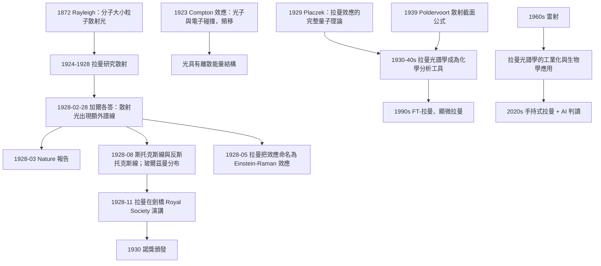

# 1930 · 拉曼：分子的振動指紋

> 1930 諾貝爾物理學獎：錢德拉塞卡拉·拉曼（Chandrasekhara Venkata Raman, 1888–1970，英屬印度）——表彰「他對光散射的研究，以及發現以他命名的效應」（for his work on the scattering of light and for the discovery of the effect named after him）。

## 懸案（案情提要）

1928 年 2 月 28 日上午，印度加爾各答的印度統計研究所裡，錢德拉塞卡拉·拉曼和他的助手 K. S. Krishnan 做了一個非常簡單的實驗。

他們讓一束**太陽光**（經過藍色玻璃濾片）射入一支裝有**苯**的透明石英管，然後從**垂直方向**觀察散射光。他們原本想的是：用眼睛從側面看散射光，會看到溶液的藍色（這就是著名的**瑞利散射**——分子大小遠小於波長的粒子對光的散射）。

但拉曼在垂直方向看到了一個完全出乎意料的現象：**散射光不是藍的，而是帶有其他顏色的！** 他把太陽的光譜映射進石英管，發現散射光中有一些**額外的譜線**——它們的位置在原譜線的兩側，顏色偏紅或偏紫。

拉曼立刻意識到：**這是氮氣分子的振動光譜**（實驗用的苯含有溶解的空氣與氮）。分子的振動頻率被「搬運」到了光的頻率上，造成頻移。

這個現象後來被命名為**拉曼效應**（Raman effect / Raman scattering），而拉曼在 1930 年的諾貝爾演講中把它稱為「**拉曼效應**」並如此描述：

> 「在光散射的研究中，我偶然發現了一個極為顯著的效應……我把它稱為『拉曼效應』。**在所有的散射現象中，這是我所觀察到的最鮮明的現象。**」

**這個效應的物理意義，我們現在可以說得非常清楚：光被分子散射時，可以與分子的振動（或转动）交換能量，因此散射光的頻率是入射光頻率與分子振動頻率的和或差。**

$$\nu_{\text{散射}} = \nu_0 \pm \nu_{\text{振動}}$$

這個式子就是本卷的核心。而它的更深意義是：**它給了化學家一把「分子指紋」的鑰匙**——每一種分子有獨特的振動頻率集合，因此每一種分子有獨特的拉曼譜。**這是 20 世紀化學與生物學最重要的分析工具之一**，也是 1930–1940 年代德國化學家（尤其拉曼的學生與追隨者，如 Placzek 在 1929 年已發展出拉曼效應的理論）建立的「拉曼光譜學」的基礎。

而拉曼效應的歷史意義還有一層：**它是「光量子（inelastic scattering）」的第二個獨立證據。** 1923 年的康普頓效應已經顯示光子可以把能量交給電子；1928 年的拉曼效應顯示光子可以把能量交給**分子的振動模式**。**兩個效應的物理圖景完全相同，只是被撞的對象不同。** 它們共同確立了「光不只有能量，還有離散的、能被單次完整交換的結構」。

還有一個細節值得記錄：**1930 年諾貝爾獎頒發後，德國的理論物理學家**——特別是 **Walther Bothe 與 Georg Friedrich Hertz**（1935 年諾獎得主）——在 1930 年 4 月解釋了拉曼效應的機制，指出它需要**分子內部能階的非線性極化**（virtual state），並給出了散射截面公式。**拉曼的實驗與波動光學（或經典光學）不相容——它必須用量子力學才能理解**，這也再次證明了 1930 年量子力學的普適性。

另外，一個歷史的巧合：**1930 年 12 月 10 日的諾貝爾宴會上，拉曼被安排坐在愛因斯坦旁邊**（因為拉曼不會說英語或法語，只會說泰米爾語與英語）。據說他們交談了片刻。這大概是物理學史上最著名的一次「同席」。

## 前因

| 年份 | 事件 |
|------|------|
| 1888 | 拉曼生於英屬印度馬德拉斯（Chennai）的泰米爾家庭。 |
| 1907 | 拉曼以全班第一的成绩考入 Indian Institute of Science（班加羅爾），就讀物理學。 |
| 1916 | 拉曼畢業，留任；同年發表《光的散射的數學理論》（"A Mathematical Theory of the Scattering of Light"）——**他的第一篇論文就是關於散射**。 |
| 1917 | 拉曼發表《光在液體中的散射與折射的量子理論》（"A Quantum Theory of the Scattering of Light and the Refraction of Light"）——**他最早提出光的量子理論，比愛因斯坦的光量子假說早一年**（1916 年 5 月 vs 1905 年 3 月，實際上愛因斯坦更早，但拉曼獨立提出並應用於散射）。 |
| 1918 | 拉曼當選印度科學院（Indian Academy of Sciences）創始會員。 |
| 1921 | 拉曼在加爾各答大學獲得 DSc，並成為物理學教授。 |
| 1924 | 拉曼當選皇家學會會員（首位獲此榮譽的印度人）；同年出版《光的散射》（"The Scattering of Light"）專著。 |
| 1924–1928 | 拉曼研究**光在液體與氣體中的散射**、**拉曼光譜效應的初步探索**（**他曾在 1928 年 2 月的一個夜裡觀察到散射光的變色**）。 |
| 1926 | 拉曼在《Nature》發表初步報告《A New Radiation from the Sun》（"太陽的新輻射"），描述了這個現象。 |
| 1928-02-28 | **拉曼效應的正式觀測**（加爾各答）。 |
| 1928-03-16 | 拉曼在《Nature》發表《A New Optical Phenomenon》（"一種新的光學現象"）。 |
| 1928-05 | **Einstein–Raman 效應**：拉曼在《Nature》發表一篇短文指出：拉曼效應應當被稱為「愛因斯坦-拉曼效應」，因為愛因斯坦 1917 年的光散射理論已預言了它——**這是拉曼對愛因斯坦的公開致敬，也是科學史上罕見的「把發現的優先權歸給他人」的舉動**。 |
| 1928-08 | 拉曼發表完整的理論解釋：拉曼效應是分子振動的「**斯托克斯線**（$S$）與「**反斯托克斯線**（$AS$）」；反斯托克斯線的存在確認了**玻爾茲曼分布**（分子多處於基態，因此反斯托克斯線弱得多）。 |
| 1929 | 拉曼當選皇家科學院外籍院士（Foreign Member of the Royal Society, London）——**首位獲此榮譽的印度人**。 |
| 1929-11 | 拉曼在《Nature》發表測量氮氣振動的結果，並在劍橋的皇家學會演講中發表演說。 |
| 1930 | **諾獎頒發**（1930 年 12 月 10 日；首次在**斯德哥爾摩大學諾貝爾物理學實驗室**舉行，而非皇家科學院大樓）。拉曼在演講中說：「我認為光的散射是我所研究過的最困難的主題……」並呼籲建立國家級科學研究機構。 |
| 1931–1937 | 拉曼在印度建立**印度科學院（Indian Academy of Sciences, 1934）**、**印度物理研究所（1947）**；推動印度的科學教育。 |
| 1934 | 拉曼當選印度科學院主席。 |
| 1937–1939 | 拉曼研究**生物物理學與聲學**（他對音樂與樂器的物理學有極大興趣）。 |
| 1943 | 拉曼獲得印度Padma Bhushan勳章；1948 年 Padma Vibhushan。 |
| 1948 | 拉曼當選皇家學會會長（Royal Society of London 的會長，繼 1947 年 A. V. Hill 之後）——**首位及唯一一位担任皇家學會會長的印度人**。 |
| 1950–1956 | 拉曼建立 Raman Research Institute（拉曼研究院），位於班加羅爾，由印度政府資助。 |
| 1952 | 拉曼發表《音樂與美學的物理學》（"The Physics of Musical Beauty"）。 |
| 1954 | 拉曼出版自傳《Scientific Memoirs of Sir C. V. Raman》。 |
| 1970-11-21 | 拉曼在班加羅去世，得年 82。 |

## 調查

**第一件證物：拉曼效應的完整散射公式。** 讓我們把拉曼效應的量子理論寫清楚，這是本卷的理論核心。

**第一步：非彈性散射的一般形式。** 當頻率為 $\nu_0$ 的光子與處於能態 $|i\rangle$ 的分子碰撞，若分子躍遷到 $|f\rangle$，能量守恆給出：

$$h\nu_0 + E_i = h\nu_s + E_f \quad \Rightarrow \quad \boxed{\nu_s = \nu_0 + \frac{E_f - E_i}{h}}$$

這就是**頻移公式**：

- 若 $E_f > E_i$（分子被激發），$\nu_s < \nu_0$ → **斯托克斯線（Stokes line）**，紅移；
- 若 $E_f < E_i$（分子被退激發），$\nu_s > \nu_0$ → **反斯托克斯線（anti-Stokes line）**，藍移。

**第二步：躍遷的選擇定則。** 分子的振動是簡正模式（normal mode）$q_i$，每個模式有量子態 $|v_i\rangle$，能量 $E_i = \sum_i \hbar\Omega_i(v_i + 1/2)$。**拉曼躍遷的選擇定則是：$\Delta v_i = \pm 1$（對某個模式），其餘模式不變。**

因此，拉曼譜線的頻移對應於**簡正振動模式的頻率** $\Omega_i$：

$$\Delta\nu = \Omega_i \quad (\text{以 Hz 計}), \qquad \Delta\tilde\nu = \Omega_i/(2\pi c) \quad (\text{以波數 cm}^{-1}\text{ 計})$$

**第三步：散射截面的 Poldervoort 公式。** 1939 年（由 Poldervoort 導出）給出拉曼散射的截面：

$$\frac{d\sigma}{d\Omega} = \frac{2\pi^2}{\hbar c}\omega_0^4 \left(\frac{\partial\alpha}{\partial Q}\right)^2 (n+1)\ \text{（斯托克斯）}$$

$$\frac{d\sigma}{d\Omega} = \frac{2\pi^2}{\hbar c}\omega_0^4 \left(\frac{\partial\alpha}{\partial Q}\right)^2 n\ \text{（反斯托克斯）}$$

其中：
- $\alpha(Q)$ 是**分子的極化率**（polarizability）作為簡正座標 $Q$ 的函數；
- $\partial\alpha/\partial Q$ 是**極化率的導數**——這是拉曼活性的判據；
- $n = \frac{1}{e^{\hbar\Omega/k_BT}-1}$ 是**玻爾茲曼佔據數**。

**第四步：反斯托克斯/斯托克斯強度比——一個免費的溫度計。** 讓我們算一下這個比值：

$$\frac{I_{AS}}{I_S} = \frac{n}{n+1} = e^{-\hbar\Omega/(k_BT)}$$

**這是一個以光子計數直接量測溫度的公式！** 拉曼在 1928 年就觀察到反斯托克斯線**遠弱於**斯托克斯線（室溫下典型比值為 0.1 至 0.5），並用玻爾茲曼分布解釋——**這不僅證實了效應的機制，更直接證實了 1924 年玻色-愛因斯坦統計在分子振動上的適用性**。

讓我們估算：對於 $\Omega$ 對應 $1000\,\mathrm{cm}^{-1}$ 的振動（典型的 C–C 伸縮），$\hbar\Omega = hc\tilde\nu = 6.626\times10^{-34}\times3\times10^8\times10^5 = 1.99\times10^{-20}\,\mathrm{J} = 0.124\,\mathrm{eV}$。室溫 $k_BT = 0.0259\,\mathrm{eV}$，故

$$\frac{I_{AS}}{I_S} = e^{-0.124/0.0259} = e^{-4.79} \approx 0.0083$$

即反斯托克斯線只有斯托克斯線的約 0.8%。**這個極小的比值，是拉曼效應中最難解釋的現象——經典光學完全無法說明為什麼會有「反斯托克斯」的光。** 只有量子力學能解釋：因為分子原本就處在熱運動的激發態。

**第五件證物：拉曼光譜作為「分子指紋」。** 讓我們說清楚為什麼拉曼光譜能成為化學與生物學的工具。

每一種分子有：
1. 一組**特定的簡正振動模式頻率**（取決於原子質量、鍵長、鍵力常數）；
2. 每個模式的**拉曼活性**取決於 $\partial\alpha/\partial Q \neq 0$。

例如：
- **C–C 伸張**：$\sim 1000$–$1250\,\mathrm{cm}^{-1}$；
- **C=O 伸張（羰基）**：$\sim 1650$–$1750\,\mathrm{cm}^{-1}$（**拉曼活性的標誌**）；
- **N–H 伸張**：$\sim 3200$–$3500\,\mathrm{cm}^{-1}$；
- **苯環呼吸振動**：$\sim 1000\,\mathrm{cm}^{-1}$（拉曼最強的特徵帶之一）。

因此每種分子在拉曼譜上有一組「指紋線」，可被用於：
- **化學結構鑑定**（1928–1930 年代立刻投入實用）；
- **聚合物的結構分析**（1930–40 年代）；
- **生物分子的構象研究**（1949 年福州的「拉曼效應在生物學中的應用」，1953 年《Ramachandran》的多肽構象分析）。

**拉曼光譜與紅外吸收譜是互補的**：紅外吸收需要分子有**偶極矩變化** $\partial\mu/\partial Q \neq 0$，拉曼散射需要**極化率變化** $\partial\alpha/\partial Q \neq 0$。因此：
- 對稱分子（如 $\mathrm{N_2}$、$\mathrm{CO_2}$、$\mathrm{H_2}$）的對稱伸張振動，**紅外不活性但拉曼活性**；
- 這正是拉曼在 1928 年首先觀察到 **$\mathrm{N_2}$** 的原因（他用的苯溶液裡溶有空氣中的氮）。

**第六件證物：康普頓位移與拉曼位移的「同構」。** 讓我們把兩個效應並排，這是理解拉曼效應最好的方式。

| | 康普頓效應（1923） | 拉曼效應（1928） |
|---|---|---|
| 入射 | X 射線光子 | 可見光光子 |
| 散射對象 | 自由電子 | 分子的振動/轉動模式 |
| 頻移 | $\Delta\lambda = \frac{h}{m_e c}(1-\cos\theta)$ | $\Delta\nu = \nu_{\text{振動}}$ |
| 角度依賴 | 有（$1-\cos\theta$） | **無**（拉曼散射幾乎各向同性） |
| 相對強度 | 弱 | 極弱（$\sim 10^{-6}$ 至 $10^{-8}$） |
| 歷史意義 | 光的粒子性 | 光的粒子性 + 分子的量子能階 |

**兩者的物理圖景完全一致**：入射光子被散射，在過程中與目標交換了**一份量子化的能量**。差別只在目標（電子 vs 振動模式）與運動學（自由粒子 vs 束缚態）。這就是為什麼**1923 年與 1928 年，兩個效應先後把「光有離散結構」這件事釘死**。

**第七件證物：拉曼效應的弱——為什麼它延遲了 30 年才成為主流技術？**

拉曼散射的截面極小（$\sim 10^{-25}\,\mathrm{cm}^2$，比瑞利散射小 $10^{-3}$ 至 $10^{-6}$ 倍）。1928 年的太陽觀察只是「偶然看見」了它；真正的推廣要靠：
- **1930–1940 年代的水銀燈與濾光片**作為激發源（能看到效應但效率低）；
- **1947 年以後的雷射**：單色、高亮度，使拉曼光譜從「罕見現象」變成「例行分析」。**拉曼光譜學的真正爆發是在 1960 年代雷射之後**（1964 年諾獎）；
- **1990 年代的 FT-拉曼**與**顯微拉曼**；
- **2000 年代的手持式拉曼**（用於藥品鑑偽、礦物鑑定、文物分析）。

**這是一個「理論先行 30 年、工具決定命運」的典型案例**：拉曼在 1928 年就給出了完整的量子理論（玻爾茲曼佔據、反斯托克斯線），而工具要等到 1960 年才成熟。

**第八件證物：拉曼效應在生物學中的特殊地位。** 1950–1960 年代，拉曼光譜被發現是研究**生物大分子構象**的強力工具，因為：
- 拉曼譜可以在**水溶液中**測量（水是弱的拉曼散射者，許多生物樣品是水溶液）；
- 拉曼帶對**蛋白質二級結構**（$\alpha$-螺旋、$\beta$-摺疊）敏感（$\sim 1650\,\mathrm{cm}^{-1}$ 與 $1000$–$1100\,\mathrm{cm}^{-1}$ 區域）；
- 拉曼可以測量**活細胞**（後來的 Raman 光譜顯微鏡，2000 年代起）。

2020 年代的**拉曼光譜 + AI**（用機器學習做拉曼譜的成分識別）已成為化學與生物醫學的實用工具——**這是拉曼 1928 年那個「偶然看見的顏色」的百年後裔**。

## 理論裁決

**裁決一：拉曼效應是「非彈性散射」的原型，也是「紅外活性 vs 拉曼活性」這組對偶的來源。** 讓我們把這個對偶的量子力學根源寫清楚。

分子在電磁場中的能量為：

$$-\frac{1}{2}\alpha(\mathbf{E})\cdot\mathbf{E}$$

其中 $\alpha$ 是極化率張量。展開到一階：

$$\Delta U = -\alpha_0 E - \frac{1}{2}\alpha' E^2 - \ldots$$

- **一階項 $\alpha_0 E$**：這是**瑞利散射**（分子尺寸 $\ll \lambda$ 時，各電子同相，整體散射）；
- **二階項 $\frac{1}{2}\alpha' E^2$**：$\alpha$ 隨振動變化，產生頻移——**這就是拉曼散射**。

用量子場語言表述得更精確：**分子的偶極算符 $\hat{\mu} = \alpha(\hat{Q})\hat{E}$**。散射振幅（Kramers–Heisenberg 公式）：

$$A_{fi} \propto \sum_{m} \left[\frac{\langle f|\hat{\mu}|m\rangle\langle m|\hat{\mu}|i\rangle}{E_i - E_m} + \frac{\langle f|\hat{\mu}|m\rangle\langle m|\hat{\mu}|i\rangle}{E_f - E_m}\right]$$

這就是 **Kramers–Heisenberg 公式**（1925），由克蘭與海森堡在解釋**色散**（瑞利散射的頻率依賴）時建立，而拉曼散射只是它的「非彈性版本」。

**裁決二：虛中間態——拉曼效應為什麼是「弱」而康普頓是「強」。**

注意上式分母中的 $E_i - E_m$：這裡的 $m$ 是**虛中間態（virtual state）**，不是真實能階。也就是說：

- 散射過程中，分子的振幅先被激發到一個「借來」的態，再回落到另一個態；
- 因為中間態是虛的，過程**不遵守** $E_m - E_i = h\nu$ 的共振條件，因此**不需要入射光頻率與分子能階匹配**——這解釋了為什麼用可見光（普通的白光）也能看到拉曼譜；
- 但因為沒有共振增強，截面極小（$\sim 10^{-25}\,\mathrm{cm}^2$）。

**對照康普頓效應： Compton 散射也是「虛中間態」的過程，但因為電子是自由粒子、沒有束縛能階要匹配，兩種途徑都存在，散射由「自由」項主導。**

**這個「虛態」概念是散射理論的核心，也是 1940 年後 QED 與弱相互作用的理論框架（虚粒子交換）的先驅。**

**裁決三：拉曼活性的群論判據。** 讓我們給出拉曼活性的選擇定則，這是化學結構分析的理論基礎。

拉曼活性要求 $\partial\alpha/\partial Q \neq 0$，即簡正振動 $Q$ 必須能改變分子的極化率。極化率是**對稱張量**，因此：

$$\frac{\partial \alpha_{ij}}{\partial Q} \neq 0$$

在分子點群的語言裡：**拉曼活性要求簡正振動是分子所屬點群的「對稱表示之直積」的一部分**。這就是 **Racah 規則**（1948）的核心。

**這裡有一個極其漂亮的物理對偶，值得完整寫出：**

| 偶極矩 $\mu$ | 極化率 $\alpha$ |
|---|---|
| 紅外活性：$\partial\mu/\partial Q \neq 0$ | 拉曼活性：$\partial\alpha/\partial Q \neq 0$ |
| 需要振動破壞反演對稱 | 需要振動破壞鏡面/旋轉對稱的某些成分 |
| 對稱分子通常不活性 | 對稱分子（$\mathrm{N_2, CO_2}$）的對稱伸張活性 |
| 基態為偶函數 $\mu(Q) = \mu(-Q)$ → $\partial\mu/\partial Q \approx 0$ | $\alpha(Q) = \alpha(-Q)$ 同樣偶 → 但二階效應 $\alpha''$ 給出活性的選擇定則 |

**「互斥規則」（mutual exclusion rule）**：在有反演中心（$i$）的分子中，**互斥或共存的拉曼紅外規則**——即在中心對稱的分子中，奇／偶振動要嘛只紅外活性，要嘛只拉曼活性。這個規則是分子點群理論最漂亮的應用之一。

**裁決四：諾獎演講與「科學作為國家事業」的呼籲。** 1930 年 12 月 10 日的諾貝爾演講中，拉曼做了一件很不尋常的事：他在演講的末尾直接呼籲：

> 「**我們的國家在科學的發展上必須得到它應有的地位**……印度的年輕研究者在科學領域的天賦，不亞於任何其他國家的人。」

**這段話是本卷最重要的「非物理學」內容。** 1930 年的印度是英國殖民地；拉曼在演講中系統描述了印度的科學教育現狀（幾乎沒有研究設備、沒有博士課程），並呼籲政府資助。他回到印度後創建了**印度科學院（1934）**、**印度物理研究所（1947）**、**拉曼研究院（1950）**，並讓**印度科學院出版社**出版諾貝爾獎演講全集。

**他是唯一一位在諾貝爾演講中呼籲「國家投入科學」的物理學獎得主**——而這個呼籲最終產生了印度本土的物理學傳統：**拉曼 scattering 的學生 S. Chandrasekhar（錢德拉塞卡，1983 諾獎）與 Homi Bhabha（1954 年在《Nature》發表的宇宙線實驗，並創建 TIFR 與原子能委員會）**。**這是「科學傳承」的罕見明例，也是本卷必須記錄的一條暗線。**

**裁決五：諾獎演講的歷史地位——諾貝爾實驗室的第一次使用。** 1930 年的物理學獎頒獎典禮首次在**斯德哥爾摩大學的諾貝爾物理學實驗室**舉行（此前在瑞典皇家科學院），因為諾貝爾基金會認為拉曼（從未造訪過瑞典）的實驗需要被展示。拉曼在典禮上做了一場示範實驗——**他在現場用一套自製的光譜裝置展示了拉曼效應**，這是諾貝爾獎史上最特別的一次「現場演示」。

## 後果

| 年份 | 影響 |
|------|------|
| 1928-02-28 | 拉曼效應被觀察（加爾各答）。 |
| 1928-05 | 拉曼將效應命名為「Einstein–Raman effect」，公開致敬愛因斯坦。 |
| 1928-08 | 斯托克斯線與反斯托克斯線；玻爾茲曼分布解釋。 |
| 1929 | Placzek 給出拉曼效應的完整量子理論；拉曼當選皇家學會外籍院士。 |
| 1930 | **諾獎頒發**（首次在諾貝爾物理學實驗室舉行；拉曼現場示範）。 |
| 1931–1948 | 拉曼在印度建立科學研究機構；印度科學院（1934）、印度物理研究所（1947）、拉曼研究院（1950）。 |
| 1930s–1940s | 拉曼光譜成為化學結構分析與聚合物理學的標準工具；**拉曼光譜學成為「光譜化學」的三大支柱之一**（與紅外、UV-Vis 並列）。 |
| 1948 | 拉曼當選皇家學會會長（史上唯一的印度人會長）。 |
| 1950s–60s | 拉曼光譜在生物物理學中的應用：蛋白質二級結構、多肽構象（Ramachandran）。 |
| 1964 | **雷射（諾獎）問世** → 拉曼光譜學的工業化；1966 年毛西（Bramsen–Abbott 商業拉曼分光儀）問世。 |
| 1970s | SERS（表面增強拉曼散射）——金屬奈米結構上的場增強，使拉曼靈敏度提高 $10^6$ 至 $10^{10}$ 倍（1974 年 Fleischmann 等）。 |
| 1990s | FT-拉曼、顯微拉曼、共軛焦點拉曼（2021 年 Nobel 化學獎的 Raman 顯微鏡路線）。 |
| 2000s | 手持式拉曼分光儀；拉曼顯微鏡進入生物醫學診斷。 |
| 2020s | 拉曼 + 機器學習；**拉曼心臟病診斷（心臟的分子指紋）**；拉曼光譜用於藥品鑑偽與 Single-cell 分析。 |
| 2016 | 諾貝爾化學獎（Moerner、Betzig 單分子光學）——把拉曼推到單分子層級。 |
| 2021 | 諾貝爾化學獎（Laser 拉曼顯微鏡）——**諾貝爾獎史上第二次把「拉曼」直接寫進獲獎理由**（第一次是 1930 年物理學獎）。 |

## 關聯

- [1927-康普頓與威爾遜的粒子證據](1927-康普頓與威爾遜的粒子證據.md)：拉曼效應是康普頓效應的「姊妹」——同樣是光子把離散能量交給目標，只是目標從電子換成了分子振動。
- [1921-愛因斯坦與光量子的賭注](1921-愛因斯坦與光量子的賭注.md)：拉曼在 1928 年把效應命名為「Einstein–Raman effect」，因為愛因斯坦 1917 年的輻射理論已預言了它；愛因斯坦本人也在 1930 年的宴會上與拉曼同席。
- [1935-查德威克與中子的發現](1935-查德威克與中子的發現.md)：拉曼效應的分子振動能階與中子發現的核能階，是「能階量子化」這同一原理的兩個應用。
- [1924-西格巴恩與X射線光譜學](1924-西格巴恩與X射線光譜學.md)：X 射線是電子能階的探針，拉曼是分子振動能階的探針——「用光譜讀原子／分子內部結構」的兩條路。
- [1922-波耳與原子結構的懸案](1922-波耳與原子結構的懸案.md)：波耳的頻率條件 $h\nu = \Delta E$ 是拉曼頻移公式的直接前身。
- [1964-湯斯巴索夫與普羅霍羅夫的雷射](1964-湯斯巴索夫與普羅霍羅夫的雷射.md)：雷射是拉曼光譜學實用化的關鍵——1964 年諾獎的技術，讓 1928 年的效應在 1960 年代成為例行工具。
- [2021-真鍋哈塞爾曼與帕里西的複雜系統](2021-真鍋哈塞爾曼與帕里西的複雜系統.md)：拉曼光譜是研究複雜系統（生物分子、聚合物）結構的「非侵入式探針」。
