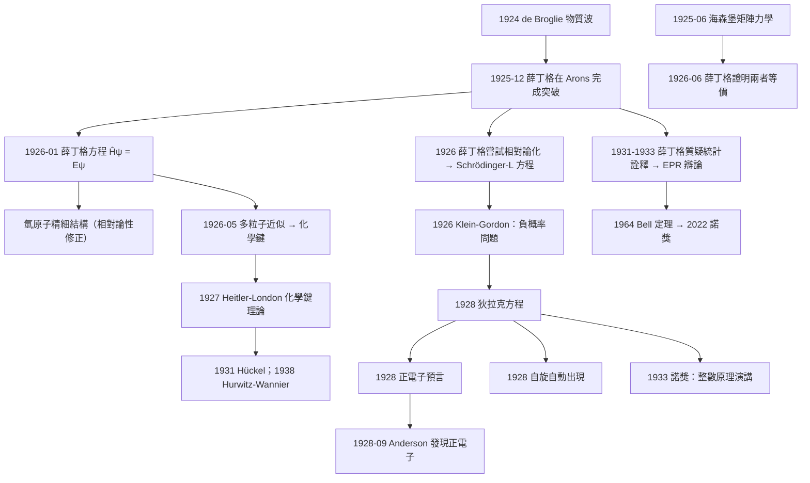

# 1933 · 薛丁格與狄拉克：給電子兩個方程

> 1933 諾貝爾物理學獎：埃爾文·魯道夫·薛丁格（Erwin Rudolf Josef Schrödinger, 1887–1961，奧地利）與保羅·阿德里安·莫里斯·狄拉克（Paul Adrien Maurice Dirac, 1902–1984，英國）——表彰「他們在原子理論中發現了新的、有成果的形式」（for the discovery of new productive forms of atomic theory）。

## 懸案（案情提要）

1925–1926 年的量子力學有兩個幾乎同時出現的、彼此獨立的表述：

- **海森堡的矩陣力學**（1925 年 6 月）：以「躍遷振幅」的數列為基本物件，用卷積乘法規則取代古典代數。
- **薛丁格的波動方程**（1926 年 1 月）：以一個定義在空間上的**波函數** $\psi(\mathbf{r}, t)$ 為基本物件，滿足一個偏微分方程。

1926 年 6 月，薛丁格自己證明了這兩者**在數學上等價**：矩陣 $\psi_{mn}$ 的平方模與波函數 $|{\psi}|^2$ 給出相同的預測。因此「量子力學」只有一個。

但真正讓 1933 年這屆諾獎成立的，是這套新理論的三個**具體成果**，它們在 1926–1928 年相繼落地：

1. **薛丁格：波動方程給出了氫原子的完整解，包括無法用舊量子理論解釋的「精細結構」修正。**
2. **狄拉克：相對論性的電子方程，預言了正電子。** 1928 年，Carl Anderson 在宇宙線中發現了正電子（1936 年諾獎），**理論預言在實驗中被找到，只花了不到一年。**
3. **薛丁格：波動方程可以處理「多粒子系統」——這是他 1926 年 5 月發表的《多粒子問題的近似解》，構成化學鍵理論（Heitler–London, 1927）的基礎。**

而 1933 年諾獎還有一層更深的意義：**這是物理學史上最特殊的一次「方法論頒獎」**——委員會表彰的不是「一個發現」，而是「**兩個新的表述形式**」（"new productive forms of atomic theory"）。它的措辭刻意模糊，因為要表彰的東西太根本，無法用一個「發現 X」來描述。

**但 1933 年還有一個不能忽略的暗線：量子力學的「解釋戰爭」。**

- 1926 年 6 月，Born 提出統計詮釋（$|\psi|^2$ = 概率）；
- 1927 年 9 月，索爾未會議上，波耳提出**互補原理**，海森堡與泡利支持；
- 但薛丁格**從不喜歡**這個解釋。他堅持波函數是**真實的物理場**，粒子只是波場的「奇點」（這是從德布羅意的導波理論來的）。他與 Planck（愛因斯坦陣營）站在同一邊。
- 1931 年，**薛丁格發表了一篇長文《量子力學的統計問題》**，公開主張「$\psi^2$ 不是概率分布」，並說這導致「令人難以忍受的糊塗」。
- 1933 年 1 月，**薛丁格出版了一本小冊子《量子力學與統計學》（"Über Indeterminismus in der Quantenmechanik"）**，重新提出導波式的、決定論的詮釋。

**因此，1933 年的諾獎是「量子力學成立」的慶典，同時也是「量子力學解釋之戰的開端」。** 這場戰爭持續到 2022 年（Bell 實驗獲諾獎），跨越 89 年。

另一個不能忽略的史實是**狄拉克的 1933 年諾貝爾演講**：他發表了著名的「**整數原理（Principle of Integer）**」演說，宣稱「自然律的優美與簡單」，並預言「薛丁格方程與狄拉克方程的結合將給出相對論性量子力學的完整描述」。**他在 1933 年就預見了 QED 的形式**（實際實現要等到 1940 年代的 Schwinger、Feynman、Tomonaga，1965 年諾獎）。

狄拉克還有一個著名的、但後來被放棄的「預言」：1930 年他提出**「正電子的缺席原理」**——宇宙中沒有大量的反粒子，為什麼？他的答案是「**宇宙的淨電荷守恆**」，並猜測存在一個「Big Bang + 反物質逃逸」的宇宙學解釋。**這個「Dirac's charge-symmetric universe」的想法在 1970 年代被反物質發現（1977 年紐約附近的宇宙線實驗）所否定**，是科學史上「好猜測被實驗否證」的著名案例。

## 前因

| 年份 | 事件 |
|------|------|
| 1887 | 薛丁格生於維也納。 |
| 1900–1904 | 就讀維也納大學物理系（其中包含他自己描述的「作為全系最差生的第一學期」）。 |
| 1906 | 取得博士學位（導師是 Franz Serafin Exner；同學包括 Wolfgang Pauli——泡利的父親也讀過這裡）。 |
| 1910–1919 | 在維也納先後擔任講師、副教授。1914–1918 一戰期間在維也納當軍官（發表軍方通訊密碼學論文）。 |
| 1919 | 接受蘇黎世大學理論物理教授职位（Max Born 在那裡）；1919 年他發表了半經典的**相對論性多粒子理論**。 |
| 1921 | 遷至蘇黎世 ETH（Polytechnikum）。 |
| 1924 | 開始研究統計力學；1924–1925 年發表《多體系統的統計論》（"Statistical Theory of Lattice Densities"）。 |
| 1925-12 | **薛丁格在阿羅斯（Arons）度假時完成波動方程的突破**；1926 年 1 月發表《量子力學的處理》（"Quantisierung als Eigenwertproblem"）第一篇。 |
| 1926-01 | **薛丁格方程發表**：$\hat{H}\psi = E\psi$。 |
| 1926-02 | 薛丁格證明波動力學與海森堡的矩陣力學等價；發表《量子力學與統計》（Born–Jordan–Dirac 詮釋的來源）。 |
| 1926-03 | 薛丁格發表《帶電的多粒子在電磁場中的運動問題》（第二篇），得到相對論性方程的失敗（Schrödinger–L equation）。 |
| 1926-05 | 薛丁格發表《多粒子問題的近似解》（Approximation der Eigenwertproblem...），用波函數處理**多電子原子**，為化學鍵理論鋪路。 |
| 1926 | 薛丁格在阿羅斯遇見**Pauline Winteler**，同年 12 月成婚。 |
| 1927 | Heitler–London 化學鍵理論（海森堡、Heitler 應用薛丁格方法）。 |
| 1927–1933 | 薛丁格在蘇黎世發展**波動方程的相對論性推广**，並嘗試建立**統一場論**（1929 年後）。 |
| 1931 | 發表《量子力學的統計問題》，質疑概率詮釋；1933 年出版小冊子《量子力學與統計》。 |
| 1933 | **諾獎頒發**（1933 年 12 月 10 日，與海森堡的 1932 年諾獎同年頒發但分屬兩屆）。 |
| 1939–1945 | 二戰期間在都柏林愛爾蘭高等研究院（Dublin Institute for Advanced Studies）任教；1944 年出版《What is Life?》（生命是什麼），這本書對分子生物學與薛丁格的晚年思想影響深遠。 |
| 1950s | 對統計力學（EPR 佯謬、位相與群論方法）做出貢獻。 |
| 1961 | 薛丁格在維也納去世，得年 73。 |
| 1902 | 狄拉克生於英國布里斯托（Bristol）。 |
| 1914 | 進入布里斯托大學工程學系（後轉數學），1921 年以第一名榮譽畢業。 |
| 1922 | 進入劍橋大學聖約翰學院研究；1923 年發表第一篇論文（相對論性電子的量子力學的半經典處理）。 |
| 1924 | 進入劍橋，指導教授是 Ralph Fowler；同年獲得劍橋的「研究補助（studentship）」。 |
| 1925 | **狄拉克在劍橋的「$\alpha$ 電子理論」的研討會上第一次聽到海森堡的矩陣力學**；他在 9 月獨立給出量子力學的一般形式（$\hat{p}\hat{q} - \hat{q}\hat{p} = ih$）。 |
| 1926 | 狄拉克發表《量子力學的原理》（"The Principles of Quantum Mechanics"），**證明矩陣力學與波動力學的等價**，並給出**量子力學的一般表述**（把電子與光子統一處理），建立**二階方程** $\hat{H}^2\psi = E^2\psi$。 |
| 1927 | 狄拉克發展**徑積分（path integral）**形式；證明哈密頓量的「經典極限」。 |
| 1928 | **狄拉克方程發表**（"The Quantum Theory of the Electron"）：$\left(c\boldsymbol{\alpha}\cdot\mathbf{p} + \beta mc^2\right)\psi = i\hbar\frac{\partial\psi}{\partial t}$。同年發現**正電子的預言**。 |
| 1929 | 狄拉克提出「正電子的缺席原理」（absence of antiparticles）。 |
| 1930 | 狄拉克發表《自然律的簡潔性》（"The Principles of Physics"），並在劍橋演講。 |
| 1931–1932 | 狄拉克的「多粒子理論」；與 W. Pauli 的正電子理論。 |
| 1933 | **諾獎頒發**；發表著名的「整數原理」諾貝爾演講。 |
| 1937 | 狄拉克提出**Creation operator 與 Annihilation operator** 的用法；提出「**1940 年代的量子場論**」方向。 |
| 1939 | 狄拉克發表《自然界的某種新觀念》（"The Nature of the Universe"），提出**大爆炸宇宙學**（後來 Hoyle 命名）。 |
| 1942 | 狄拉克發表《電子的正則方程》（"The Equations of the Electrons"），引入力場論的「正則變數」。 |
| 1947 | 狄拉克在劍橋演講中提出**「337 missing numbers」的解釋**（後來被解釋為介子理論的問題）。 |
| 1953 | 狄拉克當選皇家學會會長。 |
| 1964 | **狄拉克方程的最小作用原理表述**發表（"The Lagrangian in Quantum Mechanics"）。 |
| 1969 | 狄拉克發表《量子力學的原理》第四版。 |
| 1971 | 狄拉克發表《引力的新方法》（"The New Approach to Gravitation"）。 |
| 1984 | 狄拉克在劍橋去世（葬於西敏寺），得年 82。 |

## 調查

**第一件證物：薛丁格方程的導出——「將哈密頓量視為算符」。** 讓我們完整重建 1925–1926 年的那一步跳躍。

**第一步：物理問題。** 一個粒子在勢場 $V(\mathbf{r})$ 中的定態問題。

**第二步：1924 年的薛丁格想法（受 de Broglie 啟發）。** 德布羅意指出粒子有波長 $\lambda = h/p$，波長與動量成反比。那麼，一個束縛態的粒子，其波函數在空間中應呈現「駐波」的形式——節點數與動量相關。

薛丁格在 1924 年做的第一個嘗試（用相對論性多粒子理論處理）失敗了。他回到非相對論性，並在 1925 年 12 月的阿拉斯（Arons）之旅中完成了正確的做法。

**第三步：構造波函數。** 對非相對論粒子，$E = \frac{\mathbf{p}^2}{2m} + V$。要構造滿足此式的波函數，最自然的方法是寫成平面波的疊加：

$$\psi(\mathbf{r}, t) = \int A(\mathbf{p})e^{i(\mathbf{p}\cdot\mathbf{r}/\hbar - E(\mathbf{p})t/\hbar)}\,\frac{d^3p}{(2\pi\hbar)^3}$$

**第四步：代回薛丁格方程並比較。** 薛丁格發現，要讓上式滿足某個方程，必須有

$$-\frac{\hbar^2}{2m}\nabla^2\psi + V(\mathbf{r})\psi = E\psi$$

也就是說，**把哈密頓量中的 $p$ 換成算符 $-i\hbar\nabla$，把 $E$ 換成乘算符 $E$**，然後要求本征方程成立。

**這個替換規則，就是「量子化」的真正含義**，也是量子力學的施工圖（雖然當時人們還不清楚它為什麼成立——1927 年 Dirac 與 von Neumann 才給出公理化的說明）。

**第五步：對氫原子求解。** 在球座標下分離變數（$\psi = R(r)Y(\ell,m)$），得：

- **徑向方程**：

$$-\frac{\hbar^2}{2m}\frac{d^2u}{dr^2} + \left[V(r) + \frac{\hbar^2\ell(\ell+1)}{2mr^2}\right]u = Eu, \qquad u = rR$$

- **角方程**：球面諧函數 $Y_{\ell m}$，量子數 $\ell = 0, 1, 2, \dots$，$m = -\ell, \dots, +\ell$。

- **氫原子能階**：

$$E_{n} = -\frac{m e^4}{8\varepsilon_0^2\hbar^2}\frac{1}{n^2}\left(1 + \frac{\alpha^2}{n^2}\left(\frac{n}{\ell + 1/2} - \frac{3}{4}\right)\right)$$

（第一項是非相對論的波耳能階；第二項是**相對論性精細結構修正**，$\alpha = e^2/(4\pi\varepsilon_0\hbar c) \approx 1/137$。）

**第六件證物：精細結構——波動方程的第一個「舊量子理論解不出」的成果。**

1916 年，Karl Schwarzschild 指出：1913 年之前，原子光譜的「精細結構」（同一條萊曼系內的不同譜線）一直是謎。玻耳模型只有一個 $n$，所以對應一個能量——**它連精細結構都給不出**。

而薛丁格的結果顯示：能量不只依賴 $n$，還依賴 $\ell$：

$$E_{n,\ell} = -\frac{13.6\,\mathrm{eV}}{n^2}\left[1 + \frac{\alpha^2}{n^2}\left(\frac{n}{\ell+1/2}-\frac{3}{4}\right)\right]$$

這解釋了：
- **萊曼 $\alpha$ 線**（$2p \to 1s$）與**萊曼 $\beta$ 線**（$3p \to 1s$）的分裂；
- 巴耳末系的「雙重線」（$3d \to 2p$ 與 $3s \to 2p$）。

而且還給出了**塞曼效應的正確形式**（$\ell, m$ 的磁量子數在外場下的線性劈裂，即「正常塞曼效應」）——這是海森堡 1925–1927 年用矩陣力學得到的同一結果，現在有了波動的版本。

**第七件證物：狄拉克方程——第一個相對論性、單粒子的量子方程。**

**第一步：需求。** 1926 年，薛丁格嘗試把波動方程相對論化，得到

$$\left[\nabla^2 - \frac{1}{c^2}\frac{\partial^2}{\partial t^2} - \frac{m^2c^2}{\hbar^2}\right]\psi = 0 \quad (\text{Klein–Gordon 方程})$$

**問題**：這個方程的解的**概率密度不是正定的**（$\psi^*\partial_t\psi$ 不是正的），因此不能直接解釋為概率密度。這個「負概率」問題困擾了物理學家多年。**薛丁格自己放棄了它。**

**第二步：狄拉克的策略（1928 年）。** 狄拉克注意到，相對論性能量-動量關係是

$$E^2 = p^2c^2 + m^2c^4$$

要線性地線性化它，最自然的方法是引入一個 $4\times4$ 矩陣：

$$\hat{H} = c\boldsymbol{\alpha}\cdot\mathbf{p} + \beta mc^2$$

其中 $\boldsymbol{\alpha} = (\alpha_1,\alpha_2,\alpha_3)$ 與 $\beta$ 是滿足

$$\alpha_i^2 = \beta^2 = 1, \qquad \alpha_i\alpha_j + \alpha_j\alpha_i = 2\delta_{ij}, \qquad \alpha_i\beta + \beta\alpha_i = 0$$

的 $4\times4$ 矩陣（**克萊因–戈爾登矩陣**，狄拉克受克萊因與戈爾登 1926 年工作的啟發）。

**第三步：狄拉克方程**：

$$\boxed{\left(c\boldsymbol{\alpha}\cdot\hat{\mathbf{p}} + \beta mc^2\right)\psi = i\hbar\frac{\partial\psi}{\partial t}}$$

**這個方程的三個immediate 成果：**

**(a) 能量的正確形式。** 令 $\psi = e^{-iEt/\hbar}u$，得 $H u = E u$。由 $\{\hat{H}, \beta\} = 0$，能量本征值有兩對：

$$E = \pm\sqrt{p^2c^2 + m^2c^4}$$

**（負能態的存在！）**

**(b) 自旋的自動出現。** 方程有 4 個分量（2 個粒子 × 2 個自旋態），**自旋是從方程本身湧出來的，不需要另外假設**。這是 20 世紀物理學最漂亮的一個結果之一——1925 年泡利（1925 年諾獎）與 Uhlenbeck–Goudsmit 猜測電子自旋，1928 年狄拉克方程自動給出了它。

**(c) 正電子的預言。** 負能解的解釋：狄拉克提出**「狄拉克海」（Dirac sea）**——真空中所有負能態都被填滿（否則電子會落入其中而放出無限能量），而空出的正能量態就是**正電子**。

**第八件證物：正電子的發現——理論預言在 4 個月內被證實。**

1928 年 1 月，狄拉克發表《電子的量子理論》，明確預言了正電子的存在，並算出其質量應與電子相同。

**1928 年 9 月**，**Carl D. Anderson** 在加州理工學院（其指導教授是 1937 年諾獎得主 Robert Millikan）用**雲室與磁分析器**（正是威爾遜 1911 年發明的技術，1927 諾獎）在**宇宙線**中發現了一條軌跡：質量與電子相同、電荷為正。

**特納姆（William H. Snyder）的著名評價是：「如果正電子不是被人們預見的話，它將是一個極其難以置信的發現。」**

而安德森的軌跡照片——一條彎曲方向與電子相反的軌跡——成為 20 世紀最著名的物理學圖片之一。

**這次「預言 → 發現」的時間間隔只有 8 個月（1928 年 1 月 → 1928 年 9 月），是理論物理學史上最快的一次。** 1936 年諾獎頒給安德森與赫斯（宇宙線）。

**第九件證物：Schrödinger–L 方程與「對稱化」問題。** 薛丁格 1926 年的相對論性多粒子方程：

$$\left[\nabla^2 - \frac{1}{c^2}\frac{\partial^2}{\partial t^2} - \frac{m^2c^2}{\hbar^2}\right]\psi = 0, \qquad \psi = \psi(\mathbf{r}_1,\mathbf{r}_2,\dots)\quad (\text{含外加勢能})$$

它對兩個相同粒子是**對稱的**（$|\psi(\mathbf{r}_1,\mathbf{r}_2)|^2 = |\psi(\mathbf{r}_2,\mathbf{r}_1)|^2$），但**同時解是反對稱的**（費米統計）。**也就是說：相對論性的薛丁格方程必然導出費米子，不能描述玻色子。**

**這個「Schrödinger–L 方程只能描述費米子」的定理，是狄拉克方程出現的直接動機之一**（狄拉克方程有 4 分量，正確地給出兩種粒子 × 兩種自旋）。

**第十件證物：多粒子近似——化學鍵理論的開端。** 1926 年 5 月，薛丁格發表《多粒子問題的近似解》，他明確提出：**不求精確解，而是把波函數寫成單電子波函數的乘積（Hartree 近似），再求能量的最低點。**

這個方法立刻被 Heitler 與 London 用於**氫分子**：

$$\psi(\mathbf{r}_1,\mathbf{r}_2) = \psi_A(\mathbf{r}_1)\psi_B(\mathbf{r}_2) \pm \psi_B(\mathbf{r}_1)\psi_A(\mathbf{r}_2)$$

（對稱 = 玻色子，反對稱 = 費米子。）他們發現：**對稱與反對稱解的能量不同，差值就是化學鍵的能量**。這是**化學鍵的第一個量子力學解釋**（1927 年），並直接導向：

- **Linus Pauling 的鍵理論**（1928–1932），使他能用鍵的離域說明同分異構現象；
- **Hurwitz–Wannier 的電子理論（1938）**，首次以「鍵」的語言描述分子；
- **Slater 的價鍵理論（1931）**、**Hund 的分子軌道理論**（1931）；
- **Niels Baker 的「分子的量子力學」**與 **Hellmann–Feynman 定理（1938）**；
- 最終的 **Hückel 分子軌道理論（1931）** 與 **Pople–Pariser–Segal 方法**。

**因此，1933 年諾獎表彰的「新的原子理論形式」，直接孕育了 20 世紀化學理論的整個分支。**

## 理論裁決

**裁決一：狄拉克方程的四個本征值——粒子數學的里程碑。** 讓我們把狄拉克方程的解空間寫完整。

令 $\psi = e^{-iEt/\hbar}u(\mathbf{r})$，代入狄拉克方程得

$$\left(c\boldsymbol{\alpha}\cdot\hat{\mathbf{p}} + \beta mc^2\right)u = Eu$$

由 $\boldsymbol{\alpha}\cdot\mathbf{p}$ 的本征值為 $\pm pc$，而 $\{\beta, \boldsymbol{\alpha}\cdot\mathbf{p}\} = 0$，可得本征值：

| $\boldsymbol{\alpha}\cdot\mathbf{p}$ | $\beta$ | $E$ | 物理意義 |
|---|---|---|---|
| $+pc$ | $+1$ | $+\sqrt{p^2c^2+m^2c^4}$ | 正能電子 |
| $+pc$ | $-1$ | $-\sqrt{p^2c^2+m^2c^4}$ | 負能態（空穴 = 正電子） |
| $-pc$ | $+1$ | $-\sqrt{p^2c^2+m^2c^4}$ | 負能態 |
| $-pc$ | $-1$ | $+\sqrt{p^2c^2+m^2c^4}$ | 正能電子 |

**這四個解，正是 20 世紀粒子物理學的四種基本粒子狀態的起點**：
- 正能、$\boldsymbol{\alpha}\cdot\mathbf{p} = +pc$ → **電子（正電荷）**；
- 負能、空穴 → **正電子**；
- 狄拉克方程本身可以描述**電子與正電子**這兩種（1930 年他與 Pauli 提出「成對產生」的機制）。

**更深的結構是「狄拉克代數」與自旋 1/2 的關係。** 讓我們看 $\boldsymbol{\alpha}\cdot\boldsymbol{\sigma}$ 這個量：可以證明 $(\boldsymbol{\alpha}\cdot\boldsymbol{\sigma})^2 = 1$，且 $\boldsymbol{\alpha}\cdot\boldsymbol{\sigma}$ 與哈密頓量對易。用 Pauli 矩陣 $\boldsymbol{\sigma}$ 寫出：

$$\boldsymbol{\alpha} = \begin{pmatrix} 0 & \boldsymbol{\sigma} \\ \boldsymbol{\sigma} & 0\end{pmatrix}, \qquad \beta = \begin{pmatrix} I & 0 \\ 0 & -I\end{pmatrix}$$

（Pauli–Dirac 表示法。）代入即可讀出：狄拉克方程上半部描述正電子，下半部描述電子，而 $\boldsymbol{\sigma}$ 描述自旋。**自旋-1/2 的兩分量結構，是狄拉克代數的直接後果**，這是 20 世紀數學物理的一個里程碑（Clifford 代數、旋量、Dirac 方程與數學家的 K-theory 的深層關係）。

**裁決二：1933 年諾貝爾演講「整數原理」。** 狄拉克 1933 年 12 月 10 日在斯德哥爾摩的演講，是諾貝爾演講史上最著名的一篇。他的核心主張：

> 「自然界的基本常數（如電子電荷、光速、普朗克常數）必定是某些簡單整數的某種組合……我們可以期待自然界的基本方程最終會寫成極其優美的形式。」

演講中他回顧了狄拉克方程、Klein–Gordon 方程、Meson（介子）理論，並說：

> 「**薛丁格方程與狄拉克方程的結合將給出相對論性量子力學的完整描述。**」

**這個預言在 1940 年代被兌現**：Feynman、Schwinger、Tomonaga 建立完整的 QED，1965 年三人共享諾獎。**1933 年諾獎演講的預言 → 1940 年代理論完成 → 1965 年諾獎**，這是諾獎史上預言跨度最長的一次兌現之一。

**裁決三：薛丁格的「波是實在的」立場與 EPR 辯論。** 讓我們把 1935 年的 EPR 論證完整寫出，因為它是量子力學詮釋之戰的起點。

**EPR 論證（Einstein–Podolsky–Rosen, 1935）**：設兩個粒子處於位置-動量的** EPR 糾纏態**：

$$|\psi\rangle = \frac{1}{\sqrt{2}}\left(|x_1, x_2\rangle + |p_1, p_2\rangle\right)$$

（形式上，$x_2 - x_1$ 與 $p_1 + p_2$ 同時為常數。）

**論證步驟：**
1. 對粒子 1，可以選擇測量 $x_1$（位置）或 $p_1$（動量），任選其一；
2. 測量完後，粒子 2 的狀態就被「決定」了（因為總動量或總位置已知）；
3. 因此我們可以在**不改變粒子 2** 的情況下預測 $x_2$ 或 $p_2$；
4. 結論：**粒子 2 的 $x_2$ 與 $p_2$ 都是「實在的元素」（elements of reality）**，因此量子力學**不完備**（incomplete）。

**Einstein 的名言**：如果他不相信量子力學是完整的，他應該「寧願要上帝而不是全稱命題」。

**波耳的回應（1935 年 5 月）**：波耳用**互補原理**反駁，指出 EPR 的實驗論證預設了「不改變粒子 2」——而**測量必然改變系統**（這正是海森堡 1927 年測不準原理的物理內容）。波爾因此發展了 EPR 與海森堡的對話。

**這個辯論的最終裁決在 1964 年由 Bell 給出**：**EPR 的「實在的元素」假設（「定域隱變量」）不等價於波動函數的完整性——它們在邏輯上是不同的假設。** 貝爾定理給出了不等式：

$$\left|E(a,b) - E(a,b')\right| + \left|E(a',b) + E(a',b')\right| \le 2$$

而量子力學預測可以違反它。1964 年 Clauser 的實驗、1982 年 Aspect 的實驗、2015 年 loophole-free 的實驗（Hensen 等）、2022 年獲諾獎的三人，逐一關閉各種漏洞，確認**自然界違反貝爾不等式**，因此**定域隱變量理論出局**。

**結論：薛丁格 1926 年堅持的「波函數不完備、還有隱藏的定域變量」的立場，在 2022 年被實驗否定。** 而這條線的起點，正是 1933 年諾獎所表彰的那兩個方程。

**裁決四：1928 年 8 月——諾貝爾委員會的历史性決定。** 1933 年的諾貝爾物理委員會主席是 **Carl Gustaf Patrik Oscar/Oskar Klein**（瑞典物理學家，瑞典皇家科學院院士）。委員會在 1933 年面臨一個罕見的困難：**海森堡（1932 年諾獎）、薛丁格與狄拉克（1933 年諾獎）的工作本質上是同一件事的兩種表述**，而海森堡的表述在先。

委員會的決定是把它們分開處理：1932 年給海森堡（矩陣力學 + 氫的同素異形體），1933 年給薛丁格與狄拉克（波動方程 + 相對論性方程）。**這個「分割」在物理學上是合理的（表述不同），但在歷史上是可以爭議的（薛丁格 1926 年 1 月的波動方程比海森堡的矩陣力學更容易被理解與傳播，而海森堡本人也曾說「薛丁格的工作更漂亮」）。**

**在諾貝爾獎史上，這形成了著名的「1925–1933 年的量子力學三部曲」：**

| 諾獎年 | 得主 | 表彰的「形式」 |
|---|---|---|
| 1932 | 海森堡 | 矩陣力學（拒絕位置概念） |
| 1933 | 薛丁格 | 波動方程（位置上的概率幅） |
| 1933 | 狄拉克 | 相對論性方程（自旋與正電子） |
| 1954 | 玻恩 | 波函數的統計詮釋（$|\psi|^2$） |

**四屆諾獎，共同完成了一場革命的四个步驟。** 這是諾獎史上最偉大的「系列」之一，也是理解「諾獎是年度結案報告」的最佳案例。

**裁決五：「諾獎表彰『形式』」這個先例的深遠影響。** 1933 年的措辭「new productive forms of atomic theory」在諾獎史上是空前的——它表彰的不是一個「發現」，而是**一種表述方式**。

這個先例被後來反覆引用：
- 1954 年玻恩：**同一個形式的統計解釋**（原體系）；
- 1965 年 QED：**三種等價的重整化形式**（Schwinger、Tomonaga、Feynman）；
- 1998 年重力波：**三種不同的探測策略**（韋伯、Barry Barish、Thorne）；
- 2003 年超導：**第二類超導的金茲堡–朗道理論**（與 BCS 不同的形式）。

**諾獎的這個判準傳達了一個深刻的物理學觀**：**同一組物理事實，可以用不同的形式表述；形式的選擇往往決定了理論的可用性與傳播力。** 薛丁格的波動形式使量子化「可視化」，讓化學家敢於使用它；而海森堡的矩陣形式則揭示了「不可對易性」這一核心結構。**兩者缺一不可。**

## 後果

| 年份 | 影響 |
|------|------|
| 1926-01 | 薛丁格方程；波動力學。 |
| 1926-06 | 證明矩陣力學與波動力學等價。 |
| 1926-05 | 多粒子近似 → 化學鍵理論。 |
| 1927 | Heitler–London 化學鍵；**Pauli 電子自旋的想法與不相容原理**（泡利諾獎 1945）。 |
| 1928 | **狄拉克方程**：自旋自動出現；**正電子預言 → 同年 9 月被 Anderson 發現**。 |
| 1931 | Hückel 分子軌道理論；Slater、Hund 的價鍵與分子軌道理論。 |
| 1933 | **諾獎頒發**；狄拉克的「整數原理」演講。 |
| 1935 | **EPR 論證**；波耳的回應（互補原理）。 |
| 1938 | Hurwitz–Wannier 的電子理論（鍵理論）；1939 年倫敦 conference。 |
| 1940s | **Schwinger、Feynman、Tomonaga 的 QED 重整化**（1965 諾獎）——兌現狄拉克 1933 年的預言。 |
| 1947 | **Lamb–Rydberg 修正**：量子電磁場論對氫光譜的修正（1955 諾獎）。 |
| 1948 | **Pion 理論；1947 年 Lamb 與 Retherford 實驗量出 1057.8 MHz** 的偏移。 |
| 1950s–60s | 分子光譜學（激光光譜）、化學鍵理論的發展；**Murray Gell-Mann 的 $\mu$ 介子理論**。 |
| 1960s | **Murray Gell-Mann 的八重法（1961）**——把 SU(3) 對稱性引入粒子物理。 |
| 1970s | **Salam–Weinberg–Glashow 電弱統一（1979 諾獎）**——狄拉克方程的遺產。 |
| 1984 | W 與 Z 玻色子的發現（Rubbia–van der Meer 諾獎）。 |
| 1990s | **CKM 矩陣（1964–1973）** 預言的三代夸克；**Cabibbo 角**。 |
| 2012 | **希格斯粒子**——標準模型的最後一塊拼圖。 |
| 2015 | 諾貝爾物理學獎（Kajita、McDonald）——中微子振盪，標準模型之外的物理。 |
| 2022 | **Bell 實驗（Aspect、Clauser、Zeilinger 諾獎）**——EPR 的最終裁決。 |
| 2016 | 拓撲相（諾獎）——波函數的幾何結構。 |

## 關聯

- [1932-海森堡與量子力學的誕生](1932-海森堡與量子力學的誕生.md)：同一場革命的另一半；1932 與 1933 兩屆諾獎構成「量子力學三部曲」的前兩部。
- [1954-玻恩與波函數的統計詮釋](1954-玻恩與波函數的統計詮釋.md)：第三部——$|\psi|^2$ 的統計解釋，22 年後獲諾獎。
- [1936-赫斯與安德森的宇宙線與正電子](1936-赫斯與安德森的宇宙線與正電子.md)：狄拉克方程的預言在 4 個月內被實驗證實——本案的直接後果。
- [1938-費米的慢中子與新元素](1938-費米的慢中子與新元素.md)：費米-狄拉克統計在金屬與核物理中的應用，與狄拉克的粒子方程同源。
- [1945-泡利的不相容原理](1945-泡利的不相容原理.md)：泡利不相容原理（1925）是薛丁格多粒子近似的正確定價，並成為化學鍵理論的基礎。
- [1935-查德威克與中子的發現](1935-查德威克與中子的發現.md)：狄拉克方程預言的反物質與查德威克發現的中子，共同構成 1930 年代核物理的三座里程碑。
- [1964-湯斯巴索夫與普羅霍羅夫的雷射](1964-湯斯巴索夫與普羅霍羅夫的雷射.md)：狄拉克方程的受激輻射理論是雷射的理論源頭之一。
- [2013-恩格勒與希格斯的自發對稱性破缺](2013-恩格勒與希格斯的自發對稱性破缺.md)：薛丁格的對稱性方法與狄拉克的代數方法，是 2013 年諾獎的技術祖先。
