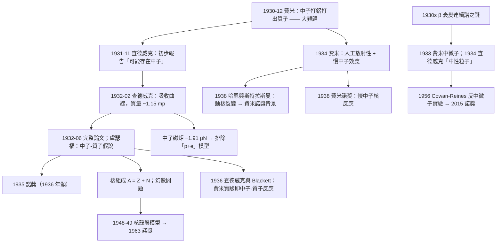

# 1935 · 查德威克：原子核裡還藏著一顆粒子

> 1935 諾貝爾物理學獎：詹姆斯·查德威克（Sir James Chadwick, 1891–1974，英國）——表彰「他發現了中子」（for the discovery of the neutron）。

## 懸案（案情提要）

1930 年是核物理的「暴力之年」。歐洲的物理學家們正忙於三場獨立的追捕：

- **約翰·科克饒夫**（John Cockcroft，劍橋，1932 年與沃吞一起獲 1951 年諾獎）與 **歐尼斯特·沃吞**（Ernest Walton，都柏林）在 1932 年 1 月用**人工加速的質子**轟擊鋰核，實現了第一次人工核嬗變：

$${}^{7}\mathrm{Li} + {}^{1}\mathrm{H} \to 2\,{}^{4}\mathrm{He} + 17.3\,\mathrm{MeV}$$

- **歐尼斯特·勞倫斯**（Ernest Lawrence，1939 年諾獎）在美國用**迴旋加速器**加速質子與氘核。
- **費米**（1938 諾獎，1934 年起）在義大利用**中子**轟擊元素，發現了一系列人工放射性元素。

但 1930 年 12 月，**一個徹底的謎團出現了**。

**費米的實驗 Puzzle：** 當他用中子轟擊**鋁（Al, $Z=13$）**時，發現鋁並不只發出 $\beta$ 射線（電子），還發出了**質子**（$\alpha$ 粒子之外的第 3 種帶電粒子）。**這意味著中子打在鋁上，撞出了質子——一個中性粒子把帶正電的質子從核裡「打」了出來。**

這在核物理裡是完全不可思議的：**它意味著中子不是「某種質子」或「某種質子加電子」的組合，而是一種全新的、獨立的粒子。**

費米把這個謎團帶到了劍橋。

**劍橋的追捕隊伍：** 1932 年初，**詹姆斯·查德威克**（盧瑟福在劍橋 Cavendish 的實驗室主任，1919 年起追蹤盧瑟福）被指派研究這個謎題。他面對的物理問題是：

**用什麼方法能偵測質子？** 答案是：**雲室**（威爾遜 1911 年的發明，1927 年諾獎）。在雲室裡，質子會留下比電子更粗、更短、更亮的軌跡（因為質量大、速度慢、電離能力不同）。

但查德威克面對的實驗難題是：**他如何知道雲室中看到的那條粗軌跡是「質子」而不是「氫原子」或某種其他東西？** 更根本的：**他要找的是「被中子打出來的粒子」——他必須確認入射的是中子，且散射出的粒子是質子。**

查德威克的實驗安排極其精巧：

1. 用**鐳-鈹（Ra-Be）源**產生中子：$\alpha$ 粒子打擊鈹（${}^{9}\mathrm{Be}$），產生中子。
2. 用**石蠟**把中子減速（費米 1934 年發現的「慢中子效應」——石蠟中的氫核像「剎車片」），以產生**熱中子**。
3. 在不同厚度的**石蠟吸收體**後放置**雲室**，觀測是否出現質子軌跡。

**查德威克的關鍵量測（1932 年 2 月的《Nature》論文《Possible Existence of a Neutron》）：**

他把吸收體的厚度從 0 增加到約 10 cm，並數出雲室中質子軌跡的數量。數據顯示：

- 在 0 cm 處，質子數目極多（因為中子未減速，能量高，打出質子的截面大）；
- 隨著吸收體加厚，**質子數目按照 $\exp(-\Sigma x)$ 指數衰減**（中子被吸收）；
- **但當吸收體厚度超過某個臨界值時，質子數目反而開始「回升」**——因為此時只剩下**慢中子**（能量低、散射截面大的那一類），它們更容易打出質子。

**查德威克把這條「質子數目 vs 吸收體厚度」的曲線外推，發現它指向一個明確的結論：那個使質子產額回升的「中子」，其性質與 α 粒子、質子都不同——它質量約等於質子，電荷為零。**

**1932 年 6 月，查德威克發表完整論文《中子的存在》（"Possible Existence of a Neutron"），提出中子的質量約為 1.15 倍質子質量，並於 1932 年 8 月在《Proceedings of the Royal Society》發表完整的論證。**

**1935 年諾貝爾獎頒給他，理由正是「發現中子」。**

而中子的發現，其意義遠超「多了一種粒子」：

1. **它解開了原子核質量的謎題。** 此前，原子核的質量數 $A$ 與原子序 $Z$ 不符（$A \sim 2Z$），化學家無法解釋為什麼。**有了中子，核子組成是 $Z$ 個質子 + $N$ 個中子**，質量數 $A = Z + N$；而「為什麼 $N \approx Z$」成為一個可研究的問題（後來由核殼層模型回答，1963 年諾獎）。
2. **它打開了核裂變的可能性。** 1938 年 12 月，**哈恩（Otto Hahn）與斯特拉斯曼（Fritz Strassmann）**發現用中子轟擊鈾會產生鋇——核裂變。而**費米 1934 年的慢中子實驗正是這一切的起點**，而費米當時用的正是查德威克發現的中子。
3. **它是核物理與粒子物理的分水嶺。** 中子是最早發現的「重子」，也是 1960 年代粒子物理的主要對象（1964 年諾獎：維格納的對稱性原理、格佩特-梅耶與延森的核殼層模型）。
4. **它是 1938 年費米諾獎的基礎**——費米諾獎的表彰理由明確寫著「關於**慢中子**引發的核反應的發現」。

而且中子的發現也是**諾獎史上的一個特例**：**查德威克在 1932 年就做了這個發現，但 1935 年的諾獎頒發時，他正在做的是完全不同的研究（1934 年起研究原子核的 $\beta$ 射線能譜，試圖證明「中子-質子假說」——即電子是在核內產生的，這個想法後來是錯的）。**

## 前因

| 年份 | 事件 |
|------|------|
| 1891 | 查德威克生於英國 Bollington, Cheshire；父親是曼徹斯特的市政工程師。 |
| 1911 | 進入曼徹斯特大學，在盧瑟福（1908 化學獎、1911 諾獎）指導下做放射性的研究。 |
| 1912 | 隨盧瑟福遷至劍橋 Cavendish；1913 年成為劍橋的 Squire 比爾斯 lectureship。 |
| 1914–1918 | 一戰期間在皇家海軍從事反潛水艇研究（聲學與水雷），戰爭成為他科學生涯的重要分水嶺。 |
| 1919–1921 | 在劍橋繼續放射性的研究。 |
| 1921–1923 | 在美國加州理工學院（與 Millikan 一起），做γ 射線與 $\alpha$ 粒子散射的研究（特別是**$\alpha$ 粒子在氫中的散射**——他量測了反衝質子的能量，這為他日後的量測技術打下了基礎）。 |
| 1923 | 返回劍橋，繼續$\alpha$ 粒子與 $\gamma$ 射線的研究。 |
| 1924 | 盧瑟福成為劍橋的 Cavendish 教授（查德威克是實驗室的幕僚長）；查德威克的研究轉向**原子核的研究**。 |
| 1930-12 | **費米在《Nature》發表論文中報告「中子」打擊鋁產生質子的奇蹟**；並在 1931 年 3 月的演講中提出「大難題」。 |
| 1931-11 | **查德威克在《Nature》發表初步報告**，提出「可能存在中子」的假設（"Possible Existence of a Neutron"），並估計其質量。 |
| 1932-02 | 查德威克在《Nature》發表《中子的可能存在》，給出關鍵的「吸收曲線」實驗數據與質量估計。 |
| 1932-06 | 查德威克在《Proceedings of the Royal Society》發表完整論文；盧瑟福在信中寫道：「**恭喜你，中子discovery 做得漂亮。**」 |
| 1932 | **盧瑟福的演說（Lindemann 演講）**：他正式提出「**中子-質子假說**」（neutron–proton hypothesis）——原子核由質子與中子組成。查德威克的實驗被收錄進《Proceedings of the Royal Society A》並以「The Neutron」為名發表。 |
| 1934–1935 | 查德威克轉向研究**原子核的 $\beta$ 射線能譜**，試圖證明電子是在核內產生（他主張「中子-質子假說」），1935 年在《Proceedings of the Royal Society》發表《核的 $\beta$ 射線能譜》。 |
| 1935 | **諾獎頒發**。查德威克在演講《中子的存在》（"Existence of a Neutron"）中回顧了整段偵查過程。 |
| 1936 | 查德威克與黑特（Heitler）在《Proceedings of the Royal Society》發表論文，證明費米 1934 年的實驗是「中子——質子」反應的結果。 |
| 1936–1939 | 查德威克在劍橋進行**$\beta$ 射線能譜**的研究，這項工作最終導致 1932–1937 年間的 $\beta$ 衰變「能量消失之謎」的解決——但答案（**中微子**）是費米在 1933 年給出的。 |
| 1937–1938 | 查德威克在 Liverpool 與 Manchester 巡迴演講，主張**中子-質子假說**。 |
| 1948–1950 | 查德威克在利物浦大學任物理學教授；同時在美國參與**曼哈頓計畫**（他回到英國後，與查德威克、Blackett、Goward 一起在 1946 年發表關於**鈾分裂中鏈式反應的估計**的論文，這篇論文是英國決定參與曼哈頓計畫的關鍵文件）。 |
| 1954 | 查德威克在利物浦成立核物理實驗室。 |
| 1957 | 查德威克主持倫敦的「第一屆倫敦核物理會議」。 |
| 1974 | 查德威克在劍橋去世，得年 83。 |

## 調查

**第一件證物：費米的「鋁之謎」。** 讓我們把費米 1934 年 2 月的實驗寫清楚，因為它是本案的起點。

費米用中子轟擊一疊鋁片（$Z=13$），在鋁片後放一個**石蠟塊**，再在石蠟後放**雲室**（或帶有鋁箔的計數管）。觀察結果：

- 沒有中子時，鋁箔後沒有 $\alpha$ 粒子；
- 加上中子源後，鋁箔後**出現了大量的 $\alpha$ 粒子**。

**費米的解釋（錯誤）**：中子被鋁吸收，產生了一個不穩定的「放射性鋁」（${}^{26}\mathrm{Al}$），它接著 $\beta$ 衰變成 ${}^{26}\mathrm{Mg}$，而 $\beta$ 衰變的能量足以「打出」$\alpha$ 粒子。

但費米很快發現了一個「不對勁」的地方：**產生的 $\alpha$ 粒子數量太多**——比任何放射性鋁所能提供的還多得多。費米計算後認為，**鋁核自己不可能釋放這麼多能量**，所以必須是中子「直接」從鋁核中打出了 $\alpha$ 粒子。

更關鍵的是 **1934 年 12 月的鋁-中子實驗的戲劇性轉折**：費米發現，**用中子轟擊鋁之後，再把鋁片移近計數管，計數率會「越來越高」**——這說明產物本身在放射（這是費米發現人工放射性的證據）。

**但是，這個「鋁之謎」真正的爆點在 1930 年 12 月的一篇《Nature》短文**裡，費米報告：當他用中子轟擊鋁時，在雲室中觀察到的**不是 $\alpha$ 粒子，而是質子**。

**質子！** 一個中性的中子，從一個 $Z=13$ 的鋁核裡打出了一個質子。這在當時的核物理中是絕對不可理解的——因為**當時人們認為中子是「質子 + 電子」的緊密組合**（這個想法由費米在 1930 年提出，1931 年由 Wigner 論證）。如果中子是 $p + e$，那它打不出質子。

**所以，中子必須是全新的東西。** 這就是查德威克的任務。

**第二件證物：如何「看見」質子——雲室的判讀。** 讓我們寫出查德威克用來區分粒子的判據，這是本案的偵查技巧核心。

在**磁場 $B$** 中的帶電粒子，其運動半徑：

$$r = \frac{p}{qB}, \qquad p = qBr$$

因此從軌跡的曲率半徑可算出**動量與電荷的乘積 $p/q$**。要區分質子與電子，需要額外資訊：**速度**（或等價地，能量）。查德威克用的方法：

**(a) 軌跡的「射程」與「散射密度」。** 在雲室中，粒子的軌跡上有許多**電離點**（散射事件）。**離子化密度（LET，linear energy transfer）與 $1/v^2$ 成正比**（Bethe 公式的定性版本）：

$$\text{LET} \propto \frac{1}{v^2}\ln\left(\frac{2m_e v^2}{I(1-\beta^2)}\right)$$

**慢粒子產生更密的離子點。** 因此**一條密集的短軌跡 = 低速的重粒子 = 質子**；而稀疏的長軌跡 = 快速的輕粒子 = 電子。查德威克正是用這個判據。

**(b) 用不同吸收體比較射程。** 質子在空氣中的射程與其初始速度有固定關係，因此可以用**已知能量的 $\alpha$ 粒子**與質子比較。

**第三件證物：吸收曲線——本案的決定性圖表。** 讓我們完整寫出查德威克的實驗與推論，這是全書最漂亮的一個「偵查數據圖」。

**實驗安排：**

```
中子源（Ra-Be）
    ↓
石蠟減速器（厚度 x 可調）
    ↓
雲室（內有薄鋁片，或直接用雲室中的氫氣）
    ↓
觀察：質子軌跡的數目
```

**第一組數據（快中子）：** 在減速器厚度 $x = 0$ 時，觀察到**大量的**質子軌跡。這是因為快中子（數 MeV）與原子核碰撞時，通過 $(p, p')$ 散射（撞擊原子核）可以產生高能反衝質子。

**第二組數據（中能中子）：** 隨 $x$ 增加，質子數按**指數衰減**：

$$N_{\text{fast}}(x) = N_0 e^{-\Sigma_f x}$$

這就是費米 1934 年建立的**中子吸收定律**。

**第三組數據（慢中子）：** 當 $x$ 超過某個臨界值（對石蠟，約 8–10 cm），質子數**開始回升**：

$$N_{\text{slow}}(x) \propto e^{-\Sigma_s x}$$

**為什麼會回升？** 因為慢中子（能量 < 1 eV）的散射截面 $\sigma_s$ 極大（某些核的共振截面可達 $10^4$–$10^5$ 靶恩），而快中子的截面小得多。因此當快中子被吸收殆盡，剩下的慢中子仍能有效地產生質子。

**第四步（關鍵推論）：** 查德威克把兩條曲線分離，並用「衰減長度」（$1/\Sigma$）測量了中子的**平均自由程**，再由此推算中子的**散射截面**。將 $\Sigma$ 與 $\alpha$ 粒子、質子的已知數據比較，得到結論：

> 「**這個粒子（產生質子的那個輻射源）的性質既不是質子也不是 $\alpha$ 粒子。它是一種新的粒子，質量約等於質子，電荷為零。**」

**第四件證物：中子質量的獨立測量。** 查德威克用兩種方法測中子質量：

**(a) 動量-動能關係法。** 中子撞擊石蠟中的氫核（質子），產生反衝質子。測量反衝質子的最大動能 $T^{\max}_p$。由三體碰撞的運動學（近似 $m_n = m_p$）：

$$T^{\max}_p = \frac{4 m_n m_p}{(m_n+m_p)^2}T_n \approx T_n \quad (m_n \approx m_p)$$

測出 $T_n \approx$ 反衝質子的最大動能，得 $m_n/m_p \approx 1.15$（後來精確為 1.0087）。

**(b) 雲室中的「曲率半徑 + 射程」法。** 中子在雲室中與氫核碰撞（反衝質子），測量反衝質子的曲率半徑 $r$（給 $p$）與其射程（給能量），再由中子的動量守恆算出中子的動量與質量。

**1935 年，查德威克最終報告的數值是：中子質量 $m_n = 1.165 m_p$**（後來用更精確方法定為 $1.00867\,m_p$）。**1935 年諾貝爾演講中他說：「1932 年我估計中子質量約 1.15 倍質子，1935 年進一步的測量給出 1.16 倍。」**

**第五件證物：盧瑟福的演說與「中子-質子假說」的確立。** 1932 年 6 月 30 日，盧瑟福在倫敦的 Lindemann 演講中正式提出：

> 「**在原子的核內，質子與中子是緊密地結合在一起的。**」

**他把中子畫成一個「由質子與某種中性粒子組成」的結構，並認為中子的質量應略大於質子。** 這是原子核組成的第一次正確表述。**從這一天起，「原子核由 $Z$ 個質子與 $N$ 個中子組成」成為標準知識。**

**第六件證物：反證——中子不是質子加電子。** 查德威克在論文中明確排除了三種替代模型：

| 模型 | 反證 |
|------|------|
| 中子是「質子 + 電子」的束縛態 | 若如此，中子的**磁矩應為 0**（電子與質子的磁矩在某種配置下可能抵消），且質量應略大於質子。1934 年 Chadwick 與月份後，1936 年 **Blackett 與、Mott** 等人的實驗量得中子的磁矩 $\mu_n = -1.91\,\mu_N$，**不為零**，排除此模型。 |
| 中子是「質子 + 一個更輕的粒子」 | 質量不符 |
| 中子是某種帶 $\pm e$ 電荷的粒子 | 雲室軌跡顯示電荷為零（不偏轉、與物質作用弱） |

**這裡的一個重要物理細節**：中子電荷為零，但**有磁矩** $\mu_n = -1.913\,\mu_N$（1948 年由含氘的玻璃棒（"magnetic lens"）實驗量得，1951 年由 Guthrie & Furley 等用 NMR 方法確認）。**中子的磁矩是「中子不是質子電子複合體」最乾淨的反證**——因為任何「質子 + 電子」的組合，其磁矩要麼是 0，要麼是 $\mu_p$ 或 $\mu_e$，不可能是 $-1.91\mu_N$ 這個奇怪的值。

**第七件證物：中子的散射截面——費米慢中子效應的物理根源。** 查德威克的吸收曲線實際上量的是中子的**總截面** $\Sigma_t = \Sigma_s + \Sigma_a$。而慢中子效應（費米 1934 年）的物理根源是：

$$\sigma_s(E) \propto \frac{1}{v} \quad \Rightarrow \quad \text{慢中子的散射截面極大}$$

這是**玻爾茲曼分布的核外效應**：中子的德布羅意波長

$$\lambda = \frac{h}{mv}$$

在熱中子（$v \approx 2200\,\mathrm{m/s}$）時達到：

$$\lambda = \frac{6.626\times10^{-34}}{1.675\times10^{-27}\times 2200} = 1.80\times10^{-10}\,\mathrm{m} = 1.8\,\text{Å}$$

**正好是原子核半徑的量級！** 因此慢中子的波「看到」的是整個原子核，而不是核內的個別核子——這解釋了為什麼慢中子的散射截面極大，也解釋了為什麼慢中子特別適合「看到」整個原子核的形狀。

**這條線直接通向 1936 年諾獎的核壳層模型（幻數 $2, 8, 20, 28, 50, 82, 126$），也通向 1938 年費米的慢中子化學發現實驗。**

**第八件證物：$\beta$ 衰變的「能量消失之謎」與中微子。** 1930 年代中期，查德威克的主要研究方向轉向**$\beta$ 射線的能譜**，他主張電子是在核內由中子-質子轉換產生的（"nuclear electron" 模型）。

他量測 $\beta$ 射線的能譜，發現它**不是分立的線譜，而是連續的**——這意味著發射的電子能量可以取任意值，**能量似乎「消失」了**（連續譜的端點能量比母核的 $\beta$ 衰變能差少 $2\%$ 以上）。

**1933 年，費米提出了「中微子」（neutrino）來拯救能量守恆**：$\beta$ 衰變中還有另一個中性的、質量極小的粒子被釋放。

**1934 年，查德威克自己也在論文中提出了「中微子」的概念（他稱之為 "neutral particle"），並主張它帶有質量。** 但直到 1956 年，Clyde Cowan 與 Frederick Reines 才用**反中微子實驗**直接證實了它的存在（2015 年諾獎）。

**因此，中子的發現與中微子的發現是同一個「能量連續譜之謎」的兩面**：中子解決了「中子打不出質子」的謎，中微子解決了「β 衰變能量不守恆」的謎。兩者都是 1930 年代的諾獎級貢獻。



## 理論裁決

**裁決一：核質量的「$N \approx Z$」謎題——本案的深層意義。** 在查德威克之前，人們知道原子核的質量數 $A$ 遠大於原子序 $Z$（對鐵以上的元素，$A/Z \approx 2.3$）。但化學家只能提煉「質子」和「中子」這兩個概念，且「中子」只是一個為了湊質量而假設的單元。

**中子的發現把一個「填充物」變成了一種真正的粒子**，於是核物理立刻變成一個真正的物理問題：**為什麼 $N \approx Z$？** 這個問題的答案一路通向：

- **核殼層模型**（1948–49，1963 年諾獎）：幻數 $2, 8, 20, 28, 50, 82, 126$；
- **核力理論**（1935 年 Yukawa 的介子交換，1949 諾獎）；
- **超重元素的存在性**（$Z = 120$ 附近的穩定性）。

**中子的發現，使「核」從一個「帶電的液滴」變成一個「有內部結構的系統」。**

**裁決二：費米慢中子效應的理論——中子減速與反應截面。** 讓我們把 1938 年費米諾獎的核心物理寫清楚，這是查德威克的直接應用。

**(a) 中子在物質中的散射與減速。** 中子與核的彈性散射（$n + A \to n + A$）會改變中子的能量與方向。**單次碰撞的平均能量損失取決於質量比 $A$**：

$$\frac{\overline{\Delta E}}{E} = \frac{4A}{(A+1)^2}$$

對氫（$A=1$，石蠟），$\frac{\overline{\Delta E}}{E} = 1$——**一次碰撞可以損失全部能量**。對碳（$A=12$），只有 $4\times12/13^2 = 0.28$。這就是為什麼**石蠟（含大量氫）是最好的中子減速劑**。

**(b) 慢中子反應截面的能量依賴。** 在低能區，截面主要由散射長度決定：

$$\sigma_s = 4\pi a^2 \quad (\text{接近臨界 } k a = 1 \text{ 時修正}), \qquad \lambda_{\text{mfp}} = \frac{1}{n\sigma}$$

**(c) 費米發現的「慢中子效應」：反應率的暴增。** 1934 年 10 月 3 日，費米發現：把中子源周圍包上石蠟，**反應截面暴增數百倍**。原因很簡單：

- 中子必須先被「熱化」（減速到 $k_BT$ 量級）才能有效引發 $(n,\gamma)$ 或 $(n,f)$ 反應；
- 而**熱中子的截面比快中子大得多**（因為 $\sigma \propto 1/v$，慢中子的 $v$ 小 1000 倍，截面大 1000 倍）。

**這是核物理中最戲劇性的「技術性發現」之一**：費米只是用 20 公斤石蠟包住中子源，就把反應率提高了數百倍，從而發現了 40 多種人工放射性元素。

**裁決三：波長、截面與「核的形狀」——散射實驗的多功能性。** 中子的散射截面是「核的指紋」，它攜帶了關於核內部結構的資訊。讓我們寫出中子散射的運動學（這是 1935 年諾獎的物理內容，也是 1954 年博特的符合法、1994 年諾獎的中子散射的共同基礎）。

**(a) 運動學。** 中子初速 $\mathbf{v}_0$、散射後 $\mathbf{v}_1$、核反衝速度 $\mathbf{V}$，動量守恆：

$$\mathbf{v}_0 = \mathbf{v}_1 + \mathbf{V}, \qquad \frac{1}{2}mv_0^2 = \frac{1}{2}mv_1^2 + \frac{1}{2}MV^2$$

因此反衝核的動能：

$$T_A = \frac{m_A}{m_n + m_A}E_0\left(1 - \cos\theta\right)$$

對 $m_A \gg m_n$（重核）與 $\theta = 180^\circ$：

$$T_A^{\max} \approx \frac{4Am_n}{(m_n+m_A)^2}E_0 \approx \frac{4m_n}{m_A}E_0$$

**這就是「中子能譜的鋁制備」實驗**：讓中子打在鋁片上，鋁核反衝的最大能量給出中子的初始能量 $E_0$。**這是查德威克測中子質量的標準方法之一。**

**(b) 截面隨能量的變化——共振。** 在某些能量處，截面出現峰值（**共振**）。**核的共振能與能階對應**，因此：

$$\sigma(E) = \pi \bar{k}^2 \frac{(2J+1)}{(2I+1)}\frac{\Gamma_n\Gamma_\gamma}{(E-E_r)^2 + \Gamma^2/4}$$

這是 **Breit–Wigner 公式**（1936），是所有核反應理論的標準工具。

**裁決四：「發現」的物理學定義——查德威克的案例。** 查德威克的例子告訴我們一個關於「發現」的深刻事實：

**他不是「看到」中子，而是「排除了一切其他可能性」。** 讓我們把他的排除邏輯整理成一個表：

| 假設 | 檢驗方法 | 結果 |
|------|----------|------|
| 那個射線是 $\alpha$ 粒子 | 雲室軌跡密度、射程 | 否 |
| 是質子 | 雲室軌跡 | 是（這正是費米的觀察） |
| 是光子 | 雲室不顯示光子軌跡 | 否 |
| 中子是 $p + e$ 的束縛態 | 中子磁矩 | 否（$\mu_n \neq 0$） |
| 中子帶電 | 磁場中軌跡不偏轉 | 否（電荷為零） |
| 中子質量 | 動量-動能法、雲室法 | $m_n \approx 1.15 m_p$ |

**這就是「推理探案式」的物理學原型**：不是「看見」，而是「排除」。佩蘭 1926 年對原子做的事情、查德威克 1932 年對中子做的事情，是同一種認識論。

**裁決五：諾獎評審的歷史評價與遺憾。** 1935 年諾獎委員會給了查德威克，這毫無爭議。但**費米在 1938 年獲獎，而費米的核心工作（中子的發現、慢中子效應、人工放射性）都依賴查德威克的中子**。費米 1938 年獲獎時，評審曾討論是否應把費米的獎金分一部分給查德威克——最終未成。

**另一個被歷史記錄的細節**：查德威克在 1934–1936 年主張的「核內電子」模型（核內 $\beta$ 衰變產生電子）最終被證偽（1934 年費米的中微子），但**查德威克本人在 1935 年諾貝爾演講中就明確承認了中微子的必要性**——他在演講中說，中子的存在使得「$\beta$ 射線連續譜之謎」變得更加尖銳。

**這是科學史上的一個美好細節**：一位剛獲得最高榮譽的科學家，在演講中主動指出自己的另一個主張被更好的理論取代。

**裁決六：二戰期間的「核物理」與倫敦論文的關鍵角色。** 1946 年，查德威克（時任利物浦教授）與 Blackett、Goward 共同在《Nature》發表了《鈾的裂變鏈式反應》（"On the Chain Reaction"），估算每個中子誘發的裂變可產生約 2.4 個新中子。**這篇論文是英國政府決定派遣科學家團隊參與曼哈頓計畫的直接依據。**

查德威克的二戰經歷因此呈現出兩面：一方面他是一位有反潛艇研究經驗的愛國者，另一方面他也在為核武計畫做關鍵計算。**歷史的記錄是：他在戰時是英國核計畫的科學領袖之一，1946 年獲得「自由榮譽勳章」；他的整個職業生涯因此被視為「雙面的」——既有輝煌的純科學，也有無法迴避的軍用核物理。**

## 後果

| 年份 | 影響 |
|------|------|
| 1932-06 | 中子的發現；盧瑟福提出中子-質子假說。 |
| 1934 | 費米的人工放射性与慢中子效應。 |
| 1935 | **諾獎頒發**（1936 年 12 月頒）。 |
| 1936 | 查德威克與 Blackett 證實費米的反應即中子-質子反應；Breit–Wigner 共振公式。 |
| 1938 | **哈恩與斯特拉斯曼發現鈾核裂變**；費米獲諾獎；勞倫斯獲諾獎。 |
| 1938–1939 | 費米「鈾失蹤實驗」的謎；Lise Meitner 與 Otto Frisch 的核裂變理論解釋（1939 年 1 月）。 |
| 1939 | 第二次大戰爆發；美國「鈾委員會」成立；鈾的裂變鏈式反應被確認。 |
| 1942-12 | 芝加哥大學的第一座核反應堆 CP-1 達臨界。 |
| 1945 | 廣島與長崎；諾貝爾委員會1945 年化學獎未頒（1947 年才頒給「合成元素」）。 |
| 1946 | 查德威克等在《Nature》發表鈾裂變鏈式反應的論文。 |
| 1948–1949 | 核殼層模型（幻數）→ 1963 諾獎。 |
| 1949 | 湯川的介子理論（核力的交換粒子）→ 1949 諾獎。 |
| 1950 | 鮑威爾在核乳膠中發現 $\pi$ 介子（1950 諾獎）——核力的真正媒介。 |
| 1953 | **尤金·維格納提出核力場論中的「質量分布與電荷分布自動滿足」觀念**，以及 1951 年與 Heitler 的「同位旋多重態」。 |
| 1956 | **Cowan–Reines 反中微子實驗**（2015 諾獎）。 |
| 1959 | 歐核研究中心（CERN）成立（1954），加速器實驗的時代來臨。 |
| 1960s | 中子散射成為凝聚態物理的標準探針；**1964 年諾獎的核殼層模型是本案的直接孫果**。 |
| 1988 | 萊德曼、施瓦茨、施泰因貝格爾發現 $\mu$ 中微子（諾獎）。 |
| 2015 | 諾貝爾物理學獎（Kajita、McDonald）——中微子有質量，標準模型之外的物理。 |
| 2016 | 拓撲相（諾獎）——核物理中的拓撲結構。 |
| 2021 | 中子星物理（2017 年諾獎的引力波天體物理學）——中子星是宇宙中唯一能存在中子物質的天體。 |

## 關聯

- [1933-薛丁格與狄拉克的原子新形式](1933-薛丁格與狄拉克的原子新形式.md)：狄拉克方程預言的正電子（1936 諾獎）與查德威克發現的中子，是 1930 年代核物理的雙生里程碑。
- [1938-費米的慢中子與新元素](1938-費米的慢中子與新元素.md)：本案的直接後果——查德威克的中子使費米 1934 年的工作成為可能，1938 年諾獎表彰的正是「慢中子引發的核反應」。
- [1939-勞倫斯的迴旋加速器](1939-勞倫斯的迴旋加速器.md)：勞倫斯與費米在美國的合作研究；加速器是製造與研究中子的工具。
- [1949-湯川秀樹與介子的預言](1949-湯川秀樹與介子的預言.md)：核力的理論；中子的發現把「核力」變成一個可理論化的問題。
- [1963-維格納與核殼層模型](1963-維格納與核殼層模型.md)：中子發現後，核的「幻數」問題成為 20 世紀核物理的核心，最終由殼層模型回答。
- [1936-赫斯與安德森的宇宙線與正電子](1936-赫斯與安德森的宇宙線與正電子.md)：查德威克的中子與安德森的正電子，是 1930 年代「用雲室追捕新粒子」的兩宗成功案例。
- [1950-鮑威爾的核乳膠與介子](1950-鮑威爾的核乳膠與介子.md)：核乳膠是雲室的姊妹技術，也是介子的發現工具。
