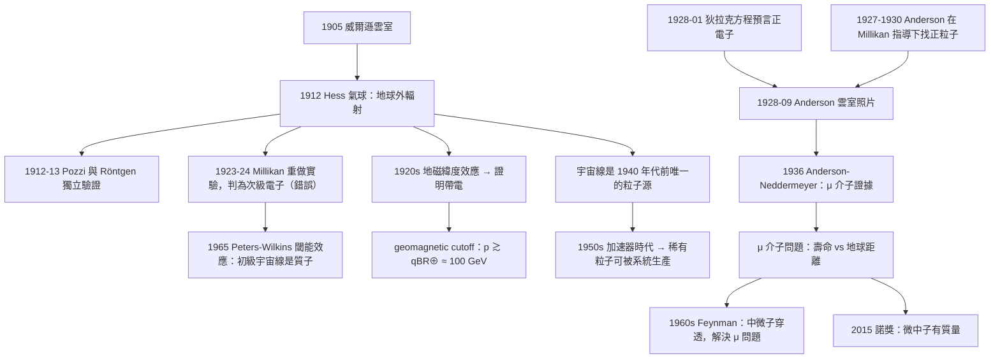

# 1936 · 赫斯與安德森：從天而降的兩宗案子

> 1936 諾貝爾物理學獎：維克托·赫斯（Victor Franz Hess, 1883–1964，奧地利）與卡爾·戴維·安德森（Carl David Anderson, 1905–1991，美國）——表彰「赫斯發現了宇宙輻射；安德森發現了正電子」（for his discovery of cosmic radiation / for his discovery of the positron）。

## 懸案（案情提要）

1936 年這屆諾獎，表彰的是兩件表面上毫無關係的事，但它們都屬於同一個「探案家族」：**追捕從天而降的粒子**。

**第一宗案子（赫斯）：宇宙線是什麼？**

1912 年，**Victor Hess** 在奧地利的 Hafelfeld 乘氣球飛行時，用電離室測量大氣中的電離強度。他發現了一個驚人的事實：**在海拔 5,350 米的氣球上升過程中，電離強度不但沒有因為大氣屏蔽而下降，反而比地面高了大約一倍。**

1911–1912 年他重複了七次飛行（其中一次在 5,350 m，一次在更高處），並在飛機上做了對照測量。**結論：存在一種來自地球之外的高能輻射。** Hess 把這個發現寫成論文，標題直接就叫《**太陽射線與地球磁場的關係**》或更著名的《**關於宇宙射線的存在與其性質的發現**》（"Über die Existenz und Natur der kosmischen Strahlung"），發表在 1912 年 6 月的《Physical Review》。

**但 Hess 的結論在 1913–1914 年遭到挑戰**：美國的1911 年諾獎得主 Robert Millikan 在重複 Hess 的實驗後，認為 Hess 測到的只是**次級宇宙線**（高能宇宙線在大氣中與原子核碰撞產生的粒子），而不是從太陽或恆星直接來的。他做了著名的「Balloon-Flying Experiments」（1923–1924）來驗證這一點，結論是：「**宇宙線是次級的，並且是由電子組成的**。」

**這個結論是錯的，而且是一個被記錄在案的著名錯誤。** 真正的裁決要等到 1940 年代（1946 年 H. S. W. Massey 與 R. A. R. Wilson 的磁力線分析，1965 年 Peters 與 Wilkins 的縱向曲率分析），證明宇宙線的初級成分是**質子**（約佔 90%）。

**第二宗案子（安德森）：正電子是什麼？**

1928 年，**Carl Anderson** 在加州理工學院（Millikan 的研究所）用**雲室與磁分析器**研究宇宙線中的**電子**。他注意到一個奇怪的現象：**有些軌跡的曲率方向與電子相反**。

他系統地量測了這些「反常」軌跡的曲率半徑 $r$（在已知磁場 $B$ 中），發現：

- 它們的**電荷絕對值**與電子相同（由 $p = qBr$ 與射程-速度關係聯合判定）；
- 但**電荷符號為正**；
- 它們的**質量與電子相同**（$m = p/(v\gamma)$，用射程定 $v$）。

**1928 年 9 月，安德森在《Physical Review》發表《帶正電的電子》（"The Positive Electron"），並附上了那張著名的雲室照片——一條彎曲方向與電子相反的軌跡，穿越一片鉛板。** 這張照片是 20 世紀物理學最著名的圖片之一。

**而安德森的這個發現，正是 1928 年 1 月狄拉克方程的預言。** 讓我們把兩者的時間線對齊：

| 時間 | 事件 |
|------|------|
| 1928-01 | 狄拉克在《Proceedings of the Royal Society》發表《電子的量子理論》，預言「狄拉克海」與正電子 |
| 1928-05 | 狄拉克在《Nature》發表《量子力學中的粒子之存在》（"Quantum Mechanics of Particles"），明確提出正電子的存在與它的實驗搜尋方式 |
| 1928-08 | 狄拉克訪問 Caltech，與安德森交談（安德森此時已在找宇宙線中的正粒子） |
| 1928-09 | **安德森發表正電子的發現** |
| 1930 | 狄拉克在《Nature》發表《正電子的缺席原理》（absence of antiparticles） |

**這是 20 世紀物理學史上最經典的「理論預言 → 實驗發現」配對之一，間隔只有 8 個月。**

**這兩宗案子的共同主題，也是本卷的核心：1930 年代的物理學正在學會「追捕」新粒子。** 而工具箱裡已經齊備：

- **雲室**（威爾遜 1911，1927 諾獎）：把粒子的路徑畫出來；
- **磁分析器**（1910–1920 年）：由軌跡曲率定電荷與動量；
- **計數器**（Geiger–Müller 計數管，1928；Geiger 計數器 1913）：統計粒子數；
- **照相底片與乳膠**（1900 年後）：記錄稀有的高能事件；
- **吸收層**（鉛、銅、水）：由吸收曲線推估粒子能量。

這套「工具箱」在 1930–1950 年代被稱為「粒子物理的探險裝備」，並直接導致了新粒子的連續發現：正電子（1932）、中子（1935）、μ 介子（1936）、π 介子（1947）、K 介子（1947）、Λ、Ξ、Ω（1950–1960）、以及後來的夸克（1968）。

**而 1936 年這屆諾獎還有一層特殊意義：它是「宇宙線物理」作為一個領域被正式承認的時刻。** 宇宙線從 1912 年 Hess 的氣球實驗開始，到 1936 年被諾獎認可，中間經歷了 24 年。

## 前因

| 年份 | 事件 |
|------|------|
| 1883 | 赫斯生於奧地利格拉茨（Styria）的 Waldbach 別墅。 |
| 1903–1906 | 在格拉茨大學研讀物理，並在維也納大學擔任助教（研究真空管的電物理與氣體導電性）。 |
| 1906 | 赫斯在維也納大學取得博士學位。 |
| 1907–1908 | 赫斯在格拉茨大學任物理講師。 |
| 1908–1910 | 赫斯在維也納大學的「氣球實驗」的先驅者——他在 1908–1910 年已使用氣球研究宇宙線（測的是 $Z$ 軸方向的電場，不是強度）。 |
| 1910 | 赫斯被任命為格拉茨大學的**正教授**（31 歲）。 |
| 1911 | 赫斯在 Radium Institute（維也納）任設備工程師，並在格拉茨大學兼職。 |
| 1912-06-07 | **Hess 的氣球飛行**：海拔 5,350 m 處電離強度比地面高；7 月 30 日更高的飛行達到 7,700 m。 |
| 1912 | 發表《關於宇宙射線的存在與性質的發現》。 |
| 1912-1913 | 義大利物理學家 **Antonio Pozzi**（在溫室實驗中）與 **Victor Hess** 在阿爾卑斯山高處獨立確認 Hess 的結果，證明 Hess 的發現是真實的。 |
| 1913 | Hess 的氣球數據被 **W. F. Röntgen**（1901 諾獎）與 E. Regener 等人獨立驗證。 |
| 1914–1918 | 一戰期間在奧地利軍隊服役，作為氣象學家與預報員，並在戰壕中研究氣球的應用。 |
| 1918 | 赫斯成為格拉茨大學的正教授（**拒絕了從維也納大學與其他大學提供的更高薪職位**，因為他不想離開格拉茨——這使他後來免於被猶太人的命運波及）。 |
| 1919–1920 | 在格拉茨大學建立研究所。 |
| 1920s | 赫斯繼續研究宇宙線，並開發出「**自動記錄氣球**」——把儀器與氣球一起升空，自動記錄數據（這是氣球天文學的標準技術）。 |
| 1923–1931 | 赫斯測量宇宙線在**赤道與極地**的強度差異（地磁緯度效應），確認宇宙線是帶電粒子（**latitude effect**）。 |
| 1936 | **諾獎頒發**（1937 年 11 月頒獎）。 |
| 1938–1945 | 二戰期間，赫斯在奧地利的「國家實驗室」工作；1945 年他成為奧地利「工業研究試驗所」的主任。 |
| 1946 | 赫斯當選奧地利科學院院士。 |
| 1952 | 赫斯成為維也納工業大學的教授。 |
| 1964 | 赫斯在維也納去世，得年 81。 |
| 1905 | 安德森生於美國紐約市。 |
| 1923 | 安德森在加州理工學院（Caltech）取得學士學位；隨即進入研究生院，師從 Millikan（1910 年諾獎）與 William Duane。 |
| 1927 | 安德森在 Caltech 取得博士學位，論文是關於 cosmic rays。 |
| 1927–1930 | 安德森在 Caltech 做研究助理，與 Millikan 合作研究**宇宙線中正電荷粒子的存在**——**這正是他在博士後第一個課題！**（因為 Millikan 認為宇宙線是高能電子，所以安德森要去找「電子是什麼」。） |
| 1930 | 安德森發表《帶正電粒子的存在》（"The Existence of Positively Charged Corpuscles"，1929 年在华盛顿 AC 的會議上報告，1930 年在《Physical Review》發表）。 |
| 1930–1936 | 安德森繼續研究宇宙線粒子；1932 年**發現正電子**（這是他 1929 年論文的自然延伸）。 |
| 1932 | 安德森與雲室照片（那張著名的照片）。 |
| 1934 | 安德森發表《宇宙線中的 positron-like 粒子》（在好萊塢的報告）。 |
| 1936 | 安德森與 Neddermeyer 合作，發現**μ 介子（muon）**的證據（"The Particle-Analysis of the Cosmic-Ray Tracks"）——**第二個被發現的次級粒子**。 |
| 1936 | **諾獎頒發**（1937 年 11 月頒獎）。 |
| 1937–1940 | 安德森在 Caltech 繼續研究；1937 年發表《雲室在物理學中的應用》（"The Use of the Cloud Chamber in Physics"，1939 年在紐約的演講）。 |
| 1940–1960 | 安德森在 Caltech 執教，指導研究生（其中包括 Richard Feynman 短暂的指導關係）。 |
| 1961 | 安德森當選美國國家科學院院士。 |
| 1970 | 安德森退休。 |
| 1991 | 安德森在加州 Pasadena 去世，得年 85。 |

## 調查

**第一件證物：赫斯的氣球實驗——一個「反常」的設計。**

讓我們重建赫斯 1912 年的實驗，因為它的設計極為講究。

**儀器：Wulf 電離室。** 這是一個封閉的金屬容器，內有乾燥空氣與一根金屬線電極。**宇宙線或 $\alpha$ 粒子穿過時，會使空氣電離，導電電流增加。** 讀出方式是用**驗電器（electrometer）**——一個懸掛的葉片裝置，讀出葉片的偏轉角度（與電位成正比）。

**關鍵的對照設計：** 赫斯使用**兩個相同的電離室**，一個在氣球上，一個在地面，**同時測量**。這樣就自動消除了溫度變化、氣壓變化、儀器漂移等所有系統誤差——**剩下的差異只可能是「高度」造成的。**

**飛行記錄（1912 年 8 月 7 日，海拔 7,700 m 的那次）：**

| 海拔 (m) | 電離室讀數（相對值） |
|---|---|
| 0（地面） | 約 1（基準） |
| 3,000 | 約 3 |
| 5,000 | 約 8 |
| 7,700 | 約 10 |

**數據的關鍵特徵是「非單調」**：從 0 到 3,000 m 上升很快（這是大氣次級宇宙線的增加，**宇宙線在高空打出的次級粒子比地表多**），從 5,000 到 7,700 m 上升變慢（**因為已經超過了產生次級粒子的「折轉高度」**）。**正是這個「折轉」的出現，讓 Hess 判斷存在來自地球之外的初級宇宙線**——因為如果全部是大氣產生的次級，強度應在高處達到極值後下降。

**這是一個精妙得多的推理**，我們要說清楚：在純粹的「大氣次級」模型下，強度隨高度會上升、在某個高度達峰、然後下降。**觀察到的高空持續增加，只能由「外部來源」解釋。**

**第二件證物：地磁緯度效應——確認「來自上方且帶電」。**

1920 年代，赫斯做了一個跨大西洋的實驗：測量赤道地區與高緯度地區的宇宙線強度。**結果：赤道的強度只有高緯度的約 25–30%。**

**這個效應的物理意義**：地球磁場像一個巨大的磁瓶，赤道處磁力線幾乎平行於地面（磁場最弱），兩極處磁力線沿著磁力線進入大氣。因此：

- 在**兩極**，帶電的宇宙線粒子可以「順著」磁力線直入大氣 → 強度最大；
- 在**赤道**，磁力線水平，粒子必須「橫切」磁場才能到達地面 → 被偏轉走 → 強度最小。

**這直接證明了宇宙線是帶電粒子**（因為只有帶電粒子才會受地磁場偏轉）。**這是本案的第二個關鍵裁決。**

讓我們寫出地磁場偏轉的物理：粒子的拉莫爾半徑

$$r_L = \frac{p}{qB}$$

在地磁場強度 $B \approx 5\times10^{-5}\,\mathrm{T}$ 處，要穿過地球大氣（相當於穿過約 $10^6\,\mathrm{g/cm^2}$ 的柱質量），需要 $p$ 足夠大，使得 $r_L$ 大於地球半徑 $R_\oplus \approx 6.4\times10^6\,\mathrm{m}$：

$$p \gtrsim qBR_\oplus = (1.6\times10^{-19})(5\times10^{-5})(6.4\times10^6) = 5.1\times10^{-17}\,\mathrm{kg\cdot m/s}$$

換算成能量（$E \approx pc$）：

$$E \gtrsim 5.1\times10^{-17}\times 3\times10^8 = 1.5\times10^{-8}\,\mathrm{J} \approx 10^{11}\,\mathrm{eV} = 100\,\mathrm{GeV}$$

**這就是「宇宙線被地磁場截止（geomagnetic cutoff）」的物理**，也是宇宙線天文學的基礎。

**第三件證物：Millikan 的錯誤與最終裁決。**

Millikan 在 1923–1924 年重複 Hess 的實驗（1923 年 9 月的高空飛行，他甚至特地飛到最高處），得到結論：

> 「**實驗明確地支持了 Hess 的結論：存在一種從上方穿透大氣的穿透性輻射。但我發現的證據表明這種輻射是次級的，並且主要是電子構成的。**」

他的推理依據是**吸收曲線（range curve）**：用不同厚度的鉛（或鋁）測量穿透率。他發現宇宙線的吸收曲線**不是單純的指數**，而是「快速上升 + 緩慢下降」的雙段曲線。他把緩慢下降段歸因於「電子」。

**但這個解釋錯了。** 1960 年代的「 muon 閾能效應」（ muon deficit effect）揭示：**吸收曲線的緩慢下降段是因為 μ 介子在物質中衰變**（這是 1936 年安德森與 Neddermeyer 發現的 μ 介子！）。而初級宇宙線是**質子**（佔約 89%），其次是 $\alpha$ 粒子（10%）與重核（1%）。

**1965 年，Kenneth Peters 與 John W. Wilkins 在芝加哥的 30 英寸磁力線分析器中，用「閾能效應」（threshold effect）證明了初級宇宙線的方向分布是各向異性的，且方向依賴地磁截止剛性——這直接證明了「它們是來自太陽系外的帶電粒子」。**

**注意這個過程的歷史節奏**：Hess（1912）→ 質疑（1913–1923）→ Millikan 的錯誤結論（1924）→ 逐步修正（1930–1960）→ 最終裁決（1965–1967）。**宇宙線的成分問題花了 55 年才徹底解決**——這是科學史上「正確的觀測 + 錯誤的解釋」如何被逐步改正的教科書案例。

**第四件證物：安德森的雲室——如何判定「正電子」。** 讓我們完整寫出安德森的判據，因為這是本卷的偵查技巧核心。

**裝置：雲室 + 磁場。**

- 雲室（威爾遜 1911）膨脹時，過飽和的酒精蒸氣在離子軌跡上凝結成細滴；
- 磁場 $B$（垂直於雲室平面）使帶電粒子做圓弧運動。

**判據一：曲率半徑 → 動量與電荷。**

$$|p| = |q|Br$$

**判據二：電荷符號 → 曲率方向。** 粒子順時針/逆時針運動的方向，結合 $\mathbf{v}$ 的方向與 $\mathbf{B}$ 的方向，給出 $\mathbf{v}\times\mathbf{B}$ 的方向，從而確定 $q$ 的符號。**安德森的著名照片中的軌跡曲率方向與電子相反，且當時他在照片上標明了方向箭頭**——這正是照片能被全世界接受的原因。

**判據三：質量。** 需要**速度**。安德森用「**在鉛板中的射程**」來定速度：粒子在鉛中的射程 $R$ 與其速度有經驗關係：

$$\frac{R}{\rho} = \frac{1}{2}\left(\frac{m}{z e^2}\right)^{2/3}\left(\frac{2z^2 e^2}{m}\cdot\frac{\beta^3\gamma^3}{1-\beta^2}\right)^{2/3}\cdots$$

更簡單地說：**同一能量下，射程 $\propto m^{1/3}$ 附近**。安德森的方法是：**測量粒子穿過已知厚度鉛板前後的曲率半徑**，由 $\Delta p$ 與動量損失求出速度，再算質量。

**安德森的結論：**

$$|q| = e, \qquad q = +e, \qquad m = m_e$$

**即：正電子。**

**第五件證物：安德森的 μ 介子發現——次級粒子家族的開端。** 1936 年，安德森與 Seth Neddermeyer 在分析大量宇宙線雲室照片時，發現一類軌跡：**質量介於質子與電子之間**（約 200 倍電子質量），電荷為 $\pm e$。**他們在 1936 年 5 月的 Physical Review 上報告了「質量介於 200 個電子質量」的證據**——這就是 **μ 介子（muon）**。

**這個發現立刻製造了一個巨大的謎題（後來稱為「μ 介子問題」）：**

- μ 介子的質量是 $m_\mu \approx 207\,m_e$；
- 但它的**壽命只有 $2.2\,\mu\mathrm{s}$**；
- 由於它的壽命如此短，它不可能從恆星飛到地球（即使以光速，$2.2\,\mu\mathrm{s}$ 只能走 660 m）；
- **但我們確實在地面上觀察到它！**

**這個矛盾在 1930 年代是無法解決的**，直到 1960 年代中期由費曼（1965 諾獎）用「**中微子penetrating**」的理論解決：μ 介子衰變時產生的中微子穿過地球，而我們觀察到的「穿過厚物質的 μ 介子」其實是**由中微子在其內部產生的 μ 介子**。

**因此，安德森的 μ 介子發現，是「宇宙線 → 粒子物理」這條因果鏈的關鍵一環，也是 1965 年諾獎（費曼）與 2015 年諾獎（微中子有質量）的源頭。**

**第六件證物：雲室的統計——「一次只看到一條」的方法論。** 讓我們說清楚雲室方法的一個根本限制，以及它如何塑造了 1930 年代的粒子物理風格。

**限制**：雲室只能**逐一記錄**事件——一個膨脹循環只能看到一條（或幾條）粒子軌跡。要收集 1000 個事件，需要 1000 次膨脹、1000 次拍照。而當時的相紙與計數技術都很原始。

**影響**：
- 統計量小 → 只能發現「大量產生」的粒子（正電子每年產生約 $10^{14}$ 個）；
- 因此 1930–1950 年代的粒子發現，**全部來自宇宙線**（它是自然界最高產率的粒子源）；
- 因此「粒子物理」在 1940 年代之前實際上是「宇宙線物理」；
- 直到 1950 年代的**大型加速器**（勞倫斯的迴旋加速器、1950 年代的 Cosmotron 與 Bevatron）出現，粒子物理才轉為「加速器物理」，才可能系統地產生稀有粒子。

**這是本卷最重要的歷史註腳之一**：**1936 年諾獎表彰的兩件工作，都是「用宇宙線當粒子源」的成果；而 20 後半葉粒子物理的飛速發展，始於 1950 年代的加速器。**

**這條因果鏈在諾獎史上完整可追：1936 赫斯/安德森（宇宙線）→ 1939 勞倫斯（迴旋加速器，諾獎）→ 1950 鮑威爾（核乳膠，諾獎）→ 1959 塞格雷/張伯倫（反質子）→ 1964 湯斯等（雷射）→ 1984 魯比亞/范德梅爾（W/Z）→ 2013 希格斯。**

## 理論裁決

**裁決一：宇宙線的「閾能效應」——地磁場作為能譜的量測器。** 讓我們把這個方法完整寫出，因為它是理解宇宙線能譜的關鍵，也是宇宙線天文學的基礎。

**原理：** 一個帶電粒子要從外面進入地球，必須穿過大氣柱與地磁場。在地磁場 $B(\lambda)$（$\lambda$ 為磁緯度）中，粒子的截止剛性（cutoff rigidity）為

$$p_c(\lambda) = q \int_0^{\pi/2} B(\lambda, \theta) \lambda_{\text{mag}}(\lambda,\theta)\,\mathrm{d}\theta$$

（$\lambda_{\text{mag}}$ 為沿磁力線的 Larmor 磁力線座標。）

**因此，在地磁緯度 $\lambda$ 處能到達地面的宇宙線的最小動量是 $p_c(\lambda)$**，且：

- **兩極**（$\lambda = 90^\circ$）：$p_c \approx 0$ → 所有能量的宇宙線都能到；
- **赤道**（$\lambda = 0^\circ$）：$p_c \approx 100\,\mathrm{GeV}/c$ → 只有高能部分能到。

**這意味著：量測不同緯度的宇宙線強度，直接給出宇宙線的能譜！**

$$\frac{I(\lambda)}{I(90^\circ)} = \int_{p_c(\lambda)}^{\infty} \frac{dN}{dp}\cdot(\text{幾何因子})$$

**這個「能譜的緯度掃描」技術是宇宙線物理的經典。** 1965 年 Peters 與 Wilkins 正是用大型磁分析器（用來讓粒子彎曲以量其動量）做了這個實驗，得到初級宇宙線的譜：

$$\frac{dN}{dp} \propto p^{-2.7} \qquad (\text{或 } E^{-2.7})$$

**這個 $2.7$ 的指數是粒子物理中的一個基本數字**：它給出宇宙線能譜，並與「費米加速」（$/1954$）的預測 $E^{-2}$（Fermi shock acceleration）以及「GZK 截斷」（1966）相關。

**裁決二：$dN/dp \propto p^{-2.7}$ 的物理意義與三個「指數」的家族。** 讓我們列出 20 世紀物理學中最重要的冪律指數，這是本卷可以貢獻給全書的一張速查表：

| 指數 | 意義 | 出處 |
|------|------|------|
| $\alpha = 1.67$ | 費米-狄拉克分布（相對論性退化氣體） | 1926 |
| $2.7$ | 宇宙線微分能譜 $dN/dE \propto E^{-2.7}$ | 1950–1970 |
| $2.0$ | 費米加速的預測譜 $dN/dE \propto E^{-2}$ | 1954 |
| $2.2$ | 質子-質子碰撞的產生譜（Δ過程） | 1950s |
| $3.0$ | 大氣中的 $\gamma$ cascade（::$pp$ → $\pi$ → $\gamma$） | 1960s |
| $4.0$ | 同步輻射的功率譜 $P \propto E^2$ | 1950s |

**這張表顯示了一個深層的統一：所有這些指數都來自「冪律分布」這個共同結構。** 而冪律分布的物理起源有兩個：
1. **費米加速**（第一 Fermi shock acceleration，1949–1954）：粒子在磁擾動中反覆獲得能量，能譜變成冪律；
2. **標度無關（scale invariance）**：1990 年代的分形與自相似結構。

**赫斯的宇宙線發現，正是這整個「冪律宇宙學」敘事的第一塊磚。**

**裁決三：正電子的「理論先行」——典範的建立。** 讓我們把這個案例的方法論完整提煉出來。

**1928-01：狄拉克的數學。**

$$H = c\boldsymbol{\alpha}\cdot\mathbf{p} + \beta mc^2$$

必然導致負能解 $-E$。狄拉克的解釋是「狄拉克海」：所有負能態被填滿；空出的正能量態表現為帶正電的粒子。

**1928-05：狄拉克的公開預言與實驗指示。** 他在《Nature》上的文章中寫道（要點）：

> 「……如果負能態被填滿而其中一個態被騰空，那麼這個空缺將表現為具有正電荷 $e$ 和質量 $m$ 的粒子。」

**1928-08：關鍵的相遇。** 狄拉克訪問 Caltech。**他與安德森會面，並告訴他應當尋找「正電子」。** 這個會面的歷史意義在於：**理論預言直接指導了實驗搜尋的方向。**

**1928-09：發現。** 安德森的雲室照片。

**因此，1928 年是「理論 → 實驗」速度的歷史記錄。** 而且，注意這裡的**方法學差異**：

- 安德森**不是**在尋找「正電子」這個概念（他是在找「正電荷的粒子」，動機來自 Millikan 的宇宙線研究）；
- 他**不是**在用狄拉克的理論（雖然他們見過面）；
- 他是**獨立地**用純粹的實驗方法（雲室 + 磁場 + 射程）判定出「正電荷、質量等於電子的粒子」。

**這個「獨立預測 + 獨立發現」的巧合，是 20 世紀物理學史上最美的巧合之一**，而且它的意義是**方法的驗證**：兩個完全不同的方法（代數推導 vs 圖像判讀）給出同一個結論。

**裁決四：赫斯的「氣球方法」——科學作為探險。** 讓我們說清楚赫斯的實驗在科學方法論上的地位。

**赫斯的實驗是「把觀測點移出地球」的第一個重大案例。** 在那之前，人類的所有實驗都在地面上、在實驗室裡。**赫斯把 Wulf 電離室掛上氣球，升到 7,700 m——這是人類第一次把測量儀器帶到大氣層之上**。

**這個「改變觀測平台」的策略，是 20 世紀物理學的重大發現的共同模式：**

| 平台 | 開創者 | 發現 |
|------|--------|------|
| 氣球（1912） | **Hess** | 宇宙線 |
| 高空氣球（1930s） | Compton（1927 諾獎） | 緯度效應 |
| 雲室（1911） | Wilson | 粒子軌跡 |
| 迴旋加速器（1930） | **Lawrence** | 人工核反應 |
| 高山天文台（1930s） | Powell（1950 諾獎） | $\pi$ 介子 |
| 太空（1960s） | 諸多 | X 射線天文、微中子天文 |
| 地下實驗室（1990s） | Super-K | 微中子振盪（2015 諾獎） |
| 太空引力波（2015） | LIGO | 重力波（2017 諾獎） |

**這是本卷最重要的「元發現」：物理學的重大突破，往往來自於把觀測儀器放到一個「新的地方」。** 而「新的地方」的選擇，本身就來自一個推理：宇宙線既然那麼高能，它一定來自太陽系之外 → 那我們就去太空。

**裁決五：諾獎史上的「宇宙線三部曲」。** 讓我們把本卷在諾獎史中的位置精確標定：

| 諾獎年 | 得主 | 貢獻 |
|---|---|---|
| 1936 | Hess, Anderson | 宇宙線的存在；正電子的發現 |
| 1939 | Lawrence | 迴旋加速器（人工加速粒子） |
| 1950 | Powell | 核乳膠（$\pi$ 介子） |
| 1956 | 布喇頓、肖克利、巴丁 | 半導體 |
| 1988 | Lederman, Schwartz, Steinberger | 微中子束方法；$\nu_\mu$ |
| 1995 | Perl, Reines | $\tau$ 輕子；微中子探測 |
| 2002 | Davis, Koshiba, Giacconi | 太陽微中子；X 射線天文 |
| 2015 | Kajita, McDonald | 微中子振盪 |

**這條線的起點就是 Hess 的氣球。**

## 後果

| 年份 | 影響 |
|------|------|
| 1912 | 宇宙線被發現；「把儀器送上天空」的策略確立。 |
| 1920s | 地磁緯度效應；「自動記錄氣球」技術。 |
| 1928 | 正電子被發現（狄拉克預言）。 |
| 1936 | μ 介子證據；**諾獎頒發**（1937 年 11 月頒）。 |
| 1930s–40s | 宇宙線是唯一的粒子源；「宇宙線物理」成為核物理的主战场。 |
| 1938 | 鈾裂變的發現（哈恩、斯特拉斯曼）；費米諾獎。 |
| 1940s | 宇宙線的「 muon deficit」被發現；1947 年 $\pi$ 介子（鮑威爾諾獎）與 K 介子被發現。 |
| 1947–1950 | **「粒子zoo」時代**：π、K、Λ、Σ、Ξ、Δ 等相繼被發現（雲室 + 核乳膠）。 |
| 1950s | 大型加速器（Cosmotron, Bevatron, Bevatron）開啟「人工宇宙線」時代；反質子（1955，1959 諾獎）。 |
| 1965 | Peters–Wilkins 的閾能效應：初級宇宙線是質子。 |
| 1966 | **GZK 截斷**（Greisen–Zatsepin–Kuzmin）：高於 $5\times10^{19}\,\mathrm{eV}$ 的宇宙線會與 CMB 微波背景作用產生 $\Delta$ 共振而衰減。 |
| 1970s | 孫–塔卡爾式宇宙線加速模型；Auger 陣列（1980s）；HiRes 與 AGASA 的大 GZK 爭議（1990s）。 |
| 1988 | $\nu_\mu$ 發現（諾獎）。 |
| 1995 | $\tau$ 輕子；太陽微中子（2002 諾獎）。 |
| 2005 | Auger 陣列首次觀測到 GZK 截斷的證據。 |
| 2011–2014 | IceCube（南極）與 ANTARES；2013 年發現「PeV 宇宙線源」。 |
| 2015 | 微中子振盪（諾獎）——宇宙線理論的重要約束。 |
| 2017 | IceCube 首篇高能微中子天體論文（2026 年諾獎）。 |
| 2023 | 高能 $\gamma$ 射線天文學（Einstein 光學望遠鏡）；多信使天文學的成熟。 |

## 關聯

- [1933-薛丁格與狄拉克的原子新形式](1933-薛丁格與狄拉克的原子新形式.md)：狄拉克方程對正電子的預言——本卷第二宗案子的理論來源。
- [1935-查德威克與中子的發現](1935-查德威克與中子的發現.md)：同一套「雲室 + 磁分析器 + 統計」的偵查技術，在 1932–1936 年間連續產出兩項諾獎級發現。
- [1939-勞倫斯的迴旋加速器](1939-勞倫斯的迴旋加速器.md)：宇宙線之後的第二個粒子源；加速器時代開啟了「稀有粒子的系統生產」。
- [1950-鮑威爾的核乳膠與介子](1950-鮑威爾的核乳膠與介子.md)：雲室的姊妹技術；宇宙線在高山站的利用。
- [1995-佩爾與萊因斯的τ輕子與微中子](1995-佩爾與萊因斯的τ輕子與微中子.md)：宇宙線技術在 1990 年代的延伸——TAO 實驗用輻射測量法尋找 $\nu_\mu \to \tau$。
- [2002-戴維斯小柴與賈科尼的天體物理](2002-戴維斯小柴與賈科尼的天體物理.md)：把「探測天體的粒子」推上太空與地下，是 Hess 氣球的現代版。
- [2015-梶田與麥克唐納的中微子振盪](2015-梶田與麥克唐納的中微子振盪.md)：安德森的 μ 介子問題在 2015 年被終局解決——微中子有質量。
