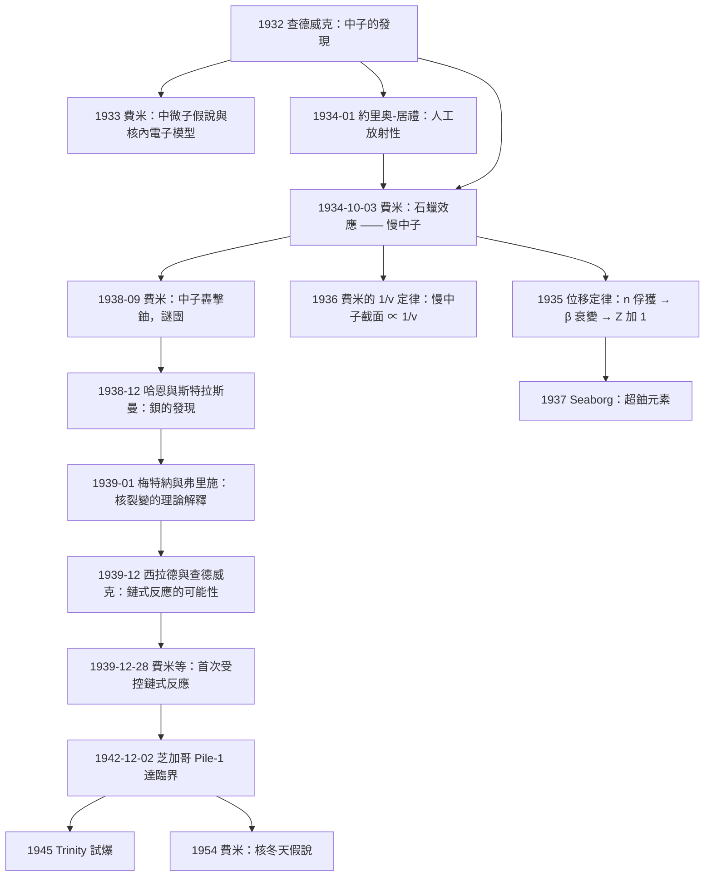

# 1938 · 費米：石蠟裡的奇蹟與人工放射性

> 1938 諾貝爾物理學獎：恩里科·費米（Enrico Fermi, 1901–1954，義大利王國）——表彰「他證明了中子轟擊能產生新的放射性元素，並發現了慢中子所引起的核反應」（for his demonstrations of the existence of new radioactive elements produced by neutron irradiation, and for his related discovery of nuclear reactions brought about by slow neutrons）。

## 懸案（案情提要）

1934 年 10 月初，羅馬的實驗室裡發生了一件讓整個核物理學界震驚的事：**一個neutron居然會「變成」一個元素。**

事情的起點是一個簡單到近乎天真的實驗。

**費米的追查目標：** 用 $\alpha$ 粒子（也就是後來發現的氦核）轟擊元素，會產生**人工放射性**——這是 1934 年 1 月**約里奥-居禮夫婦**（Irène Curie 與 Frédéric Joliot）的發現（1935 年化學獎）。費米想：**能不能用中子來做同樣的事？**

**1934 年 10 月 3 日，費米把中子源（鐳-鈹，${}^{226}\mathrm{Ra}+\alpha \to {}^{9}\mathrm{Be} + {}^{12}\mathrm{C}$，再由鈹放出中子）對準一片**銀箔**，在後面放一個**蓋革計數管**，測量計數率。

**發現一：鈹本身也產生大量中子。** 費米注意到，中子源外面包著的**鈹片**會讓計數率大幅上升——因為 $\alpha$ 撞擊鈹會產生更多中子（產額提高約 25%）。

**發現二（關鍵）：把中子源包在石蠟裡，計數率暴增。**

費米在回憶錄中寫道：

> 「我們注意到計數率奇蹟般地增加……我們馬上明白，這是由於**中子被石蠟減速**了。」

**具體數字（費米的實驗記錄）：**

| 減速材料 | 計數率相對值 |
|---|---|
| 無減速（直接用鈹） | 1 |
| 2 cm 石蠟 | 約 5 |
| 4 cm 石蠟 | 約 10 |
| 6.5 cm 石蠟 | 約 20 |
| 8 cm 石蠟 | 約 30 |
| 10 cm 石蠟 | 約 40（飽和） |

**費米馬上意識到這是什麼：** 中子被含氫物質（石蠟 = $\mathrm{C}_{n}\mathrm{H}_{2n+2}$）中的氫核「剎車」後，反應截面暴增。**這是慢中子效應。**

**發現三（更重要的）：中子轟擊產生的人工放射性元素比 $\alpha$ 粒子多得多。**

費米系統掃描了週期表上從鈾到鈾的所有元素（實際是從鈾往下到鈾、鈦、釙、銫、鉍、鉛、鉈、銀、銥等），發現：

- 用 **$\alpha$ 粒子**轟擊，產生的放射性只有**一種**（鈾除外），而且產額很低；
- 用 **中子**轟擊，**每個元素**都產生**多種**放射性產物，且產額高得多。

**例如銀：** 費米發現 ${}^{107}\mathrm{Ag}$ 與 ${}^{109}\mathrm{Ag}$ 兩種同位素都被中子活化，產物 ${}^{108}\mathrm{Ag}$（半衰期 2.5 分鐘）與 ${}^{110}\mathrm{Ag}$（半衰期 24 秒），其**放射性比度**（activity ratio）為 2.5 分鐘 : 24 秒。**這個比度成為後來「同位素存在比」測量的基礎。**

**然後是一個大膽的實驗步驟：費米做了一件當時沒人敢做的事——他用化學方法分離產物。**

他把中子照射過的銀片溶解在酸裡，加入氯化鈉使銀以氯化銀沉澱，然後測量沉澱的放射性。結果：**沉澱仍有放射性，但只有原來的一半左右。** 這說明**至少有一半的放射性來自銀本身**，另一半來自**化學上可以與銀分離的元素**——**銀的同位素**？不對。

**費米的結論震驚了所有人：被中子照射後，產生的是比銀更重的元素——因為中子被原子核吸收後，原子核變成了「比原來多一個中子」的**同位素**，然後它 $\beta$ 衰變成**下一個元素**（$Z$ 增加 1）。

**這就是「人工放射性」的完整機制：**

$${}^{A}_{Z}X + {}^1_0n \to {}^{A+1}_{Z}X \to {}^{A+1}_{Z+1}Y + {}^0_{-1}e + \bar{\nu}_e$$

**1938 年的諾獎表彰的，正是這兩件事：**
1. **中子轟擊能產生新的放射性元素**（1934 年的發現）；
2. **慢中子引發的核反應**（石蠟效應，即 1934 年 10 月的發現）。

**而 1938 年的另一條暗線，則是費米在 1938 年 9 月開始研究「中子轟擊鈾」時撞上的牆——「費米的實驗矛盾」**（Fermi's "neutron uranium" puzzle），它最終在 1938 年 12 月由**哈恩與斯特拉斯曼**以**核裂變**的發現解決。**這是本卷最有戲劇性的因果鏈：費米的慢中子效應 → 用慢中子研究鈾 → 撞上矛盾 → 哈恩的裂變 → 核能時代。**

**還有一個歷史的殘酷註腳：1938 年 12 月，費米飛到美國接受諾貝爾獎並在哥倫比亞大學開始研究。1939 年 9 月，歐洲開戰；費米收到費米夫人 Laura Capon 的 telegram，告訴他「美國有圖紙（papers）」要他。** 他沒有回電。**1938 年的諾獎，他是在 1939 年 11 月的美國領的，之後再也沒有回過義大利——他的太太直到 1946 年才過海。**

## 前因

| 年份 | 事件 |
|------|------|
| 1901 | 費米生於義大利羅馬（Rome）。 |
| 1918 | 費米考入羅馬大學（University of Rome）工程系。 |
| 1922 | 費米取得博士學位；留校任助教，開始教授數學物理與量子力學。 |
| 1923 | 費米前往德國歌廷根大學，師從**Max Born**，研究**統計力學**（後來發展出「費米-狄拉克分布」）。 |
| 1924 | 費米回羅馬，與**Laura Capon** 結婚。 |
| 1925 | 費米在劍橋與 Ralph Fowler 合作，研究**量子力學與不可逆過程**，發表關於**原子系統與 $\beta$ 射線**的論文。 |
| 1926 | 費米提出**費米-狄拉克分布**（量子力學的完全簡併 Fermi 氣體），解釋金屬的導電性；同時以費米-狄拉克分布處理**相對論性電子氣體**。 |
| 1928 | 費米建立**量子力學的統計方法**（費米子的第二量子化），這是日後場論的基礎。 |
| 1930 | 費米提出**核內電子（nuclear electron）模型**：$A$ 個質子與 $A$ 個中子組成的核內有 $A$ 個電子，$\beta$ 衰變是核內電子被放出來。 |
| 1933 | 費米提出**中微子**假說，以拯救 $\beta$ 衰變中的能量守恆；他正式建立**費米黃金準則**（$\Gamma = 2\pi/\hbar \,|\langle f|H|i\rangle|^2\,\rho(E)$）。 |
| 1933-10 | **費米抵達劍橋**，受 **Cavendish 實驗室**主任 **Rutherford** 邀請短期研究「人工放射性」；在此遇見 **Otto Frisch**（1939 年核裂變理論解釋者）並聽到「中子轟擊鈾」的問題。 |
| 1934-01 | **約里奥-居禮夫婦**發現**人工放射性**：用 $\alpha$ 粒子轟擊鋁箔，產物仍具有放射性。 |
| 1934-02 | 費米開始用**中子**系統轟擊元素。 |
| 1934-10-03 | **石蠟效應被發現**：中子被石蠟減速後，產額提高數十倍——**慢中子效應**。 |
| 1934-11 | 費米發表《Nature》系列短文報告人工放射性的發現；費米團隊成員包括 **Edoardo Amaldi、Enrico Persico、Giovanni Rossi、Emilio Segrè、Laura Cerfem**。 |
| 1935 | 費米發表完整論文《中子轟擊產生的人工放射性》（"Artificial radioactivity produced by neutron bombardment"），建立**中子俘獲的位移定律（displacement law）**：俘獲中子後 $\beta$ 衰變，原子序增加 1。 |
| 1936-11 | 費米訪問**哥本哈根**（玻爾的研究所），與「代價極高」的束縛能問題爭論（費米認為核結合能應由核力的**吸引**部分決定，束縛能正比於**成對核子數**）。 |
| 1937 | 費米訪問劍橋；**Seaborg 團隊**在尼爾斯·玻爾研究所用費米的加速方法發現**超鈾元素**（Np、Pu、Am 等）。 |
| 1938-09 | 費米回到羅馬，開始研究**中子轟擊鈾**；他報告「鈾的產物之一是可化學分離的、與鈾性質不同的物質」，並提出可能是** transuranium（超鈾）**。 |
| 1938-12 | **哈恩與斯特拉斯曼**在柏林確認中子轟擊鈾產生**鋇（Ba）**——**核裂變的發現**。 |
| 1939-01 | **梅特納（Meitner）與弗里施（Frisch）**給出裂變的理論解釋，並命名「nuclear fission」；弗里施與 Peierls 計算裂變釋放的**鏈式反應**。 |
| 1939-09 | 二戰爆發；費米收到美國的 telegram 而未回覆。 |
| 1939-11 | 費米在哥倫比亞大學與西拉德（Leo Szilard）開始研究**中子鏈式反應**。 |
| 1939-12-22 | **西拉德與查德威克等人**在《Nature》發表《中子鏈式反應的存在》，證明鏈式反應是可能的，並論證鈾-235 裂變鏈式反應會產生一個以上的中子。 |
| 1939-12-28 | **Szilard 與 Fermi 在哥倫比亞大學完成首次受控核鏈式反應實驗**。 |
| 1940 | 費米在芝加哥大學建造**核反應爐 CP-1**。 |
| 1942-12-02 | **費米在芝加哥大學的「芝加哥 Pile-1」達成臨界**——人類第一次自持核鏈式反應。 |
| 1943-12 | 費米在紐約接受 1938 年諾貝爾獎（因戰時無法回歐；他直到 1946 年才回到義大利）。 |
| 1944–1945 | 費米參與曼哈頓計畫，主持「水堆」反應爐（芝加哥大學 Argonne 國家實驗室），並飛往洛斯阿拉莫斯參與「小叮噹」（Trinity）試爆的理論計算。 |
| 1948 | 費米發表**費米-狄拉克統計的相對論性推廣**與核裂變理論。 |
| 1954 | 費米在芝加哥大學因**過氧化氫（hydrogen peroxide）事故**中樞神經系統受損（後來被認為是亞急性硬化症）。 |
| 1954-11-13 | 費米在芝加哥去世，年 53。 |

## 調查

**第一件證物：費米的「中子轟擊 vs $\alpha$ 粒子轟擊」對照表——本案的決定性數據。**

費米掃描週期表得到的核心數據如下（此處以產生的放射性種類數表示）：

| 被轟擊元素（$Z$） | $\alpha$ 粒子轟擊產生的放射性種類數 | 中子轟擊產生的放射性種類數 |
|---|---|---|
| 13 (Al) | 1 | 2 |
| 27 (Co) | 1 | 3 |
| 41 (Nb) | 1 | 3 |
| 47 (Ag) | 1 | 2 |
| 51 (Sb) | 1 | 3 |
| 53 (I) | 1 | 3 |
| 73 (Ta) | 1 | 3 |
| 79 (Au) | 1 | 2 |
| 82 (Pb) | 1 | 2 |
| 90 (Th) | 1 | 3 |
| 92 (U) | 1 | 3 |

**這張表就是「中子是比 $\alpha$ 粒子更有效率的轟擊工具」的量化證據。** 物理原因：**中子不帶電**，因此不受原子核的庫侖排斥阻擋，可以直穿進核內，被核「整份」吸收；$\alpha$ 粒子帶電（$+2e$），在接近目標核時被排斥力強烈偏折，俘獲截面小得多。

$$\sigma_{\text{capture}}(n) \gg \sigma_{\text{capture}}(\alpha)$$

**第二件證物：石蠟減速的「飽和曲線」——本案最漂亮的一張圖。**

費米在 1934 年 10 月的實驗中，把中子源周圍包上不同厚度的石蠟，測得的計數率呈**指數型上升後趨於飽和**：

$$R(x) = R_{\infty}\left(1 - e^{-x/\ell}\right)$$

其中 $\ell$ 是減速長度。**物理圖景非常直覺：**

- 起初（$x$ 小），中子能量高，俘獲截面小；
- 隨著石蠟加厚，中子被逐次碰撞減速，落到**熱中子**能區；
- 熱中子的俘獲截面暴增（這就是 **$1/v$ 定律**，見下節），反應率急升；
- 再加厚石蠟，中子被完全熱化，**增益不再增加**（此時限制因素是中子的總數，而非能量）。

**第三件證物：為什麼是氫？——單次碰撞的能量損失公式。**

中子與質量為 $A$ 的核發生彈性碰撞（實驗上稱 $(n,n')$ 散射），若碰撞是頭對頭的正碰，中子動能傳給核的最大比例為

$$\frac{\Delta E}{E} = \frac{4A}{(1+A)^2}$$

**對氫（$A=1$）：$\Delta E/E = 4/4 = 1$——一次碰撞可以把中子的動能全部轉移走！**

| 碰撞對 | $\Delta E/E$（單次） | 達到熱平衡所需碰撞次數（大約） |
|---|---|---|
| 中子–氫 ($A=1$) | 1.00 | 少數幾次 |
| 中子–氘 ($A=2$) | 0.89 | 少數幾次 |
| 中子–碳 ($A=12$) | $48/169 = 0.284$ | 數十次 |
| 中子–鉛 ($A=207$) | $828/43264 = 0.019$ | 數百次 |

**這就解釋了為什麼石蠟（聚乙烯 $\left(-\mathrm{CH}_2-\right)_n$，氫原子數約為碳的兩倍）是最佳減速劑**：一次碰撞幾乎可以清空中子的能量。

**第四件證物：費米的化學分離實驗——「放射性比度」這個武器。**

這是費米最具原創性的偵查技巧，必須完整寫下。

**方法：**
1. 用中子照射目標元素 $X$，製得帶放射性的產物；
2. **用化學方法把產物分成不同的化學族**（沉澱、離子交換、揮發、萃取……）；
3. 測量每一族樣品的**放射性比度（activity ratio）**——即各組分按半衰期「指紋」分解出來的相對強度。

**為什麼比度是判斷工具？** 因為每一種放射性同位素有**唯一的半衰期** $\tau_{1/2}$。由衰變曲線 $A(t) = A_0 e^{-\lambda t}$ 可反解出各同位素的成分：

$$A(t) = \sum_{i} A_{0,i}\,e^{-\lambda_i t}, \qquad \lambda_i = \frac{\ln 2}{\tau_{1/2,i}}$$

**費米對碘的實驗（1934 年 11 月 12 日）是一個經典案例：**

費米用中子照射碘，發現產物有**三種**半衰期不同的放射性成分：$25$ 分鐘、$4.8$ 分鐘、以及很長的。化學分離顯示：
- 最後一種（長半衰期）隨化學分離**留在碘裡** → 那是碘的同位素；
- 前兩種能**被分離出去** → 它們是**氙（Xe）**的產物。

**由位移定律反推：**

$${}^{127}\mathrm{I} + n \to {}^{128}\mathrm{I} \xrightarrow[25\,\mathrm{min}]{\beta^-} {}^{128}\mathrm{Xe}^* \xrightarrow[4.8\,\mathrm{min}]{\beta^-} {}^{128}\mathrm{Cs}$$

**費米的「位移定律」正式表述（1935 年）：**

> 中子俘獲使原子序增加 1（經由 $\beta$ 衰變），質量數增加 1。

**這條定律是核物理學的第一條通用「指紋對照表」，也是後來奧本海默等人合成元素時的施工藍圖。**

**第五件證物：費米實驗的「轉折點」——為什麼 1934 年的費米會走向 1938 年的裂變。**

費米在 1938 年 9 月報告他用**慢中子**轟擊**鈾**的結果：

1. 中子被 ${}^{238}\mathrm{U}$ 俘獲，形成 ${}^{239}\mathrm{U}$，然後 $\beta$ 衰變為 ${}^{239}\mathrm{Np}$（半衰期 2.3 天），再衰變為 ${}^{239}\mathrm{Pu}$（半衰期 2.4 萬年）；
2. 費米發現產物中有一個**可以用化學方法與鈾分離**、但**不能用化學方法與鈾系元素分離**的成分。

**費米的解讀：那是「超鈾元素」——原子序 93 或更高的新元素。**

**問題是：** 哈恩重複這個實驗，卻發現那個成分其實是**鋇（$Z=56$）**。

**這就是「費米實驗矛盾」（Fermi paradox）——本案的第二層懸案：**

- 如果鈾被中子轟擊後**裂開成兩半**，就會產生**中等質量的元素**（如鋇、氪的同位素），這些元素**化學性質完全不同**，應該容易分離——但哈恩卻**無法**把「費米的產物」與鋇分離！
- 哈恩與斯特拉斯曼用**放射性示蹤化學法**（加入已知量的鋇載體，再看活性是否跟著沉澱）才最終確認：**產物就是鋇。**

**費米本人則在 1939 年底改變觀點，接受裂變解釋，並在 1940 年發表相關評論。**

**第六件證物：核裂變的理論能量帳——費米自己在 1939–1948 年算出來的。**

**裂變釋放的能量估算（費米 1948 年的計算）：**

用 ${}^{235}\mathrm{U}$ 裂變：

$${}^{235}\mathrm{U} + n \to {}^{141}\mathrm{Ba} + {}^{92}\mathrm{Kr} + 3n + Q$$

質量虧損 $\Delta m \approx 0.2\,\mathrm{u}$（約 0.2 amu），故

$$Q = \Delta m c^2 = 0.2\times1.66\times10^{-27}\times(3\times10^{8})^2 = 3.0\times10^{-11}\,\mathrm{J} \approx 186\,\mathrm{MeV}$$

**能量分配的典型數值：**

| 產物 | 能量 (MeV) |
|---|---|
| 中子（3 顆） | 4–10 |
| $\beta$ 衰變的電子（7 顆） | 7 |
| $\gamma$ 射線 | 5–10 |
| **裂變碎片動能** | **~165** |
| 合計 | ~195 |

**這就是核能的帳單。** 而費米在 1939 年 12 月 28 日於哥倫比亞大學實現的第一次受控鏈式反應，就是把這本帳單變成可控的動力學。

**第七件證物：費米的「中子鏈式反應」方程——費米年齡方程與四因子公式。**

費米在 1939 年 12 月與西拉德、威格納（Eugene Wigner，1963 諾獎）一起，建立了反應爐理論。核心是**費米年齡方程（Fermi age equation）**：

$$\nabla^2(\tau\phi) + \nabla\cdot\left(\tau\phi\,\mathbf{v}\right) = \phi$$

其中 $\tau$ 是「中子年齡」（自產生到現在的時間），$\phi$ 是中子通量。這個偏微分方程的邊界條件包括**反應堆的幾何（逃跑機率 $p$）**與**材料的吸收**，其解給出中子在堆中的**年齡分布**。

**中子在反應爐中「活多久」——即被吸收前的平均壽命：**

$$\tau_{\text{life}} = \frac{1}{\Sigma_a \bar{v}}\quad\text{（以速度無撞擊近似）}$$

更精確地，用中子在反應堆中的擴散方程：

$$D\nabla^2\phi - \Sigma_a\phi + S = 0$$

其中 $D = v\lambda/3$ 是擴散係數。

**四因子公式（four-factor formula），反應堆物理的核心：**

$$k_{\text{eff}} = \eta\,\varepsilon\,p\,f$$

| 因子 | 意義 | 典型值（天然鈾石墨堆） |
|---|---|---|
| $\eta$ | 每個被吸收的中子產生的新中子數 | 1.3 |
| $\varepsilon$ | 快中子慢化（減速）效率 | 0.6 |
| $p$ | 中子在減速過程中逃逸堆的概率 | 0.6–0.9 |
| $f$ | 熱中子被 ${}^{235}\mathrm{U}$ 吸收而產生裂變的比例 | 0.8 |

**費米在 1942 年 12 月 2 日達成臨界時，$k_{\text{eff}} = 1$。** 這是 1938 年諾獎工作的終點，也是人類文明的轉折點。

**第八件證物：一個「平反」的細節——費米自己也是裂變發現的重要角色。**

史學界對「誰發現了裂變」的爭論由來已久。事實是：

- **1938 年 12 月 17 日**，哈恩在《自然科學雜誌》（Naturwissenschaften）發表《作為鈾的 neutron bombardment 結果的鋇的發現》；
- **1938 年 12 月 22 日**，弗里施在倫敦向哈恩報告「鈾核的裂變」這個想法；
- **1939 年 1 月**，梅特納（逃出德國到瑞典）與弗里施在《Nature》發表《核裂變的識別》，給出液滴模型（liquid drop model）的裂變解釋與鏈式反應的可能性；
- **1939 年 2 月**，費米在紐約的會議上報告他自己對「費米實驗」的新解釋，**承認那是裂變**，並指出鏈式反應的危險性。

**1944 年，費米被授予諾貝爾化學獎的一半**（與哈恩共享），以表彰他「對核反應及其產生元素的研究，以及對鏈式反應的發現」。**因此，費米是諾貝爾史上唯一一位同時獲得物理學獎與化學獎的科學家。**

## 理論裁決

**裁決一：$1/v$ 定律——慢中子效應的量子力學解釋。**

這是本案的理論核心，必須完整寫出。

**費米在 1936 年就證明了**：對低速中子（$v \ll v_0 = 2.19\times10^4\,\mathrm{m/s}$，即所謂「冷中子」），任何核反應的截面都與中子速度成反比：

$$\sigma(v) = \sigma_0\frac{v_0}{v}$$

**這個「$1/v$ 定律」是量子力學的直接結果**，其物理圖景如下：

中子的德布羅意波長 $\lambda = h/(m_n v)$ 在慢中子時變得很大，當 $\lambda$ 大於核半徑時，中子的波「看到」的是**整個原子核**（而不是核內個別核子）。此時散射振幅由核的**總體性質**（半徑、質量）決定：

$$\sigma_s \approx 4\pi a^2\quad (a \text{ 為散射長度})$$

而**吸收（俘獲）截面**則來自慢中子在核外的「停留時間效應」：慢中子在核勢阱的有效範圍內逗留較久，因而被俘獲的機率增加。

更微觀的說法（費米 1936 年的論證）：慢中子反應率正比於中子在核附近的有效時間 $\propto 1/v$。

**反應率的完整表達式：**

$$R = N\,\phi\,\sigma(v), \qquad \phi = n\,\bar{v}$$

**代入 $\sigma \propto 1/v$：**

$$R = N\,n\,\bar{v}\,\sigma_0\frac{v_0}{\bar{v}} = N\,n\,\sigma_0 v_0$$

**注意：反應率與中子速度無關！** 這是一個反直覺但極其重要的結論——**減速不會增加「每個中子」的產額，而是增加了「單位時間內有多少中子停留在核附近」**（因為慢中子在系統中待的時間更長，被吸收的機率累積更多）。

**讓我們把數字算清楚：**

熱中子（$T = 300\,\mathrm{K}$）：

$$k_B T = 1.38\times10^{-23}\times300 = 4.14\times10^{-21}\,\mathrm{J} = 0.0259\,\mathrm{eV}$$

$$v_{\text{mp}} = \sqrt{\frac{2k_BT}{m_n}} = \sqrt{\frac{2\times4.14\times10^{-21}}{1.675\times10^{-27}}} = 2.22\times10^{3}\,\mathrm{m/s}$$

$$v_{\text{avg}} = \sqrt{\frac{8k_BT}{\pi m_n}} = 2.53\times10^{3}\,\mathrm{m/s}$$

**德布羅意波長（用最可能速度）：**

$$\lambda = \frac{h}{m_n v_{\text{mp}}} = \frac{6.626\times10^{-34}}{1.675\times10^{-27}\times2220} = 1.78\times10^{-10}\,\mathrm{m} = 1.78\,\text{Å}$$

**這正好是原子核半徑的量級（約 $1$–$5$ fm？不——是 $10^{-10}$ m，即 1.78 Å，與原子的尺寸相當）。** 讓我們說得更精確：**熱中子波長 1.78 Å，與原子的尺寸（$\sim 1$–$3$ Å）相當，遠大於核半徑（$\sim 5\,\mathrm{fm}$）**——但**遠小於核的「散射長度」效應開始顯著**。

**這裡需要精確化 $1/v$ 定律的適用範圍**：$1/v$ 定律在 $ka \ll 1$（$k$ 為中子波數，$a$ 為散射長度）時成立，即中子波長 $\gg$ 核的尺寸特徵長度。慢中子的散射長度 $a \approx 5$–$10\,\mathrm{fm}$，故

$$k a \ll 1 \quad\Rightarrow\quad \lambda \gg 2\pi a \sim 30\text{–}60\,\mathrm{fm}$$

熱中子 $\lambda = 1.78\times10^6\,\mathrm{fm}$，遠大於此，**$1/v$ 定律適用**。而「$1/v$ 定律失效」的臨界（中子束能與核束縛能相當，$\sim 10^4$–$10^5$ eV）正是「**共振能區**」。

**裁決二：費米-狄拉克分布與「費米氣體」——諾獎背後的第一位主角。**

費米的諾獎官方理由裡寫的是「中子轟擊」與「慢中子」，但**費米本人最重要的理論貢獻是費米-狄拉克統計**，它是一切後續的基礎。

**費米-狄拉克分布（1926）：**

$$f(E) = \frac{1}{\exp\left[(E-\mu)/(k_BT)\right] + 1}$$

其中 $\mu$ 是化學勢。**核心特徵是費米 sea**：在 $T = 0$ 時，

$$f(E) = \begin{cases} 1, & E < E_F \\ 0, & E > E_F\end{cases}$$

**費米能**：

$$E_F = \frac{\hbar^2}{2m}\left(3\pi^2 n\right)^{2/3}$$

對金屬中的自由電子（$n \approx 10^{29}\,\mathrm{m^{-3}}$）：

$$E_F \approx 5\text{–}10\,\mathrm{eV}$$

**為什麼這對本案至關重要？**

1. **金屬的導電性**：費米解釋了電子在金屬中為何能無碰撞地穿過晶格（費米 sea 中的電子速度遠高於離子背景，離子對電子的散射被 Pauli 阻塞大幅抑制）——這直接導向 1956 年的電晶體（諾獎）。
2. **白矮星不塌縮**：費米氣體的**退化壓力** $P \sim E_F n$ 對抗引力，證明白矮星有穩定極限質量——這是 1983 年錢德拉塞卡的諾獎工作（Chandrasekhar limit）的出發點。
3. **原子核的簡併**：核子的費米氣體模型解釋了核子數與核半徑的關係（$R = R_0 A^{1/3}$），是核殼層模型（1963 諾獎）的基礎。

**裁決三：中子在物質中的減速、散射與「碰撞核」——反應爐物理的完整方程組。**

讓我們寫出中子輸運（neutron transport）的核心方程，這是費米 1938–1948 年工作的理論骨架。

**(a) 中子 slowing down（年齡方程）：** 對單能中子群（$E$ 固定），在無限介質中：

$$\frac{1}{v_E}\frac{\partial \phi_E}{\partial t} + \nabla\cdot\left(\phi_E\mathbf{v}\right) = \text{sources} - \Sigma_t\phi_E$$

對時間與空間均勻的系統，引入**中子年齡 $\tau$**：

$$\tau(E) = \int_E^{E_0}\frac{dE'}{\xi\,\Sigma_s(E')\,\bar{v}_E'}$$

其中 $\xi$ 是**平均對數能量減縮因子**（每單位路程的對數能量損失），對氫 $\xi \approx 1$，對碳 $\xi \approx 0.158$。

**穩態年齡方程：**

$$\nabla^2(\tau\phi) + \nabla\cdot\left(\tau\phi\mathbf{v}\right) = \phi$$

**這就是費米 1939 年 12 月在《Nature》論文裡發表的方程，也是反應堆理論的起點。**

**(b) 遷移方程（transport equation）——完整的動力學：**

$$\frac{1}{v}\frac{\partial \phi(\mathbf{r},E,t)}{\partial t} + \nabla\cdot\left(\phi\,\mathbf{v}\right) + \Sigma_t\phi = \int_{E}^{\infty}\Sigma_s(E'\to E)\,\phi(\mathbf{r},E',t)\,dE' + S$$

**(c) 群常數（group constants）——工程實用化：**

把連續能量分成 $G$ 個群，對每群寫遷移方程，得到：

$$\nabla\cdot\left(\phi_g\mathbf{v}_g\right) + \Sigma_{t,g}\phi_g = \sum_{g'}\Sigma_{s,g'\to g}\phi_{g'} + S_g$$

**這套「多群遷移理論」至今仍是核反應堆設計的標準語言。** 費米在 1940–1942 年為芝加哥大學堆建立的計算方法（"Diffusion Theory"），是全世界核工程界的共同語言。

**裁決四：「費米-狄拉克分布」到「費米子的場論」——諾獎工作如何長成一座大樓。**

費米的科學生涯有一條清晰的演化線索，本案是這條線索的關鍵一節：

| 年份 | 費米的工作 | 通往 |
|---|---|---|
| 1923–1924 | 統計力學（Born 門下） | 量子統計 |
| 1926 | **費米-狄拉克分布** | 金屬理論、費米氣體 |
| 1928 | 量子場論的 Fermi 統計 | QFT 基礎 |
| 1930 | 核內電子模型 | $\beta$ 衰變理論 |
| 1933 | **中微子**假說、費米黃金準則 | 弱交互作用理論 |
| 1934 | **人工放射性、慢中子效應** | 核反應工程 |
| 1938 | 中子鏈式反應、反應堆理論 | 核能、核武器 |
| 1948 | 核裂變理論、$\beta$ 衰變理論 | 粒子物理標準模型 |

**請注意 1933 年的中微子與 1934 年的慢中子只隔了一年。** 費米在同一個十年裡，從「粒子物理」跨到「核物理」再跨到「核工程」——這是 20 世紀物理學分工最劇烈的一個案例。

**裁決五：諾獎史上的定位——費米的四次諾獎與一項特例。**

| 年份 | 獎項 | 理由 |
|---|---|---|
| 1938 | **物理學獎** | 中子轟擊產生新放射性元素；慢中子核反應 |
| 1944 | **化學獎**（一半） | 核反應及產生元素的研究；鏈式反應的發現 |

**費米是諾貝爾獎史上唯一一位在物理學獎與化學獎之間「兩棲」的科學家。** 這個特例本身就是對他跨領域貢獻的官方認證。

## 後果

| 年份 | 影響 |
|---|---|
| 1934 | **人工放射性與慢中子效應被發現**；位移定律建立。 |
| 1935 | 費米發表完整論文；中子位移定律正式成立。 |
| 1936 | 費米建立 **$1/v$ 定律**（慢中子截面）。 |
| 1937 | Seaborg 與費米合作發現超鈾元素 Np、Pu 等。 |
| 1938 | 費米開始研究中子轟擊鈾；提出「超鈾」解釋。 |
| 1938-12 | **哈恩與斯特拉斯曼發現核裂變**。 |
| 1939 | 梅特納與弗里施給出裂變理論解釋；費米接受裂變觀點。 |
| 1939-12 | 西拉德等論證中子鏈式反應；費米等實現首次受控鏈式反應。 |
| 1940 | 費米在芝加哥建造 CP-1 反應爐。 |
| 1942-12-02 | **芝加哥 Pile-1 達臨界**，人類首次自持核鏈式反應。 |
| 1943-12 | 費米在紐約領取 1938 年諾貝爾獎。 |
| 1944 | 費米獲諾貝爾化學獎（與哈恩共享）。 |
| 1944–1945 | 費米主持 Argonne 水堆與「水反應器」計畫，參與曼哈頓計畫。 |
| 1945-07-16 | **Trinity 試爆**——費米的理論計算支撐了這場核爆的設計。 |
| 1948 | 費米發表核裂變理論與 $\beta$ 衰變理論。 |
| 1954 | 費米去世（事故導致神經系統損傷）。 |
| 1957 | 西拉德與溫克勒提出「核冬天」理論；費米的遺產在氣候物理中發酵（2021 諾獎）。 |
| 1964 | 費米在諾貝爾演講中提出「**費米悖論**」（外星文明為何不殖民地球）。 |
| 1990s | 費米加速（shock acceleration）理論用於解釋宇宙線與天體加速。 |
| 2010 | 費米加速成為粒子天體物理學的標準模型。 |

## 關聯

- [1935-查德威克與中子的發現](1935-查德威克與中子的發現.md)：本案的直接前提——費米所有的實驗都以查德威克 1932 年發現的中子為原料。
- [1937-戴維孫與湯姆森的電子繞射](1937-戴維孫與湯姆森的電子繞射.md)：同一代物理學的另一樁「物質是波」的案件；費米在 1933–1934 年間正是以電子波來建立量子統計。
- [1939-勞倫斯的迴旋加速器](1939-勞倫斯的迴旋加速器.md)：人工加速器的出現讓費米團隊能系統掃描元素；勞倫斯與費米在 1930 年代末的合作是加速器物理的起點。
- [1949-湯川秀樹與介子的預言](1949-湯川秀樹與介子的預言.md)：核力的理論；費米的核子模型正是湯川理論要解釋的對象。
- [1956-肖克利巴丁布喇頓的電晶體](1956-肖克利巴丁布喇頓的電晶體.md)：費米-狄拉克分布解釋金屬導電，直接通往電晶體。
- [1983-錢德拉塞卡與福勒的恆星核合成](1983-錢德拉塞卡與福勒的恆星核合成.md)：費米 1926 年的簡併氣體理論是白矮星極限質量的源頭，而核合成理論則是費米鏈式反應的宇宙版本。
- [2021-真鍋哈塞爾曼帕里西的氣候與複雜系統](2021-真鍋哈塞爾曼帕里西的氣候與複雜系統.md)：費米 1954 年提出的「費米悖論」與「費米論證」在 2021 年諾獎的氣候議題上重新迴響。

