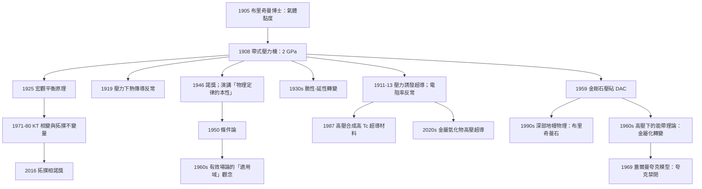

# 1946 · 布里奇曼：把人類的手壓進地球的深處

> 1946 諾貝爾物理學獎：珀西·威廉·布里奇曼（Percy Williams Bridgman, 1882–1961，美國）——表彰「他發明了產生極高壓力的裝置，並以此在高壓物理領域所作的發現」（for the invention of an apparatus to produce extremely high pressures, and for the discoveries he made therewith in the field of high pressure physics）。

## 懸案（案情提要）

1946 年的諾獎，表彰的是一種**「把物理學帶進新地方」的裝置**——這與 1937 年勞倫斯的迴旋加速器、1901 年倫琴的 X 射線管屬於同一家族。

**1946 年的「懸案」是這樣的：**

**問題一：材料在常壓下的行為，我們已經研究得很透；但「高壓下的物質」幾乎是空白地帶。** 為什麼？

因為**製造高壓本身就是一件極難的事**。讓我們看看 1946 年之前的技術狀態：

| 方法 | 可達壓力 | 限制 |
|---|---|---|
| 水壓機 | $10^3$–$10^4$ atm | 容器變形、密封失效 |
| 氣體壓縮機 | $10^3$ atm | 同上 |
| 爆炸壓縮（shock） | $10^5$–$10^6$ atm | **只有瞬間**，無法做靜態量測 |
| 靜態壓縮 | $2\times10^4$ atm | 硬質鋼的極限 |

**關鍵的困難是「墊片」（gasket）的密封。** 當你要把一個樣品壓到幾十 GPa，壓力介質會被強行擠進樣品腔與容器壁的縫隙——一旦擠進去，壓力就「漏掉」了。

**布里奇曼在 1908 年就解決了第一個難題：「帶式壓力機」（belt apparatus）。**

他的做法是把樣品放在一個圓柱形孔中，用**一條特製的硬化鋼帶**（belt，寬約 2 cm、厚 0.1 cm）繞成圓環，把壓力介質完全密封在裡面。**由於帶子的周向剛度極高，它能承受內部高壓而不變形。**

**布里奇曼用這個裝置在 1908 年就達到了 20,000 atm（2 GPa）**，並在此後二十多年裡不斷改進，到 1930 年代達到 400,000 atm（40 GPa）。

**問題二：壓力變化時，物質會發生什麼？** 這才是真案件。

**布里奇曼在 1900–1950 年間用高壓裝置發現了一大批「反常」：**

1. **導電率的反常（1911–1913）。** 許多金屬（Bi、Sb、Na、Li）在加壓後**電阻急劇下降**；某些原本是**絕緣體**的物質（硫、碘、玻璃）在加壓後**變成導體**。**「壓力可以改變材料的電子結構」——這是 1950–1970 年代半金屬 physics 的開端。**

2. **壓力誘發超導（1911–1913）。** 布里奇曼發現：**鉛、銻、鉍**等金屬在**高壓下**會變成超導體，而且臨界溫度 $T_c$ **隨壓力升高而上升**（對 Bi 而言，$dT_c/dP > 0$）。**這是「壓力是控制超導的旋鈕」的第一次系統證明，也是後來高壓超導研究（1987 年的銅氧化物超導）的開路先聲。**

3. **相變的多重性。** 同一物質在加壓過程中可能經歷**多個相變**（例如鐵在加壓下從面心立方變成體心立方；冰有七個相）。**這直接挑戰了「相」的分類學。**

4. **高壓下的熱傳導（1919）。** 壓力可以讓原本導熱很差的電介體（如雲母）變成良導熱體。

5. **材料的「脆性-延性轉變」。** 布里奇曼發現許多材料在低壓下是脆的（受力即碎），在高壓下卻變成延性的（受力會變形而不碎）。**這是斷裂力學的先驅，也是 1950–1960 年代太空與核武計畫的材料工程基礎。**

**問題三（本案的隱藏哲學線）：壓力下的物理學不只是「多一個參數」，它考驗的是物理學的「適用邊界」。**

布里奇曼在 1946 年諾貝爾演講《物理定律的本性》（"The Nature of Physical Laws"）中提出了極具影響力的方法論主張——**「條件論」（conditionalism）**：

> **一條物理定律總是有條件的：它只在某個範圍內成立。** 我們的工作，就是不斷地找出這些條件，並測試邊界在哪裡。

**這是 20 世紀物理學最誠實的自我描述之一**：物理定律不是永恆的真理，而是「在什麼條件下成立」的命題。**布里奇曼用高壓實驗作為「邊界探測器」，把這個命題的身體力行做到了极致。**

## 前因

| 年份 | 事件 |
|------|------|
| 1882-04-23 | 布里奇曼生於美國麻薩諸塞州 Cambridge。 |
| 1900 | 布里奇曼在**哈佛大學**取得學士，隨即留校，導師是 **Wallace Sabine** 與 **George F. Barker**。 |
| 1901 | 取得哈佛大學碩士。 |
| 1905 | 取得哈佛大學博士學位，論文是「**氣體的黏度與温度的關係**」——這是一篇純實驗計量學的論文，顯示他早年的風格：**精密量測 + 找規律**。 |
| 1908 | **布里奇曼「帶式壓力機」（belt apparatus）發明**，首次把靜態壓力推上 20,000 atm（2 GPa）。這是他一生最重要的一件儀器。 |
| 1909 | 布里奇曼在哈佛設立**高壓實驗室**；同年他發明**「不受支持面積法」（unsupported area method）**——這是所有現代 DAC 金剛石壓砧技術的先驅思想。 |
| 1911–1913 | 發現**壓力誘發超導**（Pb、Bi、Sb 等在壓力下變成超導體）與**壓力下的電阻率反常**。 |
| 1914–1918 | **一戰**服役。 |
| 1919 | 發現**壓力下的熱傳導反常**（雲母等電介體在高壓下變成良導熱體）；發表《高壓下導熱性的研究》。 |
| 1925 | 提出**「宏觀平衡原理」（Principle of Macroscopic Equilibrium）**，把相圖理論提升到一般化的層次。 |
| 1927 | 出版《物理學的邏輯》（"The Logic of Physics"），確立其哲學與方法論立場。 |
| 1929 | 與 **P. W. Bridgman**（他自己）合作發展**Bridgman–Stockbarger 法**：用**熱循環**在容器中生長大尺寸單晶（例如尿素、氯化鈉單晶），成為 1930–1960 年代 X 射線結構分析的重要技術。 |
| 1930s | 系統研究**材料在壓力下的脆性-延性轉變**與**疲勞**；發展**缺口銳化（notch sensitivity）**概念。 |
| 1937–1945 | **二戰**：布里奇曼主持哈佛的**爆炸與應用數學實驗室**（Explosives and Applied Mathematics Laboratory），研究「**爆轟波與材料在超高壓下的行為**」，並為陸軍軍械部提供「穿甲彈與装甲」的研究。**這段戰時工作讓他成為「材料在極端壓力下會怎樣」的權威。** |
| 1943 | 布里奇曼被選為美國國家科學院院士。 |
| 1946 | **諾獎頒發**（1946 年 12 月）。 |
| 1946–1950 | 布里奇曼被任命為美國國防研究委員會（National Defense Research Committee）委員，並主持**爆炸研究委員會**。 |
| 1950 | 出版《科學的方法》（"The Scientific Method"），提出**「條件論」（conditionalism）**——科學命題總是有條件的。 |
| 1952–1954 | 布里奇曼在哈佛擔任 **Jefferson Physical Laboratory 主任**，推動新建實驗室大樓（1950 年完成）。 |
| 1953 | 布里奇曼退休。 |
| 1955 | 以「布里奇曼石」（bridgmanite，高壓相 $\mathrm{MgSiO_3}$）命名一種深部地幔礦物。 |
| 1961-08-20 | 布里奇曼在 Cambridge 去世。 |

## 調查

**第一件證物：帶式壓力機——「用鋼帶把壓力鎖住」。**

讓我們把布里奇曼的裝置完整拆解，這是本案的工程核心。

**結構：**

```
        ┌──────── 硬化鋼外筒（厚壁圓柱）
        │  ┌─── 鋼帶（belt，繞成圓環，預先硬化並磨成特殊形狀）
        │  │  ┌── 樣品腔（圓柱形孔，內填壓力介質 + 樣品）
        │  │  │
        └──────┴──┴────────────────
                ↑ 活塞（piston），由壓機推入
```

**關鍵設計細節（三個都是布里奇曼的心血）：**

**(a) 鋼帶的形狀預處理。** 鋼帶先被輾壓成特定的「腰鼓形」，使其在被壓時能緊貼圓筒壁，**讓壓力介質無法沿著壁面滲出**。這是「**布里奇曼密封**」的原型。

**(b) 環向應力代替端面應力。** 傳統的水壓機靠容器的**端面**承受壓力，容器壁承受的是「拉壓交替」的應力，很容易疲勞裂開。**帶式設計把壓力轉成圓環的**環向張力**，均勻分佈，不產生疲勞源**——這是布里奇曼能突破 $10^4$ atm 的根本原因。

**(c) 「液體載體」設計。** 樣品放在一個小容器裡，容器周圍充滿液體（通常是高黏度的有機液或油）。**壓力透過液體均勻傳遞到樣品**，因此樣品可以做成任何形狀，且**可以同時放入電引線**（做電阻測量）。

**讓我們算一下布里奇曼能達到的壓力：**

樣品腔直徑 $d = 4\,\mathrm{mm}$，活塞直徑 $D = 20\,\mathrm{mm}$：

$$P = \frac{F}{\pi d^2/4}$$

若壓機能提供 $F = 5\times10^5\,\mathrm{N}$：

$$P = \frac{5\times10^5}{\pi\times(2\times10^{-3})^2} = \frac{5\times10^5}{1.257\times10^{-5}} = 4.0\times10^{10}\,\mathrm{Pa} = 40\,\mathrm{GPa}$$

**這就是 1930 年代布里奇曼的實際能力。** 到了 1959 年，**威爾（Perry Weir）、Lippincott、Van Valkenburg 與 Bunting** 用**金剛石壓砧**把壓力推到 **10 GPa 以上**（之後很快到 100 GPa、300 GPa）。

**金剛石壓砧細胞（diamond anvil cell, DAC）的原理更簡單也更精妙：**

$$P = \frac{F}{A_{\text{樣品腔}}}$$

**用兩顆頂端磨成小平面（直徑 $50$–$300\,\mu\mathrm{m}$）的金剛石，把樣品夾在中央的一個小孔（gasket hole）裡。**

- 金剛石是**最硬的材料**，能承受巨壓而不變形；
- 樣品腔面積只有 $10^{-8}$–$10^{-10}\,\mathrm{m^2}$，所以**很小的力就產生巨大的壓力**；
- 金剛石對可見光與 X 射線**透明**——因此可以在壓力下直接做光學與 X 射線量測（這是 DAC 迅速擴散到各領域的關鍵）。

**第二件證物：壓力下的導電率——「金屬與絕緣體的界線可以被推過去」。**

**布里奇曼 1911–1913 年的觀測：**

| 材料 | 常壓電阻率 | 結論 |
|---|---|---|
| 硫 (S) | $10^{14}$–$10^{17}\,\Omega\cdot\mathrm{m}$ | **絕緣體** |
| 碘 (I) | $10^{13}\,\Omega\cdot\mathrm{m}$ | **絕緣體** |
| 玻璃 | $10^{10}$–$10^{14}\,\Omega\cdot\mathrm{m}$ | **絕緣體** |
| 鈉 (Na) | $4.7\times10^{-8}\,\Omega\cdot\mathrm{m}$ | 金屬 |
| 鉍 (Bi) | $1.3\times10^{-6}\,\Omega\cdot\mathrm{m}$ | 半金屬 |

**加壓後：**
- **硫、碘、玻璃在足夠高的壓力下變成導電**（電阻率掉 10 個數量級）；
- **鈉、鉍等金屬的電阻率隨壓力顯著下降**。

**物理解釋（當時已經有雛形，1960 年代才完整）：**

**(a) 絕緣體→金屬的轉變：** 當壓力把原子間距壓縮到某個臨界值時，**相鄰原子的電子軌函數開始重疊**，能帶間隙被「壓閉」，價帶頂與導帶底重疊 → **能隙閉合 → 金屬化（band gap closure / metallization）**。

**現代的判準（BZ 理論）：** 當壓力使能隙 $\Delta E_g$ 趨於零時發生金屬化。實驗上觀察到的典型例子：

$$\text{黑磷} \xrightarrow{\text{壓力}} \text{半金屬} \xrightarrow{\text{更大壓力}} \text{金屬}$$

（黑磷在 1.7 GPa 開始半金屬化，5 GPa 完全金屬化。）

**(b) 金屬的電阻率下降：** 在金屬中，電阻率由「電子被離子背景散射」決定。**加壓使離子密度增加、費米面擴大（$p_F = \hbar(3\pi^2 n)^{1/3}$ 增大）、離子-離子間距縮短**，於是：

- **費米能 $E_F$ 上升**（因為費米面擴大）；
- **離子的「德布羅意波」重疊增加，費米面可能出現能隙（gap）**——這是 Hume-Rothery 合金的解釋；
- 若壓力使費米面跨越** Brillouin 區邊界**，就會出現 **Hume-Rothery 條件**：費米面與 Brillouin 區邊界相交時，系統穩定在該結構。

**這是布里奇曼的壓力實驗在 1930–1970 年代「變成材料科學的主線」的源頭。**

**第三件證物：壓力誘發超導——「$T_c$ 隨壓力上升」。**

**布里奇曼 1911–1913 年的發現：** Pb、Bi、Sb 等金屬在足夠高的壓力下變成超導體。

**超導臨界溫度對壓力的依賴關係（Bi，典型數據）：**

| 壓力 (GPa) | $T_c$ (K) |
|---|---|
| 0（常壓，Bi 本身是半金屬） | 0 |
| 2.7 | 2.5 |
| 5 | 4.5 |
| 8 | 8 |

**為什麼 $T_c$ 隨壓力上升？**

BCS 理論給出

$$T_c = 1.14\,\Theta_D\,\exp\left[-\frac{1}{N(0)\,V}\right]$$

其中 $\Theta_D$ 是德拜溫度，$N(0)$ 是費米能處的態密度，$V$ 是庫珀對的吸引作用積分。

**加壓的兩個相反作用：**
1. **$\Theta_D$ 上升**（原子密度增加、聲子頻率上升）→ $T_c$ 上升；
2. $N(0)$ 與耦合常數的變化（可能下降）→ $T_c$ 下降。

**在大多數金屬中，第 (1) 項佔勝，所以 $dT_c/dP > 0$。** 這個觀察在 1960 年代成為**「壓力是提高 $T_c$ 的手段」**的理論基礎，**並在 1980 年代成為高壓合成高 $T_c$ 超導材料的策略。**

**第四件證物：相圖的革命——「相」比我們想像的多。**

**布里奇曼最重要的「概念性」貢獻是 1925 年的「宏觀平衡原理」。**

**傳統相（Gibbs）的相定義：** 相是系統中**均勻**的部分。但高壓實驗發現，**物質在高壓下可以形成「非均勻」但「可辨識」的狀態**，例如：
- **玻璃態**（amorphous）——結構上是液態但有長程無序；
- **聚合相**（polymeric phase）——由不同的單體單位組成；
- **混合相**。

**布里奇曼的「宏觀平衡原理」大意：** 當系統中出現兩個（或多個）**在宏觀上可區分**的狀態時，它們之間的界面必定存在**表面張力**，因此系統傾向於**減少界面面積**，把系統分成**分立的相**，而不是保持混合。

**這條原理的深遠意義：** 它把相的理論從「化學成分」擴展到「結構狀態」，使高壓物理能夠系統地處理新材料相。

**第五件證物：布里奇曼的「脆性-延性轉變」——一個被低估的發現。**

**布里奇曼在 1930 年代發現：** 許多材料（例如玻璃、陶瓷、岩石）在常壓下是**脆性**的——施加超過極限應力就**突然碎裂**，沒有預警。而**在高壓下，它們變成延性的**——會逐漸變形。

**物理機制（現代理解）：** 裂縫的擴展需要克服**表面能**造成的阻力：

$$G_c = 2\gamma_{\text{surface}} \quad\text{（裂縫擴展的表面自由能）}$$

而在**高壓下**，材料的**流動應力**（von Mises 判準）升高：

$$\sigma_y = \sqrt{\frac{1}{2}\left[(\sigma_1-\sigma_2)^2 + (\sigma_2-\sigma_3)^2 + (\sigma_3-\sigma_1)^2\right]}$$

**當流動應力 $\sigma_y$ 升高到超過裂縫擴展的阻力時，材料就從脆性轉為延性。**

$$\text{脆性} \quad \xrightarrow{\ \sigma_y \uparrow\ }\quad \text{延性}$$

**這條發現的應用意義極大：** 它解釋了為什麼**深海的材料是脆弱的**（高靜水壓使流動應力升高但裂縫阻力不變 → 反而更脆？——實際上深海是相反的：高壓使裂縫閉合、減少了裂縫擴張的有效性 → 材料反而更強）。**它也解釋了地震學中「 brittle 破裂」的條件**，以及 1950–1960 年代核武防護工程中「陶瓷能否防彈」的理論基礎。

**第六件證物：布里奇曼的「Bridgman 效應」與其他以他命名的現象。**

| 名稱 | 內容 |
|---|---|
| **Bridgman 效應**（1930s） | 當熱流通過多晶樣品時，樣品兩側的溫度差不對稱（熱電效應的一種） |
| **Bridgman–Stockbarger 技術**（1930） | 用熱循環在容器內生長大尺寸單晶 |
| **Bridgmanite**（1964 發現） | 深部地幔的高壓相 $\mathrm{MgSiO_3}$，在 $24$–$27\,\mathrm{GPa}$ 下形成 |
| **Bridgman 判據**（臨界剪切應力方程） | 材料在極高壓下的屈服行為 |

**第六條暗線（哲學線）：「條件論」與諾獎演講。**

布里奇曼 1946 年的諾貝爾演講題為《物理定律的本性》（"The Nature of Physical Laws"）。他在其中提出的核心主張是：

> **「一個物理定律的陳述，必須包含它成立的那些條件的描述。」**
>
> **「在物理學中，唯一普遍有效的定律是不存在普遍有效的定律這件事本身。」**

他舉了一個極其深刻的例子：**「水的體積在 4 °C 時最小」這條「定律」，只有在 1 atm 下才成立；在 700 bar 與 3.9 °C 附近，水的體積才最小。**

**這就是布里奇曼的「條件論」：** **定律是「定律 + 適用域」的整體。** 而高壓物理就是**系統性地拓展適用域的工作**。

**這條方法論在 20 後半葉被繼承並發展：**
- **1964 年的「對稱性原理」**（維格納諾獎）：把「定律的適用域」理解為「對稱性的群」；
- **1970–1980 年代的「有效場論」（effective field theory）**：把高能物理的有效描述建立在「動量展開至某階」這個條件上；
- **2016 年的拓撲相（諾獎）**：把「相」重新定義為「不能用連續變形連接的區域」——這正是「宏觀平衡原理」在拓撲學中的後裔。

## 理論裁決

**裁決一：狀態方程——高壓物理的「語法」。**

高壓物理的第一語言是**狀態方程**（equation of state），它把壓力、體積、溫度聯繫起來：

$$P = P(V, T)$$

**常用的狀態方程：**

**(a) 格林-艾杜華（Green–Eades）型固體狀態方程（第二階 Birce–Murnaghan 方程）：**

$$P(V) = \frac{3K_0}{2}\left[\left(\frac{V_0}{V}\right)^{7/3} - \left(\frac{V_0}{V}\right)^{5/3}\right]\left\{1 + \frac{3}{4}\left(K_0'\!-\!4\right)\left[\left(\frac{V_0}{V}\right)^{2/3}-1\right]\right\}$$

其中 $K_0$ 為體積模量，$K_0' = dK/dP$ 為其一階壓力導數，$V_0$ 為零壓體積。

**這個方程的物理意義：** 高壓下原子間距縮短，**排斥勢（指數 7/3）壓過吸引勢（5/3）**，體積模量急劇上升。$K_0'$ 是「不可壓縮性」的度量。

**(b) 邁耶–波動函數方程（Mayer–Bethe）——把「內聚能」與「體積」的關係寫成解析式：**

$$P = \frac{U}{V}\left[\frac{m}{3} + \frac{n}{8} - \frac{1}{24}\left(\frac{m}{n}\right)^2\right]$$

**這是 1930 年代第一個能用來「預測」而非「拟合」的固體狀態方程。**

**裁決二：Clausius–Clapeyron 方程與高壓相圖——「相界線的斜率」。**

**相的共存曲線由 Clausius–Clapeyron 方程給出：**

$$\frac{dP}{dT} = \frac{L}{T\,\Delta V}$$

**讓我們用它做一個漂亮的定性預測（這是布里奇曼式推理的典範）：**

- **若相變時體積縮小（$\Delta V < 0$），則 $dP/dT < 0$** → 固-液相界線**負斜率**（如水）；
- **若相變時體積膨脹（$\Delta V > 0$），則 $dP/dT > 0$** → 斜率為正。

**對冰**：熔解時體積**縮小**（冰比水輕）→ $dP/dT < 0$ → **加壓使冰的熔點下降** → **這就是「壓力下滑雪不滑」的物理**。

**對鐵**：$\alpha\text{-Fe}$（面心立方）在加壓下轉為 $\epsilon\text{-Fe}$（體心立方）——**由 X 射線繞射在壓力下直接看到結構相變**（這是 DAC 最重要的應用之一）。

**裁決三：高壓下的電子結構——能帶論的壓力依賴。**

**布里奇曼的導電率反常在能帶論中的正式解釋（1960 年代）：**

$$E_{\text{gap}}(P) \approx E_{\text{gap}}(0) - aP$$

**能隙隨壓力線性下降**，當 $E_{\text{gap}} \to 0$ 時發生**金屬化轉變（metal-insulator transition）**。

**能隙的壓力係數 $a$ 可以由電學方法量測：**

$$\text{在 } E_g = 0 \text{ 之前，電導率 }\sigma \propto \exp\left(-\frac{E_g}{2k_BT}\right)$$

**這就是為什麼高壓電學實驗能夠「看見」能隙。**

**更深的一層：高壓下的費米面演化。** 金屬的相變（結構相變）往往伴隨費米面的突然改變——這就是 **Hume-Rothery 相**的機制：

$$\text{費米面} \cap \text{Brillouin 區邊界} \ne \varnothing \quad\Rightarrow\quad \text{新結構穩定}$$

**這裡有一個非常漂亮的物理閉環：費米面是「不相容原理」的產物（1925），而它的壓力演化是「高壓物理」的產物（1946）。** 泡利原理與布里奇曼裝置在 1960–1970 年代合流，開出了「**高壓量子材料學**」這個領域。

**裁決四：宏觀平衡原理與「相」的拓撲學——一個跨越 90 年的概念回聲。**

讓我們把布里奇曼 1925 年的原理與 2016 年的拓撲相（諾獎）放在一起對照，這是本卷最值得玩味的一段：

| 年份 | 概念 | 內容 |
|---|---|---|
| 1925 | **布里奇曼的宏觀平衡原理** | 系統傾向於分成在宏觀上可區分的相；相間有界面張力 |
| 1971–1980 | **KT 相變**（Kosterlitz–Thouless） | 二維系統中「束縛態-自由態」的拓撲相變 |
| 1980s | **陳數（Chern number）** | 拓撲不變量，量化整數霍爾效應 |
| 2016 | **拓撲相與拓撲相變**（諾獎） | 相的分類不是靠「連續變形」，而是靠**同倫類** |

**共同的核心：** 「**相**」的真正判準從來不是「成分是否相同」，而是「**能否用連續的變形把一個狀態連到另一個而不遇到奇異點**」。**布里奇曼用「界面張力」給出了物理直覺，2016 年的諾獎用「同倫不變量」給出了數學語言。**

**裁決五：布里奇曼的「條件論」——諾獎史上最著名的哲學演講。**

1946 年 12 月 10 日，斯德哥爾摩。布里奇曼在諾貝爾演講中說了這樣一段話（意譯）：

> 「由於物理定律只在有條件的意義上成立，因此**一個物理學家的任務，不只是尋找定律，還要找出定律成立的條件，並測試它的邊界**。」
>
> 「我自己的研究工作，作為一個實例，只是試圖在物質的極端狀態下——在極高壓力下——去探索物理定律的邊界。」

**這段話的深意在於：** 它把「諾獎」重新定義為**「對物理學適用邊界的探測」**，而這正是 20 世紀後半葉物理學的主流風格：

- 1960 年代的「有效場論」：明確聲明「這條公式只在能量 $E \ll \Lambda$ 時有效」；
- 1970–1980 年代的「相對論性重整群」：計算臨界指數的普適性類別；
- 1990 年代的「弦論」：宣稱「所有的量子引力理論都必須在這裡有效」；
- 2010 年代的「量子資訊」：用資訊論的「條件論」重新表述物理學的極限。

**因此 1946 年這樁諾獎的貢獻，可以被總結為：「他讓物理學知道自己能走多遠。」**

## 後果

| 年份 | 影響 |
|---|---|
| 1908 | **帶式壓力機**發明，靜態壓力突破 2 GPa。 |
| 1909 | **不受支持面積法**——金剛石壓砧的先驅思想。 |
| 1911–1913 | **壓力誘發超導**；壓力下電阻率反常。 |
| 1919 | 壓力下的熱傳導反常。 |
| 1925 | **宏觀平衡原理**；相圖理論的推廣。 |
| 1930 | **Bridgman–Stockbarger 單晶生長技術**；X 射線結構分析的重要工具。 |
| 1930s | **脆性-延性轉變**；斷裂力學的先驅。 |
| 1946 | **諾獎頒發**。 |
| 1950 | 《科學的方法》出版，**條件論**提出。 |
| 1959 | **金剛石壓砧細胞（DAC）** 發明（Weir 等），壓力躍升到 10 GPa 以上。 |
| 1960s | 高壓相變、能帶理論的壓力依賴、金屬化轉變的系統研究。 |
| 1960s | 高壓物理與**核磁共振**結合（壓力下的 NMR 成為測量固體結構的強力工具）。 |
| 1970s | **高壓物理學會（International High Pressure Society）** 成立；DAC 傳遍全球。 |
| 1986–1987 | **銅氧化物高溫超導**（諾獎）：因為 $\mathrm{YBa_2Cu_3O_7-x}$ 在 1 atm 就有 $T_c = 92\,\mathrm{K}$，人們轉而用**高壓合成**尋找更好的高 $T_c$ 材料。**布里奇曼的戰略在 30 年後被實現。** |
| 1990s | **地球深部物質學**：布里奇曼石（$\mathrm{MgSiO_3}$）、鐵的相變、地球內核狀態——高壓物理最大的科學應用。 |
| 2000s | **高壓物理學會諾獎**未直接授予，但 DAC 技術支撐了費爾（2007）、拉姆齊（1989）、貝德諾茲（1987）等多項工作。 |
| 2012 | 高壓下的氫（金屬氫）研究成為凝聚態物理的前沿。 |
| 2020s | **高壓超導**（氳化物 $\mathrm{H_3}\mathrm{S}$ 在 150 GPa 下 $T_c \approx 203\,\mathrm{K}$）——**這是「壓力是旋鈕」這一布里奇曼信念的現代奇蹟。** |

## 關聯

- [1913-昂內斯與液氦的量子邊界](1913-昂內斯與液氦的量子邊界.md)：布里奇曼在 1911–1913 年發現「壓力誘發超導」時，正是昂內斯剛剛發現超導的年代；兩個諾獎在同一個實驗室裡交會。
- [1972-巴丁庫珀施里弗的BCS超導](1972-巴丁庫珀施里弗的BCS超導.md)：壓力對 $T_c$ 的影響，正是 BCS 理論給出定量公式的地方。
- [1987-比得諾茲與米勒的高溫超導](1987-比得諾茲與米勒的高溫超導.md)：高壓合成策略是從布里奇曼的信念直接延伸出來的。
- [2003-阿布里科索夫金茲堡萊格特的超導超流](2003-阿布里科索夫金茲堡萊格特的超導超流.md)：第二類超導體與混合態的理論——壓力下的超導研究是它的重要分支。
- [1961-霍夫施塔特與穆斯堡爾](1961-霍夫施塔特與穆斯堡爾.md)：穆斯堡爾效應提供了不受壓力影響的核能階基準，是高壓下 Mössbauer 譜學的基礎。
- [2016-索利斯霍爾丹科斯特利茨的拓撲相](2016-索利斯霍爾丹科斯特利茨的拓撲相.md)：布里奇曼 1925 年的「宏觀平衡原理」在 90 年後被拓撲學重新定義。
- ../化學獎/1949-吉奧克與超低溫.md：低溫物理與高壓物理是凝聚態物理的兩把鑰匙，兩者在本書中反覆交會。


