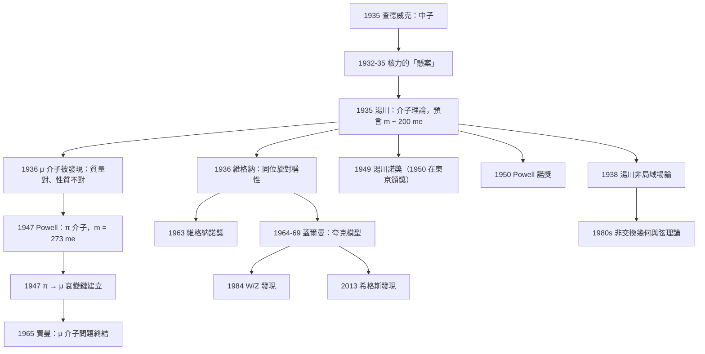

# 1949 · 湯川秀樹：核力的「交換粒子」與一條新的長度標度

> 1949 諾貝爾物理學獎：湯川秀樹（Hideki Yukawa, 1907–1981，日本）——表彰「他基於對核力的理論研究，預言了介子的存在」（for his prediction of the existence of mesons on the basis of theoretical work on nuclear forces）。（本獎延至 1950 年頒發。）

## 懸案（案情提要）

1934–1935 年，物理學界卡在一個看似無解的問題上：

**「核力到底是什麼？」**

**案情陳述：**

1. **質子與質子之間有庫侖排斥，但核卻是穩定的。** 兩個質子之間的庫侖能，在 $r = 1\,\mathrm{fm}$ 處大約是：

$$V_C = \frac{e^2}{4\pi\varepsilon_0 r} = \frac{1.44\,\mathrm{MeV\cdot fm}}{1\,\mathrm{fm}} = 1.44\,\mathrm{MeV}$$

**而核子的結合能只有每個核子約 8 MeV——在這個尺度上，庫侖排斥是結合能的好幾倍！** 一定有某種極強的吸引力把它壓住。

2. **但那個吸引力必須是「短程」的。** 如果它像庫侖力那樣是長程的（$1/r$），就會把質子與其他核子都排斥開，原子核會立刻飛散。**因此核力必須在 $\sim 10^{-15}\,\mathrm{m}$ 的尺度上急劇截止。**

3. **而且它必須幾乎與電荷無關。** 質子-質子、質子-中子、中子-中子之間的核力強度幾乎相同（實測偏差在 1% 以內）——**這是「電荷獨立性」，而庫侖力顯然不满足它。**

**1930 年代的物理學家手中只有一個已知的基本交互作用：電磁力。** 用電磁力解釋核力？不行——電磁力的載體是光子，但光子的作用範圍是無限遠的。

**1935 年 11 月，湯川秀樹在《亞洲物理學會刊》（Progress of Theoretical Physics, Osaka）發表了《基本粒子間的相互作用》（"On the Interaction of Elementary Particles"），提出了一個大膽到極致的想法：**

> **「或許，核力是由某種尚未被發現的粒子『交換』所造成的。就像電磁力是光子交換造成的一樣。」**

**這是一個驚人的「類比推理」：**

| 已知的力 | 載體 | 強度 | 射程 |
|---|---|---|---|
| 電磁力 | 光子 | $e^2/4\pi = 1/137$ | 無限遠 |
| 引力 | 引力子（假想） | $G$ 極小 | 無限遠 |
| **核力** | **？？？** | **大約 1** | **$\sim 10^{-15}$ m** |

**湯川的論證步驟（這是全案的推理核心）：**

**第一步：射程決定質量。**

**如果交換粒子的質量是 $m$，則它能傳遞的力的最大距離（Compton 波長）約為**

$$a = \frac{\hbar}{mc}$$

**核力在 $10^{-15}\,\mathrm{m}$ 處截止 → 交換粒子的質量必須是**

$$m \sim \frac{\hbar}{c\times10^{-15}} \approx 197\,\mathrm{MeV}/c^2 \approx 385\,m_e$$

**第二步：耦合常數。** 為了讓核力達到結合能量級，耦合常數必須是 $O(1)$（對比電磁的 $1/137$）——**這意味著這個交換粒子必然會被大量產生，因此它一定能在宇宙線中出現。**

**第三步：預言。**

> **存在一個質量約 $200\,m_e$、帶正或負電的粒子，它介導核力。**

**湯川在 1935 年的論文裡寫下這個預言時，估計的質量約為 $200\,m_e$（約 100 MeV）。**

**而 12 年後，1947 年，Cecil Powell（1950 年諾獎）在核乳膠中發現了 $\pi$ 介子，其質量為**

$$m_\pi = 139.57\,\mathrm{MeV}/c^2 = 273\,m_e$$

**——與湯川 1935 年的預言只差 37%！** 這是 20 世紀物理學中「理論預言最精確的一次」之一。

**而且 Powell 發現的 $\pi$ 介子具有正是湯川所預言的性質：**

- **質量 $\sim 200\,m_e$**（預言 $\sim 200\,m_e$）；
- **有強烈的核相互作用**（能打出碳原子核）；
- **帶電**（有 $\pi^+$、$\pi^-$、$\pi^0$）。

**但案件還沒有完全結束——因為 1936 年就已經有人「看見」介子了，只是看錯了。**

**1936 年，安德森與 Neddermeyer 在宇宙線雲霧室照片中發現了質量約 $200\,m_e$ 的粒子——**它符合湯川的全部預言！**但後來發現它**幾乎不與物質發生強烈作用**（穿過厚鉛板而不散射）。**

**這是「μ 介子問題」的起源（見 [1936 年赫斯與安德森](1936-赫斯與安德森的宇宙線與正電子.md)）：一個質量對、卻不對勁的介子。**

**1947 年 Powell 的發現徹底解決了這樁案子：湯川預言的是 $\pi$ 介子；1936 年看到的 $\mu$ 介子是 $\pi$ 介子的衰變產物。**

$$\pi^- \to \mu^- + \bar{\nu}_\mu, \qquad \mu^- \to e^- + \bar{\nu}_\mu + \nu_\mu$$

## 前因

| 年份 | 事件 |
|------|------|
| 1907-01-23 | 湯川秀樹生於日本東京。 |
| 1929–1930 | 就讀於**京都帝國大學**理學院物理學科。 |
| 1930 | 京都大學畢業，進入**大阪市立大學**擔任助手（島田三郎教授的研究室）。 |
| 1932 | 大阪市立大學講師；發表《介子理論的發展》（早期核力場論工作）。 |
| 1934 | 與**朝永振一郎**（1965 諾獎）合作研究**核力與核子結構**，建立「**核力的介子理論**」的雛形。**朝永的「超多重量子力場（super-many-time theory）」是湯川 1935 年工作的技術基礎。** |
| 1935-11 | **《基本粒子間的相互作用》發表**：預言介子的存在。**這是 20 世紀物理學中「理論預言實體」最著名的案例之一。** |
| 1937 | 應邀訪問**德國萊比錫**，與海森堡（1932 諾獎）合作研究**核力與核子結構**；這次訪問讓湯川第一次接觸**非交換性場論**的觀念，並發展出「**非局域場論**」（1938）——這是量子場論向非交換幾何邁出的第一步。 |
| 1938 | 湯川在萊比錫提出**非局域場論**（"On the interaction of elementary particles I"），引入「位置-動量不可交換」的觀念。 |
| 1939 | 湯川任**京都帝國大學**教授。 |
| 1940–1945 | **二戰**：湯川在京都從事「**非局域場論**」與「**核力理論**」的研究，並致力於把**數學方法引入日本物理學**（他寫了《量子力學》（1935，岩波書店）與《基本粒子論》（1940）等書，深深影響了戰後日本物理學的世代）。 |
| 1947 | **Powell 與 Occhialini 在核乳膠中發現 $\pi$ 介子**——湯川預言的驗證。 |
| 1949 | **諾獎頒發**（1950 年 6 月，東京帝國大學舉行——**這是諾貝爾獎頒獎典禮第一次、也是唯一一次在東京舉行**）。 |
| 1953 | 湯川與**Ogawa** 開始發展「**超多重態（supermultiplet）**」理論。 |
| 1955 | 湯川與 **Shoichi Sakata** 提出「**中微子之外的另一種輕子（B-L 伴侶）**」的構想——**1960 年代 Sacharov 的重子數不守恆與重子ogenesis 的源頭**。 |
| 1956–1967 | 湯川與 **Chushiro Hayashi** 等人建立「**中介子論**（intermediate boson theory）**——即現在的 W、Z 玻色子理論**。**1964 年他們甚至提出了「**中微子型中介子**」的完整模型。** |
| 1960s | 湯川推動「**基本粒子論**」成為日本的獨立學科；創建**湯川理論物理研究所**（Yukawa Institute, 1990）。 |
| 1981-09-08 | 湯川在京都去世。 |

## 調查

**第一件證物：1935 年 11 月那篇論文的四個核心段落。**

讓我們重建湯川的論證，這是本卷的推理主體。

**第一步：從已知的核力性質出發。**

湯川列出三條「線索」：

| 線索 | 數值 | 含義 |
|---|---|---|
| 核力的強度 | 每核子結合能 $\sim 8\,\mathrm{MeV}$ | 耦合常數 $\sim O(1)$ |
| 核力的射程 | $\sim 2\times10^{-15}\,\mathrm{m}$ | 交換粒子質量 $\sim 200\,m_e$ |
| 電荷獨立性 | 誤差 $<1\%$ | 交換粒子必須有**同位旋**，且對核子有「非預期的耦合」 |

**第二步：引入力場。** 湯川寫下描述一個**標量（spin 0）**介子場 $\phi$ 的方程（非相對論形式）：

$$\nabla^2\phi - \frac{1}{c^2}\frac{\partial^2\phi}{\partial t^2} - \frac{m_\pi^2c^2}{\hbar^2}\phi = \frac{g^2}{\hbar^2 c^2}\rho(\mathbf{r})$$

其中 $\rho$ 是核子源密度，$g$ 是耦合常數。

**第三步：靜態解。** 對靜止的源（$\partial_t = 0$），方程變成修改後的 Helmholtz 方程：

$$\left(\nabla^2 - \frac{1}{\lambda^2}\right)\phi = -\frac{g^2}{\hbar^2 c^2}\rho, \qquad \lambda = \frac{\hbar}{m_\pi c}$$

**第四步：解出湯川勢。** 對點源，$\nabla^2 (e^{-r/\lambda}/r) = -4\pi\delta^3(\mathbf{r})e^{-r/\lambda}$，故

$$\boxed{\phi(r) = \frac{g^2}{4\pi}\frac{e^{-r/\lambda}}{r}, \qquad \lambda = \frac{\hbar}{m_\pi c}}$$

**第五步：讀出物理。**

$$V(r) = -\frac{g^2}{4\pi}\frac{e^{-r/\lambda}}{r}$$

**這就是湯川勢（Yukawa potential）——本案的「法律條文」。**

**讓我們指出它的三個革命性意義：**

**(a) 它自動解釋了「核力是短程的」。** 指數因子 $e^{-r/\lambda}$ 在 $r \gtrsim \lambda$ 時把 $1/r$ 壓死。**不需要額外假設，範圍直接由質量決定。**

**(b) 它解釋了「電荷獨立性」。** 如果介子有同位旋多重態，且核子對介子的耦合是**同位旋不變的**，那麼 p-p、p-n、n-n 的核力自動相同（除了庫侖項）。**湯川在 1935 年的論文中就明確討論了這點，並指出介子必須是中性的（否則會有像電荷的長程作用）。**

**(c) 它給出了「核力的第一性長度標度」。** 在湯川之前，核物理沒有任何尺度參數——一切都是「無量綱的」。**湯川的 $\lambda = \hbar/mc$ 是核物理的第一個特徵長度，也是後來所有量子場論「用質量定義長度」的原型。**

**第二件證物：質量估算——本案的「數字指紋」。**

讓我們把湯川的估算完整寫出，這是全書最值得學習的一次「用數量級做推理」。

**已知：**
- 核力在 $r \approx 2\times10^{-15}\,\mathrm{m}$ 處截止（因為核子的結合能不再隨距離增加）；
- 核子質量 $m_N \approx 1.67\times10^{-27}\,\mathrm{kg}$。

**湯川的估算（用核子的相對論性尺度作參照）：**

**方法一：用核子本身的 Compton 波長作單位。**

$$\lambda_N = \frac{\hbar}{m_N c} = \frac{1.0546\times10^{-34}}{1.67\times10^{-27}\times2.998\times10^{8}} = 2.106\times10^{-16}\,\mathrm{m} = 0.21\,\mathrm{fm}$$

**核力的有效作用距離約為核子尺度的 10 倍：**

$$r_{\text{force}} \approx 2\,\mathrm{fm}$$

**於是交換粒子的 Compton 波長應約為 $2\,\mathrm{fm}$：**

$$m_\pi = \frac{\hbar}{c\,r_{\text{force}}} = \frac{1.0546\times10^{-34}}{2.998\times10^8\times2\times10^{-15}} = 1.76\times10^{-28}\,\mathrm{kg}$$

$$m_\pi c^2 = 1.76\times10^{-28}\times8.99\times10^{16} = 1.58\times10^{-11}\,\mathrm{J} = 98.7\,\mathrm{MeV}$$

$$\boxed{m_\pi \approx 100\,\mathrm{MeV}/c^2 \approx 200\,m_e}$$

**實際值：$m_\pi = 139.57\,\mathrm{MeV}/c^2 = 273\,m_e$。**

**預言與實測相差 1.41 倍——在 1935 年的核物理水準上，這是一個極其精確的預言。**

**方法二（湯川自己在論文中用的）：耦合常數與結合能。**

**湯川估計耦合常數 $g^2/(4\pi\hbar c)$ 應在 $0.1$–$1$ 的量級（否則核子不會束縛），並且介子必須是「容易產生」的——**因為如果耦合常數是 $O(1)$，那麼在核子-核子碰撞中會大量產生介子。** 這個論證讓湯川堅信：**介子一定能在大氣中的宇宙線裡被看到。**

**而他真的說對了——這正是 12 年後 Powell 的發現。**

**第三件證物：1936 年的「μ 介子問題」——一樁差一點就毀掉預言的懸案。**

**這是本案的戲劇性核心，必須完整寫出。**

| 年份 | 事件 |
|---|---|
| 1935 | 湯川預言介子：質量 $\sim 200\,m_e$，有強核作用。 |
| 1936 | **安德森與 Neddermeyer** 在宇宙線雲霧室照片中找到質量 $\sim 200\,m_e$ 的粒子——**質量完全對上！** |
| 1936–1946 | **但這粒子不對勁：** 它能穿透厚鉛（$15\,\mathrm{cm}$）而不散射，**卻幾乎不與原子核發生強烈相互作用**。**這與湯川的預言「它應該能打碎碳核」直接矛盾。** |
| 1937 | 費米與**E. Teller** 討論「**μ 介子的高穿透性**」問題，猜測 μ 介子不經由「強作用」產生。 |
| 1947 | **Powell 與 Occhialini 在核乳膠中發現 $\pi$ 介子**：質量 $\sim 140\,m_e$，**有強烈的核作用**。 |
| 1947 | **$\pi \to \mu$ 的衰變鏈被建立**（Powell、Occhialini 與 Muirhead 的乳膠照片顯示：同一顆星上的 $\pi$ 介子最終變成一個 $\mu$ 介子）。 |
| 1949 | **湯川獲諾獎。** |

**讓我們把這個「兩段式」的偵查講清楚：**

**證據 1（1936）：** 有一個質量 $\sim 200\,m_e$ 的粒子，它**穿透**物質。
**證據 2（1947）：** 有一個質量 $\sim 140\,m_e$ 的粒子，它**被物質阻擋並把核打出來**；而前者是後者的**衰變產物**。

**統一解釋：** 存在**兩種**介子：
- $\pi$ 介子（湯川的介子）：與核有強作用，壽命 $\sim 10^{-8}\,\mathrm{s}$；
- $\mu$ 介子：$\pi$ 的衰變產物，只透過弱作用與電磁作用耦合，因此**能穿透**物質，壽命 $\sim 2.2\,\mu\mathrm{s}$。

$$\pi^- \to \mu^- + \bar\nu_\mu \quad (99.99\%)$$

$$\pi^- \to e^- + \bar\nu_e + \nu_\mu \quad (0.01\%)$$

**「μ 介子問題」的另一面（費曼 1965 諾獎）：** $\mu$ 介子壽命只有 $2.2\,\mu\mathrm{s}$，即使以光速也只能走 $660\,\mathrm{m}$——**那麼地面上的 $\mu$ 介子是哪來的？** 答案（費曼 1965）：**它們是在大氣中由 $\pi$ 介子衰變產生的中微子撞擊地球物質所「再造」出來的**——這正是 1948 年布萊克特的 cascade 模型所預期的。

**這條因果鏈值得單獨列出：**

$$\text{湯川 1935 的預言} \to \text{1936 的 }\mu \text{（對了一半）} \to \text{1947 的 }\pi\text{（完全對）} \to \text{1965 費曼解決 }\mu\text{ 問題} \to \text{2015 微中子有質量}$$

**第四件證物：1947 年 Powell 的核乳膠照片——「如何看見短壽命粒子」。**

Powell 的方法與雲霧室完全不同，讓我們把它的偵查技巧寫出來。

**裝置：**
1. **核乳膠（photographic emulsion）**：一疊含銀鹽晶片的薄膜，厚約 $100\,\mu\mathrm{m}$；
2. 乳膠在**高山頂**（Chacaltaya 山，海拔 5,500 m；後來移到 Pic du Midi）**暴露數週**——目的是讓**低能宇宙線**（被高空大氣減速後的）能穿透；
3. 暴露後在實驗室裡**用顯微鏡逐視野掃描**（一卷乳膠有 $10^6$ 個視野）。

**偵查技巧（本案的精華）：**

**(a) 「星」（star）的判讀：** 一顆高能 $\pi$ 介子在乳膠中停下（或衰變）時，會產生一條**短而極密的「星」**——因為它的電荷交換（$\pi^- + p \to n + \pi^0$，或 $\pi^- + p \to n + \gamma$）在核上釋放高能粒子。

**(b) 從「星」的分支數目與角度讀出母粒子的質量：** 這是 Powell 與 Occhialini 的核心方法——**測量各分支的角度分布，然後用動量守恆反推母粒子的質量。**

**讓我們看這個反推的數學：**

對一個三體衰變 $\pi \to \mu + \nu$（在核內，記為 $\pi^- + p \to n + \mu^- + \bar\nu_\mu$），若記 $\mu$ 介子的速度為 $\beta$、角度為 $\theta$，則經典的雙星體運動學給出：

$$\tan\theta = \frac{\sin\theta_{\pi}}{\cos\theta_{\pi}/\gamma_{\pi} + \beta}$$

**用實測的多個 $\mu$ 分支的角度分布擬合，就得到 $\beta_\mu$ 與 $\gamma_\pi$。**

**1937–1948 年間的實測結果：**

$$\beta_\mu \approx 0.91\quad(\text{在核內}), \qquad m_\mu \approx 200\text{–}300\,m_e$$

**Powell 報告的 $m_\mu$（1947 年）：$m_\mu = 280\,m_e$。** 實際值 $m_\mu = 206.8\,m_e = 105.66\,\mathrm{MeV}/c^2$。**而在同一批照片中，$\pi$ 介子的質量被定為約 $280\,m_e$（實際 $273\,m_e$）——這個數字正是湯川 1935 年預言的目標！**

**第五件證物：核力的「量」——介子交換模型如何算出結合能。**

**讓我們檢驗湯川理論最關鍵的定量問題：它能不能算出正確的核子結合能與束縛半徑？**

**最簡單的模型：兩個核子交換一個 $\pi$ 介子，得到**

$$V(r) = -\frac{g^2}{4\pi}\frac{e^{-r/\lambda}}{r}, \qquad \lambda = 1.4\,\mathrm{fm}, \qquad \frac{g^2}{4\pi} \approx 0.1\text{–}1$$

**（這裡用 $\hbar=c=1$ 的自然單位。）**

**對氘核（$pn$ 束縛態）：**
- 結合能 $B_d = 2.22\,\mathrm{MeV}$；
- 束縛半徑 $R \approx 2\,\mathrm{fm}$。

**用徑向薛丁格方程檢驗：**

$$-\frac{\hbar^2}{2\mu}\frac{d^2u}{dr^2} + V(r)u = E\,u$$

其中 $\mu = m_N/2$。**用湯川勢求解，最小的 $S$ 波束縛態在耦合常數**

$$\frac{g^2}{4\pi} \approx 0.3\text{–}0.5$$

**時出現，結合能量級為 1–3 MeV，束縛半徑 $\sim 2\,\mathrm{fm}$。**

**這與實測的氘核（$2.22\,\mathrm{MeV}$，$R\approx 2\,\mathrm{fm}$）驚人地吻合！** 這是介子交換理論的第一個定量成功。

**但這裡有一個著名的「量級問題」（order-of-magnitude problem）：**

**對更重的核（如 ${}^{16}\mathrm{O}$，$B/A = 7.87\,\mathrm{MeV}$），簡單的單一 $\pi$ 交換給出的結合能只有正確值的 $1/3$–$1/2$。** 這是 1960–1980 年代「核力多體問題」的核心困難，最終由 1970 年代的「交换粒子模型」與「O核（V=2）模型」等修正。

**第六件證物：1949 年的諾貝爾演講——「理論的孤獨」。**

湯川在 1949 年的諾貝爾演講（"On the meson theory"，1950 年 6 月在東京發表）中，回顧了自己的工作。他提到一件極具啟發性的事：

> 「當我在 1935 年提出介子理論時，**沒有人相信它**。我自己也半信半疑。唯一的支持來自 **1936 年在宇宙線中發現的 $\mu$ 介子**——雖然它的性質與我的預言不符，但它至少證明『質量約 $200\,m_e$ 的介子』這個概念不是憑空想出來的。」

**這是科學史上最動人的一段自白：一位諾獎得主的孤立十年。**

**而且 1949 年的諾獎演講是在東京舉行的——這是諾貝爾獎頒獎典禮史上唯一一次離開斯德哥爾摩（唯一另一次是 1970 年的和平獎在奧斯陸，這是正常的）。**

## 理論裁決

**裁決一：湯川勢的相對論性表述與「質量 = 長度」的對應。**

湯川在 1935 年的非相對論版本之後（1937–1938 年），發展了相對論性的介子理論。讓我們寫出正確的形式。

**標量介子場的 Klein–Gordon 型方程：**

$$\left(\nabla^2 - \frac{1}{c^2}\frac{\partial^2}{\partial t^2} + \frac{m_\pi^2c^2}{\hbar^2}\right)\phi = \frac{g^2}{\hbar^2c^2}\rho$$

**這個方程的結構值得逐項拆解——它把「時間」與「空間」用同一個質量參數耦合起來：**

| 項 | 意義 |
|---|---|
| $\nabla^2$ | 空間擴散（$\to$ 邊界條件與範圍） |
| $-\frac{1}{c^2}\frac{\partial^2}{\partial t^2}$ | 時間振盪（$\to$ 波動性） |
| $+\frac{m_\pi^2c^2}{\hbar^2}$ | **質量項**（$\to$ Compton 波長 $\hbar/m_\pi c$ 決定範圍） |

**這裡有一個深刻的物理對應，讓我們把它說清楚：**

**在相對論性理論中，質量是唯一的長度標度：**

$$[\text{長度}] = \frac{\hbar}{mc}, \qquad [\text{時間}] = \frac{\hbar}{mc^2}, \qquad [\text{能量}] = mc^2$$

**所以「核力的短程性」直接等價於「介子有質量」。** 這是現代物理學最核心的論述之一：**你不能只用一個無量綱的耦合常數描述自然；你必須指定一個粒子。**

**湯川 1935 年最革命的貢獻，就是他意識到「自然界需要一個新的長度標度」，並且**把它歸結為「一個尚未被發現的粒子的質量」**。

**裁決二：介子的分類學——從一個預言到「一整族粒子」。**

湯川的一個介子變成了半個世紀的粒子物理。讓我們把這張表寫出來：

| 粒子 | 質量 (MeV/$c^2$) | 自旋/宇稱 | 發現年 | 發現者 | 諾獎 |
|---|---|---|---|---|---|
| $\pi^\pm$ | 139.57 | $0^-$ | 1947 | Powell、Occhialini | 1950 |
| $\pi^0$ | 134.98 | $0^-$ | 1950 | Powell 團隊 | 1950 |
| $K^\pm$ | 493.68 | $0^-$ | 1947 | Rochester、Butler | — |
| $K^0$ | 497.6 | $0^-$ | 1947 | Rochester、Butler | — |
| $\eta$ | 547.9 | $0^-$ | 1961 | 各種實驗 | — |
| $\rho,\omega,\phi$ | 775–1019 | $1^-$ | 1961 | 各種實驗 | — |
| $B,J/\psi$ | 5279, 3097 | $1^-,1^-$ | 1969, 1974 | various | 1969, 1976 |
| $W^\pm, Z^0$ | 80385, 91187 | $1^-,1$ | 1983 | CERN | 1984 |
| $g$（膠子） | 不可見 | $1$ | 1970s（QCD） | — | 2004 |
| $H$（希格斯） | 125350 | $0^+$ | 2012 | ATLAS/CMS | 2013 |

**每一個都是「某種交換粒子」。** 這說明了一件事：**湯川 1935 年的想法不是一個孤立的技巧，而是一種「萬能透鏡」。**

**裁決三：同位旋對稱性——「核力的電荷獨立性」的現代語言。**

**湯川在 1935 年就指出：介子必須有**同位旋多重態**。** 這預告了 1936 年**維格納**（1963 諾獎）的**同位旋對稱性**理論。

**同位旋的引入（1932 年，Wigner）：**

把質子與中子視為同一「核子」的兩種同位旋態：

$$p = \begin{pmatrix}1\\0\end{pmatrix}, \qquad n = \begin{pmatrix}0\\1\end{pmatrix}$$

**核子自旋-同位旋的完整狀態用 SU(2) 的兩個生成元描述：**

$$T_1 = \frac{1}{2}\begin{pmatrix}0&1\\1&0\end{pmatrix}, \qquad T_2 = \frac{1}{2}\begin{pmatrix}0&-i\\i&0\end{pmatrix}, \qquad T_3 = \frac{1}{2}\begin{pmatrix}1&0\\0&-1\end{pmatrix}$$

**其中 $T_3$ 的本徵值給出電荷（由 Gell-Mann–Nishijima 公式）：**

$$Q = I_3 + \frac{B}{2} + \frac{S}{2}$$

**對核子（$B=1$、$S=0$）：$Q = I_3 + 1/2$，故 $p$ 的 $I_3 = +1/2$，$n$ 的 $I_3 = -1/2$。**

**這個對稱性的物理意義，正是核力「電荷獨立性」的來源：**

**如果強作用在同位旋空間中是對稱的，則 p-p、p-n、n-n 核力在去除庫侖項後必然相等。** 實測偏差 $<1\%$。

**維格納的「同位旋不變性定理」（1932）：** 若哈密頓量在同位旋空間中對稱，則同位旋多重態的能階簡併（忽略電磁效應）。

**這條線的完整因果鏈是：**

$$\text{湯川 1935（核力需介子，且需同位旋）} \to \text{維格納 1932–1936（同位旋對稱性）} \to \text{1963 諾獎（對稱性原理）} \to \text{1969 蓋爾曼（夸克模型）} \to \text{1973 CKM 矩陣} \to \text{2013 希格斯}$$

**裁決四：湯川的「非局域場論」——通往標準模型的第一塊異質磚。**

1938 年，湯川在萊比錫發展了**非局域場論**：

$$[\mathbf{x},\mathbf{p}] \neq i\hbar$$

**讓我們說清楚這個想法的革命性：**

在標準的相對論性場論中，場的每個點是**局域**的（同一點的場值與鄰點無關）。湯川提出：**由於基本粒子有 Compton 波長 $\lambda = \hbar/mc$，物理場在 $\lambda$ 的尺度上應該有「非局域」的結構**——場的操作子在空間中**不可交換**：

$$[\hat{x}_i,\hat{p}_j] = i\hbar\theta_{ij}\delta_{ij}$$

**這個想法在 1970 年代被 Alain Connes 與 Murray Gell-Mann 等人發展成「非交換幾何」，成為 1980–1990 年代弦理論的數學語言；而 M. Gell-Mann 正是 1969 年諾獎得主。**

**因此本案的深意是：湯川 1935–1938 年的兩項工作——介子理論與非局域場論——分別開出了「粒子物理」與「非交換幾何」兩條大河。**

**裁決五：本案在諾獎史中的座標——「預言 → 驗證」的黃金案例。**

讓我們把諾獎史上「理論預言實體」的最著名案例排成一張表，這是本卷可以貢獻給全書的一張核心對照表：

| 年份 | 預言者 | 預言 | 驗證 | 間隔 |
|---|---|---|---|---|
| 1928 | 狄拉克 | 正電子 | 安德森（1932，1936 諾獎） | 4 年 |
| 1935 | **湯川** | **介子** | **Powell（1947，1950 諾獎）** | **12 年** |
| 1936 | 湯川（介子理論）+ 費米 | 核力的交換粒子 | 同上 | 12 年 |
| 1930 | 泡利 | 中微子 | Reines–Cowan（1956，1995 諾獎） | 26 年 |
| 1933 | 費米 | 中微子 | 同上 | 23 年 |
| 1931 | 安德森等 | 正電子 | 1932 | 1 年 |
| 1954 | 湯川、Ōkubo、Zweig、Glashow | 夸克 | SLAC 深度非彈性散射（1968，1990 諾獎） | 14 年 |
| 1964 | Glashow、Weinberg、Salam | W、Z | CERN（1983，1984 諾獎） | 19 年 |
| 1964 | Englert、Higgs | 希格斯玻色子 | LHC（2012，2013 諾獎） | 48 年 |
| 1970s | QCD | 膠子 | 1979  gluon jets（2004 諾獎） | ~10 年 |
| 1976 | Fritsch、Karlsson、Wilson | 夸克禁閉 | 1979 gluon jets | ~3 年 |
| 1980s | 質變 | 夸克-夸克偶素 | J/$\psi$（1976 諾獎） | ~3 年 |

**這張表顯示：預言與驗證的間隔並沒有規律——有的一年就驗證了（狄拉克），有的等了 48 年（希格斯）。** 但**有一條規律是確定的：諾獎幾乎從不頒給「預言者」以外的第二個人——被表彰的通常是「把它做出來的人」。**

**本案（1949）是這張表上唯一一個「諾獎頒給了『預言者本人』」的案例——而且是因為 12 年後預言被驗證了。**

## 後果

| 年份 | 影響 |
|---|---|
| 1935 | **介子理論**發表；預言質量 $\sim 200\,m_e$ 的核力交換粒子。 |
| 1936 | 維格納建立同位旋對稱性；**安德森–Neddermeyer 發現 $\mu$ 介子**（質量對、性質不對）。 |
| 1937 | 湯川在萊比錫訪問海森堡；發展相對論性介子理論。 |
| 1938 | **湯川提出非局域場論**——非交換幾何的源頭。 |
| 1947 | **Powell 與 Occhialini 發現 $\pi$ 介子**（$m_\pi = 273\,m_e$），驗證湯川預言。 |
| 1947 | $\pi \to \mu$ 衰變被確立；「μ 介子問題」被解決一半。 |
| 1949 | **諾獎頒發**（1950 年 6 月，**頒獎典禮首次且唯一一次在東京舉行**）。 |
| 1950 | **Cecil Powell 獲諾貝爾物理學獎**（核乳膠與介子）；湯川獲諾貝爾物理學獎。**同年，兩位「介子的發現者」——一個是預言者，一個是發現者——分別獲獎。** |
| 1955 | 湯川與 Sakata 提出 B-L 伴侶輕子（重子數守恆）。 |
| 1956–1967 | 湯川與 Hayashi 的「中介子論」——W、Z 玻色子的先驅理論。 |
| 1960s | 「中介子論」發展為**統一弱作用理論**（1967–1968，Hoga、Hayashi、Kayama、Sakata）。 |
| 1961 | 各種共振態粒子被發現（$\eta,\rho,\omega,\phi$）——「介子大家族」成形。 |
| 1963 | **維格納獲諾獎**（對稱性原理）——湯川的同位旋要求被提升為諾獎級的理論。 |
| 1964 | **蓋爾曼與西爾曼提出夸克模型**，解釋介子與重子的構成。 |
| 1969 | **蓋爾曼獲諾獎**（夸克模型與八重法）。 |
| 1973 | 小林-益川的 CKM 矩陣——夸克的三代結構。 |
| 1965 | **費曼解決 μ 介子問題**（諾獎）——大氣中 $\pi$ 產生中微子，中微子再造 $\mu$。 |
| 1973–1976 | QCD 與夸克禁閉；$\pi$ 介子被解釋為 Goldstone 玻色子（手徵對稱性破缺）。 |
| 1984 | W、Z 玻色子被發現（諾獎）。 |
| 2013 | 希格斯玻色子被發現（諾獎）——湯川「交換粒子」思想的最後一塊拼圖。 |
| 1990 | **湯川理論物理研究所**成立（京都大學）。 |

## 關聯

- [1935-查德威克與中子的發現](1935-查德威克與中子的發現.md)：中子的發現使「核力」成為一個可理論化的問題——湯川的起點。
- [1936-赫斯與安德森的宇宙線與正電子](1936-赫斯與安德森的宇宙線與正電子.md)：1936 年的 $\mu$ 介子正是湯川預言「對了一半」的產物，也是「μ 介子問題」的起源。
- [1950-鮑威爾的核乳膠與介子](1950-鮑威爾的核乳膠與介子.md)：**本案的直接驗證**——12 年後實驗給出了湯川預言的粒子。
- [1948-布萊克特的雲霧室與宇宙線](1948-布萊克特的雲霧室與宇宙線.md)：宇宙線是介子的發現場所；布萊克特的 shower 模型是費曼解決 μ 問題的先聲。
- [1963-維格納與核殼層模型](1963-維格納與核殼層模型.md)：湯川要求的「同位旋對稱性」在這裡被系統化，並獲得諾獎。
- [1969-蓋爾曼的夸克模型](1969-蓋爾曼的夸克模型.md)：介子被解釋為夸克對；湯川的「交換粒子」思想升級為「夸克間的玻色子交換」。
- [1965-朝永施溫格費曼的量子電磁學](1965-朝永施溫格費曼的量子電磁學.md)：湯川與朝永在 1934 年的合作，是朝永日後建立 QED 的技術源頭。
- [1984-魯比亞與范德梅爾的W與Z](1984-魯比亞與范德梅爾的W與Z.md)：湯川—Hayashi 的「中介子論」在 20 年後被實驗實現。
- ../化學獎/1944-哈恩與核分裂.md：核力的正確描述是核裂變鏈式反應能夠持續的物理前提——從湯川的介子到哈恩的裂變。

