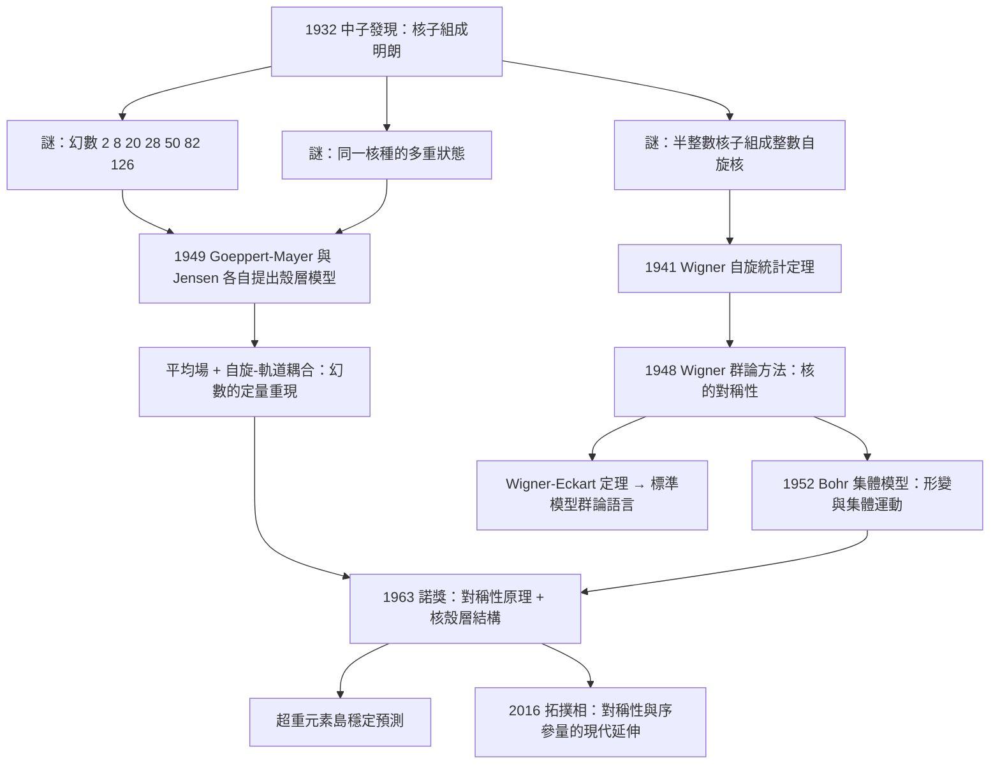

# 1963 · 維格納與核殼層模型：把核子當成電子來排座位

> 1963 諾貝爾物理學獎：尤金·保羅·維格納（Eugene Paul Wigner, 1902–1995，美國/匈牙利）——表彰「他對原子核與基本粒子理論的貢獻，特別是透過發現並應用基本對稱性原理」；瑪麗亞·格佩特-梅耶（Maria Goeppert Mayer, 1906–1992，美國）與約翰內斯·漢斯·丹尼爾·延森（Johannes Hans Daniel Jensen, 1907–1993，西德）——表彰「他們關於核殼層結構的發現」。

## 懸案（案情提要）

1930 年代末，物理學家手上握著一份奇怪的「失蹤人口名單」。

中子被發現之後，人們很快弄清楚了原子核的組成：**質子**提供電荷與大部分質量，**中子**提供額外質量。但立刻出現一個要命的問題——**原子核裡的核子（質子加中子）去了哪裡？**

實驗測出的核子數一目了然，然而核子明明是自旋 $\tfrac{1}{2}$ 的粒子，卻展現出**整數自旋**的行為：

| 核種 | 質子數 $Z$ | 中子數 $N$ | $Z+N$ | 自旋（實測） |
|---|---|---|---|---|
| $^{16}\mathrm{O}$ | 8 | 8 | 16 | $0$（整數） |
| $^{12}\mathrm{C}$ | 6 | 6 | 12 | $0$（整數） |
| $^{4}\mathrm{He}$ | 2 | 2 | 4 | $0$（整數） |
| $^{3}\mathrm{H}$ | 1 | 2 | 3 | $\tfrac{1}{2}$（半整數） |
| $^{7}\mathrm{Li}$ | 3 | 4 | 7 | $\tfrac{3}{2}$（半整數） |

**半整數自旋的粒子怎麼會組成整數自旋的系統？** 這在當時是無解的謎——就像問「兩枚硬幣如何擲出『正面』這個面？」沒有任何已知的量子力學機制能解釋它。

第二個謎是「**幻數**」。實驗上發現某些核種格外穩定、格外常見（$^{4}\mathrm{He}$、$^{16}\mathrm{O}$、$^{40}\mathrm{Ca}$、$^{56}\mathrm{Fe}$、 $^{132}\mathrm{Sn}$……），對應的核子數是：

$$2,\ 8,\ 20,\ 28,\ 50,\ 82,\ 126$$

**這些數字是週期表的 $2, 8, 18, 32$ 的核版**。但為什麼？如果核子沒有結構、彼此作用也很弱，就不該有週期性。

第三個謎：**同一個核種竟然可以存在於不同狀態**（例如 $^{28}\mathrm{Al}$ 有兩個半衰期相差很大的同位素），意味著核子可以「排不同的座位」。

**三個謎，一個共同的直覺：核子也許並非無差異的散兵——它們像電子一樣，有殼層。**

這就是 1963 年諾獎的三宗案子：**維格納給了「對稱性」這把鑰匙，格佩特-梅耶與延森給了「殼層」這張圖紙。**

## 前因

| 年份 | 事件 |
|---|---|
| 1911 | 盧瑟福用 $\alpha$ 粒子散射證明原子核的存在，質量集中於極小的核內。 |
| 1913 | 波耳提出量子化的原子軌道模型；原子中電子能階的概念誕生。 |
| 1919 | 盧瑟福實現第一个人工核嬗變（$^{14}\mathrm{N} + {}^{4}\mathrm{He} \to {}^{17}\mathrm{O} + p$）。 |
| 1928 | 狄拉克提出相對論性電子方程；反物質概念浮現。 |
| 1930 | 費米提出統計力學的新狀態（費米狄拉克分布），確立「自旋 $\tfrac{1}{2}$ 全同粒子」的數學語言。 |
| 1931 | 哈恩與斯特拉斯曼發現核分裂；**中子轟擊原子核的化學（費米「中子俘獲」）成為常規手段**。 |
| 1932 | 查德威克發現中子，核組成問題解開。 |
| 1932 | 海森堡提出核力的「交換力」模型（質子-中子互換），首次引入**核力與自旋交換有關**的想法。 |
| 1934–1936 | 費米、哈恩、斯特拉斯曼等建立放射化學的「化學家式」核素鑑別法，累積大量幻數異常證據。 |
| 1936 | 玻爾提出「複合核」觀點：核反應先形成高激发態的複合核再衰變。 |
| 1937 | 費米與海森堡提出核力的介子交換理論（湯川的預言在此接軌）。 |
| 1938 | 邁特納弗里施給出核分裂的理論解釋並提出「液滴模型」。 |
| 1948–1949 | **格佩特-梅耶與延森各自獨立提出核殼層模型**（美國核物理年會的「同步奇蹟」）。 |
| 1949 | 維格納發表〈核子的相互作用與核子的能階〉，建立**群論方法處理核對稱性**。 |
| 1950s | 詹森（維格納的學生）推廣群論工具；核經典場論（interacting boson model）由 Arima 與 Iachello 發展。 |
| 1955 | 維格納因核反應堆理論（鏈式反應、增殖反應堆）獲「原子能和平利用獎」——這份工程遺產使他得以在冷戰年代堅持研究基礎核物理。 |
| 1963 | **諾獎頒發**。 |

## 調查

**第一件證物：奇偶效應的兩難。**

第一個謎怎麼解？維格納給出的線索來自**核統計**：同一偶偶核（$Z$、$N$ 皆為偶）與奇奇核的自旋分佈不同，奇偶核（$Z$、$N$ 一奇一偶）則遵循最簡單的規則。玻恩在 1920 年代的實驗（統計方法）與威格納 1941 年的「**自旋統計定理**」說明：

> **一個半整數自旋粒子的系統，其總波函數在交換兩個全同粒子時必為反對稱（費米子統計）。**

對核子而言，交換對稱性由相對自旋 $\mathbf{s}$ 與同位旋 $\mathbf{t}$ 共同決定：

$$\Psi(\text{交換}) = (-1)^{L+S+T}$$

其中 $L$ 為軌道角動量、$S$ 為總自旋、$T$ 為總同位旋。**問題是：波函數必須同時對空間部分（由 $\mathbf{r}_i - \mathbf{r}_j$ 決定）與同位旋部分都反對稱。** 空間與同位旋波函數的組合方式，正是「對稱性原理」發揮威力的地方。

**第二件證物：格佩特-梅耶的「旋轉魔法」。**

瑪麗亞·格佩特-梅耶（當時在芝加哥大學「自願不拿薪」的副教授身分——因為她丈夫約瑟夫是regular faculty，而當時的制度不允許夫妻同時在同校任職）注意到一個奇怪的模式：**某些核的基態自旋，在核子數改變時的變化規律，像極了原子中電子的「角動量加一」遊戲。**

她的洞見是：對**幻數**核，基態自旋取最大值：

$$J = N\ (\text{核子數為偶數時})$$

| 幻數 $N$ | 核種 | $J$（實測） |
|---|---|---|
| 2 | $^{4}\mathrm{He}$ | $0$ |
| 8 | $^{16}\mathrm{O}$ | $0$ |
| 20 | $^{40}\mathrm{Ca}$ | $0$ |
| 28 | $^{56}\mathrm{Fe}$ | $0$ |
| 50 | $^{132}\mathrm{Sn}$ | $0$ |

而**在幻數之間**，自旋遵循一條極具辨識度的規則：

$$J = \left|N - N_0\right|,\qquad N_0 \in \{\ldots, 0, 2, 8, 20, 28, 50, 82, \ldots\}$$

例如 $^{15}\mathrm{N}$（$N=7$）自旋 $J=\tfrac{1}{2}$（距幻數 8 差 1）；$^{17}\mathrm{O}$（$N=9$）$J=\tfrac{5}{2}$（距 8 差 1 但在 8 之上，配對方式不同）；$^{41}\mathrm{Ca}$（$N=21$）$J=\tfrac{7}{2}$。

**這正是原子中「電子填入軌域」的行為學。** 也就是說：**核子有「軌域」**。

**第三件證物：延森的獨立發現與競賽。**

約翰內斯·延森在漢堡的歐洲核子研究機構（Institut für Kernphysik）做 $\beta$ 衰變研究，他發現某些核的基態有**特別大的自旋**（例如 $^{209}\mathrm{Bi}$ 的 $J=\tfrac{9}{2}$），並且他注意到「配對效應」：核子成對時自旋相消，所以只有**未配對核子數**決定基態自旋。延森在 1948 年 12 月的報告裡明確說出：

> 「我認為核子有類似電子的殼層結構。」

**兩人的發現相隔僅數月，卻是各自獨立完成的。** 1950 年在哥本哈根召開的核物理會議上，兩人同意共同發表——這是一段科學史上為人稱道的「同步奇蹟」（a remarkable coincidence）。格佩特-梅耶在諾獎演說中說：「我認為我們在相似的時間、相似的地方、相似地工作……這必定是某種神祕的引導。」

**第四件證物：魔數的理論難題。**

即使承認「有殼層」，還有一個硬問題：**為什麼是 2, 8, 20, 28, 50, 82, 126 這七個數，而不是別的？**

答案藏在核力的**自旋-軌道耦合**裡。核力包含：

$$V = V_{\text{central}}(r) + V_{\text{ls}}(\mathbf{l}\cdot\mathbf{s}) + V_{\text{tensor}} + \cdots$$

**關鍵在 $V_{\text{ls}}$ 項：自旋與軌道的耦合。** 當一個核子的軌道角動量 $\mathbf{l}$ 與自旋 $\mathbf{s}=\tfrac{1}{2}$ 耦合時，$j = l \pm \tfrac{1}{2}$ 兩個能階**分裂**，而分裂幅度隨 $l$ 迅速增大：

$$\Delta E_{\text{ls}} \propto \langle \mathbf{l}\cdot\mathbf{s}\rangle \propto l\ (\text{對 } j = l + \tfrac{1}{2}), \qquad \propto -(l+1)\ (\text{對 } j = l - \tfrac{1}{2})$$

**分裂把原本「簡併」的大殼層打碎成兩組，一高一低。** 高 $j$ 的能階被往上推、低 $j$ 的被往下拉——結果就是**能階間隔重新排列**，從而產生幻數。

用自旋-軌道耦合的量級估計：

$$\frac{\Delta E_{\text{ls}}}{E} \sim \frac{g_l - g_s}{2}\cdot \frac{\langle \mathbf{l}\cdot\mathbf{s}\rangle}{l(l+1)}$$

由於核子的 Schmidt 磁極因子差異（$g_l = 1$，$g_s = -0.12$ 或 $+0.58$ 依中子/質子而定）與原子電子截然不同，**分裂效應在核裡比在原子裡強得多**——這正是核幻數「特別整齊」的原因。

## 理論裁決

**裁決一：維格納的「群論方法」——對稱性是自然界的語法。**

維格納的貢獻在諾獎措辭裡被寫成「**發現並應用基本對稱性原理**」。這不是客套話，而是一整套方法論。

他的核心洞見：**物理定律不因座標系的選擇而改變，這個要求會強迫量子力學的解具有特定的對稱結構。** 具體地說，若哈密頓量在 unitary 變換 $U$ 下不變：

$$U^\dagger H U = H \quad\Longrightarrow\quad [H, U] = 0$$

那麼 $H$ 的本徵態可選擇為 $U$ 的共同本徵態。對角化 $U$ 得到的**量子數**，就是能階的分類標籤。

維格納在核物理中建立的基本詞彙是：

- **時間反演 $\mathcal{T}$**：運動反向，$t \to -t$；
- **空間反演 $\mathcal{P}$**：$\mathbf{r} \to -\mathbf{r}$；
- **同位旋旋轉**：質子 $\leftrightarrow$ 中子；
- **$\mathrm{SU}(2)$ 旋轉**：自旋方向旋轉。

**自旋-軌道耦合不能獨立存在**——它意味著軌道角動量與自旋的**相對方向**有意義，也就是**空間反演 $\mathcal{P}$ 不再是對稱性**。這就是為什麼核裡 $\mathbf{l}\cdot\mathbf{s}$ 耦合能存在而原子裡（無外磁場時）不行：**自旋是相對概念**。

維格納還證明了著名的**維格納定理**（1929，關於含時演化的時間平移對稱性）與 **Wigner–Eckart 定理**（處理角動量耦合與投影定理）。後者是群論工具在物理中的極致應用。

**裁決二：格佩特-梅耶-延森的「平均場 + 自旋-軌道耦合」殼層模型。**

核殼層模型的出發點是一個大膽近似：**把每個核子都看成在一個平均的、球對稱的核位阱中獨立運動。**

$$H = \sum_{i=1}^{A}\left[-\frac{\hbar^2}{2m}\nabla_i^2 + V(r_i) + V_{\text{ls}}(\mathbf{l}_i\cdot\mathbf{s}_i)\right]$$

其中 $V(r)$ 是平均核位阱（近似 Woods-Saxon 或諧振子形式）。**但正是「獨立粒子」這個近似最出人意料地給出了「集體性」的結果**：核子的軌道是集體的（所有核子共享集體流體運動），因此**個別核子的 $l$ 與 $j$ 量子數並非固定不變**，而會隨集體形變而混合。

這就是 **「獨立粒子」與「集體運動」的共存**——一個看似矛盾的組合，卻是核物理的核心。

**幻數 2, 8, 20, 28, 50, 82, 126 的定量來源**：用 Woods-Saxon 位阱加自旋-軌道項計算能譜，計算出的能階間隔圖（magic numbers 出現在費米能 $E_F$ 附近有大間隔處）重現實驗幻數。**這是「數字解出來的，不是硬塞的」**——這是分階段對稱性理論的核心勝利。

**裁決三：核的「集體模型」——形變與集體運動。**

維格納之外，阿格·波耳（$\alpha$ 粒子散射專家）於 1952–1953 年提出集體模型：原子核會**形變**（像液滴），形變的旋轉（轉動帶）與振動（振動帶）給出明確的能階模式。

$$E_{\text{rot}}(I) = \frac{\hbar^2}{2\mathcal{I}}\, I(I+1),\qquad E_{\text{vib}}(n) = n\,\hbar\omega_{\text{vib}}$$

維格納 1954 年之後發展的**核的集體場論**（與 Arima、Iachello 一起發展的相互作用玻色子模型）更進一步：把核子成對地看成「玻色子」，用群方法描述集體自由度。**維格納因此在 1963 年之後仍持續拿「諾貝爾之外的榮譽」，但物理學界普遍認為，他若在 1963 年之後再拿一次諾獎並非不可能**（事實上，若無戰後對他在核物理貢獻的重新評價，他很可能更早獲獎）。

**裁決四：維格納-艾卡特定理——自旋的量子化起源。**

這是 1927–1928 年維格納最重要的定理之一：**在只有自旋 $\tfrac{1}{2}$ 與軌道角動量的系統中，角動量總和必為半整數**：

$$J = j_1 \oplus j_2 \oplus \cdots = \frac{1}{2}, \frac{3}{2}, \frac{5}{2}, \ldots$$

**推論：整數自旋的系統必須含有自旋 $\tfrac{1}{2}$ 的粒子數為偶數。** 這正是第一個謎的答案——**奇偶效應不是統計的巧合，而是角動量耦合的必然**。維格納在 1940 年代把這套理論用於原子核，成功解釋了核的奇偶效應與自旋分佈。

**裁決五：為什麼「對稱性」在諾獎措辭裡排在第一位？**

讓我們把諾獎委員會的取捨講清楚。1963 年有大量候選：核物理、粒子物理、凝聚態都有重大成果。委員會選了維格納（方法論）、格佩特-梅耶與延森（具體模型），理由是：

1. **維格納的對稱性方法是一個「可教、可學、可傳承」的物理**，不是一次性發現；
2. **格佩特-梅耶的殼層模型把「化學週期表」的直覺帶進了原子核**，讓核物理有了週期性語言；
3. 這三人在「**核子也有殼層**」這個結論上互相獨立、互相印證。

**值得強調的一個史實細節**：維格納是**唯一一位在核物理、粒子物理、凝聚態理論三個領域都有根本貢獻，並且活得足够長（93 歲）見證 1963 年諾獎的人**。他在 1995 年 12 月 26 日於帕洛阿圖去世，幾乎滿 94 歲。

## 後果

| 年份 | 影響 |
|---|---|
| 1948–49 | 核殼層模型提出；幻數獲得解釋。 |
| 1950s | 群論方法廣泛進入核物理；核經典場論。 |
| 1952–53 | 波耳的集體模型：核形變、轉動帶、振動帶。 |
| 1963 | **諾獎頒發**。 |
| 1964 | 獨立核模型（independent-particle model）與集體模型之争。 |
| 1960s–70s | 核的「超重元素」搜尋、裂變理論、大核基態形變的觀測。 |
| 1975 | 核集體運動理論榮獲「諾貝爾物理學獎之外的重大肯定」：同年維格納因此獲**諾貝爾基金會 60 週年紀念獎**（與 Arima、Rainwater 的集體模型工作同獲）。 |
| 1980s | 超重元素（${}^{208}\mathrm{Pb}$ 之後的「島穩定」預測 $Z \sim 114$–$126$）；殼層效應在超重核中的驗證。 |
| 1990s | 核結構現代理論（密度泛函理論 + 殼層效應）；錘形核的觀測。 |
| 2003 | 勒格特獲諾獎（超流體的量子理論），與維格納的對稱性方法一脈相承。 |
| 2016 | 拓撲相的諾獎（索利斯、霍爾丹、科斯特利茨）——「對稱性與序參量」方法論的又一次延伸。 |

## 關聯

- [1935-查德威克與中子的發現](1935-查德威克與中子的發現.md)：核子組成的謎底，本案一切問題的起點。
- [1949-湯川秀樹與介子的預言](1949-湯川秀樹與介子的預言.md)：核力的傳遞者；殼層模型的位阱來自平均場近似。
- [1951-考克饒夫與沃吞的人工嬗變](1951-考克饒夫與沃吞的人工嬗變.md)：人工核反應讓核素清單快速膨脹，幻數證據得以累積。
- [1958-契忍可夫輻射與粒子偵測](1958-契忍可夫輻射與粒子偵測.md)：同時代的粒子偵測技術。
- [1965-朝永施溫格費曼的量子電磁學](1965-朝永施溫格費曼的量子電磁學.md)：維格納的群論方法在量子場論中的巔峰應用。
- [2003-阿布里科索夫金茲堡萊格特的超導超流](2003-阿布里科索夫金茲堡萊格特的超導超流.md)：維格納對稱性方法的另一分支（費米液體的 Landau 能階）。
- [2016-拓撲相變與拓撲相](2016-拓撲相變與拓撲相.md)：從「殼層」到「拓撲序」的秩序概念演化。
