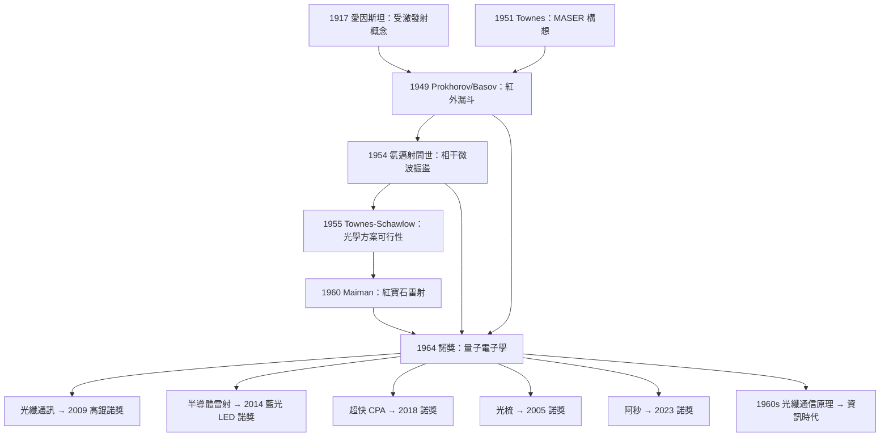

# 1964 · 湯斯、巴索夫、普羅霍羅夫：把光本身當成放大器

> 1964 諾貝爾物理學獎：查爾斯·哈德·湯斯（Charles Hard Townes, 1915–2015，美國）、尼古拉·加夫里洛維奇·巴索夫（Nikolay G. Basov, 1922–2001，蘇聯）與亞歷山大·米哈伊洛維奇·普羅霍羅夫（Aleksandr M. Prokhorov, 1916–2002，蘇聯）——表彰「他們在量子電子學領域的根本性工作，使我們得以建造基於邁射-雷射原理的振盪器與放大器」。

## 懸案（案情提要）

1960 年之前的半個世紀裡，光學有兩條彼此平行的命脈：

**第一條是光譜學。** 人們靠原子吸收與發出的光，把元素的「指紋」一條條抄進表格。普朗克 1900 年的能量量子假說，提供了指紋背後的規則：每條譜線對應能階差 $\Delta E = h\nu$。但這條路走到 1920 年代就觸到了天花板——**譜線越來越窄、越來越密，能量解析度到了極限**，原子內部的超精細結構無從分辨。

**第二條是微波雷達。** 二戰期間，麻省理工的雷達實驗室為了找出 10 cm 波段的雷達（英國正在秘密研發 9 cm 的磁控管），需要頻率極穩定的振盪器。結果工程師們發現：**電子束在多腔磁控管裡振盪時，會以與腔體共振頻率幾乎相同的頻率自持振盪**——這是一個「自然頻率」，精確到令人吃驚。

兩條線在 1950 年代交會時，冒出了一個所有人都覺得「不可能」的問題：

> **既然微波可以自持振盪並維持純粹的正弦波，那麼可不可以讓「光」也自持振盪？也就是製造出一束具有完全確定的頻率、相位、方向的單色光——比任何自然光源都純粹的光？**

自然界提供的最接近物是**雷射光**：單色、方向性好。但雷射的問題在於它**必須靠外界的「泵浦」把原子推上去**（把原子從低能級推到高能級），泵浦效率極低（$0.1\%$ 級別），而且離散、能階分布難以控制。

**湯斯在 1951 年的那個「自旋元胞」的構想，是這個懸案的破題手。**

## 前因

| 年份 | 事件 |
|---|---|
| 1887 | 亨內斯・赫茲發現電磁波的產生（振盪器原理）；赫茲的火花隙振盪器。 |
| 1895 | 倫琴發現 X 射線——人類第一次「製造」了一種新的電磁輻射。 |
| 1917 | 愛因斯坦提出**受激發光**（stimulated emission）的概念，並指出這是「產生與放電管光不同之光」的機制；但他沒有給出實現路徑。 |
| 1921 | 愛因斯坦在一封給玻恩的信中提出：可以設計裝置，利用分子的非平衡分佈，把原子「推」到高能態。 |
| 1939–1945 | 二戰：麻省理工輻射實驗室（Rad Lab）因雷達需求而興起，催生微波電子學。 |
| 1945–1949 | **戰後紅外線「漏斗」之謎**：蘇聯物理學家 Alexander Prokhorov 與 Charles Townes（後來在哥倫比亞）各自在 1949–1951 年注意到微波腔在紅外波段有「本徵振盪模式」在衰減——若能讓紅外光子不斷被激發並維持，就等於造出紅外雷射。 |
| 1951 | 湯斯在哥倫比亞大學提出「**MASER**」（受激輻射微波放大：Microwave Amplification by Stimulated Emission of Radiation）的構想，並於 1953–1954 年製出第一台氨分子邁射。 |
| 1953–1954 | 巴索夫與普羅霍羅夫在莫斯科的 Lebedev Physical Institute 獨立提出並推動邁射方案。 |
| 1954 | 巴索夫與普羅霍羅夫證明受激輻射可以用於放大，並發表「光學量子電子學」的綱領性論文。 |
| 1955–1956 | Townes 與 Schawlow 從原理上證明光頻段受激輻射的可行性（"Infrared and Optical Masers"，1955 年 12 月發表）；同期 Basov 與 Prokhorov 也發表了對應的俄文論文。 |
| 1956 | ** Theodore Maiman 在休斯飛機公司做出第一台以紅寶石為增益介質的光學雷射**：1960 年 5 月 16 日首次點亮。 |
| 1960–1963 | 雷射迅速擴散：氣體雷射（1960）、固體雷射（1961）、半導體雷射（1962）。 |
| 1961 | Townes 與 Schawlow 發展冷卻技術與諧振腔理論；**Prokhorov 建立雷射理論的「光學泵浦門檻條件」**。 |
| 1962 | 第一台半導體雷射由 optically pumped 技術實現。 |
| 1963 | 巴索夫報告氣體雷射的「泵浦效率」與「高效率泵浦」研究。 |
| 1964 | **諾獎頒發**。 |

## 調查

**第一件證物：1949 年的「紅外漏斗」——放棄等溫平衡。**

普羅霍羅夫後來回憶：1949 年他與 Basov 在研究微波譜時，注意到一個現象——**微波腔中存在衰減緩慢的共振模式**。他們意識到：如果腔內充入氣體，氣體分子會吸收微波而衰減；但若腔的尺寸遠大於波長（**開放腔／開放諧振器**），某些模式就幾乎不會衰減。

**關鍵的物理推論**：若能讓分子處於「**非平衡分佈**」——即高能級的粒子數多於低能級的粒子數（**粒子數反轉**，population inversion）——那麼受激輻射的增益就會超過吸收，振盪自持。

而湯斯的洞察是：**粒子數反轉不一定要靠外來泵浦，可以用「分離的能階壽命」來維持。**

**第二件證物：受激輻射的速率方程——Ampère 方程的自洽解。**

我們來把核心的物理寫清楚。考慮一個能階系統：低能級 $E_1$（粒子數 $N_1$）、高能級 $E_2$（粒子數 $N_2$）。在頻率 $\nu$ 的輻射場作用下，躍遷速率由愛因斯坦係數給出：

$$\frac{dN_2}{dt} = W_{12}N_1 - W_{21}N_2 - \frac{N_2}{\tau_2}$$

其中 $W_{12}$、$W_{21}$ 是受激吸收與受激發射速率，$\tau_2$ 是高能級壽命。**平衡時 $N_2/N_1 = e^{-h\nu/kT}$（波茲曼分布）**，此時受激發射與吸收抵銷，淨增益為零——這就是普通光源。

**要產生淨放大，必須**

$$N_2 > N_1 \cdot \frac{g_1}{g_2}$$

（$g$ 為簡併度）。這就是**粒子數反轉**。

在諧振腔內，光場的振幅 $E$ 滿足（忽略耗散與飽和）：

$$\frac{dE}{dt} = \frac{1}{2}\left(\sigma N_2 - N_1 \sigma_1\right) c E \cdot \text{(overlap)}$$

**這是光場的自持振盪方程**——形式與雷達、振盪器完全相同，只是把「電子束與腔的交互作用」換成了「光子與原子系综的交互作用」。

**第三件證物：光學泵浦——如何製造反轉。**

普羅霍羅夫在 1954–1963 年的核心工作，就是**找出在光學波段能真正實現反轉的泵浦方案**。他分析了三類：

1. **三能階系統**：以頻率 $\nu_p$ 從基態把原子打到最高能級 $E_3$，$E_3$ 迅速經非輻射躍遷到 $E_2$（高能態但壽命長），$E_2 \to E_1$ 才是雷射躍遷。**紅寶石（$E_3$ 壽命 $\sim$ 毫秒，$E_2$ 壽命 $\sim$ 3 ms）就是三能階系統**——這解釋了為何紅寶石雷射效率低：只有 $E_3$ 的population 能被用掉，且 $E_3$ 泵浦佔了大部分能量。

2. **四能階系統**：$E_3 \to E_2 \to E_1 \to E_0$，各層壽命遞減，$E_1$ 迅速排空，因此反 inversion 容易維持。**Nd:YAG、Nd:glass 都是四能階系統**——這就是它們效率遠高於紅寶石的原因。

3. **電子轟擊泵浦**：用電子束直接激發氣體原子（巴索夫 1950 年代的方案，後來成為氦氖雷射的標準泵浦）。

**普羅霍羅夫給出了一個關鍵判準**：光泵浦的效率上限受能級結構限制——要把原子從 $E_1$ 送到 $E_3$，至少要花 $h\nu_p$ 的能量，而雷射輸出只有 $h\nu_{\text{las}}$，因此

$$\eta_{\max} \lesssim \frac{h\nu_{\text{las}}}{h\nu_p} = \frac{\nu_{\text{las}}}{\nu_p}$$

**並且高頻泵浦光本身會被介質再吸收。** 這個「Stokes 效率」分析，正是「效率困境」的理論來源。

**第四件證物：Townes–Schawlow 條件——雷射「起步」的臨界條件。**

這是本案最漂亮的理論貢獻之一。Townes 與 Schawlow 在 1955 年推導出：光學振盪能自持的條件是

$$\text{增益} > \text{損耗}$$

具體形式（一維單模近似）：

$$\frac{c}{2L}\, \frac{1}{t_{\text{ph}}} + \frac{c}{2L}\ln \frac{1}{R_1 R_2} \leq \frac{8\pi g \nu \, \Delta \nu_{\text{cav}} \cdot \sigma N}{c}$$

更常用的寫法是「**每單位長度的增益必須超過每單位長度的總損耗**」：

$$\underbrace{\frac{8\pi \nu \sigma N (n_2/n_1)}{c}}_{\text{受激輻射增益}} > \underbrace{\frac{1}{L}\left(\frac{1}{t_{\text{sp}}} + \frac{1}{2L}\ln\frac{1}{R_1R_2} + \alpha_i\right)}_{\text{腔損耗 + 散射 + 內部吸收}}$$

三項損耗的物理意義：

- $t_{\text{sp}}$：**自發輻射壽命**決定增益的上限（粒子數反轉不是無限的）；
- $\ln(1/R_1R_2)$：**鏡面反射損耗**，因此鏡子的反射率是工程關鍵；
- $\alpha_i$：**介質內部吸收**（雜質、散射）。

**這個公式是所有雷射設計的聖經**，也是「為什麼鈾玻璃雷射器只有毫瓦、而 CO$_2$ 雷射能到百瓦」的直接答案（$'^3\mathrm{He}$ 的增益截面小、壽命長，CO$_2$ 的受激截面大）。

## 理論裁決

**裁決一：光與物質的交換——速率方程與波爾茲曼統計的分工。**

我們把整套機制的數學骨架完整寫出。

**光場的量子描述。** 光子的產生速率：

$$\frac{dN_{\text{ph}}}{dt} = \sigma N_2 \rho(\nu) - \sigma N_1 \rho(\nu)$$

其中 $\rho(\nu)$ 是在共振頻率上的光子數密度，$\sigma$ 是受激截面。在光場很弱時，$\rho$ 很小，自發輻射項 $\frac{N_2}{\tau_{\text{sp}}}$ 反而是主導。

**光場的相干性要求。** 關鍵是：**受激發射產生的光子與激發它的光子具有完全相同的頻率、方向、偏振與相位**。這就是「雷射」與「日光燈」的根本差別：

| | 日光燈／黑體輻射 | 雷射 |
|---|---|---|
| 光子產生 | 自發輻射 | 受激輻射（受引導） |
| 相位 | 隨機 | 與激發光相同 |
| 方向 | 全向 | 沿諧振腔軸 |
| 頻寬 | 寬（連續） | 窄（$\Delta \nu / \nu \sim 10^{-6}$ 或更小） |
| 光子數關係 | 獨立 | 玻色－愛因斯坦統計凝聚 |

**這一點值得單獨說明**：受激輻射本質上是**玻色粒子**的受引導輻射，因此可以形成「光子凝聚」。這個洞見在 1970 年代由甘道爾（Roy Glauber）用量子光學語言發展成**相干態理論**（2005 年諾獎），並解釋了「為什麼雷射光不是熱輻射」。

**裁決二：普羅霍羅夫的「效率上限」與雷射物理的兩難。**

普羅霍羅夫 1954 年論文中的一個根本論證：用光泵浦時，若要達到反轉，必須把至少一半（理想情形）原子從 $E_1$ 移到 $E_2$，但反轉只要求 $N_2/N_1$ 略大於 1（三能階系統中理想反轉是 $N_2/N_1 = 1$）。**因此一半的激發能量被「白白」丟在把原子從基態拉上來的過程中。**

這就是三能階系統效率上限低的緣由。四能階系統中，被移到 $E_3$ 的原子經 $E_3\to E_2\to E_1$ 兩次快速躍遷排空基態，因此反轉容易得多。

**這個「Stokes 效率」困境，直到 1990 年代半導體雷射與量子級聯雷射的出現才逐步化解**——因為它們用「電子注入」取代「光泵浦」，直接控制粒子數。**雷射的歷史因此分成三段：光泵浦的邁射時代 → 光泵浦的雷射時代 → 電子泵浦的半導體雷射時代。**

**裁決三：Townes–Schawlow 條件與「雷射的物理限制」。**

我們再把 Townes–Schawlow 條件寫成一個更漂亮的「往返增益」形式：

$$\boxed{\;G_{\text{round}} \equiv \underbrace{\exp\!\left(2\alpha_{\text{gain}} L\right)}_{\text{增益放大}} \cdot \underbrace{R_1 R_2}_{\text{鏡面}} \cdot \underbrace{e^{-2\alpha_i L}}_{\text{內部損耗}} > 1\;}$$

即「光在腔內繞一圈後強度必須增加」。**這是一個極其簡潔的設計判準**，也是今天所有雷射設計的起點。

巴索夫在 1960 年代的另一貢獻是**提出並推廣「半導體雷射的電子注入泵浦」**，並預言「**級聯雷射**」與「量子井雷射」的方向。他 1962 年即在《Nature》雜誌上發表半導體雷射的理論，並系統闡述電子注入的能帶圖。

**裁決四：諾獎三人分工的完整圖像。**

委員會的措辭把三人的貢獻寫得很精確，值得逐字拆解：

> 「for fundamental work in the field of **quantum electronics**, which has led to the construction of **oscillators and amplifiers** based on the maser-laser principle.」

| 得主 | 貢獻層面 | 關鍵年份 |
|---|---|---|
| Townes | **裝置構想與演示**：氨邁射（1954）、紅外光學方案（1955 與 Schawlow）、光學泵浦思路 | 1951–1955 |
| Prokhorov | **理論判準**：紅外漏斗的物理論證（1949）、泵浦效率分析（1954）、光學泵浦與電子注入的系統理論 | 1949–1963 |
| Basov | **實驗推進與推廣**：蘇聯的系列實驗、半導體雷射（1962）、氣體雷射與泵浦方案 | 1954–1963 |

**三人中兩位在蘇聯。** 這是一段值得記住的科學史背景：1950–1960 年代，蘇聯的基礎物理在某些領域（尤其是激光、數學、物理學）世界領先，但由於意識形態體制的資訊隔離與軍備競賽的扭曲，蘇聯科學家在國際期刊上的發表與傳播受到限制。

**這裡有一個歷史性的諷刺**：湯斯、巴索夫、普羅霍羅夫三人因同一主題同獲諾獎，是諾獎史上少見的「三人共構同一技術」；而 1981 年諾獎（卡爾肖、魯賓斯、洛倫斯）表彰的「**自發光二極體**」與 2014 年諾獎（藍光 LED）則是「把光變成可用器件」的後半段故事。**從邁射到 LED，是一條長達 60 年的因果鏈。**

**裁決五：湯斯的「邁射」——在常溫常壓下做光譜學。**

湯斯的氨邁射（1954）用極精確的技術完成了不可能的任務：**用微波躍遷能量 $\sim 10^{-4}\,\mathrm{eV}$ 的極窄能量差，去做光譜學。** 因為受激輻射的相干性，輸出的頻率寬度極窄（約 $10^{-4}$ 的相對精度），這使得**用氨分子定義時間頻率標準**成為可能（後來 $\mathrm{NH_3}$ 邁射鐘）。

**這個想法的深遠影響在 1960 年代完全兌現**：1971 年 NIST 用 $\mathrm{NH_3}$ 邁射鐘比對 $\mathrm{H}_2$ 鐘，精度達 $10^{-13}$；1980 年代後光梳接管了頻率標準的角色（2005 年諾獎）。**同一條線：1949 微波漏斗 → 1954 氨邁射 → 1964 雷射 → 2005 光頻梳。**

## 後果

| 年份 | 影響 |
|---|---|
| 1960 | 紅寶石雷射（Maiman）問世；光纖通訊的時代開啟。 |
| 1961 | 固體雷射（Nd:YAG）、半導體雷射；雷射手術、鑽孔。 |
| 1962 | 光纖通訊的可行性被提出（Kao 1966 論證，2009 諾獎）。 |
| 1964 | **諾獎頒發**。 |
| 1964–1970 | 化學雷射、大氣探測雷射（$\mathrm{CO}_2$ 雷射的發現帶來了衛星測溫技術）、激光冷卻、染料雷射（可調諧）。 |
| 1971 | 雷射彩色電視示範；光纖通訊實驗成功（高錕）。 |
| 1980s | 光纖通訊商業化；CD 雷射；雷射治療；雷射加工。 |
| 1990s | 鈾玻璃與 erbium 纖維放大器（EDFA，1990）；超快飛秒雷射。 |
| 2005 | 光頻梳獲諾獎；Frequency combs 由 Hänsch 團隊從 1990 年代推動。 |
| 2009 | 高錕因光纖獲諾獎——**從 1964 年諾獎的「雷射發明」到 2009 年的「傳輸可行性」，閉環完成**。 |
| 2014 | 藍光 LED 獲諾獎——**白光 LED 照明的技術鏈條完成**。 |
| 2018 | 阿什金光鑷、啾脈衝放大（CPA）獲諾獎——**超強雷射**。 |
| 2023 | 阿秒光學獲諾獎——**超短雷射的極致**。 |

## 關聯

- [1918-普朗克與能量量子的賭注](1918-普朗克與能量量子的賭注.md)：$E = h\nu$ 是所有受激躍遷頻率的來源。
- [1921-愛因斯坦與光量子的賭注](1921-愛因斯坦與光量子的賭注.md)：愛因斯坦 1917 年的受激發射構想，本案的理論起點。
- [1944-拉比的核磁共振](1944-拉比的核磁共振.md)：受激輻射與共振吸收的共同物理（Townes 的邁射思路來自 NMR 的群體觀念）。
- [1953-塞爾尼克的相襯顯微鏡](1953-塞爾尼克的相襯顯微鏡.md)：同樣是利用干涉把微弱差異放大成可見訊號的思路。
- [1965-朝永施溫格費曼的量子電磁學](1965-朝永施溫格費曼的量子電磁學.md)：受激輻射的完整量子場論描述（光子算符與增益）。
- [2005-格勞伯霍爾亨施的量子光學與光頻梳](2005-格勞伯霍爾亨施的量子光學與光頻梳.md)：相干態理論與頻率標準——湯斯的 $\mathrm{NH_3}$ 邁射鐘的現代版。
- [2014-赤崎天野中村修二的藍光LED](2014-赤崎天野中村修二的藍光LED.md)：雷射技術鏈條的另一分支。
