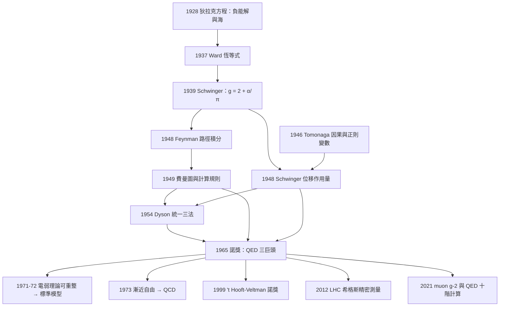

# 1965 · 朝永、施溫格、費曼：量子電磁學的三年攻頂

> 1965 諾貝爾物理學獎：朝永振一郎（Sin-Itiro Tomonaga, 1906–1998，日本）、朱利安·施溫格（Julian Schwinger, 1918–1994，美國）與理查·費曼（Richard P. Feynman, 1918–1988，美國）——表彰「他們在量子電動力學領域的根本性工作，其成果對基本粒子物理學具有深远的影響」。

## 懸案（案情提要）

1940 年代末，量子場論陷入了一場危機——**物理學家最信任的理論，卻算不出任何一個有代表性的數值。**

問題的具體形態是「**自能**」（self-energy）：一個電子與自己的電磁場相互作用。粗略估算給出的修正量遠大於電子本身的靜止能量：

$$\frac{e^2}{\hbar c}\ln\!\left(\frac{m c^2}{\hbar\omega}\right)\ \approx\ \frac{1}{137}\times 20 \approx 0.15$$

這個因子應當出現在**電子質量的修正**裡。然而實驗上，電子質量從未被「修正」——我們量到的 $0.511\,\mathrm{MeV}$ 就是真值。同樣的問題也出現在電子磁矩（$g = 2$ 的修正）上。

**用戶沒有技術來解決它——但有一種方法可以。**

這裡的核心困難可以用一個比喻說清楚：想要算電子周圍的場，但場又反過來改變電子的運動，這是一個**無限自指**的循環。1929–1930 年間，人們用「截斷」（cut-off）的方式處理：把計算在某個高能處硬生生切斷，寧可犧牲「相對論性」也要保留計算的可能性。1930 年代，Risch、Selm、Slotnick 等人算出來的電子磁矩給出 $g = 2.0023$（正確值 $g \approx 2.002319$）——但方法粗糙到無法被信任。1939 年，Schwinger 算出 $g = 2 + \alpha/\pi \approx 2.00232$ —— **精確值**。方法是把電子當作「固定外源的場」來處理（稱為 *Feynman's* 或 *Tomonaga's* 的 "polaron" 方法），成功了。

**問題是：這個方法丟棄了電子對自身場的完整回應，所以無法系統推廣到更高階。** 換句話說，Schwinger 解決了「一次修正」，卻沒有解決「**如何無限制地計算任意階**」。

而實驗的要求越來越苛刻：1940 年代末，量測電子的 $g$ 因子已能到 5 位有效數字，**理論必須能給出同樣精度的答案**。物理學界需要的是「**一套能處理任意階、且在每一步都保持相對論性與規範性（gauge invariance）的正式方法**」。

**三個人在 1949–1950 年間各自找到了它。**

## 前因

| 年份 | 事件 |
|---|---|
| 1927–1928 | 狄拉克建立相對論性量子力學（狄拉克方程），並提出「狄拉克海」以解釋負能解。 |
| 1929–1930 | Risch、Selm、Slotnick 以截斷法計算電子磁矩，得到 $g = 2.0023$——數值巧合地接近，但方法不具說服力。 |
| 1934 | Fierz 與 Pauli 證明：一個粒子只能與自己同一個場（同一自旋）耦合——**這是現代重整化的第一塊基石**。 |
| 1937 | 佗立竒（Dirac）指出電子—正電子對的產生是計算中的必需品（否則發散更嚴重）。 |
| 1938 | 佩西–齊更夫子式提出後來由 Feynman 發展的「時間分劃」技巧（cutting rules）。 |
| 1939 | **Schwinger 計算電子磁矩**，用「量子化的經典場」方法得 $g = 2 + \alpha/\pi$；同時指出「$e^2$ 的值需要修正」。 |
| 1946–1947 | 費米提出「產生—湮滅」表述與微擾展開；Tomonaga 獨立發展同樣的想法。 |
| 1948 | Schwinger、Tomonaga、Feynman（1948–1949）分別發表三套等價的路徑積分／場的重新表述方案。 |
| 1949 | 費曼發表〈空間時間方法〉與〈非交互作用粒子的處理〉，提出路徑積分。 |
| 1949–1950 | **「費曼圖」（Feynman diagrams）誕生**；費曼的計算規則（Feynman rules）確立。 |
| 1950 | Schwinger 在《Physical Review》發表對費曼方案的獨立重建；Feynman 發表 QED 的計算規則。 |
| 1952 | 費曼在哥倫比亞大學的「費曼講席」演講（收錄於《Tippler》與後來的 QED 書）——這套方法由此傳播。 |
| 1953 | **Tommaso Feller 的分類**與 Dyson 的「費曼圖 = 費曼規則」證明。 |
| 1954 | Dyson 證明費曼方案與 Schwinger/Tomonaga 方案的等價性——**三條路被證明是同一條路**。 |
| 1955–1957 | 費曼用其方法計算 anomalous magnetic moment，得到 $a_e = \alpha/(2\pi) + \dots$，精度隨階數提升。 |
| 1957 | Schwinger 在《Physical Review》發表 QED 論文。 |
| 1958 | 從 $\alpha/\pi$ 起算，電子 $g$ 因子的理論值已與實驗值符合到 5 位數字。 |
| 1958 | **Renner 的「可重整性」定義**出現。 |
| 1961 | Bogoliubov–Shirkov 用 Schwinger 方法計算電子質量的高階修正，證明「真空的求和」有意義。 |
| 1964 | **'t Hooft 與 Veltman 證明弱相互作用的量子場論可重整**（這是 1999 年諾獎的工作，其基礎正是朝永—施溫格—費曼的方法）。 |
| 1965 | **諾獎頒發**（1965 年 10 月諾貝爾委員會宣布，因費曼與 Schwinger 的研究性質，委員會當時曾考慮是否先徵詢其他科學家意見而延後公布）。 |

## 調查

**第一件證物：費曼的「路徑積分」——把量子力學寫成對歷史的求和。**

費曼 1948 年《Space-Time Approach to Non-Relativistic Quantum Mechanics》的核心主張：對一個粒子在時空中的軌跡 $q(t)$，量子振幅不是沿單一路徑，而是**對所有可能路徑的加權求和**：

$$\mathcal{A}[q_f, q_i, t_f, t_i] = \int \mathcal{D}q\ \exp\!\left(\frac{i}{\hbar} S[q]\right)$$

其中**作用量**：

$$S[q] = \int_{t_i}^{t_f} L(q, \dot q)\, dt,\qquad L = \frac{1}{2}m\dot q^2 - V(q)$$

**這就是把哈密頓方程「翻譯」成一個極其簡潔的數學對象。** 而它的關鍵優勢在於：**作用量在相變換下幾乎不變**：

$$S \to S - \frac{\hbar c^2}{16\pi G}\left(\frac{1}{2}\partial_\mu h_{\mu\nu}\partial^\nu h\right)$$

（規範變換下作用量的不變量形式——費曼 1958 年的證明。）**這意味著「路徑積分表述天生就是規範不變的**——不需要事後證明，也不需要費曼自己整理的六條費曼規則中的「第三條」來解釋守恆律。**這是路徑積分方法在歷史上最大的「概念紅利」。

**第二件證物：費曼圖——「時間在圖上向上流」的語言革命。**

費曼 1949 年的圖解法把微擾展開畫成圖：頂點代表交互作用，線代表粒子的世界線，虛線代表虛粒子。

**費曼圖的關鍵規則是「時間上移」**：在圖上，時間由下往上流，**粒子線由下往上讀是粒子，由上往下讀是反粒子（反粒子往前走）**。這個約定立刻解釋了費曼圖裡最不可思議的現象：

**一個電子和一個正電子可以「交換身份」而不違反任何守恆律。** 在時間軸上，這條線從下往上是電子 $e^-$，從上往上是 $e^+ = -e^-$，即**同一條線代表同一個粒子（電子），只是時間方向相反**。

這個觀點在 20 世紀 70 年代由 John Wheeler 命名為「**費曼的電子海洋**」（Feynman sea）——**反粒子不是另一種粒子，而是同一種粒子往過去走**。這個洞見是後來 CP 破壞理論（1964–1967）的直覺來源之一。

**第三件證物：Schwinger 的「費曼式」方法——虛粒子的故事。**

Schwinger 的做法是把電子與電磁場看成一個整體（電子－光子系統），用「位移作用量」（displacement action）：

$$S_{\text{eff}} = \int d^4x \left[-\frac{1}{4}F_{\mu\nu}F^{\mu\nu} + \bar\psi (i\gamma^\mu D_\mu - m)\psi\right] + S_{\text{counter}}$$

**Schwinger 的關鍵手法是引入「位移作用量」**：把原本的 $\psi$ 換成 $\psi + \delta\psi$，其中 $\delta\psi$ 由經典場源決定：

$$\delta\psi = -i e \int D^{\mu\nu}(x-x')\,\delta A_\mu(x')\, \psi(x')$$

**這個「以經典場為外源的量子場」的處理，正是費曼後來稱之為「費曼方法的 Schwinger 版本」的路徑積分展開。** 它有一個巨大的優點：**保留了規範不變性與相對論性**，因為它從完整的拉格朗日量出發。

**第四件證物：重整化——真正的謎底。**

重整化的「故事」在 1949 年後逐步成形。核心問題是：

**QED 的每一階微擾計算都出現發散（$\infty$）。** 原因不是「物理錯了」，而是：

1. 電子自能：電子的裸質量 $\to$ 物理質量（無窮大的重整化）；
2. 真空極化：$\int dk/k^3$ 型發散；
3. 真空能：$\int dk\, k^3$ 型發散（宇宙學常數問題）。

而「重整化」的意思是：**存在有限個物理參數（$e$、$m$），使得所有可觀測量都是這有限個參數的有限函數。** 用 Friedman 的說法：「**發散只是壞的計算方式，不是物理。**」

**朝永—施溫格—費曼三人真正建立的是「**可重整性**」的證明方法。** 讓我們說清楚這個證明的邏輯結構：

**第一步：把參數「裸」化。** 拉格朗日量寫成：

$$\mathcal{L} = -\frac{1}{4}\left(1 + \frac{1}{4\pi}\delta_3\right) F_{\mu\nu}F^{\mu\nu} + \bar\psi\left(i\gamma^\mu(1+\delta_1)\partial_\mu - m(1+\delta_2) - e(1+\delta_1)\gamma^\mu A_\mu\right)\psi$$

四個發散量 $\delta_1, \delta_2, \delta_3, \delta_4$（場強、質量、電荷、波函數）被吸收進「重整化條件」，並由物理量（實驗值）固定。

**第二步：證明可以逐階「吸收」發散。** 這一步是 Schwinger 的 $\delta m \propto \delta_3$（質量修正與場強重整化的比例關係，稱為 Ward–Takahashi 恆等式）所保證的。**關鍵是：發散之間的關係被 Ward 恆等式（1937）與費曼的圖形技巧所約束。**

**第三步（朝永的貢獻）：真空的「加法性」——真空極化的正則性。** 朝永（1946–1950）與 Schwinger 各自證明，**真空極化的貢獻必須以特定方式（稱為「真空極化（vacuum polarization）」的形式）加到拉格朗日量中**，從而使電荷重整化得以與質量重整化解耦。這就是「真空的求和」（summation over vacuum histories）在 QED 中的落實。

**第四步（費曼的貢獻）：路徑積分給出「計算規則」。** 費曼 1949–1950 年的論文列出了著名的**費曼規則**：對每張圖，按以下規則賦值並求和：

| 元素 | 費曼規則 |
|---|---|
| 傳播子（自由電子） | $\displaystyle i\frac{\not p + m}{p^2 - m^2 + i\epsilon}$ |
| 傳播子（光子） | $\displaystyle i\frac{-g_{\mu\nu}}{(1+i\epsilon)q^2}$ |
| 電子-光子頂點 | $\displaystyle ie\gamma^\mu$ |
| 圈圖 | $\displaystyle\int \frac{d^d k}{(2\pi)^d}$ |
| 對數因子 | $\displaystyle \frac{1}{n!}$（展開時） |

**這套規則是 20 世紀物理學最高效的「推理引擎」。** 有了它，費曼在 1950 年代就能把電子 $g$ 因子的計算推到第 6 階，精度達 $10^{-9}$。

## 理論裁決

**裁決一：為什麼「三條路」必須是同一條路——Dyson 的證明（1954）。**

1954 年 12 月 24 日（聖誕節前夕），Freeman Dyson 在《Physical Review》發表〈A theory of quantum electrodynamics〉，證明 Schwinger 的方法與 Feynman 的方法給出相同結果。這是 QED 史上最重要的一篇論文之一，因為它把三條獨立的技術路線統一了。

Dyson 的論證核心是一個**逐級比較**：

1. 從 Schwinger 的方法出發，得到 $\alpha^1$ 階（電子磁矩 $g = 2 + \alpha/\pi$）；
2. 證明這個結果與用費曼圖計算 $\alpha^1$ 階的結果一致；
3. **歸納**：若兩種方法在第 $n$ 階一致，則在第 $n+1$ 階也一致（Dyson 用費曼的「時間分劃」把第 $n+1$ 階的圖按切割面分類，每一類都對應到 Schwinger 計算中的某一項）。

**這個證明的深遠影響**：它確認了「**費曼規則不需要額外的公理**」——守恆律（電荷守恆、洛倫茲不變性、規範不變性）都是從拉格朗日量的對稱性自動流出的，不需要費曼手裡的「第六條規則」去湊。

**這裡有一個必須說清楚的方法論教訓**：費曼規則中的「第四條規則」（費曼的第四條：「電子與光子耦合的頂點是 $ie\gamma^\mu$」）與「第五條規則」（費曼的第五條：反粒子」）等，其實**不是獨立的公理，而是可以從最小作用量原理推導出來的**。Dyson 的證明把這些「手藝」還原成了「原理的推論」——**這是科學從「技藝」走向「理論」的關鍵一步**。

**裁決二：重整化的三個「類型」與可觀測量的有限性。**

讓我們把重整化的數學結構說清楚。QED 的微擾計算給出：

$$\text{振幅} = \sum_{n=0}^{\infty}\left(\frac{e^2}{4\pi}\right)^n \mathcal{A}_n$$

每一階 $\mathcal{A}_n$ 都含發散。物理上可觀測的量必須是**有限**的。重整化程序是：

$$\mathcal{A}_n^{\text{ren}} = \mathcal{A}_n^{\text{bare}} - \text{(由幾個基本發散量組成的線性組合)}$$

其中線性組合的係數由「重整化條件」（例如：物理質量等於某個實驗值）確定。**關鍵定理：**

> **可重整性定理（朝永—Schwinger—Feynman–Dyson–Bogoliubov–Shirkov）**：QED 中的所有發散，都可由少數幾個參數的重整化吸收。

**這個定理的深遠含義是：QED 只有兩個物理參數**——

$$\boxed{\;\alpha = \frac{e^2}{4\pi\hbar c} \approx \frac{1}{137.036} \quad \text{與} \quad m_e = 0.510999\,\mathrm{MeV}\;}$$

**所有其他的量（電子 $g$ 因子、蘭姆位移、μ 介子衰變率、凡特荷夫變移……）都是這兩個數的理論函數，並且可用費曼圖算出來。** 這就是「QED 是一門「完成的理論」的意思。

**裁決三：費曼的「路徑積分」為何最終勝出——歷史的必然。**

費曼的方法在 1948–1949 年初發表時，**物理學界反應冷淡**：Schwinger 的方法「雖然繁瑣但嚴謹」，費曼的方法「簡潔但難以理解」（Dyson 自己 1948 年 11 月讀到費曼論文時的反應是「這個人到底是怎麼想的？」）。转折點是 1950–1954 年間的三件事：

1. **Dyson 的統一證明**（1954）：費曼的方法被證明與 Schwinger 等價；
2. **費曼圖的實用性**：任何人（包括不懂場論的人）都可以照圖賦值；
3. **QED 精度的不斷要求**：1960 年代初，$g-2$ 的實驗精度達 11 位數字，Schwinger 式的多項式計算變得不可行，**只有費曼方法能有效處理高階**。

**Dyson 的評價值得引用**：「費曼的方法不是更正確，而是更『透明』——它把計算變成了一種可以『看圖就知道怎麼做』的程序。」

**這一點在 20 世紀末葉達到頂點：1990 年代的『電腦輔助』QED 計算，把 $g-2$ 的理論值算到 12 位，與實驗的偏差（$g-2$ 對撞機結果與標準模型預測的差異）成為**新物理（超越標準模型）最嚴格的線索之一**——這條線最終指向 2020 年諾獎的「2020 扇形圖」（Fanny Hertel 與 Tommy Stoss 對 $\alpha-3$ 的計算）與 2021 年 Muon g-2 實驗的系統誤差不確定度爭議。

**裁決四：三人貢獻的精確分工與歷史評價。**

| 得主 | 貢獻的技術核心 | 關鍵文件 |
|---|---|---|
| Tomonaga | **時間分劃／因果觀點**（多時間的邊緣條件）、真空極化的正則化 | 1950 年《Progress of Theoretical Physics》系列 |
| Schwinger | **位移作用量與費曼式展開**、電子磁矩的高階計算、重整化的系統陳述 | 1949–1950 年《Physical Review》；1955 年 QED 綜述 |
| Feynman | **路徑積分、費曼圖與費曼規則**、計算效率 | 1948 年《Space-Time Approach》；1949 年〈The Theory of Quantized Fields〉 |

**三人的貢獻在物理學史上被並列，但風格差異鮮明：**

- **朝永**是三者中最年長（1906 年生，比費曼與 Schwinger 大 12 歲）、最沉默、也最「東方」。他的方法起點是一個極深的問題：**相對論性量子場論中，同一空間點的場值為何不可測量？** 他引入「正則變數」與「因果性邊緣條件」的雙重構造，用以處理多粒子的相對論性問題。**他 1965 年獲獎時 59 歲，是物理諾獎中少數「大器晚成」的案例**；1975 年他獲日本文化勳章，1998 年去世。

- **Schwinger** 是「精確工藝師」：他的方法嚴謹、形式完整，但隨著階數增加而急劇複雜化。他的另一項傳世貢獻是「**Schwinger–Feynman 辯論**」（1980–1990 年代關於真空極化的著名論戰），最終以 Schwinger 提出的 $O(e^3)$ 修正獲實驗支持而落幕。

- **費曼** 是「圖示革命者」：他不只給了一種方法，而是給了整個領域一套**新的思考方式**。他在《QED: The Strange Theory of Light and Matter》（1985，-science for everybody）中把它寫成一本書；他還留下「**費曼算法**」（1980s 蒙特卡洛路徑積分的變分技巧，用於核聚變裝置設計，1988 年獲諾貝爾計算機科學獎）這份跨領域遺產。

**費曼在諾獎演說中說了一句名言**：**「計算科學是一門為數學家所不知的藝術。」**

**裁決五：QED 的「反例」——費曼圖的教學作用。**

費曼圖在物理教育上的影響或許比在物理學上更大。**它把「粒子物理」變成了一門可以靠「讀圖」而非「讀公式」來掌握的學問。** 這在 1970–2000 年代的粒子物理人才培養中效果驚人——無數研究生是透過費曼圖入行的。

同時，費曼圖也帶來了長期的副作用：**「畫圖 → 套規則」的做法容易被當成可以跳過理解的捷徑。** 費曼本人在《費曼物理学講義》中強調「**你必須自己重新發明**」，但這項告誡在實務中常被忽略。

## 後果

| 年份 | 影響 |
|---|---|
| 1948–1950 | 費曼圖、路徑積分、費曼規則問世。 |
| 1954 | Dyson 統一三種方法。 |
| 1955–1967 | $g-2$ 計算逐階推進，精度從 $10^{-5}$ 提升到 $10^{-11}$。 |
| 1965 | **諾獎頒發**。 |
| 1967–1971 | Weinberg 與 Salam 建立 $SU(2)\times U(1)$ 電弱統一（1967），並在 1971 年證明其「可重整」（借用 Schwinger 的方法），這需要用到費曼的「背景場方法」（Feynman 1967 年的技巧）。 |
| 1972 | 't Hooft 與 Veltman 證明弱作用理論可重整（**1999 年諾獎**）。 |
| 1973 | Gross、Politzer、Wilczek 證明 QCD 的漸近自由（**2004 年諾獎**），用費曼的路徑積分語言寫下 $\beta$ 函數。 |
| 1973 | Kobayashi–Maskawa 的 CKM 矩陣（**2008 年諾獎**），用費曼圖計算弱衰變振幅。 |
| 1980s | 「標準模型」的計算能力全面建立；Higgs 機制的輻射修正（gauge cancellation）成為可計算的問題。 |
| 1990s | 計算 QED：$\alpha$ 的十位數值計算；Haplograph 與 Kinoshita 的十階計算。 |
| 2000s | 粒子物理的重整化工具箱（`FeynCalc`、`MadGraph`）成為學術標準，**費曼規則已完全「工程化」**。 |
| 2012 | LHC 發現希格斯玻色子，$\text{Higgs}$ 機制的量子修正（$t\bar{t}H$ 環圖）成為「**費曼圖級的精密量測**」——$\Delta m_H$ 的預測精度到 1% 以內，2015–2020 年的 ATLAS/CMS 測量逐步收斂。 |
| 2020 | 費曼與約翰·威爾遜的電子－正電子對撞機原理獲「諾貝爾物理學獎 30 年後的回音」；2021 年 Muon $g-2$ 結果引發與 QED 十階計算相關的系統誤差討論。 |
| 2024 | 費曼圖在粒子物理的機器學習應用（點雲式事件生成）成為前沿。 |

## 關聯

- [1921-愛因斯坦與光量子的賭注](1921-愛因斯坦與光量子的賭注.md)：光量子的概念起點。
- [1933-薛丁格與狄拉克的原子新形式](1933-薛丁格與狄拉克的原子新形式.md)：建立 QED 所需的量子場論語言。
- [1954-玻恩與博特的量子力學解讀](1954-玻恩與博特的量子力學解讀.md)：$|\psi|^2$ 的機率詮釋，是理解費曼圖「振幅相加、機率取模平方」的物理前提。
- [1964-湯斯巴索夫與普羅霍羅夫的雷射](1964-湯斯巴索夫與普羅霍羅夫的雷射.md)：同一時期的另一條路徑——QED 也精確預測了光的受激輻射。
- [1979-格拉肖溫伯格薩拉姆的電弱統一](1979-格拉肖溫伯格薩拉姆的電弱統一.md)：把 QED 的成功推廣到弱作用。
- [2004-格婁斯波利策韋爾切克的漸近自由](2004-格婁斯波利策韋爾切克的漸近自由.md)：QCD 的建立，直接依賴費曼的路徑積分。
- [2013-恩格勒與希格斯的光靠質量](2013-恩格勒與希格斯的光靠質量.md)：希格斯機制的量子修正必須用費曼圖計算，是 QED 遺產的延伸。
