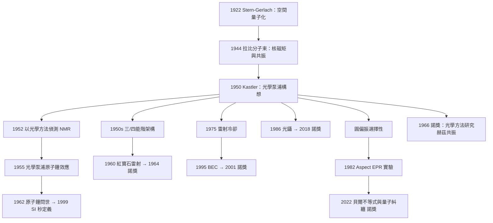

# 1966 · 卡斯特勒：光學泵浦與核磁共振的聯姻

> 1966 諾貝爾物理學獎：阿爾弗雷德·卡斯特勒（Alfred Kastler, 1903–1983，法國）——表彰「他發現並發展了以光學方法研究原子中赫茲共振的技術」。

## 懸案（案情提要）

1966 年這屆物理獎只有一位得主，且表彰的技術（光學泵浦）聽起來像是雷射的附屬品。但它解決的問題，卻是整個核磁共振（NMR）、雷射冷卻、原子鐘與自旋量子計算的共同前提。

**案子是這樣的。**

1950 年代的 NMR 已經是一門成熟的技術：拉比用分子束（1944 年諾獎）測出質子與中子的磁矩，布洛赫與珀塞爾（1952 年諾獎）用射頻場測定固體中的 NMR。**但它們都有一個致命限制：訊號太弱。**

問題的根源在物理上很清楚。一個置於磁場 $\mathbf{B}_0$ 中的原子或核，自旋有兩個能階：

$$\Delta E = \hbar \omega_0,\qquad \omega_0 = \gamma B_0$$

平衡時兩個能階的粒子數幾乎相等（塞曼分裂只有 $\Delta E \sim 10^{-5}\,\mathrm{eV}$，而 $kT \sim 25\,\mathrm{meV}$），因此淨吸收訊號極其微弱。要讓 NMR 真正有用，必須**先把粒子「極化」**——也就是人為地讓低能階的粒子數明顯多於高能階。

**唯一的有效手段是「溫度降到極低」**，但在 1950 年代，毫開爾文的溫度（$10^{-3}\,\mathrm{K}$）與「核自旋極化」所需的 $10^{-5}\,\mathrm{K}$ 級別溫度之間隔著巨大的技術鴻溝，而冷卻技術本身極不成熟。

**卡斯特勒的提議非常簡單，簡單到令人吃驚：**

> **不要去冷卻原子——去「照」原子。用光把原子從低能階「打」到高能階，把低能階抽空，讓吸收差變大。**

這個想法叫「**光學泵浦**」（optical pumping）。而它的困難在於：**你不能只把原子打上去，你必須讓它「只上去不下來」**，否則原子會像熱平衡那樣回到均勻狀態。

**解決的關鍵，是塞曼分裂讓「泵浦」變得具有方向性。** 這就是本案真正的物理。

## 前因

| 年份 | 事件 |
|---|---|
| 1922 | Stern–Gerlach 實驗證明空間量子化。 |
| 1924 | 卡斯特勒在巴黎大學（ Institut de Physique, rue Pierre-Curie）任教，開始研究原子光譜。 |
| 1924–1928 | 卡斯特勒在原子吸收光譜與「雙重態系統」上的工作。 |
| 1930s | Kastler 建立自己的實驗室風格：**以簡單實驗與清晰物理詮釋組合**（他後來在自傳中稱之為「si la physique experimental n'est pas une science exacte, il faut faire de la physique avec le moins de mathématique possible」）。 |
| 1944 | **拉比的分子束實驗**首次測得核自旋與磁矩——「核磁共振」的原型。 |
| 1946 | 布洛赫與珀塞爾在固體中觀察到 NMR。 |
| 1946–1950 | Kastler 與學生 Brossard、Gros 在法國已發展出早期的「磁共振」與「光學方法」實驗。 |
| 1949 | Kastler 與 Guynot 開始用光學方法研究原子能階。 |
| 1950 | **「光學泵浦」的構想提出**；Kastler 與 Brossard 用圓偏振光選擇性地激發鹼金屬原子，證實「光可以選擇性地『搬走』某一個塞曼能階的原子」。 |
| 1950–1952 | Kastler 建立「**四能階系統**」與「三能階系統」的光學泵浦方案（後者正是 1964 年雷射的基本架構）。 |
| 1952 | **Gros、冒隆、龔蒂（L. Gros, P. V. Malimon, A. Darton）用光學方法偵測核磁共振**——這是 NMR 走向「用光學方法增強靈敏度」的關鍵一步。 |
| 1954 | Kastler 與 Sauzade 證明：**在弱磁場中觀測到的順磁共振訊號，其強度取決於磁化的各向異性**，可用來量測原子極化。 |
| 1958 | Kastler 的綜述〈Optical pumping and maser〉發表，把方法系統化。 |
| 1962 | 第一台以光學泵浦的氬-85 原子鐘由技術上實現。 |
| 1964 | 雷射問世（1964 年諾獎），**使光學泵浦技術可用「單色、高強度、可調頻」的光源**，從根本上改變了光學泵浦的可行性。 |
| 1966 | **諾獎頒發**。 |

## 調查

**第一件證物：塞曼分裂與「選擇性激發」——圓偏振光的政治學。**

一切從簡單的事實開始：原子在磁場 $\mathbf{B}_0 = B_0\hat{z}$ 中，能階分裂成

$$E_{m_j} = -\mu_B g m_j B_0,\qquad m_j = -J, \ldots, +J$$

**光學泵浦的第一個問題是：要只激發特定的 $m_j$ 態。** 解法是**圓偏振光**：若原子基態的選擇定則為 $\Delta m_j = +1$，則用沿 $+\hat{z}$ 方向傳播的圓偏振光（$\sigma^+$）只會把原子從 $m_j$ 推到 $m_j + 1$。

**第二個問題更妙：光可以把原子「推上去」，但要讓它「不要掉下來」。** 這靠的是**能級的壽命差異**：

| 能階 | 壽命 | 角色 |
|---|---|---|
| $E_1$（基態） | 極長（$\sim 10^{-8}$–$10^{-9}\,\mathrm{s}$） | 被 $\sigma^+$ 光「抽空」 |
| $E_2$（激發態） | 短（$\sim 10^{-8}\,\mathrm{s}$） | 迅速經輻射衰變回落，並把偏振資訊帶走 |
| $E_3$（高能階） | **長（$\sim$ 毫秒）** | **「暗庫存」**——原子停在這裡 |

**用圓偏振光反覆「抽」原子，會讓原子自旋沿磁場方向排列（極化）。** 因為每一次循環都把「量子數標籤」寫進原子，而輻射衰變選擇性地丟棄其中某些標籤。

**這就是光學泵浦的完整機制。** 讓我們用一個具體的 $\mathrm{Na}$ 原子（$3s\,{}^{2}S_{1/2} \to 3p\,{}^{2}P_{1/2} \to 4s\,{}^{2}S_{1/2}$）把它寫清楚：

- $4s\,{}^{2}S_{1/2}$ 是長壽「儲存」態（$\sim$ 幾 ms）；
- 光把 $3s$ 原子送到 $4s$；
- 原子在 $4s$ 停留較久，並在此期間完成自旋極化；
- 最後衰變回 $3s$，但**衰變時放出的光帶有偏振資訊**（圓偏振或線偏振），Kastler 的學生在 1950 年代正是利用這個「偏振分析」來**讀出原子雲的極化狀態**。

**這是一個「用光寫、用光讀」的量子狀態存儲與讀取方案——它的直系後代就是 1960–1990 年代的原子鐘、1990 年代的 EPR 原子纠缠實驗（2015 年諾獎的先聲），以及 2000 年代的量子資訊實驗。**

**第二件證物：1952 年的關鍵實驗——用光學方法「看見」NMR。**

1952 年，Kastler 與 Gros 完成了第一個**用光學方法偵測的核磁共振**：他們用光學泵浦把 ${}^{3}\mathrm{He}$ 原子（核自旋 $\tfrac{1}{2}$）極化，然後觀察其**順磁共振**（$I = \tfrac{1}{2}$ 的原子其電子基態自旋為 0，順磁共振其實是核自旋的共振）吸收對偏振的改變。

**關鍵是靈敏度的數量級提升。** 傳統的 NMR 訊號正比於極化差 $\Delta N/N \sim \frac{\hbar\omega_0}{kT} \sim 10^{-5}$，而在低溫下的核極化可達 0.5 以上：

$$\frac{\Delta N}{N} = \tanh\!\left(\frac{\hbar\omega_0}{2kT}\right)$$

光學泵浦把 $\Delta N/N$ 從 $10^{-5}$ 提升到 $10^{-3}$–$10^{-1}$，**訊號增強了 2–4 個數量級**。這在 1950 年代是一個驚人的進步。

**第三件證物：順磁共振的「方向效應」——為什麼要圓偏振光。**

卡斯特勒 1950 年代最漂亮的實驗，是用光學方法量測**原子的磁化各向異性**。他的論證是：

順磁共振的吸收強度取決於射頻場的極化方向與原子宏觀磁化 $\mathbf{M}$ 的相對角度。對於一個已被光學泵浦沿 $\hat{z}$ 極化的樣品，$\mathbf{M} \parallel \hat{z}$；若射頻場為線偏振且沿 $\hat{z}$，則無法驅動 $\Delta m_j = \pm 1$ 的躍遷（圓偏振才會），因此**吸收強度出現角度依賴性**：

$$I_{\text{abs}} \propto \left|\hat{e}_{\text{rf}} \cdot \hat{e}_{\text{pump}}\right|^{2}\ \text{（線偏振情形）}$$

**這個測量能夠直接「看見」原子的磁化方向**——是「用光學方法研究原子中赫茲共振」的原型實驗。

## 理論裁決

**裁決一：光學泵浦為什麼能極化——三個必要條件。**

我們把光學泵浦的理論條件完整列出（這是本案最有價值的知識遺產）：

**條件一：選擇定則讓 $\sigma^+$ 與 $\sigma^-$ 光的作用不對稱。**
在磁場中，選擇定則 $\Delta m_j = \pm 1$ 使得 $\sigma^+$（$+1$）與 $\sigma^-$（$-1$）的作用可分辨。若激發態有合適的塞曼分裂，兩者的共振頻率不同：

$$\nu_{\pm} = \nu_0 \pm \frac{\mu_B g' B_0}{h}$$

**條件二：必須有「長壽 Reservoir 態」。** 這正是 1964 年雷射的「三能階／四能階」架構。**Kastler 與雷射之間的關係因此不是事後的相似，而是直接的技術血緣**——湯斯等人正是引用了 Kastler 的方案。

**條件三：弛豫時間必須夠長，否則極化會被熱運動洗掉。**
極化強度的時間演化由速率方程決定：

$$\frac{dS}{dt} = R_{\text{pump}}(1 - S) - \frac{S}{T_1}$$

其中 $S$ 為極化度，$T_1$ 為縱向弛豫時間。**極化的穩態值**

$$S_{\infty} = \frac{R_{\text{pump}} T_1}{1 + R_{\text{pump}} T_1}$$

**所以「泵浦率」與「弛豫率」的競爭決定了一切**：這是一個 Langmuir 型的動力學，形式上與化學反應的穩態完全相同。

**裁決二：原子鐘的歷史鏈條——從 Kastler 到 SI 定義。**

我們把這條因果鏈完整拉出來，因為它是「物理學如何定義時間」的精彩案例：

| 年份 | 事件 | 作用 |
|---|---|---|
| 1944 | 拉比的分子束 NMR | 發現原子自旋的共振頻率 $\omega_0 = \gamma B_0$ 只取決於原子內部常數 |
| 1946 | 鉀-87 的「自旋躍遷頻率是時間的天然標準」的建議 | 想法 |
| 1955 | 第一次 $^{87}\mathrm{Rb}$ 原子鐘（NBS） | 實現 |
| 1955 | Kastler 與 Richa 觀測到光學泵浦的原子鐘效應 | 極化技術 |
| 1962 | 光學泵浦 $^{87}\mathrm{Rb}$ 原子鐘問世 | 精度躍升 |
| 1967 | **第一台光纖铷原子鐘**（商用） | 商業化 |
| 1989 | 冷原子鍺原子鐘、銫原子鐘（基準） | 精度 $\sim 10^{-15}$ |
| 2019 | SI 秒改定義：$\nu_{\mathrm{Cs}} = 9\,192\,631\,770\,\mathrm{Hz}$ **不變**，改變的是秒的**定義方式** | 從「原子定義秒」變成「以原子躍遷次數定義秒」 |

**注意：整條鏈的每一環都依賴「原子自旋的量子共振頻率只由微觀常數決定」這件事**——而這個觀念的物理基礎，正是 NMR 與光學泵浦所建立的。

**裁決三：Kastler 的方法論——「用最簡單的實驗說最清楚的物理」。**

卡斯特勒在諾獎演說與自傳中反覆強調的一個原則，值得記錄：

> 「如果實驗物理不是一門精確的科學，那麼我們就應該做**用最少數學**的物理。」

他常舉的例子是**卡斯特勒自己的「競走實驗」（La course à pied）**：讓一群跑者繞著桌子跑，用計時器量他們每次通過某點的時間，證明「週期運動的相位會隨時間累積」——用來向非專業人士解釋自旋進動。**Kastler 的科普著作《L'Énigme du temps》（時間之謎）是法國的科普經典**。

**這種方法論在物理學史上的位置**：它是 20 世紀中期「**示範實驗**」（demonstration experiment）傳統的一部分——法拉第的電磁感應實驗、史特凡的 Stefan–Boltzmann 定律實驗、卡斯特勒的光學泵浦實驗、盧瑟福的金箔實驗。**這些實驗的目標不是測量，而是「讓現象本身站出來」。**

**裁決四：光學泵浦與雷射、與 EPR 實驗的深層關係。**

我們把三個看似無關的技術放在一起比較，會發現它們共享同一個「量子資訊架構」：

| 技術 | 寫入 | 讀出 | 存儲 |
|---|---|---|---|
| **光學泵浦**（Kastler） | $\sigma^+$ 光把原子抽到高能階並極化 | 偏振分析傳遞光 | 原子基態自旋取向（毫秒） |
| **雷射**（Townes/Basov/Prokhorov） | 受激輻射產生相干光子 | 腔增強 | 光場振幅 |
| **EPR 實驗**（Aspect 1982） | 光的圓偏振選擇性 | 分析器偏振測量 | 原子自旋與光子偏振的**糾纏** |

**而最後一行，正是 2022 年諾獎的核心。** 讓我們把這條鏈寫清楚：

1. **Kastler（1966）**：圓偏振光可以選擇性地作用於原子自旋態。
2. **Aspect、Clauser、Zeilinger（1982–1998）**：用光子（雷射 + 偏振）的選擇性激發與分析，測試貝爾不等式。
3. **Aspect 等（1982）**：正是用 Kastler 式的圓偏振方案（$45^\circ$ 分析器、$67.5^\circ$ 延遲器）做偏振關聯測量。

**因此，2022 年諾獎的實驗技術，在光學上直接繼承了 1966 年諾獎。** 這是諾獎史上一條被低估的重要暗線。

## 後果

| 年份 | 影響 |
|---|---|
| 1950 | 光學泵浦提出。 |
| 1952 | 以光學方法偵測核磁共振。 |
| 1955 | Kastler 與 Richa 展示光學泵浦原子鐘效應。 |
| 1962 | 光學泵浦原子鐘問世（${}^{87}\mathrm{Rb}$）。 |
| 1964 | 雷射問世，使光學泵浦技術躍升（單色、高功率、可選波長）。 |
| 1966 | **諾獎頒發**。 |
| 1970s | 光學泵浦用於氙、鉀、銫、鈷等系統；**光學 pumping 的核磁共振成為固體物理與生物物理（蛋白質結構 NMR，1980s 起）的主力工具**。 |
| 1970s–1980s | **激光冷卻**（1975 起）、**光柵捕陷**（1986）、**光鑷**（1986，2018 年諾獎）都建立在「光學方法操控原子自旋」的傳統上。 |
| 1989 | NIST-7 冷銫原子鐘問世。 |
| 1990s | EPR 原子糾纏實驗（Bennett 等，1998）；**量子計算與量子密碼的實驗起點**。 |
| 2000s | 磁光阱、玻色－愛因斯坦凝聚（2001 年諾獎）都以雷射冷卻為前提。 |
| 2015 | **梶田與麥克唐納**：SNO 的光學探測器（heavy water 中的 Cherenkov 輻射）——**光學方法在微中子物理中的極致應用**。 |
| 2022 | **Aspect、Clauser、Zeilinger**：貝爾不等式與量子糾纏——**Kastler 的圓偏振選擇性在量子資訊時代的回歸**。 |

## 關聯

- [1922-波耳與原子結構的懸案](1922-波耳與原子結構的懸案.md)：塞曼分裂與選擇定則的原子物理背景。
- [1944-拉比的核磁共振](1944-拉比的核磁共振.md)：共振頻率 $\omega_0 = \gamma B_0$ 的來源；Kastler 方法的直接前身。
- [1952-布洛赫與珀塞爾的核磁共振](1952-布洛赫與珀塞爾的核磁共振.md)：NMR 訊號太弱——本案要解決的核心困難。
- [1964-湯斯巴索夫與普羅霍羅夫的雷射](1964-湯斯巴索夫與普羅霍羅夫的雷射.md)：三能階/四能階架構同源；雷射使光學泵浦技術跨越到實用。
- [1977-安德森莫特凡扶累克的磁性](1977-安德森莫特凡扶累克的磁性.md)：磁性物理的另一條路徑。
- [2015-梶田與麥克唐納的中微子振盪](2015-梶田與麥克唐納的中微子振盪.md)：光學偵測技術在微中子實驗中的頂級應用。
- [2022-阿斯佩與克勞澤蔡林格的量子糾纏](2022-阿斯佩與克勞澤蔡林格的量子糾纏.md)：圓偏振選擇性的量子資訊時代。
