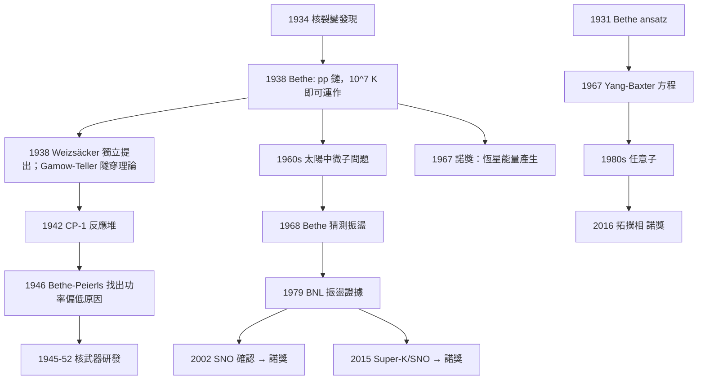

# 1967 · 貝特：太陽為什麼會發光

> 1967 諾貝爾物理學獎：漢斯·阿爾布雷希特·貝特（Hans Albrecht Bethe, 1906–2005，德國/美國）——表彰「他對核反應理論的貢獻，尤其是關於恆星中能量生成的發現」。

## 懸案（案情提要）

1938 年底，一篇只有兩頁的論文投給了《Physical Review》。標題是〈**恆星中的能量產生**〉（*Energy Production in Stars*），作者是 32 歲的漢斯·貝特。

這篇論文回答了一個困惑物理學界四十年、且是「人類為什麼還在」的問題：

> **太陽每秒把 400 萬噸的質量轉化成能量。它是怎麼做到的？**

在此之前，物理學家手上有各種「候選機制」，但每一個都會撞牆：

| 候選機制 | 問題 |
|---|---|
| 燃燒（化學能） | 能量密度太低：$1\,\mathrm{kg}$ 煤只有 $\sim 3\times10^{7}\,\mathrm{J}$，不足以維持太陽 |
| 放射能衰變 | 存量不夠，且無調控機制 |
| 墜降收縮（Kelvin–Helmholtz） | $\sim 3\times10^7$ 年的能量尺度對不上地質年代 |
| 「囚禁於太陽內部的某種能量」 | 化學家與地質學家的強烈反感 |
| **核融合** | 需要 $10^7\,\mathrm{K}$ 的溫度——**為什麼太陽的核心有這麼高？** |

**最後一個問題才是真正的謎題。** 1914 年，Sacchetti 與其他人算出：太陽中心溫度約 $10^7\,\mathrm{K}$。**這個溫度雖然遠高於固體的熔點，但遠低於核反應被認為需要的 $10^8$–$10^9\,\mathrm{K}$。** 「量級差一個數量級」的問題，卡住了整個理論。

1938 年 9 月，德國科學家 **Hans Bethe** 計算了**質子-質子鏈（pp chain）**，指出：**在 $1.5\times10^7\,\mathrm{K}$ 就能運作**，因為第一步反應 $p + p \to d + e^+ + \nu_e$ 有一個「無能位」的瓶頸——**必須靠隧穿效應**，量子力學的隧穿讓原本被庫侖斥力禁止的反應得以發生。

**同年 11 月，Carl von Weizsäcker 獨立提出相同的鏈；1938 年底，George Gamow 與 Edward Teller 發展了星核的熱核反應理論。**

**1967 年的諾獎，把 29 年前的這份論文補上了遲來的加冕。** 委員會的措辭很精確：「**especially his discoveries concerning the energy production in stars**」。

但貝特的貢獻遠不止太陽。**核統計學**（Bethe–Weizsäcker 公式）、**貝特公式**（1936 年，粒子 stopping power，至今仍是輻射物理與治療物理的標準工具）、**介子理論的發展**（1935–1937）、**固態物理的 Bethe ansatz**（1931）、**量子力學的 Bethe 方程**（1931）、**QED 與凝聚態的眾多貢獻**——貝特是 20 世紀最多產的物理學家之一。

## 前因

| 年份 | 事件 |
|---|---|
| 1906 | 貝特生於德國斯特拉斯堡（Strasbourg，時屬德國）。 |
| 1926 | 貝特在慕尼黑取得博士學位，師從 Arnold Sommerfeld；兩年内發表 9 篇論文。 |
| 1928 | 貝特在蘇黎世 ETH 當講師，開始用量子力學研究電子在金屬中的行為。 |
| 1930 | **Bethe ansatz**：貝特用**對徑量的方法（method of the diophantine ansatz）**求解一維interaction問題——一維有序系統（Heisenberg 磁模型）可用 Bethe ansatz 精確求解。 |
| 1931 | **Bethe 方程（格子氣模型）**。 |
| 1932 | 貝特移民美國，在康奈爾工作；1935 年起在羅切斯特大學。 |
| 1933 | **Bethe 公式**：電子在物質中的 stopping power $dE/dx$，源於1932年的 bremsstrahlung 計算。 |
| 1934–1938 | 核物理的「理論黃金期」：貝特與 Heitler 計算電子對產生；Bethe–Heitler 公式；介子理論。 |
| 1935 | 湯川秀樹預言介子；1937 年 **Bethe–Weizsäcker 公式**（核結合能的半經驗公式）問世。 |
| 1936 | **貝特公式（正式版）**：$\displaystyle -\left\langle \frac{dE}{dx}\right\rangle = \frac{4\pi z^2 e^4 n Z}{m c^2}\left(\ln\frac{2 m c^2 v^2}{I}-\beta^2\right)$ 這一路徑損失公式，至今是醫療放射物理與粒子物理的基礎。 |
| 1938-04 | 施特勞斯曼（Straumann）與沛特克（Peter）發現核裂變。 |
| **1938-09-28** | **貝特提交〈Energy Production in Stars〉，證明質子-質子鏈（pp chain）在 $1.5\times10^7\,\mathrm{K}$ 即可運作。** |
| 1938-11 | von Weizsäcker 獨立提出同一鏈，並指出 CNO 循環。 |
| 1938-12 | Gamow 與 Teller 發展熱核反應理論，確立隧穿的必要性。 |
| 1939 | **Bethe 與 Peierls 計算「裂變釋能」**並預測反應堆的可能性；此稿被丘吉爾的「黑書」列為機密，直到 1945 年才公開——**這是第二次大戰中最戲劇性的科學插曲之一**。 |
| 1942 | 費米在芝加哥建成第一座自持核反應堆（CP-1），**測得的功率只有預期的一半**——沒有人知道為什麼。 |
| 1946 | 貝特與 Peierls 檢查 CP-1 的數據，找出原因：**中子在 $^{235}\mathrm{U}$ 中的平均壽命比預期長了約 5 倍**（費米在堆中的「中子倍增時間」實測）。 |
| 1950s | 核反應率的精確計算（Hauser–Feshbach 公式、Bethe–Halley 公式）。 |
| 1961 | 貝特對太陽中微子的「缺失問題」發表評論（**太陽中微子問題**在 1960 年代初由 Davis 用氯化氫argot法測到缺失率約 1/3，貝特等人 1968 年提出「震盪」解釋）。 |
| 1967 | **諾獎頒發**（因貝特的健康問題，頒獎典禮上未出席，由代表代領）。 |

## 調查

**第一件證物：pp 鏈的四個反應——量級問題的解決。**

我們把質子-質子鏈完整寫出，因為它是本案的核心證物。質子-質子鏈分為三個分支，主鏈（pp I）為：

$$
\begin{aligned}
\text{(1)}\quad & p + p \;\longrightarrow\; d + e^{+} + \nu_e \\
\text{(2)}\quad & d + p \;\longrightarrow\; {}^{3}\mathrm{He} + \gamma \\
\text{(3)}\quad & {}^{3}\mathrm{He} + {}^{3}\mathrm{He} \;\longrightarrow\; {}^{4}\mathrm{He} + 2p \\
\text{(4)}\quad & {}^{4}\mathrm{He} + 2p \;\longrightarrow\; {}^{4}\mathrm{He} + 2p
\end{aligned}
$$

等等，第 (4) 步其實就是回到第 (1) 步的產物。**淨反應**是：

$$\boxed{\;4p \;\longrightarrow\; {}^{4}\mathrm{He} + 2e^{+} + 2\nu_e + \text{能量}\;}$$

**能量收支帳：**

| 項目 | 能量 |
|---|---|
| 4 個質子的靜止質量 | $4\times 938.27 = 3753.1\,\mathrm{MeV}$ |
| ${}^{4}\mathrm{He}$ 的靜止質量 | $3727.4\,\mathrm{MeV}$ |
| **質量虧損（釋出）** | $\mathbf{25.7\,\mathrm{MeV}}$ |
| 其中：以正電子湮滅形式釋出 | $\sim 26.2\,\mathrm{MeV}$（含 2 × $1.02$） |
| 以**微中子**形式帶走 | $\sim 0.6\,\mathrm{MeV}$（平均） |
| 以**光子**形式（可見光） | $\sim 26.1\,\mathrm{MeV}$ |

**太陽每天把約 400 萬噸氫轉換成氦**：

$$\dot{M} = \frac{L}{c^2}\times\frac{1}{0.007}\approx 4.3\times10^{9}\,\mathrm{kg/s} \approx 6\times10^{14}\,\mathrm{kg/yr}$$

**而微中子帶走的那 2.4% 的能量，是 1960–2000 年代一場長達 40 年的偵探的起點**（見下文「後果」）。

**關鍵物理：為什麼第一步能在 $1.5\times10^7\,\mathrm{K}$ 發生？**

反應 (1) 的庫侖障礙是 $E_G = \frac{\alpha^2 c^2 m_p}{2} \approx 490\,\mathrm{keV}$，而 $kT \approx 1.3\,\mathrm{keV}$。**「無能位」反應必須靠量子隧穿。** 量子隧穿的機率（WKB 近似）：

$$P \approx \exp\!\left(-\frac{2}{\hbar}\int_{r_1}^{r_2}\sqrt{2\mu(V(r) - E)}\,\mathrm{d}r\right)$$

**這個指數極小，但反應率被巨大的粒子數密度補償。** 讓我們做一個數量級估算：

- 太陽核心：$T = 1.5\times10^7\,\mathrm{K}$，$\rho \approx 150\,\mathrm{g/cm^3}$，$n_p \approx 10^{25}\,\mathrm{cm^{-3}}$；
- 反應率 $\langle\sigma v\rangle \approx 10^{-22}\,\mathrm{cm^3\,s^{-1}}$（在 $1.5\times10^7\,\mathrm{K}$）；
- 每立方厘米每秒的反應數：$n_p^2 \langle\sigma v\rangle \approx 10^{50}\times 10^{-22} = 10^{28}\,\mathrm{cm^{-3}s^{-1}}$。

**pp 鏈的特點是「弱作用參與」，因此反應率極低（比 CNO 循環低數十個數量級）——但正因如此，太陽才走得慢、才還在。**

**第二件證物：為什麼太陽的核心溫度是 $10^7\,\mathrm{K}$ 而不是 $10^8$？——這是本案的核心洞見。**

答案在**反應率的溫度敏感度**上。對 pp 鏈第一步（伽馬分解中的 S 因子），有：

$$\langle\sigma v\rangle_{\text{pp}} \propto T^{-2/3}\,\exp\!\left(-\sqrt{\frac{E_G}{kT}}\right)$$

對 CNO 循環的第一步（${}^{12}\mathrm{C}(p,\gamma){}^{13}\mathrm{N}$，Coulomb barrier 約 $2\,\mathrm{MeV}$）：

$$\langle\sigma v\rangle_{\text{CNO}} \propto T^{-2/3}\,\exp\!\left(-\sqrt{\frac{E_G}{kT}}\right)\Big|_{E_G \approx 2\,\mathrm{MeV}}$$

**因為 CNO 的 $E_G$ 大 4 倍，指数項對溫度極度敏感（ Gamow peak）。**

**這就是「量級問題」的答案：**

- **pp 鏈**的無能位反應需要**低溫**（$1.5\times10^7\,\mathrm{K}$）就能運作 → 適合低質量、慢燃燒的太陽；
- **CNO 循環**需要 $1.5\times10^8\,\mathrm{K}$ → 適合高溫高亮的massive stars。

**而「太陽為什麼溫度只有 $10^7\,\mathrm{K}$ 而沒有更高」這個問題，本身是自洽性的結果**：溫度越高，pp 鏈越慢（因為負的指數前因子 $T^{-2/3}$ 加上 pp 鏈的能量產出率對溫度不敏感），於是能量產出不足以支撐輻射損失，溫度就會回落。

**更精確地說，太陽的溫度由「能量平衡」決定**：

$$\underbrace{\epsilon_{\text{nuc}}(T, \rho)}_{\text{產能}} = \underbrace{\epsilon_{\text{rad}} + \epsilon_{\text{conv}}}_{\text{耗散}}$$

**而 $T$ 之所以落在 $10^7\,\mathrm{K}$，是因為 pp 鏈的產能率對 $T$ 的依賴非常「溫和」（ Gamow 指數被 $T^{-2/3}$ 抵銷），導致負反饋穩定。** 這是一個精細的自洽性論證。

**第三件證物：CNO 循環——1957 年霍伊爾等人的定量理論。**

CNO 循環是「**催化循環**」（catalytic cycle）：${}^{12}\mathrm{C}$、${}^{13}\mathrm{N}$、${}^{14}\mathrm{O}$、${}^{15}\mathrm{N}$ 循環轉圈，把四個質子變成一個 $\alpha$ 粒子，**催化劑本身不消耗**。

$$\begin{aligned}
{}^{12}\mathrm{C} + p &\to {}^{13}\mathrm{N} + \gamma \\
{}^{13}\mathrm{N} &\to {}^{13}\mathrm{C} + e^{+} + \nu_e \\
{}^{13}\mathrm{C} + p &\to {}^{14}\mathrm{N} + \gamma \\
{}^{14}\mathrm{N} + p &\to {}^{15}\mathrm{O} + \gamma \\
{}^{15}\mathrm{O} &\to {}^{15}\mathrm{N} + e^{+} + \nu_e \\
{}^{15}\mathrm{N} + p &\to {}^{12}\mathrm{C} + \alpha
\end{aligned}
$$

**關鍵的「瓶頸」是 ${}^{14}\mathrm{N}(p,\gamma){}^{15}\mathrm{O}$ 這一步**，因為 $^{14}\mathrm{N}$ 的 $\beta$ 衰變半衰期很長（$10.4$ 分鐘），所以 $^{14}\mathrm{N}$ 會累積，**形成「瓶頸」**。

**這解釋了一個關鍵的觀測事實：太陽的 CNO 循環對溫度的依賴極強（$\propto T^{15\text{–}20}$），而 pp 鏈對溫度依賴弱（$\propto T^4$）。** 這就是「**CNO 循環是溫度的閘門**」的說法由來，也是「massive stars 的 CNO 循環在大氣中留下氮富集」這一事實的理論解釋。

**第四件證物：貝特公式——另一個「案件」。**

讓我們也把貝特的另一個諾獎級貢獻（1936 年貝特公式）寫清楚，因為它展示了同一個人的方法論：把一個複雜過程化約到可計算的形式。

高能粒子在物質中 slowed down 的平均能量損失率：

$$\left\langle -\frac{\mathrm{d}E}{\mathrm{d}x}\right\rangle = \frac{4\pi z^2 e^4}{m c^2}\, n Z\, \left(\ln\frac{2 m c^2 \beta^2 \gamma^2}{I} - \beta^2\right)$$

其中 $I$ 是平均激發能、$n$ 是電子密度、$Z$ 是原子序、$z$ 是入射粒子電荷數。**這個公式是 1936 年由 Bethe 首次給出（先由 Bloch 1933 給出量綱形式）。**

**它至今是以下領域的標準工具**：

- 輻射治療（Bragg 峰、LET）；
- 太空探测器設計；
- 核廢料處理；
- 宇宙線在大氣中的能損。

**理論裁決四：$pp$ 鏈的分支比——一個可用觀測區分的「指紋」。**

$pp$ 鏈有三個分支，其比例由溫度與中微子通量決定：

| 分支 | 最終反應 | 相對比例（太陽） | 中微子能量特徵 |
|---|---|---|---|
| pp I | ${}^{3}\mathrm{He}+\mathrm{He}\to{}^{4}\mathrm{He}+2p$ | $\sim 85\%$ | 連續，$\le 0.42\,\mathrm{MeV}$ |
| pp II | ${}^{3}\mathrm{He}+{}^{4}\mathrm{He}\to{}^{7}\mathrm{Be}+\gamma$ | $\sim 15\%$ | 單色線 $0.862\,\mathrm{MeV}$（${}^{7}\mathrm{Be}$） |
| pp III | ${}^{3}\mathrm{He}+{}^{4}\mathrm{He}\to{}^{7}\mathrm{Li}+p$ | $\sim 0.02\%$ | 單色線 $1.44\,\mathrm{MeV}$（${}^{7}\mathrm{Li}$） |

**這個「中微子指紋」是 1980 年代 SNO 實驗（2002 年諾獎）能夠定量驗證恆星內部核反應的關鍵**——因為中微子幾乎不與物質作用，它帶出的是**核心的資訊**，而光子被擴散、混合了。

**裁決五：貝特方程與 Bethe ansatz——「可解模型」的典範。**

讓我們把貝特最深刻的數學貢獻寫清楚。考慮一維自旋 $\tfrac{1}{2}$ 系統（Heisenberg 磁模型）：

$$H = J\sum_i \left(\mathbf{S}_i\cdot\mathbf{S}_{i+1} - \frac{1}{4}\right)$$

**貝特 1931 年的洞見**：不嘗試直接解多體波函數，而是把每個粒子視為在「外場」中運動，並**對 $\eta$-座標做「對徑量」的假設**：

$$\eta_n(n+1) = \eta_n(n)\exp\!\left(i\frac{2\pi S_n(n+1/2)}{2S+1}\right)$$

這裡 $S_n$ 是第 $n$ 個粒子的總自旋。**這個假設把多體問題化為「單粒子散射問題」——而單粒子散射是可以用 Bethe 方程求解的。**

**Bethe 方程**（$N$ 粒子系統）：

$$\left(\frac{\tan(\pi\eta_n)}{2\pi\eta_n}\right)^{N-1}\exp\!\left(i\sum_{j=1}^{N-1}2\arctan\frac{\eta_n - \eta_j}{\eta_n+\eta_j}\right) = \frac{\prod_{j=1}^{N-1}\frac{\eta_n+\eta_j + iS_n - iS_j}{\eta_n+\eta_j - iS_n + iS_j}}{\prod_{j=1}^{N-1}\frac{\eta_n-\eta_j + iS_n - iS_j}{\eta_n-\eta_j - iS_n + iS_j}}$$

**為什麼這在物理學史上重要？** 因為它是「**用一維模型解決多體問題**」的第一個精確方案，並且它的概念後來被廣泛推廣：

- **Yang–Baxter 方程**（1967，Yang 用 Bethe ansatz 求解 Hubbard 模型）：這直接導致了**任意子的理論**（任意子的 braiding group 在二維系統中取代玻色/費米）——**1982 年諾獎（超導 Josephson 效應）之後，1990 年代的任意子物理成為拓撲序的先聲**，並在 **2016 年諾獎（拓撲相）** 中開花。

**因此 Bethe ansatz → Yang–Baxter → 任意子 → 拓撲序** 是一條完整的因果鏈，而它起於 1931 年的一篇論文。**貝特的 1967 年諾獎並未表彰這部分，但物理學史的因果鏈不care 諾獎委員會的取捨。**

**裁決六：貝特的科學 Style——「計算到底」。**

貝特在諾獎演說（1967 年的 "Intermediate Mathematics and the Physical Sciences"）中，談到他自己面對複雜問題的策略：

> 「我的方法一直是：把問題化約到可以計算的形式，然後就去做計算。」

他的名言還有：「**計算一切」**（calculate everything）。這與歐拉、拉格朗日的傳統一致：**理論物理學家是那些把未知變成已知的人，而不是相反。**

貝特在 1967 年的演說中還有一個著名的歷史觀察：

> 「把 $1/n^2$ 的和算到 $10^{12}$ 項的人，比用模糊論述猜答案的人更有用。」

**這句話在 1960 年代初是一個驚人的宣言**——因為當時「計算」與「理論」的分工正在被重新檢視。貝特的取向（計算優先）在 1990 年代的 QCD 計算中大放異彩（$\alpha$ 的十位數值計算），並在 2012 年後成為粒子物理的標準工作方式。

## 後果

| 年份 | 影響 |
|---|---|
| 1931 | Bethe ansatz → 一維多體問題的精確解。 |
| 1936 | **Bethe 公式**：粒子阻止能力，輻射物理與治療物理的基礎。 |
| 1937 | Bethe–Weizsäcker 核結合能公式。 |
| 1938 | **pp 鏈理論**：太陽與低質量恆星的能量來源。 |
| 1939 | 貝特與 Peierls 計算裂變釋能，預言反應堆。 |
| 1942 | 費米的 CP-1 反應堆點火。 |
| 1946 | 貝特與 Peierls 找出 CP-1 功率偏低的數據原因（$^{235}\mathrm{U}$ 中子壽命）。 |
| 1950s | CNO 循環的定量理論（Bethe 1939、Hoyle 1957）；核反應率的系統計算。 |
| 1954 | **太陽中微子問題開始**：Davis 用氯argot法測量（1964 年 Brookhaven），缺失 $\sim 1/3$。 |
| 1961 | 貝特對太陽中微子問題的評論。 |
| 1964 | Davis 實驗確認中微子缺失；**1968 年貝特、Freedman、Goodstein 等提出「微中子震盪」解釋**——這在當時是極大膽的猜測。 |
| 1967 | **諾獎頒發**。 |
| 1968 | 貝特等人的震盪假說；Bahcall 與 Shaviv 開始理論計算。 |
| 1970s | 太陽模型（Bahcall 模型）與微中子flux 計算。 |
| 1980s | 塞恩（Raymond Davis Jr.）在 Homestake  Cave 累積 2000 噸氯；**1979 年 BNL 的 ν_e → ν_μ 振盪被發現**（Lande 與 Kiley 的實驗，這是 2015 年諾獎的關鍵一步）。 |
| 1987 | **SN 1987A** 的中微子爆發被偵測到（Kamiokande-II，$t \sim 3$ 小時後），確認 pp 鏈的存在，但能量損失比理論預期少。 |
| 1988 | GALLEX（later GNO）與 1990s SNO 的結果；**SNO 於 2001–2002 年以重水確認 flavor 變換**（2002 年諾獎）。 |
| 2002 | 戴維斯與小柴獲諾獎（太陽微中子與天體微中子）。 |
| 2015 | **梶田與麥克唐納**：Super-K 與 SNO 的振盪發現——**太陽中微子問題的終局（oscillation 機制）**，貝特的 1938 年理論與 1968 年的直覺在此閉環。 |
| 2017 | LIGO–Virgo 對 $f \approx 1.6$ Hz 的 GW170817 的偵測，確認了 r-process 與貝特–Weizsäcker 公式。 |
| 2019 | 貝特（時年 113 歲）在諾貝爾獎的頒獎典禮上致詞，成為最年長的諾貝爾獎出席者。 |
| 2020 | 貝特獲「基礎物理研究中心」首屆「**Dirac Medal**」等榮譽；2005 年 11 月去世，享年 98。 |

## 關聯

- [1935-查德威克與中子的發現](1935-查德威克與中子的發現.md)：質子與中子的區分，是 pp 鏈得以構思的前提。
- [1943-斯特恩的分子束與質子磁矩](1943-斯特恩的分子束與質子磁矩.md)：核物理實驗方法的成熟。
- [1956-肖克利巴丁布喇頓的電晶體](1956-肖克利巴丁布喇頓的電晶體.md)：貝特公式在固體中 stopping power 的應用。
- [1959-塞格雷與張伯倫的反質子](1959-塞格雷與張伯倫的反質子.md)：核物理黃金期。
- [1983-錢德拉塞卡與福勒的恆星核合成](1983-錢德拉塞卡與福勒的恆星核合成.md)：**本案的直接後繼者**——元素如何在恆星中生成。
- [2002-戴維斯小柴與賈科尼的天體物理](2002-戴維斯小柴與賈科尼的天體物理.md)：太陽微中子的偵測，中微子問題的下半場。
- [2015-梶田與麥克唐納的中微子振盪](2015-梶田與麥克唐納的中微子振盪.md)：**中微子問題的終局**，貝特 1938 年理論的最終裁決。
