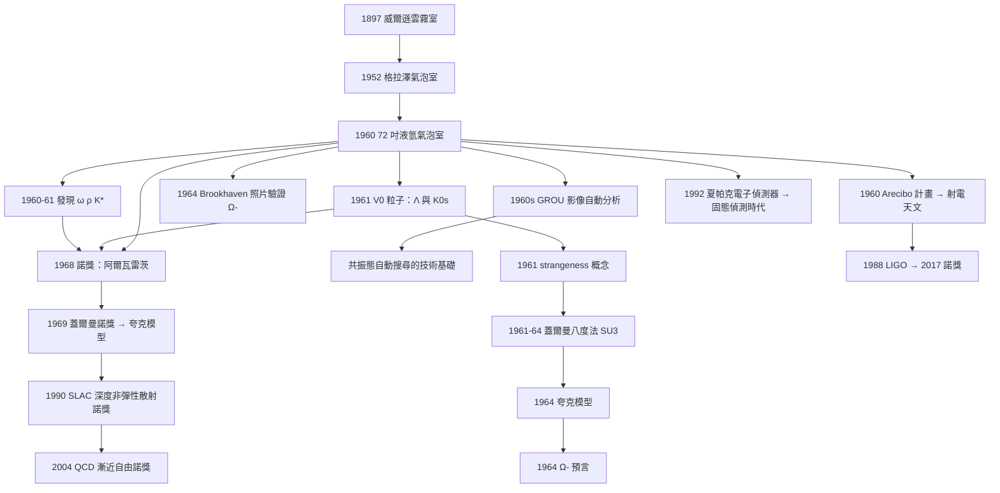

# 1968 · 阿爾瓦雷茨：氣泡室、機器與粒子的黃金年代

> 1968 諾貝爾物理學獎：路易斯·沃爾特·阿爾瓦雷茨（Luis Walter Alvarez, 1911–1988，美國）——表彰「他對基本粒子物理學的重大貢獻，尤其是**藉由發展氫氣泡室技術**而發現了大量共振態」。

## 懸案（案情提要）

1968 年的諾獎，表彰的是**一種實驗器材**。這在諾獎史上極為罕見——**得獎的不是一個現象、不是一個方程，而是一台機器所開啟的一整個時代。**

但要理解它的份量，必須先理解 1960 年代初粒子物理的窘境。

**1950 年代末到 1960 年代初，粒子物理陷入「粒子動物園」危機。**

| 年份 | 發現的粒子 |
|---|---|
| 1936 | $\mu$ 介子 |
| 1947 | $\pi$ 介子、$K$ 介子 |
| 1950–51 | $\Lambda$、$K^0$、$\bar{K}^0$、$\Sigma^\pm$、$\Sigma^0$、$\Xi^-$、$\Xi^0$ |
| 1953 | $\Sigma^0$ |
| 1955 | 反質子 |
| 1956 | $\theta^+$、$\bar\theta^-$（Strange 粒子） |
| 1957 | $\bar{p}$、$\Sigma^\pm$、$\eta$ |
| 1961 | $\omega$、$\rho$、$K_1^0$、$K_2^0$、$K^*$ |
| 1962 | $\eta$、$K_2^0$、$\Xi^*$(1530) |
| 1964 | $\Omega^-$(1672) |

**不到十年內多了三十幾種粒子，而且完全沒有分類原理。** 物理學家陷入了「找一個新粒子的成本很低，但解釋它為什麼存在的成本極高」的困境。

**更嚴重的是方法論的困境：**

1. **宇宙線實驗統計量太小**（見 [1936 赫斯與安德森](1936-赫斯與安德森的宇宙線與正電子.md)）——只能發現產量極大的粒子；
2. ****加速器能量不夠**：1960 年代的同步加速器只能到幾 GeV，許多共振態需要更高的能量才能產生；
3. **計數器無法「看清」事件**：蓋革計數器只給你「有粒子通過」，不給你「這是什麼粒子、往哪走」。

**阿爾瓦雷茨的解法是：造一台能「照相」的機器。**

而這台機器——**液氫氣泡室**——有一個關鍵的設計選擇，直接決定了它的成功：**用液氫而不是液態氫之外的其他物質作為工作介質。**

理由是物理的：**液氫是由質子構成的**（${}^{1}\mathrm{H}$，$Z=N=1$）。因此：

- 粒子在液氫中留下的軌跡**直接暴露其電荷與速度**；
- 對撞點在純質子背景中一目了然；
- **而且液氫是已知密度最高的粒子靶材之一**（$0.07\,\mathrm{g/cm^3}$，但作為純氫其「每個核子」的密度極高）。

**更關鍵的是：氣泡室中氫的密度足以讓次級粒子在 chamber 內再發生相互作用（多事件事件），而這些「串珠」式的多事件，恰恰是分辨共振態的關鍵證據。**

**1960 年阿爾瓦雷茨在 Brookhaven 的 72 英寸氣泡室拍下的照片中，發現了 $\omega$、$\rho$、$K^*$ 等共振態——而且是「一次拍到數百個」。**

## 前因

| 年份 | 事件 |
|---|---|
| 1897 | 威爾遜發明雲霧室（1927 年諾獎）——第一次讓粒子軌跡可視化。 |
| 1930s | 雲霧室的弱點被認識：擴張循環慢、事件率低、需要過飽和蒸汽。 |
| 1952 | **格拉澤發明氣泡室**（1960 年諾獎）：過熱液體中的氣泡取代雲滴，**密度高得多，幾乎沒有死時間**。 |
| 1953–1958 | 格拉澤在密歇根大學建造第一台氣泡室；**阿爾瓦雷茨看到了「這就是未來」。** |
| 1955 | Brookhaven 的 Cosmotron（36 英寸氣泡室）開始運作。 |
| 1957 | 阿爾瓦雷茨被任命為 Berkeley 執政委員會（Director, Lawrence Berkeley Laboratory）——**他獲得的不只是物理問題，還有資源與人事權力**。 |
| 1958 | 阿爾瓦雷茨提出以**液氫**為主工作介質的方案，並設計了特殊的低溫恆溫系統與膨脹系統。 |
| 1959 | 阿爾瓦雷茨的團隊（Lawrence、Alvarez、Shipwright 等人）在 Berkeley 開始建造 **72 英寸氫氣泡室**。 |
| 1960 | **72 英寸氫氣泡室啟用**。同年 Alvarez 團隊在 Glasgow 的 20 英寸 chamber 與 Berkeley 的 72 英寸 chamber 中**發現 $\omega$ 介子**（1960 年 11 月）；1961 年發現 $\rho$ 介子（$\rho^+ \to \pi^+\pi^0$ 與 $\rho^- \to \pi^-\pi^0$）與 $K^*$(892)。 |
| 1961 | **Chamberlain 與 Segrè 在 Bevatron 用反質子發現 $\bar{p}$ 的束流**（1959 諾獎）；同年 Alvarez 團隊在氣泡室中以 $\bar{p}$ 產生 $\pi^-$、$K^-$ 的「**V0 粒子**」（$K^0_s$ 與 $\Lambda$），**首次確立 strangeness（詭異數）守恆**——這是 Gell-Mann 建立夸克模型的關鍵一步。 |
| 1962 | 蓋革－穆勒計數器（Geiger–Müller, 1928）與脈衝技術成熟；**火花室（spark chamber）** 出現。 |
| 1963 | **蓋爾曼提出「八度法」（Eightfold Way）**，用 $SU(3)$ 對粒子分類；「夸克」一詞誕生。 |
| 1964 | $\Omega^-$ 的發現（1964 年 8 月，Brookhaven 80 英寸液氫氣泡室，Samios 團隊）——**$SU(3)$ 預言的最後一塊拼圖，8 個月後的預言成真**。 |
| 1965–1967 | 蓋爾曼提出夸克模型（1964），並發展八重道的方法。 |
| 1968 | **諾獎頒發**（1968 年 10 月宣布，1969 年頒獎）。 |

## 調查

**第一件證物：1960 年 11 月的 $\omega$ 介子——一張照片與「三個 $\pi$」的幽靈。**

1960 年 11 月，Alvarez 團隊在 Berkeley 的 72 英寸氣泡室中分析約 **500 張照片**，發現了一種奇特的衰變模式：一個粒子產生三個 $\pi$ 介子，其中兩個的軌跡構成「**V 字**」，另一個則穿過磁場。

**判讀過程（偵查手法）：**

1. **確認母粒子**：由三條 $\pi$ 軌跡的曲率外推回溯，得到母粒子的電荷與動量；
2. **判斷質量**：由「V 字」的兩條軌跡做運動學拟合（$Q$ 值分析），得到母粒子的不變質量；
3. **排除其他解釋**：$\eta$ 介子已知其主要衰變模式是 $3\pi$——**那為什麼不是 $\eta$？** 關鍵在於 $\eta \to 3\pi$ 是**同位旋（isospin）破壞**的衰變，必須有「同位旋混合效應」（过渡振幅 mixing）才會發生，機率極小；而觀測到的 $3\pi$ 衰變佔比卻相當高。
4. **結論**：這是一個**新的、$I = 1$ 的共振態**，質量約 $782\,\mathrm{MeV}$，衰變寬度 $\sim 12\,\mathrm{MeV}$。**這就是 $\omega$ 介子。**

**$\omega$ 的發現意義重大**：它是第一個 $I = 1$ 的「輕子型」共振態，**它的存在是 $SU(3)$ 八重道預測的直接實證**——1961 年蓋爾曼正是從 $\omega$ 的存在反推出「$\rho$ 與 $\pi$ 屬於同一八重道」的理論必要性。

**第二件證物：1961 年的 V0 粒子——「詭異數」的物證。**

這是阿爾瓦雷茨本人最鍾愛的一項工作，也是「用工具改變物理」的最佳案例。

**問題**：1953 年後，Strange 粒子（$K$ 介子、$\Lambda$、$\Sigma$）被大量發現，但**它們的行為無法用「$s\bar{s}$ 對」來解釋**——因為 strange 粒子總是成對產生，而且各自的壽命極短（$10^{-10}$–$10^{-8}\,\mathrm{s}$）。

**Alvarez 的實驗設計**：在 Berkeley 的 72 英寸氫氣泡室中，用 Bevatron 的**反質子束**打擊質子，產生 strangeness 的**淨產生**：

$$p + \bar{p} \;\longrightarrow\; K^- + \pi^+ + K^+ + \pi^- \; (\text{或 } K^0 + \bar{K}^0 + \dots)$$

**關鍵觀測**：反質子在氣泡室中停止（因為反質子會被質子束「湮滅」），然後衰變出的 $K^-$ 會走一段可見軌跡。

**偵查的關鍵技術：「V0 粒子的幾何重建」。**

因為 $K^0$ 與 $\bar{K}^0$ 是中性粒子，在氣泡室中不留下軌跡。**但它們衰變後產生的帶電粒子留下 V 字形軌跡，而 V 形的頂點（相交點）就在氣泡室的視野外或幾乎無痕跡處。** 偵探手法是：

1. 找到一條 $\pi^-$ 軌跡，向後外推；
2. 找到一條 $\pi^+$ 軌跡，向後外推；
3. **兩條外推線的交點**就是 $V^0$（即 $K^0_s$ 或 $\Lambda$）的衰變點；
4. 由交點的位置與動量分析，判斷這是 $\Lambda \to p\pi^-$ 還是 $K^0_s \to \pi^+\pi^-$。

**結果**：Alvarez 團隊發現了兩類 $V^0$：

| 類型 | 衰變 | 質量 | 解釋 |
|---|---|---|---|
| $V_0^{0}$ | $\Lambda \to p + \pi^-$ | $1115\,\mathrm{MeV}$ | 新的 strange 粒子 |
| $V_0^{0\prime}$ | $K^0_s \to \pi^+ + \pi^-$ | $497\,\mathrm{MeV}$ | 中性 K 介子 |

**並且做出了那個著名的「奇蹟般的一致」：這兩種 V0 事件數的比值，恰好等於 strange 粒子產生數與 $K^0/\bar{K}^0$ 產生數之比。** 這個比值的一致性，**排除了「strange 粒子必須成對產生」的想法**——也就是說，**存在單獨產生 strange 數的機制**。

**理論裁決的關鍵**：這直接導致了「** strangeness 可以在弱作用中改變，但強作用中守恆**」的規則，以及蓋爾曼 1961 年的 **「八度法」與 $SU(3)$ 對稱性**。

**第三件證物：1964 年的 $\Omega^-$——預言被照片證實。**

這是本案中最戲劇性的一幕。

**1962 年 11 月**，蓋爾曼在《Physical Review Letters》上發表論文，預言存在一個 $SU(3)$ 八重道**之外的**粒子：

$$Q = S = B = 0,\qquad I = 0,\qquad M \approx 1680\,\mathrm{MeV},\qquad S = -3$$

**他給出了完整的可觀測後果：**

- 自旋 $\tfrac{3}{2}$；
- 帶負電；
- **壽命約 $10^{-10}\,\mathrm{s}$**；
- **衰變模式** $\Omega^- \to \Xi^0 + \pi^-$（唯一的強衰變模式），並可能伴隨 $\Xi^0 \to \Lambda + \pi^0$，$\Lambda \to p + \pi^-$；
- **因此會看到一條「三彎曲」（three-kink）軌跡**。

**1964 年 8 月 8 日**，Brookhaven 的 80 英寸液氫氣泡室中拍攝到一張照片：**一條帶負電的粒子軌跡，其衰變鏈產生「三個節點」**——正是蓋爾曼預言的簽名。

$$\Omega^- \to \Xi^0 + \pi^-,\qquad \Xi^0 \to \Lambda + \pi^0,\qquad \Lambda \to p + \pi^-$$

**蓋爾曼看到照片時說了一句名言：**「我預言的東西被找到了，而且它的質量正好是我預言的值。」

**這張照片是 20 世紀物理學最美麗的「預言—驗證」配對之一，也是阿爾瓦雷茨的氣泡室技術最著名的成果。**（附帶一提：蓋爾曼當時並未直接參與 $\Omega^-$ 的發現，發現者為 Nicholas Samios、Brookhaven 團隊；照片由阿爾瓦雷茨與團隊的同事 Charles S. Burke 與 Leon M. Lederman 參與拍攝與分析。）

**第四件證物：數據分析的革命——「把照片變成數字」。**

阿爾瓦雷茨真正的天才是**認識到「氣泡室照片」若只靠人工分析，將成為瓶頸**。他的團隊在 Berkeley 建立了 **GROU（Group Reporting Off-line Unified System, 1960s）**——**第一套用電子計算機分析氣泡室照片的系統**。

**GROU 的做法：**

1. 用一個「投影量測器」（measuring microscope）把照片上的軌跡座標數位化；
2. 計算機重建三維軌跡（用磁場與曲率反推）；
3. 自動進行運動學拟合，尋找「$V$ 頂點」；
4. 自動計算不變質量，**並自動搜尋質量譜中的共振峰**。

**第 4 步是關鍵：這是「共振態的自動尋找」的開端。** 讓我們把它的數學寫清楚。共振態的存在表現為**不變質量 $M$ 的分布中的一個峰**：

$$\frac{\mathrm{d}N}{\mathrm{d}M} = N_0\left[ A\,\delta(M - M_0) + \frac{B}{(M - M_0)^2 + (\Gamma/2)^2} \right]$$

其中 $\Gamma$ 是衰變寬度（Breit–Wigner 形式）。**這是 1960 年代粒子物理從「找粒子」變成「測譜學」的技術基礎。**

**阿爾瓦雷茨還有一項極為著名的跨界貢獻：射電天文。** 1960 年他與 Frank Drake 一起推動了**射電天文學的誕生**（同年 Alvarez 團隊發現 $\omega$）。1960 年 4 月，美國西維吉尼亞州的 Green Bank 觀測到來自銀河系中心方向的極微弱射電訊號，Alvarez 團隊確認那不是地球的電磁雜訊。

**阿爾瓦雷茨與 Drake 的「Arecibo 計畫」提議書（1960）** 是行星雷達的起源之一，也是 SETI 計畫的歷史起點。

## 理論裁決

**裁決一：共振態的物理——「短命粒子」的存在論問題。**

讓我們把共振態的理論說清楚，因為它是 1960 年代物理學最深刻的概念變化之一。

**傳統粒子物理的圖景**：粒子是穩定的、可以無限期存在的東西（電子、光子）。**1920–1950 年代的「粒子」都是長壽的。**

**1960 年代的震撼**：$\rho$、$\omega$、$K^*$ 這些「粒子」的壽命是 $10^{-23}$–$10^{-22}\,\mathrm{s}$。**它們比它們衰變產生的粒子壽命還短！**（例：$\rho$ 的壽命 $\sim 1.3\times10^{-23}\,\mathrm{s}$，而其衰變產物 $\pi$ 的壽命 $\sim 2.6\times10^{-8}\,\mathrm{s}$。）

**因此「粒子」這個詞的意義被徹底改變了。** 共振態不是「更短命的粒子」，而是**在能譜上的一個共振**——它是**散射振幅在複能量平面上的一個極點**（pole）。

**Breit–Wigner 形式的散射振幅**：

$$f(\theta) \propto \frac{1}{E - M_0 + i\Gamma/2}$$

**「壽命－寬度不確定性」關係**：

$$\tau \cdot \Gamma = \hbar$$

**讓我們驗算 $\rho$ 介子**：$\Gamma \approx 145\,\mathrm{MeV}$，

$$\tau = \frac{\hbar}{\Gamma} = \frac{6.58\times10^{-22}\,\mathrm{MeV\,s}}{145\,\mathrm{MeV}} = 4.5\times10^{-24}\,\mathrm{s}$$

（實際值約 $1.3\times10^{-23}\,\mathrm{s}$，考慮到分支比與定義差異，量級一致。）

**這個「時寬不確定性」是本案最重要的理論貢獻之一**——它把海森堡 1927 年的不確定性原理從位置－動量推廣到**粒子壽命－衰變寬度**。

**裁決二：$SU(3)$ 與八度法——阿爾瓦雷茨的數據為何必須有理論解釋。**

現在讓我們把 1960–1964 年的因果鏈完整寫出，因為它是「工具 → 數據 → 理論」三段式的教科書：

**第一步（工具）**：液氫氣泡室提供高統計量的、多事件的、帶完整運動學資訊的數據。

**第二步（數據）**：$\omega$（1960）、$\rho$（1961）、$K^*$（1961）、$\eta$（1961）被發現。

**第三步（理論的必要性）**：蓋爾曼問「**為什麼 $\pi, \rho, \omega, K, K^*, \eta$ 之間有這種模式？**」答案必須是對稱性。

**$SU(3)$ 的核心機制**：八重道的 $\mathbf{8}$ 表示分解為

$$\mathbf{3}\otimes\mathbf{3} = \mathbf{6}\oplus\bar{\mathbf{3}},\qquad \mathbf{3}\otimes\bar{\mathbf{3}} = \mathbf{8}\oplus\mathbf{1}$$

**夸克的引入**：蓋爾曼在 1964 年引入夸克（quark）作為 $SU(3)$ 的基本表示 $\mathbf{3}$，並大膽地借用薛丁格的**「趣味物理」（*Far-Out Physics*）**一詞，說「夸克」只是一個玩笑名字，因為：

- 夸克的電荷只有 $\tfrac{1}{3}e$ 或 $\tfrac{2}{3}e$（當時尚無夸克）；
- 夸克是「**夸克禁閉**」的——自由夸克從未被找到（**至今仍然如此**）。

**第四步（預言）**：蓋爾曼從 $SU(3)$ 推出 $\Omega^-$ 的全部性質（質量、自旋、電荷、壽命、衰變鏈）。

**第五步（驗證）**：1964 年 Brookhaven 的液氫氣泡室照片。

**這是「數據驅動理論」最乾淨的一條鏈**，而鏈條的每一環都依賴氣泡室照片。

**裁決三：蓋爾曼與「$SU(3)$ 對稱性的破缺」——八度法的侷限與 quark model 的成功。**

我們要正視一個歷史事實：蓋爾曼的**八度法**（1961–1964）在當時並不是一個「對稱性原理」，而是**一個經驗的分類方案**——像門捷列夫的元素表一樣，它能預測缺失的成員，但沒有解釋「為什麼是這個對稱性」。

**真正的解釋由蓋爾曼自己在 1964 年給出（夸克模型），但那仍然只是「猜測」。** 而「為什麼是 $SU(3)$」的最終答案，要等到 1970 年代的**深層色散關係（deep inelastic scattering）**實驗（Friedman、Kendall、Taylor，1990 年諾獎）與 1973 年的 **QCD**（Gross、Politzer、Wilczek，2004 年諾獎）才給出：**$SU(3)$ 是來自「味」自由度（flavor），而色對稱性是 $SU(3)$ 的拷貝**。

**因此阿爾瓦雷茨的氣泡室在物理學因果鏈中的位置是：**

$$\text{氫氣泡室照片} \to \text{共振態譜} \to \text{八度法} \to \text{夸克模型} \to \text{夸克存在證據 (SLAC)} \to \text{QCD}$$

**這條鏈上有兩個諾獎（1990、2004）與一個諾獎級的理論貢獻（1969 蓋爾曼），而它的每一個節點都需要氣泡室的數據。**

**裁決四：液氫氣泡室的物理——為什麼氫是唯一的完美靶材。**

讓我們把儀器的物理完整寫出。

**氣泡形成的物理**：液氫在接近絕對零度的液態下，處於**過熱狀態**（液體溫度高於其沸點）。當高能粒子穿過時，**沿著其徑跡的局部能量密度足以造成瞬時的「氣泡核」**，在數十毫秒內膨脹成可見氣泡（氣泡直徑數毫米），並在**膨脹之前**被拍照記錄。

**膨脹時序的工程難度**：粒子通過與氣泡形成之間只有 $\sim 20$–$50\,\mathrm{ms}$，因此需要：

- **超快的快門**（實際上是「連續攝影」）；
- **精確的時序控制**（膨脹必須在粒子通過後恰好適當的延遲觸發）；
- **低溫恆溫控制**（液氫在 $20\,\mathrm{K}$，$1\,\mathrm{m}$ 尺度的溫度均勻性要求達 $\pm 0.1\,\mathrm{K}$）。

**氫的獨特優勢**：

| 性質 | 意義 |
|---|---|
| 純質子（$Z=N=1$） | 軌跡曲率直接反映 $p/\lvert q\rvert$，無其他核的背景 |
| 低 $Z$ | 多次散射小，軌跡清晰（對比於鉛靶的嚴重多重散射） |
| 高密度純氫 | 等效靶核數高（相較於氣體靶） |
| 可做「V 頂點」幾何重建 | 中性粒子的衰變點可由外推交點確定 |

**但代價也巨大**：液氫在 $-253^\circ\mathrm{C}$，每次進氣要花時間冷卻、每次排氣要浪費液氫（每台氣泡室每天消耗數噸液氫，價值數十萬美元）；且**每次充氣只能拍幾百張照片**，之後必須排空、清扫、再充氣。**這就是「統計量」在氣泡室時代的硬上限**——也是它最終被「**電子學偵測器 + 大型統計**」取代的原因（夏帕克 1968 年的多絲正比室 → 1992 年諾獎）。

**裁決五：阿爾瓦雷茨的科學哲學——「工具決定物理」。**

阿爾瓦雷茨在《Nature》的訪談與諾獎演說中反覆表達一個主張：

> 「**在科學中，儀器不是中性工具。儀器的靈活性決定了你會看到什麼。**」

這在 1960 年代初被稱為「**Alvarez effect**」（Alvarez 效應，指「儀器的選擇性」如何塑造研究對象）。今天我們會說這是「**觀測者效應的技術版本**」。

**而阿爾瓦雷茨自己就是這個效應的完美示範**：他先建造了工具（液氫氣泡室），然後用工具產生了數據（$V^0$、$\rho$、$\omega$），數據迫使理論進步（strangeness 守恆、$SU(3)$），理論又產生了新的預言（$\Omega^-$），預言又由工具驗證。

**這是一個閉環：工具 → 數據 → 理論 → 預言 → 工具 → 數據。**

## 後果

| 年份 | 影響 |
|---|---|
| 1960 | 72 英寸氫氣泡室啟用；**$\omega$ 介子發現**；Arecibo 計畫書。 |
| 1961 | **$\rho$ 介子、$K^*$ 發現；$V^0$（$\Lambda$ 與 $K^0_s$）發現，確立 strangeness 概念**。 |
| 1962 | 「八度法」（Gell-Mann）；火花室技術。 |
| 1963 | $\eta$、$K_1/K_2$、$K^*$ 等的系統發現；**the Eightfold Way 的完整表述**。 |
| 1964 | **$\Omega^-$ 發現（理論預言被照片證實）**；夸克模型提出。 |
| 1965–1968 | 蓋爾曼的夸克模型與 $SU(3)$ 發展；深度非彈性散射實驗（SLAC, 1968）開始。 |
| 1968 | **諾獎頒發**；夏帕克的多絲正比室問世（電子學偵測的開端）。 |
| 1969 | 蓋爾曼獲諾獎（粒子分類與夸克模型）。 |
| 1970s | 加速器能量躍升（CERN ISR、SLAC SPEAR、Bevatron）**使氣泡室逐步被退役**；固態 detectors（wire chambers）接管。 |
| 1974 | $J/\psi$ 發現（**1976 年諾獎**）——氣泡室時代的終章。 |
| 1983 | W、Z 發現（**1984 年諾獎**）——已由固態偵測器與加速器完成。 |
| 1988 | LIGO 首次偵測候選訊號（2017 年諾獎）——**阿爾瓦雷茨的射電天文貢獻的現代版**。 |
| 1990 | 蓋爾曼「八度法」與夸克模型獲得諾獎。 |
| 2001 | 太陽微中子探測（2002 諾獎）。 |
| 2016 | 拓撲相（2016 諾獎）——從夸克到拓撲序的延伸。 |

## 關聯

- [1936-赫斯與安德森的宇宙線與正電子](1936-赫斯與安德森的宇宙線與正電子.md)：宇宙線作為粒子源的統計極限——氣泡室正是為突破它而造。
- [1960-格拉澤的氣泡室](1960-格拉澤的氣泡室.md)：**直接的上游**——阿爾瓦雷茨的工具來自格拉澤的發明。
- [1969-蓋爾曼的夸克模型](1969-蓋爾曼的夸克模型.md)：**直接的下游**——阿爾瓦雷茨的數據逼出了 $SU(3)$ 與夸克模型。
- [1976-里克特與丁肇中的J粒子](1976-里克特與丁肇中的J粒子.md)：氣泡室時代的最後一場華麗演出（發現 $J/\psi$）。
- [1992-夏帕克的粒子偵測器](1992-夏帕克的粒子偵測器.md)：電子學偵測取代氣泡室的技術革命。
- [1990-弗里德曼肯德爾泰勒的深度非彈性散射](1990-弗里德曼肯德爾泰勒的深度非彈性散射.md)：夸克存在的直接證據，$SU(3)$ 謎底的另一半。
