# 1969 · 蓋爾曼：夸克模型與「粒子zoo」的門捷列夫

> 1969 諾貝爾物理學獎：默里·蓋爾曼（Murray Gell-Mann, 1929–2019，美國）——表彰「他對基本粒子的分類與其相互作用的貢獻與發現」。

## 懸案（案情提要）

1969 年 5 月，諾貝爾委員會頒出一個有點orthodox的獎：**給了一個「分類方案」**。

這在科學史上極不尋常。**沒有一個公式、沒有一台儀器、沒有一個現象。** 蓋爾曼得獎的理由寫得很謹慎：

> 「For his contributions and discoveries concerning the **classification** of elementary particles and their interactions.」

**注意用的是「classification（分類）」而不是「discovery（發現）」。**

那麼，1969 年的粒子物理界究竟面對什麼樣的困境？讓我們把 1968 年的「particle zoo」完整列出：

| 類別 | 粒子 |
|---|---|
| 輕子 | $e^-$、$e^+$、$\mu^-$、$\mu^+$、$\nu_e$、$\nu_\mu$ |
| 介子 | $\pi^\pm$、$\pi^0$、$K^\pm$、$K^0$、$\bar{K}^0$、$K_L$、$K_S$、$\eta$、$\eta^\prime$、$\rho^\pm$、$\rho^0$、$\omega$、$\phi$、$f$、$A_1$ |
| 重子 | $p$、$n$、$\bar{p}$、$\bar{n}$、$\Lambda$、$\Sigma^\pm$、$\Sigma^0$、$\Xi^-$、$\Xi^0$、$\Omega^-$、$\Delta^\pm$、$\Delta^0$、$\Sigma^*$、$\Xi^*$、$\Lambda^*$ |

**約三十種粒子，沒有一個分類原理。** 對比一下化學史上的門捷列夫元素表——它只是「排列」，直到 1913 年 Bohr 給出「原子序數 $Z$ 決定週期性」才成為理論。**1969 年的粒子物理，正處於「門捷列夫排列」的階段，人們渴望的是那個「$Z$」。**

而且，當時物理學家面對的是一個**極為尷尬的經驗事實**：

- 1964–1968 年間，蓋爾曼自己的「八度法」預測成功（$\Omega^-$），但**沒有人知道為什麼是 $SU(3)$**；
- 更糟的是，**「夸克」這個概念一旦被寫下來，就無法被遺忘**——1964 年蓋爾曼在《物理學評論快报》上發表〈Elementary Theory of Strong Interaction〉（他稱之為「**趣味物理**」），用夸克 $\mathbf{3}$、$\bar{\mathbf{3}}$、$\mathbf{8}$ 來組合出所有介子與重子：

$$\pi^+ = u\bar{d},\quad \pi^0 = \frac{u\bar{u} - d\bar{d}}{\sqrt{2}},\quad K^+ = u\bar{s},\quad p = uud,\quad n = udd,\quad \Lambda = uds,\quad \Sigma^+ = uus,\quad \Xi^0 = uss,\quad \Omega^- = sss$$

**這三十種粒子，八個夸克記號，全部解釋了。**

**但代價是：三個夸克帶分數電荷（$+\tfrac{2}{3}e$、$-\tfrac{1}{3}e$、$-\tfrac{1}{3}e$），而且從未被找到。** 自由夸克在今天仍未被發現。

**於是 1960 年代的物理學家面前有一個真正的兩難：**

> **放棄夸克（因為分數電荷與未發現），還是保留夸克（因為它是唯一可行的分類方案）？**

**蓋爾曼的裁決是：保留它，但加上「趣味物理」的免責條款——把夸克標記為「數學工具」，說服世界先接受分類方案，尋找實體的事交給後人。**

**這個裁決在科學方法論上極其深刻，因為它揭示了一個殘酷的事實：最好的理論在實驗證實之前，必須能以「不要求實體存在」的形式被使用。** 這正是今天「有效場論」方法的先聲。

## 前因

| 年份 | 事件 |
|---|---|
| 1929 | 蓋爾曼生於紐約下曼哈頓。 |
| 1948 | 蓋爾曼在芝加哥大學取得博士學位（**物理學家 Victor Weisskopf 的學生**），論文題目是〈**矩陣形式下的核力理論**〉。 |
| 1948–1950 | 蓋爾曼在普林斯顿高等研究所；1950 年在芝加哥；1952 年在哥倫比亞大學。 |
| 1953 | 蓋爾曼發表〈**核子物理中的交叉對稱性**〉，引入「**交叉原理**」。 |
| 1954 | 蓋爾曼與**George Zweig**（在 CERN 的博士學生）獨立提出夸克的早期版本：Zweig 稱之為「**acequark**」（代夸克），Gell-Mann 稱之為「quark」。Zweig 的論文沒有發表（直到 1969 年才由 MIT 的技術報告公開流傳）。 |
| 1956 | **「Strange」一詞的創造**：蓋爾曼在《Physical Review》發表〈Strange Particle Production: A Puzzle〉，提出 strangeness 量子數 $S$ 來解釋 strange 粒子成對產生且壽命異常短（約 $10^{-10}$–$10^{-8}\,\mathrm{s}$）的現象。 |
| 1958 | 蓋爾曼與「**1961 年前的粒子分類嘗試**：$\pi$–$\Lambda$–$\Sigma$–$N$ 混合」。 |
| 1961 | **「八度法」（Eightfold Way）**：蓋爾曼在《Physical Review Letters》的「亞里士多德式的對稱性」一文中提出，以 $SU(3)$ 的表示來分類粒子。 |
| 1962 | 蓋爾曼與 Ne'eman 的「八度法」正式表述（$\mathbf{1}\oplus\mathbf{8}\oplus\mathbf{8}\oplus\mathbf{10}\oplus\mathbf{8}\oplus\overline{\mathbf{10}}$）。 |
| 1964 | **夸克模型**正式提出（〈Elementary Theory of Strong Interaction〉）；**同年被選為諾貝爾物理學委員會委員**。 |
| 1964 | $\Omega^-$ 被發現，$SU(3)$ 預言成功。 |
| 1965 | 蓋爾曼與 Ne'eman 的書《八度法與強交互作用中的對稱性》問世。 |
| 1966–1968 | **深度非彈性散射實驗（SLAC，Friedman、Kendall、Taylor）**：電子撞擊質子，顯示質子內部有點狀結構；蓋爾曼立刻主張「那就是夸克」。 |
| 1968 | 蓋爾曼推廣「**Manhattan Project／Boys Town**」的跨學科計畫，把生物學、考古學、心理學與物理學串成「複雜性」研究（他是 Santa Fe Institute 的共同創辦人）。 |
| 1969 | **諾獎頒發**。 |

## 調查

**第一件證物：strangeness——第一個成功的分類量子數。**

1956 年之前的狀況：為什麼 $\Lambda$、$K$、$\Sigma$、$\Xi$ 這些「strange 粒子」的行為如此古怪？

- 它們**總是成對產生**（一個 strange，一個 antistrange）；
- 它們**壽命極短**（$10^{-10}\,\mathrm{s}$）；
- 但它們**不會被產生在純粹的強作用反應中**（不帶 strange 數的粒子撞擊不會產生它們）。

**蓋爾曼的洞見：賦予它們一個新的守恆量子數 $S$，並讓它只在弱作用中破壞。**

守恆律的推論：

| 反應類型 | strangeness 守恆？ |
|---|---|
| 強作用 | ✅ 守恆 |
| 電磁作用 | ✅ 守恆 |
| 弱作用 | ❌ 不守恆（因此 strange 粒子可以衰變） |

**而「成對產生」正是「守恆」的必然結果**：$S$ 守恆意味著反應前後的 $S$ 總和相等，因此淨產生一個 $S = +1$ 的粒子必須伴隨一個 $S = -1$ 的粒子。

**這個簡單的守恆律解釋了整個 puzzle。** 讓我們用它解釋幾個具體的實驗：

1. **為什麼 $K^+ + n \to \Lambda + p$ 可以發生？** $S(K^+) = -1$，$S(\Lambda) = -1$，守恆 ✅；但這是弱作用，速度很慢——**實驗上確實如此**。
2. **為什麼 $K^+ + p \to \Lambda + \pi^+ + n$ 觀測到的比例有特定數值？** 由各通道的 $Q$ 值與相空間決定。
3. **為什麼 strange 粒子的衰變總是「一次壞一個 $S$」？** 弱作用使 $|\Delta S| \le 1$。

**數學上**，$SU(3)$ 下的 strangeness 就是 $SU(3)$ 對角線上的 Cartan 生成元對應的量子數。**「Strange」在後來被升格為「味」（flavor）的一個分量。**

**第二件證物：八度法——分類學的第一次成功。**

蓋爾曼的八度法分類如下（1961–1962）：

$$\text{強子} \;\supset\; \mathbf{1}\oplus\mathbf{8}\oplus\mathbf{8}\oplus\mathbf{10}\oplus\mathbf{8}\oplus\overline{\mathbf{10}}$$

對應：

| 表示 | 粒子 | $J^P$ |
|---|---|---|
| $\mathbf{1}$ | 假想 | — |
| $\mathbf{8}$ | $\pi$（3）$+$ $K$（4）$+$ $\eta$（1） | $0^-, 1^-, 2^+$ |
| $\mathbf{8}$ | $N$（4）$+$ $\Lambda$（1）$+$ $\Sigma$（3） | $\tfrac{1}{2}^+,\tfrac{3}{2}^+$ |
| $\mathbf{10}$ | $\Delta$（4）$+$ $\Sigma^*$（3）$+$ $\Xi^*$（2）$+$ $\Omega$（1） | $\tfrac{3}{2}^+, \tfrac{5}{2}^+$ |
| $\mathbf{8}$ | $N^*$（反十重道） | 多種 |
| $\overline{\mathbf{10}}$ | 反重子 | — |

**關鍵的「預測」**：

1. $\Omega^-$（1964 驗證）——$S = -3$；
2. $\Xi^*$（1960 發現，$S = -2$）；
3. $f$ 或 $f^\prime$ 介子（後來找到 $f^\prime(1520)$）。

**最漂亮的一點：$\pi$、$K$、$\eta$ 八重道與 $N$、$\Lambda$、$\Sigma$ 八重道有完全相同的 $J^P$ 結構——這正是 $SU(3)$ 多重態的定義特徵。** 蓋爾曼在 1962 年指出，$\pi$ 與 $K$ 構成一個八重道、$N$ 與 $\Lambda$ 構成另一個——**這兩個八重道與同一個 $\mathbf{8}$ 表示完全相同**，是「**同位旋多重態**」的推廣。

**第三件證物：夸克模型的具體內容——三個夸克與一個代夸克。**

蓋爾曼 1964 年的方案（後來被稱為「夸克模型的第一版」）：

$$\text{夸克} : \quad u\left(+\tfrac{2}{3}\right),\quad d\left(-\tfrac{1}{3}\right),\quad s\left(-\tfrac{1}{3}\right)$$

**hadron = 夸克的束縛態**，且規則是：

- 介子：夸克－反夸克對；
- 重子：三個夸克；
- **「重子數」（baryon number）$B$** 定義為夸克數目。

**驗算每個粒子**：

| 夸克組合 | 電荷 | $B$ | $S$ | 粒子 |
|---|---|---|---|---|
| $u\bar{d}$ | $+\tfrac{2}{3}+\tfrac{1}{3} = +1$ | 0 | 0 | $\pi^+$ |
| $u\bar{u}$ | 0 | 0 | 0 | $\pi^0$ |
| $u\bar{s}$ | $+\tfrac{2}{3}+\tfrac{1}{3} = +1$ | 0 | $+1$ | $K^+$ |
| $s\bar{s}$ | $-\tfrac{2}{3}+\tfrac{2}{3} = 0$ | 0 | $-2$ | $\phi(1020)$ |
| $uud$ | $\tfrac{2}{3}+\tfrac{2}{3}-\tfrac{1}{3} = +1$ | 1 | 0 | $p$ |
| $udd$ | $\tfrac{2}{3}-\tfrac{1}{3}-\tfrac{1}{3} = 0$ | 1 | 0 | $n$ |
| $uds$ | $\tfrac{2}{3}-\tfrac{1}{3}-\tfrac{1}{3} = 0$ | 1 | $-1$ | $\Lambda$ |
| $sss$ | $-1$ | 1 | $-3$ | $\Omega^-$ |

**「Yang–Mills 巨型磁 monopole」的討論**：蓋爾曼在 1962 年還談到「**夸克－夸克間的膠子**」的可能性——他甚至給了「膠子」這個名字（gluon），儘管當時他沒有建立 QCD。**這是 1970 年代 QCD 的先聲。**

**第四件證物：1968 年的 SLAC 實驗——「看見」夸克。**

這是本案最關鍵的外部證據。

**實驗**：把高能電子（$\sim 20$–$50\,\mathrm{GeV}$）打在液氫靶上，測量散射角分布。

**如果質子是「均勻的」**：散射截面對 $q^2$ 的依賴會很小（點狀探針）。

**如果質子內部有點狀結構**：在大的 $q^2$ 下，散射截面呈現**標度無關性**：

$$\nu Q^2 = x y Q^2 = 2 x M \nu \text{（不變）}$$

**更關鍵的是「 Bjorken 結構函數」的行為**：$F_2(x)$ 在 $x$ 大時趨於常數（不是 $\ln$ 發散）。這意味著：

$$\text{結構函數反映點狀自由度的分布} \;\Rightarrow\; \text{夸克是點狀的}$$

**Friedman、Kendall、Taylor 於 1968 年發表的結果直接測量了夸克的「電荷平方和」：**

$$\sum_i q_i^2 = \left(\tfrac{2}{3}\right)^2 + 2\left(-\tfrac{1}{3}\right)^2 = \tfrac{4}{9} + \tfrac{2}{9} = \tfrac{2}{3}$$

**這個 $\tfrac{2}{3}$ 正是理論預測值！** 這是夸克模型的第一個定量確認。

**第五件證物：「三個夸克 + 一個 gluon」的不完整——1964 年的困境。**

蓋爾曼自己很清楚問題所在：

**問題一：分數電荷。** 夸克帶 $\tfrac{2}{3}e$、$-\tfrac{1}{3}e$。**自然界沒有分數電荷的粒子**（至少到今天為止）。

**問題二：禁閉。** 夸克從未在自由態被發現。

**問題三：$SU(3)$ 對稱性的來源。** 八度法「有效」但沒有解釋為什麼。

**蓋爾曼的解脫方式——「趣味物理」與「quark」這個詞的雙重功能。**

他引入「quark」這個詞時寫了一段著名的話（1964）：

> 「在其他名稱中，**quark**（夸克）只是個發音聽起來不錯的字；我並不打算對它有太認真的對待，因為它是個習語用的詞，正如輕子（lepton）一樣。」

而他用「**趣味物理**」（Far-Out Physics）來標記那些「確定是對的、但還沒有被證實」的論斷。**這是一個極為精明的策略：**

1. **把夸克定位成「數學便利」而非「物理實體」**，使物理學家可以放心使用；
2. **同時在文獻中埋下具體的、可以被實驗推翻的預言**（分數電荷、夸克存在、$SU(3)$ 關係）；
3. **等到實驗到來（1968 SLAC、1974 $J/\psi$、1974–77 deep inelastic）**，理論的地位自然升級。

**這個策略在科學史上有一個精確的名字：「有效場論式的思考」。** 蓋爾曼在 1969 年諾獎演說中說：

> 「**我們不再需要相信夸克存在就能使用它們。**」

**這句話就是 1970 年代 Willner、Weinberg 等人發展有效場論（EFT）的心聲。** 蓋爾曼的「趣味物理」分類，今天會被寫成：

$$\text{Claim} \in \{\text{已證實的物理}\} \cup \{\text{尚未證實但架構自洽的物理}\}$$

## 理論裁決

**裁決一：$SU(3)$ 群表示的實際結構——「八度法」的數學。**

讓我們把 $SU(3)$ 的表示理論寫清楚，因為這是本案的核心理論。

**基本表示 $\mathbf{3}$**（對應夸克 $u, d, s$）的權（weights）在 Weight diagram 上構成一個等邊三角形：

$$\begin{array}{ccc} & s & \\ d & & u \end{array}$$

**八重道 $\mathbf{8}$** 的權圖是一個六邊形加中心：

$$\mathbf{3}\otimes\bar{\mathbf{3}} = \mathbf{8}\oplus\mathbf{1},\qquad \mathbf{3}\otimes\mathbf{3} = \mathbf{6}\oplus\bar{\mathbf{3}}$$

**$SU(3)$ 的一個著名性質：$\mathbf{8}\otimes\mathbf{8}$ 包含 $\mathbf{8}$**（自對偶性），這意味著**八度道之間可以互相作用**——這是後來建立強子動力學（chiral Lagrangian）的基礎。

**八度法的分類學成果，用一句話概括**：所有輕子型的強子（$J^P = 0^-, 1^-, 2^+$）構成一個 $\mathbf{8}$，所有核子型的（$J^P = \tfrac{1}{2}^+, \tfrac{3}{2}^+$）構成另一個 $\mathbf{8}$，而 $J = \tfrac{3}{2}$ 的一族構成 $\mathbf{10}$。

**「八度道」這個名字來自佛教的「八正道」（ Noble Eightfold Path）——蓋爾曼自己承認這是開玩笑，但「八」這個數字確實精確。**

**裁決二：夸克模型作為「味」的 $SU(3)$——以及它的侷限。**

我們把蓋爾曼方案的物理結構完整寫出：

**（a）強子 = 夸克的束縛態。** 這是後來 QCD 的核心命題，但在 1964 年它只是一個「有效」的描述。

**（b）夸克的三個味道 $u, d, s$。** 對應一個 $SU(3)$ 基本表示。

**（c）成分模型規則：**

$$
\begin{aligned}
\text{介子} &: \quad q\bar{q}' \quad \Rightarrow \text{可為 } \mathbf{1},\mathbf{8},\overline{\mathbf{3}},\mathbf{6},\dots\\
\text{重子} &: \quad q q' q'' \quad \Rightarrow \text{可為 } \mathbf{1},\mathbf{8},\mathbf{10},\overline{\mathbf{10}},\dots
\end{aligned}
$$

**（d）質量來源。** 蓋爾曼承認夸克模型的重大缺陷：**它無法解釋質量。** 質子與中子的質量幾乎相同（939.6 vs 939.5 MeV），但 $u$ 與 $d$ 夸克質量相差甚多（今天知道 $m_u \approx 2.2\,\mathrm{MeV}$、$m_d \approx 4.7\,\mathrm{MeV}$）。**質子 938 MeV 的質量中，約 99% 來自 QCD 的真空能量與色場，不是夸克靜止質量。** 這個「質量的起源」問題要到 **2010 年諾獎（$\pi$ 介子貢獻的質子質量）**才被正式處理。

**（e）夸克的量子數表（1964 年版）：**

| 夸克 | $Q$ | $B$ | $S$ | $J$ | $P$ |
|---|---|---|---|---|---|
| $u$ | $+\tfrac{2}{3}$ | $+\tfrac{1}{3}$ | 0 | $\tfrac{1}{2}$ | $+$ |
| $d$ | $-\tfrac{1}{3}$ | $+\tfrac{1}{3}$ | 0 | $\tfrac{1}{2}$ | $+$ |
| $s$ | $-\tfrac{1}{3}$ | $+\tfrac{1}{3}$ | $-1$ | $\tfrac{1}{2}$ | $+$ |

**裁決三：1968 年之後的歷史轉折——從「分類學」到「動力學」。**

我們把 1969 年之後的因果鏈完整寫出，因為它決定了蓋爾曼工作的最終地位：

| 年份 | 事件 | 對夸克模型的影響 |
|---|---|---|
| 1968 | SLAC 深度非彈性散射：質子有點狀結構 | **夸克存在的直接證據（味層面）** |
| 1973 | Gross、Politzer、Wilczek：漸近自由 | **QCD：夸克與膠子的動力學** |
| 1973 | Kobayashi–Maskawa：第三代夸克 | **味的三代（$CKM$ 矩陣）** |
| 1974 | $J/\psi$ 發現 | **第四味夸克 $c$ 的束縛態**（「十一月革命」） |
| 1974–77 | deep inelastic scattering 的精密測量 | **Parton 模型 → 夸克分佈函數 $f_{q/h}(x, Q^2)$** |
| 1979 | 't Hooft–Veltman：電弱理論可重整 | **標準模型**（夸克＋膠子＋$W$、$Z$＋希格斯） |
| 1990 | SLAC 諾獎 | 夸克存在的正式確認 |
| 1995 | $\tau$ 輕子發現 | **第三代的完成**（$t$ 夸克 1995 年由 CDF/D0 發現） |
| 2004 | QCD 漸近自由諾獎 | 夸克模型的動力學完成 |
| 2008 | 小林–益川諾獎 | 夸克的三代與 CP 破壞 |
| 2013 | 希格斯諾獎 | 夸克質量的來源 |
| 2015 | 微中子振盪諾獎 | 夸克質量的另一個後果（味 mixing） |

**因此，蓋爾曼 1969 年的諾獎，其實是對一條長達 45 年的因果鏈的「第一段落」的表彰。** 而鏈條的每一環都依賴「夸克是計算的基本成分」這個判斷——**而這個判斷在 1969 年還沒有任何直接證據。**

**裁決四：蓋爾曼的科學哲學——「分類是發現的第一階段」。**

蓋爾曼在諾獎演說中有一段極具價值的話，值得完整記錄（意譯）：

> 「在我的一生中，我曾有幸參與一種科學上非常有效的工作：**先做分類，再尋找機制**。化學家Periodic Table 是分類；生物學家把生物分為界門綱目科屬種；粒子物理学家把粒子分為八度道。」

**並且他指出分類的深層功能：**

> 「**分類不只是省事的速記法，它是一個機制的線索。** 每當分類成功時，機制往往就已在其中醞釀。」

**這句話可以作為整個「粒子物理」部門的方法論宣言**，並且它與生物學、化學、材料科學的方法論完全一致——**分類 → 找出對稱性 → 建立動力學 → 預測 → 驗證。**

**盖尔曼的另一個貢獻是「跨學科」的：**

- 他在 **1964 年**是「**Manhattan Project**」（把人類學與考古學結合以追蹤人類遷徙）的共同作者；
- 他在 1960 年代末建立了 **「Boys Town–Santa Fe」的跨學科計畫**，把**生物學、考古學、經濟學、心理學**與**物理學**放進同一個「複雜性」框架；
- 他是 **Santa Fe Institute**（1984 年成立）的共同創辦人，與 Murray Gell-Mann、George Cowan、Kenneth Arrow 共同發起。

**這段「跨學科」努力在 2021 年諾獎（複雜系統：帕里西、哈塞爾曼、真鍋）得到了最終承認——**50 年後，諾獎委員會把「複雜性的科學」正式寫進了獎項。** 這是 20 世紀物理學中「方法論外溢」的罕見案例。**

**裁決五：1979 年諾獎——「趣味物理」的正式追認。**

讓我們在這裡補上一個必須提的歷史註腳：

**1979 年諾貝爾物理學獎頒給了 't Hooft 與 Veltman**，表彰他們「**闡明了電弱交互作用的量子結構**」——即**證明標準模型（以夸克與膠子為內容的理論）是可以重整化的**。

**十年後，蓋爾曼的夸克模型從「趣味物理」升級為「有動力學的、可重整化的、被實驗證實的理論」。** 這個升級過程的每一個環節，都需要蓋爾曼 1964 年那篇「玩笑」論文。

## 後果

| 年份 | 影響 |
|---|---|
| 1956 | Strangeness 量子數的引入。 |
| 1961–62 | 八度法（$SU(3)$）分類。 |
| 1964 | 夸克模型（"Far-Out Physics"）；$\Omega^-$ 預言被驗證。 |
| 1966–1968 | 蓋爾曼被選入諾貝爾物理委員會；推動跨學科計畫。 |
| 1968 | SLAC 深度非彈性散射：質子內部點狀結構。 |
| 1969 | **諾獎頒發**。 |
| 1973 | QCD 誕生（2004 年諾獎）；CKM 矩陣（2008 年諾獎）。 |
| 1974 | 第四味夸克 $c$（1976 年諾獎）。 |
| 1979 | 't Hooft–Veltman 諾獎：標準模型可重整——**夸克模型成為可計算的理論**。 |
| 1984 | **聖塔菲研究所（Santa Fe Institute）成立**，蓋爾曼為共同創辦人。 |
| 1990 | SLAC 夸克發現獲諾獎。 |
| 1995 | $\tau$ 輕子；$t$ 夸克。 |
| 2004 | QCD 漸近自由獲諾獎。 |
| 2009 | 蓋爾曼獲諾貝爾獎的「一甲子」紀念。 |
| 2013 | 希格斯機制諾獎：夸克質量的來源。 |
| 2015 | 微中子振盪諾獎：夸克質量的味 mixing 後果。 |
| 2019 | 蓋爾曼於 2019 年 5 月 24 日在加州 Santa Fe 去世，享年 89。 |
| 2021 | **帕里西諾獎（複雜系統）——蓋爾曼 1960 年代跨學科主張的最終追認**。 |

```mermaid
flowchart TD
    A[1953 交叉對稱性] --> B[1956 strangeness 量子數]
    B --> C[1961 八度法 SU3 分类]
    C --> D[1964 Ω- 預言被驗證]
    C --> E[1964 夸克模型 Far-Out Physics]
    E --> F[1968 SLAC 深度非彈性散射：點狀結構]
    F --> G[1969 諾獎：分類與相互作用]
    E --> H[1973 QCD 漸近自由]
    H --> I[1979 't Hooft-Veltman：可重整]
    I --> J[標準模型成立]
    E --> K[1974 c 夸克 → J/ψ]
    E --> L[1973 CKM 第三代]
    G --> M[1984 Santa Fe Institute]
    M --> N[2021 帕里西複雜系統諾獎]
    G --> O[1960s-70s 跨學科：生物學/考古學/心理學]
```

## 關聯

- [1956-肖克利巴丁布喇頓的電晶體](1956-肖克利巴丁布喇頓的電晶體.md)：同一時期，固態物理中的「能帶分類學」與夸克分類學共享方法論。
- [1968-阿爾瓦雷茨的氫氣泡室](1968-阿爾瓦雷茨的氫氣泡室.md)：**直接的上游**——蓋爾曼的分類建立在阿爾瓦雷茨工具產生的數據上。
- [1976-里克特與丁肇中的J粒子](1976-里克特與丁肇中的J粒子.md)：**直接的下游**——第四味夸克的發現。
- [1979-格拉肖溫伯格薩拉姆的電弱統一](1979-格拉肖溫伯格薩拉姆的電弱統一.md)：夸克與弱作用理論的整合。
- [1990-弗里德曼肯德爾泰勒的深度非彈性散射](1990-弗里德曼肯德爾泰勒的深度非彈性散射.md)：夸克存在的正式證據。
- [2004-格婁斯波利策韋爾切克的漸近自由](2004-格婁斯波利策韋爾切克的漸近自由.md)：夸克模型的動力學完成。
- [2021-真鍋哈塞爾曼帕里西的氣候與複雜系統](2021-真鍋哈塞爾曼帕里西的氣候與複雜系統.md)：蓋爾曼跨學科主張的終局。
