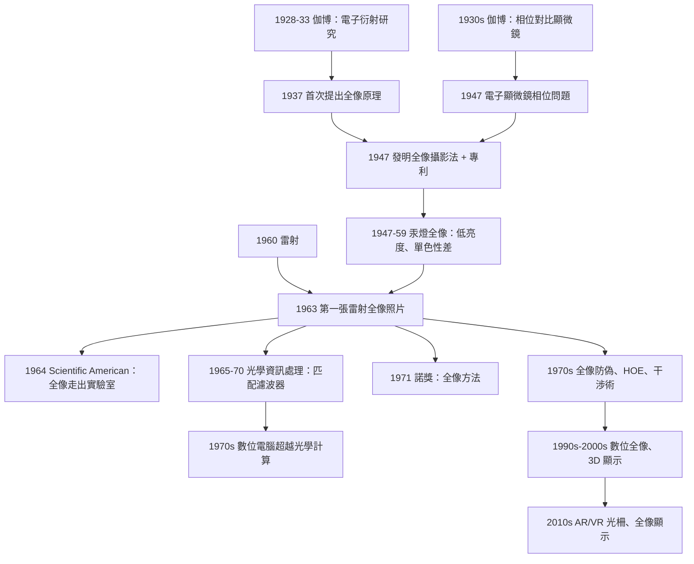

# 1971 · 伽博：全像術與「光學的記憶」

> 1971 諾貝爾物理學獎：丹尼斯·伽博（Dennis Gabor, 1900–1970，英國/匈牙利）——表彰「他發明並發展了全像攝影法」。

## 懸案（案情提要）

1947 年 4 月，匈牙利裔的英國工程師丹尼斯·伽博在倫敦的 GEC 實驗室裡，正在研究如何改進電子顯微鏡。

他的問題非常具體：**電子顯微鏡的電子束太短波長，分辨率遠高於光學顯微鏡；但它只能拍出「死」的影像——電子穿過樣品後就散射掉了，沒有任何「立體」資訊被保留下來。**

當時的解法是用電子束**多次穿過**樣品（多角度掃描），再由計算機把散射數據重建成影像。**但這非常慢，而且只能重建「形狀」，重建不了「相位」。**

**伽博的洞見是這樣的：**

> **如果我們用「相干光」取代電子束，並且不是讓光只穿過一次，而是讓光在參考光與物光之間產生干涉，那麼干涉條紋就會把相位資訊「記錄」下來。以後只要用與記錄時相同的光照射這張記錄，就能重建出原來的完整波場——包括相位。**

**這個「把相位資訊編碼進干涉圖樣」的技巧，就是全像攝影（holography）。**

**而它的深遠之處在於：全像是一種「光學資料庫」——它記錄的是波前的完整資訊，而不是像普通照片那樣只記錄強度。**

**這是一個「原理先於用途」的典型案例**：1935 年就有關於全像的論文，1947 年有實驗，但**要等到 1960 年雷射問世，才有人做出第一張全像照片**（Gabor 與 Maiman 在 1963 年的著名照片）。**1969 年，正當全像技術準備好要進入工業與醫學的時候，伽博於 1970 年 9 月 5 日在倫敦去世——他在世時只看到雷射全像的第一批成果，而諾獎是在他死後一年、於 1971 年頒發的。**

## 前因

| 年份 | 事件 |
|---|---|
| 1900 | 伽博生於匈牙利布達佩斯。 |
| 1927 | 伽博在柏林 Technische Hochschule 取得博士學位（工程物理），導師 Richard Konig。 |
| 1928–1933 | 伽博在 德國 AEG（Allgemeine Elektricitäts-Gesellschaft）研究**金屬的電子衍射**——**這是他日後發明全像的直接技術源頭**：他熟悉「電子束通過物體後的干涉圖樣」正是電子顯微鏡像的成因。 |
| 1934–1939 | 伽博在匈牙利 Szeged 大學任教，發展「**光學顯微鏡的相位對比理論**」——**這是他獲得 1954 年 Körber 獎的工作，也是諾貝爾委員會肯定他科學貢獻的重要依據**。 |
| 1937 | 伽博發表〈A New Microscopic Principle〉，首次提出全像原理（當時他稱為「波動照相法」）。 |
| 1940 | 二戰爆發，伽博留在匈牙利。 |
| 1943–1945 | 伽博在布達佩斯技術大學任教授；1943 年將「光學顯微鏡的相位對比」方法應用到電子顯微鏡。 |
| 1947 | **伽博發明全像攝影法**，發表於 *Nature*（《New method for recording and displaying 3-D images and wavefronts》），並申請專利（1947 年英國專利 645,751，1951 年美國專利）。 |
| 1948 | 伽博離開匈牙利，1947 年底經義大利輾轉抵達英國。 |
| 1949–1950 | 伽博在 GEC 實驗室工作；1951 年成為 Reader；1964 年成為倫敦帝國學院（Imperial College）教授。 |
| 1955 | 伽博獲得 Körber 獎（相位對比）。 |
| 1960 | **雷射問世**（Maiman）。 |
| 1963 | **第一張雷射全像照片**：Gabor 與 Maiman 用 He-Ne 雷射拍攝的桌上玩具（全息照片中的「戴著彩色帽子的玩偶」，被稱為 "the first hologram"）。 |
| 1964 | 激光全像術（*laser holography*）在 Scientific American 上發表（June 1964 號），**全像術走出實驗室**。 |
| 1965–1969 | 全像術的應用擴展到干涉量測（干涉顯微術）、光學資訊處理（matched filtering）、全像光學元件（holographic optical elements）、全像顯微鏡。 |
| 1969 | 伽博提名諾獎；**1970-09-05 伽博在倫敦逝世**（當時正在為《The New Physics》準備章節）。 |
| 1971 | **諾獎頒發**（由 Royal Society 會長 Lord Flowers 宣讀；伽博的家人，包括他的女兒 Marguerite Marzin，接受了榮譽）。 |

## 調查

**第一件證物：電子顯微鏡的「相位問題」——伽博要解決的到底是什麼。**

讓我們先理解「相位」為什麼是難題，這是全像的關鍵概念。

**波的形式**：任何波可以寫成

$$A = a\,e^{i\phi}$$

**照相底片（或人眼）只對 $|A|^2 = a^2$ 敏感**——也就是只記錄「振幅」，不記錄「相位」$\phi$。

**在光學顯微鏡中，問題的尖銳程度尤其明顯。** 考慮一個完全透明的標本（例如活細胞），它只**延緩**光波而不吸收：

$$A(x,y) = A_0\,e^{i\phi(x,y)}\quad\Rightarrow\quad |A|^2 = A_0^2 = \text{常數}$$

**影像是一片均勻的空白！** 所有的結構資訊都在相位裡，但眼睛看不到。

**這就是相位對比顯微鏡（1954 年 Körber 獎）要解決的問題**：把相位差 $\Delta\phi$ 轉換成強度差。

$$I \approx |A_0 + A_0 e^{i\Delta\phi}|^2 \approx 2A_0^2(1 + \cos\Delta\phi) \approx A_0^2\left(2 - \Delta\phi^2\right)$$

**但在電子顯微鏡中，情況更極端**：電子波通過標品時的相位差極大（數百弧度），而且電子的波长是 $\sim 0.0037\,\mathrm{nm}$，使得傳統光學方法完全無效。

**伽博的全像法給出的答案是：不要「轉換」相位，而是「把相位轉成強度」——用干涉。**

**第二件證物：全像的記錄——干涉條紋就是資料庫。**

**全像記錄的完整數學。** 設物光（object wave）為

$$O(x,y) = o(x,y)\,e^{i\phi_o(x,y)}$$

參考光（reference wave）為

$$R(x,y) = r\,e^{i\phi_r(x,y)}$$

記錄介質上的**總強度**（底片記錄的正是這個）：

$$I(x,y) = |O + R|^2 = |O|^2 + |R|^2 + O R^* + O^* R$$

**關鍵：交叉項 $OR^* + O^*R$ 同時攜帶了物光的振幅與相位資訊。** 把它寫成餘弦形式：

$$I(x,y) = |O|^2 + r^2 + 2r\,o(x,y)\cos\!\big(\phi_o(x,y) - \phi_r(x,y)\big)$$

**最後一項就是「全像」——一組以參考光相位為基準的干涉條紋，條紋的「亮度包絡」是物光的振幅，條紋的「位置」是物光的相位。**

**讓我們看一個具體例子：平面波物光。** 若物光是從 $x = 0$ 處傳出的平面波 $\phi_o = kx$，參考光是平面波 $\phi_r = 0$，則：

$$I(x) = \text{const} + 2r\,o\cos(kx)$$

**這就是一組週期為 $\lambda/2$ 的條紋**——這是「全息圖」裡最基本的結構。

**第三件證物：重建——用同樣的光照射全像圖。**

現在用與記錄時**相同**的參考光 $R$ 照射全像圖（此時全像圖的透射率正比於 $I$）：

$$U_{\text{out}}(x,y) = \underbrace{\alpha |O|^2}_{\text{原物光（被衰減）}} + \underbrace{\beta |R|^2}_{\text{零級衍射}} + \underbrace{\gamma\,O\,R^*}_{\text{共軛像}} + \underbrace{\delta\,O^* R}_{\textbf{重建的真實像}}$$

**第四項 $\delta\,O^*R$ 就是重建出來的原來波前**——**注意它攜帶了完整的相位資訊！** 這就是全像能重建三維立體影像的原因：**觀看者從不同角度看，會看到不同的透射光進入眼睛，感覺到「視差」——正是立體感覺的物理來源。**

**兩個孿生像**：

| 分量 | 內容 | 位置 |
|---|---|---|
| $\gamma\,OR^*$ | **共軛像**（虛像，倒立） | 與原物同側 |
| $\delta\,O^*R$ | **真實像**（正立） | 與原物異側 |

**因此全像圖需要用「點擴散函數」的語言描述，而「重建像」的品質取決於兩個「孿生分離」是否清楚——這要求參考光相對物光的角度足夠大**，使得孿生像在空間上分離。

**第四件證物：關鍵的技術難題——「空間頻寬」與「載波」。**

讓我們把全像記錄的「帶寬」問題講清楚，這是理解全像原理最重要的一步。

**問題**：干涉條紋把相位資訊「調製」到載波上。條紋的空間頻率是

$$k_{\text{carrier}} = \nabla(\phi_o - \phi_r)$$

**干涉條紋的空間頻率越高（載波越陡），能記錄的物光角度範圍越大（視場越大），但記錄介質的解析度需求也越高。**

**用「空間頻寬乘積」（space-bandwidth product, SWP）表述**：

$$\text{SWP} = \underbrace{\text{介質解析度}}_{1/\text{像素尺寸}} \times \underbrace{\text{記錄孔徑}}_{D}$$

**這是一個硬性限制，也是 20 世紀 60 年代全像實驗的瓶頸：** 1960 年代的照相底片解析度約 1000 lp/mm，而全像需要極高的解析度（因為要記錄細密的干涉條紋）。

**雷射的到來解決了「單色性」問題，但沒有解決「解析度」問題**——直到 1968 年 Lunts 與其他人發明「**Silver halide emulsions with high resolution**」（1970 年代的 SHS 相干記錄材料），全像才真正能做出高解析度影像。

**讓我們比較三種方案的取捨**：

| 方法 | 解析度需求 | 視場 | 立體感 | 狀態 |
|---|---|---|---|---|
| 全息光學顯微鏡（1947） | 高（電子束） | 小 | 弱（弱相位物體） | 實用性差 |
| 雷射全像（1963–） | 中（改善的底片） | 大 | 強 | 工業化 |
| 計算全息（1960s–） | 取決於輸出 | 可程式化 | 依方法 | 現代主力 |

## 理論裁決

**裁決一：全像的本質——「光學資訊的完整記錄與非全息術的對比」。**

讓我們把「全像」（hologram）這個詞的嚴格定義寫清楚：

**全像 = 波前完整資訊（振幅 + 相位）的記錄。**

對照三種記錄方式：

| 記錄方式 | 記錄的資訊 | 可重建的對象 |
|---|---|---|
| 普通照片 | 只有 $\|A\|^2$（振幅） | 平面影像（無立體感） |
| 全息干涉術 | 兩束光的干涉條紋 | **波前差**（形貌、位移、折射率） |
| 全像（hologram） | 參考光與物光的干涉條紋 | **完整波前**（含相位）→ 三維重建 |

**這裡有一個深刻的物理學觀察**：**「全像」與「粒子物理」中波函數的地位有類比性。**

| | 全像 | 量子力學 |
|---|---|---|
| 不可直接觀測的量 | 相位 $\phi$ | 波函數 $\psi$（含相位） |
| 可觀測的量 | 強度 $\lvert A\rvert^2$ | $\lvert\psi\rvert^2$ |
| 記錄相位的技巧 | 與參考光干涉（干涉術） | 與參考束干涉（電子干涉術） |
| 重建 | 用同樣的光 | 用同樣的波函數計算 |

**這個對比不是巧合，而是物理學中「相位不可觀測但可干涉記錄」這一普遍結構的兩個實例。** 干涉術是量子力學的實驗基礎（光子干涉 → 量子計算 → 2022 年諾獎）。

**裁決二：數位全像與「光學計算」的復興。**

伽博的原理在 1960 年代後半被重新發掘為「**光學資訊處理**」的工具，這是 20 世紀 60 年代末的「**光學計算浪潮**」（optical computing）：

**關鍵人物**：Casimir Goodman 與 Leonard Ravitz（1967 年在 University of Pennsylvania 開始研究）。

**原理**：全像的記錄過程本質上是一個**卷積積分**：

$$I(\mathbf{r}) = O(\mathbf{r}) * R(\mathbf{r})$$

**因此，一個全像匹配濾波器（matched filter）執行的就是相關運算（correlation）**：

$$\text{output}(\mathbf{r}) = \int I(\mathbf{r}')\,O^*(\mathbf{r}'-\mathbf{r})\,\mathrm{d}\mathbf{r}'$$

**這正是「辨識與相關」運算的數學基礎**，可以用光學平行地完成。

**實例**：字元辨識、指紋比對、圖形配準（1970 年代的軍事與工業應用）。

**為什麼後來被數位電腦取代？** 讓我們做一個誠實的評估：

| 光學全像處理 | 數位處理 |
|---|---|
| 極高平行度（$10^6$ 像素同時處理） | 受限於 von Neumann 架構 |
| 速度快（一次曝光即完成卷積） | 需大量乘法 |
| 不可程式化、精度受限於光學元件 | 可程式化、精度可任意提高 |

**結論：光學計算在 1970 年代被數位取代，但它的「全像匹配濾波器」思想在今天的「相關」與「卷積神經網路」中以軟體形式復興。** 這個歷史值得記錄：**一個原理被拋棄，但它的數學結構被繼承。**

**裁決三：全像技術的物理學意義——「三維資訊的存儲」。**

讓我們把「全像為什麼能給立體感」的物理講清楚，這是本案最值得學的部分。

**核心機制：視差（parallax）。**

重建波前 $O^*R$ 是一個**真實的三維波前**。當觀看者移動眼睛位置 $\mathbf{r}_{\text{eye}}$ 時，從不同路徑進入眼睛的光線對應物體的不同部分：

$$I_{\text{retina}}(\mathbf{r}_{\text{eye}}) \propto \left|\psi(\mathbf{r}_{\text{eye}}, t)\right|^2$$

**因為波前攜帶了完整的立體資訊，視差是自動產生的，不需要任何立體顯示技術。** 這就是「全像是真正的三維記錄」的物理意義。

**延伸應用的邏輯**：

| 應用 | 使用的全像特性 |
|---|---|
| 全像干涉術（holographic interferometry） | 兩個波前的差 → 物體形貌的精密量測 |
| 全像顯微鏡（1955, 1960s） | 以全像取代透鏡，像差校正 |
| 全像光學元件（HOE, 1969–） | 記錄下複雜的波前 → 便宜的元件 |
| 資訊加密（1960s 起） | 全像作為光學資料存儲 |
| 全像 3D 顯示（1970s–） | 用 SLM 或多頻全像重建 3D |
| 數位全像（1990s–） | 計算生成全像，用於 3D 顯示、顯微鏡 |

**裁決四：全像與「資訊」概念的深遠影響。**

讓我們把這個影響說清楚，因為它是 1971 年諾獎在 21 世紀的最重要回響。

**伽博在 1947 年的洞見本質上是：**

> **如果一個系統的物理狀態可以用某種「干涉圖樣」完整編碼，那麼該系統就可以用這個圖樣作為記憶體。**

**這是「光學資訊理論」的開端。** 而它在 21 世紀以兩個形式回歸：

**（a）全像資料存儲（holographic data storage）**：1990 年代與 2000 年代，Sony、Optware 等公司嘗試用體積全像（volume hologram）存儲多層資訊（多層光折變晶體），以實現 TB 級光學存儲。**受限於 Bragg 選擇性與介質均勻性。**

**（b）更深刻的影響：光學計算與光互連。** 2000 年代的「光互連」（optical interconnect）與 2010 年代的「光子計算」研究，仍在追求全像方法論的目標：**用光的固有並行性來加速卷積與相關運算。**

**裁決五：諾獎委員會的措辭與「工程師諾貝爾獎」傳統。**

我們來看 1971 年諾獎措辭的精確性：

> 「For his **invention and development** of the **holographic method**.」

這裡的兩個動詞值得注意：**invention（發明）與 development（發展）**。委員會承認這是一項「**方法**」的發明。

**「工程師型諾貝爾獎」的傳統**在 20 世紀物理獎中有一條清晰的系譜：

| 年份 | 得主 | 貢獻 |
|---|---|---|
| 1912 | Dalén | 燈塔自動調節閥 |
| 1947 | Appleton | 電離層探測（應用性） |
| 1964 | Townes、BASOV、Prokhorov | 雷射（發明） |
| **1971** | **Gabor** | **全像（發明）** |
| 1989 | Ramsey、Dehmelt、Paul | 原子鐘與離子阱（工具） |
| 1995 | Reines、Perl | 探測技術 |
| 2002 | Davis、Koshiba、Giacconi | 探測技術 |

**這個傳統說明：諾貝爾委員會從不排斥「工具與方法」的表彰——只要它打開了新的物理。**

**而伽博的案例有一個特別的悲劇性張力**：**他在有生之年幾乎沒有得到應有的科學承認**。1960 年代，全像術的商業化（防偽、全息影像）讓他成為工業顧問，但**學術界長期不把全像當作物理**（1965–1975 年間，全像相關論文大量發在光學與工程期刊，而非物理期刊）。**諾獎在 1971 年追認了他的地位。**

**他的自傳《Inventing the Future》（1988 年他口述，1989 年出版）成了 20 世紀最重要的科學家自傳之一**，其中提出了著名的「**九條原則**」（Gabor's Nine Principles），包括：

> 「**未來的最好發明，是尚未被發明的。**」
> 「**承認知識的界限，才能有真正的進步。**」

## 後果

| 年份 | 影響 |
|---|---|
| 1947 | 全像方法發明（*Nature* 論文 + 專利）。 |
| 1955 | 全像光學顯微鏡（holographic microscope,1955）。 |
| 1960 | 雷射問世。 |
| 1963 | **第一張雷射全像照片**（Gabor–Maiman）。 |
| 1964 | 雷射全像術發表於 *Scientific American*。 |
| 1965–1970 | **光學資訊處理（全像匹配濾波器）**；全像光學元件（HOE）。 |
| 1970 | 伽博逝世（1970-09-05）。 |
| 1971 | **諾獎頒發**。 |
| 1971–1980 | 全像干涉術成為精密量測（車輪應力分析、鈣鈦礦晶體生長監測）；**全像防偽（1970s–80s，Banknote Reflectometry）**；全像顯微鏡商業化（1980s 的 Zeiss 鏡像全像顯微鏡）。 |
| 1980s–1990s | **數位全像（digital holography）** 興起（1980s 的 Yariv 與 Kogelnik 的工作）；光學加密。 |
| 1990s–2000s | 體積全像資料存儲（Sony 等）；**全像 3D 顯示的商業化嘗試**（Spatial 與 SeeReal）。 |
| 2000s–2010s | 光子計算與光互連研究；全像光柵（holographic optical elements）成為 AR/VR 顯示的技術之一；**「全像顯示」成為大眾科技術語**。 |
| 2018 | 諾貝爾物理學獎頒給光鑷與超快雷射——**全像術在超快光學中的延伸（泵浦探測全像）**。 |
| 2022 | 量子糾纏諾獎——**干涉作為資訊載體的量子版本**。 |

## 關聯

- [1914-勞厄與晶體中的X射線繞射](1914-勞厄與晶體中的X射線繞射.md)：繞射與傅立葉光學——全像記錄與重建的數學語言。
- [1933-薛丁格與狄拉克的原子新形式](1933-薛丁格與狄拉克的原子新形式.md)：波函數的相位問題——與全像的相位問題同構。
- [1964-湯斯巴索夫與普羅霍羅夫的雷射](1964-湯斯巴索夫與普羅霍羅夫的雷射.md)：**單色性與相干性的來源**，全像實用化的前提。
- [1960-格拉澤的氣泡室](1960-格拉澤的氣泡室.md)：另一種「記錄」技術（粒子軌跡）——同樣是把不可見的波前/軌跡轉成可觀測圖樣。
- [2022-阿斯佩與克勞澤蔡林格的量子糾纏](2022-阿斯佩與克勞澤蔡林格的量子糾纏.md)：干涉作為資訊載體的量子版；「相位不可觀測」的最終處理。
