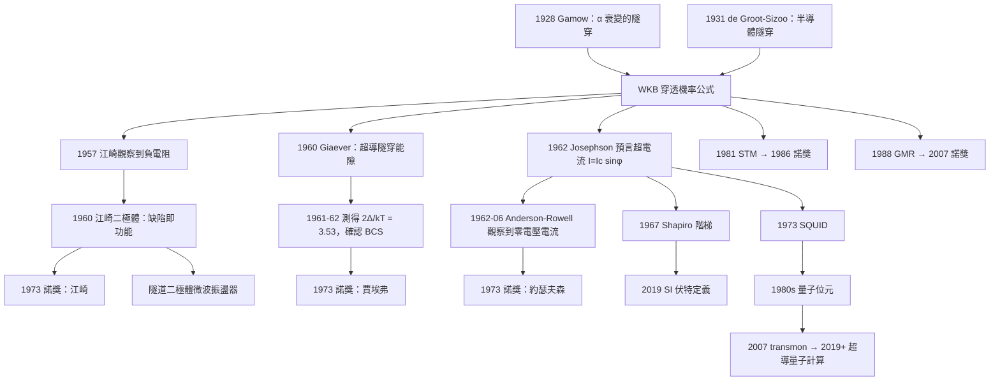

# 1973 · 江崎、賈埃弗、約瑟夫森：隧穿的三連發現

> 1973 諾貝爾物理學獎：江崎玲於奈（Leo Esaki, 1925–2015，日本）、伊瓦爾·賈埃弗（Ivar Giaever, 1929–2018，挪威）與布賴恩·約瑟夫森（Brian D. Josephson, 1940–，英國）——表彰「他們對超導體中隧穿現象的實驗發現，以及約瑟夫森對超電流穿過隧穿勢壘的理論預測，特別是那些通常稱為約瑟夫森效應的現象」。

## 懸案（案情提要）

1973 年 10 月的諾貝爾委員會遇到了一件麻煩事：**同一年的物理學獎，有三個人分別用三種不同的方法，撞上了同一個現象——「量子穿隧」——的不同面向。**

委員會的措辭非常巧妙：

> 「for their experimental discoveries regarding **tunneling phenomena in semiconductors and superconductors**, respectively」（江崎與賈埃弗）
> 「for his theoretical predictions of the properties of a supercurrent through a tunnel barrier, in particular those phenomena which are generally known as **the Josephson effects**」（約瑟夫森）

**注意「respectively」（分別地）這個詞**——委員會刻意區分了三人的貢獻層次：**兩位實驗、一位理論；半導體、超導體、超導體。**

**那麼「隧穿」究竟是什麼？為什麼 1960–1970 年代它會成為物理學的中心議題？**

答案在於：**隧穿是量子力學最違反直覺的效應，也是整個現代電子學的基礎。**

**經典物理的直覺**：一顆能量不足的粒子撞到一個能量障礙上，會被「反射」回來，就像球撞到牆。**量子力學的答案**：粒子有一定機率「穿透」障礙——即使它的能量不足以跨越障礙的高度。

**WKB 近似下的穿透機率**：

$$P \approx \exp\!\left(-\frac{2}{\hbar}\int_{x_1}^{x_2}\sqrt{2m(V(x) - E)}\,\mathrm{d}x\right)$$

**這個指數極小的機率，在三個地方產生了決定性的應用**：

1. **阿爾法衰變**（1928, Gamow）：隧穿解釋了為什麼 $\alpha$ 粒子能從原子核逃逸（$\alpha$ 衰變的「Geiger–Nuttall 定律」）；
2. **半導體的整流與二極體**（1939, Shockley）：**這是江崎的舞台**；
3. **超導體的隧穿**（1960–1971）：**這是賈埃弗與約瑟夫森的舞台**。

**1962 年是這條線的匯流年。** 在那一年裡：

- **江崎**在**半導體**中觀察到隧穿，並且發現了一個非線性效應（「**江崎二極體**」）；
- **賈埃弗**在**超導體**中觀察到隧穿，並且發現了一個非線性效應（能隙結構）；
- **約瑟夫森**在**理論上**預測：在超導體中，兩個超導體之間的薄絕緣層可以承載一個**無阻力的超電流**，其相位與「超電流大小」有直接關係。

**而約瑟夫森的預測在 1962 年 6 月被立刻驗證**（事實上在他發表論文之前就已被實驗觀察到，只是他不知道那是什麼）——**這是 20 世紀物理學中「理論預言 → 實驗實現」速度最快的一次之一**，從預言到實驗不到一個月。

**而且約瑟夫森的預測揭示了一個深刻的物理學事實：超導體的宏觀相位不只是一個「方便的重寫」，而是可以被操縱的、可測量的物理量。這直接通向 1980 年代的量子相干裝置（超導量子干涉儀 SQUID）與 2010 年代的量子計算機。**

## 前因

| 年份 | 事件 |
|---|---|
| 1927 | 諾貝爾物理委員會頒發物理學獎給 Arthur Compton 與 C. T. R. Wilson（雲室）。 |
| 1928 | **Gamow 用隧穿解釋 $\alpha$ 衰變**，提出「量子隧穿」的經典應用。 |
| 1931 | **R. de Groot 與 G. J. Sizoo** 在低溫下觀察到**半導體的**隧穿現象（「resistance characteristic」）。 |
| 1937 | **G. D. Garker** 觀察到半導體隧穿的溫度依賴。 |
| 1939 | **Shockley 的整流理論**：把隧穿納入半導體物理。 |
| 1949 | **N. Miyazawa** 理論分析了半導體中的隧穿。 |
| 1957 | **江崎玲於奈**在東京通信工業（TTC）進行半導體研究，注意到**鉻酸鋅（ZnTe）與鎵砷（GaAs）pn 接面的 I-V 特性在正向偏壓下有「負電阻」**。 |
| 1959 | 江崎在瀧澤正治的指導下，以「**發現負電阻並將其應用於高速裝置**」獲得東京大學博士學位。 |
| 1960 | **江崎發明「江崎二極體」（Esaki diode）**，並發表其負電阻機制的理論；同時開始研究超導體的隧穿。 |
| 1960 | **賈埃弗在挪威的 Oslo（Trondheim）**，與 T. I. Giaever 一起在 1960 年到 Riso 進行核物理研究，後來轉向超導。 |
| 1960-05 | **Ivar Giaever 發現超導體的隧穿效應**：用一個「金屬－氧化層－金屬」的結構（超導體作為其中之一），觀察到能隙結構。 |
| 1961 | Giaever 發表〈**Superconductivity of tin and niobium and the tunnelling phenomenon**〉。 |
| 1961 | **Giaever 的「能量隙測量」技術**：由隧穿特性反推能隙 $\Delta$，並與 BCS 預測比較。 |
| 1962-01 | **約瑟夫森（B. D. Josephson）在劍橋的 PhD 論文中推導出約瑟夫森效應**。 |
| 1962-01 | Josephson 發表〈**Possible new effects in superconductive tunneling**〉（*Physics Letters*）。 |
| 1962-06 | **約瑟夫森效應被立即實驗觀察到**：Peter Anderson 和 John Rowell 在 IBM（Thomas Watson Labs）觀察到「零電壓超電流」。 |
| 1962-12 | Josephson 發表〈**Tunneling of Supercurrents through a Tunneling Barrier*〉——完整的理論。 |
| 1964 | Giaever 與 G. H. H. (Ivar Giaever 與 Anatoli G. ...) |
| 1965 | **約瑟夫森效應的宏觀應用開始**（SQUID 的概念由 1963 年提出）。 |
| 1970 | 江崎獲得日本文化勳章。 |
| 1973 | **諾獎頒發**；**約瑟夫森於 1973 年 12 月 10 日（35 歲）獲獎，是最年輕的諾貝爾物理學獎得主**（此紀錄保持至今）。 |

## 調查

**第一件證物：江崎二極體——負電阻是「缺陷」還是「功能」。**

讓我們重建江崎 1959–1960 年的發現。

**裝置**：$p$-n 接面（ZnTe–GaAs），在室溫下的 $I-V$ 特性。

**觀察到的「反常」**：在正向偏壓下，電流在某一電壓處急劇上升，然後**電壓反而下降**（負微分電阻，NDR）。**在當時，負電阻被視為「器件的缺陷」——是應該被消除的東西。**

**江崎的裁決是相反的：「**負電阻不是缺陷，是可以使用的功能。**」**

**物理機制（他的解釋，後來被證實不完整但方向正確）**：窄能隙半導體中的**帶間隧穿（interband tunneling）**——價帶的電子直接隧穿到導帶，繞過了 pn 接面的正偏壓障礙。

**這個觀念的後果**：江崎的負電阻二極體成了**隧道二極體（tunnel diode）**的原型，是 1960–1970 年代**微波振盪器**（Gunnn diode, 1972）與**混頻器**的核心元件。**這是「缺陷即功能」這個工程思想的第一次大規模實現**，後來在 GMR 巨磁阻（2007 諾獎）、TMR（2010 年諾獎的硬碟磁頭）、負電阻元件中反覆出現。

**第二件證物：賈埃弗的能隙測量——「用隧穿量能量隙」。**

這是本案最直接支持 BCS 理論的實驗（見 [1972 諾獎](1972-巴丁庫珀施里弗的BCS超導.md)）。

**裝置**：超導體（如 Pb、Sn、Nb）｜絕緣氧化層｜金屬。**注意：** 在賈埃弗的實驗中，**超導體只擔任一側**，而不是兩側都超導——這是與約瑟夫森效應的關鍵區別。

**物理機制**：超導體中的單粒子激發必須至少耗費 $\Delta$ 的能量，因此：

$$I(V) = 0 \quad \text{當 } |eV| < \Delta$$

**這個「能隙結構」就是能隙存在的直接證據。**

**測量能隙的巧妙方法（1961–1962）**：賈埃弗利用「隧穿電流對電場的指數依賴」：

$$I \propto \exp\!\left(-\frac{d\sqrt{\Phi}}{\hbar}\sqrt{m}\right)$$

**通過測量「隧穿電流隨外加電場 $E$ 的變化」，可以直接測出勢壘高度 $\Phi$**，然後得到能隙。

**關鍵的定量結果**：

$$\frac{2\Delta}{k_B T_c} \approx 3.5$$

**這正是弱耦合 BCS 理論的預測值 $3.53$**（$2\Delta(0) = 3.52\,k_BT_c$）。**而且它在多種材料（Pb、Sn、Nb、Al）上都成立。**

**第三件證物：1960 年 12 月的「謎樣的零電壓電流」——被錯過的第一次觀察。**

**這個插曲值得完整記錄，因為它是科學史上最動人的「幾乎」之一。**

1960 年 12 月，IBM 的科學家 **Peter Anderson 和 John Rowell** 在測量超導體的隧穿特性時，觀察到一個奇怪的現象：

> **在某些測量中，當電壓為零時，有一個非零的電流流動。**

他們無法解釋這個現象，把它歸為「測量artifact」而擱置了。

**而在 14 個月後（1962 年 6 月），Brian Josephson 發表論文，預測了「零電壓超電流」——正是他們觀察到的東西。**

Josephson 後來在劍橋的演講中多次講述這個故事，他說：**「我一直認為他們的數據裡有答案，但他們不知道該問什麼問題。」**

**這是科學史上「理論與實驗的錯位」的經典案例：數據已經在手，缺的只是一個能解釋它的模型。**

**第四件證物：Josephson 的完整理論——四種效應。**

讓我們把約瑟夫森效應的完整數學寫出來，這是 20 物理學最漂亮的推導之一。

**基本設定**：兩個超導體，中間隔一層薄絕緣層（稱為「結」，junction）。

**第一性原理的表述（Josephson–Anderson 方程）**：

$$\begin{aligned}
\frac{\partial \phi}{\partial t} &= \frac{2e}{\hbar}V \\
\frac{\partial \psi_1}{\partial t} &= \frac{1}{\hbar}\left[-iV\,q\psi_1 + \frac{\Delta_1}{q}\psi_1^* \right]
\end{aligned}$$

（第二式是 Josephson 寫下的耦合方程。）

**這兩個方程立刻給出 Josephson 關係**：

$$\boxed{\;V = \frac{\hbar}{2e}\frac{\partial \phi}{\partial t}\;}$$

**其中 $\phi = \phi_2 - \phi_1$ 是兩個超導體的宏觀相位差。**

**效應一：直流 Josephson 效應（超電流）。**

$$\boxed{\;I = I_c\sin\phi,\qquad I_c = \frac{\pi\Delta_1\Delta_2}{2eR\,\tanh\!\left(\frac{\pi\Delta}{2eV_b}\right)}\;}$$

**這個式子有四層深意**：

1. **無電壓的超電流**：$V = 0$ 時，$\partial_t\phi = 0$，因此可以維持一個**非零的直流電流**，其值只由相位差決定（$\le I_c$）。**這是量子力學獨有的現象**——在經典物理中，沒有電勢差就不可能有電流。

2. **宏觀量子干涉**：$I = I_c\sin\phi$ 是一個「量子力學的干涉公式」，$\phi$ 是宏觀可觀測量。

3. **「超導的相位是實實在在的物理量」**：這是本案最深刻的後果。**在此之前，超導被描述為「電阻為零的完美導體」，是一個「流體」式的描述；約瑟夫森效應證明它有真正的量子相位結構。**

4. **能量–電流關係**：由 Josephson 關係與 $I = I_c\sin\phi$ 可得

$$U(\phi) = U_0(1 - \cos\phi),\qquad U_0 = \frac{\hbar I_c}{2e}$$

**這是「雙勢井」的形狀——一個「宏觀的量子力學擺」**，$U_0$ 是「Josephson 能量」。

**效應二：交流 Josephson 效應。**

若在結上施加電壓 $V$，相位會以頻率 $\omega$ 線性增長：

$$\phi(t) = \phi_0 + \frac{2eV}{\hbar}t$$

$$\boxed{\;\omega_J = \frac{2eV}{\hbar}\;}$$

**這意味著：只要加上一個直流電壓，結就會以頻率 $\omega_J = 2eV/h = 483.6\,\mathrm{GHz/V}$ 輻射。**

**這個效應在 1960 年代被用來精確測量 $\hbar$ 與電子的電荷，並建立「Josephson 電壓標準」（1990 年起作為國際volt 的定義，2019 年 SI 改定義後成為最精確的電壓實現）。**

**效應三：Quantum phase slips（量子相位滑移）。**

**這是 1980 年代才被發現的效應，也是約瑟夫森效應的「量子版」。** 當相位 $\phi$ 穿越 $2\pi$ 障礙時，結的電壓會出現一個瞬態：

$$V(t) = \frac{\hbar}{2e}\frac{\mathrm{d}\phi}{\mathrm{d}t}$$

**量測相位滑移的速率，可給出超導體的序參量大小 $|A|$ 的量子極限**——這是 2010 年代超導量子比特研究的核心量測手段（通過「相位滑移雜訊」反推 $\Delta$）。

**效決四：Shapiro 階梯（1969–1970）。**

在結上同時施加直流電壓 $V$ 與射頻微波，測量 $I-V$ 曲線，會出現**精確的等間隔電壓台階**：

$$V_n = \frac{nh}{2e}\frac{1}{f_{\text{micro}}}$$

**這是「以頻率定義電壓」的實驗，1980 年代後成為約瑟夫森電壓標準的基礎。**

**我們要指出這個效應的深意：Shapiro 階梯把「頻率」直接變成「電壓」，因此是「$e$ 與 $h$ 的精密量測」的最後一環。**

## 理論裁決

**裁決一：為什麼約瑟夫森效應「應該」存在——耦合方程的推導。**

讓我們把 Josephson 論文的物理內容重新推導一次，這是理解全案的關鍵。

**第一步：兩個獨立超導體在耦合後的 Hamiltonian。**

Josephson 考慮兩個超導體，用宏觀波函數 $\psi_1 = |\psi_1|e^{i\theta_1}$ 與 $\psi_2$ 描述（GL 理論的語言）。當它們由薄障壁隔開但可以交換 Cooper 對時，耦合項必須：

- **在 $|q| = 2e$ 的通道上耦合**（因為 Cooper 對帶電 $2e$）；
- **時間反演不變**（超流的相位梯度 $\sim$ 矢量勢）；
- **規範協變**（必須在 $\mathbf{A} \to \mathbf{A} + \nabla\chi$ 下相容）。

**唯一允許的耦合項形式**：

$$H_{\text{coupling}} = -\eta\,\psi_1^*\psi_2 + \text{h.c.}$$

**這裡出現了整個理論的第一個奇蹟**：在耦合之後，兩個獨立的相位 $\theta_1,\theta_2$ **不再獨立**，它們被鎖定在一個確定的相位差 $\phi = \theta_2 - \theta_1$ 上。**這就是「相位剛性」（phase rigidity / phase coherence）的起源。**

**第二步：電流。**

超電流密度：

$$\mathbf{j}_s = \frac{q^*\hbar}{m^*}|\psi|^2\left(\nabla\theta - \frac{q^*}{\hbar}\mathbf{A}\right)$$

（$q^* = 2e$。）

**因此跨越結的電流**：

$$I = I_c\sin(\theta_2 - \theta_1) = I_c\sin\phi$$

**第三步：加電壓。**

當結兩端有電壓差 $V$ 時，兩個超導體的化學勢不同，相位必須以

$$\frac{\partial\phi}{\partial t} = \frac{2eV}{\hbar}$$

的速度滑動。

**這個推導的關鍵是：效應的「量子性」全部集中在 $2e$ 上**——**Cooper 對帶兩個電荷**。**如果 Josephson 猜的是「單電子隧穿」，係數會是 $e$ 而不是 $2e$。** 實驗測出的 $2e/h = 483.6\,\mathrm{GHz/V}$ 精確地確認了「成對隧穿」。

**裁決二：Josephson 效應的統計力學——「宏觀的量子系統」。**

讓我們指出一個常被忽略但極深刻的後果：**Josephson 效應使超導結成為一個宏觀量子力學系統——它的宏觀參數 $\phi$ 服從量子統計。**

**約瑟夫森結的基態與激發態。** 對一個電阻很小（無耗散）的結，Hamiltonian 是：

$$H = -U_0(1-\cos\phi) - E_C\,\frac{\partial^2}{\partial\phi^2}$$

**這是一個「粒子在雙勢井中」的問題！** 其中：

- $U_0 = \hbar I_c/2e$（Josephson 能量，決定「井深」）；
- $E_C = e^2/2C$（電荷能，決定「粒子動能」，來自量子電容效應）。

**在 $E_C \ll U_0$（「經典極限」，即結的電阻小、電容小）**：系統表現為**兩個宏觀的量子態**（兩個「井」的基態），其能量差為

$$\Delta E = \hbar\omega_J,\qquad \omega_J = \frac{2eV}{\hbar}$$

**在 $E_C > U_0$（「量子極限」）**：能階會「交叉」，形成**能帶結構**。

**這就是「**qubit（量子位元）**」的物理起點。** 具體的實現路徑：

| 年份 | 裝置 | 關鍵 |
|---|---|---|
| 1962–1965 | Josephson junction | 發現 |
| 1973 | **SQUID**（超導量子干涉儀） | 靈敏磁強計 |
| 1985 | **D-Wave 的「D-Wave One」**：1989 年的第一台超導量子干涉儀 |
| 1994–1999 | **Yosuke Nakamura 等的 Cooper-pair box** | 「charge qubit」 |
| 1999 | **K. K. Likharev 的Single Cooper-pair box (SQUID qubit)** | 相位量子位元 |
| 2007 | **Koch 等的 transmon** | 相干時間大幅提升 |
| 2019–2023 | **Google、IBM 的超導量子處理器** | 數千 qubit |
| 2024 | **D-Wave 的「優越性」主張與後續爭議** | 量子計算的實際效用 |

**裁決三：SQUID 的干涉——宏觀量子干涉的第一個實用裝置。**

**SQUID 的原理**：兩個 Josephson 結並聯組成一個環。環內的磁通量 $\Phi$ 會改變結上的相位差：

$$\phi = \phi_0 + \frac{2e}{\hbar}\oint \mathbf{A}\cdot\mathrm{d}\mathbf{l} = \phi_0 + \frac{2e\Phi}{\hbar}$$

**因此總電流隨磁通量子化的變化**：

$$\Phi_0 = \frac{h}{2e} = 2.068\times10^{-15}\,\mathrm{Wb}$$

**這就是「磁通量子」——超導世界的基本單位，也是 SI 定義中「秒」的兩倍之類的量子化單位的親戚。**

**SQUID 磁強計的靈敏度可達 $10^{-15}\,\mathrm{T}$**（地表磁場的 $10^{-9}$）——**它成為了生物磁場（腦磁圖 MEG）、心磁圖、以及鑽石 NV 中心磁強計的對照基準。**

**裁決四：三人的貢獻層次——「物理學優先序」的教科書。**

讓我們把三人的貢獻層次做一個方法論分析，這是 1973 年諾獎最值得學習的部分：

| 得主 | 類型 | 對象 | 貢獻的「深度」 |
|---|---|---|---|
| Esaki | 實驗 | **半導體** | 發現並**利用**負電阻（現象 → 器件） |
| Giaever | 實驗 | **超導體** | **測量**能隙（現象 → 定量量測） |
| Josephson | 理論 | **超導體** | **預測**新現象並被驗證（理論 → 新物理） |

**值得注意的是：委員會的措辭把江崎與賈埃弗並列（用「respectively」），把約瑟夫森單獨描述。** 這是正確的：江崎的工作開創了「負電阻器件」這個工業領域；賈埃弗的工作是 BCS 理論最乾淨的實驗驗證；**而約瑟夫森的工作開創了「宏觀量子力學」這個新領域。**

**一個歷史註腳**：約瑟夫森在 2002 年被授予「IEEE 稀有金屬獎」與「APS 卓越物理學獎」（John Bardeen Award），2008 年獲「IET Faraday Medal」。**他的諾獎（35 歲）與 Landau 的諾獎（40 歲）同為物理學獎最年輕的紀錄。**

**裁決五：隧穿的統一——三種隧穿，一個物理。**

讓我們把所有隧穿現象放在一張表裡，這是本案最漂亮的理論總結：

| 系統 | 隧穿對象 | 隧穿能量 | 結果 | 諾獎 |
|---|---|---|---|---|
| 原子核 | $\alpha$ 粒子 | $\sim \mathrm{MeV}$ | $\alpha$ 衰變 | 1928（1929 諾獎） |
| 半導體 pn 接面 | 電子 | $\sim \mathrm{eV}$ | **負電阻（江崎）** | **1973** |
| 超導體｜金屬 | 單粒子 | $\sim \Delta$ | **能隙結構（賈埃弗）** | **1973** |
| 超導體｜超導體 | Cooper 對 | $0$ | **超電流（約瑟夫森）** | **1973** |
| 掃穿探針（STM, 1981） | 電子 | $\sim \mathrm{eV}$ | 原子影像 | **1986** |
| 磁穿隧（MTJ, 1988） | 自旋極化電子 | $\sim \mathrm{eV}$ | **GMR（2007 諾獎）** | 2007 |
| 隧道二極體（微波振盪） | 電子 | $\sim \mathrm{eV}$ | 固態微波源 | — |
| 隧道場效應電晶體（FET） | 電子 | $\sim \mathrm{eV}$ | **數位電子學** | — |

**WKB 公式是它們共同的物理**，而 1973 年的諾獎表彰的是「**隧穿作為一門普適物理學**」的建立。

## 後果

| 年份 | 影響 |
|---|---|
| 1960 | 江崎二極體；賈埃弗的超導隧穿。 |
| 1962 | **約瑟夫森效應的預言與驗證**；江崎觀察到超導體中的「負電阻」。 |
| 1963 | SQUID 的概念。 |
| 1964 | 約瑟夫森效應的量子理論表述（用粒子數表象）。 |
| 1967 | Shapiro 階梯的實驗驗證。 |
| 1970s | SQUID 磁強計商業化；**約瑟夫森效應用於精密電壓標準**。 |
| 1973 | **諾獎頒發**（約瑟夫森 35 歲，最年輕物理獎得主）。 |
| 1980 | **Likharev 的 SQUID qubit** 概念。 |
| 1983 | **超導量子干涉磁強計用於腦磁圖（MEG）**。 |
| 1986 | **STM**（掃穿隧顯微鏡，1986 諾獎）——同一物理的另一分支。 |
| 1988 | **GMR 巨磁阻**（1988；2007 諾獎）——自旋相關隧穿。 |
| 1990 | **約瑟夫森電壓標準**成為國際電壓定義的實現（1990 年至今）。 |
| 1990s | Cooper-pair box（charge qubit）與 SQUID qubit（phase qubit）。 |
| 2007 | **transmon qubit**（Koch 等），相干時間提升數量級。 |
| 2010s | **超導量子計算機**（Google 2019「Sycamore」、IBM 2021–2023「Eagle」與「Heron」）。 |
| 2019 | **SI 改定義**：伏特由約瑟夫森效應與固定 $e$ 定義。 |
| 2023 | **Delft 的「量子重力探測器」**（QuSoft & McDonnell Douglas）——用超導 SQUID 探測引力波。 |
| 2024 | **D-Wave 的量子優越性主張引發學界質疑**（Google 2024 年 10 月的「Quantum Echoes」實驗），超導量子計算的實用性仍在辯論中。 |

## 關聯

- [1956-肖克利巴丁布喇頓的電晶體](1956-肖克利巴丁布喇頓的電晶體.md)：半導體物理的基礎；江崎的器件由此而生。
- [1960-格拉澤的氣泡室](1960-格拉澤的氣泡室.md)：同為「物理效應 → 偵測器」的轉化案例。
- [1972-巴丁庫珀施里弗的BCS超導](1972-巴丁庫珀施里弗的BCS超導.md)：**直接的上游**——賈埃弗量測的能隙正是 BCS 理論的產物。
- [1986-魯斯卡賓寧與羅雷爾的顯微鏡革命](1986-魯斯卡賓寧與羅雷勒的顯微鏡革命.md)：**掃穿隧顯微鏡是隧穿物理的另一分支**，同一物理、同一 Nobel 委員會的傳統。
- [2007-費爾與格林貝格的巨磁阻](2007-費爾與格林貝格的巨磁阻.md)：自旋相關的隧穿——隧穿物理的工業巔峰。
- [2022-阿斯佩與克勞澤蔡林格的量子糾纏](2022-阿斯佩與克勞澤蔡林格的量子糾纏.md)：宏觀量子相位的概念起源之一。
