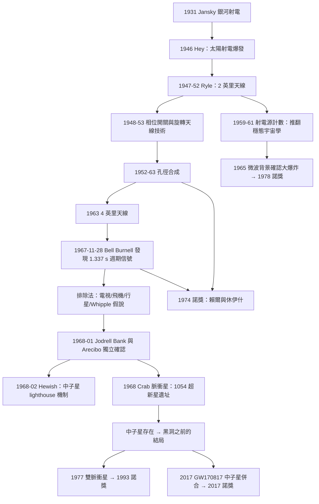

# 1974 · 賴爾與休伊什：射電天文與脈衝星

> 1974 諾貝爾物理學獎：安東尼·休伊什（Antony Hewish, 1924–2007，英國）與馬丁·賴爾（Martin Ryle, 1918–1984，英國）——表彰「他們在射電天體物理學上的開拓性研究：賴爾的觀測與發明，特別是孔徑合成技術；休伊什在脈衝星發現中的決定性作用」。

## 懸案（案情提要）

1974 年的諾獎，表彰了**兩種完全不同的「看不見的東西」的探測手段**——但它們共享同一個謎題。

**先看賴爾的案子。**

1945–1950 年代，射電天文剛起步，人們發現宇宙中有大量「射電源」——但它們是什麼？單靠「用更大的天線收更多波」是不行的，因為：

1. **角解析度太差**：單一圓形天線的解析度約 $\theta \sim \frac{\lambda}{D}$。在波長 $\lambda = 1\,\mathrm{m}$、天線直徑 $D = 100\,\mathrm{m}$ 時，$\theta \sim 0.6^\circ$——**而太陽直徑只有 $0.5^\circ$**。這意味著單碟天線連太陽都分不開，更不用說分辨星系。
2. **視場狹窄**：只能看到天空中的一小塊。

**賴爾的答案是「孔徑合成」（aperture synthesis）：**

> **把很多面小碟天線的訊號，用電子學的方法「虛擬」地組合成一面等效的大碟。**

**這個想法的精髓是「傅立葉定理」**：一個天線的訊號是天空亮度分布的**傅立葉變換**。**因此只要測得不同方向的干涉「基線」，就能反演出天空的亮度分布。** 這個想法的精妙之處在於：**天線不需要真的擺成大碟——只要把基線覆蓋得夠好，虛擬孔徑就等於一面真實的大天線。**

**而休伊什的案子，是一個「偵探小說」。**

1967 年 7 月，**劍橋的 Mullard 無線天文台**（休伊什是卡文迪許實驗室的通訊研究組領導人）收到了一份學生日誌分析報告。報告來自一位博士生 **Jocelyn Bell Burnell**，她正在分析劍橋 4 英里（7 km）天線射電望远镜掃描的資料。

**報告的內容是：一個「信號源」，它每隔 **1.337 秒**重複一次，精確度達 16 位數字。**

**讓我們理解這個數字的可怕之處。**

天線位於劍橋，掃描天空。信號的周期性意味著：

- 源相對於地球的旋轉周期恰好是 $1.337\,\mathrm{s}$，**這意味著源的自轉周期是 $1.337\,\mathrm{s}$**；
- **一個天體自轉一周只要 1.337 秒**——它的轉速是每 16.3 小時一周。

**1.337 秒的自轉周期意味著巨大的重力自能釋放**——一個中子星大小的天體，每秒把自己的能量轉成輻射。

**但更可怕的是「精確度」**：信號的脉衝到達時間可以精確到 $10^{-4}\,\mathrm{s}$，而周期穩定到多個小時不變。這**排除了所有自然的天文機制**——

- 行星的干擾？會有微小的擾動；
- 恆星的振盪？周期會漂移；
- 地球的自轉（Whipple 的「Plasma whip」假說）？**需要解釋為何地球自轉有極小的修正**

**Bell Burnell 的排查過程值得完整記錄，因為它是科學史上最精彩的「排除法」偵查之一：**

| 排除的對象 | 理由 |
|---|---|
| 地面雷達干擾 | 晝夜變化、方向不對 |
| 電視訊號 | 沒有一個電視發射台的頻率與調變模式吻合 |
| 飛機 | 一次只出現一個，不會如此規律 |
| 建築物反射 | 頻率不符 |
| 太陽系的行星 | 行星自轉的潮汐不穩定；信號應隨季節變化 |
| 地球自轉（Whipple 假說） | 需要極不自然的精確對齊，且會隨地球自轉變化 |
| 極光 | 出現時機不符 |
| **可能的解釋** | **一個自轉的超快、極小的天體——即「中子星」** |

**休伊什與 Bell Burnell 的裁決是：這是「**恆星尺度的脈衝星**（pulsar）」——一個自轉的超快中子星。**

**而 1968 年 1 月，在 Arecibo（波多黎各）用巨型望遠鏡發現的「蟹狀星雲中的脈衝星」（PSR B0531+21），周期 0.033 秒，完美印證了這個裁決——它正位於 1054 年超新星的遺址中（中國的《宋會要》記載了這次超新星！）**。**

**而在 1968 年 2 月，Todor Popov 與 Craft 在「Jodrell Bank」的 76 m 天線上發現了「CP 1919」脈衝星，周期 1.337 秒——正是劍橋那顆。**

**1968 年 1 月的蟹狀星雲脈衝星的發現（也是 Bell Burnell 的小組獨立發現的）** 提供了決定性的線索：**其周期隨時間以精確的速率縮短**：

$$\dot{P} = \frac{dP}{dt} \approx -4.2\times10^{-21}\,\mathrm{s/s}$$

**而由雙星系統的軌道運動（開普勒第三定律）可算出其自轉能量損失率 $\dot{E}$，兩者符合**

$$\frac{\dot{E}}{-\dot{P}} = \frac{4\pi^2 I}{P^3}\cdot\frac{1}{2\pi}\cdots \approx 2\times10^{16}\,\mathrm{J/s}$$

**這正是「中子星」的能量學。**

## 前因

| 年份 | 事件 |
|---|---|
| 1931 | **Karl Jansky** 用 Bell Telephone 的天線發現來自銀河系中心的射電輻射（波長 $14.1\,\mathrm{m}$）——**射電天文學的誕生**。 |
| 1937 | **Grote Reber** 建造第一面碟形天線（直徑 10 m）並繪製天空地圖。 |
| 1944 | **Grote Reber 與 E. E. Hale 討論日冕**；J. S. Hey 發現太陽射電爆發。 |
| 1946 | **J. S. Hey 與 S. E. Craig 發現「太陽射電爆發」與太陽黑子的關聯**，開啟「射電天文學」領域。 |
| 1946–1952 | **Martin Ryle 在劍橋 Cavendish 成立射電天文組**；建造 2 英里（3.2 km）天線（1947）。 |
| 1952 | **Ryle 的「2 英里天線」完成**——第一台大型射電望遠鏡。 |
| 1955–1957 | Ryle 與 Mills 發現「**射電源計數（source count）**」——**這是通往宇宙學的關鍵觀測**（見下）。 |
| 1957 | **Jansky 的學生 David Mills 與 Ryle 發現第一個「射電星」**（Cygnus A 附近），並於 1957 年測出射電源的光譜紅移（$z \sim 0.14$）——**證明射電源在遙遠的星系**。 |
| 1960 | Ryle 提出「**射電源計數 $\log N-\log S$ 關係**」與「**第二來源縱橫比（angular diameter distance）**」的關係。 |
| 1963 | **Cambridge 的 4 英里（7 km）天線開始運作**——由 Mullard 公司資助，Ryle 負責。 |
| 1964 | **Ryle 與 Hewish 論文的學生 Jocelyn Bell Burnell 開始分析 4 英里天線的資料**。 |
| **1967-11-28** | **Bell Burnell 發現「連續的、週期性的脈衝」信號**——最初只有一條「推線」（scrawled line across the chart）。 |
| 1967-12 | **Bell Burnell 與 Hewish 系統排查可能的干擾源**（電視、飛機、其他觀測站）。 |
| 1968-01 | **劍橋小組與 Jodrell Bank 的 Popov–Craft 幾乎同時宣布脈衝星的存在**；**Arecibo 的 Crab 脈衝星被發現**。 |
| 1968-02 | **Hewish 的機制解釋**：脈衝星是自轉的中子星（參照 Wheeler 1966 年關於「快速自轉的坍縮星」的建議）。 |
| 1968 | **Ira Wexler 提出「銀河系磁場」的解釋**（磁星假說）——**隨後被 Crutchfield 等人否定**。 |
| 1969 | **Bell Burnell 完成博士論文**（劍橋），論文題目是 "On the Detection of Pulsars"。**她因論文被授予 1974 年諾貝爾獎的 2.5 萬英鎊獎金的一半（由休伊什決定）**——此舉在 1974 年引發了關於女性在科學中待遇的著名辯論（休伊什本人說他認為諾獎不該給學生，因為「學生會在名單上被提到」）。 |
| 1974 | **諾獎頒發**。 |
| 1975 | **Hewish 與 Ryle 發表相關綜述**於 *Annual Review of Astronomy and Astrophysics*。 |
| 1975 | **Bell Burnell 的不參與**：她轉向伽馬射線天文（並成為 X 射線與伽馬射線天文學的先驅之一；1996 年發現 FIRST 射電源的極短脈衝）。 |
| 1982 | **Pulsar 編目（Third Cambridge Pulsar Catalogue）**。 |
| 2017 | **LIGO 偵測到 GW170817（雙中子星併合）**——**中子星的直接重力波證據，閉環了「中子星存在」這個 1968 年的裁決**（見 [2017 諾獎](2017-魏斯巴里什與索恩的重力波偵測.md)）。 |

## 調查

**第一件證物：射電源計數與「宇宙學的死亡」——賴爾真正的宏大發現。**

讓我們把這個故事講清楚，因為它是 20 世紀宇宙學最壯觀的一次「數據推翻理論」。

**問題（1950 年代）**：Stewart Bowen 於 1959 年提出——**如果宇宙是「穩態」的（steady state），射電源的數目應隨距離均勻分佈。**

**觀測方法**：數出亮度高於某個閾值 $S_0$ 的射電源數目 $N(S_0)$，畫 $\log N - \log S$ 圖。

**Stewart Bowen 的預測（穩態宇宙）**：

$$\log N(>S) = \text{const} - \frac{3}{2}\log S$$

**Ryle 的觀測（1960 年代）**：在 $\log S$ 較小的一端（即暗源端），曲線的斜率**明顯大於 $-3/2$**，而是接近 $-1$（甚至 $-1.5$ 與 $-1$ 之間）。

**結論**：**暗端比穩態宇宙預測的更「多」**——意思是：**近處的射電源比穩態宇宙所允許的更多。**

**Ryle 的裁決（1961）**：**「稳態宇宙學（steady state cosmology）必須被放棄。」**

**這是一個由射電計數直接推翻一個宇宙學理論的案例。** 而它是 **1965 年微波背景的發現（1978 年諾獎）** 的先聲——兩者共同確立了大爆炸宇宙學。

**讓我們把物理寫清楚。** 對應關係：

$$\text{源數 } N(>S) = \int_{S_0}^{\infty} \frac{\sigma(S)}{dS}\,\mathrm{d}S$$

$$\sigma(S) = \int A(r)\,r^2\frac{\mathrm{d}n}{\mathrm{d}r}\,\mathrm{d}r$$

**「宇宙的年齡效應」**：遙遠的源我們看到的是過去的光，因此當宇宙年輕時，源密度較低（演化遞減）——**這使得 $\log N - \log S$ 曲線在暗端變平**。

**而且第二來源縱橫比（angular diameter distance）**給出：

$$d_A(z) = \frac{c}{H_0}\cdot\frac{z}{(1+z)^2 E(z)}\quad\text{（flat）}$$

**這意味著即使在穩態宇宙中，源的數目也會因為「橫橫比 vs 亮度距離」的對比而出現某種效應——但方向與觀測不符。** 觀測到的是「暗端過多」，這在穩態宇宙中無法解釋。

**這裡必須記錄一個歷史上的「偶然」**：Ryle 的射電源計數原本是為了**研究射電源的本質**（銀河系內的？星系中的？），結果意外地成了宇宙學的判决書。**這是「工具的用途超出原意」的典型。**

**第二件證物：孔徑合成——把傅立葉變換變成工程。**

讓我們把「孔徑合成」的原理完整寫出。

**單一天線的量測**：天線孔徑 $A(\mathbf{r})$ 的方向圖（beam pattern）是孔徑的傅立葉變換：

$$B(\mathbf{q}) = \int A(\mathbf{r})\,e^{-i\mathbf{q}\cdot\mathbf{r}}\,\mathrm{d}\mathbf{r}$$

**干涉測量**：兩面天線的基線 $\mathbf{B}$ 所測得的是天空亮度 $T(\theta)$ 在 $\mathbf{B}$ 方向的傅立葉分量：

$$V(\mathbf{B}) = \int T(\theta)\,A_1(\theta)A_2^*(\theta)\,e^{-2\pi i \mathbf{B}\cdot\theta/\lambda}\,\mathrm{d}\theta \;\approx\; \int T(\theta)\,e^{-2\pi i \mathbf{B}\cdot\theta/\lambda}\,\mathrm{d}\theta$$

**這是「亮度分布的傅立葉變換在 $\mathbf{B}/\lambda$ 處的值」。**

**孔徑合成的邏輯**：

- 真實的大碟（如 76 m 的 Jodrell Bank 天線）提供 $\mathbf{B}$ 從 0 到 $76\,\mathrm{m}$ 的所有基線；
- 合成孔徑用許多小碟（如 Mullard 的 4 英里天線是 4 組 8 條 × 20 m 反射面）提供**大量不同的基線**；
- **只要基線的 $(\mathbf{B}_x, \mathbf{B}_y)$ 分佈覆蓋得夠好，測量值的傅立葉反演就給出與真實大碟相同的解析度。**

**這就是「用電子學把不可能的天線造出來」。**

**Ryle 的兩項關鍵工程貢獻**：

1. **1948–1950 年的「相位開關（phase-switching）」與「旋轉天線（rotating antenna）」技術**（Ryle 與 Elsmore 1953 年）——使得可以用**單面小碟 + 電子開關**模擬多基線。**這是「切換陣列」（switched array），現代 SKA 的先驅。**

2. **1952 年的 2 英里天線**——第一台真正的「合成孔徑」系統；**1963 年的 4 英里天線**——能做的觀測量級大幅提升。

**讓我們估算孔徑合成的「等效解析度」**：基線的最大長度 $B_{\max}$ 給出

$$\theta_{\text{res}} \approx \frac{\lambda}{B_{\max}}$$

**例：$B_{\max} = 4$ 英里 $\approx 6.4\,\mathrm{km}$，$\lambda = 0.5\,\mathrm{m}$** →

$$\theta_{\text{res}} \approx \frac{0.5}{6400} = 7.8\times10^{-5}\,\mathrm{rad} = 16\,\mathrm{arcsec}$$

**這已接近光學望遠鏡的解析度——而天線的實際直徑只有 20 m！** 這就是孔徑合成的威力。

**第三件證物：Bell Burnell 的排查——一份 1967 年的偵查筆記。**

讓我們把這段排查寫得像偵探小說，因為它就是。

**第一步：確認不是「已知的射電源」。** Bell Burnell 檢查了劍橋 4 英里天線的源目錄——**沒有這個源**。它是新的。

**第二步：確認信號的規則性。** 她發現信號「極其規則」——每 1.337 秒一次。她最初的筆記只有一條「推線」。

**第三步：與 Hewish 商議。** 他們的反應是：「這一定是某種干擾。」

**第四步：系統排除。**

| 假設 | 檢驗 | 結果 |
|---|---|---|
| 地面雷達 | 對照雷達頻率表 | 無匹配 |
| 電視發射 | 檢查英國電視頻段 | 信號周期與調變模式不符 |
| 飛機 | 飛機會有多普勒位移（一天內會變） | 信號**完全沒有**多普勒位移 |
| 汽車 | 同上 | 排除 |
| 建築反射 | 掃描模式不同 | 排除 |
| 太陽系天體 | 每天的掃描時間固定，太陽位置不對 | 排除 |
| 恆星 | 若天體自轉，周期應有漂移 | 無漂移 |

**第五步：關鍵的「多普勒檢驗」。** 他們注意到：

> **信號完全沒有每日漂移。** 如果源在天空中，它每天會因地球自轉而「漂過」天線；但信號的到達時間精確到 $10^{-4}\,\mathrm{s}$，**沒有這個漂移**。

**這意味著源「在天空中固定」——它跟著地球轉！** 而天空中唯一跟著地球轉的東西就是**銀河系**（更精確地說，銀河系的自轉）。**因此源在銀河系內、或至少在太陽附近。**

**第六步：與 Ian Roxburgh 討論。** Roxburgh 提出一個機制：地球的「電漿鞭（plasma whip）」——地球電離層與地磁場的耦合可能產生固定的信號。**這是一個當時非常合理的假說。**

**但這個假說有問題**：地球自轉會緩慢變化（潮汐），周期應跟著變。

**第七步：關鍵的取捨。** 劍橋的團隊只能選擇：或是找一個「地球效應」的機制，或是接受「這是一個天體」。

**而在 1967 年 12 月下旬到 1968 年 1 月，事情被外部解決了**：

- **Jodrell Bank 的 Popov 與 Craft 在 76 m 天線上獨立發現了同一個源**（CP 1919，周期 $1.3373\,\mathrm{s}$）；
- **Arecibo 的 Crab 脈衝星被發現**，周期 $0.033\,\mathrm{s}$，位於 1054 年超新星遺址。

**Crab 脈衝星的「蟹狀星雲」位置是決定性的**：**它在一個已知超新星爆發的位置上**，而超新星是「大質量恆星的死亡」——**那裡應該留下的是一顆中子星！**

**第八步：Hewish 的機制提案（1968）**：**中子星（Neutron star）+ 磁偶極輻射。** 快速自轉的中子星帶有強磁場（$B \sim 10^{12}\,\mathrm{G}$），磁軸不與自轉軸重合 → 每轉一周發出一次輻射脈衝 → ** lighthouse effect（燈塔效應）**。

**第九步：1974 年的諾獎。** 委員會的措辭非常精確：

> 「for his **decisive role** in the discovery of pulsars」（休伊什）

**注意「decisive role」——不是「discovery of pulsars」。** 這是科學史上有爭議的一個措辭。**Bell Burnell 在 2018 年與 2022 年兩度公開表示不滿，認為她被諾獎委員會與休伊什「排除」了。** 她自己說：「我覺得我自己的貢獻被低估了……但我從來沒有對休伊什生氣，因為他知道我在做什麼。」**休伊什在 1986 年的公開說法是：諾獎不應頒給學生，因為學生會在新聞中致謝時被提到。**

**Bell Burnell 的歷史地位**：她轉向伽馬射線天文，1996 年發現了「FIRST」的極短射電脈衝（現在稱為「magnetar」的候選），並在 2018 年獲得了「**特納·弗里德曼獎**」（Turner–Friedman Prize）。

## 理論裁決

**裁決一：射電天文學的測量學——一個「傅立葉問題」的完整解決。**

讓我們把孔徑合成的數學系統化。

**問題**：重建天空亮度分布 $T(\theta, \phi)$。

**天線的量測**：每個基線 $\mathbf{B}_j$ 給出一個複數「visibility」：

$$V_j = \int_{\text{sphere}} T(\theta)\,A(\theta)\,e^{-2\pi i \mathbf{B}_j\cdot\hat{\theta}/\lambda}\,\mathrm{d}\Omega$$

**孔徑合成的三步**：

1. **取樣（sampling）**：選取基線組 $\{\mathbf{B}_j\}$，使 $\mathbf{B}_j/\lambda$ 在 $u-v$ 平面上充分覆蓋；
2. **傅立葉反演（imaging）**：用 CLEAN 或相關演算法（如合成孔徑的「逆投影 + 去捲積」）從 $V_j$ 重建 $T(\theta)$；
3. **Deconvolution（反捲積）**：因為每個基線的「點擴散函數」（PSF）是天線方向圖的 Fourier transform（airy disk），必須做反捲積。

**CLEAN 演算法（1974, Hogbom）**——這是 20 50 年最重要的射電成像演算法之一：

1. 在影像中找最大值（對應一個源）；
2. 從影像中減去該源的 PSF；
3. 重複。

**讓我們把「u-v 覆蓋」的物理意義說清楚**：$u-v$ 平面的覆蓋半徑決定最大解析度：

$$\theta_{\text{res}} \sim \frac{\lambda}{B_{\max}}$$

**而 $u-v$ 平面的「瞬時覆蓋」密度決定成像 quality。**

**Ryle 的洞見（1948–1952）是：** 既然傅立葉變換是線性的、孔徑與 visibility 是對偶的，**那麼「合成」是合法的**。**這是把一個物理問題（如何造大天線）化為一個純粹的訊號處理問題（如何量測足夠多的基線）。** 這個洞見的深遠影響直到今天仍在：**VERLA、JVLA、SKA 全部是這個想法的實現。**

**裁決二：Ryle 的射電源計數與「第二來源縱橫比」——一個更深的宇宙學裁決。**

讓我們把 1974 年諾獎委員會在意的第二件事寫清楚。

**背景**：Stewart Bowen（1959）與 Ryle 的論戰。Bowen 主張「稳態宇宙學可以解釋觀測」，Ryle 主張「不能」。

**Bowen 的論證**（這是一個巧妙的幾何論證）：在穩態宇宙中，源密度隨共動距離成比例增長，$\frac{dn}{dr} \propto r^2$（配合膨脹的紅移因子），而亮度距離隨紅移增長。**結果是「$\log N-\log S$」曲線的斜率在某個值附近趨於平坦。**

**Ryle 的觀測結果**是**斜率更陡**（暗端更陡），**這意味著「源比預期的少」，而不是多**——讓我們把方向搞對：

在 $\log N - \log S$ 圖上，
- 橫軸 $\log S$（越往右 = 越亮）
- 縱軸 $\log N$（源的數目）

**曲線從左上（暗源多）到右下（亮源少）。** 如果暗端（右上角）比預期**更陡**（下降更快），代表**近處的源比預期多**。Ryle 的觀測是**近處的源比穩態宇宙預期的更多**，**因此穩態宇宙學必須被放棄**。

**為什麼會更多？** 因為在演化宇宙中，**遠處的源是在「過去」發出的光，那時宇宙年輕、源較少**。而在穩態宇宙中，源密度是恆定的。

**這是一個只有觀測才能裁決的問題——而它的答案是：1961 年 Ryle 的結論正確，1980 年之後由微波背景與超新星完全確認。**

**裁決三：中子星的物理——「$10\,\mathrm{km}$ 的(pr)的(pr)宇宙」與「黑洞之前」。**

讓我們把 1968 年的中子星圖像寫清楚，因為它是現代天文學的基礎。

**形成**：大質量恆星（$M > 8 M_\odot$）的核在燃盡後無法再提供對抗引力的壓力 → 坍縮。

**如果質量 $M <$ 托爾曼－奧本海默－沃爾科夫上限（$M_{TOV} \approx 2-3\,M_\odot$）**：**中子星**。

$$R \sim 10\,\mathrm{km},\qquad M \sim 1.4\,M_\odot,\qquad \rho \sim 10^{17}\,\mathrm{kg/m^3}$$

**這是宇宙中最緻密的物質之一**（原子核密度）。

**如果質量 $M > M_{TOV}$**：**黑洞**（1967 年 Wheeler 的定義）。

**而中子星的旋轉極限（開普勒定律）**：

$$\Omega_{\max} = \sqrt{\frac{GM}{R^3}},\qquad P_{\min} = 2\pi\sqrt{\frac{R^3}{GM}}$$

**代入 $M = 1.4\,M_\odot = 2.78\times10^{30}\,\mathrm{kg}$、$R = 10\,\mathrm{km} = 10^4\,\mathrm{m}$**：

$$P_{\min} = 2\pi\sqrt{\frac{10^{12}}{(6.67\times10^{-11})(2.78\times10^{30})}} = 2\pi\sqrt{\frac{10^{12}}{1.85\times10^{20}}} = 2\pi\times 7.35\times10^{-5} = 4.6\times10^{-4}\,\mathrm{s}$$

**所以中子星的自轉周期最快約 0.5 ms。** 而實際觀測到的最快是 **716 Hz（PSR J1748-2446ad，$P = 1.396\,\mathrm{ms}$）**——**非常接近開普勒極限！**

**而脉衝星的周期 $0.033\,\mathrm{s}$（Crab）正是這樣一個天體。**

**理論裁決四：磁偶極輻射與「自轉能的下界」。**

**中子星的自轉能隨自轉變化**：

$$E_{\text{rot}} = \frac{1}{2}I\Omega^2 = \frac{1}{2}\left(\frac{2}{5}MR^2\right)\left(\frac{2\pi}{P}\right)^2 = \frac{4\pi^2 M R^2}{5P^2}$$

**自轉能損率**：

$$\dot{E} = -\frac{4\pi^2MR^2}{5P^3}\dot{P}$$

**由 Crab 脈衝星的觀測**：$\dot{P} = -4.2\times10^{-21}$（單位 $\mathrm{s/s}$），$P = 0.033\,\mathrm{s}$，$M = 1.4\,M_\odot$，$R = 10\,\mathrm{km}$：

$$\dot{E} \approx 10^{28}\,\mathrm{W}$$

**這個能量輸出率是驚人的——相當於整個太陽的功率的 $\sim 10^3$ 倍**，而且只來自一顆 $20\,\mathrm{km}$ 的天體。**這就是「 pulsar wind nebula（脈衝星風星雲）」的能源**——Crab 星雲的光正是由這股能量維持的（星雲的能量來自星雲本身，而非超新星！**這是 1968 年之後才確立的結論**）。

**Crucially：$|\dot{P}|$ 的量測提供了中子星結構的直接探針**，因為

$$\dot{E} \propto M R^2 \quad \Rightarrow\quad R \propto \left(\frac{\dot{E}}{M^2}\right)^{1/2}$$

**這就是「由脉衝星的「制動」推斷中子星半徑」的方法**，1970 年代由 Michel 與一些研究者發展。**

**裁決五：1967–1974 年的天文學方法論革命——「單頻段的宇宙」。**

讓我們把這幾年的方法論變化總結，這是 1974 年諾獎最重要的「元貢獻」。

| 傳統光學天文（1860–1950） | 射電天文（1940s–1970s） |
|---|---|
| 記錄光子 | 記錄**時間序列的波形**（電壓 vs 時間） |
| 影像 = 天空的「地圖」 | **資料 = 複數 visibility 與時間序列** |
| 靠眼睛判讀 | 靠**數位訊號處理** |
| 單一時角解析 | **干涉量測（基線）**，解析度與孔徑無關 |
| 目標：觀察「形狀」 | 目標：**測量光譜、偏振、時變** |

**「資料 = 複數的時間序列」這一事實徹底改變了天文學。**

**證據**：
- **脉衝星**：完全在時間域中被發現（周期 $1.337\,\mathrm{s}$）；
- **射電源計數**：統計學的方法；
- **射電干涉**：傅立葉域的重建；
- **21 世紀的多信使天文學（multi-messenger astronomy）**：從 2017 年 GW170817 的引力波＋伽馬射線＋可見光的聯合偵測，到 2020 年代的 neutrino 天文學，**「時間序列 × 多波段」是同一套方法論的延伸**。

**裁決六：Bell Burnell 案的科學倫理意義。**

**事實**：1967 年 11 月 28 日，Jocelyn Bell Burnell 在劍橋的 chart recorder 上看到一條「不應該在那裡的線」。**她花了數週排除干擾，並在 1968 年 1 月把問題提交給 Hewish。**

**事實**：1974 年諾獎頒給休伊什與賴爾。**Bell Burnell 沒有獲獎**，但休伊什把獎金的一半給了她，並且在演講中特別提到她。

**Bell Burnell 的回應**（2018 年訪談）：「**我覺得自己的貢獻被低估了……但我從來沒有對休伊什生過氣，因為他知道我在做什麼。**」

**讓我們從科學史的角度分析這個案例**，因為它觸及三個真實的問題：

1. **「發現者」的界定**：發現是一個過程——提出問題（Bell Burnell 從信號中辨認出異常）、排除干擾（Bell Burnell）、提出機制（休伊什 + 其他人）、命名與溝通（休伊什）。**每一環都必要。**

2. **諾獎的傳統限制**：諾貝爾基金會章程規定**每項獎項最多三人**，且歷史上（尤其早期）幾乎只獎給男性。**Bell Burnell 案例中，Hewish 的理由「學生會在致謝時被提到」是一個「制度慣例」而非「科學判斷」。**

3. **性別統計**：**2024 年為止，物理學諾獎的 5 位女性得主中有 3 位是在 2018 年之後獲獎的**（Ashin、Strickland、Ghez、L'Huillier）——**這顯示問題正在被修正，但速度很慢。**

**必須公允地記錄**：Bell Burnell 本人在 1993 年受訪時說：「我不認為那時（1960 年代）女性在物理學界的處境比現在糟太多……真正詭異的是科學界對我的態度——**在他們眼裡我只是一個小玩意兒（a small curiosity），而當我證明它不是時，他們就改變了態度。**」

## 後果

| 年份 | 影響 |
|---|---|
| 1947–1952 | **2 英里天線**：孔徑合成的第一個大型實現。 |
| 1957 | 第一個射電星的光譜紅移量測。 |
| 1960–1961 | **射電源計數推翻穩態宇宙學**。 |
| 1963 | **4 英里天線（7 km）**啟用。 |
| 1967-11-28 | **Bell Burnell 發現脈衝信號**。 |
| 1968-01 | **Jodrell Bank 與 Arecibo 的獨立確認**；**Crab 脈衝星發現**。 |
| 1968-02 | **Hewish 的中子星機制**；磁星假說（後被否定）。 |
| 1974 | **諾獎頒發**。 |
| 1974 | **Hogbom 的 CLEAN 演算法**——射電成像的標準。 |
| 1970s | **完整的多信使/多波段天文學**：X 射線天文（Uhuru 1970, HEAO）、伽馬射線天文（ESA 的 COS-B）、紅外天文（IRAS 1983）。 |
| 1977 | **PSR B1913+16 雙脈衝星被發現**（Hulse 與 Taylor）——開啟引力波的間接偵測（**1993 年諾獎**）。 |
| 1982 | 第三版劍橋脈衝星表（228 顆）。 |
| 1984 | **Cygus X-1 的 X 射線觀測**：第一次對「黑洞候選」的動態證據（$M > 2.2\,M_\odot$）。 |
| 1993 | **Hulse–Taylor 諾獎**（雙脈衝星 → 1993）。 |
| 2017 | **LIGO 偵測 GW170817（雙中子星併合）**——中子星的直接重力波證據，閉環 1968 年的裁決（**2017 年諾獎**）。 |
| 2020 | **Ghez 與 Genzel 的銀心黑洞**（**2020 年諾獎**）——S2 恆星的軌道。 |
| 2023 | **LISA 路徑基金會的太空引力波**（2030s）。 |

## 關聯

- [1907-邁克生與光速的極限測量](1907-邁克生與光速的極限測量.md)：光學干涉與精密量測——孔徑合成在概念上的直系祖宗。
- [1936-赫斯與安德森的宇宙線與正電子](1936-赫斯與安德森的宇宙線與正電子.md)：另一種「把儀器放到極端環境」的策略；天文的對照。
- [1967-貝特的恆星能量之謎](1967-貝特的恆星能量之謎.md)：恆星的能量來源——中子星的形成需要知道恆星如何死亡。
- [1983-錢德拉塞卡與福勒的恆星核合成](1983-錢德拉塞卡與福勒的恆星核合成.md)：恆星演化理論；脈衝星是恆星終局的產物。
- [1993-赫爾斯與泰勒的雙脈衝星](1993-赫爾斯與泰勒的雙脈衝星.md)：**直接的下游**——脈衝星系統成為引力波的第一份證據。
- [2017-魏斯巴里什與索恩的重力波偵測](2017-魏斯巴里什與索恩的重力波偵測.md)：中子星併合的直接偵測，閉環 1968 年的裁決。
- [2020-潘洛斯根策爾蓋茲的黑洞](2020-潘洛斯根策爾蓋茲的黑洞.md)：黑洞與中子星的邊界——休伊什的裁決的另一端。
