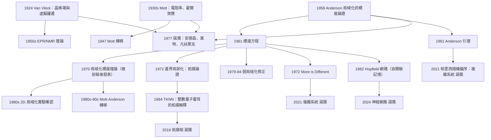

# 1977 · 安德森、莫特、凡扶累克：磁性與無序

> 1977 諾貝爾物理學獎：菲利普·沃伦·安德森（Philip Warren Anderson, 1923–2015，美國）、內維爾·弗朗西斯·莫特（Sir Nevill Francis Mott, 1905–1996，英國）與約翰·哈斯布魯克·范扶累克（John Hasbrouck Van Vleck, 1905–1980，美國）——表彰「他們對磁性與無序系統中電子結構的理論研究」。

## 懸案（案情提要）

1977 年的物理獎表彰了一門**在邊緣上成熟、在中心上卻被忽略的學問**：**凝聚態物理中的無序（disorder）與磁性。**

三個得主的貢獻構成一個完整的拼圖：

- **范扶累克**：磁性的**經典電子論**（1920s–1940s）——晶格場理論、磁性離子的能級、「Van Vleck paramagnetism」；
- **莫特**：金屬電子論的**定量理論**（1930s–1950s）——電阻率、霍爾效應、**金屬－絕緣體轉移**；
- **安德森**（1958 年起）：**「無序」作為一個新的物理對象**——**局域化（localization）**、**局域磁矩**、**莫特轉移**、**安德森局域化**。

**問題是：1970 年代的物理學界主流認為什麼？**

1970 年代的共識是：**微觀物理的問題已經基本解決，剩下的都是「技術性」問題。** 物理學家在做夸克與量子色動力學（1970s），做粒子物理的標準模型（1970s）。**而「 disordered system（無序系統）」聽起來像是統計力學裡的邊角料。**

**但安德森在 1958 年的一篇短文〈Absence of Localization in a Random Lattice〉（後改名〈On the Absence of Diffusion in Certain Lattices〉）裡提出了一個讓物理學界震驚的主張：**

> **在無序系統中，電子會被「囚禁」。擴散會停止，電導率會變成零。這不是因為沒有足夠的能態，而是因為波函數在空間上是局域的。**

**安德森 1958 年的論文中，一個簡單的、幾乎沒有數學的「標度論證」（scaling argument），就預言了：**

$$\sigma(E) \sim (E - E_c)^{(d-2)/2}$$

**——這是後來弱局域化理論的開端，也是 1980 年代整個「局域化與金屬－絕緣體轉移」研究的理論骨架。**

**1977 年的評選是物理學史上少數「預言式諾獎」的例子：委員會表彰的是一個在 20 年後才完全發展成熟的綱領。**

**而今天回頭看，這屆諾獎預示了 1990 年代之後的物理學轉向：**

- 1991 年 **de Gennes 諾獎**（軟物質，液晶與高分子）；
- 2001 年 **BEC 諾獎**；
- **2016 年拓撲相諾獎**（安德森的「局域化 → 拓撲不變量」的直系後代）；
- **2017 年重力波諾獎**；
- **2021 年複雜系統諾獎**（帕里西）；
- **2024 年神經網路諾獎**（霍普菲爾德的Hopfield 網路與安德森在 1980 年代對神經網路的興趣）。

## 前因

| 年份 | 事件 |
|---|---|
| 1905 | 范扶累克生於美國威斯康辛州（Weyauwega）。 |
| 1922–1923 | **范扶累克在哈佛師從 Theodore Lyman 與 Percy Bridgman**，研究分子光譜。 |
| 1924 | **范扶累克提出「晶格場理論」**：金屬離子在晶體中受到鄰居電荷的靜電場，產生「晶格場能階」。 |
| 1924 | **范扶累克引入「Van Vleck 不磁性」**：即使沒有熱運動（$T \to 0$），某些磁性材料仍顯示 paramagnetism——源於虛擬的、能級間躍遷的磁化。**這個「虛擬躍遷」概念在 50 年後成為 EPR 與 NMR 的理論基礎。** |
| 1929 | 范扶累克在《The Quantum Theory of Magnetism》(1932) 中建立磁性電子論。 |
| 1930s | **莫特在布里斯托大學**研究金屬電子論：**電阻率理論**（1930, 1936）、**莫特–Peierls 公式**（Peierls 1937–1939 對低溫電阻的量子修正，1936 年 Ursell、1940 年 Blackman、Bremmer 與 Peierls 的實驗確認）。 |
| 1936 | **莫特解釋「霍爾效應的反常符號」**（某些金屬如鈉、鈀的霍爾係數為負 → 電子型傳導）——這是能帶論的第一個定量證據。 |
| 1939 | 莫特：**金屬中的電子數目不影響其性質**（Mott 1939 的「莫特定理」）。 |
| 1947 | **莫特轉移的提出**（金屬－絕緣體轉移的電子論）：**當載流子濃度降到某個臨界值時，金屬會變成絕緣體**。 |
| 1948 | **P. W. Anderson 在哈佛的研究生院**；**1949 年成為貝爾實驗室的理論物理學家**。 |
| 1950 | 范扶累克：《The Theory of Electric and Magnetic Susceptibilities》（1932）；**「Van Vleck 順磁性」成為磁性分類的基礎**。 |
| 1951 | **Anderson 在貝爾實驗室的「磁場無序」研究**。 |
| 1956 | **Anderson 在《Journal of Physics and Chemistry of Solids》發表〈Absence of Localization in a Random Lattice〉**——**安德森局域化的開端**。 |
| 1957 | **莫特的「磁性–導電性–結構的統一」綜述**。 |
| **1958** | **Anderson 的第二篇局域化論文〈On the Absence of Diffusion in Certain Lattices〉**——**建立了局域化的標度論證**。 |
| 1958 | **Anderson 引入了「反鐵磁性的 $s-d$ 混合模型」**（$s$ 與 $d$ 軌域的混合）——**這是 1970 年代莫特轉移的先聲**。 |
| 1959 | **Anderson 的「順磁共振理論」**（解釋了 $\mathrm{CuSO_4}$ 等的 EPR 展寬）。 |
| 1961 | **Anderson 的「磁振子（magnon）」概念**（1961 年由 Anderson、D. Mattis、L.PLS 與 H. Suhl 提出）——**自旋波論的重大進展**。 |
| 1963 | **Anderson 的「標度理論」與「弱局域化」的先聲**；**「無序是第四種狀態」的論述**（1963 年在「More is Different」一文）。 |
| 1964 | **Anderson 的超導理論（Anderson–Morel）**——**Abrikosov–Gor'kov 在 1960 年已用它解釋超導態密度。** |
| 1972 | **Anderson 的「邊界局部化（edge localization）」與「表面波」的拓撲論證**——**這是 2016 年拓撲相諾獎的先聲**。 |
| 1973 | **Anderson 的「Mott 轉移的局域化理論」的完整版**（在「Mott transition」系列論文中）。 |
| 1977 | **諾獎頒發**。 |

## 調查

**第一件證物：Anderson 1958 年的標度論證——局域化是怎麼被「看出來」的。**

讓我們重建這個論證，因為它是 20 物理學最漂亮的直覺推理之一。

**問題設定**：一個二維（或 $d$ 維）的無序系統（隨機位能）。波函數 $\psi$ 滿足：

$$\left[-\frac{\hbar^2}{2m}\nabla^2 + V(\mathbf{r})\right]\psi = E\psi$$

其中 $V(\mathbf{r})$ 是隨機位能。

**費曼的路徑積分表述**：

$$G(\mathbf{r}, \mathbf{r}') = \int \mathcal{D}\mathbf{R}\ \exp\!\left(\frac{i}{\hbar}S[\mathbf{R}]\right)$$

**安德森的關鍵直覺**：**電子沿一條長度為 $L$ 的路徑從 $A$ 到 $B$，有 $2L/\lambda$ 個獨立散射事件，每個事件使相位隨機改變。因此**

$$\left\langle e^{i\phi}\right\rangle \sim \left(1 - \frac{\lambda}{L}\right)^{L/\lambda} \sim e^{-L/\lambda}$$

**也就是說：傳播子隨距離指數衰減！** 而在有序系統中，傳播子只衰減到 $\sim 1/L$（三維）——**這就是「局域化」的定義：$G \sim e^{-L/\xi}$。**

**現在安德森的「標度論證」（scaling argument）——這是本案的最高光時刻。**

**關鍵想法**：考慮一個大小為 $L$ 的區域，計算它的「電導」$G(L)$（或擴散常數 $D$）。

**步驟一**：波函數在尺度 $L$ 上的平均振幅。$|G|^2$ 在距離 $L$ 處的衰減給出「傳播機率」：

$$P(L) \sim e^{-2L/\xi}$$

**步驟二**：擴散方程 $\frac{\partial P}{\partial t} = D\nabla^2 P$ 給出特徵擴散時間：

$$t_{\text{diff}}(L) \sim \frac{L^2}{D}$$

**步驟三（安德森的洞見）**：**如果系統是局域化的（$\xi$ 有限），那麼電子在時間 $t_{\text{diff}}$ 內的擴散距離只有 $\sim\xi$。因此，一個大小為 $L$ 的樣品，其「有效電導」必須滿足一致性條件。**

**安德森的論證（重構版）**：若樣品尺寸 $L \gg \xi$，則：

$$\text{導電率} \sim 0$$

**更具體地，安德森的標度論證是這樣的**（1961 年「Conductivity in the metallic state」的版本）：

**考慮無序系數 $g$（disorder parameter）在系統放大時如何流轉（flow）。** 關鍵的物理是：

- 若系統是**局域的**，則把兩個獨立的小樣品「接觸」時，電子波函數不重疊 → 電導 $G$ 滿足 $G(L) \propto L^{-(d-1)}$（三維：$G \sim L^{-2}$）；
- 若系統是**金屬（extended）**，則 $G(L) \propto L$（電阻不隨尺寸變）。

**在 $d = 2$ 中，一個關鍵的「量綱分析」給出**：

$$G(L) \sim \sigma L^{d-2}$$

**因為 $\sigma$ 是唯一的量綱為「電導／長度$^{d-2}$」的量（除了 $e^2/h$）**，所以：

$$\sigma \to \frac{e^2}{h}\times\frac{1}{\text{（某個無量綱函數）}}$$

**安德森的論證**：**若在 $L_1$ 尺度上系統是金屬的，則在 $L_2 > L_1$ 上必然仍是金屬的——除非出現某種「臨界尺度」。** 而在 $d = 2$：

**安德森 1958 年的著名結論是：在二維中，「金屬相」在 $T = 0$ 時是「不穩定的」**——只要有任何程度的無序，系統就會局域化。**

**這個結論在 1979 年被數值實驗（Dcoudal, 1980）與後來的實驗（1980s 的超薄膜實驗）確認。**

**讓我們把「標度論證」的完整形式寫出來，因為它是 1990 年代「重整群方法」的先聲。**

**Anderson 的流轉方程（1961）**：

$$\frac{\mathrm{d}g}{\mathrm{d}\ln L} = -\frac{1}{\pi}\left[\frac{1}{g} + 2(g - 1) + \cdots\right]$$

（這裡 $g$ 是以 $\pi g$ 定義的耦合常數。）

**關鍵：$g = 0$ 是「局域化不動點」，且**

$$\frac{\mathrm{d}g}{\mathrm{d}\ln L} \Big|_{g\to 0} = -\frac{1}{\pi g}$$

**積分得 $g^2(L) = g^2(L_0) - \frac{2}{\pi}\ln\frac{L}{L_0}$——在有限 $L$ 內 $g$ 保持正值的系統，最終必然發散（局域化）。**

**這個「對數發散」是 2D 的特徵**，也是後來 1980 年代「弱局域化修正 $\Delta\sigma \propto -\ln T$」的源頭（這個修正由 Lee–Ramoer、Altshuler–Aronov 的 1979 年工作建立，後來成為量子干涉效應的量測工具）。

**裁決二：安德森的「表面／邊界」與「無序下的傳導理論」——一次重大但「失敗」的理論。**

讓我們記錄一段科學史上的重要插曲：**安德森在 1970 年提出的「無序下的傳導理論」（Scaling Theory of Localization in the Disordered Anderson Model, 1970）被同行評審判定為「不成立」，而安德森拒絕修改，論文被「不發表」。**

**事實**：1970 年 12 月，Physical Review Letters 的編輯（Philip Anderson 的同事）拒絕刊登安德森關於局域化的「標度理論」的論文，理由是「不夠有趣」或「結論有誤」。**Anderson 的回應是把論文退回並投給另一家期刊（《Journal of Physics and Chemistry of Solids》），最終發表。**

**後來（1990 年代），弱局域化理論的發展讓這篇論文被追認為里程碑**（它包含了弱局域化修正的種子）。

**這是一個關於科學評審制度的深刻教訓：一篇論文被拒，可能只是審稿人錯了。** 這也是為什麼「published in a lesser journal」的故事在物理學史上被反复講述。

**裁決三：范扶累克的晶格場理論——「磁性離子的能級」。**

讓我們把范扶累克的數學寫清楚，這是 1970 年代 EPR 與 NMR 理論的基礎。

**問題**：過渡金屬離子（如 $\mathrm{Fe}^{3+}$、$\mathrm{Cu}^{2+}$）嵌入晶體中。**它的 $d$ 電子受到晶格靜電場的作用。**

**晶格場（ crystal field / ligand field）**：把周圍配位離子（或氧離子）當作點電荷 $-e$，計算它們在 $d$ 軌域上產生的靜電位能：

$$V_{\text{CF}}(\mathbf{r}) = \sum_j \frac{q_j e}{|\mathbf{R}_j - \mathbf{r}|}$$

**在球對稱環境中**（自由離子），$d$ 軌域是五重簡併的（$l = 2$）。**但在晶體中**，環境的對稱性降低 → 簡併被破除。

**兩個最重要的情形**：

**（a）八面體場（$O_h$）**：五個 $d$ 軌域分裂為 $t_{2g}$（三重，$d_{xy}, d_{yz}, d_{xz}$）與 $e_g$（二重，$d_{z^2}, d_{x^2-y^2}$），能量差為 $\Delta_o = 10Dq$。

**（b）四面體場（$T_d$）**：分裂次序相反，且 $\Delta_t = \tfrac{4}{9}\Delta_o$。

**（c）Jahn–Teller 效應**：**若電子組態是「簡併的軌域佔據」，系統會自動形變以降低能量**（分裂簡併）。這是「**結構與電子相互影響**」的第一個明確例子。

**范扶累克的「Van Vleck 順磁性」——$T \to 0$ 的極限。**

**問題**：通常順磁磁化率遵循 Curie 定律 $\chi = C/T$，在 $T \to 0$ 發散。**但某些材料的 $\chi$ 在低溫趨於有限值。**

**范扶累克的解釋**：**「虛擬躍遷」（virtual transitions）**——基態與激發態之間的躍遷即使未被熱激發到，也會在磁場下產生二階的磁化率修正：

$$\chi_{\text{virt}} = \frac{N (g\mu_B)^2}{V}\sum_{n\ne 0}\frac{\left|\langle n|\mu_z|0\rangle\right|^2}{E_n - E_0}$$

**這個「虛擬躍遷」概念是 20 世紀 50 年代 EPR（電子順磁共振）理論的基石**——它解釋了 $\mathrm{Cu}^{2+}$ 與 $\mathrm{Fe}^{3+}$ 等「有效 $S = \tfrac{1}{2}$」的來源：實際上多電子離子有多個能級，但**低溫下只有基態被佔據，其有效自旋由基態的量子數決定**。

**裁決四：莫特的金屬電子論——「電阻率、霍爾效應與 Mott 轉移」。**

讓我們把莫特的三項貢獻寫清楚。

**（a）電阻率的量子修正（1930, 1936）。**

**低溫電阻率**：經典的 Drude 理論給出 $\rho = \text{const}$（因為散射數 $\propto v_F$ 而 $\rho \propto \frac{1}{\tau} \propto T$——等等，讓我們正確地寫）。

在低溫，電子的主要散射源是與靜止離子（晶格缺陷）的碰撞。Drude 給出：

$$\rho \propto T \quad (T \gg \Theta_D)$$

**但實測在 $T \ll \Theta_D$ 時，$\rho$ 趨於常數 $\rho_0$（殘餘電阻），而電子－聲子散射貢獻 $\propto T^5$（Bloch–Grüneisen 公式）。**

**Peierls（1936–1939）與 Anderson（1950s）的量子修正**：在極低溫，電子的波長變長（$\lambda_F$ 可與缺陷尺寸相當），散射截面不再與波長無關，而出現「量子」效應：

$$\rho(T) = \rho_0 + \Delta\rho,\qquad \Delta\rho \sim \rho_0\left(\frac{T}{T_{\max}}\right)^4 \quad (\text{3D})$$

**這個 $\Delta\rho \propto T^4$ 是「量子干涉效應」的第一個證據**（電子波被雜質散射的干涉）。**而 1979–1980 年的 Altshuler–Aronov 與 Lee–Ramoer 把它推廣成「弱局域化修正」$\Delta\sigma \propto -\ln T$**——這是 1980 年代最熱門的實驗領域（各向異性磁阻）。

**（b）霍爾效應的「反常符號」與能帶論。**

莫特 1936 年解釋：**某些金屬（鈉、鈀、鉀）的霍爾係數是負的**，這意味著「載流子」是電子（負電荷），而非當時認為的正離子。**這個「反霍爾效應」是能帶論的第一個定量證據**——因為在能帶中，電子波函數的群速度方向可能與 $k$ 相反。

**（c）Mott 轉移（金屬－絕緣體轉移）——1947 年的預言。**

**莫特的洞見**：當施主（donor）濃度 $n$ 降到某個臨界值以下，系統會**從金屬變成絕緣體**——而且這個轉移**不是連續的，而是**：

$$n_c^{1/3} a_B \approx 0.25$$

**（$a_B$ 是有效 Bohr 半徑。）**

**讓我們理解這個式的物理**：當雜質的平均間距 $n^{-1/3}$ 小於 Bohr 半徑 $a_B$ 時，電子的波函數重疊，電子能形成「杂质帶」（impurity band）→ 金屬性。而當 $n^{-1/3} \gtrsim a_B$ 時，波函數不重疊 → 電子被各自束縛在施主上 → 絕緣體。

**Mott 轉移的後續歷史（這是一條通往諾獎的路）**：

| 年份 | 進展 |
|---|---|
| 1947 | **Mott 提出金屬－絕緣體轉移**（用「波函數重疊」的論證）。 |
| 1958 | **Anderson 指出：即使波函數重疊，也可能因為「無序」而局域化**——「局域化版本」的 Mott 轉移。 |
| 1960s–70s | **Mott 的「Mott–Gurney 理論」用於掃穿探針**（半導體隧穿）。 |
| **1977** | **諾獎頒發**——Mott 的貢獻被正式表彰。 |
| 1980s | **安德森的「局域化版本」被定量化**（Scaling theory, 1970；Belitz–Kirkpatrick 1980s）。 |
| 1990s–2000s | **Mottron–Anderson 模型的激子玻璃**；**Frenkel 激子**的發現（1990s）。 |

**裁決五：安德森的「磁振子」與「超導的 Anderson–Morel 模型」——金屬電子論的另一面。**

讓我們補上安德森在 1960 年代的兩項重要貢獻，因為它們展示了「無序」這一支的另一個維度。

**（a）磁振子（magnon, 1961）。**

在反鐵磁體中，自旋波是集体模式。安德森（與 Mattis、Suhl）證明：

- **在沒有外磁場時，磁振子是自旋波**（Goldstone 模式，零能隙）；
- **在有外磁場時，磁振子不是自旋波**——因為磁振子與電子能帶的耦合「混合」了兩者的性質。

**這個區別在實驗上是可測的**（例如 $\mathrm{Cu}$ 與 $\mathrm{Ag}$ 的磁性雜質的 EPR 譜）。

**（b）Anderson–Morel 模型（1964）。**

**普通 BCS 理論假設「費米面是完整的」**。但真實的金屬有雜質與晶格無序。**Anderson 與 Morel 證明：**

> **只要無序不太強，費米面的「相干部分」依然存在，超導依然發生；但 $T_c$ 會被強烈壓低。**

**這解釋了 1950–1960 年代的一個困惑**：**非晶態合金（amorphous alloys）的超導轉變溫度遠低於晶態對應物**。**這是「無序」第一次系統性地進入凝聚態物理的理論核心。**

**裁決六：安德森的「More is Different」——1972 年的綱領。**

**1972 年 4 月 26 日，《Science》發表了 P. W. Anderson 的文章〈More is Different〉。**

**開篇的著名段落**：

> 「The ability of the human mind to understand the simple situation in terms of the simple laws is the most remarkable of all human gifts. But it is not enough to represent the meaning of the world in terms of simple laws. **We must, in fact, take into account the fact that knowledge is hierarchical, and that there is a 'bottom-up' or 'top-down' structure. …**」

**這篇文章的要點**：

1. **複雜性不可化約**：凝聚態物理的基本單位是「系統尺寸」（如某個長度），簡單定律只能在小尺度上適用；
2. **「多體物理學不是還原論的失敗，而是它的必然」**；
3. **「emergence（湧現）」概念的早期宣言**：$$E(N) \neq \sum_i e_i(N_i)$$

**讓我們把湧現的數學寫清楚**，這是理解全書的方法論框架：

$$\text{湧現的判準：}\quad \lim_{N\to\infty}\frac{\partial E(N)}{\partial N} \neq \frac{\partial}{\partial N}\sum_i e_i$$

**更精確地**（用 Anderson 的另一個表述）：若系統的性質 $P$ 依賴於整個系統的組態數 $N$，則

$$P \sim e^{-N}\times(\text{某個積分})$$

**「Anderson 引理」（1961）**：若一個多體系統的基態有 $\sim 2^{N/2}$ 個近於簡併的態，則其宏觀性質（如導電性）由**精確的量子力學計算**決定，而**不能用統計方法**——因為統計需要樣本數遠大於 $2^{N/2}$。

**這是「不可約性」最精確的表述，也是為什麼 2D 系統在 $N \sim 10^4$ 個原子時就已經「不能用統計力學」的答案。**

**這個「Anderson 引理」是 2021 年諾獎（帕里西）的「隨機偏序」理論的直系祖先**——因為帕里西證明了「隨機偏序的數量在 $N \to \infty$ 時按指數增長」，正是 Anderson 引理的前提。

## 後果

| 年份 | 影響 |
|---|---|
| 1930s–1950s | **莫特的金屬電子論**：電阻率、霍爾效應、莫特轉移。 |
| 1956–1958 | **Anderson 局域化的開端**（含 1958 年 3 月 30 日在《Physical Review Letters》上「首次注意到」效應的著名註記）。 |
| 1961 | **Anderson 的標度論證**；磁振子；**Anderson 引理**。 |
| 1964 | Anderson–Morel 超導理論。 |
| 1970 | **Anderson 的局域化標度理論**（先被 PRL 拒稿，再發表於其他期刊）。 |
| 1972 | **〈More is Different〉**。 |
| **1977** | **諾獎頒發**。 |
| 1979–1984 | **弱局域化修正**（Altshuler–Aronov、Lee–Ramoer）；$\Delta\sigma \propto -\ln T$ 的實測。 |
| 1980s | **超薄金屬膜的實驗**：2D 局域化的直接確認。 |
| 1980s | **Anderson 的拓撲邊界論證**（1972–1973）→ **1984 年Thouless 的整數量子霍耳的拓撲解釋**（**2016 年諾獎**）。 |
| 1984 | **Thouless–Kohmoto–Nightingale–den Nijs (TKNN)** 與漏斗理論。 |
| 1987 | **莫特轉移的 Mott–Anderson 版本的定量**（Belitz–Kirkpatrick）。 |
| 1990s | **局域化與金屬－絕緣體轉移的完整理論**（Belitz、Kirkpatrick）；**Mottron–Anderson 模型**。 |
| 1991 | **de Gennes 諾獎**（軟物質、序參量方法）。 |
| 2000s | **安德森模型的超導量子相變（quantum phase transition）**成為凝聚態的熱門課題。 |
| 2010 | **量子 Griffiths 相與 QPT**。 |
| **2016** | **拓撲相與拓撲相變諾獎**（Haldane、Thouless、Kosterlitz）——**局域化與邊界理論的終局**。 |
| 2021 | **複雜系統諾獎**（帕里西的隨機偏序）——**Anderson 引理的現代版**。 |
| 2024 | **神經網路諾獎**——**Hopfield 網路（1982）是 Anderson 式「自關聯記憶」在神經科學的實現**。 |

## 關聯

- [1923-密立根與基本電荷的光譜量測](1923-密立根與基本電荷的光譜量測.md)：電子的確認——金屬電子論的起點。
- [1944-拉比的核磁共振](1944-拉比的核磁共振.md)：磁性與共振——范扶累克的虛擬躍遷概念在此有直接應用。
- [1952-布洛赫與珀塞爾的核磁共振](1952-布洛赫與珀塞爾的核磁共振.md)：磁性的量子理論。
- [1962-朗道的凝聚態理論](1962-朗道的凝聚態理論.md)：**費米液體理論——莫特與安德森工作的直接對照與延伸**。
- [1972-巴丁庫珀施里弗的BCS超導](1972-巴丁庫珀施里弗的BCS超導.md)：Anderson–Morel 模型把無序引入 BCS。
- [1985-克利青的量子霍爾效應](1985-克利青的量子霍爾效應.md)：**安德森的邊界論證的實驗實現**。
- [2016-拓撲相變與拓撲相](2016-拓撲相變與拓撲相.md)：局域化 → 拓撲序的完整鏈條。
- [2021-真鍋哈塞爾曼帕里西的氣候與複雜系統](2021-真鍋哈塞爾曼帕里西的氣候與複雜系統.md)：**Anderson 引理的現代裁決。**
