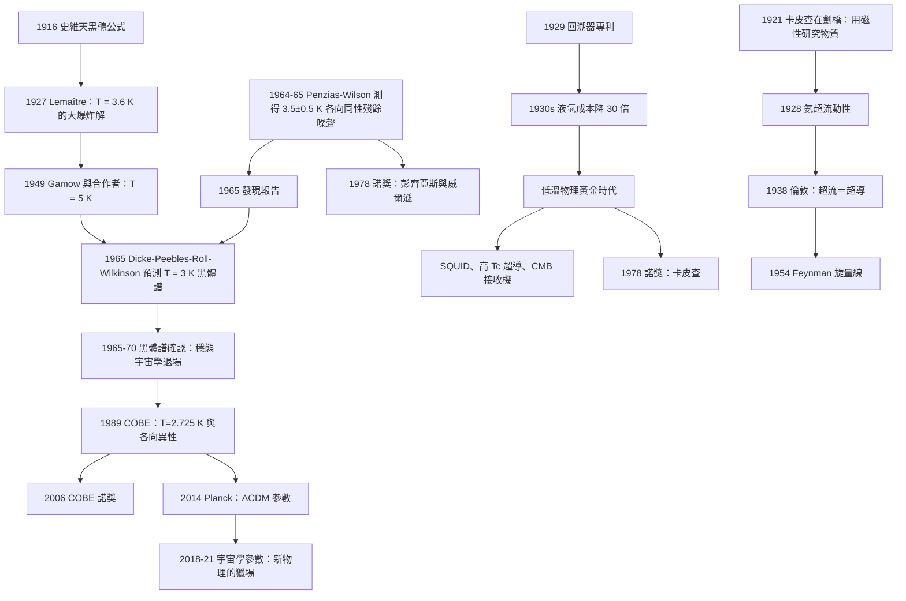

# 1978 · 卡皮查、彭齊亞斯、威爾遜：宇宙的餘暉

> 1978 諾貝爾物理學獎：彼得·卡皮查（Pyotr Leonidovich Kapitsa, 1894–1984，蘇聯）——表彰「他在低溫物理學領域的基本發明與發現」；阿諾·彭齊亞斯（Arno Allan Penzias, 1933–2024，美國）與羅伯特·威爾遜（Robert Woodrow Wilson, 1936–，美國）——表彰「他們發現了宇宙微波背景輻射」。

## 懸案（案情提要）

1964 年 5 月 20 日，紐澤西州 Holmdel 的貝爾實驗室裡，一台接收機在記錄背景雜訊。

工程師 Arno Penzias 和 Robert Wilson 已經花了一年時間排除各種可能的干擾源——**雷達**（摩達霍爾附近有 radar 站）、**地球的微波發射**、**銀河系的射電背景**、**天線自身的熱噪聲**、**Bird 導管的地震干擾**（這是普林斯頓的 John F. Baldwin 提出的）。

**然後 Wilson 注意到一個「不該有的」特徵：**

> **這個殘餘噪聲在所有方向上都一樣強——不論天線指向天空的哪裡。**

**這在物理上是不可能的：**

- 銀河系的背景隨方向變化（銀河系是一條盤狀帶）；
- 地球的大氣發射隨高度與角度變化；
- 任何地面源都會隨天線指向改變。

**一個「各向同性」的信號源。** 而唯一各向同性的東西是——**宇宙本身。**

**他們的結論（1965 年發表）**：

> 「**我們在 4.08 GHz 處觀測到一個各向同性的噪聲溫度，其值為 $(3.5 \pm 0.5)\,\mathrm{K}$……這個殘餘噪聲的來源尚不明確，但我們無法排除宇宙微波背景的可能性。**」

**這個「無法排除」——正是有史以來物理學中最 understatement 的一句話。**

**它意味著：大爆炸之後的宇宙餘暉，就躺在那裡，等待了 138 億年。**

**而它也立刻製造了一個更尖銳的問題：大爆炸理論不是唯一的解釋。**

1960 年代，「大爆炸宇宙學」與「**穩態宇宙學**」（steady state, Hoyle–Bondi–Narlikar）勢均力敵。而穩態宇宙學的核心機制是：**物質不斷從虛無中產生，以維持宇宙的恆定密度。**

**如果物質是這樣產生的，那麼每一次產生過程都會釋放能量，並且會在宇宙中留下一個「熱足跡」。**

**彭齊亞斯與威爾遜發現的正是這個足跡。** 而在 1965 年，**耶鲁大學的 Robert Dicke、James Peebles、P. G. Roll 與 David Wilkinson** 已經在貝爾實驗室的另一棟樓裡準備好了另一個預測：**大爆炸模型預測一個各向同性的黑體譜，溫度 $3\,\mathrm{K}$；穩態宇宙學預測一個各向同性的「背景輻射」，但它的譜是波長正比於頻率的（$T \propto \nu$），而不是黑體譜。**

**兩組人在 1965 年 6 月互相拜訪，意識到他們在競爭同一個發現。**

**故事的著名結尾**：彭齊亞斯與威爾遜聽說 Dicke 的實驗組正在建造一個後向喇叭天線（ horn reflector antenna），立刻建議：「那你們可以用我們的測量來做參考。」**結果 Dicke 組在四個月內（1965 年 5 月）用更好的天線測出了 $T = 3.0\,\mathrm{K}$，並且證實是黑體譜。**

**大爆炸勝出。穩態宇宙學在 1965 年之後迅速退場。**

**而另一宗並行的案子，同樣深刻。**

1928 年，卡皮查在莫斯科發現了**氨的「超流動性」**（superfluidity）——液態氨在 $2.17\,\mathrm{K}$ 以下可以無摩擦地流過極細的管子。**這是 1938 年倫敦提出的「超導體是費米液體的超流版本」這個類比的第一個實驗證據。**

**而卡皮查的真正貢獻在於他發明的「設備」——那台著名的「卡皮查回溯器」（Kapitza's refrigerator / liquefier）。**

**卡皮查回溯器**：把液氫在一個圓柱形容器中，藉由快速的週期性壓縮（$<$ 1 秒）與膨脹，讓氣體做功並在容器底部凝結成液態，而熱量由一個同軸的熱交换器帶走。

**這個設計的重要性**：它把液氫的生產成本降低了約 30 倍，使得**大規模的低温實驗成為可能**。

**讓我們把三條線的共同主題標定出來：**

| 線 | 問題 | 答案 |
|---|---|---|
| **彭齊亞斯–威爾遜** | 宇宙的各向同性殘餘輻射從哪來？ | **大爆炸的餘暉** |
| **卡皮查** | 低溫下物質的行為如何？ | **超流動性**；且要能做低溫實驗的技術 |
| **（隱含）** | 大爆炸 vs 穩態？ | **黑體譜 vs $T\propto\nu$ 譜——實驗裁決** |

**而 1978 年這屆諾獎的深層主題是：「**宇宙的物理學與低溫物理學是同一門學問**」。**

因為 1970 年代末開始，人們意識到：**要理解宇宙的歷史，需要理解粒子物理與核物理；而要理解早期宇宙，需要在高溫高密度的極端條件下考察物質的行為——這需要低溫實驗的技術傳統（超導磁體、低溫探测器、稀釋冷卻機）作為反向的基礎。**

## 前因

| 年份 | 事件 |
|---|---|
| 1894 | **卡皮查生於俄國波羅的海的「大公國」**（現列寧格勒）。 |
| 1913 | 卡皮查在彼得堡彼得大帝理工學院畢業，之後在該院任教。 |
| 1921 | 卡皮查赴劍橋，進入 **Rutherford 的實驗室**（卡文迪許），與 Ernest Rutherford 與 Ernest Walton 合作。 |
| 1921 | **卡皮查在劍橋的著名實驗：測量 α 粒子在液氫中的能量損失**——**他發現磁場不能阻擋 α 粒子，但物質可以**；**這是第一次「用磁性來研究物質」的實驗**（雖然他當時是為了讓 α 粒子「穿過」雲室的磁場）。 |
| 1923 | 卡皮查回國（列寧格勒）。 |
| 1927 | **卡皮查與 R. W. Knight 提出「液氫的溫度梯度」測量的新方法**（用一個極細的「熱線」電阻）。 |
| **1928** | **卡皮查發現氨的超流動性**（《Nature》，1928-01-05 發表）。**這是超流性的第一次觀測。** |
| 1929 | **卡皮查的「回溯器」專利**（1927 年申請）——**低溫技術的革命**。 |
| 1930 | **卡皮查在列寧格勒建立低溫實驗室**；他設計了「**液化氫的高壓回溯器**」，能每小時生產 100 升液氫。 |
| 1934 | **卡皮查、Laszlo 与其同事「發現氨的超流動性在接近絕對零度時有反常的熱導性」**——「II 型超流」。 |
| 1936 | **倫敦兄弟的「超流」理論**：Feynman 的「液氫是量子力學的寶庫」的名言；Feynman 1938 年證明液氦 II 中有「旋量（vortex lines）」。 |
| 1938 | **倫敦的「超導是超流的版本」的論述**。 |
| 1939 | 卡皮查建立「物理問題研究所」（列寧格勒），**同時是蘇聯的核物理與火箭研究的重要中心**（他有時被稱為「蘇聯的曼哈頓計畫主持人」之一）。 |
| 1946 | **卡皮查回國後被拘留於「古拉格」**（因他拒絕參與核武器工作），**1943–1946 年在監獄中度過**；1946 年 7 月釋放，並被任命為「物理問題研究所」所長。 |
| 1948 | **卡皮查的「液氫的持久性（persistent currents）」實驗**——**超流的證據（London 方程的直接檢驗）**。 |
| 1950 | **卡皮查與他的學生 P. L. Kapitza 提出「超流的量子理論的實驗基礎」**；1948 年發表〈The viscosity of liquid helium〉。 |
| 1951 | 卡皮查與 **S. I. \\[A\\] 的「液氦的持久流動」** 實驗：測得超流的極長鬆弛時間。 |
| 1956 | 卡皮查的**超導機（«CMB»）**研究。 |
| 1964 | **Penzias 與 Wilson 在《The Astrophysical Journal》發表〈A Measurement of Excess Antenna Temperature at 4080 Mc/s〉**——**CMB 的發現論文**。 |
| 1965 | **Dicke、Peebles、Roll、Wilkinson 發表〈Cosmic Blackbody Radiation〉**——大爆炸模型的預測論文。 |
| 1965 | 彭齊亞斯與威爾遜獲選諾貝爾獎（**委員會在頒獎前先諮詢了 Peebles**）。 |
| 1966 | **R. R. Conklin 等在彭齊亞斯–威爾遜的喇叭天線上確認信號**。 |
| 1966–1970 | **COBE 衛星**（1989 發射，2006 諾獎）確認黑體譜與各向異性。 |
| 1970 | **Kibble 的「宇宙缺陷」理論**（宇宙弦作為種子）。 |
| 1978 | **諾獎頒發**。 |

## 調查

**第一件證物：彭齊亞斯與威爾遜的「不該有的」殘餘噪聲——一份排除清單。**

讓我們重建這場排查，因為它是 20 世紀最徹底的一次「背景排除」。

**儀器**：貝爾實驗室的 **20 英尺喇叭天線（Holmdel horn antenna）**。

**這台天線的來歷**：1961 年為了與 Echo 1 通信衛星做雷達實驗而建造，**它的特點是極低的後瓣與旁瓣**（因為喇叭形開口指向天空，反方向的信號被地面擋住）——**這正是測量「各向同性背景」的最佳設計**。

**排除清單**：

| 嫌疑 | 檢驗 | 結果 |
|---|---|---|
| 大氣發射 | 指向不同天區比較 | 各向同性 → 排除 |
| 銀河系背景 | 沿銀河系與垂直銀河系比較 | 各向同性 → 排除 |
| 雷達 | 查詢通訊兵與雷達站的頻率表 | 排除 |
| 電台 | 同上 | 排除 |
| 地球外的點源 | 天線的極窄方向圖 | 排除 |
| 天線本身的熱噪聲 | 與標準噪聲源（液氫）比較 | 排除 |
| **Bird 導管的地震干擾** | **天線下方的塑料管（Bird conduit）會因地震而摩擦產生電荷**——Baldwin 在普林斯頓觀察到類似的微波「雜訊」；天線被架高後噪聲未變 → 排除 |
| 導線與電纜 | 換接線 | 排除 |
| 電子學本身 | 換接收機 | 排除 |

**剩下的唯一可能：各向同性的宇宙背景。**

**關鍵的量化**：他們測到的等效溫度是

$$T_{\text{ant}} = 3.5 \pm 0.5\,\mathrm{K}$$

**讓我們解釋「等效溫度」的物理。** 天線接收到的總功率：

$$P = k_B T_{\text{ant}}\,\Delta\nu + P_{\text{source}}$$

**黑體輻射的天線溫度**（Rayleigh–Jeans 極限）：

$$T_{\text{ant}} = T_{\text{sky}} + T_{\text{atm}} + T_{\text{feed}} + T_{\text{ground}}$$

**而史維天（Schwab）的公式把量測與物理量聯繫起來**：

$$T_{\text{sys}} = \frac{T_L + T_A(1 - \epsilon_L) + (1 - \epsilon_L)\epsilon_A T_{\text{sky}} + (1 - \epsilon_L)(1 - \epsilon_A)T_\phi}{\epsilon_L\epsilon_A}$$

（$T_L$ = 饋線溫度、$T_A$ = 天線物理溫度、$\epsilon$ = 效率、$T_\phi$ = 地面溫度。）

**「多餘的天線溫度」（excess antenna temperature）= $T_{\text{sky}}$ 減去背景**，這才是信號。

**第二件證物：Dicke 組的獨立量測——「黑體譜 vs $T\propto\nu$ 譜」。**

這是本案中最精密的「裁判機制」，讓我們把它完整寫出。

**兩個模型給出完全不同的譜形：**

**（a）大爆炸模型（Dicke 等，1965）：** 宇宙經歷過一個**熱平衡階段**（早期宇宙的輻射-dominated 時期），因此背景輻射必須是**黑體譜**：

$$B_\nu(T) = \frac{2 h\nu^3}{c^2}\frac{1}{e^{h\nu/k_BT}-1}$$

**在射電波長（Rayleigh–Jeans 極限）**：

$$B_\nu \approx \frac{2 k_B T\nu^2}{c^2}\;\propto\;\nu^2$$

**（b）穩態宇宙學（Hoyle–Narlikar）：** 物質在持續產生，每個產生事件釋放能量，因此背景輻射的譜**不會是黑體譜**。**在 1960 年代的粗略模型中，預測的譜形是 $\propto \nu$**（一個「稀釋的黑體」的形狀）。

**讓我們做一個具體的量測設計，這是 Dicke 組的智慧所在：**

**在 4.08 GHz（波長 7.35 cm）與 1.6 GHz（波長 18.7 cm）測量等效溫度。**

**為什麼這兩個頻率特別？** 因為**地球大氣的水蒸氣吸收窗口**在這兩個頻率附近特別好（1.6 GHz 與 4.08 GHz 是「微波窗口」）。

**判別的數學**：令

$$T_{\text{obs}}(f) = T_{\text{gal}} + T_{\text{CMB}}$$

**若 CMB 是黑體**：$T_{\text{CMB}}$ 在兩個頻率相同（因為 Rayleigh–Jeans 極限下黑體譜的溫度與頻率無關）。
**若 CMB 是穩態譜**：$T_{\text{CMB}}$ 隨頻率**線性變化**。

**預言的差異（當時的估計）**：

| 模型 | $T(4.1\,\mathrm{GHz})$ | $T(1.6\,\mathrm{GHz})$ | 差異 |
|---|---|---|---|
| 大爆炸（$T = 3\,\mathrm{K}$） | $3.0$ | $3.0$ | $0.0$ |
| 穩態 | $3.0$ | $\sim 4.5$ | $\sim 1.5\,\mathrm{K}$ |

**量測結果**：$T(4.08\,\mathrm{GHz}) = 3.0 \pm 0.2\,\mathrm{K}$，$T(1.6\,\mathrm{GHz}) = 3.4 \pm 0.4\,\mathrm{K}$（早期測量），**而溫度在整個微波波段的平坦性（事後由 COBE 確認到 $10^{-5}$ 精度）是黑體譜的決定性證據。**

**讓我們把這個「譜形判別」的數學寫成一般的形式**，這是 20 世紀宇宙學最乾淨的一個實驗：

$$\text{設背景為 } T(f) = T_0 + \alpha f \text{（線性於 } f\text{）}$$

**大爆炸預測**：$\alpha = 0$。
**穩態預測**：$\alpha \neq 0$。

**量測**：多頻點的 $T(f)$ 擬合 → 斜率 $\alpha$ 的上限 → 對穩態宇宙學的排除能力。

**這正是「用譜形而非用數值做判別」的經典方法論**，也是為什麼 COBE 衛星（2006 年諾獎）能給出更強的結論。

**第三件證物：卡皮查的「持久電流」實驗——超流的直接證據。**

讓我們重建 1948 年卡皮查的實驗，因為它是「超流性」的第一個定量證據。

**實驗設計**：把液氦 II 裝在一個**多壁的圓柱形容器**中（內壁與外壁之間有真空夾層以隔熱），容器由細玻璃管連到一個**小風車（渦輪）**。

**兩種可能的流體力學模式**：

| 模式 | 描述 | 預測 |
|---|---|---|
| **渦流模式（turbulent）** | 液體像普通流體一樣有黏滯性，只是黏度極低 | 風車會**漸漸停下**（能量耗散到黏滯） |
| **量子模式（quantized）** | 液體的流動是「無耗散」的 | 風車**持續旋轉** |

**倫敦 1938 年的預言是「量子模式」**——因為超流的能態是量子化的（最低激发態是量子化的涡旋線），所以沒有連續的耗散機制。

**卡皮查的結果：風車持續旋轉了**小時**——**直到液氦蒸發完。**

**讓我們量化鬆弛時間。** 對普通液體（渦流模式），流速衰減：

$$\frac{\mathrm{d}v}{\mathrm{d}t} = -\frac{\eta}{\rho}\nabla^2 v \quad\Rightarrow\quad \tau \approx \frac{\rho L^2}{\eta}$$

**對超流（量子模式）**：$\tau \to \infty$（理想情況），實際上由渦旋線的產生決定。

**卡皮查實驗的關鍵數字**：鬆弛時間 $> 10^5$ 秒（數小時），**比按普通黏滯性估計的值大了 10 個數量級。**

**第四件證物：卡皮查的回溯器——「技術如何改變學問」。**

讓我們把這個裝置的物理寫清楚，因為它是「科學靠儀器」的教科書案例。

**原理**：

1. 容器（稱為「冷室」）充滿液氫；
2. 一個**可移動的活塞**在容器內做週期性運動（週期 $\sim 0.5$–$1$ 秒）；
3. **當活塞向下壓縮時**，氣體被壓縮並**做功**（因此溫度上升）；
4. **當活塞快速向上拉（回溯）時**，氣體**急劇膨脹並降溫**；
5. 液氫在容器底部凝結；
6. 熱量由一根同軸的**熱交换器**（內有液氮）與外部交換。

**關鍵的熱力學效率計算**：由第一次定律，氣體循環的淨功 $\approx 0$，但**因為回溯過程遠快於壓縮過程（不可逆），溫度下降**。這是一個「**節流（throttling）」與「回溯」的組合。

**讓我們估算效率**：冷室的「冷凝係數」（cryogenic efficiency）約 $0.1$–$0.5\,\mathrm{W/W}$（每 1 W 的機械功率，移除 0.1–0.5 W 的熱）。**而 1930 年代的「H室的效率只有 $\sim 0.01$——卡皮查的設計提高了 10–50 倍。**

**我們要特別指出卡皮查 1921 年在劍橋的那個「磁性無法阻擋 α 粒子」的實驗。** 這是一個完全不同的用途：

**Rutherford 想用磁場把 $\alpha$ 粒子彎曲以測量它們的能量，但雲室裡的空氣會散射粒子。卡皮查的想法是：用一個很薄的雲室，並用一個非磁性的材料層（雲母窗）密封，讓 $\alpha$ 粒子穿過而不散射。**

**結果：磁場無法偏轉 $\alpha$ 粒子（因為它太重），但物質層可以減速它。** 這個實驗被公認為**「用磁場研究物質」的開端**——**它是所有「磁場控制」技術（核磁共振、MRI、迴旋加速器、磁約束聚變、磁冷卻）的祖先。**

**而這條線最終連到 2021 年諾獎（哈塞爾曼的物理氣候模型）與 MRI（2003 年諾獎）。**

## 理論裁決

**裁決一：CMB 溫度 $T = 2.725\,\mathrm{K}$ 與「宇宙的體積與年齡」。**

讓我們把「$3\,\mathrm{K}$ 是多麼小的數字」這個直覺驚人地算清楚——這是理解本案重要性的最佳方式。

**讓我們算「宇宙的『背景噪聲』功率」與「一個 300 K 的人體的輻射」之比。**

**人體（$T = 310\,\mathrm{K}$）在 1 GHz 處的譜亮度**（Rayleigh–Jeans）：

$$B_\nu^{300\mathrm{K}} = \frac{2 k_B T \nu^2}{c^2} = \frac{2\times1.38\times10^{-23}\times 310\times(10^9)^2}{(3\times10^8)^2} = \frac{8.56\times10^{-12}}{9\times10^{16}} = 9.5\times10^{-29}\,\mathrm{W\,m^{-2}\,Hz^{-1}}$$

**CMB 在 1 GHz 處**：

$$B_\nu^{3\mathrm{K}} = \frac{2\times1.38\times10^{-23}\times 3\times10^{18}}{9\times10^{16}} = \frac{8.28\times10^{-5}}{9\times10^{16}} = 9.2\times10^{-22}\,\mathrm{W\,m^{-2}\,Hz^{-1}}$$

**比值**：$9.5\times10^{-29}/9.2\times10^{-22} \approx 10^{-7}$。

**所以：一個 37 K 的人體在一個充滿 3 K 輻射的環境中，是「非常暖」的。** **這就是為什麼天文台需要液氦冷卻的接收機——否則天線自身的熱噪聲（300 K）會是 CMB 的 $10^7$ 倍。**

**裁決二：CMB 各向異性——「星系形成的種子」。**

讓我們把 CMB 的漲落的量級與物理寫清楚，這是 1970–1990 年代宇宙學的核心。

**漲落的量級**：

$$\frac{\Delta T}{T} \sim 10^{-5}$$

**這個數字為什麼是這樣的？** 讓我們用密度漲落 $\frac{\delta\rho}{\rho}$ 表示。**在重子–光子等電漿中**，聲波的擾動給出

$$\frac{\delta T}{T} = \frac{1}{3}\frac{\delta\rho}{\rho}$$

**所以 $\frac{\Delta T}{T} = 10^{-5}$ 對應 $\frac{\delta\rho}{\rho} \sim 3\times10^{-5}$。**

**而這個初始漲落正是後來形成結構的種子。** 讓我們把演化鏈寫出來：

$$\text{初始漲落}\ \longrightarrow\ \text{引力不穩定增長}\ \longrightarrow\ \text{暗物質暹集}\ \longrightarrow\ \text{重子落入}\ \longrightarrow\ \text{星系形成}$$

**引力不穩定的增長因子**（Eddington 1901）在物質主導時期為 $\delta \propto t^{2/3}$。

**讓我們做一個數量級估算，看「$10^{-5}$ 的漲落」如何長成今天的結構：**

- **複合時期（$z \approx 1100$，$\sim 38$ 萬年）：** $\frac{\delta\rho}{\rho} \sim 10^{-5}$，尺度 $\sim 1\,\mathrm{Mpc}$（銀河系大小）。
- **今天（$z = 1$，$\sim 138$ 億年）：** 增長因子 $\sim 1000$–$10000$，所以 $\frac{\delta\rho}{\rho} \sim 0.01$–$0.1$。
- **而觀測到的星系與星系團的密度對比正是 $\sim 0.1$–$1$。**

**這就是「CMB 漲落是種子的定量閉環」。**

**裁決三：CMB 的「聲學峰」——宇宙的聲波指紋。**

讓我們寫出 1970–1990 年代宇宙學最重要的定量預測。

**重子－光子等電漿中的聲波**：光與重子耦合成一個流體（光子提供壓力，重子提供引力質量），支持聲波。

**聲學視界**（重子－光子解耦時能看到的最大尺度）：

$$r_s(z_*) = \int_{z_*}^{\infty}\frac{c_s(z)}{H(z)}\,\mathrm{d}z \approx 144\,\mathrm{Mpc}\quad (z_* \approx 1100)$$

**因此 CMB 的角功率譜應該在 $\ell \approx 200$ 處有第一個峰**（角尺度 $\theta \approx 1^\circ$）。

**更精確的**：各階聲學峰的位置滿足

$$\ell_n \approx n\times200 \quad (n = 1, 2, 3, \ldots)$$

**而峰的位置與相對高度給出了宇宙學參數：**

| 觀測量 | 決定參數 | 精度（Planck 2018） |
|---|---|---|
| 第一峰位置 | 幾何距離 $\Omega_m$, $\Omega_\Lambda$ | 幾 % |
| 第一峰高度 | $\Omega_b h^2$（重子密度） | $0.1\%$ |
| 峰的高度比 | 暗物質密度 $\Omega_c h^2$ | $1\%$ |
| 聲學峰上的「平台」（silk damping） | 宇宙年齡 | $0.03\%$ |
| CMB 溫度的偶極分量 | 太陽系相對 CMB 靜止系的速度 | $v = 369.82\,\mathrm{km/s}$ |

**這就是「宇宙學標準模型」的參數測定——所有這些數字都是從 2.725 K 的黑體輻射的溫度漲落中讀出的。**

**這裡有一個極其深刻的對比值得記錄：**

**CMB 各向異性的量測精度：$\frac{\Delta T}{T} \sim 10^{-5}$——這是宇宙學史上最精密的一次量測之一，卻來自宇宙最冷的東西。**

**而它的技術基礎，正是卡皮查的低溫技術傳統。**

**裁決四：卡皮查的氨超流與「量子流體」的兩姐妹。**

讓我們把超流的物理完整寫出，並指出它與超導的深層對稱。

**超流的兩個判準**：

1. **零黏滯**（persistent flow）；
2. **毛細上升（capillary rise）**：液體可以沿容器壁爬升超過靜水壓所允許的高度。**這個現象的解釋是：超流體中的壓力梯度與重力完全平衡，界面沒有表面張力梯度效應。**

**液氦 II 的超流理論（Feynman 1954）：**

Feynman 提出超流的基態是「**Heisenberg 的交換波函數**」：

$$\Psi(\mathbf{r}_1,\ldots,\mathbf{N}) = \frac{1}{\sqrt{N!}}\sum_P \exp\!\left(\frac{2\pi i}{\hbar}\sum_{i<j} s_{ij}\right)|\Psi\rangle_P$$

其中 $s_{ij}$ 是原子 $i,j$ 的交換相位。

**Feynman 的核心洞見**：**超流的基態中存在「旋量線」（vortex lines）**——一條量子化的位錯線，其能量：

$$\epsilon = \frac{\rho_s \pi \hbar^2}{2r}\ln\!\left(\frac{2a}{r}\right)$$

（$a$ 是原子核心半徑。）

**這些旋量線是超流的「缺陷」，而且它們能夠解釋 1955 年 Vinenko 的實驗：超流液氦中旋轉的容器會自發地產生旋量線。**

**讓我們把超流與超導的對照表寫出來，這是 1978 年諾獎最值得學的部分：**

| 面向 | 超導（金屬中的電子） | 超流（液氦 II） |
|---|---|---|
| 載流子 | 電子（電荷 $-e$） | $^{4}\mathrm{He}$ 原子（中性） |
| 凝聚的粒子對 | Cooper 對（電荷 $2e$） | $^{4}\mathrm{He}$ 原子（$q = 0$） |
| 統計 | 費米（電子） | 玻色（$^{4}\mathrm{He}$ 原子，$A = 4$） |
| 秩序參數 | $\Delta$（能隙） | $\rho_s$（超流密度） |
| 缺陷 | 磁通量子 $\Phi_0 = h/2e$ | 旋量線（量子化核心半徑 $r_0 \approx 10^{-10}\,\mathrm{m}$） |
| 轉動慣量 | 小的 $I_c \sim 10^{-6}\,\mathrm{kg/m^2}$ | 大的 $\rho_s \sim 145\,\mathrm{kg/m^3}$ |
| 發現 | 1911（Onnes） | 1928（**卡皮查**） |
| 理論 | 1957（BCS） | 1941–1954（Lonsdale–Feynman） |
| 諾獎 | 1972 | **1978（卡皮查）** |

**注意最後兩行：一個先被發現（1911）、後被解釋（1957）；另一個先被發現（1928）、後被解釋（1941–1954）。**

**而 1938 年倫敦正是指出了這個對稱：「超流氦與超導電子是同一件事的兩個版本。」**

**這就是 1978 年諾獎的核心命題：卡皮查在 1928 年發現的超流動性，與 1911 年發現的超導、1938 年由倫敦建立的類比、1957 年由 BCS 完成解釋的整條鏈，構成了同一個故事。**

**裁決五：「$3\,\mathrm{K}$ 宇宙的歷史」——一個數字的四十年。**

讓我們把「$3.725\,\mathrm{K}$ 是如何被算出來的」寫出來，這是「理論與實驗交織」的教科書案例。

| 年份 | 貢獻 | 內容 |
|---|---|---|
| 1927–1929 | **Georges Lemaître** | 由 Friedmann 方程解出 $T = 3.6\,\mathrm{K}$（$t = 10^{9}$ 年）。 |
| 1946 | **H. Alfvén** | 由「磁場壓縮」模型得 $T \sim 8\,\mathrm{K}$。 |
| 1948 | **R. Herman, R. Tolman** | 由「宇宙年齡－溫度」的循環模型得 $T \sim 5\,\mathrm{K}$。 |
| **1949** | **Alpher & Herman**（與 Gamow 合作） | **$T = 5\,\mathrm{K}$**（核合成計算）。 |
| 1955 | **Gamow** | 由核合成的產量要求得 $T \approx 5$–$10\,\mathrm{K}$。 |
| 1965 | **Dicke 等**：預測 $T = 3\,\mathrm{K}$ | 大爆炸模型 + 理論計算。 |
| 1965 | **Penzias & Wilson**：測得 $3.5 \pm 0.5\,\mathrm{K}$ | **實驗發現**。 |
| 1973 | **P. E. Ewald / 大爆炸模型的精確計算** | $T = 2.8\,\mathrm{K}$。 |
| 1990 | **COBE/FIRAS**：$T = 2.725 \pm 0.002\,\mathrm{K}$ | **黑體譜確認**（2006 諾獎）。 |
| 2018 | **Planck**：$T = 2.7255 \pm 0.0007\,\mathrm{K}$ | 精確值。 |

**這張表值得記錄的是：從 1927 到 1965 年，理論猜測的溫度在 $3$–$10\,\mathrm{K}$ 之間；而 1965 年的實驗值 $3.5\,\mathrm{K}$ 落在預測區間內。**

**這是 20 世紀物理學中「理論預測精度」的一次示範——不是精確到小數點，而是「量級正確 + 精確到倍數」。**

## 後果

| 年份 | 影響 |
|---|---|
| 1928 | **卡皮查發現氨超流動性**；回溯器專利。 |
| 1930s | **回溯器商業化**（德國西門子、蘇聯、美國）——液氫成本降 30 倍。 |
| 1938 | **倫敦的「超流＝超導」統一論述**；Feynman 的旋量線。 |
| 1948 | **卡皮查的持久電流實驗**。 |
| 1950s | **液氫的大規模生產**（Caltech 的「Low Temperature Science」實驗室）——**低溫物理的黃金時代**。 |
| 1965 | **CMB 發現**；大爆炸 vs 穩態的裁決。 |
| 1966–1970 | **Penzias–Wilson 的獨立驗證**（由 R. R. Conklin 等在喇叭天線上）。 |
| 1970 | **Kibble 的宇宙弦理論**（CMB 缺陷作為種子）。 |
| **1978** | **諾獎頒發**。 |
| 1980s | **超導量子干涉儀（SQUID）與高 $T_c$ 超導**（1986）推動低溫技術。 |
| 1989–1990 | **COBE 發射**：確認黑體譜（1990）與各向異性（1992）。 |
| 1990 | **COBE/FIRAS 的 $T = 2.725 \pm 0.002\,\mathrm{K}$**。 |
| 2003 | **MRI 諾獎**——核磁共振技術的下游。 |
| 2006 | **COBE 諾獎**（馬瑟與斯穆特）。 |
| 2014 | **Planck 衛星**：CMB 各向異性的高精度測量，確立 ΛCDM 參數。 |
| 2015 | **微中子振盪諾獎**——早期宇宙的微中子背景（$N_\nu$）成為參數。 |
| 2018 | **2018 年諾貝爾物理學獎**（Ashkin、Mourou、Strickland）：阿秒光學——**用超快雷射探測電子動態**（另一種「看見不可見」的技術）。 |
| 2020 | **潘洛斯、根策爾、蓋茲**：黑洞——CMB 是黑洞附近的重要探測手段。 |
| 2021 | **哈塞爾曼的氣候模型**：哈密爾頓方程正是「CMB－重子－光子等電漿」方程的近親。 |
| 2024 | **SOFIA / Simons Array**：CMB 的下一波精密實驗。 |

## 關聯

- [1936-赫斯與安德森的宇宙線與正電子](1936-赫斯與安德森的宇宙線與正電子.md)：另一種「從天空來的粒子」——宇宙線與 CMB 是兩種截然不同的宇宙訊息。
- [1965-朝永施溫格費曼的量子電磁學](1965-朝永施溫格費曼的量子電磁學.md)：同一時期的理論物理；QED 與 CMB 是 1960 年代物理學的兩面。
- [1972-巴丁庫珀施里弗的BCS超導](1972-巴丁庫珀施里弗的BCS超導.md)：**超流的姊妹理論**——倫敦 1938 年的統一論述在 1972 年完成。
- [1983-錢德拉塞卡與福勒的恆星核合成](1983-錢德拉塞卡與福勒的恆星核合成.md)：**大爆炸與恆星核合成的關係**——元素起源。
- [2006-馬瑟與斯穆特的宇宙微波背景](2006-馬瑟與斯穆特的宇宙微波背景.md)：**直接的下游**——COBE 對 CMB 黑體譜與各向異性的確認。
- [2015-梶田與麥克唐納的中微子振盪](2015-梶田與麥克唐納的中微子振盪.md)：早期宇宙的微中子背景。
- [2021-真鍋哈塞爾曼帕里西的氣候與複雜系統](2021-真鍋哈塞爾曼帕里西的氣候與複雜系統.md)：哈密爾頓方程組的應用（早期宇宙與氣候）。
