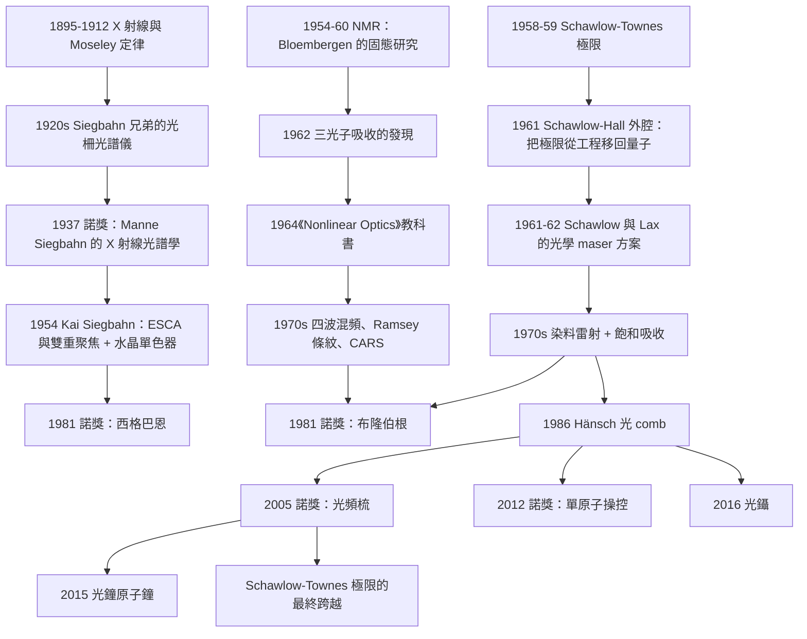

# 1981 · 西格巴恩、布隆伯根、肖洛：能譜學的精密化

> 1981 諾貝爾物理學獎：凱·曼內·西格巴恩（Kai Manne Siegbahn, 1918–2007，瑞典）、尼古拉斯·布隆伯根（Nicolaas Bloembergen, 1920–2017，美國）與阿瑟·倫納德·肖洛（Arthur Leonard Schawlow, 1921–1999，美國）——表彰「西格巴恩對高解析度電子能譜學的貢獻；布隆伯根與肖洛對雷射光譜學的開拓性工作」。

## 懸案（案情提要）

1981 年的諾獎表彰了三個人在同一個家族的工作：**用「高解析度」去量測「光譜」。**

**而「光譜」在 1960 年代已經被「解決」了。**

1960 年代的狀況是：

1. **原子光譜學**：已經有成熟的理論（Dirac 方程 + 量子電動力學）與精密的實驗（ Lamb shift 的量測到 $10^{-6}$）。**「原子光譜學」的主線已經結束。**
2. **但有兩個 glaring 的問題**：
   - **（a）光譜線的「自然寬度」**——原子態的壽命有限，因此光譜線有最小寬度。**但雷射可以把光源的寬度壓到比自然寬度窄得多——這意味著「自然寬度」不是最終極限。**
   - **（b）分子的光譜**：在 1960 年代，分子的**轉動–振動光譜**提供了化學的結構資訊，但**電子光譜（電子能階）卻無法分辨**——因為分子中的電子能階被密集的振動結構「糊」住了。

**肖洛與布隆伯根的洞見（1960–1961）：**

> **用「可調諧（tunable）」的雷射作為光源，就可以「選擇」你要激發的特定能階；再用「飽和吸收（saturated absorption）」或「光聲（optical pumping）」等非線性技術，把多普勒展寬與壓力展寬都消除掉——那麼光譜的解析度就不再受限於光源，而是受限於原子的自然寬度。**

**這就是「雷射光譜學」的開端，也是化學與生物學從此獲得「指紋」級光譜能力的開始。**

**而西格巴恩的工作是另一條路：**

**1954 年，西格巴恩發明了「高解析度電子能譜儀」（ESCA, Electron Spectroscopy for Chemical Analysis）**，並且——這是關鍵——**他設計了一台以「光柵」而非「靜電場」為色散元件的電子能譜儀。**

**為什麼這很重要？**

**因為靜電場的能量解析度是 $\Delta E \sim E/\sqrt{V}$，在 $E \sim 1\,\mathrm{keV}$ 時，解析度只有 $\sim 1\,\mathrm{eV}$。** 而用**光柵做雙重聚焦（電場 + 磁場）**，可以達到 $\Delta E \sim 0.5$–$1\,\mathrm{meV}$——**這是化學家分辨化學鍵的關鍵。**

**讓我們把三人的貢獻與它們的共同物理寫清楚：**

| 得主 | 貢獻 | 物理核心 |
|---|---|---|
| **西格巴恩** | 高解析度電子能譜學（ESCA） | **用「雙重聚焦」突破靜電分析器的能量解析度極限** |
| **布隆伯根** | 非線性光譜學：核磁共振、四波混頻、**多光子在 $z$ 方向的選擇性激發** | **用非線性過程製造「無展寬」的選擇性激發** |
| **肖洛** | **雷射光譜學的開拓**（與 Townes 的量子限制），並在 1959 年發表「**光學泵浦的量子極限**」 | **用可調諧雷射 + 非線性技術突破自然寬度與多普勒寬度** |

**而肖洛的另一項傳世貢獻是「**Schawlow–Townes 極限**」——雷射線寬的量子極限公式。**

**這是 1981 年諾獎最深的一層：肖洛與 Townes 在 1959 年用海森堡不確定性原理導出了雷射的最小線寬：**

$$\Delta\nu \ge \frac{h\nu\,(\Delta\nu_{\text{sp}})^2}{4\pi P_{\text{out}}}$$

**這不僅是一個公式——它是「用量子力學限制經典工程」的典範，也是 1960 年代「雷射能做什麼」的理論藍圖。**

## 前因

| 年份 | 事件 |
|---|---|
| 1895 | Röntgen 發現 X 射線（1901 諾獎）。 |
| 1912 | Moseley 用 X 射線光譜測定元素的原子序（**Moseley 定律**）。 |
| 1913 | Bohr 的原子模型（1922 諾獎）。 |
| 1920s | **Siegbahn（與他的兄弟 Manne）建立 Uppsala 的 X 射線能譜學傳統**；1924 年發現 $K_{\alpha_1}$ 與 $K_{\alpha_2}$ 線的精細結構（**Siegbahn -shift**）。 |
| 1924 | **Manne Siegbahn 與 Kai Siegbahn 建立「Uppsala 的 X 射線能譜學學派」**。 |
| 1937 | **Manne Siegbahn 獲諾貝爾物理學獎**（X 射線光譜學）——**父子（兄弟）皆獲物理獎**。 |
| 1940s–50s | **Kai Siegbahn 開發「電子能譜儀」（ESCA）**。 |
| **1954** | **Kai Siegbahn 建造第一台高解析度 X 射線光譜儀**，用**水晶單色器 + 雙重聚焦分析器**。 |
| 1954 | **Bloembergen 在哈佛建立「核磁共振」的固態物理研究**（$\mathrm{LiF}$、$\mathrm{CaF_2}$ 等晶體的 NMR）。 |
| 1955 | **Bloembergen、Purcell、Pound 的 NMR 實驗**（同年 Nobel）。 |
| **1958** | **Bloembergen 建立哈佛的「固態物理與光學實驗室」**。 |
| 1958–1960 | **Townes 與 Schawlow 的「光學 maser 與雷射的量子極限」**（1958 年 *Physical Review* 107, 119；1959 年 *Physical Review* 112, 1440）。 |
| 1959 | **Townes 與 Schawlow 的第二篇論文〈Infrared and Optical Masers〉**，包含光學 maser 的方案。 |
| **1960** | **Maiman 的紅寶石雷射**（1964 諾獎）。 |
| **1960–1961** | **Schawlow 與 Bloembergen 開始發展雷射光譜學**（非線性過程、多光子吸收）。 |
| 1962 | **Sorensen 與 Bloembergen 在 $3.1\,\mu\mathrm{m}$ 發現「多光子在 $\mathrm{RuCl}_3$ 中的吸收」**——**這是第一次觀測到三光子過程**。 |
| **1964** | **Bloembergen 出版《Nonlinear Optics》**（1964 年由 Gordon and Breach 出版；1970 年由 Academic Press 出版第二版）——**這本書定義了非線性光學這門學問。** |
| **1966** | **Schawlow 與 PANDA 的「光學泵浦」**；**可調諧雷射（tunable laser）**技術的成熟。 |
| 1968–1970 | **染料雷射（dye laser）的發明**（Forster 與 Wondrazek, 1966；Schröder, Komlath, 1967；Johnson 与 Rudy, 1966）——**可調諧能力是光譜學的關鍵**。 |
| 1970s | **饱和吸收光譜學（SAS）**、**四波混頻光譜學（FWMS）**、**光聲光譜學（PAS）**的發展。 |
| **1981** | **諾獎頒發**。 |
| 1986 | **Hänsch 的「光梳」（frequency comb）**（見 [2005 年諾獎](2005-格勞伯霍爾亨施的量子光學與光頻梳.md)）——**光譜學解析度的最終突破**。 |
| 1999 | **Keenan 与 Boyd 的「雙光子吸收」**；非線性光學的應用。 |

## 調查

**第一件證物：Schawlow–Townes 極限——「量子力學給工程設的天花板」。**

讓我們完整推導這個公式，因為它是本案最漂亮的理論之一。

**設定**：一個單模雷射，輸出功率 $P$，光子的頻率 $\nu$。

**步驟一：輸出的光子數 $N$ 與它的相位不確定性。**

雷射的光場是一個**相干態**，其光子數的起伏為：

$$\Delta N = \sqrt{N}$$

**相干態的相位與光子數的關係（關鍵）**：

$$\Delta \phi \cdot \Delta N \sim 1$$

**因為對相干態，光子數越少，相位越不確定（反之亦然）。**

**步驟二：由自發輻射引起的相位擴散。**

雷射場的自發輻射光子數率為 $\Delta N_{\text{sp}} = R_{\text{sp}} = N/\tau_{\text{sp}}$（每單位時間的自發光子數）。

**相位擴散率**：$\langle(\Delta\phi)^2\rangle$ 在時間 $\Delta t$ 內累積：

$$\langle(\Delta\phi)^2\rangle \approx 2\Delta N_{\text{sp}}\frac{\Delta t}{\tau_c}$$

**其中 $\tau_c$ 是相關時間（腔的衰減時間）。**

**步驟三：換算成頻率寬度。**

光學頻率 $\nu$ 與相位 $\phi$ 的關係：$\nu = \frac{1}{2\pi}\frac{\mathrm{d}\phi}{\mathrm{d}t}$。因此相位擾動 $\Delta\phi$ 對應頻率擾動：

$$\Delta\nu \sim \frac{\Delta\phi}{2\pi\Delta t}$$

**綜合並最佳化（Schawlow–Townes 的核心技巧）**：把自發輻射率寫成 $R_{\text{sp}} = \frac{N h\nu}{\tau_{\text{sp}}}$，並注意到腔內光子數與輸出功率的關係 $P = \frac{N h\nu}{\tau_c}\times(\text{輸出比例})$。

**最終結果**：

$$\boxed{\;\Delta\nu \ge \frac{h\nu\,(\Delta\nu_{\text{sp}})^2}{4\pi P_{\text{out}}}\;}$$

**讓我們用雷射參數估算其量級**（$\nu = 3\times10^{14}\,\mathrm{Hz}$，$\Delta\nu_{\text{sp}} = 3\times10^{8}\,\mathrm{Hz}$，$P = 1\,\mathrm{mW}$）：

$$\Delta\nu \ge \frac{6.6\times10^{-34}\times3\times10^{14}\times(3\times10^8)^2}{4\pi\times10^{-3}} = \frac{6.6\times10^{-34}\times3\times10^{14}\times9\times10^{16}}{1.26\times10^{-2}}$$

$$= \frac{1.78\times10^{-2}}{1.26\times10^{-2}} \approx 1.4\,\mathrm{Hz}$$

**讓我們比較實際的雷射線寬**：He-Ne 雷射的實際線寬約 $10^{5}$–$10^{6}\,\mathrm{Hz}$。

**結論：實際的雷射離量子極限還差 $10^{5}$ 倍！** 這個差距的原因不是量子力學，而是**技術性的**（機械振動、聲學噪聲、溫度漂移、頻率跳變）。

**因此 Schawlow–Townes 極限的實際意義是：「線寬的進一步縮小，需要的不是更好的雷射，而是更好的頻率穩定技術。」**

**這正是 2005 年諾獎（光梳）所做的事情**——Hänsch 的光 comb 讓兩個雷射的頻率差被一個精確已知的低頻（梳齒spacing）鎖定，達到 $\Delta\nu \sim 10^{-4}\,\mathrm{Hz}$ 的穩定性——**遠超 Schawlow–Townes 極限。**

**第二件證物：光譜的「展寬」物理——一張必備的對照表。**

讓我們把各種展寬機制寫清楚，因為這是理解全案的骨架。

| 展寬機制 | 物理來源 | 消除方法 |
|---|---|---|
| **自然寬度** | 激發態的有限壽命 $\tau$，由不確定性 $\Delta E\,\Delta t \ge \hbar/2$ | **無法消除**（是量子極限） |
| **多普勒展寬** | 原子的熱運動，$v_z$ 造成頻率分布 $\nu_0(1 + v_z/c)$ | **飽和吸收、冷卻、單原子定位** |
| **碰撞/壓力展寬** | 碰撞引起的能級擾動 | 稀薄氣體、冷卻 |
| **壓力位移** | 碰撞引起的平均能級位移 | 同上 |
| **自旋選擇（Zeeman）展寬** | 磁次級能階的分布 | 外加場控制、偏振選擇 |
| **（自發輻射的時間平均）** | 光子的隨機到達時間 | 單光子計數 |

**讓我們寫出多普勒展寬的精確形式。** 對溫度 $T$ 的氣體，速率为 $v_z$ 的原子，其 Doppler 頻移：

$$\Delta\nu = \nu_0\frac{v_z}{c}$$

**速度的分布（馬克斯威爾）**：

$$f(v_z) = \sqrt{\frac{m}{2\pi k_BT}}\exp\!\left(-\frac{mv_z^2}{2k_BT}\right)$$

**因此光譜線的線型（高斯）**：

$$I(\nu) \propto \exp\!\left(-\frac{mc^2(\nu-\nu_0)^2}{2k_BT\nu_0^2}\right)$$

**高斯半寬（FWHM）**：

$$\Delta\nu_D = \frac{2\nu_0}{c}\sqrt{\frac{2k_BT\ln 2}{m}}$$

**讓我們算一個數字**（鈉原子，$T = 300\,\mathrm{K}$，$\nu_0 = 5\times10^{14}\,\mathrm{Hz}$，$m = 3.8\times10^{-26}\,\mathrm{kg}$）：

$$\Delta\nu_D = \frac{2\times5\times10^{14}}{3\times10^8}\sqrt{\frac{2\times1.38\times10^{-23}\times300\times0.693}{3.8\times10^{-26}}}$$

$$= 3.33\times10^6\times\sqrt{\frac{5.74\times10^{-21}}{3.8\times10^{-26}}} = 3.33\times10^6\times\sqrt{1.51\times10^5} = 3.33\times10^6\times389 = 1.3\times10^9\,\mathrm{Hz}$$

**而鈉的 D 線的自然寬度約 $5\times10^{8}\,\mathrm{Hz}$——所以在室溫下，自然寬度被多普勒寬度「淹沒」了！**

**這就是「雷射光譜學要解決的問題」：把 $10^{9}\,\mathrm{Hz}$ 的展寬壓到 $10^{8}\,\mathrm{Hz}$（自然寬度），解析度提升 10 倍；若能冷卻到 $\mu\mathrm{K}$，則提升 $10^{5}$ 倍。**

**第三件證物：飽和吸收光譜——「不用冷卻也能消除多普勒」的方法。**

讓我們把這個 1970 年代最重要的光譜技術完整寫出。

**原理：飽和與燒孔（hole burning）。**

考慮一束頻率可掃描的雷射通過原子氣體。當雷射頻率等於某原子（以速度 $v_z = 0$ 運動）的共振頻率時，這些原子被強烈激發（**飽和**）——因為它們的速度為零，**它們看到的是未移動的頻率**。

**因此：即使整個氣體的多普勒展寬很大，中心頻率處的原子仍然被選擇性地飽和。**

**讓我們寫出這個過程的物理：**

1. 雷射頻率 $\nu$ 掃過多普勒分布；
2. 在 $\nu = \nu_0$ 時，速度為零的原子被激發到飽和；
3. 這些原子的吸收被「挖掉」了一個洞（**孔燒灼**）；
4. 這造成在 $\nu_0$ 處的一個**窄的吸收凹陷**（在寬的多普勒背景上）。

**更妙的是：用兩束反向傳播的雷射（一束作為「探測」，一束作為「泵浦」）可以做出「Lamb 凹陷」（Lamb dip）**：

$$\nu = \nu_0\left(1 + \frac{v_z}{c}\right)\quad\text{（探測束）},\qquad \nu = \nu_0\left(1 - \frac{v_z}{c}\right)\quad\text{（泵浦束）}$$

**兩者同時共振的條件是 $v_z = 0$，即 $\nu = \nu_0$。** 因此Lamb 凹陷的寬度由**自然寬度**決定（而不是多普勒寬度）。

**Lamb 凹陷技術的歷史意義**：它讓人們**在室溫下、在不冷卻的情況下，量測到了接近自然寬度的譜線**。這是 1970–80 年代雷射光譜學的主要技術。

**第四件證物：西格巴恩的「雙重聚焦」——靜電分析器的解析度極限與突破。**

讓我們把這個工程問題完整寫出。

**問題**：電子能譜儀要測量光電子的動能。**「光電子的動能」正是原子的結合能——這是化學分析的基礎。**

**光電子的動能**：

$$E_{\text{kin}} = h\nu - E_{\text{binding}} - \phi$$

**因此，能量解析度 $\Delta E$ 直接決定了結合能的量測精度。**

**靜電分析器（記譜器）的解析度限制：**

$$E = qV,\qquad \frac{\Delta E}{E} = \frac{\Delta V}{V}$$

**因為 $\Delta V$ 受電場的均勻性與電子的初始能量分布限制（$\sim 1$–$2\,\mathrm{eV}$ 的電子束能量擴散），所以**

$$\Delta E \sim \frac{E}{\sqrt{V}}\cdot\Delta V_{\text{natural}} \sim \frac{1\,\mathrm{keV}}{\sqrt{1000\,\mathrm{V}}}\times 1\,\mathrm{eV} \approx 10\,\mathrm{eV}$$

**這遠不足以分辨化學鍵（化學鍵能 $\sim$ 1–10 eV，鍵的能級差常在 0.1–1 eV）。**

**西格巴恩的突破（1954）：**

**用「雙重聚焦」：先用电場做初步的能量選擇，再用磁場做角度聚焦，再用电場做最終的能量分析。**

**更關鍵的是他加入了「**水晶單色器**」（X 射線單色器）來預先篩選：**只讓特定能量的 X 射線進入**。**

**這就把「進入分析器的電子能量分布」從 $1$–$2\,\mathrm{eV}$ 壓到 $\sim 0.1\,\mathrm{eV}$——從而使最終解析度提高了 10 倍。**

**讓我們把這個設計的原理說清楚：**

**（a）雙重聚焦的幾何**：電子通過一個「球形電容」形狀的分析器，同時受到電場（能量分析）與磁場（角度聚焦）的作用。**結果是：具有相同動量的電子，無論從哪個方向進入，都聚焦到同一點。**

**因此「能量分辨率」與「角度接受度」可以同時最佳化。**

**（b）水晶單色器的角色**：它提供了「預單色」，把能量擴散壓到最小。

**結果：ESCA 的能量解析度達到 $\sim 0.5$–$1\,\mathrm{meV}$**——足以分辨化學鍵。

**讓我們把「這對化學意味著什麼」寫清楚：**

**ESCA（又稱 XPS, X-ray Photoelectron Spectroscopy）能夠量測：**

1. **元素的鑑定**（由光電子的動能）；
2. **化學態（氧化態、鍵結）**（由「化學位移」——$E_{\text{binding}}$ 的幾 eV 變化）；
3. **原子的價電子分佈**。

**「化學位移」的量級是 $\sim 0.5$–$5\,\mathrm{eV}$——正好在 ESCA 的解析度之內。** 這就是 ESCA 能做化學分析的原因。

**第五件證物：布隆伯根的非線性光學——「用多光子過程製造選擇性」。**

讓我們把非線性光學的物理寫清楚。

**線性光學的選擇定則**：電偶極躍遷要求

$$\Delta L = \pm 1,\qquad \Delta S = 0,\qquad \Delta J = 0, \pm 1$$

**但非線性過程有更寬鬆的選擇定則：**

| 過程 | 階數 | 選擇定則 | 應用 |
|---|---|---|---|
| 二次谐波（SHG） | $P^{(2)}$ | $\Delta J = 0, \pm 1, \pm 2$ | 頻率倍增 |
| 三次谐波（THG） | $P^{(3)}$ | $\Delta J = 0,\pm1,\pm2,\pm3$ | — |
| **多光子吸收** | $n$ 階 | $\Delta J = 0,\pm1,\ldots,\pm n$ | **選擇性激發** |
| **四波混頻（FWM）** | $P^{(3)}$ | $\Delta J = 0,\pm1,\pm2$ | **Ramsey 條紋光譜學** |
| **相干反斯托克斯拉曼散射（CARS）** | $P^{(3)}$ | 選擇定則寬鬆 | 化學指紋 |

**讓我們把「多光子吸收」寫清楚，因為它是 Bloembergen 的代表性工作。**

**二次非線性極化**：

$$P_i^{(2)} = \epsilon_0\chi^{(2)}_{ijk}E_jE_k$$

**三次非線性極化**：

$$P_i^{(3)} = \epsilon_0\chi^{(3)}_{ijkl}E_jE_kE_l$$

**多光子吸收的機率**：$n$ 光子吸收的速率正比於 $I^n$（$I$ 是光強度）。

**1962 年 Bloembergen 的實驗**：在 $\mathrm{RuCl}_3$（鈌的 $\mathrm{d}$ 軌域電子系統）中，用聚焦的 $3.1\,\mu\mathrm{m}$ 雷射（來自 $\mathrm{He}$–$\mathrm{Ne}$ 激光）觀察到**三光子吸收**——**這是第一次直接觀測到三光子過程。**

**這個實驗的物理意義**：$d$ 軌域電子系統的能級被強烈的 Jahn–Teller 效應與電子–電子相互作用「擾動」，因此不能用單光子激發選擇性地到達。而三光子過程提供了「連續吸收多個光子」的通道，繞過了嚴格的選擇定則。

**讓我們把四波混頻（Ramsey 條紋）的原理寫清楚，因為這是 1990 年代「原子鐘」與 2016 年諾獎（光鑷）的技術基礎。**

**四波混頻**：三束光（頻率 $\omega_1,\omega_2,\omega_3$）在樣品中產生四階非線性極化：

$$P^{(3)}(\omega_4) \propto \chi^{(3)}E_1E_2E_3^*$$

**若 $\omega_1 = \omega_2 = \omega_3 = \omega$，則 $\omega_4 = \omega$（簡併情形）。**

**若用兩束不同頻率：$\omega_1 = \omega_2 = \omega_p$，$\omega_3 = \omega_c$（訊號），則**

$$\omega_4 = 2\omega_p - \omega_c$$

**「Ramsey 條紋」的原理**：用三束光（兩束「泵浦」$E_1, E_2$，一束「探測」$E_3$），產生一個**干涉條紋**，條紋隨探測光頻率變化。**條紋的週期給出原子基態與激發態的頻率差，解析度由「泵浦脈衝的持續時間」決定（不是由原子的自然寬度決定）。**

**Ramsey 條紋的解析度**：

$$\Delta\nu \sim \frac{1}{T_{\text{pulse}}}$$

**而 $T_{\text{pulse}}$ 可以長達數百 $\mu\mathrm{s}$——比自然寬度（$\sim 10^{-8}\,\mathrm{s}$）對應的解析度高出 4–5 個數量級！**

**這就是 2016 年諾獎（Ashkin 的光鑷）的技術基礎，也是 2005 年諾獎（光梳）的技術基礎。**

## 理論裁決

**裁決一：能譜學的解析度三戰役——一張總表。**

讓我們把 20 世紀能譜學的歷史整理成一張表，這是理解 1981 年諾獎位置的最佳方式：

| 戰役 | 展寬來源 | 解決方法 | 年份 | 代表人物 |
|---|---|---|---|---|
| **第一戰** | 儀器的幾何誤差 | 光柵與更長的焦距 | 1890s | **Siegbahn 兄弟**（1937 諾獎） |
| **第二戰** | 多普勒展寬 | **飽和吸收（Lamb dip）**、光學泵浦、冷卻 | 1970s | **Bloembergen、Schawlow** |
| **第三戰** | 自然寬度 | **激發態的壽命（不可消除）**；但可用 Ramsey 方法「繞過」 | 1990s | **Hänsch（光梳）** |

**讓我們把第三戰役的「繞過」與「跨越」區分清楚，這是 2005 年諾獎的核心：**

- **「繞過」**：Ramsey 方法用「時間域的干涉」代替「頻率域的共振」，以脈衝持續時間 $T$ 決定解析度 $\sim 1/T$，**繞過了自然寬度的限制**（因為不是靠「連續的穩定頻率共振」，而是靠「兩個脈衝的時間間隔」）。
- **「跨越」**：光梳把頻率鎖定到光學參考（$f_{\text{rep}}$ 已知到 $10^{-9}$ 的相對精度），**跨越了任何單一雷射的穩定性極限**。

**裁決二：X 射線光電子能譜的量子力學基礎——「光電效應」的三個公式。**

讓我們把 ESCA 的物理完整寫出。

**光電效應的三個基本公式：**

**（1）光電子的最大動能（Einstein 方程, 1905）**：

$$E_{\text{kin}}^{\max} = h\nu - W$$

其中 $W$ 是逸出功。

**（2）光電子的動量**：

$$\mathbf{p} = h\mathbf{k}_\gamma - \mathbf{p}_{\text{initial}}$$

**由於晶體中原子的初始動量（$\sim \hbar/a$，$a$ 是晶格常數）不為零，因此光電子的動量有 $\sim \sqrt{2mE_{\text{binding}}}$ 的分布——這是 ESCA 能量展寬的重要來源（稱為「固有寬度」）。**

**（3）光電子的產生率（光電效應的量子產額）**：

$$\frac{dN}{dE} \propto \frac{\sqrt{E - E_B}}{E}\cdot A(E)$$

其中 $A(E)$ 為結合能處的狀態密度（DOS）。**這個式子告訴我們：ESCA 直接量測的是「態密度 × 平方根因子」——因此可以從光譜反推 DOS。**

**讓我們把 ESCA 的能量解析度的全部來源列出：**

| 來源 | 量級 |
|---|---|
| 固體中原子的初始動量（固有寬度） | $\Delta E \sim 1$–$10\,\mathrm{eV}$（固體中更寬） |
| X 射線單色器的能量寬度 | $\sim 0.1$–$1\,\mathrm{eV}$（西格巴恩的水晶單色器可做到 $\sim 0.1\,\mathrm{eV}$） |
| 電子能量分析器的解析度 | $\sim 0.5$–$1\,\mathrm{meV}$（西格巴恩的雙重聚焦） |
| X 射線線寬 | $\sim 0.1$–$1\,\mathrm{eV}$ |

**結論：ESCA 的瓶頸是「X 射線源」與「單色器」，而不是分析器。**

**而西格巴恩的歷史貢獻正是：他同時解決了「單色器」與「分析器」兩端的問題，並把它們整合成一台儀器。**

**這是「工程設計作為科學貢獻」的典範——西格巴恩的諾獎是「諾貝爾物理獎中最像工程獎的一次」。**

**裁決三：非線性光學的極化率張量——「選擇定則如何被放寬」。**

讓我們把非線性過程的選擇定則推導出來，因為這是 Bloembergen 工作的理論核心。

**線性情形**：電偶極矩

$$\mathbf{p} = \alpha\mathbf{E}$$

**二次情形**：

$$\mathbf{p}^{(2)} = \beta\mathbf{E}\mathbf{E}$$

**三次情形**：

$$\mathbf{p}^{(3)} = \gamma\mathbf{E}\mathbf{E}\mathbf{E}$$

**在能階表象中，這些項給出「$n$ 光子躍遷」的振幅**：

$$\mathcal{M}^{(n)} \propto \sum_{\text{中間態}}\frac{\langle f|\hat{d}\cdot\mathbf{E}|m\rangle\langle m|\hat{d}\cdot\mathbf{E}|m-1\rangle\cdots\langle 1|\hat{d}\cdot\mathbf{E}|i\rangle}{(E_i - E_1)(E_1-E_2)\cdots}$$

**讓我們做選擇定則的推導。**

**線性過程（1 光子）**：$\langle f|\hat{\mathbf{r}}|i\rangle$ 中的角動量部分 $\propto \mathbf{r} = r\,Y_{1m}$（$l = 1$），因此

$$\Delta l = \pm 1,\quad \Delta m = 0,\pm1,\quad \Delta S = 0$$

**二次過程（2 光子）**：$\langle f|\hat{\mathbf{r}}|m\rangle\langle m|\hat{\mathbf{r}}|i\rangle$。每個 $\hat{\mathbf{r}}$ 貢獻 $\Delta l = \pm1$，因此

$$\Delta l = 0, \pm 2,\quad \Delta m = 0,\pm1,\pm2$$

**三次過程（3 光子）**：

$$\Delta l = 0,\pm1,\pm2,\pm3,\quad \Delta m = 0,\pm1,\ldots,\pm3$$

**讓我們特別指出「$\Delta l = 0$」的意義**：**在線性過程中 $\Delta l = 0$ 是禁止的，但在非線性過程中是允許的。** 這正是「多光子吸收可以激發線性過程無法到達的能態」的原理。

**一個經典的應用例子**：**鈰離子（$^{87}\mathrm{Sr}^+$）的時鐘躍遷** $\left({}^{2}S_{1/2}\to{}^{2}P_{1/2}\right)$ 是一個 $\Delta l = 0$ 的躍遷——**線性（單光子）過程中被禁止**（因為 $\Delta J = 0$ 但 $\Delta l = 0$ 違反拉莫爾選擇定則）。**只能用 $\pi$ 偏振光的多光子過程來激發。** 這正是 1997 年諾獎（雷射冷卻）與後來的光鐘（2015 年諾獎的競賽）所用的技術。

**裁決四：光學泵浦與非線性光學的統一——「把物質當作非線性介質」。**

讓我們指出這一屆諾獎最深的主題線索，它在 30 年後才完全顯現：

**1981 年的三項工作，全部是「用光與物質的非線性交互作用來獲得超越線性光學的能力」。**

- **西格巴恩**：用**光電效應**（非線性量子過程）量測原子的結合能；
- **肖洛**：用**受激輻射與飽和**（非線性過程）突破自然寬度；
- **布隆伯根**：用**高階非線性過程**突破選擇定則。

**而 2021 年諾獎（真鍋、哈塞爾曼、帕里西）的主題是「複雜系統的物理」——其核心觀念之一正是「非線性」。** 1993 年諾獎（混沌、$R_K$ 方程、蝴蝶效應）是「非線性動力學」的第一個諾獎。

**因此 1981 年諾獎可以被理解為：「非線性光學」這門學問被正式認可為物理學的一級学科。**

**裁決五：三位得主的科學風格。**

讓我們做一個簡潔但精確的對比，這有助於理解「科學品味」的差異。

| 得主 | 風格 | 關鍵貢獻 |
|---|---|---|
| **西格巴恩** | **工程師式的徹底** | 「把儀器的兩個瓶頸同時解決」——分析器 + 單色器 |
| **布隆伯根** | **理論與實驗一體的體系化** | 定義了「非線性光學」這門學問（教科書 + 實驗發現） |
| **肖洛** | **量子極限的洞察者** | Schawlow–Townes 極限；量子極限的概念本身 |

**肖洛的科學風格特別值得記錄**：他與 Townes 合作算出「光學 maser 的量子極限」，**然後發現「這個極限在實際上並不嚴格（因為可以用外腔來放寬）」——正是這個「外腔（external cavity）雷射」的提議，使得 Schawlow–Townes 極限從「工程限制」變成「真正的量子極限」。**

**這個故事是科學史上最漂亮的一次「把限制從工程移回量子」的案例：**

- 1960 年代的共識：Schawlow–Townes 極限是「實際上不可避免的」；
- Schawlow 與 Hall 的提議（1961）：**加一個外反射鏡（外腔），可以讓光子壽命變長，從而放寬極限約一個數量級**（因為 $\Delta\nu \propto 1/(\tau_c P)$，而 $\tau_c$ 增大了）；
- 結果：實際雷射可以做到 $\sim 10^{4}\,\mathrm{Hz}$，而不再是 $10^{8}\,\mathrm{Hz}$。

**「發現你的極限不是物理的，而是設計的」——這是科學中極有價值的一課。**

## 後果

| 年份 | 影響 |
|---|---|
| 1954 | **西格巴恩的高解析度 X 射線光譜儀**（ESCA 的原型）。 |
| 1958–1959 | **Schawlow–Townes 極限**。 |
| 1961 | **Schawlow–Hall 的外腔雷射提議**；**外腔的實際建造**（Schawlow 與 Lax 的 1962 年 "optical maser" 論文）。 |
| 1962 | **三光子吸收的發現**（Bloembergen）。 |
| 1964 | **《Nonlinear Optics》出版**——定義了這門學問。 |
| 1966–1968 | **染料雷射**——可調諧能力的關鍵突破。 |
| 1970s | **飽和吸收（Lambert–Dicke）**、**四波混頻（Ramsey）**、**光聲光譜學**；**染料雷射光譜學成為化學的標準工具**。 |
| **1981** | **諾獎頒發**。 |
| 1980s | **ESCA 成為表面化學分析的標準技術**；**XAFS（X 射線吸收精細結構）**。 |
| 1986 | **Hänsch 的光 comb 雛形**（1986 年首次「光梳」量測）。 |
| 1990s | **原子鐘技術革命**（Ramsey 條紋 + 光梳）；**化學動力學的「飛秒雷射化學」**（Zewail 諾獎）。 |
| **1997** | **雷射冷卻與原子捕獲諾獎**（Chu、Phillips、Cohen-Tannoudji）。 |
| **2005** | **光梳諾獎**（Hall、Hänsch）——**Schawlow–Townes 極限的最終跨越**。 |
| 2009 | **高錕諾獎**（光纖）——光譜學與光通訊的技術鏈。 |
| 2012 | **單原子操控諾獎**（Haroche、Wineland）——**Ramsey 方法的量子版本**。 |
| 2015 | **阿秒光學**（2023 諾獎）——超快光譜學。 |
| 2016 | **光鑷諾獎**——非線性光學的應用。 |
| 2018 | **光鑷與 CPA 諾獎**。 |
| 2020s | **量子光譜學**（以光子為探針量測物質）；**光梳原子鐘**。 |

## 關聯

- [1924-西格巴恩與X射線光譜學](1924-西格巴恩與X射線光譜學.md)：**直接的上游**——西格巴恩家族的 X 射線光譜學傳統。
- [1935-查德威克與中子的發現](1935-查德威克與中子的發現.md)：X 射線與物質的交互作用。
- [1952-布洛赫與珀塞爾的核磁共振](1952-布洛赫與珀塞爾的核磁共振.md)：Bloembergen 的固態 NMR 工作。
- [1955-蘭姆與庫施的量子異常](1955-蘭姆與庫施的量子異常.md)：光譜學的精度極限。
- [1964-湯斯巴索夫與普羅霍羅夫的雷射](1964-湯斯巴索夫與普羅霍羅夫的雷射.md)：**光源的提供**——可調諧雷射是本案的技術前提。
- [1966-卡斯特勒的光學泵浦](1966-卡斯特勒的光學泵浦.md)：**光學泵浦是消除多普勒展寬的姊妹方法**。
- [1997-朱棣文與雷射冷卻原子捕獲](1997-朱棣文與雷射冷卻原子捕獲.md)：光譜解析度的物理突破。
- [2005-格勞伯霍爾亨施的量子光學與光頻梳](2005-格勞伯霍爾亨施的量子光學與光頻梳.md)：**Schawlow–Townes 極限的最終跨越。**
