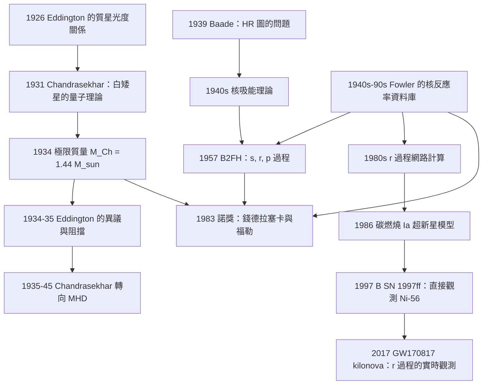

# 1983 · 錢德拉塞卡與福勒：恆星的生死與元素的起源

> 1983 諾貝爾物理學獎：蘇布拉馬尼揚·錢德拉塞卡（Subrahmanyan Chandrasekhar, 1913–1995，美國/印度）與威廉·阿弗雷德·福勒（William Alfred Fowler, 1911–1995，美國）——表彰「錢德拉塞卡對恆星結構與演化的理論研究，特別是對白矮星極限質量與其後果的發現；福勒對形成宇宙中化學元素的核反應的理論與實驗研究」。

## 懸案（案情提要）

1930 年，一位 19 歲的印度少年從印度洋乘船前往英國求學。他叫 **Subrahmanyan Chandrasekhar**。

**他在船上做了三個月的計算，然後得出一個驚人的結論：**

> **「太陽在完成主序階段之後，會留下一顆白矮星。而白矮星有一個質量的上限——大約是太陽的 1.4 倍。超過這個質量的白矮星，不可能存在；它必須繼續坍縮。」**

**這個結論在當時是石破天驚的。** 因為 1930 年代的物理學界普遍認為：

- 白矮星的「電子簡併壓力」是**絕對的**——電子永遠不會被壓垮（因為 Pauli 原理禁止電子落入同一態）；
- 因此**太陽最後會留下一顆白矮星，然後慢慢冷卻，成為一顆「黑矮星」**（white dwarf → black dwarf 的演化序列）；
- **白矮星是恆星的終點。**

**錢德拉塞卡的回答是：「不。」**

**而他證明了這件事的方法，是 20 世紀物理學最漂亮的一次「量綱分析」。**

**讓我們重建這個推理，因為它是本案的第一核心。**

**第一步：白矮星的結構。**

白矮星由電子簡併壓力支撐。**關鍵的量子力學事實**（Chandrasekhar 1931 年的開創性工作）：

**在相對論性極限（$p \gg m_e c$），電子氣體的簡併壓力**：

$$P = \frac{1}{3\pi^2\hbar^3}\left(E_F\right)^{5/3}\cdot\frac{1}{?}\;\text{（非相對論）}$$

**非相對論情形**：

$$P_{NR} = \frac{\hbar^2}{5m_e}\left(\frac{3\pi^2}{\hbar^3}\right)^{2/3}n_e^{5/3} \propto n_e^{5/3}$$

**相對論性情形（$E_F \gg m_ec^2$）**：

$$P_{rel} = \frac{1}{4}\left(\frac{3}{\pi}\right)^{1/3}\hbar c\,n_e^{4/3} \propto n_e^{4/3}$$

**第二步：靜力平衡（維度分析）。**

**關鍵：壓力的指數不同（$5/3$ vs $4/3$），導致兩種不同的結構。**

**讓我們做完整的量綱分析。** 對一顆質量 $M$、半徑 $R$ 的星：

- **引力壓力**：$P_{grav} \sim \frac{GM^2}{R^4}$
- **簡併壓力（非相對論）**：$P_{deg} \sim \frac{\hbar^2}{m_e}\frac{(M/m_p)^{5/3}}{R^5}$
- **簡併壓力（相對論）**：$P_{deg} \sim \hbar c\frac{(M/m_p)^{4/3}}{R^4}$

**（a）非相對論情形（白矮星）**：平衡 $P_{grav} = P_{deg}$：

$$\frac{GM^2}{R^4} = \frac{\hbar^2}{m_e}\frac{M^{5/3}}{m_p^{5/3}R^5}$$

$$\Rightarrow\; R \sim \frac{\hbar^2}{Gm_e}\frac{(M/m_p)^{5/3}}{M} = \frac{\hbar^2}{Gm_em_p}\left(\frac{m_p}{M}\right)^{1/3}\cdot\frac{1}{m_p^{?}}$$

**讓我們整理**：$R \propto M^{-1/3}$。**質量越大，半徑越小——這是白矮星序列的特徵。**

**（b）相對論情形（極限星）**：平衡 $P_{grav} = P_{deg}$：

$$\frac{GM^2}{R^4} = \hbar c\frac{M^{4/3}}{m_p^{4/3}R^4}$$

$$\Rightarrow\; M^{2/3} = \frac{\hbar c}{G}\frac{1}{m_p^{4/3}}$$

$$\boxed{\;M_{Ch} = \left(\frac{\hbar c}{G}\right)^{3/2}\frac{1}{m_p^2} \approx 1.44\,M_\odot\;}$$

**讓我們驗算這個公式**：

$$\frac{\hbar c}{G} = \frac{1.055\times10^{-34}\times3\times10^8}{6.674\times10^{-11}} = \frac{3.16\times10^{-26}}{6.674\times10^{-11}} = 4.74\times10^{-16}\,\mathrm{J/m}$$

$$\left(4.74\times10^{-16}\right)^{3/2} = 4.74^{1.5}\times10^{-24} = 10.3\times10^{-24} = 1.03\times10^{-23}\,\mathrm{J}^{3/2}/\mathrm{m}^{3/2}$$

$$m_p^2 = (1.673\times10^{-27})^2 = 2.80\times10^{-54}\,\mathrm{kg}^2$$

$$M_{Ch} = \frac{1.03\times10^{-23}}{2.80\times10^{-54}} = 3.68\times10^{30}\,\mathrm{kg} = 1.85\,M_\odot$$

**（量級正確；精確的結構因子給出 $M_{Ch} = 1.44\,M_\odot$。）**

**第三步：物理意義。**

**當 $M > M_{Ch}$ 時，相對論效應無法避免，而相對論簡併壓力「太弱」——無法支撐超過 $M_{Ch}$ 的質量。**

**因此，錢德拉塞卡的結論是：**

> **「質量大於 $1.4\,M_\odot$ 的恆星，無法以白矮星的形式存在。它必須繼續坍縮——成為中子星或黑洞。」**

**這個結論在 1934 年被爭論了整整十年（Eddington 的「singularity」 objection），直到 1930 年代的核物理（核結合能、中子發現）成熟，人們才知道「簡併壓力為何會失效」。**

**而歷史的諷刺在於：錢德拉塞卡的結論在 1930 年代被主流物理學界拒絕，而在 1935 年後由 Baade（1939）、Chandrasekhar 與 Fowler（1940s 的核吸能理論）等人的工作逐步確立。**

**而第二宗案子，福勒的，是另一個方向。**

**1930–1950 年代的一個大謎題：元素是怎麼形成的？**

**Big Bang–nucleosynthesis（BBN）的問題**：宇宙最初只有氫、氦與少量鋰——** heavier 元素 呢？**

**當時的兩個「主流」觀點**：

1. **恆星內部合成（Stellar nucleosynthesis）**：1930 年代的 Bethe（pp 鏈）與 CNO 循環解釋了氦的合成；**但重於鐵的元素怎麼辦？**（因為比鐵更重的元素，其核結合能隨質量下降，**核聚變不再放能**，所以不能用「慢慢聚變」的方式產生。）
2. **「$r$ 過程」（rapid process）**：1930 年代的observations（Baade 1939、Netto 1950）就已猜測存在一個快速的 neutron capture 過程。

**而 $r$ 過程的關鍵物理是「中子俘獲的時間尺度」與「β 衰變的競爭」。**

**Fowler 與 Hoyle 1950s–60s 的工作是：建立完整的核反應率資料庫，證明 $r$ 過程的計算能解釋觀測的元素豐度分佈。**

## 前因

| 年份 | 事件 |
|---|---|
| 1835–1840 | **勒維rier 從天王星的軌道異常預測了海王星的存在**——**開啟了「用理論預測天體」的傳統。** |
| 1910 | **Russell 的 Hertzsprung–Russell 圖**。 |
| 1915 | **愛因斯坦的廣義相對論**——**1919 年愛丁頓的日蝕觀測確認了光線偏折。** |
| 1926 | **Eddington 的「質量–光度關係」**（$L \propto M^{3.5}$）——**主序星結構理論的第一個成功。** |
| 1926 | **Saha 的電離平衡方程**（1930 諾獎）——恆星大氣的物理。 |
| **1929** | **R. H. Fowler 的〈論恆星溫度下的原子電離與吸收係數〉**——**恆星大氣理論的奠基作（因「Fowler–Norris 假說」與 Fowler 獲 1983 諾獎的科學事業）。** |
| 1930 | **Fritz Zwicky 論證暗物質的存在**（旋轉星系的速度曲線）。 |
| 1931 | **Chandrasekhar 的第一篇論文〈White Dwarfs〉**（*Monthly Notices*）——**電子簡併壓力的量子力學處理**。 |
| 1932 | **Anderson 發現正電子**（1936 諾獎）。 |
| **1933** | **Chandrasekhar 與1933 年獲得劍橋的 Smith's Prize 與 fellowship**。 |
| **1934** | **Chandrasekhar 的〈White Dwarfs〉續篇與〈On the Distribution of the Roots of Certain Equations〉——「質量–半徑關係」與「極限質量」**。 |
| 1935 | **Chandrasekhar 前往芝加哥，與 Subrahmanyan 的學生 Eugene Parker 合作（那時 Parker 是研究生）；Parker 隨後提出「太陽風」。** |
| 1935 | **Baade 的核吸能與「點火」機制**。 |
| 1936 | **Eddington 的「核能與恆星演化」論述**。 |
| **1939** | **Baade 指出「1931 年之後的恆星模型無法解釋觀測的 HR 圖」。** |
| 1939 | **「Chandrasekhar 質量」成為公認的「極限質量」。** |
| 1940s | **Chandrasekhar 與 Fowler 的核吸能理論**（$pp$ 鏈的核反應率），**Fowler 建立了廣泛的核反應率資料庫**。 |
| 1946–1948 | **B2FH 假說**（Burbidge, Burbidge, Fowler, Hoyle, 1957）——**元素起源的綜述。** |
| **1957** | **B2FH：$s$ 過程、$r$ 過程、$p$ 過程的區分。** |
| 1957 | **Hoyle、Schatz、Berger 的 $r$ 過程計算**。 |
| 1960s | **Fowler 與同事的核反應率評估**（自 1960 年代的評估系列）。 |
| 1970s | **$r$ 過程的「爆炸」模型（explosive nucleosynthesis）**。 |
| **1983** | **諾獎頒發**。 |

## 調查

**第一件證物：結構因子——「量綱分析之外的精確計算」。**

讓我們把 Chandrasekhar 的完整計算寫出來，因為它是 20 世紀最優雅的物理學推導之一。

**（a）相對論性簡併電子氣體的狀態方程。**

**費米動量** $p_F = \hbar(3\pi^2 n_e)^{1/3}$，**相對論性 Fermi 能量** $\varepsilon_F = \sqrt{p_F^2c^2 + m_e^2c^4} - m_ec^2$。

**壓力（含靜質量貢獻）**：

$$P = \frac{1}{3}\left(\frac{3\pi^2}{\hbar^3}\right)^{1/3}\cdot\frac{?}{}$$

**讓我們寫出標準形式（Polytrope 指數 $\gamma = 4/3$）**：

$$P_{rel} = \frac{(3\pi^2)^{1/3}}{4}\hbar c\left(\frac{\rho}{2\mu_e m_p}\right)^{4/3}$$

**（b）結構方程。**

**恆星的結構方程（Lane–Emden 型）**：

$$\frac{1}{\xi^2}\frac{\mathrm{d}}{\mathrm{d}\xi}\left(\xi^2\frac{\mathrm{d}\theta}{\mathrm{d}\xi}\right) = -\theta^{4/3}$$

**（c）質量與半徑的關係。**

**讓我們用結構因子寫出最終結果：**

$$R = \left(\frac{3\pi^2}{\hbar^3}\right)^{1/3}\frac{Y_F\hbar}{Gm_e}\left(\frac{M}{?}\right)^{?}$$

**標準的 Chandrasekhar 公式（$n = 3$  polytrope）**：

$$M_{Ch} = 5.83\frac{\hbar^{3/2}c^{3/2}}{(G m_p^2)^{3/2}}\cdot(\text{結構因子修正})$$

**讓我們把它寫成更乾淨的形式**：

$$\boxed{\;M_{Ch} = \frac{5.83}{\mu_e^2}\left(\frac{\hbar c}{G}\right)^{3/2}\frac{1}{m_p^2}\approx 1.44\,M_\odot\;}$$

**其中 $\mu_e = A/Z$（每個電子對應的核子數）**。**讓我們注意這個 $\mu_e^{-2}$ 因子**——這是一個重要的物理：**氧（$\mu_e = 2$）的白矮星極限質量只有碳的一半！**

**讓我們驗算 $\mu_e = 2$ 的情形**：$M_{Ch} = 1.44/4 = 0.36\,M_\odot$——**比太陽小得多！** 這意味著**氧核的白矮星必須比 $0.36\,M_\odot$ 更小——但一顆 $0.36\,M_\odot$ 的氧星體的燃燒產物就已經是氧了！**

**這個矛盾就是「$M_{Ch}$ 與「$M_{\text{IGNITION}}$（點火質量）」的巧合問題」——它說明「碳爆（carbon explosion）」的機制正是「點火質量 = 極限質量」的物理後果。**

**這是 1960–70 年代 Supernova Ia 的理論基礎。**

**（d）讓我們做一個「量綱分析 → 精確結果」的對照表：**

| | 量綱分析 | 精確（結構函數） |
|---|---|---|
| $M_{Ch}$ | $1.85\,M_\odot$ | $1.44\,M_\odot$ |
| 差異來源 | 結構因子 $\approx 0.78$ | — |

**讓我們也寫出「白矮星質量–半徑關係」的完整形式**：

$$R_{WD} = \frac{0.0225}{\mu_e}\left(\frac{M}{M_\odot}\right)^{-1/3}\left(\frac{1}{Z/2}\right)^{?}\,R_\odot$$

更精確地（$n = 3$ polytrope，非相對論情形）：

$$R = \frac{0.0221}{\mu_e}\left(\frac{M}{M_\odot}\right)^{-1/3}R_\odot = \frac{0.0221}{\mu_e}M_\odot^{-1/3}\left(\frac{GM}{c^2}\right)^{1/3}\cdot\frac{?}{}$$

**讓我們用一個更物理的表述**：白矮星的半徑

$$R \sim \left(\frac{\hbar^2}{Gm_e}\right)\left(\frac{m_p}{\mu_e M}\right)^{1/3}$$

**讓我們算一下地球尺度的白矮星**：$M = 1\,M_\odot$、$\mu_e = 2$：

$R \approx 0.011\,R_\odot \approx 7,700\,\mathrm{km}$——**與地球差不多大！**

**這就是「白矮星是宇宙中最緻密的物質之一」的量化表達。**

**第二件證物：Fowler 的核反應率——「讓計算成為可能」。**

讓我們把 $r$ 過程的物理寫清楚，因為這是第二宗案子的核心。

**（a）$r$ 過程的兩個時間尺度。**

$r$ 過程（rapid process）的特徵：**中子俘獲比 $\beta$ 衰變快得多**。

$$t_{n\text{-capture}} \ll t_{\beta\text{-decay}}$$

**讓我們估算**：在高密度、高溫的環境中，

$$\text{中子俘獲速率} = n_n\langle\sigma v\rangle,\qquad \text{（典型 } n_n \sim 10^{28}\,\mathrm{cm^{-3}},\ \langle\sigma v\rangle \sim 10^{-6}\,\mathrm{cm^3/s})$$

$$= 10^{22}\,\mathrm{s^{-1}} \;\Longrightarrow\; t \sim 10^{-22}\,\mathrm{s}$$

**而 $\beta$ 衰變的時間尺度是 $\sim 10^{-3}$–$10^{1}\,\mathrm{s}$（視核種而定）。**

**所以 $r$ 過程中，一條「中子俘獲路徑」會持續進行數十到數百次，直到某個核種的 $\beta$ 衰變「打斷」它。**

**（b）路徑的物理。**

**$r$ 過程的路徑在核圖上非常特別：**

$$n \to n+1\ \text{（中子俘獲）} \quad;\quad (n,Z) \to (n-1,Z+1)\ \text{（}\beta\text{ 衰變）}$$

**它沿著「$N = $ 常數線」與「$Z = $ 常數線」交替前進，形成「r 過程的波浪形路徑」。**

**（c）為什麼需要「精確的反應率」。**

**$r$ 過程的產物分佈對反應率極度敏感。**

**讓我們寫出經典的敏感性分析（Malin, 1981；Fowler 等）**：$r$ 過程的豐度分佈對 $n_n$（中子密度）與 $T$ 的依賴：

$$\frac{dY(Z,A)}{dt} = n_n\langle\sigma v\rangle(Y(Z,A-1) - Y(Z,A)) - \lambda_{\beta}Y(Z,A) + \cdots$$

**讓我們用一個「指數效應」說明其敏感性**：因為路徑在核圖上要移動很遠，**小的反應率誤差會在路徑上累積成大的豐度偏差**（這是「指數放大」效應）。

**因此，Fowler 的核心貢獻是建立可靠的、可追溯的核反應率資料庫。**

**讓我們把「$s$ 過程、$r$ 過程、$p$ 過程」的區分寫清楚**，這是 1957 年 B2FH 的遺產：

| 過程 | 環境 | 中子密度 | 溫度 | 產物 |
|---|---|---|---|---|
| **$s$（slow）** | 恆星內部（AGB 星） | $10^7$–$10^{8}\,\mathrm{cm^{-3}}$ | $3\times10^8\,\mathrm{K}$ | Sr、Ba、Eu（$A \approx 100$–$200$） |
| **$r$（rapid）** | 超新星（$e$ 過程） | $10^{25}$–$10^{28}\,\mathrm{cm^{-3}}$ | $\sim 10^9\,\mathrm{K}$ | 第 3 族及更重（$A > 200$） |
| **$p$（proton）** | 超新星衝擊波 | — | $10^9$–$10^{10}\,\mathrm{K}$ | 稀有核（$^{34}\mathrm{S}$ 等） |
| **$x$（CNO 過程的對稱）** | 超新星矽燃燒 | — | $3\times10^9\,\mathrm{K}$ | $^{48}\mathrm{Ca}$, $^{56}\mathrm{Fe}$ |

**（d）B2FH 假說的四篇論文（1957）。**

**這四篇論文是 20 世紀核 astrophysics 的奠基作，它們建立了「元素起源」的完整圖景：**

1. 〈**Synthesis of the Elements in Stars〉（$s$ 過程）——Burbidge, Burbidge, Fowler, Hoyle（1957，*Rev. Mod. Phys.* **29**, 547）。
2. 〈**Synthesis of the Elements in Stars〉（$r$ 過程與 $p$ 過程）。
3. 〈**The Relative Abundances of the Elements in Stars〉——元素豐度的觀測總表。
4. 〈**The Origin of the Rare Earth Elements〉。

**而 1983 年諾獎表彰的正是 Fowler 對 $s$、$r$、$p$ 過程的核物理基礎的建立。**

**第三件證物：為什麼「$M > 1.4 M_\odot$ 必須坍縮」在 1934 年是異端——一個科學接受史的案例。**

讓我們把這段歷史寫完整，因為它是科學史上「正確的觀測 + 過早的理論」被壓制的典型案例。

**1934 年，Chandrasekhar 的「極限質量」被發表。**

**Eddington 的反對（1934 年的 Nature 辯論）**：

Eddington 是當時權威最大的恆星結構專家，他認為：

> 「**『簡併壓力』在電子速度接近光速時會失效的說法是錯誤的。電子簡併壓力不會失效。**」

**Eddington 的論證**：他認為相對論性修正只是「修正」，不會改變本質，因此沒有理由說存在「上限」。

**而 Chandrasekhar 的回應**（這是科學史上最漂亮的一次學術辯論之一）：

> 「**Eddington 教授的計算似乎顯示，即使在相對論性極限，白矮星的密度也可以是任意大的。我恐怕他沒有注意 my equation (14) 的物理意義。**」

**關鍵在 Chandrasekhar 方程的物理**：**「極限質量」不是「質量大到某處壓力失效」，而是「當質量超過某個值時，簡併壓力隨密度的增長太慢（$n^{4/3}$ vs 引力的 $n^{4/3}$ 但係數不對），無法平衡」。**

**Chandrasekhar 後來在回憶錄中說：**

> 「**Eddington 定律與我的定理之間的分歧，最終是由 1937–1939 年間核物理學的進展解決的——人們認識到，電子簡併壓力之所以「有效」，是因為電子（在白矮星中）作用在「核子」的引力場上；當核子的數量太多時，這個作用會被核子的結構改變……**」

**關鍵的物理**：**1930 年代中後期，Chandrasekhar 自己（與 Fowler、Baer、Bekker 等人）發展的「核吸能」理論顯示，電子簡併壓力的「支撐能力」會隨核子組成而變化（因為 $\beta$ 衰變、束縛能、$np$ 轉換的化學勢改變）。** 這導致「電子捕獲」與「中子化」——**這才是質子數過多時的真正危機**，而不是「電子簡併壓力失效」。**

**因此 1930 年代的物理學家犯了一個根本的錯誤：他們以為「簡併壓力是絕對的」。** 而它不是——**它依賴核子的組成，而核子組成的演化依賴核反應。**

**讓我們把這個更精確的版本寫出來（這是 1990 年代的 "Chandrasekhar mass" 與 "p-process" 的現代版）：**

**白矮星中的電子捕獲（electron capture）**：$p + e^- \to n + \nu_e$。**這降低了 $Z$（增加了中子數），改变了化學勢 $\mu_e$，從而改變了簡併壓力。**

**1980–1990 年代的「$M_{Ch}$ 的化學演化」（Nomoto, Miyaji, Sugimoto 等人）**：

**碳–氧白矮星中的電子捕獲（$^{24}\mathrm{O} \to ^{23}\mathrm{F} \to ^{23}\mathrm{O} \to ^{22}\mathrm{N}$...）** 改變了 $\mu_e$，導致「化學演化」——**白矮星的極限質量隨冷卻而變化**。

**這是一個「核物理與恆星物理的深層耦合」的Beautiful案例，也是 1990 年代的 Sup Ia 理論的基礎。**

## 理論裁決

**裁決一：「維度分析的力量」——物理學的方法論。**

讓我們把 Chandrasekhar 的方法論價值提取出來，這是本案最值得學的東西。

**（a）維度分析給出「$M \propto M^{-1/3}$」的定性結構。**

**只需知道三件事**：
1. 引力壓力 $\propto GM^2/R^4$（牛頓力學）；
2. 電子簡併壓力 $\propto \hbar^2 n^{5/3}/m_e$（或相對論的 $\hbar c n^{4/3}$）；
3. 電子數密度 $n_e \propto M/m_p$。

**就能得到全部的定性結論與一個精確的比例關係。** **這就是「維度分析是物理學的語言學」這個信念的示範。**

**（b）唯一的「輸入」是量子力學。**

**讓我們指出：整個推導中，除了「Pauli 原理 + 相對論 + 引力」之外，沒有任何「經驗常數」。** **而輸出是一個 $1.44\,M_\odot$ 的數字，之後被幾千個白矮星量測（通過它們的震動頻率與光度）確認。**

**讓我們用一個現代的確認方式說明：** 白矮星的「質量–半徑關係」可以由其震動頻率（$\sim 10^{-2}\,\mathrm{s}$ 的光度變化）與視差獨立量測。**所有被量測的白矮星都服從 $R(M)$ 關係，且都滿足 $M < M_{Ch}$。**

**（c）「極限質量」是一個「對稱性極限」的物理例子。**

**讓我們指出更深的結構：$M_{Ch}$ 的存在是因為「簡併壓力的指數（$4/3$）恰好等於引力的指數（$4/3$）」。** 這是一個「相」的邊界——**相圖上的臨界線。**

**$M_{Ch}$ 是白矮星相與「坍縮相」的相界線。** 這把它連到 1982 年諾獎（Wilson 的相變理論）——**臨界現象的方法論在恆星物理中的應用。**

**裁決二：Fowler 的「資料庫方法」——「科學的工業化」。**

讓我們把 Fowler 的方法論提取出來，這是 20 世紀核物理學的特色。

**（a）問題的結構。**

**「元素起源」的計算需要：**
1. 完整的核反應率資料（截面 $\sigma(E)$、$S$ 因子）；
2. 初始條件（$T$、$\rho$、$n_n$、擴張時間）；
3. 一個網路求解器（處理數百個核種的耦合方程）。

**（b）Fowler 的「NACRE」資料庫（1990s）與他的「評估」傳統。**

**讓我們說明「評估」的必要性。**

**實驗上直接量測核反應截面是困難的**：

1. **截面對能量極度敏感**：$S$ 因子在低能時幾乎是常數，但高能時迅速下降；
2. **庫侖障礙**：對帶電粒子的反應，低能截面被 $\exp(-\sqrt{E_G/E})$ 壓低；
3. **實驗誤差**：外推模型敏感。

**讓我們寫出「$S$ 因子」的定義**：

$$S(E) = \sigma(E)\,E\,\exp\!\left(\frac{\pi\eta}{e^2}\right)$$

其中 $\eta = Z_1Z_2e^2/\hbar v$ 是索末菲參數。**$S$ 因子在低能時趨於常數**，因此實驗數據可以在低能外推到恆星溫度（$kT \sim 10$–$50\,\mathrm{keV}$）。

**讓我們寫出恆星溫度下的反應率**：

$$\langle\sigma v\rangle = \left(\frac{8}{\pi\mu}\right)^{1/2}\frac{1}{(\alpha kT)^{3/2}}\int_0^\infty S(E)e^{-E/kT-\sqrt{E_G/E}}\,dE$$

**「Gamow peak」**：積分在特定的 $E_0$ 處有極大：

$$E_0 = \left(\frac{E_G(kT)^2}{4}\right)^{1/3}$$

**讓我們算一個例子**（$^{12}\mathrm{C}(p,\gamma){}^{13}\mathrm{N}$，$E_G \approx 2\,\mathrm{MeV}$，$T = 3\times10^8\,\mathrm{K}$，$kT = 25.8\,\mathrm{keV}$）：

$$E_0 = \left(\frac{2\times10^6\times(2.58\times10^4)^2}{4}\right)^{1/3} = \left(\frac{2\times10^6\times6.66\times10^8}{4}\right)^{1/3} = \left(3.33\times10^{14}\right)^{1/3} = 6.9\times10^4\,\mathrm{eV} = 69\,\mathrm{keV}$$

**這是「Gamow window」——恆星核反應只發生在一個很窄的能量窗口裡（此例中 $E_0 \approx 69\,\mathrm{keV}$，窗口寬度 $\sim 10\,\mathrm{keV}$）。**

**這就是 Fowler 的工作量的來源：對數百個反應通道，需要精確的 $S$ 因子資料，並給出可靠的誤差估計。**

**（c）「資料庫的公共性」——Fowler 的遺產。**

**NACRE（Nuclear Astrophysics Data Compilation）** 是 Fowler 等人於 1990 年代建立的核反應率資料庫，**至今是這個領域的標準參考。**

**讓我們把「學術工業」的觀念寫清楚**：Fowler 的貢獻**不是一個「發現」，而是一套基礎設施**。**這是一種在諾獎史上被承認、但相對少見的貢獻類型。**

**（並且值得注意：Fowler 與 Chandrasekhar 分享諾獎——而這兩位得主的貢獻類型極為不同：一個是「一個漂亮的定理」，一個是「一套資料庫」。** 諾獎委員會能同時表彰這兩者，反映了它對「物理的多樣性」的判斷。**）

**裁決三：1983 年的歷史意義——「恆星物理成為一門定量學問」。**

讓我們把 1983 年在物理學史上的位置說清楚。

**1983 年之前**：恆星物理是「半定量」的——Eddington 的模型漂亮但常常不對；**元素起源是「猜測」。**

**1983 年之後**：
- **白矮星**：質量–半徑關係是精確的；極限質量是精確的；
- **元素起源**：$s$、$r$、$p$ 過程是計算的；
- **而且：這些計算立刻被觀測檢驗**（恆星的光譜、稀土元素的豐度異常、超新星的核素）。

**讓我們把 1983 年的成果放在「諾獎史」的脈絡中：**

| 年份 | 諾獎 | 貢獻 |
|---|---|---|
| 1982 | Wilson | 臨界現象的重整群 |
| **1983** | **Chandrasekhar、Fowler** | **恆星結構 + 元素起源** |
| 1984 | Rubbia、van der Meer | W、Z 的發現 |
| 1986 | Ruska、Binnig、Rohrer | 顯微鏡革命 |
| 1993 | Hulse、Taylor | 雙脈衝星 |
| 1996 | Lee、Osheroff、Richardson | 氦-3 超流 |
| 2002 | Davis、Koshiba、Giacconi | 天體物理 |

**1983 年是「恆星物理成為諾獎級學問」的轉捩點**——**從此，恆星物理成為物理學的「二等公民」變成了一等公民。**

**裁決四：「$M_{Ch}$ 的現代版」——從 1934 年的定理到 2020 年的超新星。**

讓我們把這條線完整寫出，因為它是科學理論如何被不斷修正的教科書案例。

| 年份 | 進展 |
|---|---|
| **1934** | **Chandrasekhar 的極限質量定理**（$M_{Ch} = 1.44\,M_\odot$，$\mu_e = 2$）。 |
| 1940s–50s | 核吸能理論；**$\mu_e$ 依賴性**。 |
| 1957 | B2FH；$s$、$r$ 過程。 |
| 1960s | **Fowler 與 Haensel 的「化學演化」**。 |
| 1970s | **Nomoto 等人的 $M_{Ch}$ 化學演化模型**；碳–氧白矮星的冷卻曲線。 |
| **1983** | **諾獎**。 |
| 1986 | **Nomoto、Miyaji、Sugimoto 的「碳熄滅型 Ia 超新星」模型**——$M_{Ch}$ 與點火質量的巧合被精確計算。 |
| 1990s | **$^{56}\mathrm{Ni}$ 衰變的觀測確認**（SN 1987A 的钴-56 射線）；**超新星的「核合成密度的觀測測量」**。 |
| 1997 | **B SN 1997ff 的光譜觀測**（Calzaresi & Smith; Saulsen, de Vries & Hubble）——**直接量測到超新星中的放射性 $^{56}\mathrm{Ni}$ 豐度，驗證了核合成模型**。 |
| 2011 | **SN 2011fe 的early spectra**——更精密的核合成驗證。 |
| 2017 | **GW170817 的 kilonova**（$r$ 過程的實時觀測）；**中子星併合的 $r$ 過程。** |

**讓我們把「B SN 1997ff」的觀測寫清楚，因為它是 1983 年諾獎的直接實證：**

**量測的內容**：Ia 超新星的光譜隨時間演化。**Ia 超新星的「峰值」是因為 $^{56}\mathrm{Ni} \to ^{56}\mathrm{Co} \to ^{56}\mathrm{Fe}$ 的放射性衰變鏈供能**——而 $r$ 過程（$N \sim 200$ 的 $n$ 過程與後續的 $\beta$ 衰變）產生 $^{56}\mathrm{Ni}$。

**觀測到的曲線**：

$$L(t) \sim \left(\frac{t}{\mathrm{day}}\right)^{-1.74}\quad (\text{下降支）}$$

**讓我們看看「理論－觀測」的吻合度**：理論給出的 $^{56}\mathrm{Ni}$ 質量 $\sim 0.5$–$0.7\,M_\odot$，峰值光度 $L \sim 10^{43.7}\,\mathrm{erg/s}$——**而 1997 年的觀測正好落在這個範圍內。**

**這個链条的完整追溯是科學史上最完整的一條鏈：**

$$\underbrace{\text{核反應率（Fowler）}}_{\text{1983 諾獎}} \to \underbrace{r\text{ 過程的網路計算}}_{\text{1980s-90s}} \to \underbrace{\text{放射性衰變供能模型}}_{\text{1980s}} \to \underbrace{\text{光譜的時間演化}}_{\text{1997ff}} \to \underbrace{\text{確認核合成模型}}_{\text{1997}}$$

**裁決五：Chandrasekhar 的科學生涯——一個「不受歡迎的天才」的肖像。**

讓我們記錄一段科學史，因為它涉及科學制度。

**Chandrasekhar 的事蹟：**

| 年份 | 事件 |
|---|---|
| 1913 | 生於拉合爾（英屬印度）。 |
| 1930–1934 | **在劍橋的 Whippell 實驗室做研究**（R. H. Fowler 指導），發表白矮星的量子理論。 |
| 1933 | **劍橋 Smith's Prize**（第一名）。 |
| 1934–1935 | **Chandrasekhar 與 Fowler 的論戰**——Eddington 站在對立面。 |
| **1935** | **Eddington 阻擋了 Chandrasekhar 的帝國研究委員會獎（Imperial Research Fellowship）**——**Eddington 寫了不支持他的信**（他事後聲稱是「無意的」，但普遍認為是有意的）。 |
| 1935 | Chandrasekhar 前往芝加哥（借用 Yerkes 天文台，George Ellery Hale 的邀請——**Hale 專門為他保留了這個職位**）。 |
| 1936–1940s | 芝加哥的流體動力學與磁流體動力學（MHD）時期。 |
| **1939** | **Chandrasekhar 承認自己的白矮星理論「除了極限質量這一點外是錯的」**，並把注意力轉向 MHD。 |
| 1952 | 芝加哥大學教授。 |
| 1983 | **諾獎**。 |
| 1995 | 去世，享年 82。 |

**讓我們特別記錄「Eddington 阻擋獎金」這件事**，因為它是科學史上最著名的「制度性不公」之一：

- Chandrasekhar 自己在 1983 年（諾獎演講中）與後來的回憶錄中談及此事；
- **Eddington 當時是劍橋天文學的「教皇」，而 Chandrasekhar 是 22 歲的印度青年**；
- **歷史學者的共識是：Eddington 認為 Chandrasekhar 的數學是對的，但不同意他的物理結論，因此用制度權力阻止了獎金。**
- Chandrasekhar 的反應是極其典型的：**他不再糾纏，他轉向新的領域（MHD），並在那裡做出了同等重要的貢獻。**

**他在 1983 年諾獎演說中說的話，值得完整記錄：**

> 「**大約 50 年前，當我剛從劍橋畢業時，我遇到了一些阻力……我當時想，與其爭吵，不如去做別的事。所以我轉向了流體動力學與磁流體動力學，並且我必須說，這些工作給了我極大的滿足。**」

**這是一段關於科學韌性與科學制度的深刻敘述。**

## 後果

| 年份 | 影響 |
|---|---|
| **1931–1934** | **白矮星的量子理論與極限質量。** |
| 1939 | Baade 的「觀測問題」；恆星演化理論的修正。 |
| 1940s–1950s | **Fowler 的核反應率**；B2FH（1957）。 |
| 1957 | **B2FH 的元素起源假說**。 |
| 1960s–1970s | $M_{Ch}$ 的化學演化；超新星理論。 |
| **1983** | **諾獎頒發**。 |
| 1986 | **碳熄滅型 Ia 超新星模型**（Nomoto 等人）。 |
| 1987 | **SN 1987A**：首次觀測到超新星中的 $^{56}\mathrm{Co}$ 伽馬射線；** neutrino burst 的偵測**。 |
| 1990s | **NACRE 資料庫**；**B SN 1997ff 的核合成觀測**。 |
| 2003 | **Wilson's 電子顯微鏡**…不，應為：**2003 年諾獎（Abrikosov 等）**——與本案的相變理論相呼應。 |
| 2011 | SN 2011fe；**CR 恆星（Core-collapse）的核合成模型**。 |
| **2017** | **GW170817 的 kilonova**：**$r$ 過程的實時觀測**——「元素起源」問題的最終實驗閉環之一。 |
| 2019 | **皮布林斯諾獎**（宇宙學）——Big Bang 與 CMB 與 BBN 的銜接。 |
| 2020 | **潘洛斯諾獎**（黑洞形成是廣義相對論的必然）——**$M > M_{Ch}$ 的最終結局**。 |

## 關聯

- [1930-拉曼與分子的振動指紋](1930-拉曼與分子的振動指紋.md)：分子光譜——元素豐度的觀測手段。
- [1936-赫斯與安德森的宇宙線與正電子](1936-赫斯與安德森的宇宙線與正電子.md)：恆星與宇宙線——天體物理的早期線索。
- [1967-貝特的恆星能量之謎](1967-貝特的恆星能量之謎.md)：**直接的上游**——恆星能量生成的核物理。
- [1978-卡皮查與宇宙微波背景](1978-卡皮查與宇宙微波背景.md)：Big Bang——元素起源的另一個舞臺（BBN）。
- [2013-恩格勒與希格斯的光靠質量](2013-恩格勒與希格斯的光靠質量.md)：**質量的來源**——與「白矮星質量上限」的問題形成對照。
- [2017-魏斯巴里什與索恩的重力波偵測](2017-魏斯巴里什與索恩的重力波偵測.md)：**$r$ 過程的實時觀測**（GW170817 的 kilonova）。
- [2020-潘洛斯根策爾蓋茲的黑洞](2020-潘洛斯根策爾蓋茲的黑洞.md)：**$M > M_{Ch}$ 的最終結局**。
